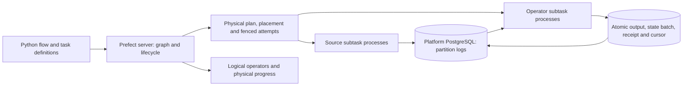

# ADR-0042: Flink-informed completion of native streaming

- Status: `progress`
- Date: 2026-11-04
- Owners: ETL Architect / HighLoad Principal, native runtime maintainers
- Related: [ADR graph](README.md), [epoch 2](../epochs/epoch-02-native-streaming-completion.md), [validated theory](ADR-0031-validated-durable-stream-theory.md), [epoch 1 acceptance](ADR-0040-native-integration-acceptance-and-operations.md)

## Problem

The original objective is a reliable streaming ETL system inside Prefect. The
accepted native epoch 1 implements a narrower foundation: finite source, one
ordered linear chain, PostgreSQL, and trusted same-host process replacement.
Its 100% describes that declared foundation, not completion of the original
objective. Branches, correlated joins, physical parallelism, continuous input,
online retention and cross-host replacement are not native capabilities today.

In particular, the current operator TaskRuns execute in threads inside one
FlowRun child process. Durable channels alone cannot make a process failure
restart only one of those threads. A larger thread pool does not fix this.

## Theory

Flink provides useful models for logical versus physical graphs, source splits,
key groups, operator state, backpressure and recovery regions. These mechanisms
can extend Prefect's native execution without importing another scheduler or
changing Ariadne's per-yield durability contract.

Flink's usual checkpoint/source-replay recovery is a different contract. Ariadne
must preserve a durably accepted input 200 and resume business execution at 201;
a periodic snapshot at 100 must not re-enter completed client calls 101–200.

## Agreed direction

1. Keep Prefect server orchestration, FlowRun lifecycle, Task definitions,
   deployment workers, retries and observability as product authorities. Add
   physical stream scheduling and placement under those authorities.
2. Define versioned capability profiles and fail unsupported admission before
   invoking user code. Preserve the accepted `bounded-linear-v1` behavior.
3. Separate logical operators from independently owned physical subtasks and
   partitions. Resolve TaskRun representation explicitly in
   [ADR-0043](ADR-0043-physical-graph-and-partitioned-channels.md).
4. Keep PostgreSQL durable channel records and per-input terminal transactions
   authoritative. Store large payloads through durable references. Do not add
   a required external message service.
5. Extend state, joins, continuous sources, pressure, selective recovery and
   rescaling through the linked decisions below. Snapshot materialization is
   an optimization over accepted state, not a replacement for durable yields.
6. Preserve client responsibility for deterministic processing and idempotent
   external effects. No new decision promises atomic effects across arbitrary
   external destinations.

This diagram is the proposed architecture. Only its bounded linear subset is
implemented. It is not a statement that distributed scheduling already exists.

## Discussion and alternatives

The [Principal discussion](../evidence/flink-architecture-2026-11-04/principal-discussion.json)
records the initial proposal and corrections. The
[worker review](../evidence/flink-architecture-2026-11-04/worker-architecture-review.json)
audits actual native constraints. The [Flink comparison](../research/flink-2.3-architecture.md)
distinguishes official mechanisms from Ariadne proposals.

- Copying checkpoint rollback would violate accepted-yield recovery. Rejected
  for this profile; see [ADR-0044](ADR-0044-multi-input-turns-and-state-materialization.md).
- Adding a separate coordinator service would create competing FlowRun
  lifecycle authorities. Physical scheduling belongs inside the native model.
- Retaining all records forever cannot support continuous bounded operation;
  see [ADR-0046](ADR-0046-continuous-pressure-and-safe-retention.md).
- Calling every union a join or every streaming recovery a single-node restart
  would overstate the evidence. Both have explicit semantics and fault tests.

### Adversarial review and revisions

The [first draft review](../evidence/flink-architecture-2026-11-04/adr-review.json)
retains nine required contract revisions. They refine the plan as follows:

| Review | Planning contract now specified |
| --- | --- |
| R1–R2 | [ADR-0044](ADR-0044-multi-input-turns-and-state-materialization.md): immutable logical turn identity versus replaceable fencing evidence; current state-only RETURN versus a proposed versioned output protocol. |
| R3, R9 | [ADR-0043](ADR-0043-physical-graph-and-partitioned-channels.md): append-materialized exchange routes and a bounded tagged canonical key domain. |
| R4 | [ADR-0044](ADR-0044-multi-input-turns-and-state-materialization.md): immutable ordered barrier manifest and complete-cut publication. |
| R5 | [ADR-0045](ADR-0045-continuous-sources-event-time-and-timers.md): ordered source controls/read intents and an enumerator-frozen drain frontier. |
| R6 | [ADR-0046](ADR-0046-continuous-pressure-and-safe-retention.md): complete terminal-footprint reservation, exact refund/retirement and progress headroom. |
| R7 | [ADR-0047](ADR-0047-selective-recovery-and-cross-host-authority.md): immutable restoring region plans and atomic activation. |
| R8 | [ADR-0048](ADR-0048-rescaling-compatibility-and-native-acceptance.md): source/control/mailbox/capacity/retention state in the transfer manifest. |

Specifying these constraints does not pass their native fault tests. Schema,
wire and SDK design must honor them and retain the explicit open lifecycle
contracts; readiness still depends on the native acceptance criteria below.

## Stories

- As a user, I want downstream tasks to receive each accepted document while upstream tasks continue.
- As a developer, I want ordinary Python tasks and yields to participate in the same native flow.
- As an operator, I want the supported failure boundary to be visible before deployment.

## Acceptance criteria

- As a user, I can distinguish accepted epoch 1 features from each newly admitted native profile.
- As a system, I can execute source → fan-out → keyed join → sink through real SDK/server/worker paths, with stable identities and fault recovery specified by ADR-0043–0047.
- As a system, I got the same accepted cursor and output identities after failure between any two snapshot intervals, without replaying accepted Python turns.
- As an operator, I can run continuous input with bounded measured storage and observable pressure, then drain or cancel it through native lifecycle APIs.
- As a developer, I can reproduce the real-process, cross-host, rescale and compatibility gates in ADR-0048 before broader readiness is claimed.

## Evidence and current state

This cycle supplies architecture research, recorded review and a narrow
standalone state-materialization experiment. It earns **zero new native
capability completion**. None of the native acceptance criteria above is closed
by the standalone experiment. Historical epoch 1 acceptance remains intact.

The [cycle verification record](../evidence/flink-architecture-2026-11-04/architecture-cycle.json)
binds the final document/probe source and scope to the review, test and graph
observations. The [follow-up design review](../evidence/flink-architecture-2026-11-04/adr-review-follow-up.json)
assesses the nine revisions without converting them to native acceptance.

## Consequences and failure modes

This is a substantial native execution extension, not a configuration flag.
Physical scheduling, data-plane locks, lifecycle aggregation and resource
accounting must be designed together. Shared PostgreSQL capacity remains a
measured scaling constraint; a Flink comparison does not establish equivalent
throughput, latency or connector coverage.

## Decision graph

- [ADR-0043: Physical graph and partitioned channels](ADR-0043-physical-graph-and-partitioned-channels.md)
- [ADR-0044: Multi-input turns and state materialization](ADR-0044-multi-input-turns-and-state-materialization.md)
- [ADR-0045: Continuous sources, event time and timers](ADR-0045-continuous-sources-event-time-and-timers.md)
- [ADR-0046: Pressure and retention](ADR-0046-continuous-pressure-and-safe-retention.md)
- [ADR-0047: Selective recovery and cross-host authority](ADR-0047-selective-recovery-and-cross-host-authority.md)
- [ADR-0048: Rescaling, compatibility and native acceptance](ADR-0048-rescaling-compatibility-and-native-acceptance.md)

## Work approval and stable criterion IDs

On 2026-11-04 the user explicitly approved ADR-0042 through ADR-0048 at
revision `fae53c90aa3b44dbc45032833b4d193001e5c8bd` for implementation through
full completion. The [approval record](../evidence/flink-architecture-2026-11-04/epoch2-work-approval-2026-11-04.json)
binds the approved bytes and workflow boundary. `progress` is this repository's
approved-for-work state; only independent Principal verification of every
criterion can move the ADR to `accepted`.

ADR-0042 is the umbrella that **extends** the accepted epoch-1 foundation and
groups ADR-0043 through ADR-0048. It is not a blocking `depends_on` edge for
their independent implementation slices.

| Stable ID | Existing acceptance criterion |
| --- | --- |
| A42-01 | Distinguish epoch-1 acceptance from each newly admitted profile. |
| A42-02 | Execute source → fan-out → keyed join → sink through native paths. |
| A42-03 | Preserve accepted cursor/output identities across snapshot intervals without business replay. |
| A42-04 | Run continuous bounded input with pressure, drain and cancel. |
| A42-05 | Reproduce process, cross-host, rescale and compatibility gates before readiness. |
