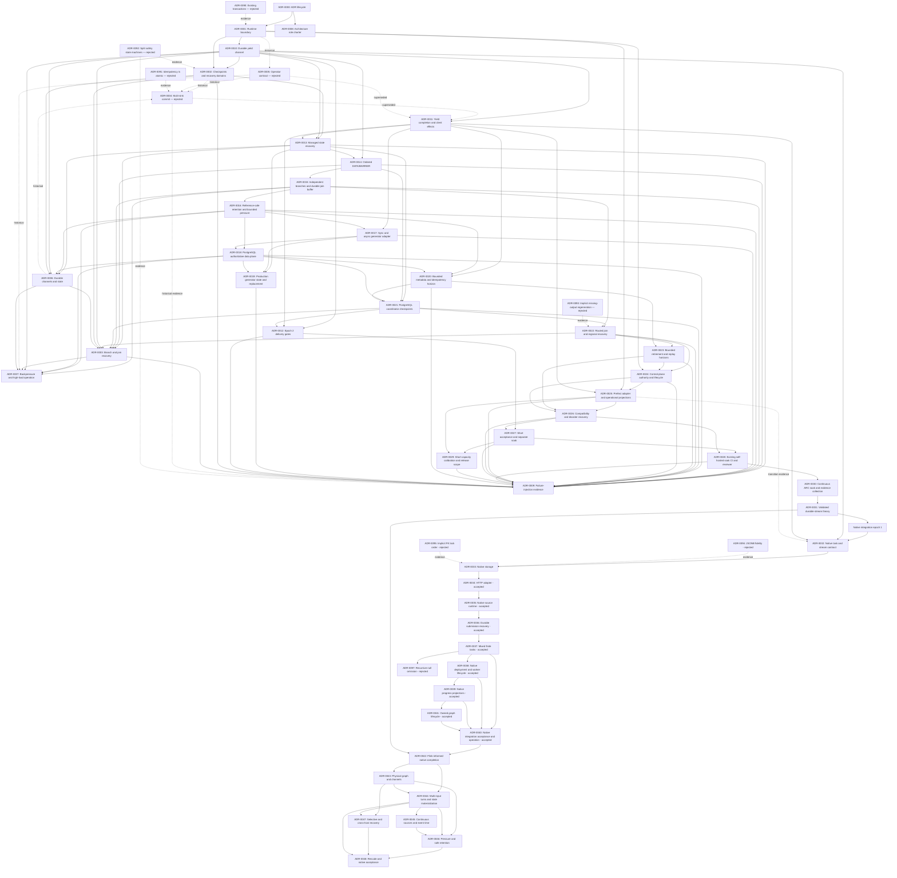

# Streaming ETL ADR graph

This directory is the decision log for the Ariadne streaming ETL runtime. ADR
files are retained historical records: they are superseded or marked
`rejected`, never deleted. The active cycle is
[native integration epoch 2](../epochs/epoch-02-native-streaming-completion.md):
Flink-informed architecture discussion under ADR-0042–0048. The original broad
streaming ETL objective remains incomplete; this design/prototype cycle earns
zero new native capability completion.

The preceding bounded native foundation is accepted at **100% of its selected
scope** under ADR-0037–0041 and the
[final source-bound gate](../evidence/native-epoch1-final-acceptance-2026-11-04.json).
Earlier percentage observations below describe their recorded historical stages.

## Status lifecycle

| Status | Meaning |
| --- | --- |
| `pending` | Created, but not yet discussed or tested. |
| `planning` | The direction is agreed for planning and implementation. |
| `progress` | The decision is being tested or implemented. |
| `accepted` | Code appropriate to the declared scope exists and every acceptance criterion has evidence. |
| `rejected` | The theory failed review or validation; the ADR remains as evidence. |

ADRs 0026, 0027, 0029, 0030 and 0031 are `accepted` for their explicit selected scopes.
Acceptance applies only to the scope defined in each ADR. Passing a selected prototype does not establish general production
readiness; broader production criteria remain open unless they have their own
implementation and deployment evidence.

Protocol epoch 2 has earned 100% of the agreed short experimental delivery. The gate evidence and remaining
production scope are recorded in
[ADR-0012](ADR-0012-protocol-epoch-2-delivery-gates.md).

The separate 72-hour campaign completed successfully on 2026-10-31;
[ADR-0030](ADR-0030-continuous-arc-soak-and-evidence-collection.md) closes its
experimental execution and publication scope, and
[ADR-0031](ADR-0031-validated-durable-stream-theory.md) records the successful
runtime theory and its limits. [Native integration epoch 1](../epochs/epoch-01-native-prefect.md)
starts a separate product-delivery scale. Its
[first-stage ADR](ADR-0032-native-task-stream-contract.md) is now `accepted` for
the native SDK/task-engine contract. The bounded storage-only
[ADR-0033](ADR-0033-native-durable-stream-storage.md) reached the historical
**20% storage milestone**. HTTP transport, source and deployment were still
open at that gate; the later accepted stages now complete the foundation.
The [current storage closure](../evidence/native-stage2-closure-acceptance-2026-11-01.json)
binds the consumer lock-order and hosted test API ownership fixes to the final
local source. Earlier passing and failed observations remain in ADR-0033;
hosted successor CI is reported separately.
The [test-only CI follow-up](../evidence/native-stage2-refusal-acceptance-2026-11-02.json)
verifies foreign-endpoint refusal and actual child cleanup on Python 3.11/3.12
without depending on natural process-exit timing; storage and fixture runtime
bytes are unchanged and no additional foundation share is earned.
Its [graph validation](../evidence/adr-graph-native-refusal-2026-11-02.json)
checks the current status and evidence links without replacing earlier graphs.
The [initial Stage 1 graph validation](../evidence/adr-graph-native-stage1-2026-11-01.json)
checks retained ADR statuses, required accepted sections and local evidence links.
The [CI follow-up graph](../evidence/adr-graph-native-stage1-ci-2026-11-01.json)
also covers the final source-bound acceptance and retained failed observations.
The [native storage graph](../evidence/adr-graph-native-stage2-2026-11-01.json)
covers accepted ADR-0033, then-pending ADR-0034, the rejected JSONB alternative,
and the frozen N1.2 code/test evidence.
The [native HTTP acceptance](../evidence/native-stage3-acceptance-2026-11-02.json)
and [current graph validation](../evidence/adr-graph-native-stage3-2026-11-02.json)
close ADR-0034 with actual HTTP/process/package evidence and scoped Principal
review. That transport gate left source SDK and whole-worker recovery for later
stages.
The [native source acceptance](../evidence/native-stage4-acceptance-2026-11-02.json)
and [source graph validation](../evidence/adr-graph-native-stage4-2026-11-02.json)
close ADR-0035's finite source/task-retry scope at 40%. Whole-worker submission
recovery is now accepted under ADR-0036's bounded selected-launcher profile,
earning the next planned +10% and reaching 50% foundation readiness.

## Decision graph

## ADRs

- [ADR-0042: Flink-informed completion of native streaming](ADR-0042-flink-informed-native-streaming-architecture.md) — `progress`
- [ADR-0043: Physical graph and partitioned durable channels](ADR-0043-physical-graph-and-partitioned-channels.md) — `planning`
- [ADR-0044: Multi-input turns and state materialization](ADR-0044-multi-input-turns-and-state-materialization.md) — `progress`
- [ADR-0045: Continuous sources, event time and durable timers](ADR-0045-continuous-sources-event-time-and-timers.md) — `planning`
- [ADR-0046: Continuous backpressure and reference-safe retention](ADR-0046-continuous-pressure-and-safe-retention.md) — `planning`
- [ADR-0047: Selective recovery and verified cross-host authority](ADR-0047-selective-recovery-and-cross-host-authority.md) — `planning`
- [ADR-0048: Rescaling, compatibility and measured native acceptance](ADR-0048-rescaling-compatibility-and-native-acceptance.md) — `planning`

The new decisions are linked to the [official Flink comparison](../research/flink-2.3-architecture.md),
[Principal discussion](../evidence/flink-architecture-2026-11-04/principal-discussion.json)
and [worker review](../evidence/flink-architecture-2026-11-04/worker-architecture-review.json).
Their planning/progress statuses do not inherit acceptance from earlier
prototype or foundation ADRs.

- [ADR-0000: Decision lifecycle and evidence](ADR-0000-decision-lifecycle.md) — `progress`
- [ADR-0001: Streaming runtime boundary](ADR-0001-runtime-boundary.md) — `progress`
- [ADR-0002: Barrier checkpoints and recovery domains](ADR-0002-checkpoints-and-recovery-domains.md) — `progress`
- [ADR-0003: Selective recovery through branches and joins](ADR-0003-branch-and-join-recovery.md) — `progress`
- [ADR-0004: Atomic outcome across multiple sinks](ADR-0004-multi-sink-commit.md) — `rejected`
- [ADR-0005: Replayable and idempotent operator contract](ADR-0005-operator-contract.md) — `rejected`
- [ADR-0006: Durable channels and state backend](ADR-0006-durable-channels-and-state.md) — `planning`
- [ADR-0007: Backpressure and high-load operation](ADR-0007-backpressure-and-high-load.md) — `pending`
- [ADR-0008: ETL Architect / HighLoad Principal role charter](ADR-0008-architecture-role-charter.md) — `planning`
- [ADR-0009: Failure-injection evidence](ADR-0009-failure-injection-evidence.md) — `progress`
- [ADR-0010: Platform-owned durable yield channel](ADR-0010-platform-durable-yield-channel.md) — `progress`
- [ADR-0011: Yield completion and client-owned effects](ADR-0011-yield-completion-and-client-effects.md) — `progress`
- [ADR-0012: Protocol epoch 2 delivery gates](ADR-0012-protocol-epoch-2-delivery-gates.md) — `planning`
- [ADR-0013: Managed state classes and recovery authority](ADR-0013-managed-state-recovery-classes.md) — `progress`
- [ADR-0014: Ordered DATA/BARRIER composition](ADR-0014-ordered-data-barrier-composition.md) — `progress`
- [ADR-0015: Independent branches and durable join buffer](ADR-0015-independent-branches-and-durable-join-buffer.md) — `progress`
- [ADR-0016: Reference-safe retention and bounded pressure](ADR-0016-reference-safe-retention-and-bounded-pressure.md) — `progress`
- [ADR-0017: Sync and async generator adapter](ADR-0017-sync-async-generator-adapter.md) — `progress`
- [ADR-0018: PostgreSQL authoritative data plane](ADR-0018-postgresql-authoritative-data-plane.md) — `progress`
- [ADR-0019: Production generator state and replacement](ADR-0019-production-generator-state-and-replacement.md) — `progress`
- [ADR-0020: Bounded metadata and idempotency horizon](ADR-0020-bounded-metadata-and-idempotency-horizon.md) — `progress`
- [ADR-0021: PostgreSQL coordinator checkpoints and frozen recovery plans](ADR-0021-postgresql-coordinator-checkpoints.md) — `progress`
- [ADR-0022: Routed barriers, durable join mailboxes, and regional recovery](ADR-0022-postgresql-routed-join-and-regional-recovery.md) — `progress`
- [ADR-0023: Bounded retention and explicit replay horizons](ADR-0023-bounded-retention-and-replay-horizons.md) — `progress`
- [ADR-0024: Control-plane projections, leadership and run lifecycle](ADR-0024-control-plane-authority-and-lifecycle.md) — `progress`
- [ADR-0025: Feature-flagged Prefect adapter and operational projections](ADR-0025-prefect-adapter-and-operational-projections.md) — `progress`
- [ADR-0026: Release compatibility and disaster recovery](ADR-0026-release-compatibility-and-disaster-recovery.md) — `accepted`
- [ADR-0027: Short acceptance and a separate long soak](ADR-0027-short-acceptance-and-separate-long-soak.md) — `accepted`
- [ADR-0028: Existing self-hosted soak CI and reviewer](ADR-0028-self-hosted-soak-ci-and-reviewer.md) — `progress`
- [ADR-0029: Short capacity calibration and release scope](ADR-0029-short-capacity-calibration-and-release-scope.md) — `accepted`
- [ADR-0030: Continuous ARC soak and fresh-job evidence collection](ADR-0030-continuous-arc-soak-and-evidence-collection.md) — `accepted`
- [ADR-0031: Validated durable-stream theory and native integration handoff](ADR-0031-validated-durable-stream-theory.md) — `accepted`
- [ADR-0032: Native task and stream dependency contract](ADR-0032-native-task-stream-contract.md) — `accepted`
- [ADR-0033: Native durable stream storage](ADR-0033-native-durable-stream-storage.md) — `accepted`
- [ADR-0034: Native stream HTTP adapter and runtime admission](ADR-0034-native-stream-http-adapter.md) — `accepted`
- [ADR-0035: Native source task runtime](ADR-0035-native-source-task-runtime.md) — `accepted`
- [ADR-0036: Durable submission recovery](ADR-0036-durable-submission-recovery.md) — `accepted`
- [ADR-0090: Use Prefect transactions as the streaming coordinator](ADR-0090-prefect-transactions-as-coordinator.md) — `rejected`
- [ADR-0091: Idempotency alone provides multi-sink atomicity](ADR-0091-idempotency-alone-is-atomic.md) — `rejected`
- [ADR-0092: Split lifecycle and progress state machines](ADR-0092-split-safety-state-machines.md) — `rejected`
- [ADR-0093: Implicit regeneration of missing durable output](ADR-0093-implicit-regeneration-of-missing-durable-output.md) — `rejected`
- [ADR-0094: Use JSONB for canonical stream values](ADR-0094-jsonb-canonical-stream-values.md) — `rejected`
- [ADR-0095: Ignore implicit foreign-key locks in stream lock ordering](ADR-0095-implicit-foreign-key-lock-order.md) — `rejected`
- [ADR-0096: Ordinary pickled task code as durable recovery identity](ADR-0096-pickled-code-as-durable-identity.md) — `rejected`

Delivery planning is tracked in [todo.md](../todo.md) and
[sprint_board.md](../sprint_board.md). Those files may change as work is sliced;
the decision history remains in ADRs.

N1.5a [immutable submission acceptance](../evidence/native-stage5a-acceptance-2026-11-03.json)
closes the identity slice on 377 source-bound case executions. The
[N1.5b scoped gate](../evidence/native-stage5b-acceptance-2026-11-03.json) and
[hosted merge](../evidence/native-stage5b-hosted-successor-2026-11-03.json) close
execution fencing/lifecycle. The [N1.5c final gate](../evidence/native-stage5c-acceptance-2026-11-03.json),
[Principal review](../evidence/native-stage5c-principal-2026-11-03.json) and
[documentation graph](../evidence/native-stage5c-graph-2026-11-03.json) now
close bounded whole-flow reconstruction and earn N1.5's planned +10%, reaching
50% native-foundation readiness. Production worker automation and the remaining
epoch criteria remain open.

The [N1.5 hosted closure](../evidence/native-stage5c-hosted-successor-2026-11-03.json)
records PR 9 merged after 97 successful checks/five conditional skips, identical
tested/merge source, successful native PostgreSQL and corrected Python 3.14
logs, and the explicit test-only bridge. This earns no extra percentage.

- [ADR-0037: Finite tasks around a streaming graph](ADR-0037-mixed-finite-and-streaming-tasks.md) — `accepted`
- [ADR-0038: Native deployment, worker enrollment and lifecycle](ADR-0038-native-deployment-worker-lifecycle.md) — `accepted`
- [ADR-0039: Native progress projections](ADR-0039-native-progress-projections.md) — `accepted`
- [ADR-0040: Native integration acceptance and operation](ADR-0040-native-integration-acceptance-and-operations.md) — `accepted`
- [ADR-0041: Own graph callbacks across FlowRun navigation](ADR-0041-owned-graph-lifecycle-during-navigation.md) — `accepted`

- [ADR-0097: Recursive null omission in recovery responses](ADR-0097-recursive-null-omission-in-recovery-responses.md) — `rejected`

N1.6a [scoped acceptance](../evidence/native-stage6a-corrected-acceptance-2026-11-04.json)
and [Principal review](../evidence/native-stage6a-corrected-principal-2026-11-04.json) close
server/client finite authority at +0%. ADR-0037 remains in progress until the
mixed SDK/runtime gate; earned foundation stays 50%.

The [N1.6a hosted closure](../evidence/native-stage6a-hosted-successor-2026-11-04.json)
records PR 11 after 96 successful checks/five conditional skips, with identical
corrected tested/merge source. 423 PostgreSQL and 88 SQLite selected cases execute
without skips. The [next SDK review](../evidence/native-stage6b-sdk-design-review-2026-11-04.md)
and its separately bound HTTP/PostgreSQL control remain planning evidence;
ADR-0037 stays in progress at 50% earned foundation.

[ADR-0038](ADR-0038-native-deployment-worker-lifecycle.md) plans the remaining
bounded route after N1.6b: public capability and actual deployment launch to
70%, confirmed Linux local-process replacement plus cancellation/drain to 85%,
authenticated projections/compatibility/resource bounds to 90%, and a real
mixed work-pool deployment gate to 100%. Timeout or lease expiry is explicitly
not proof of process death. These targets add no earned readiness until their
code and acceptance criteria pass.

The bounded [native foundation](../epochs/epoch-01-native-prefect.md) is now
accepted at 100% under ADR-0037–0041 and the
[final gate](../evidence/native-epoch1-final-acceptance-2026-11-04.json).
