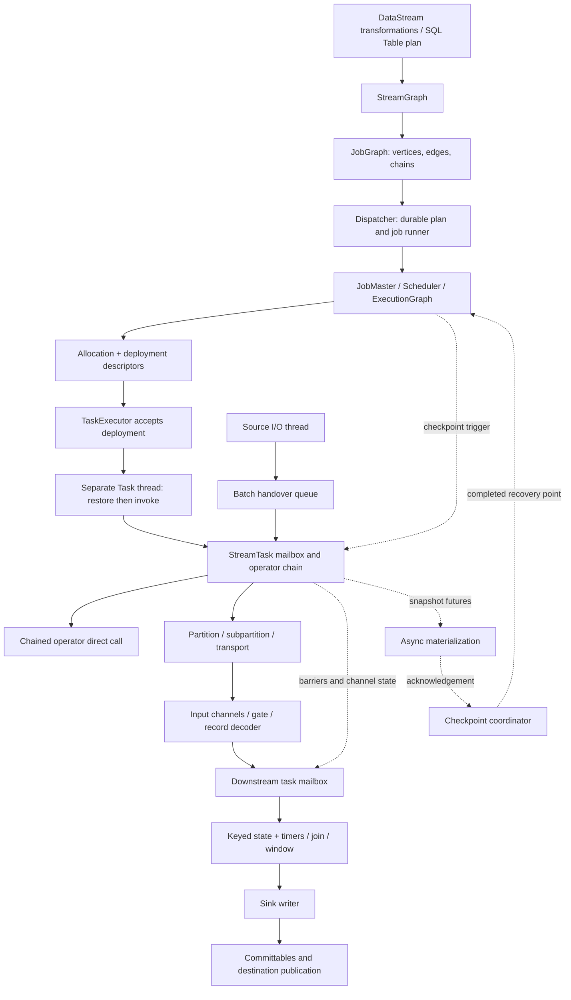

# Архитектура Flink: исполняемый граф, владение и границы гарантий

Ревизия исследования: [`068f428b29f4d9ee587fa1006d2f1a69b43c0000`](https://github.com/apache/flink/tree/068f428b29f4d9ee587fa1006d2f1a69b43c0000). **Полное чтение корпуса продолжается.** Эта глава связывает уже установленные исходниками контракты; она не обозначает завершённую архитектуру всего Flink. Собственные полные чтения автора покрывают часть connector/file I/O. Межобластные выводы опираются на конкретные находки ответственных readers и их главы с pinned source links; автор свода не заявляет личного полного повторного чтения их исходников или всех глав. Тесты ниже прочитаны как спецификация проверок и не запускались. Непрочитанные зависимости и неподтверждённые варианты остаются открытыми.

Это описание существующего Flink, без выбора реализации Ariadne и без изменения её ADR. Требования к собственному движку нельзя считать уже выполненными лишь потому, что аналогичный механизм найден в Flink.

## Сквозной путь программы

Стрелка записи не означает отдельный поток на каждом блоке. Внутри chain следующий оператор вызывается синхронно тем же task thread; межзадачный edge использует partition/channel механизм. Пунктир выделяет checkpoint-управление, которое проходит через record path и пересекает его в определённых местах. Диаграмма не охватывает все batch/hybrid shuffle и async-state варианты.

API хранит логические `Transformation` и переводит их в `StreamGraph`; последующая генерация создаёт job vertices/edges и операторные chains. SQL/Table planner добавляет собственную стадию оптимизации и генерации runtime expressions/operators до этого пути. Граф API, deployment attempt и runtime object — разные сущности: изменение parallelism, chain boundary либо serializer влияет на разные стадии. Полный причинный разбор прочитанных генераторов находится в [главе 04](04-api-types-serialization-python.md), planner/codegen и classloader boundaries — в [главе 05](05-table-sql-planner-runtime.md).

Dispatcher сначала сохраняет ExecutionPlan, затем запускает job runner. Dirty terminal results и cleanup отделены от самого terminal state: recovery может запускать cleanup вместо повторного пользовательского job. JobMaster — fenced endpoint одного плана; Scheduler/ExecutionGraph управляют попытками и failover. Leadership session, registration instance, allocation и execution attempt защищают разные виды устаревшей работы. Поэтому одного job id недостаточно для принятия любого позднего callback. [Глава 01: Dispatcher, leadership, scheduling](01-control-plane-scheduling.md).

TaskExecutor проверяет JobMasterId и active allocation, добавляет `Task`, запускает отдельный поток и подтверждает RPC. Ack означает приём deployment: restore/initialization/invoke ещё могут завершиться ошибкой. На успешном пути Task проходит CREATED→DEPLOYING→INITIALIZING→RUNNING; FINISHED допустим только после завершения output partitions. Возврат user operator и конец task lifecycle не совпадают. [Task source](https://github.com/apache/flink/blob/068f428b29f4d9ee587fa1006d2f1a69b43c0000/flink-runtime/src/main/java/org/apache/flink/runtime/taskmanager/Task.java#L577-L849), [глава 02](02-task-execution-network-backpressure.md).

## Control path, record path и владельцы

| Владелец | Что ему принадлежит | Что нельзя считать тем же событием |
|---|---|---|
| Dispatcher / leader job runner | Durable plan, job runner lifetime, terminal result/cleanup progression | Terminal status и завершённая очистка ресурсов |
| JobMaster / scheduler | Scheduling, attempts, restart decisions, coordination | Принятая cancel-команда и фактическое завершение отмены |
| TaskExecutor / slot | Active allocation, размещение Task, managed-memory lifetime slot | Свободный RPC endpoint и освобождённая память всех task threads |
| Task / StreamTask mailbox | Вызовы операторов chain, текущий key, control mails, синхронный срез state | Input availability и отсутствие всех видов блокирования |
| Network I/O / channels | Получение buffer, queue handover, credits, ownership/recycle | Доставка bytes, обработка записи и durable checkpoint |
| Source fetcher | Внешний I/O и batch handover | Fetch завершён и checkpoint progress продвинут |
| CEP operator / current key | Общий NFA graph условий; keyed queues вычислений, события и references shared buffer | Найденная ветвь, вызванный user callback и опубликованный внешний эффект |
| Async snapshot worker | Материализация переданных snapshot futures | RPC error и гарантированное непринятие ACK координатором |
| Sink client / mailbox / committer | External request, обработка результата, публикация commit соответственно | Единственный callback и единственный внешний side effect |

JobManager управляет выполнением; поточная обработка task/operator происходит на TaskManager. Абсолютное «JobManager никогда не вызывает user code» неверно для прочитанной ревизии: JobMaster вызывает AggregateFunction для global aggregate, execution graph содержит master finalization и существуют hooks/coordinators. Эти служебные callbacks следует учитывать отдельно от record execution. [Глава 01](01-control-plane-scheduling.md).

Mailbox имеет нескольких producers и одного consumer. Обычный batch mail не бесконечно растёт от самопубликующих callbacks; urgent mail может ускорить управление. Timer thread переносит callback в mailbox. Это кооперативное владение, а не вытеснение произвольного долгого вызова user code. При soft backpressure default action ждёт availability, сохраняя обработку control mails. При hard backpressure внутри blocking buffer allocation task thread действительно блокируется до выхода из вызова. [Mailbox и backpressure](02-task-execution-network-backpressure.md), [StreamTask input path](https://github.com/apache/flink/blob/068f428b29f4d9ee587fa1006d2f1a69b43c0000/flink-runtime/src/main/java/org/apache/flink/streaming/runtime/tasks/StreamTask.java#L681-L759).

Managed memory, сетевые fixed segments, state backend native resources, connector batches и пользовательский heap не образуют один общий автоматически соблюдаемый byte-limit. Slot освобождает managed memory после termination payloads; сетевой buffer возвращается по собственному ownership/recycle. Source queue ограничивает batch count, а async sink maxBufferedRequests проверяет новые inputs и не охватывает весь объём in-flight/retry objects. [Глава 02](02-task-execution-network-backpressure.md), [глава 06](06-connectors-formats-storage-metrics.md).

Operator coordination проходит отдельным control-message протоколом, полностью прочитанным reader=execution. TaskExecutor подтверждает возврат deliverOperatorEvent; StreamTask ставит dispatch в mailbox, причём при закрытии может поглотить rejection. Этот Ack не подтверждает выполнение handler. Gateway задерживает coordinator→task events относительно coordinator snapshot cut и вновь открывается по AcknowledgeCheckpointEvent после синхронного task snapshot, до async materialization и глобального checkpoint completion. AttemptID fencing и replay взаимодействий после restored checkpoint решают согласование попыток и состояния; CoordinatorStore и задержанные gateway events остаются в памяти. Это не durable inbox внешних сигналов. [Подробный протокол и source evidence](02-task-execution-network-backpressure.md), [task ACK](https://github.com/apache/flink/blob/068f428b29f4d9ee587fa1006d2f1a69b43c0000/flink-runtime/src/main/java/org/apache/flink/runtime/taskexecutor/TaskExecutor.java#L1447-L1467), [snapshot event](https://github.com/apache/flink/blob/068f428b29f4d9ee587fa1006d2f1a69b43c0000/flink-runtime/src/main/java/org/apache/flink/streaming/runtime/tasks/RegularOperatorChain.java#L180-L201), [in-memory store](https://github.com/apache/flink/blob/068f428b29f4d9ee587fa1006d2f1a69b43c0000/flink-runtime/src/main/java/org/apache/flink/runtime/operators/coordination/CoordinatorStoreImpl.java#L28-L65).

## Branch, merge, join и window

Разветвление logical graph задаёт edges и маршрутизацию. Chain boundary определяет, будет ли downstream вызван непосредственно либо через record serialization/channel. Broadcast writer может держать несколько consumers одного retained buffer, поэтому fan-out не обязан копировать payload bytes для каждой ветви, но каждая ссылка создаёт отдельное обязательство release. Backpressure одной ветви способен ограничить producer; это нельзя объяснять только количеством Java operators.

Объединение нескольких inputs означает выбор готового input и координацию progress; оно само по себе не означает keyed join. Multi-input processor учитывает выбранные незавершённые inputs и fairness. Join добавляет собственное keyed состояние, match counts и changelog/outer-row правила; их синхронная и async-state реализации не объявляются эквивалентными без проверки. Table chapter фиксирует, что async join материализует matching rows в heap List и имеет отличающийся путь изменения association counts. [Глава 02: multi-input](02-task-execution-network-backpressure.md), [глава 05: join](05-table-sql-planner-runtime.md).

Window хранит pane и trigger state по key+window namespace. FIRE, PURGE и окончательная cleanup — разные действия: выдача результата может сохранять pane для следующего fire. При session merge logical window может ссылаться на прежний state namespace; меняется mapping, а не обязательно перемещаются все строки. Event-time progress определяется watermark/timers, processing-time — отдельной службой времени. Для overlapping SQL windows late slice может ещё влиять на unfired windows и потому не всегда отбрасывается. [Глава 03: triggers/merging/timers](03-state-checkpoints-windows-timers.md), [глава 05: slicing/session SQL windows](05-table-sql-planner-runtime.md).

CEP добавляет к этому пути pattern matching. Pattern API строит связанное описание, compiler разворачивает optional/times/looping/negative clauses в graph transitions, а CepOperator применяет общий graph к отдельному managed state каждого key. Event-time records сначала попадают в timestamp buckets; watermark запускает упорядоченное продвижение NFA и timeout. Живые branches ссылаются на общие события через versioned backward edges; after-match skip освобождает branches и references. Иными словами, branch logical dataflow между tasks и branch возможного match внутри одного operator — разные уровни графа. Срез recovery хранит computation queues и shared-buffer data, тогда как graph условий приходит из программы; user match callback остаётся частью operator execution. [Прочитанная цепочка CEP](06-connectors-formats-storage-metrics.md#cep-runtime-pattern-state-machine), [operator state/timer path](https://github.com/apache/flink/blob/068f428b29f4d9ee587fa1006d2f1a69b43c0000/flink-libraries/flink-cep/src/main/java/org/apache/flink/cep/operator/CepOperator.java#L179-L220), [compiled loop](https://github.com/apache/flink/blob/068f428b29f4d9ee587fa1006d2f1a69b43c0000/flink-libraries/flink-cep/src/main/java/org/apache/flink/cep/nfa/compiler/NFACompiler.java#L845-L892).

Особенно существенна граница retract: retract-capable accumulator не доказывает корректное повторное разделение session topology при DELETE. В прочитанных Table tests есть явно обозначенные TODO: удаление не пересобирает session topology; отдельный DELETE-only сценарий имеет отрицательный COUNT. Эти ограничения относятся к конкретной реализации и сценариям теста; они не превращаются в общую модель всех joins/windows Flink. [Глава 05 с source/test links](05-table-sql-planner-runtime.md).

## Checkpoint, restart и ownership после ошибки

Checkpoint согласует source position, operator/keyed state, timers и при соответствующем режиме channel state. Aligned barrier handler приостанавливает каналы после barrier до получения остальных. Unaligned/alternating путь фиксирует overtaken in-flight buffers и может начать task snapshot до последней barrier. Snapshot должен учитывать также unread remainder spanning-record deserializer, а не только сетевую queue. Это разные протоколы получения согласованного среза. [Глава 02](02-task-execution-network-backpressure.md), [глава 03](03-state-checkpoints-windows-timers.md).

Task checkpoint сначала выполняет pre-barrier hooks и broadcast, затем создаёт operator snapshot futures. До передачи async runnable ошибки очищаются синхронным владельцем; после передачи материализация и report принадлежат async lifecycle. Runnable меняет RUNNING→COMPLETED до ACK report. При последующей ошибке отправки state не удаляется: JobManager мог принять ACK, а ответ мог потеряться. Конкурентный close может discard только после успешного RUNNING→DISCARDED. [Синхронный handoff](https://github.com/apache/flink/blob/068f428b29f4d9ee587fa1006d2f1a69b43c0000/flink-runtime/src/main/java/org/apache/flink/streaming/runtime/tasks/SubtaskCheckpointCoordinatorImpl.java#L300-L412), [async ownership](https://github.com/apache/flink/blob/068f428b29f4d9ee587fa1006d2f1a69b43c0000/flink-runtime/src/main/java/org/apache/flink/streaming/runtime/tasks/AsyncCheckpointRunnable.java#L94-L188).

Scheduler restart инвалидирует vertex versions, отменяет pending slot requests, ждёт cancellation и backoff, отсеивает изменённые версии, создаёт новые attempts и восстанавливает состояние перед restart tasks. Suspend имеет отдельную семантику и при локальном атомарном закрытии всё же может послать cancel RPC. Keyed rescale назначает пересечения key-group handles; operator state использует свой repartitioner, channel state — mappings/filtering. Изменение chain или maxParallelism может нарушить допустимость восстановления и явно отклоняется кодом. [Глава 01](01-control-plane-scheduling.md), [глава 03](03-state-checkpoints-windows-timers.md).

Backend также имеет собственную границу durability. Changelog append/appendMeta не обещает persistence: persist получает durable range, которому затем нужны confirm/reset/truncate. Truncation ограничена одновременно subsumed и materialized progress. RocksDB incremental reuse зависит от подтверждённого checkpoint ownership; delayed notification/reupload paths нельзя свести к «SST уже существует». Возможности ForSt и RocksDB не считаются одинаковыми; в прочитанном async ForSt migration есть unsupported path. [Глава 03](03-state-checkpoints-windows-timers.md).

Наличие network partition type не доказывает поддержку любого recovery mode scheduler. По отдельно прочитанным root/control sources DefaultSchedulerFactory передаёт approximate-local-recovery flag в DefaultSchedulerComponents, а тот явно отклоняет его для PipelinedRegionScheduler. Root также полностью прочитал ApproximateLocalRecoveryDownstreamITCase: он class-level Disabled с причиной отсутствия scheduler support; его assertions проверяют progress/index с AtMostOnce sink, без включённого checkpointing. Поэтому downstream-only approximate recovery не считается здесь доказанным поддержанным end-to-end режимом. Это ограничение конкретного DefaultScheduler path, без обобщения на непрочитанные scheduler variants. [Production guard](https://github.com/apache/flink/blob/068f428b29f4d9ee587fa1006d2f1a69b43c0000/flink-runtime/src/main/java/org/apache/flink/runtime/scheduler/DefaultSchedulerComponents.java#L76-L87), [свидетельства control reader](01-control-plane-scheduling.md), [root test evidence](07-build-boundaries-tests-web.md).

## От recovery-consistent state к внешнему результату

Source fetcher передаёт batch, но concrete file emitter обновляет checkpoint position только после `collect`. Continuous file source dedup хранит исторические Paths при discovery; это не downstream commit. FileSource/format batches живут до releaseBatch, отдельно от закрытия underlying file reader при EOF. [FileSource chain](06-connectors-formats-storage-metrics.md), [emitter source](https://github.com/apache/flink/blob/068f428b29f4d9ee587fa1006d2f1a69b43c0000/flink-connectors/flink-connector-files/src/main/java/org/apache/flink/connector/file/src/impl/FileSourceRecordEmitter.java#L28-L46).

Между bytes источника и operator row есть самостоятельная format boundary. Ordinary JSON может выдать несколько rows из одного сообщения; schema/converters владеют parser/tree и временными heap values, но не durable source offset. CDC decoder переводит envelope в RowKind, а sparse old у Maxwell/Canal восстанавливает before image из after. Обратное encoding этих formats может превратить update pair в независимые delete/create messages, не сохраняя исходную transaction grouping. Parse-error option управляет null/skip/exception, а не автоматическим durable dead-letter protocol; scope catch и момент collect определяют, может ли сообщение уже частично дать output перед ошибкой. Metadata timestamp отдельно от watermark strategy. [Полный прочитанный JSON/CDC путь и тестовые assertions](06-connectors-formats-storage-metrics.md), [Debezium emission](https://github.com/apache/flink/blob/068f428b29f4d9ee587fa1006d2f1a69b43c0000/flink-formats/flink-json/src/main/java/org/apache/flink/formats/json/debezium/DebeziumJsonDeserializationSchema.java#L140-L204).

Generic async sink обеспечивает at-least-once, а не универсальный exactly-once external side effect. Timeout может повторить batch, чей первый запрос позднее успешно запишется. CAS result-handler предотвращает повторное изменение локального writer state, но не отменяет внешнюю запись. FileSink имеет другую структуру: writer persist/closeForCommit→committables→FileCommitter.commitAfterRecovery, а compaction добавляет persistent precommit topology. Семантика внешнего sink определяется этим полным протоколом и underlying recoverable writer. [Глава 06 с прочитанными timeout/restore tests](06-connectors-formats-storage-metrics.md).

Даже внутри filesystem connector существуют отдельные protocols: table streaming использует legacy Buckets writer, optional table compaction и all-task partition-policy gate; batch table OutputFormat публикует выбранные finished attempts через finalizeGlobal на master. Его loader выполняет overwrite deletion и file moves до metadata policies, без общей rollback boundary. Поэтому гарантии Sink2 FileSink нельзя переносить на всё, что пишет files. Partition-time commit trigger явно сохраняет map checkpoint→watermark: reset runtime watermark после restore совместим с checkpointed копией, если конкретный subsystem сам её хранит. [Разбор table filesystem путей](06-connectors-formats-storage-metrics.md).

## Потребности разработчика и системы: наблюдаемые критерии

Эти критерии формулируют, как проверять описанную архитектуру по исходникам. Они не являются новыми утверждёнными требованиями Ariadne.

| Потребность | Критерий принятия доказательства |
|---|---|
| Как разработчик, проследить программу до исполняемой попытки | Показаны реальные graph translation, chain boundaries, deployment validation и отдельный task-thread start; Ack не назван завершением. |
| Как разработчик оператора, понимать владение состоянием | Названы task/mailbox/current-key/window namespace, serializer и timer lifecycle; async completion возвращается в допустимый контекст. |
| Как система, сохранять управление при нагрузке | Различены availability, credits, soft/hard backpressure, memory owners и terminal release; bounded queue не названа универсальным byte-cap. |
| Как система, восстановиться без потери принятого state | Зафиксированы barrier cut, sync→async handoff, ACK ambiguity, cleanup owner и assignment при rescale; append не приравнен к durable persist. |
| Как разработчик ETL, понимать branch/join/window результат | Routing, input merge, keyed association и window trigger различены; FIRE/PURGE/cleanup и retract/session ограничения подкреплены конкретным кодом/тестами. |
| Как разработчик ETL, понимать формат записи | Прослежены bytes→rows и envelope→RowKind, projection/null/error policy и ownership временных values; timestamp metadata не назван watermark, output pair не назван атомарной транзакцией. |
| Как система, публиковать внешний результат | Установлен конкретный source/sink protocol и поведение retry/timeout/recovery; checkpoint state не объявлен достаточным доказательством exactly-once destination. |
| Как reviewer, проверить полноту исследования | Все исходные файлы/строки остаются в inventory; confirmed ranges добавлены после реального чтения, непрочитанные зависимости видимы, прочитанные тесты отделены от запущенных. |

## Границы этого свода и навигация

Подробности и локальные evidence: [01 — control plane](01-control-plane-scheduling.md), [02 — task/network](02-task-execution-network-backpressure.md), [03 — state/checkpoint/time](03-state-checkpoints-windows-timers.md), [04 — API/types/serialization/Python](04-api-types-serialization-python.md), [05 — Table/SQL](05-table-sql-planner-runtime.md), [06 — connectors/formats/storage/metrics](06-connectors-formats-storage-metrics.md), [07 — build/boundaries/tests/web](07-build-boundaries-tests-web.md).

Build graph, архитектурные тесты и Web UI не являются runtime data plane, но определяют packaging, границы зависимостей и наблюдаемость: их ограничения исследуются отдельно в главе 07. Библиотеки, оставшиеся форматы/filesystems, весь SQL planner, все batch/shuffle/recovery варианты и остальные непрочитанные файлы ещё не закрыты. Весь in-tree flink-metrics subtree прочитан architect reader; runtime registry/groups и внешние exporter dependencies имеют отдельные границы доказательств. Свод будет пересматриваться при новом source evidence. [Общий статус и правила чтения](../README.md), [машинный статус диапазонов](../coverage.json) и [полный inventory](../inventory.jsonl) сохраняют это различие.
