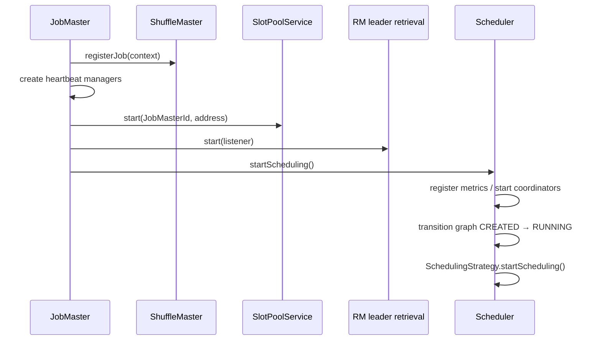

# Управление заданием, планирование и владение ресурсами Flink

Исследуемая ревизия: `068f428b29f4d9ee587fa1006d2f1a69b43c0000`. Это развивающаяся глава по непосредственно прочитанному коду. Полное чтение назначенного домена **не завершено**: окончательную границу прочитанного задаёт `readers/control.confirmed.jsonl`, а не наличие файла в инвентаре и не журнал вывода `control.exposures.jsonl`. Неподтверждённые файлы остаются непрочитанными. Прочитанные тесты ниже рассматриваются как спецификация сценариев; тесты не запускались. Исходники Flink не изменялись, сборка не выполнялась.

## 1. Объекты с разными сроками жизни

`JobMaster` — RPC endpoint, ответственный за один `ExecutionPlan`, с неизменяемым `JobMasterId` как fencing token. Его поля связывают план, `SchedulerNG`, slot pool, соединения с TaskManager и ResourceManager, heartbeat managers, shuffle master и partition tracker. Такое связывание не означает, что `JobMaster` реализует алгоритм размещения: `startScheduling`, `cancel`, обновление состояния task, checkpoint/savepoint и запросы к operator coordinator передаются scheduler. [JobMaster:144–250](https://github.com/apache/flink/blob/068f428b29f4d9ee587fa1006d2f1a69b43c0000/flink-runtime/src/main/java/org/apache/flink/runtime/jobmaster/JobMaster.java#L144), [создание scheduler](https://github.com/apache/flink/blob/068f428b29f4d9ee587fa1006d2f1a69b43c0000/flink-runtime/src/main/java/org/apache/flink/runtime/jobmaster/JobMaster.java#L423).

Полезно различать как минимум четыре идентичности:

| Идентичность | Какое владение ограничивает | Непосредственное свидетельство |
|---|---|---|
| `JobID` | Логическое задание, для которого регистрируется TaskManager | `registerTaskManager` отвергает другой JobID |
| `JobMasterId` | Действующая инстанция управляющего RPC endpoint | Наследование `FencedRpcEndpoint<JobMasterId>`, передача токена в pool и task gateway |
| `ExecutionGraphID` | Конкретный execution graph для задания | Новый ID в конструкторе; комментарий отдельно называет повторную submission, failover JM и rescaling |
| `ExecutionAttemptID` | Одна попытка выполнения конкретного subtask | Конструируется из graph ID, vertex ID и attempt number |

См. [ExecutionGraphID](https://github.com/apache/flink/blob/068f428b29f4d9ee587fa1006d2f1a69b43c0000/flink-runtime/src/main/java/org/apache/flink/runtime/executiongraph/DefaultExecutionGraph.java#L142), [создание attempt ID](https://github.com/apache/flink/blob/068f428b29f4d9ee587fa1006d2f1a69b43c0000/flink-runtime/src/main/java/org/apache/flink/runtime/executiongraph/Execution.java#L220), [проверку JobID](https://github.com/apache/flink/blob/068f428b29f4d9ee587fa1006d2f1a69b43c0000/flink-runtime/src/main/java/org/apache/flink/runtime/jobmaster/JobMaster.java#L804). Подмена этих идентичностей одним «идентификатором задачи» потеряла бы возможность отвергать сообщения от прошлой попытки или прошлого управляющего процесса.

`ExecutionVertex` может выполняться повторно; `Execution` хранит одну попытку: состояние, логический slot, allocation ID, state restore descriptor, produced partition descriptors и futures завершения. Поэтому новая попытка — самостоятельный объект состояния, а не возвращение завершённой попытки в RUNNING. `Execution` запрещает выход из terminal state. Реестр `currentExecutions` в графе индексирован полным attempt ID; неизвестное обновление состояния возвращает `false`, которое `JobMaster` преобразует в отрицательный ответ. [Execution:102–205](https://github.com/apache/flink/blob/068f428b29f4d9ee587fa1006d2f1a69b43c0000/flink-runtime/src/main/java/org/apache/flink/runtime/executiongraph/Execution.java#L102), [запрет выхода](https://github.com/apache/flink/blob/068f428b29f4d9ee587fa1006d2f1a69b43c0000/flink-runtime/src/main/java/org/apache/flink/runtime/executiongraph/Execution.java#L1669), [реестр попыток](https://github.com/apache/flink/blob/068f428b29f4d9ee587fa1006d2f1a69b43c0000/flink-runtime/src/main/java/org/apache/flink/runtime/executiongraph/DefaultExecutionGraph.java#L1593).

## 2. Исполнитель управляющего состояния и асинхронные операции

Контракт `SchedulerNG` прямо обещает отсутствие конкурентных вызовов: все обращения приходят из `ComponentMainThreadExecutor`. `SchedulerBase` проверяет этот контракт в lifecycle-методах, запросах графа и операциях checkpoint/savepoint. Граф также использует executor главного потока JobMaster. `start` графа устанавливает executor; до этого хранится dummy executor с диагностикой о необходимости инициализации. Это ограничение владения изменяемыми коллекциями графа и scheduler, а не запрет фоновых вычислений. [SchedulerNG:66–75](https://github.com/apache/flink/blob/068f428b29f4d9ee587fa1006d2f1a69b43c0000/flink-runtime/src/main/java/org/apache/flink/runtime/scheduler/SchedulerNG.java#L66), [инициализация graph executor](https://github.com/apache/flink/blob/068f428b29f4d9ee587fa1006d2f1a69b43c0000/flink-runtime/src/main/java/org/apache/flink/runtime/executiongraph/DefaultExecutionGraph.java#L375).

В `Execution.deploy` граница потоков выражена явно:

1. На main thread проверяются slot, состояние SCHEDULED, принадлежность payload, затем состояние становится DEPLOYING и фиксируется pending deployment.
2. Снимок `taskRestore` передаётся background executor для сериализации и возможного offload в blob storage.
3. Формирование `TaskDeploymentDescriptor`, обращающееся к execution graph, возвращается на main thread и повторно проверяет DEPLOYING.
4. Отправка `submitTask` и сериализация TDD происходят на background executor.
5. Обработка результата возвращается на main thread; очистка временного blob запускается асинхронно, `taskRestore` обнуляется.

Этот повторный state check закрывает промежуток, в котором cancel/failure мог сделать подготовленную операцию устаревшей. Успешный `submitTask` вызывает `notifyCompletedDeployment`, но сам не переводит попытку в RUNNING: INITIALIZING и RUNNING приходят как task state updates. [Полный deploy path](https://github.com/apache/flink/blob/068f428b29f4d9ee587fa1006d2f1a69b43c0000/flink-runtime/src/main/java/org/apache/flink/runtime/executiongraph/Execution.java#L575), [проверка после offload](https://github.com/apache/flink/blob/068f428b29f4d9ee587fa1006d2f1a69b43c0000/flink-runtime/src/main/java/org/apache/flink/runtime/executiongraph/Execution.java#L745), [обновления состояния](https://github.com/apache/flink/blob/068f428b29f4d9ee587fa1006d2f1a69b43c0000/flink-runtime/src/main/java/org/apache/flink/runtime/executiongraph/DefaultExecutionGraph.java#L1452).

Комментарии о lock-free/atomic transitions в начале `Execution` нельзя принимать за доказательство наличия CAS в текущей реализации: прочитанный `transitionState` сравнивает поле `state` с ожидаемым значением и присваивает новое; сериализация управления обеспечивается main-thread contract. Некоторые поля volatile, а accumulators имеют собственный lock. Это описание конкретной ревизии, не реконструкция по историческому комментарию.

Граница JobManager/TaskManager также требует точности. TaskManager исполняет потоковые задачи; утверждение «на JobManager никогда не выполняется user code» слишком сильное. `JobMaster.updateGlobalAggregate` десериализует пользовательскую `AggregateFunction` и вызывает `createAccumulator`, `add`, `getResult`; успешное завершение графа вызывает `JobVertex.finalizeOnMaster`. В этом же контуре существуют master hooks и operator coordinators. [Global aggregate](https://github.com/apache/flink/blob/068f428b29f4d9ee587fa1006d2f1a69b43c0000/flink-runtime/src/main/java/org/apache/flink/runtime/jobmaster/JobMaster.java#L999), [finalizeOnMaster](https://github.com/apache/flink/blob/068f428b29f4d9ee587fa1006d2f1a69b43c0000/flink-runtime/src/main/java/org/apache/flink/runtime/executiongraph/DefaultExecutionGraph.java#L1275).

## 3. Создание, запуск и остановка

`SchedulerBase` в конструкторе создаёт checkpoint store, checkpoint ID counter и tracker, затем через `ExecutionGraphFactory` создаёт и восстанавливает граф. На готовый граф устанавливаются listener внутренних task failures, job status listener и main-thread executor. Затем инициализируются operator coordinator holders. Это объясняет историческую сцепленность: восстановление state происходит до полного запуска scheduler и требует уже существующих holders; комментарии `SchedulerNG` и `SchedulerBase` прямо называют её препятствием вынесению coordinators в JobMaster. [SchedulerBase constructor](https://github.com/apache/flink/blob/068f428b29f4d9ee587fa1006d2f1a69b43c0000/flink-runtime/src/main/java/org/apache/flink/runtime/scheduler/SchedulerBase.java#L192), [createAndRestoreExecutionGraph](https://github.com/apache/flink/blob/068f428b29f4d9ee587fa1006d2f1a69b43c0000/flink-runtime/src/main/java/org/apache/flink/runtime/scheduler/SchedulerBase.java#L407), [объяснение сцепленности](https://github.com/apache/flink/blob/068f428b29f4d9ee587fa1006d2f1a69b43c0000/flink-runtime/src/main/java/org/apache/flink/runtime/scheduler/SchedulerBase.java#L1132).

Последовательность `JobMaster.onStart → startJobExecution`:

Источник: [JobMaster:1173–1207](https://github.com/apache/flink/blob/068f428b29f4d9ee587fa1006d2f1a69b43c0000/flink-runtime/src/main/java/org/apache/flink/runtime/jobmaster/JobMaster.java#L1173), [SchedulerBase.startScheduling](https://github.com/apache/flink/blob/068f428b29f4d9ee587fa1006d2f1a69b43c0000/flink-runtime/src/main/java/org/apache/flink/runtime/scheduler/SchedulerBase.java#L668), [DefaultScheduler.startSchedulingInternal](https://github.com/apache/flink/blob/068f428b29f4d9ee587fa1006d2f1a69b43c0000/flink-runtime/src/main/java/org/apache/flink/runtime/scheduler/DefaultScheduler.java#L248). Запуск RM leader retrieval означает возможность последующего подключения; это не синхронное получение всех slots перед запуском scheduler.

`JobMaster.onStop` запускает `stopJobExecution`. Сначала закрываются job metrics/status listener и вызывается `scheduler.closeAsync`; дальнейшие действия выполняются после его future на main thread: unregister shuffle job, disconnect TaskManagers/ResourceManager, stop RM leader retrieval, close slot pool и stop heartbeat managers. Ошибки сворачиваются в `JobMasterException`. При ошибке запуска сервисов предусмотрена попытка их остановки с сохранением suppressed exception. [Остановка](https://github.com/apache/flink/blob/068f428b29f4d9ee587fa1006d2f1a69b43c0000/flink-runtime/src/main/java/org/apache/flink/runtime/jobmaster/JobMaster.java#L1237).

`SchedulerBase.closeAsync` отличается от пользовательского cancel: он повышает версии всех vertices, отменяет pending slot requests, переводит graph в SUSPENDED и освобождает coordinators. После graph termination закрываются checkpoint store и ID counter, затем `CheckpointsCleaner`. Будущий результат close связан с завершением этой цепочки. `cancel` повышает версии и отменяет pending requests, но передаёт графу именно `cancel`, а не suspend. [close/cancel](https://github.com/apache/flink/blob/068f428b29f4d9ee587fa1006d2f1a69b43c0000/flink-runtime/src/main/java/org/apache/flink/runtime/scheduler/SchedulerBase.java#L710).

## 4. Размещение и защита от устаревших продолжений

`DefaultScheduler` разделяет policy (`SchedulingStrategy`), выбор slots (`ExecutionSlotAllocator`), действия с executions (`ExecutionOperations`), обработку отказов (`ExecutionFailureHandler`) и orchestration размещения (`ExecutionDeployer`). Вызов `allocateSlotsAndDeploy` сначала фиксирует новые версии vertices и извлекает текущие attempts, затем передаёт обе структуры deployer. [Состав scheduler](https://github.com/apache/flink/blob/068f428b29f4d9ee587fa1006d2f1a69b43c0000/flink-runtime/src/main/java/org/apache/flink/runtime/scheduler/DefaultScheduler.java#L171), [allocateSlotsAndDeploy](https://github.com/apache/flink/blob/068f428b29f4d9ee587fa1006d2f1a69b43c0000/flink-runtime/src/main/java/org/apache/flink/runtime/scheduler/DefaultScheduler.java#L484).

`DefaultExecutionDeployer` допускает вход только из CREATED, переводит attempts в SCHEDULED, запрашивает logical slots по attempt IDs, присваивает ресурсы и регистрирует произведённые partitions. Он ждёт завершения assignment/registration futures всей переданной группы, после чего обходит deployment handles. Каждая попытка повторно проверяет SCHEDULED и сохранённую vertex version. Устаревший успешный slot result освобождается, устаревшая ошибка не превращается в новый task failure. Ошибка timeout получения slot оборачивается в `NoResourceAvailableException`; registration produced partitions имеет отдельный timeout. [Deployer orchestration](https://github.com/apache/flink/blob/068f428b29f4d9ee587fa1006d2f1a69b43c0000/flink-runtime/src/main/java/org/apache/flink/runtime/scheduler/DefaultExecutionDeployer.java#L89), [assignment fence](https://github.com/apache/flink/blob/068f428b29f4d9ee587fa1006d2f1a69b43c0000/flink-runtime/src/main/java/org/apache/flink/runtime/scheduler/DefaultExecutionDeployer.java#L202), [deployment fence](https://github.com/apache/flink/blob/068f428b29f4d9ee587fa1006d2f1a69b43c0000/flink-runtime/src/main/java/org/apache/flink/runtime/scheduler/DefaultExecutionDeployer.java#L292).

`ExecutionVertexVersioner` — локальный счётчик модификаций каждого vertex. Он увеличивается при новом deployment или invalidation, а отложенное продолжение принимает снимок и проверяет равенство. Это самостоятельная защита внутри действующего JobMaster; RPC leader token решает другую задачу. `ExecutionVertexVersionerTest` задаёт сценарии unchanged/modified, неизвестной версии и фильтрации подмножества unmodified vertices. Прочитанные assertions подтверждают намерение контракта, а не результат исполнения тестов. [Versioner](https://github.com/apache/flink/blob/068f428b29f4d9ee587fa1006d2f1a69b43c0000/flink-runtime/src/main/java/org/apache/flink/runtime/scheduler/ExecutionVertexVersioner.java#L45), [тесты](https://github.com/apache/flink/blob/068f428b29f4d9ee587fa1006d2f1a69b43c0000/flink-runtime/src/test/java/org/apache/flink/runtime/scheduler/ExecutionVertexVersionerTest.java#L53).

## 5. Pool: требование, выделение, резервирование и возврат

В `DefaultDeclarativeSlotPool` хранятся разные величины: `totalResourceRequirements`, `fulfilledResourceRequirements`, набор выделенных/free slots и соответствие `AllocationID → matched requirement ResourceProfile`. Профиль фактически полученного slot может удовлетворять нескольким требованиям; выбранное соответствие нужно сохранить, чтобы корректно вычесть ресурс при возврате. [Поля и назначение](https://github.com/apache/flink/blob/068f428b29f4d9ee587fa1006d2f1a69b43c0000/flink-runtime/src/main/java/org/apache/flink/runtime/jobmaster/slotpool/DefaultDeclarativeSlotPool.java#L60).

Документация самого класса запрещает смешивать два способа учёта:

| Режим | Откуда берётся потребность | Что означает free/reserve |
|---|---|---|
| Legacy, DefaultScheduler | Запрос slot увеличивает requirement; освобождение уменьшает его через возвращённый `ResourceCounter` | Reservation тесно связана с требованием |
| Declarative, AdaptiveScheduler | Требования выводятся из текущих нужд всего задания | Можно многократно reserve/free без изменения requirements |

Это свидетельство контракта pool и его клиентов, не полное исследование ещё не прочитанного AdaptiveScheduler.

`offerSlots` принимает только нужные slots, повторный offer уже известного allocation ID возвращается как принятый без повторного добавления. Вначале обновляется fulfilled accounting и mapping, затем slots добавляются в pool и вызывается единственный new-slots listener. `registerSlots` — специальный путь для recovered TM в фазе restarting без выставленных requirements: не совпавший slot сопоставляется `ResourceProfile.ANY`, затем при reservation mapping меняется. [Приём offers](https://github.com/apache/flink/blob/068f428b29f4d9ee587fa1006d2f1a69b43c0000/flink-runtime/src/main/java/org/apache/flink/runtime/jobmaster/slotpool/DefaultDeclarativeSlotPool.java#L232), [recovery registration](https://github.com/apache/flink/blob/068f428b29f4d9ee587fa1006d2f1a69b43c0000/flink-runtime/src/main/java/org/apache/flink/runtime/jobmaster/slotpool/DefaultDeclarativeSlotPool.java#L289).

`reserveFreeSlot` проверяет достаточность actual profile. Если slot резервируется под другое требование, меняются mapping и fulfilled counters; для обычного предыдущего требования корректируется также total requirements, чтобы не недозаказать исходный профиль. Wildcard ANY не требует такой коррекции. `freeReservedSlot` освобождает payload, возвращает slot в free pool, уведомляет listener и сообщает ранее выполнявшееся requirement. Это ещё не физический возврат TaskManager. [Reserve/rematch](https://github.com/apache/flink/blob/068f428b29f4d9ee587fa1006d2f1a69b43c0000/flink-runtime/src/main/java/org/apache/flink/runtime/jobmaster/slotpool/DefaultDeclarativeSlotPool.java#L393), [freeReservedSlot](https://github.com/apache/flink/blob/068f428b29f4d9ee587fa1006d2f1a69b43c0000/flink-runtime/src/main/java/org/apache/flink/runtime/jobmaster/slotpool/DefaultDeclarativeSlotPool.java#L435).

Idle release требует одновременно избытка `fulfilled − total` и истечения `idleSlotTimeout` у свободного slot подходящего matched profile. После удаления slot уменьшается fulfilled counter, удаляется mapping и отправляется `TaskManagerGateway.freeSlot`. Неуспешный RPC только логируется: код ссылается на синхронизацию slot status следующим heartbeat. Следовательно локальное удаление allocation и подтверждение удалённого освобождения — разные события. [Idle release](https://github.com/apache/flink/blob/068f428b29f4d9ee587fa1006d2f1a69b43c0000/flink-runtime/src/main/java/org/apache/flink/runtime/jobmaster/slotpool/DefaultDeclarativeSlotPool.java#L553).

`DeclarativeSlotPoolService` добавляет lifecycle CREATED → STARTED → CLOSED, реестр зарегистрированных TaskManagers и RM connection manager. После подключения к RM он повторно объявляет все текущие requirements; сообщение содержит JobID, ApplicationID и JobManager address, а RPC `declareRequiredResources` получает JobMasterId. Offers от незарегистрированного TaskManager игнорируются. `createAllocatedSlotReport` сообщает physical slot number и allocation ID каждого slot данного TM. [Service lifecycle](https://github.com/apache/flink/blob/068f428b29f4d9ee587fa1006d2f1a69b43c0000/flink-runtime/src/main/java/org/apache/flink/runtime/jobmaster/slotpool/DeclarativeSlotPoolService.java#L127), [RM declaration/report](https://github.com/apache/flink/blob/068f428b29f4d9ee587fa1006d2f1a69b43c0000/flink-runtime/src/main/java/org/apache/flink/runtime/jobmaster/slotpool/DeclarativeSlotPoolService.java#L299).

Отдельный reservation учёт `DefaultScheduler` нужен local recovery: vertex сохраняет prior allocation до назначения нового либо успешного завершения; несколько vertices могут ссылаться на один allocation, поэтому используется reference counter. Этот reservation — предпочтение сохранения ресурсов для recovery, а не доказательство работающего task или физической занятости slot. [Reservation accounting](https://github.com/apache/flink/blob/068f428b29f4d9ee587fa1006d2f1a69b43c0000/flink-runtime/src/main/java/org/apache/flink/runtime/scheduler/DefaultScheduler.java#L497).

## 6. Регистрация, leadership и reconciliation

`FencedRpcEndpoint` задаёт контракт: RPC исполняется только при совпадении токена сообщения с токеном endpoint. Базовый класс хранит token; прочитанный `FencedPekkoRpcActor.handleRpcMessage` реализует проверку: требует `FencedMessage`, ненулевой expected token и `Objects.equals`; иначе возвращает `FencingTokenException` либо `UnknownMessageException`. Локальные self messages также оборачиваются текущим token. [FencedRpcEndpoint](https://github.com/apache/flink/blob/068f428b29f4d9ee587fa1006d2f1a69b43c0000/flink-rpc/flink-rpc-core/src/main/java/org/apache/flink/runtime/rpc/FencedRpcEndpoint.java#L28), [backend enforcement](https://github.com/apache/flink/blob/068f428b29f4d9ee587fa1006d2f1a69b43c0000/flink-rpc/flink-rpc-akka/src/main/java/org/apache/flink/runtime/rpc/pekko/FencedPekkoRpcActor.java#L63).

У JobMaster есть дополнительные проверки асинхронного подключения. RM leader notification ставится в `runAsync`; новое лидерство закрывает прежнее соединение и инициирует регистрацию. Успешный callback сначала проверяет объектную идентичность connection с текущим `resourceManagerConnection`; establishment затем сравнивает RM leader ID. Только после этого slot pool и partition tracker подключаются к gateway, регистрируется blocklist listener и начинается heartbeat monitoring. `disconnectResourceManager` от старого leader ID не запускает reconnect к новому лидеру. При shutdown address сбрасывается, чтобы позднее событие не запустило новое соединение. [RM connect/establish](https://github.com/apache/flink/blob/068f428b29f4d9ee587fa1006d2f1a69b43c0000/flink-runtime/src/main/java/org/apache/flink/runtime/jobmaster/JobMaster.java#L1339), [callback identity check](https://github.com/apache/flink/blob/068f428b29f4d9ee587fa1006d2f1a69b43c0000/flink-runtime/src/main/java/org/apache/flink/runtime/jobmaster/JobMaster.java#L1607), [disconnect filtering](https://github.com/apache/flink/blob/068f428b29f4d9ee587fa1006d2f1a69b43c0000/flink-runtime/src/main/java/org/apache/flink/runtime/jobmaster/JobMaster.java#L912).

TaskManager registration различает ResourceID и session UUID. Повтор той же сессии идемпотентно подтверждается; новая сессия с тем же ResourceID вызывает disconnect старого TM, потому что интерпретируется как restart. После RPC connect на main thread регистрируется pool ownership, gateway/location/session сохраняются и включается heartbeat monitoring. Offer slots разрешён только известному TM; task gateway оборачивается текущим JobMaster token. [TM registration](https://github.com/apache/flink/blob/068f428b29f4d9ee587fa1006d2f1a69b43c0000/flink-runtime/src/main/java/org/apache/flink/runtime/jobmaster/JobMaster.java#L804), [offerSlots](https://github.com/apache/flink/blob/068f428b29f4d9ee587fa1006d2f1a69b43c0000/flink-runtime/src/main/java/org/apache/flink/runtime/jobmaster/JobMaster.java#L740).

Heartbeat несёт не только liveness. От TM приходят deployment report и accumulator snapshots; к TM уходит allocated-slot report. `DefaultExecutionDeploymentReconciler` вычисляет unknown deployments как reported minus expected, а missing — expected, отсутствующие в reported, кроме PENDING. Неизвестные attempts JobMaster отменяет на TM, отсутствующие подтверждённые deployments переводит в FAILED через scheduler. Исключение PENDING принципиально: heartbeat может опередить доставку/подтверждение submitTask. [Алгоритм reconciliation](https://github.com/apache/flink/blob/068f428b29f4d9ee587fa1006d2f1a69b43c0000/flink-runtime/src/main/java/org/apache/flink/runtime/jobmaster/DefaultExecutionDeploymentReconciler.java#L41), [реакции JM](https://github.com/apache/flink/blob/068f428b29f4d9ee587fa1006d2f1a69b43c0000/flink-runtime/src/main/java/org/apache/flink/runtime/jobmaster/JobMaster.java#L284), [payload processing](https://github.com/apache/flink/blob/068f428b29f4d9ee587fa1006d2f1a69b43c0000/flink-runtime/src/main/java/org/apache/flink/runtime/jobmaster/JobMaster.java#L1684).

Полностью прочитанный `DefaultExecutionDeploymentReconcilerTest` содержит matching, missing, unknown, mixed и pending сценарии. Последний проверяет, что отсутствующий PENDING не становится missing, а неизвестный reported attempt остаётся unknown. Проверка тестами здесь установлена по assertions исходника, без запуска. [Тестовые сценарии](https://github.com/apache/flink/blob/068f428b29f4d9ee587fa1006d2f1a69b43c0000/flink-runtime/src/test/java/org/apache/flink/runtime/jobmaster/DefaultExecutionDeploymentReconcilerTest.java#L41).

## 7. Failure и региональное восстановление

При принятом task update `SchedulerBase` сначала находит attempt и применяет update в graph. Scheduler hook вызывается только если фактическое итоговое состояние совпало с заявленным; сейчас dispatch нужен для FINISHED и FAILED. Внутренняя ошибка execution graph направляется обратно в scheduler через listener, чтобы policy восстановления оставалась у scheduler. [Эффективное обновление](https://github.com/apache/flink/blob/068f428b29f4d9ee587fa1006d2f1a69b43c0000/flink-runtime/src/main/java/org/apache/flink/runtime/scheduler/SchedulerBase.java#L807), [internal task failure](https://github.com/apache/flink/blob/068f428b29f4d9ee587fa1006d2f1a69b43c0000/flink-runtime/src/main/java/org/apache/flink/runtime/executiongraph/Execution.java#L1333).

`DefaultScheduler` сообщает coordinator о failure с subtask index и attempt number, получает `FailureHandlingResult` от `ExecutionFailureHandler` и либо восстанавливает vertices, либо окончательно failJob. `ExecutionFailureHandler` отделяет область перезапуска (`FailoverStrategy`) от разрешения и задержки (`RestartBackoffTimeStrategy`). Для global failure область — все vertices. Классифицированная `NonRecoverableError`, включая вложенную причину, сразу даёт unrecoverable result; иначе `notifyFailure` сообщает, считается ли событие новой recovery attempt, `canRestart` решает допустимость, `getBackoffTime` задаёт delay. Счётчик рестартов увеличивается только для разрешённой новой recovery attempt, поэтому несколько concurrent exceptions не обязаны означать несколько рестартов. Failure labels возвращаются отдельным future; метрики дополняются после их готовности на main thread. [Failure dispatch](https://github.com/apache/flink/blob/068f428b29f4d9ee587fa1006d2f1a69b43c0000/flink-runtime/src/main/java/org/apache/flink/runtime/scheduler/DefaultScheduler.java#L277), [FailureHandler policy](https://github.com/apache/flink/blob/068f428b29f4d9ee587fa1006d2f1a69b43c0000/flink-runtime/src/main/java/org/apache/flink/runtime/executiongraph/failover/ExecutionFailureHandler.java#L177).

`RestartPipelinedRegionFailoverStrategy` обходит граф регионов в ширину. Начальная область содержит failed region. Для каждого включённого региона добавляются producer regions недоступных входных partitions и все consumer regions его выходов, затем правило повторяется до замыкания. Availability требует одновременно отсутствия временной отметки failure, подтверждения partition tracker/checker и reconsumable type либо специального `PIPELINED_APPROXIMATE`. `PartitionException` временно помечает соответствующий partition unavailable на время расчёта, даже если внешний checker считает его доступным. Из результирующих vertices исключаются CREATED: их ещё не нужно перезапускать. Identity sets не дают повторно обходить общие consumed-partition и consumer-vertex groups. Следовательно «перезапустить только упавший pipeline» недостаточно: потеря повторно используемого результата расширяет scope вверх, а повторное производство — вниз. [Region algorithm](https://github.com/apache/flink/blob/068f428b29f4d9ee587fa1006d2f1a69b43c0000/flink-runtime/src/main/java/org/apache/flink/runtime/executiongraph/failover/RestartPipelinedRegionFailoverStrategy.java#L97), [availability](https://github.com/apache/flink/blob/068f428b29f4d9ee587fa1006d2f1a69b43c0000/flink-runtime/src/main/java/org/apache/flink/runtime/executiongraph/failover/RestartPipelinedRegionFailoverStrategy.java#L290).

Два полностью прочитанных теста уточняют эти границы. `ExecutionFailureHandlerTest` различает обычный restart, подавление policy, nested unrecoverable cause, root/concurrent exceptions и global scope; unrecoverable failure считается root даже если backoff strategy не считает её новой attempt. `RestartPipelinedRegionFailoverStrategyTest` проверяет таблицу доступности двух blocking inputs, цепочку pipelined regions через blocking boundaries, CREATED exclusion, approximate recovery и hybrid edges. В hybrid сценарии HYBRID_SELECTIVE upstream включается в restart scope при availability checker, который по умолчанию возвращает true, поскольку тип не reconsumable. [Failure handler tests](https://github.com/apache/flink/blob/068f428b29f4d9ee587fa1006d2f1a69b43c0000/flink-runtime/src/test/java/org/apache/flink/runtime/executiongraph/failover/ExecutionFailureHandlerTest.java#L110), [region tests](https://github.com/apache/flink/blob/068f428b29f4d9ee587fa1006d2f1a69b43c0000/flink-runtime/src/test/java/org/apache/flink/runtime/executiongraph/failover/RestartPipelinedRegionFailoverStrategyTest.java#L174). Реальные результаты запуска этих тестов не получены.

В доказанном restart path порядок такой:

1. Зафиксировать новые версии выбранных vertices и добавить их в `verticesWaitingForRestart`; graph RUNNING → RESTARTING.
2. Отменить все pending slot requests этих vertices до отмены executions: иначе только что освобождённый slot может немедленно исполнить запрос той же отменяемой попытки.
3. Запустить cancellation всех current executions, сохранить failure snapshot для exception history.
4. По истечении restart delay дождаться также cancel future, затем на main thread взять только vertices с неизменившимися версиями.
5. Удалить их из pending set, resetForNewExecution, восстановить state, вызвать `SchedulingStrategy.restartTasks`.

[Последовательность restart](https://github.com/apache/flink/blob/068f428b29f4d9ee587fa1006d2f1a69b43c0000/flink-runtime/src/main/java/org/apache/flink/runtime/scheduler/DefaultScheduler.java#L358). Delay и cancellation могут идти одновременно; новое размещение начинается после обоих условий. Если более поздний failure/cancel изменил версию, старое отложенное продолжение не перезапускает vertex.

`SchedulerBase.restoreState` сначала сбрасывает end-of-data tracking. Без checkpoint coordinator он уведомляет coordinators об empty global restore либо subtask restore с `NO_CHECKPOINT`. При checkpointing он abort pending checkpoints до restore: комментарий отдельно связывает это с освобождением trigger и exactly-once. Global recovery восстанавливает state всего затронутого набора job vertices; local recovery вызывает restore для соответствующих job vertices и отдельно `subtaskReset` только нужным subtasks. Комментарий поясняет ограничение: checkpoint coordinator не знает точный subtask scope регионального восстановления; assignment для продолжающих работу attempts не действует. [Restore path](https://github.com/apache/flink/blob/068f428b29f4d9ee587fa1006d2f1a69b43c0000/flink-runtime/src/main/java/org/apache/flink/runtime/scheduler/SchedulerBase.java#L462).

## 8. Cancel, suspend, terminal и release — разные события

`JobMaster.cancel` вызывает `scheduler.cancel` и сразу возвращает `Acknowledge`. Это подтверждение команды; для окончания задания существует отдельный termination future. Graph переходит в CANCELLING, отменяет vertices и только после их завершения становится CANCELED. Окончательный failJob идёт через FAILING и cancellation; пользовательский cancel, пришедший во время FAILING, может привести к CANCELED. [Cancel RPC](https://github.com/apache/flink/blob/068f428b29f4d9ee587fa1006d2f1a69b43c0000/flink-runtime/src/main/java/org/apache/flink/runtime/jobmaster/JobMaster.java#L523), [graph cancel](https://github.com/apache/flink/blob/068f428b29f4d9ee587fa1006d2f1a69b43c0000/flink-runtime/src/main/java/org/apache/flink/runtime/executiongraph/DefaultExecutionGraph.java#L1032), [graph failJob](https://github.com/apache/flink/blob/068f428b29f4d9ee587fa1006d2f1a69b43c0000/flink-runtime/src/main/java/org/apache/flink/runtime/executiongraph/DefaultExecutionGraph.java#L1379).

Для `Execution.cancel` CREATED/SCHEDULED допускают непосредственное локальное завершение; DEPLOYING/INITIALIZING/RUNNING переходят в CANCELING и отправляют RPC отмены с retry. Отмена уже FINISHED execution дополнительно освобождает оставшиеся pipelined partitions. Если FINISHED приходит в CANCELING, отмена завершается: ждать отдельного CANCELED от TM уже нельзя. `suspend` локально и немедленно завершает активные attempts, не ожидая remote cancellation acknowledgment; graph требует atomic completion всех suspend futures. Даже локальный путь вызывает `startCancelling(0)` и может отправить cancel RPC, поэтому «suspend вообще не посылает RPC» также было бы неверно. [Execution.cancel/suspend](https://github.com/apache/flink/blob/068f428b29f4d9ee587fa1006d2f1a69b43c0000/flink-runtime/src/main/java/org/apache/flink/runtime/executiongraph/Execution.java#L852), [atomic cancellation helper](https://github.com/apache/flink/blob/068f428b29f4d9ee587fa1006d2f1a69b43c0000/flink-runtime/src/main/java/org/apache/flink/runtime/executiongraph/Execution.java#L1215), [graph suspend](https://github.com/apache/flink/blob/068f428b29f4d9ee587fa1006d2f1a69b43c0000/flink-runtime/src/main/java/org/apache/flink/runtime/executiongraph/DefaultExecutionGraph.java#L1102).

У attempt есть terminal-state future и отдельный release future. Первый завершается при установке terminal state после записи финальных accumulator/metrics, второй — после release assigned slot. Listeners и потребители terminal future должны видеть финальные метрики. Поздний heartbeat не перезаписывает accumulator завершённой попытки. Из финальных IO metrics удаляется объёмная детализация `resultPartitionBytes`, поскольку дальше она не используется. [Futures](https://github.com/apache/flink/blob/068f428b29f4d9ee587fa1006d2f1a69b43c0000/flink-runtime/src/main/java/org/apache/flink/runtime/executiongraph/Execution.java#L411), [release](https://github.com/apache/flink/blob/068f428b29f4d9ee587fa1006d2f1a69b43c0000/flink-runtime/src/main/java/org/apache/flink/runtime/executiongraph/Execution.java#L1610), [pre-completion action](https://github.com/apache/flink/blob/068f428b29f4d9ee587fa1006d2f1a69b43c0000/flink-runtime/src/main/java/org/apache/flink/runtime/executiongraph/Execution.java#L1654).

При глобальном FINISHED JobMaster освобождает job partitions и promote cluster partitions, затем передаёт архивированный `ExecutionGraphInfo` в completion actions. Ошибки release/promote логируются и не меняют успешно завершившееся задание; cleanup может быть доведён TaskExecutors после обнаружения закрытого JM. При других globally terminal states освобождаются все tracked partitions. [Terminal job cleanup](https://github.com/apache/flink/blob/068f428b29f4d9ee587fa1006d2f1a69b43c0000/flink-runtime/src/main/java/org/apache/flink/runtime/jobmaster/JobMaster.java#L1297).

## 9. Savepoint как управляемая остановка

`triggerSavepoint(cancelJob=true)` останавливает periodic checkpoint scheduler, ждёт успешного savepoint и затем запускает cancel. При ошибке savepoint periodic scheduler запускается снова. Возвращаемый path доказывает сохранение savepoint, но этот метод сам по себе не ждёт terminal state отменённого задания. `stopWithSavepoint` создаёт отдельную пару futures: synchronous savepoint и завершение всех executions; их согласует `StopWithSavepointTerminationManager`, реализация которого ещё требует полного чтения. Оба пути явно отвергают graph с blocking output. [Cancel-with-savepoint](https://github.com/apache/flink/blob/068f428b29f4d9ee587fa1006d2f1a69b43c0000/flink-runtime/src/main/java/org/apache/flink/runtime/scheduler/SchedulerBase.java#L939), [stop-with-savepoint](https://github.com/apache/flink/blob/068f428b29f4d9ee587fa1006d2f1a69b43c0000/flink-runtime/src/main/java/org/apache/flink/runtime/scheduler/SchedulerBase.java#L1075).

## 10. Runner и срок жизни leadership

`JobMasterServiceLeadershipRunner` владеет leader election, classloader lease, текущим `JobMasterServiceProcess` и отдельными gateway/result/termination futures. В отличие от main-thread scheduler здесь изменяемое состояние защищено lock; grant/revoke дополнительно сериализованы цепочкой `sequentialOperation`. Получив leadership, runner сначала асинхронно проверяет `JobResultStore.hasJobResultEntryAsync`: уже завершённый job не запускается вновь. Создание process, передача gateway/result и leadership confirmation привязаны к leader session ID; `runIfValidLeader` вызывает `hasLeadershipAsync` и повторно проверяет RUNNING перед действием. Новая process создаётся только когда close предыдущей уже завершён. [Runner responsibilities](https://github.com/apache/flink/blob/068f428b29f4d9ee587fa1006d2f1a69b43c0000/flink-runtime/src/main/java/org/apache/flink/runtime/jobmaster/JobMasterServiceLeadershipRunner.java#L51), [grant/check durable result](https://github.com/apache/flink/blob/068f428b29f4d9ee587fa1006d2f1a69b43c0000/flink-runtime/src/main/java/org/apache/flink/runtime/jobmaster/JobMasterServiceLeadershipRunner.java#L242), [validity check](https://github.com/apache/flink/blob/068f428b29f4d9ee587fa1006d2f1a69b43c0000/flink-runtime/src/main/java/org/apache/flink/runtime/jobmaster/JobMasterServiceLeadershipRunner.java#L486).

При revoke старый gateway future завершается ошибкой, создаётся новый pending future, сбрасывается флаг cancel текущего leader и закрывается process. Пользовательский cancel во время initialization может ждать gateway; запрос status при этом показывает CANCELLING вместо INITIALIZING. Закрытие runner прекращает дальнейший forwarding, сообщает SUSPENDED как runner result, ждёт process close, освобождает classloader lease и закрывает election. Результат job и завершение контейнера JobMaster снова являются разными событиями. [Cancel/status](https://github.com/apache/flink/blob/068f428b29f4d9ee587fa1006d2f1a69b43c0000/flink-runtime/src/main/java/org/apache/flink/runtime/jobmaster/JobMasterServiceLeadershipRunner.java#L186), [revoke](https://github.com/apache/flink/blob/068f428b29f4d9ee587fa1006d2f1a69b43c0000/flink-runtime/src/main/java/org/apache/flink/runtime/jobmaster/JobMasterServiceLeadershipRunner.java#L390).

`DefaultJobMasterServiceProcess` превращает асинхронное создание service в явные результаты. Initialization failure — `JobManagerRunnerResult.forInitializationFailure` с sparse archived graph; неожиданное завершение уже созданного service — инфраструктурная ошибка `jobMasterFailed`, а globally terminal state job — успешная доставка runner result независимо от того, FINISHED, FAILED или CANCELED сам job. Close во время незавершённого создания запоминается и закрывает service, когда тот появится; failure создания означает, что закрывать нечего. [Process construction](https://github.com/apache/flink/blob/068f428b29f4d9ee587fa1006d2f1a69b43c0000/flink-runtime/src/main/java/org/apache/flink/runtime/jobmaster/DefaultJobMasterServiceProcess.java#L84), [close](https://github.com/apache/flink/blob/068f428b29f4d9ee587fa1006d2f1a69b43c0000/flink-runtime/src/main/java/org/apache/flink/runtime/jobmaster/DefaultJobMasterServiceProcess.java#L146).

## 11. Dispatcher: admission, durable intent и cleanup

В этой ревизии Dispatcher учитывает приложения отдельно от jobs. Constructor восстанавливает `suspendedApplications`, `suspendedJobs`, связи job→application и dirty results; между recovered execution plans и dirty job results не должно быть пересечений по JobID. Аналогичная проверка есть для applications. `onStart` создаёт bootstrap и выбирает application/session recovery. В session mode application запускается раньше принадлежащих ему jobs: пользовательская логика может пропустить повторную submission уже выполненных jobs. Самостоятельный recovered job оборачивается в `SingleJobApplication`. [Recovered inventory](https://github.com/apache/flink/blob/068f428b29f4d9ee587fa1006d2f1a69b43c0000/flink-runtime/src/main/java/org/apache/flink/runtime/dispatcher/Dispatcher.java#L336), [recovery sequencing](https://github.com/apache/flink/blob/068f428b29f4d9ee587fa1006d2f1a69b43c0000/flink-runtime/src/main/java/org/apache/flink/runtime/dispatcher/Dispatcher.java#L702).

Job submission последовательно проверяет durable terminal result, active/waiting/suspended duplicates, полноту resource configuration и существование связанного application. `internalSubmitJob` резервирует JobID в outstanding set, ждёт termination старого runner с тем же ID, затем `persistAndRunJob` сначала записывает `ExecutionPlanWriter.putExecutionPlan`, а уже потом создаёт и запускает runner. Submission acknowledgment означает успешное принятие этой цепочки, а не выполнение operators. Ошибка submission запускает global cleanup и возвращает `JobSubmissionException`, сохраняя cleanup error как suppressed. [Admission](https://github.com/apache/flink/blob/068f428b29f4d9ee587fa1006d2f1a69b43c0000/flink-runtime/src/main/java/org/apache/flink/runtime/dispatcher/Dispatcher.java#L839), [persist-before-run](https://github.com/apache/flink/blob/068f428b29f4d9ee587fa1006d2f1a69b43c0000/flink-runtime/src/main/java/org/apache/flink/runtime/dispatcher/Dispatcher.java#L1277), [previous-runner barrier](https://github.com/apache/flink/blob/068f428b29f4d9ee587fa1006d2f1a69b43c0000/flink-runtime/src/main/java/org/apache/flink/runtime/dispatcher/Dispatcher.java#L2510).

Результат runner проверяется против текущей записи реестра по объектной идентичности. Initialization failure при RECOVERY трактуется как повод к fatal dispatcher failover с повторным восстановлением jobs; обычный globally terminal job идёт по протоколу завершения. SUSPENDED требует local cleanup, сохраняя durable intent для recovery. Для globally terminal job Dispatcher сохраняет `ExecutionGraphInfo`, опционально архивирует history, создаёт dirty `JobResultEntry` и только затем разрешает global cleanup. Ошибка записи dirty result направляется fatal handler: нельзя считать cleanup безопасно завершённым без durable маркера о том, что job уже закончен. [Runner result](https://github.com/apache/flink/blob/068f428b29f4d9ee587fa1006d2f1a69b43c0000/flink-runtime/src/main/java/org/apache/flink/runtime/dispatcher/Dispatcher.java#L1395), [terminal handling](https://github.com/apache/flink/blob/068f428b29f4d9ee587fa1006d2f1a69b43c0000/flink-runtime/src/main/java/org/apache/flink/runtime/dispatcher/Dispatcher.java#L2267).

Dirty/clean здесь — фаза удаления ресурсов, а не состояние обработки данных. Recovery dirty result запускает cleanup runner, не вычисление job. Job global cleanup ждёт появления dirty result приложения перед `markResultAsCleanAsync(jobId)`. Завершение application сначала доводит оставшиеся suspended jobs до cleanup, ждёт dirty markers всех jobs, создаёт archived application, сохраняет dirty application result, выполняет application cleanup и ждёт clean futures jobs; затем application result становится clean. Такая зависимость нужна для восстановления уборки после падения между записью результата и удалением artifacts. Конкретные cleaners, store atomicity и их тесты ещё требуют чтения, поэтому здесь установлен orchestration-порядок вызовов, не общая гарантия exactly-once cleanup. [Application termination](https://github.com/apache/flink/blob/068f428b29f4d9ee587fa1006d2f1a69b43c0000/flink-runtime/src/main/java/org/apache/flink/runtime/dispatcher/Dispatcher.java#L1012), [application clean](https://github.com/apache/flink/blob/068f428b29f4d9ee587fa1006d2f1a69b43c0000/flink-runtime/src/main/java/org/apache/flink/runtime/dispatcher/Dispatcher.java#L1207), [job clean](https://github.com/apache/flink/blob/068f428b29f4d9ee587fa1006d2f1a69b43c0000/flink-runtime/src/main/java/org/apache/flink/runtime/dispatcher/Dispatcher.java#L2178).

Есть два отдельных управляющих протокола. Обновление `JobResourceRequirements` блокирует параллельный update одного JobID, валидирует max parallelism, сохраняет требования в `ExecutionPlanWriter` на IO executor и только затем вызывает JobMaster; persistence failure явно означает «не применено». Client liveness включается лишь при positive initial heartbeat timeout, начальный срок выставляется после initialization runner; просроченный heartbeat вызывает cancel. Это не тот же heartbeat, которым JM следит за TM/RM. [Requirements update](https://github.com/apache/flink/blob/068f428b29f4d9ee587fa1006d2f1a69b43c0000/flink-runtime/src/main/java/org/apache/flink/runtime/dispatcher/Dispatcher.java#L2067), [client liveness](https://github.com/apache/flink/blob/068f428b29f4d9ee587fa1006d2f1a69b43c0000/flink-runtime/src/main/java/org/apache/flink/runtime/dispatcher/Dispatcher.java#L2022).

Прочитанный `RpcEndpoint` уточняет shutdown: во время асинхронного `onStop` endpoint уже не running, но может ещё обслуживать RPC до завершения stop future. `isRunning` доступен только на main thread; validation реализован Java assertion, а не обязательной production-проверкой. `MainThreadExecutor.schedule` использует отдельный таймер, который затем ставит `FutureTask` через gateway в endpoint thread; command не исполняется непосредственно timer thread. [RPC lifecycle contract](https://github.com/apache/flink/blob/068f428b29f4d9ee587fa1006d2f1a69b43c0000/flink-rpc/flink-rpc-core/src/main/java/org/apache/flink/runtime/rpc/RpcEndpoint.java#L74), [thread validation](https://github.com/apache/flink/blob/068f428b29f4d9ee587fa1006d2f1a69b43c0000/flink-rpc/flink-rpc-core/src/main/java/org/apache/flink/runtime/rpc/RpcEndpoint.java#L446), [timer routing](https://github.com/apache/flink/blob/068f428b29f4d9ee587fa1006d2f1a69b43c0000/flink-rpc/flink-rpc-core/src/main/java/org/apache/flink/runtime/rpc/RpcEndpoint.java#L516).

## 12. ResourceManager: отдельное владение ресурсами кластера

`ResourceManager` — fenced endpoint с собственным `ResourceManagerId`. Он владеет регистрациями JobMasters и TaskExecutors, `JobLeaderIdService`, `SlotManager`, cluster partition tracker, blocklist и delegation token distribution. JobMaster решает, как исполнять job; RM проверяет право этого JobMaster запрашивать ресурсы и связывает ресурсные требования с зарегистрированными workers. При старте RM запускает job-leader service, heartbeat managers, slot manager с текущим fencing token/main executor, delegation token manager и framework-specific initialization. Shutdown останавливает их, очищает локальные реестры и накапливает ошибки через suppressed exceptions. [RM composition/lifecycle](https://github.com/apache/flink/blob/068f428b29f4d9ee587fa1006d2f1a69b43c0000/flink-runtime/src/main/java/org/apache/flink/runtime/resourcemanager/ResourceManager.java#L123).

Регистрация JM проверяет два независимых результата: RPC connect с предоставленным JobMasterId и leader ID из HA `JobLeaderIdService`. Только совпадение позволяет `registerJobMasterInternal`. Новый leader заменяет старую регистрацию, но сохраняет требования (`RETAIN`). `declareRequiredResources` повторно сверяет JobMasterId с зарегистрированным и ждёт ready-to-serve future. Потеря heartbeat JM и потеря leadership также сохраняют требования; globally terminal disconnect удаляет job и очищает их (`CLEAR`). Это позволяет восстановившемуся JM повторно объявить потребность, не превращая каждую краткую потерю связи в немедленную отмену всей ресурсной ёмкости задания. [JM registration](https://github.com/apache/flink/blob/068f428b29f4d9ee587fa1006d2f1a69b43c0000/flink-runtime/src/main/java/org/apache/flink/runtime/resourcemanager/ResourceManager.java#L364), [requirements admission](https://github.com/apache/flink/blob/068f428b29f4d9ee587fa1006d2f1a69b43c0000/flink-runtime/src/main/java/org/apache/flink/runtime/resourcemanager/ResourceManager.java#L583), [retain/clear](https://github.com/apache/flink/blob/068f428b29f4d9ee587fa1006d2f1a69b43c0000/flink-runtime/src/main/java/org/apache/flink/runtime/resourcemanager/ResourceManager.java#L1137).

Регистрация TM проходит framework admission через `getWorkerNodeIfAcceptRegistration`; незнакомый worker может быть отвергнут. Асинхронный RPC-connect защищён сравнением future с последним future данного ResourceID. У принятой регистрации есть новый `InstanceID`; `sendSlotReport` и `notifySlotAvailable` проверяют его, поэтому сообщение от старой регистрации не освобождает ресурс новой. Первый slot report отдельно регистрирует TM в SlotManager и может привести к resource-limit rejection. Heartbeat report далее синхронизирует slot state и cluster partitions. Закрытие TM удаляет его из SlotManager/partition tracker и уведомляет все зарегистрированные JobMasters. [TM registration](https://github.com/apache/flink/blob/068f428b29f4d9ee587fa1006d2f1a69b43c0000/flink-runtime/src/main/java/org/apache/flink/runtime/resourcemanager/ResourceManager.java#L475), [slot availability fencing](https://github.com/apache/flink/blob/068f428b29f4d9ee587fa1006d2f1a69b43c0000/flink-runtime/src/main/java/org/apache/flink/runtime/resourcemanager/ResourceManager.java#L618), [TM disconnect fanout](https://github.com/apache/flink/blob/068f428b29f4d9ee587fa1006d2f1a69b43c0000/flink-runtime/src/main/java/org/apache/flink/runtime/resourcemanager/ResourceManager.java#L1177).

## 13. Fine-grained allocation и согласование slot state

`FineGrainedSlotManager` объединяет четыре компонента: `ResourceTracker` для requirements/acquired resources, `TaskManagerTracker` для capacity и pending workers, `ResourceAllocationStrategy` для расчёта размещения и `SlotStatusSyncer` для RPC/reconciliation. Проверка requirements и объявление требуемых workers могут откладываться и объединять несколько изменений. Результат strategy отдельно содержит allocations на зарегистрированных ресурсах, reservations на pending resources, новые pending workers и unfulfillable jobs. Максимум CPU/memory проверяется с учётом и registered, и pending capacity. [SlotManager composition](https://github.com/apache/flink/blob/068f428b29f4d9ee587fa1006d2f1a69b43c0000/flink-runtime/src/main/java/org/apache/flink/runtime/resourcemanager/slotmanager/FineGrainedSlotManager.java#L72), [matching orchestration](https://github.com/apache/flink/blob/068f428b29f4d9ee587fa1006d2f1a69b43c0000/flink-runtime/src/main/java/org/apache/flink/runtime/resourcemanager/slotmanager/FineGrainedSlotManager.java#L619).

Прочитанная `DefaultResourceAllocationStrategy` прямо отказывается от гарантии оптимальности и даже от обещания найти всякое существующее допустимое размещение. Она жадно использует registered resources раньше pending; blocked workers исключаются. Pending workers создаются с заранее заданным профилем; requirement, не помещающийся в worker profile, помечает job unfulfillable. Режим SLOTS предпочитает worker с меньшей utilization, MIN_RESOURCES — с большей; utilization считается максимумом доли CPU и доли total memory. Для pending capacity используется any-matching, чтобы меньше workers остались частично занятыми. Помимо требований jobs поддерживаются min total CPU/memory и reserve capacity, эквивалентная заданному числу redundant workers. [Strategy limits](https://github.com/apache/flink/blob/068f428b29f4d9ee587fa1006d2f1a69b43c0000/flink-runtime/src/main/java/org/apache/flink/runtime/resourcemanager/slotmanager/DefaultResourceAllocationStrategy.java#L46), [matching](https://github.com/apache/flink/blob/068f428b29f4d9ee587fa1006d2f1a69b43c0000/flink-runtime/src/main/java/org/apache/flink/runtime/resourcemanager/slotmanager/DefaultResourceAllocationStrategy.java#L299), [utilization](https://github.com/apache/flink/blob/068f428b29f4d9ee587fa1006d2f1a69b43c0000/flink-runtime/src/main/java/org/apache/flink/runtime/resourcemanager/slotmanager/DefaultResourceAllocationStrategy.java#L451).

При появлении TM без уже занятых slots SlotManager ищет совпадающий pending worker по total/default-slot profiles, предпочитая pending worker с reservations. Его pending allocations переходят на фактический InstanceID, после чего pending worker удаляется. TM с already allocated slots восстанавливается по report, не сопоставляется такому pending worker. Worker release также не равен slot free: strategy предлагает idle candidates; SlotManager вызывает `canBeReleased`, затем повторно проверяет неизменность `idleSince`, помечает worker unwanted и переобъявляет resource demand. Эта проверка защищает от использования worker во время удалённого canBeReleased. [Pending-worker registration](https://github.com/apache/flink/blob/068f428b29f4d9ee587fa1006d2f1a69b43c0000/flink-runtime/src/main/java/org/apache/flink/runtime/resourcemanager/slotmanager/FineGrainedSlotManager.java#L369), [idle release](https://github.com/apache/flink/blob/068f428b29f4d9ee587fa1006d2f1a69b43c0000/flink-runtime/src/main/java/org/apache/flink/runtime/resourcemanager/slotmanager/FineGrainedSlotManager.java#L888).

`DefaultSlotStatusSyncer.allocateSlot` создаёт AllocationID, отмечает slot PENDING и увеличивает acquired resources **до** `TaskExecutorGateway.requestSlot`. Иначе параллельный следующий расчёт считал бы эту ёмкость свободной. ACK переводит его в ALLOCATED; failure возвращает capacity, если allocation ещё актуален. Но heartbeat может обогнать ACK: если reported slot имеет известный PENDING allocation ID, report завершает allocation, удаляет pending marker и переводит его в ALLOCATED. Поздний RPC result после этого игнорируется. ALLOCATED, отсутствующий в полном report, освобождается; PENDING, отсутствующий в report, пока сохраняется, потому что report мог опередить allocation request. Неизвестный reported allocation восстанавливается в обоих trackers и заставляет пересчитать requirements. [Allocation protocol](https://github.com/apache/flink/blob/068f428b29f4d9ee587fa1006d2f1a69b43c0000/flink-runtime/src/main/java/org/apache/flink/runtime/resourcemanager/slotmanager/DefaultSlotStatusSyncer.java#L96), [report reconciliation](https://github.com/apache/flink/blob/068f428b29f4d9ee587fa1006d2f1a69b43c0000/flink-runtime/src/main/java/org/apache/flink/runtime/resourcemanager/slotmanager/DefaultSlotStatusSyncer.java#L244).

При очистке job RM может отправить `freeInactiveSlots`, но не уменьшает counters заранее: освобождение подтверждается последующим slot report, чтобы локальная capacity не опередила фактическую. Эта асимметрия существенна: allocation резервирует ёмкость заранее, reclamation возвращает её после наблюдения. Тесты RM/SlotManager/SlotStatusSyncer пока не прочитаны; приведённые выводы основаны на полном production-коде названных классов. [Inactive slot reclaim](https://github.com/apache/flink/blob/068f428b29f4d9ee587fa1006d2f1a69b43c0000/flink-runtime/src/main/java/org/apache/flink/runtime/resourcemanager/slotmanager/FineGrainedSlotManager.java#L328).

## 14. Непокрытая часть исследования

В этой редакции ещё нельзя считать установленными полные алгоритмы application implementations/cleaners, AdaptiveScheduler и adaptive batch, конкретных backoff strategies, внутренних resource/task-manager trackers, конкретных HA stores/election/retrieval, всего RPC backend и его тестов, REST/client submission, Kubernetes/YARN/container/distribution. Большинство тестов центрального runtime также ещё не прочитано. Они остаются в назначенном корпусе; текущая глава не заменяет их чтение обзором по именам. Архитектура собственного движка Ariadne, выбор механизмов переноса и будущие ADR здесь не утверждаются: это отдельный последующий этап после исследования Flink.
