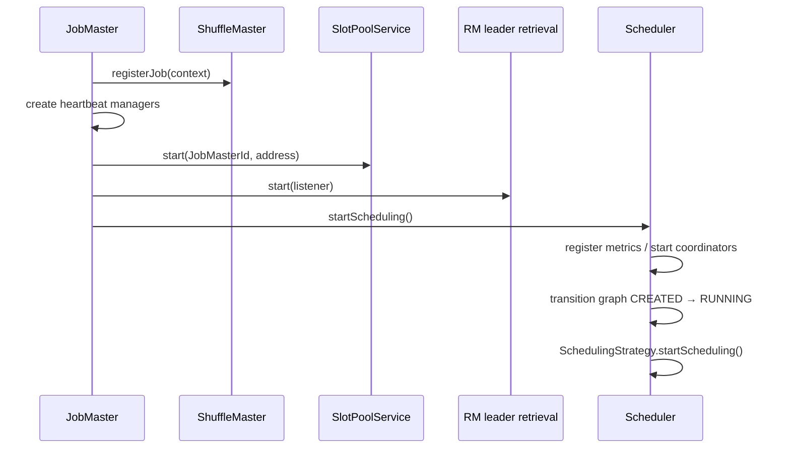

# Управление заданием, планирование и владение ресурсами Flink

Исследуемая ревизия: `068f428b29f4d9ee587fa1006d2f1a69b43c0000`. Это развивающаяся глава по непосредственно прочитанному коду. Полное чтение назначенного домена **не завершено**: окончательную границу прочитанного задаёт `readers/control.confirmed.jsonl`, а не наличие файла в инвентаре и не журнал вывода `control.exposures.jsonl`. Неподтверждённые файлы остаются непрочитанными. Прочитанные тесты ниже рассматриваются как спецификация сценариев; тесты не запускались. Исходники Flink не изменялись, сборка не выполнялась.

## 1. Объекты с разными сроками жизни

`JobMaster` — RPC endpoint, ответственный за один `ExecutionPlan`, с неизменяемым `JobMasterId` как fencing token. Его поля связывают план, `SchedulerNG`, slot pool, соединения с TaskManager и ResourceManager, heartbeat managers, shuffle master и partition tracker. Такое связывание не означает, что `JobMaster` реализует алгоритм размещения: `startScheduling`, `cancel`, обновление состояния task, checkpoint/savepoint и запросы к operator coordinator передаются scheduler. [JobMaster:144–250](https://github.com/apache/flink/blob/068f428b29f4d9ee587fa1006d2f1a69b43c0000/flink-runtime/src/main/java/org/apache/flink/runtime/jobmaster/JobMaster.java#L144), [создание scheduler](https://github.com/apache/flink/blob/068f428b29f4d9ee587fa1006d2f1a69b43c0000/flink-runtime/src/main/java/org/apache/flink/runtime/jobmaster/JobMaster.java#L423).

Полезно различать как минимум четыре идентичности:

| Идентичность | Какое владение ограничивает | Непосредственное свидетельство |
|---|---|---|
| `JobID` | Логическое задание, для которого регистрируется TaskManager | `registerTaskManager` отвергает другой JobID |
| `JobMasterId` | Действующая инстанция управляющего RPC endpoint | Наследование `FencedRpcEndpoint<JobMasterId>`, передача токена в pool и task gateway |
| `ExecutionGraphID` | Конкретный execution graph для задания | Новый ID в конструкторе; комментарий отдельно называет повторную submission, failover JM и rescaling |
| `ExecutionAttemptID` | Одна попытка выполнения конкретного subtask | Конструируется из graph ID, vertex ID и attempt number |

См. [ExecutionGraphID](https://github.com/apache/flink/blob/068f428b29f4d9ee587fa1006d2f1a69b43c0000/flink-runtime/src/main/java/org/apache/flink/runtime/executiongraph/DefaultExecutionGraph.java#L142), [создание attempt ID](https://github.com/apache/flink/blob/068f428b29f4d9ee587fa1006d2f1a69b43c0000/flink-runtime/src/main/java/org/apache/flink/runtime/executiongraph/Execution.java#L220), [проверку JobID](https://github.com/apache/flink/blob/068f428b29f4d9ee587fa1006d2f1a69b43c0000/flink-runtime/src/main/java/org/apache/flink/runtime/jobmaster/JobMaster.java#L804). Подмена этих идентичностей одним «идентификатором задачи» потеряла бы возможность отвергать сообщения от прошлой попытки или прошлого управляющего процесса.

`ExecutionVertex` может выполняться повторно; `Execution` хранит одну попытку: состояние, логический slot, allocation ID, state restore descriptor, produced partition descriptors и futures завершения. Поэтому новая попытка — самостоятельный объект состояния, а не возвращение завершённой попытки в RUNNING. `Execution` запрещает выход из terminal state. Реестр `currentExecutions` в графе индексирован полным attempt ID; неизвестное обновление состояния возвращает `false`, которое `JobMaster` преобразует в отрицательный ответ. [Execution:102–205](https://github.com/apache/flink/blob/068f428b29f4d9ee587fa1006d2f1a69b43c0000/flink-runtime/src/main/java/org/apache/flink/runtime/executiongraph/Execution.java#L102), [запрет выхода](https://github.com/apache/flink/blob/068f428b29f4d9ee587fa1006d2f1a69b43c0000/flink-runtime/src/main/java/org/apache/flink/runtime/executiongraph/Execution.java#L1669), [реестр попыток](https://github.com/apache/flink/blob/068f428b29f4d9ee587fa1006d2f1a69b43c0000/flink-runtime/src/main/java/org/apache/flink/runtime/executiongraph/DefaultExecutionGraph.java#L1593).

## 2. Исполнитель управляющего состояния и асинхронные операции

Контракт `SchedulerNG` прямо обещает отсутствие конкурентных вызовов: все обращения приходят из `ComponentMainThreadExecutor`. `SchedulerBase` проверяет этот контракт в lifecycle-методах, запросах графа и операциях checkpoint/savepoint. Граф также использует executor главного потока JobMaster. `start` графа устанавливает executor; до этого хранится dummy executor с диагностикой о необходимости инициализации. Это ограничение владения изменяемыми коллекциями графа и scheduler, а не запрет фоновых вычислений. [SchedulerNG:66–75](https://github.com/apache/flink/blob/068f428b29f4d9ee587fa1006d2f1a69b43c0000/flink-runtime/src/main/java/org/apache/flink/runtime/scheduler/SchedulerNG.java#L66), [инициализация graph executor](https://github.com/apache/flink/blob/068f428b29f4d9ee587fa1006d2f1a69b43c0000/flink-runtime/src/main/java/org/apache/flink/runtime/executiongraph/DefaultExecutionGraph.java#L375).

В `Execution.deploy` граница потоков выражена явно:

1. На main thread проверяются slot, состояние SCHEDULED, принадлежность payload, затем состояние становится DEPLOYING и фиксируется pending deployment.
2. Снимок `taskRestore` передаётся background executor для сериализации и возможного offload в blob storage.
3. Формирование `TaskDeploymentDescriptor`, обращающееся к execution graph, возвращается на main thread и повторно проверяет DEPLOYING.
4. Отправка `submitTask` и сериализация TDD происходят на background executor.
5. Обработка результата возвращается на main thread; очистка временного blob запускается асинхронно, `taskRestore` обнуляется.

Этот повторный state check закрывает промежуток, в котором cancel/failure мог сделать подготовленную операцию устаревшей. Успешный `submitTask` вызывает `notifyCompletedDeployment`, но сам не переводит попытку в RUNNING: INITIALIZING и RUNNING приходят как task state updates. [Полный deploy path](https://github.com/apache/flink/blob/068f428b29f4d9ee587fa1006d2f1a69b43c0000/flink-runtime/src/main/java/org/apache/flink/runtime/executiongraph/Execution.java#L575), [проверка после offload](https://github.com/apache/flink/blob/068f428b29f4d9ee587fa1006d2f1a69b43c0000/flink-runtime/src/main/java/org/apache/flink/runtime/executiongraph/Execution.java#L745), [обновления состояния](https://github.com/apache/flink/blob/068f428b29f4d9ee587fa1006d2f1a69b43c0000/flink-runtime/src/main/java/org/apache/flink/runtime/executiongraph/DefaultExecutionGraph.java#L1452).

Комментарии о lock-free/atomic transitions в начале `Execution` нельзя принимать за доказательство наличия CAS в текущей реализации: прочитанный `transitionState` сравнивает поле `state` с ожидаемым значением и присваивает новое; сериализация управления обеспечивается main-thread contract. Некоторые поля volatile, а accumulators имеют собственный lock. Это описание конкретной ревизии, не реконструкция по историческому комментарию.

Граница JobManager/TaskManager также требует точности. TaskManager исполняет потоковые задачи; утверждение «на JobManager никогда не выполняется user code» слишком сильное. `JobMaster.updateGlobalAggregate` десериализует пользовательскую `AggregateFunction` и вызывает `createAccumulator`, `add`, `getResult`; успешное завершение графа вызывает `JobVertex.finalizeOnMaster`. В этом же контуре существуют master hooks и operator coordinators. [Global aggregate](https://github.com/apache/flink/blob/068f428b29f4d9ee587fa1006d2f1a69b43c0000/flink-runtime/src/main/java/org/apache/flink/runtime/jobmaster/JobMaster.java#L999), [finalizeOnMaster](https://github.com/apache/flink/blob/068f428b29f4d9ee587fa1006d2f1a69b43c0000/flink-runtime/src/main/java/org/apache/flink/runtime/executiongraph/DefaultExecutionGraph.java#L1275).

## 3. Создание, запуск и остановка

`SchedulerBase` в конструкторе создаёт checkpoint store, checkpoint ID counter и tracker, затем через `ExecutionGraphFactory` создаёт и восстанавливает граф. На готовый граф устанавливаются listener внутренних task failures, job status listener и main-thread executor. Затем инициализируются operator coordinator holders. Это объясняет историческую сцепленность: восстановление state происходит до полного запуска scheduler и требует уже существующих holders; комментарии `SchedulerNG` и `SchedulerBase` прямо называют её препятствием вынесению coordinators в JobMaster. [SchedulerBase constructor](https://github.com/apache/flink/blob/068f428b29f4d9ee587fa1006d2f1a69b43c0000/flink-runtime/src/main/java/org/apache/flink/runtime/scheduler/SchedulerBase.java#L192), [createAndRestoreExecutionGraph](https://github.com/apache/flink/blob/068f428b29f4d9ee587fa1006d2f1a69b43c0000/flink-runtime/src/main/java/org/apache/flink/runtime/scheduler/SchedulerBase.java#L407), [объяснение сцепленности](https://github.com/apache/flink/blob/068f428b29f4d9ee587fa1006d2f1a69b43c0000/flink-runtime/src/main/java/org/apache/flink/runtime/scheduler/SchedulerBase.java#L1132).

Последовательность `JobMaster.onStart → startJobExecution`:

Источник: [JobMaster:1173–1207](https://github.com/apache/flink/blob/068f428b29f4d9ee587fa1006d2f1a69b43c0000/flink-runtime/src/main/java/org/apache/flink/runtime/jobmaster/JobMaster.java#L1173), [SchedulerBase.startScheduling](https://github.com/apache/flink/blob/068f428b29f4d9ee587fa1006d2f1a69b43c0000/flink-runtime/src/main/java/org/apache/flink/runtime/scheduler/SchedulerBase.java#L668), [DefaultScheduler.startSchedulingInternal](https://github.com/apache/flink/blob/068f428b29f4d9ee587fa1006d2f1a69b43c0000/flink-runtime/src/main/java/org/apache/flink/runtime/scheduler/DefaultScheduler.java#L248). Запуск RM leader retrieval означает возможность последующего подключения; это не синхронное получение всех slots перед запуском scheduler.

`JobMaster.onStop` запускает `stopJobExecution`. Сначала закрываются job metrics/status listener и вызывается `scheduler.closeAsync`; дальнейшие действия выполняются после его future на main thread: unregister shuffle job, disconnect TaskManagers/ResourceManager, stop RM leader retrieval, close slot pool и stop heartbeat managers. Ошибки сворачиваются в `JobMasterException`. При ошибке запуска сервисов предусмотрена попытка их остановки с сохранением suppressed exception. [Остановка](https://github.com/apache/flink/blob/068f428b29f4d9ee587fa1006d2f1a69b43c0000/flink-runtime/src/main/java/org/apache/flink/runtime/jobmaster/JobMaster.java#L1237).

`SchedulerBase.closeAsync` отличается от пользовательского cancel: он повышает версии всех vertices, отменяет pending slot requests, переводит graph в SUSPENDED и освобождает coordinators. После graph termination закрываются checkpoint store и ID counter, затем `CheckpointsCleaner`. Будущий результат close связан с завершением этой цепочки. `cancel` повышает версии и отменяет pending requests, но передаёт графу именно `cancel`, а не suspend. [close/cancel](https://github.com/apache/flink/blob/068f428b29f4d9ee587fa1006d2f1a69b43c0000/flink-runtime/src/main/java/org/apache/flink/runtime/scheduler/SchedulerBase.java#L710).

## 4. Размещение и защита от устаревших продолжений

`DefaultScheduler` разделяет policy (`SchedulingStrategy`), выбор slots (`ExecutionSlotAllocator`), действия с executions (`ExecutionOperations`), обработку отказов (`ExecutionFailureHandler`) и orchestration размещения (`ExecutionDeployer`). Вызов `allocateSlotsAndDeploy` сначала фиксирует новые версии vertices и извлекает текущие attempts, затем передаёт обе структуры deployer. [Состав scheduler](https://github.com/apache/flink/blob/068f428b29f4d9ee587fa1006d2f1a69b43c0000/flink-runtime/src/main/java/org/apache/flink/runtime/scheduler/DefaultScheduler.java#L171), [allocateSlotsAndDeploy](https://github.com/apache/flink/blob/068f428b29f4d9ee587fa1006d2f1a69b43c0000/flink-runtime/src/main/java/org/apache/flink/runtime/scheduler/DefaultScheduler.java#L484).

`DefaultExecutionDeployer` допускает вход только из CREATED, переводит attempts в SCHEDULED, запрашивает logical slots по attempt IDs, присваивает ресурсы и регистрирует произведённые partitions. Он ждёт завершения assignment/registration futures всей переданной группы, после чего обходит deployment handles. Каждая попытка повторно проверяет SCHEDULED и сохранённую vertex version. Устаревший успешный slot result освобождается, устаревшая ошибка не превращается в новый task failure. Ошибка timeout получения slot оборачивается в `NoResourceAvailableException`; registration produced partitions имеет отдельный timeout. [Deployer orchestration](https://github.com/apache/flink/blob/068f428b29f4d9ee587fa1006d2f1a69b43c0000/flink-runtime/src/main/java/org/apache/flink/runtime/scheduler/DefaultExecutionDeployer.java#L89), [assignment fence](https://github.com/apache/flink/blob/068f428b29f4d9ee587fa1006d2f1a69b43c0000/flink-runtime/src/main/java/org/apache/flink/runtime/scheduler/DefaultExecutionDeployer.java#L202), [deployment fence](https://github.com/apache/flink/blob/068f428b29f4d9ee587fa1006d2f1a69b43c0000/flink-runtime/src/main/java/org/apache/flink/runtime/scheduler/DefaultExecutionDeployer.java#L292).

`ExecutionVertexVersioner` — локальный счётчик модификаций каждого vertex. Он увеличивается при новом deployment или invalidation, а отложенное продолжение принимает снимок и проверяет равенство. Это самостоятельная защита внутри действующего JobMaster; RPC leader token решает другую задачу. `ExecutionVertexVersionerTest` задаёт сценарии unchanged/modified, неизвестной версии и фильтрации подмножества unmodified vertices. Прочитанные assertions подтверждают намерение контракта, а не результат исполнения тестов. [Versioner](https://github.com/apache/flink/blob/068f428b29f4d9ee587fa1006d2f1a69b43c0000/flink-runtime/src/main/java/org/apache/flink/runtime/scheduler/ExecutionVertexVersioner.java#L45), [тесты](https://github.com/apache/flink/blob/068f428b29f4d9ee587fa1006d2f1a69b43c0000/flink-runtime/src/test/java/org/apache/flink/runtime/scheduler/ExecutionVertexVersionerTest.java#L53).

## 5. Pool: требование, выделение, резервирование и возврат

В `DefaultDeclarativeSlotPool` хранятся разные величины: `totalResourceRequirements`, `fulfilledResourceRequirements`, набор выделенных/free slots и соответствие `AllocationID → matched requirement ResourceProfile`. Профиль фактически полученного slot может удовлетворять нескольким требованиям; выбранное соответствие нужно сохранить, чтобы корректно вычесть ресурс при возврате. [Поля и назначение](https://github.com/apache/flink/blob/068f428b29f4d9ee587fa1006d2f1a69b43c0000/flink-runtime/src/main/java/org/apache/flink/runtime/jobmaster/slotpool/DefaultDeclarativeSlotPool.java#L60).

Документация самого класса запрещает смешивать два способа учёта:

| Режим | Откуда берётся потребность | Что означает free/reserve |
|---|---|---|
| Legacy, DefaultScheduler | Запрос slot увеличивает requirement; освобождение уменьшает его через возвращённый `ResourceCounter` | Reservation тесно связана с требованием |
| Declarative, AdaptiveScheduler | Требования выводятся из текущих нужд всего задания | Можно многократно reserve/free без изменения requirements |

Это свидетельство контракта pool и его клиентов, не полное исследование ещё не прочитанного AdaptiveScheduler.

`offerSlots` принимает только нужные slots, повторный offer уже известного allocation ID возвращается как принятый без повторного добавления. Вначале обновляется fulfilled accounting и mapping, затем slots добавляются в pool и вызывается единственный new-slots listener. `registerSlots` — специальный путь для recovered TM в фазе restarting без выставленных requirements: не совпавший slot сопоставляется `ResourceProfile.ANY`, затем при reservation mapping меняется. [Приём offers](https://github.com/apache/flink/blob/068f428b29f4d9ee587fa1006d2f1a69b43c0000/flink-runtime/src/main/java/org/apache/flink/runtime/jobmaster/slotpool/DefaultDeclarativeSlotPool.java#L232), [recovery registration](https://github.com/apache/flink/blob/068f428b29f4d9ee587fa1006d2f1a69b43c0000/flink-runtime/src/main/java/org/apache/flink/runtime/jobmaster/slotpool/DefaultDeclarativeSlotPool.java#L289).

`reserveFreeSlot` проверяет достаточность actual profile. Если slot резервируется под другое требование, меняются mapping и fulfilled counters; для обычного предыдущего требования корректируется также total requirements, чтобы не недозаказать исходный профиль. Wildcard ANY не требует такой коррекции. `freeReservedSlot` освобождает payload, возвращает slot в free pool, уведомляет listener и сообщает ранее выполнявшееся requirement. Это ещё не физический возврат TaskManager. [Reserve/rematch](https://github.com/apache/flink/blob/068f428b29f4d9ee587fa1006d2f1a69b43c0000/flink-runtime/src/main/java/org/apache/flink/runtime/jobmaster/slotpool/DefaultDeclarativeSlotPool.java#L393), [freeReservedSlot](https://github.com/apache/flink/blob/068f428b29f4d9ee587fa1006d2f1a69b43c0000/flink-runtime/src/main/java/org/apache/flink/runtime/jobmaster/slotpool/DefaultDeclarativeSlotPool.java#L435).

Idle release требует одновременно избытка `fulfilled − total` и истечения `idleSlotTimeout` у свободного slot подходящего matched profile. После удаления slot уменьшается fulfilled counter, удаляется mapping и отправляется `TaskManagerGateway.freeSlot`. Неуспешный RPC только логируется: код ссылается на синхронизацию slot status следующим heartbeat. Следовательно локальное удаление allocation и подтверждение удалённого освобождения — разные события. [Idle release](https://github.com/apache/flink/blob/068f428b29f4d9ee587fa1006d2f1a69b43c0000/flink-runtime/src/main/java/org/apache/flink/runtime/jobmaster/slotpool/DefaultDeclarativeSlotPool.java#L553).

`DeclarativeSlotPoolService` добавляет lifecycle CREATED → STARTED → CLOSED, реестр зарегистрированных TaskManagers и RM connection manager. После подключения к RM он повторно объявляет все текущие requirements; сообщение содержит JobID, ApplicationID и JobManager address, а RPC `declareRequiredResources` получает JobMasterId. Offers от незарегистрированного TaskManager игнорируются. `createAllocatedSlotReport` сообщает physical slot number и allocation ID каждого slot данного TM. [Service lifecycle](https://github.com/apache/flink/blob/068f428b29f4d9ee587fa1006d2f1a69b43c0000/flink-runtime/src/main/java/org/apache/flink/runtime/jobmaster/slotpool/DeclarativeSlotPoolService.java#L127), [RM declaration/report](https://github.com/apache/flink/blob/068f428b29f4d9ee587fa1006d2f1a69b43c0000/flink-runtime/src/main/java/org/apache/flink/runtime/jobmaster/slotpool/DeclarativeSlotPoolService.java#L299).

Отдельный reservation учёт `DefaultScheduler` нужен local recovery: vertex сохраняет prior allocation до назначения нового либо успешного завершения; несколько vertices могут ссылаться на один allocation, поэтому используется reference counter. Этот reservation — предпочтение сохранения ресурсов для recovery, а не доказательство работающего task или физической занятости slot. [Reservation accounting](https://github.com/apache/flink/blob/068f428b29f4d9ee587fa1006d2f1a69b43c0000/flink-runtime/src/main/java/org/apache/flink/runtime/scheduler/DefaultScheduler.java#L497).

## 6. Регистрация, leadership и reconciliation

`FencedRpcEndpoint` задаёт контракт: RPC исполняется только при совпадении токена сообщения с токеном endpoint. Базовый класс хранит token; прочитанный `FencedPekkoRpcActor.handleRpcMessage` реализует проверку: требует `FencedMessage`, ненулевой expected token и `Objects.equals`; иначе возвращает `FencingTokenException` либо `UnknownMessageException`. Локальные self messages также оборачиваются текущим token. [FencedRpcEndpoint](https://github.com/apache/flink/blob/068f428b29f4d9ee587fa1006d2f1a69b43c0000/flink-rpc/flink-rpc-core/src/main/java/org/apache/flink/runtime/rpc/FencedRpcEndpoint.java#L28), [backend enforcement](https://github.com/apache/flink/blob/068f428b29f4d9ee587fa1006d2f1a69b43c0000/flink-rpc/flink-rpc-akka/src/main/java/org/apache/flink/runtime/rpc/pekko/FencedPekkoRpcActor.java#L63).

У JobMaster есть дополнительные проверки асинхронного подключения. RM leader notification ставится в `runAsync`; новое лидерство закрывает прежнее соединение и инициирует регистрацию. Успешный callback сначала проверяет объектную идентичность connection с текущим `resourceManagerConnection`; establishment затем сравнивает RM leader ID. Только после этого slot pool и partition tracker подключаются к gateway, регистрируется blocklist listener и начинается heartbeat monitoring. `disconnectResourceManager` от старого leader ID не запускает reconnect к новому лидеру. При shutdown address сбрасывается, чтобы позднее событие не запустило новое соединение. [RM connect/establish](https://github.com/apache/flink/blob/068f428b29f4d9ee587fa1006d2f1a69b43c0000/flink-runtime/src/main/java/org/apache/flink/runtime/jobmaster/JobMaster.java#L1339), [callback identity check](https://github.com/apache/flink/blob/068f428b29f4d9ee587fa1006d2f1a69b43c0000/flink-runtime/src/main/java/org/apache/flink/runtime/jobmaster/JobMaster.java#L1607), [disconnect filtering](https://github.com/apache/flink/blob/068f428b29f4d9ee587fa1006d2f1a69b43c0000/flink-runtime/src/main/java/org/apache/flink/runtime/jobmaster/JobMaster.java#L912).

TaskManager registration различает ResourceID и session UUID. Повтор той же сессии идемпотентно подтверждается; новая сессия с тем же ResourceID вызывает disconnect старого TM, потому что интерпретируется как restart. После RPC connect на main thread регистрируется pool ownership, gateway/location/session сохраняются и включается heartbeat monitoring. Offer slots разрешён только известному TM; task gateway оборачивается текущим JobMaster token. [TM registration](https://github.com/apache/flink/blob/068f428b29f4d9ee587fa1006d2f1a69b43c0000/flink-runtime/src/main/java/org/apache/flink/runtime/jobmaster/JobMaster.java#L804), [offerSlots](https://github.com/apache/flink/blob/068f428b29f4d9ee587fa1006d2f1a69b43c0000/flink-runtime/src/main/java/org/apache/flink/runtime/jobmaster/JobMaster.java#L740).

Heartbeat несёт не только liveness. От TM приходят deployment report и accumulator snapshots; к TM уходит allocated-slot report. `DefaultExecutionDeploymentReconciler` вычисляет unknown deployments как reported minus expected, а missing — expected, отсутствующие в reported, кроме PENDING. Неизвестные attempts JobMaster отменяет на TM, отсутствующие подтверждённые deployments переводит в FAILED через scheduler. Исключение PENDING принципиально: heartbeat может опередить доставку/подтверждение submitTask. [Алгоритм reconciliation](https://github.com/apache/flink/blob/068f428b29f4d9ee587fa1006d2f1a69b43c0000/flink-runtime/src/main/java/org/apache/flink/runtime/jobmaster/DefaultExecutionDeploymentReconciler.java#L41), [реакции JM](https://github.com/apache/flink/blob/068f428b29f4d9ee587fa1006d2f1a69b43c0000/flink-runtime/src/main/java/org/apache/flink/runtime/jobmaster/JobMaster.java#L284), [payload processing](https://github.com/apache/flink/blob/068f428b29f4d9ee587fa1006d2f1a69b43c0000/flink-runtime/src/main/java/org/apache/flink/runtime/jobmaster/JobMaster.java#L1684).

Полностью прочитанный `DefaultExecutionDeploymentReconcilerTest` содержит matching, missing, unknown, mixed и pending сценарии. Последний проверяет, что отсутствующий PENDING не становится missing, а неизвестный reported attempt остаётся unknown. Проверка тестами здесь установлена по assertions исходника, без запуска. [Тестовые сценарии](https://github.com/apache/flink/blob/068f428b29f4d9ee587fa1006d2f1a69b43c0000/flink-runtime/src/test/java/org/apache/flink/runtime/jobmaster/DefaultExecutionDeploymentReconcilerTest.java#L41).

## 7. Failure и региональное восстановление

При принятом task update `SchedulerBase` сначала находит attempt и применяет update в graph. Scheduler hook вызывается только если фактическое итоговое состояние совпало с заявленным; сейчас dispatch нужен для FINISHED и FAILED. Внутренняя ошибка execution graph направляется обратно в scheduler через listener, чтобы policy восстановления оставалась у scheduler. [Эффективное обновление](https://github.com/apache/flink/blob/068f428b29f4d9ee587fa1006d2f1a69b43c0000/flink-runtime/src/main/java/org/apache/flink/runtime/scheduler/SchedulerBase.java#L807), [internal task failure](https://github.com/apache/flink/blob/068f428b29f4d9ee587fa1006d2f1a69b43c0000/flink-runtime/src/main/java/org/apache/flink/runtime/executiongraph/Execution.java#L1333).

`DefaultScheduler` сообщает coordinator о failure с subtask index и attempt number, получает `FailureHandlingResult` от `ExecutionFailureHandler` и либо восстанавливает vertices, либо окончательно failJob. `ExecutionFailureHandler` отделяет область перезапуска (`FailoverStrategy`) от разрешения и задержки (`RestartBackoffTimeStrategy`). Для global failure область — все vertices. Классифицированная `NonRecoverableError`, включая вложенную причину, сразу даёт unrecoverable result; иначе `notifyFailure` сообщает, считается ли событие новой recovery attempt, `canRestart` решает допустимость, `getBackoffTime` задаёт delay. Счётчик рестартов увеличивается только для разрешённой новой recovery attempt, поэтому несколько concurrent exceptions не обязаны означать несколько рестартов. Failure labels возвращаются отдельным future; метрики дополняются после их готовности на main thread. [Failure dispatch](https://github.com/apache/flink/blob/068f428b29f4d9ee587fa1006d2f1a69b43c0000/flink-runtime/src/main/java/org/apache/flink/runtime/scheduler/DefaultScheduler.java#L277), [FailureHandler policy](https://github.com/apache/flink/blob/068f428b29f4d9ee587fa1006d2f1a69b43c0000/flink-runtime/src/main/java/org/apache/flink/runtime/executiongraph/failover/ExecutionFailureHandler.java#L177).

`RestartPipelinedRegionFailoverStrategy` обходит граф регионов в ширину. Начальная область содержит failed region. Для каждого включённого региона добавляются producer regions недоступных входных partitions и все consumer regions его выходов, затем правило повторяется до замыкания. Availability требует одновременно отсутствия временной отметки failure, подтверждения partition tracker/checker и reconsumable type либо специального `PIPELINED_APPROXIMATE`. `PartitionException` временно помечает соответствующий partition unavailable на время расчёта, даже если внешний checker считает его доступным. Из результирующих vertices исключаются CREATED: их ещё не нужно перезапускать. Identity sets не дают повторно обходить общие consumed-partition и consumer-vertex groups. Следовательно «перезапустить только упавший pipeline» недостаточно: потеря повторно используемого результата расширяет scope вверх, а повторное производство — вниз. [Region algorithm](https://github.com/apache/flink/blob/068f428b29f4d9ee587fa1006d2f1a69b43c0000/flink-runtime/src/main/java/org/apache/flink/runtime/executiongraph/failover/RestartPipelinedRegionFailoverStrategy.java#L97), [availability](https://github.com/apache/flink/blob/068f428b29f4d9ee587fa1006d2f1a69b43c0000/flink-runtime/src/main/java/org/apache/flink/runtime/executiongraph/failover/RestartPipelinedRegionFailoverStrategy.java#L290).

Два полностью прочитанных теста уточняют эти границы. `ExecutionFailureHandlerTest` различает обычный restart, подавление policy, nested unrecoverable cause, root/concurrent exceptions и global scope; unrecoverable failure считается root даже если backoff strategy не считает её новой attempt. `RestartPipelinedRegionFailoverStrategyTest` проверяет таблицу доступности двух blocking inputs, цепочку pipelined regions через blocking boundaries, CREATED exclusion, approximate recovery и hybrid edges. В hybrid сценарии HYBRID_SELECTIVE upstream включается в restart scope при availability checker, который по умолчанию возвращает true, поскольку тип не reconsumable. [Failure handler tests](https://github.com/apache/flink/blob/068f428b29f4d9ee587fa1006d2f1a69b43c0000/flink-runtime/src/test/java/org/apache/flink/runtime/executiongraph/failover/ExecutionFailureHandlerTest.java#L110), [region tests](https://github.com/apache/flink/blob/068f428b29f4d9ee587fa1006d2f1a69b43c0000/flink-runtime/src/test/java/org/apache/flink/runtime/executiongraph/failover/RestartPipelinedRegionFailoverStrategyTest.java#L174). Реальные результаты запуска этих тестов не получены.

В доказанном restart path порядок такой:

1. Зафиксировать новые версии выбранных vertices и добавить их в `verticesWaitingForRestart`; graph RUNNING → RESTARTING.
2. Отменить все pending slot requests этих vertices до отмены executions: иначе только что освобождённый slot может немедленно исполнить запрос той же отменяемой попытки.
3. Запустить cancellation всех current executions, сохранить failure snapshot для exception history.
4. По истечении restart delay дождаться также cancel future, затем на main thread взять только vertices с неизменившимися версиями.
5. Удалить их из pending set, resetForNewExecution, восстановить state, вызвать `SchedulingStrategy.restartTasks`.

[Последовательность restart](https://github.com/apache/flink/blob/068f428b29f4d9ee587fa1006d2f1a69b43c0000/flink-runtime/src/main/java/org/apache/flink/runtime/scheduler/DefaultScheduler.java#L358). Delay и cancellation могут идти одновременно; новое размещение начинается после обоих условий. Если более поздний failure/cancel изменил версию, старое отложенное продолжение не перезапускает vertex.

`SchedulerBase.restoreState` сначала сбрасывает end-of-data tracking. Без checkpoint coordinator он уведомляет coordinators об empty global restore либо subtask restore с `NO_CHECKPOINT`. При checkpointing он abort pending checkpoints до restore: комментарий отдельно связывает это с освобождением trigger и exactly-once. Global recovery восстанавливает state всего затронутого набора job vertices; local recovery вызывает restore для соответствующих job vertices и отдельно `subtaskReset` только нужным subtasks. Комментарий поясняет ограничение: checkpoint coordinator не знает точный subtask scope регионального восстановления; assignment для продолжающих работу attempts не действует. [Restore path](https://github.com/apache/flink/blob/068f428b29f4d9ee587fa1006d2f1a69b43c0000/flink-runtime/src/main/java/org/apache/flink/runtime/scheduler/SchedulerBase.java#L462).

## 8. Cancel, suspend, terminal и release — разные события

`JobMaster.cancel` вызывает `scheduler.cancel` и сразу возвращает `Acknowledge`. Это подтверждение команды; для окончания задания существует отдельный termination future. Graph переходит в CANCELLING, отменяет vertices и только после их завершения становится CANCELED. Окончательный failJob идёт через FAILING и cancellation; пользовательский cancel, пришедший во время FAILING, может привести к CANCELED. [Cancel RPC](https://github.com/apache/flink/blob/068f428b29f4d9ee587fa1006d2f1a69b43c0000/flink-runtime/src/main/java/org/apache/flink/runtime/jobmaster/JobMaster.java#L523), [graph cancel](https://github.com/apache/flink/blob/068f428b29f4d9ee587fa1006d2f1a69b43c0000/flink-runtime/src/main/java/org/apache/flink/runtime/executiongraph/DefaultExecutionGraph.java#L1032), [graph failJob](https://github.com/apache/flink/blob/068f428b29f4d9ee587fa1006d2f1a69b43c0000/flink-runtime/src/main/java/org/apache/flink/runtime/executiongraph/DefaultExecutionGraph.java#L1379).

Для `Execution.cancel` CREATED/SCHEDULED допускают непосредственное локальное завершение; DEPLOYING/INITIALIZING/RUNNING переходят в CANCELING и отправляют RPC отмены с retry. Отмена уже FINISHED execution дополнительно освобождает оставшиеся pipelined partitions. Если FINISHED приходит в CANCELING, отмена завершается: ждать отдельного CANCELED от TM уже нельзя. `suspend` локально и немедленно завершает активные attempts, не ожидая remote cancellation acknowledgment; graph требует atomic completion всех suspend futures. Даже локальный путь вызывает `startCancelling(0)` и может отправить cancel RPC, поэтому «suspend вообще не посылает RPC» также было бы неверно. [Execution.cancel/suspend](https://github.com/apache/flink/blob/068f428b29f4d9ee587fa1006d2f1a69b43c0000/flink-runtime/src/main/java/org/apache/flink/runtime/executiongraph/Execution.java#L852), [atomic cancellation helper](https://github.com/apache/flink/blob/068f428b29f4d9ee587fa1006d2f1a69b43c0000/flink-runtime/src/main/java/org/apache/flink/runtime/executiongraph/Execution.java#L1215), [graph suspend](https://github.com/apache/flink/blob/068f428b29f4d9ee587fa1006d2f1a69b43c0000/flink-runtime/src/main/java/org/apache/flink/runtime/executiongraph/DefaultExecutionGraph.java#L1102).

У attempt есть terminal-state future и отдельный release future. Первый завершается при установке terminal state после записи финальных accumulator/metrics, второй — после release assigned slot. Listeners и потребители terminal future должны видеть финальные метрики. Поздний heartbeat не перезаписывает accumulator завершённой попытки. Из финальных IO metrics удаляется объёмная детализация `resultPartitionBytes`, поскольку дальше она не используется. [Futures](https://github.com/apache/flink/blob/068f428b29f4d9ee587fa1006d2f1a69b43c0000/flink-runtime/src/main/java/org/apache/flink/runtime/executiongraph/Execution.java#L411), [release](https://github.com/apache/flink/blob/068f428b29f4d9ee587fa1006d2f1a69b43c0000/flink-runtime/src/main/java/org/apache/flink/runtime/executiongraph/Execution.java#L1610), [pre-completion action](https://github.com/apache/flink/blob/068f428b29f4d9ee587fa1006d2f1a69b43c0000/flink-runtime/src/main/java/org/apache/flink/runtime/executiongraph/Execution.java#L1654).

При глобальном FINISHED JobMaster освобождает job partitions и promote cluster partitions, затем передаёт архивированный `ExecutionGraphInfo` в completion actions. Ошибки release/promote логируются и не меняют успешно завершившееся задание; cleanup может быть доведён TaskExecutors после обнаружения закрытого JM. При других globally terminal states освобождаются все tracked partitions. [Terminal job cleanup](https://github.com/apache/flink/blob/068f428b29f4d9ee587fa1006d2f1a69b43c0000/flink-runtime/src/main/java/org/apache/flink/runtime/jobmaster/JobMaster.java#L1297).

## 9. Savepoint как управляемая остановка

`triggerSavepoint(cancelJob=true)` останавливает periodic checkpoint scheduler, ждёт успешного savepoint и затем запускает cancel. При ошибке savepoint periodic scheduler запускается снова. Возвращаемый path доказывает сохранение savepoint, но этот метод сам по себе не ждёт terminal state отменённого задания. `stopWithSavepoint` создаёт отдельную пару futures: synchronous savepoint и завершение всех executions; их согласует `StopWithSavepointTerminationManager`, реализация которого ещё требует полного чтения. Оба пути явно отвергают graph с blocking output. [Cancel-with-savepoint](https://github.com/apache/flink/blob/068f428b29f4d9ee587fa1006d2f1a69b43c0000/flink-runtime/src/main/java/org/apache/flink/runtime/scheduler/SchedulerBase.java#L939), [stop-with-savepoint](https://github.com/apache/flink/blob/068f428b29f4d9ee587fa1006d2f1a69b43c0000/flink-runtime/src/main/java/org/apache/flink/runtime/scheduler/SchedulerBase.java#L1075).

## 10. Runner и срок жизни leadership

`JobMasterServiceLeadershipRunner` владеет leader election, classloader lease, текущим `JobMasterServiceProcess` и отдельными gateway/result/termination futures. В отличие от main-thread scheduler здесь изменяемое состояние защищено lock; grant/revoke дополнительно сериализованы цепочкой `sequentialOperation`. Получив leadership, runner сначала асинхронно проверяет `JobResultStore.hasJobResultEntryAsync`: уже завершённый job не запускается вновь. Создание process, передача gateway/result и leadership confirmation привязаны к leader session ID; `runIfValidLeader` вызывает `hasLeadershipAsync` и повторно проверяет RUNNING перед действием. Новая process создаётся только когда close предыдущей уже завершён. [Runner responsibilities](https://github.com/apache/flink/blob/068f428b29f4d9ee587fa1006d2f1a69b43c0000/flink-runtime/src/main/java/org/apache/flink/runtime/jobmaster/JobMasterServiceLeadershipRunner.java#L51), [grant/check durable result](https://github.com/apache/flink/blob/068f428b29f4d9ee587fa1006d2f1a69b43c0000/flink-runtime/src/main/java/org/apache/flink/runtime/jobmaster/JobMasterServiceLeadershipRunner.java#L242), [validity check](https://github.com/apache/flink/blob/068f428b29f4d9ee587fa1006d2f1a69b43c0000/flink-runtime/src/main/java/org/apache/flink/runtime/jobmaster/JobMasterServiceLeadershipRunner.java#L486).

При revoke старый gateway future завершается ошибкой, создаётся новый pending future, сбрасывается флаг cancel текущего leader и закрывается process. Пользовательский cancel во время initialization может ждать gateway; запрос status при этом показывает CANCELLING вместо INITIALIZING. Закрытие runner прекращает дальнейший forwarding, сообщает SUSPENDED как runner result, ждёт process close, освобождает classloader lease и закрывает election. Результат job и завершение контейнера JobMaster снова являются разными событиями. [Cancel/status](https://github.com/apache/flink/blob/068f428b29f4d9ee587fa1006d2f1a69b43c0000/flink-runtime/src/main/java/org/apache/flink/runtime/jobmaster/JobMasterServiceLeadershipRunner.java#L186), [revoke](https://github.com/apache/flink/blob/068f428b29f4d9ee587fa1006d2f1a69b43c0000/flink-runtime/src/main/java/org/apache/flink/runtime/jobmaster/JobMasterServiceLeadershipRunner.java#L390).

`DefaultJobMasterServiceProcess` превращает асинхронное создание service в явные результаты. Initialization failure — `JobManagerRunnerResult.forInitializationFailure` с sparse archived graph; неожиданное завершение уже созданного service — инфраструктурная ошибка `jobMasterFailed`, а globally terminal state job — успешная доставка runner result независимо от того, FINISHED, FAILED или CANCELED сам job. Close во время незавершённого создания запоминается и закрывает service, когда тот появится; failure создания означает, что закрывать нечего. [Process construction](https://github.com/apache/flink/blob/068f428b29f4d9ee587fa1006d2f1a69b43c0000/flink-runtime/src/main/java/org/apache/flink/runtime/jobmaster/DefaultJobMasterServiceProcess.java#L84), [close](https://github.com/apache/flink/blob/068f428b29f4d9ee587fa1006d2f1a69b43c0000/flink-runtime/src/main/java/org/apache/flink/runtime/jobmaster/DefaultJobMasterServiceProcess.java#L146).

## 11. Dispatcher: admission, durable intent и cleanup

В этой ревизии Dispatcher учитывает приложения отдельно от jobs. Constructor восстанавливает `suspendedApplications`, `suspendedJobs`, связи job→application и dirty results; между recovered execution plans и dirty job results не должно быть пересечений по JobID. Аналогичная проверка есть для applications. `onStart` создаёт bootstrap и выбирает application/session recovery. В session mode application запускается раньше принадлежащих ему jobs: пользовательская логика может пропустить повторную submission уже выполненных jobs. Самостоятельный recovered job оборачивается в `SingleJobApplication`. [Recovered inventory](https://github.com/apache/flink/blob/068f428b29f4d9ee587fa1006d2f1a69b43c0000/flink-runtime/src/main/java/org/apache/flink/runtime/dispatcher/Dispatcher.java#L336), [recovery sequencing](https://github.com/apache/flink/blob/068f428b29f4d9ee587fa1006d2f1a69b43c0000/flink-runtime/src/main/java/org/apache/flink/runtime/dispatcher/Dispatcher.java#L702).

Job submission последовательно проверяет durable terminal result, active/waiting/suspended duplicates, полноту resource configuration и существование связанного application. `internalSubmitJob` резервирует JobID в outstanding set, ждёт termination старого runner с тем же ID, затем `persistAndRunJob` сначала записывает `ExecutionPlanWriter.putExecutionPlan`, а уже потом создаёт и запускает runner. Submission acknowledgment означает успешное принятие этой цепочки, а не выполнение operators. Ошибка submission запускает global cleanup и возвращает `JobSubmissionException`, сохраняя cleanup error как suppressed. [Admission](https://github.com/apache/flink/blob/068f428b29f4d9ee587fa1006d2f1a69b43c0000/flink-runtime/src/main/java/org/apache/flink/runtime/dispatcher/Dispatcher.java#L839), [persist-before-run](https://github.com/apache/flink/blob/068f428b29f4d9ee587fa1006d2f1a69b43c0000/flink-runtime/src/main/java/org/apache/flink/runtime/dispatcher/Dispatcher.java#L1277), [previous-runner barrier](https://github.com/apache/flink/blob/068f428b29f4d9ee587fa1006d2f1a69b43c0000/flink-runtime/src/main/java/org/apache/flink/runtime/dispatcher/Dispatcher.java#L2510).

Результат runner проверяется против текущей записи реестра по объектной идентичности. Initialization failure при RECOVERY трактуется как повод к fatal dispatcher failover с повторным восстановлением jobs; обычный globally terminal job идёт по протоколу завершения. SUSPENDED требует local cleanup, сохраняя durable intent для recovery. Для globally terminal job Dispatcher сохраняет `ExecutionGraphInfo`, опционально архивирует history, создаёт dirty `JobResultEntry` и только затем разрешает global cleanup. Ошибка записи dirty result направляется fatal handler: нельзя считать cleanup безопасно завершённым без durable маркера о том, что job уже закончен. [Runner result](https://github.com/apache/flink/blob/068f428b29f4d9ee587fa1006d2f1a69b43c0000/flink-runtime/src/main/java/org/apache/flink/runtime/dispatcher/Dispatcher.java#L1395), [terminal handling](https://github.com/apache/flink/blob/068f428b29f4d9ee587fa1006d2f1a69b43c0000/flink-runtime/src/main/java/org/apache/flink/runtime/dispatcher/Dispatcher.java#L2267).

Dirty/clean здесь — фаза удаления ресурсов, а не состояние обработки данных. Recovery dirty result запускает cleanup runner, не вычисление job. Job global cleanup ждёт появления dirty result приложения перед `markResultAsCleanAsync(jobId)`. Завершение application сначала доводит оставшиеся suspended jobs до cleanup, ждёт dirty markers всех jobs, создаёт archived application, сохраняет dirty application result, выполняет application cleanup и ждёт clean futures jobs; затем application result становится clean. Такая зависимость нужна для восстановления уборки после падения между записью результата и удалением artifacts. Конкретные cleaners, store atomicity и их тесты ещё требуют чтения, поэтому здесь установлен orchestration-порядок вызовов, не общая гарантия exactly-once cleanup. [Application termination](https://github.com/apache/flink/blob/068f428b29f4d9ee587fa1006d2f1a69b43c0000/flink-runtime/src/main/java/org/apache/flink/runtime/dispatcher/Dispatcher.java#L1012), [application clean](https://github.com/apache/flink/blob/068f428b29f4d9ee587fa1006d2f1a69b43c0000/flink-runtime/src/main/java/org/apache/flink/runtime/dispatcher/Dispatcher.java#L1207), [job clean](https://github.com/apache/flink/blob/068f428b29f4d9ee587fa1006d2f1a69b43c0000/flink-runtime/src/main/java/org/apache/flink/runtime/dispatcher/Dispatcher.java#L2178).

Есть два отдельных управляющих протокола. Обновление `JobResourceRequirements` блокирует параллельный update одного JobID, валидирует max parallelism, сохраняет требования в `ExecutionPlanWriter` на IO executor и только затем вызывает JobMaster; persistence failure явно означает «не применено». Client liveness включается лишь при positive initial heartbeat timeout, начальный срок выставляется после initialization runner; просроченный heartbeat вызывает cancel. Это не тот же heartbeat, которым JM следит за TM/RM. [Requirements update](https://github.com/apache/flink/blob/068f428b29f4d9ee587fa1006d2f1a69b43c0000/flink-runtime/src/main/java/org/apache/flink/runtime/dispatcher/Dispatcher.java#L2067), [client liveness](https://github.com/apache/flink/blob/068f428b29f4d9ee587fa1006d2f1a69b43c0000/flink-runtime/src/main/java/org/apache/flink/runtime/dispatcher/Dispatcher.java#L2022).

Прочитанный `RpcEndpoint` уточняет shutdown: во время асинхронного `onStop` endpoint уже не running, но может ещё обслуживать RPC до завершения stop future. `isRunning` доступен только на main thread; validation реализован Java assertion, а не обязательной production-проверкой. `MainThreadExecutor.schedule` использует отдельный таймер, который затем ставит `FutureTask` через gateway в endpoint thread; command не исполняется непосредственно timer thread. [RPC lifecycle contract](https://github.com/apache/flink/blob/068f428b29f4d9ee587fa1006d2f1a69b43c0000/flink-rpc/flink-rpc-core/src/main/java/org/apache/flink/runtime/rpc/RpcEndpoint.java#L74), [thread validation](https://github.com/apache/flink/blob/068f428b29f4d9ee587fa1006d2f1a69b43c0000/flink-rpc/flink-rpc-core/src/main/java/org/apache/flink/runtime/rpc/RpcEndpoint.java#L446), [timer routing](https://github.com/apache/flink/blob/068f428b29f4d9ee587fa1006d2f1a69b43c0000/flink-rpc/flink-rpc-core/src/main/java/org/apache/flink/runtime/rpc/RpcEndpoint.java#L516).

## 12. ResourceManager: отдельное владение ресурсами кластера

`ResourceManager` — fenced endpoint с собственным `ResourceManagerId`. Он владеет регистрациями JobMasters и TaskExecutors, `JobLeaderIdService`, `SlotManager`, cluster partition tracker, blocklist и delegation token distribution. JobMaster решает, как исполнять job; RM проверяет право этого JobMaster запрашивать ресурсы и связывает ресурсные требования с зарегистрированными workers. При старте RM запускает job-leader service, heartbeat managers, slot manager с текущим fencing token/main executor, delegation token manager и framework-specific initialization. Shutdown останавливает их, очищает локальные реестры и накапливает ошибки через suppressed exceptions. [RM composition/lifecycle](https://github.com/apache/flink/blob/068f428b29f4d9ee587fa1006d2f1a69b43c0000/flink-runtime/src/main/java/org/apache/flink/runtime/resourcemanager/ResourceManager.java#L123).

Регистрация JM проверяет два независимых результата: RPC connect с предоставленным JobMasterId и leader ID из HA `JobLeaderIdService`. Только совпадение позволяет `registerJobMasterInternal`. Новый leader заменяет старую регистрацию, но сохраняет требования (`RETAIN`). `declareRequiredResources` повторно сверяет JobMasterId с зарегистрированным и ждёт ready-to-serve future. Потеря heartbeat JM и потеря leadership также сохраняют требования; globally terminal disconnect удаляет job и очищает их (`CLEAR`). Это позволяет восстановившемуся JM повторно объявить потребность, не превращая каждую краткую потерю связи в немедленную отмену всей ресурсной ёмкости задания. [JM registration](https://github.com/apache/flink/blob/068f428b29f4d9ee587fa1006d2f1a69b43c0000/flink-runtime/src/main/java/org/apache/flink/runtime/resourcemanager/ResourceManager.java#L364), [requirements admission](https://github.com/apache/flink/blob/068f428b29f4d9ee587fa1006d2f1a69b43c0000/flink-runtime/src/main/java/org/apache/flink/runtime/resourcemanager/ResourceManager.java#L583), [retain/clear](https://github.com/apache/flink/blob/068f428b29f4d9ee587fa1006d2f1a69b43c0000/flink-runtime/src/main/java/org/apache/flink/runtime/resourcemanager/ResourceManager.java#L1137).

Регистрация TM проходит framework admission через `getWorkerNodeIfAcceptRegistration`; незнакомый worker может быть отвергнут. Асинхронный RPC-connect защищён сравнением future с последним future данного ResourceID. У принятой регистрации есть новый `InstanceID`; `sendSlotReport` и `notifySlotAvailable` проверяют его, поэтому сообщение от старой регистрации не освобождает ресурс новой. Первый slot report отдельно регистрирует TM в SlotManager и может привести к resource-limit rejection. Heartbeat report далее синхронизирует slot state и cluster partitions. Закрытие TM удаляет его из SlotManager/partition tracker и уведомляет все зарегистрированные JobMasters. [TM registration](https://github.com/apache/flink/blob/068f428b29f4d9ee587fa1006d2f1a69b43c0000/flink-runtime/src/main/java/org/apache/flink/runtime/resourcemanager/ResourceManager.java#L475), [slot availability fencing](https://github.com/apache/flink/blob/068f428b29f4d9ee587fa1006d2f1a69b43c0000/flink-runtime/src/main/java/org/apache/flink/runtime/resourcemanager/ResourceManager.java#L618), [TM disconnect fanout](https://github.com/apache/flink/blob/068f428b29f4d9ee587fa1006d2f1a69b43c0000/flink-runtime/src/main/java/org/apache/flink/runtime/resourcemanager/ResourceManager.java#L1177).

## 13. Fine-grained allocation и согласование slot state

`FineGrainedSlotManager` объединяет четыре компонента: `ResourceTracker` для requirements/acquired resources, `TaskManagerTracker` для capacity и pending workers, `ResourceAllocationStrategy` для расчёта размещения и `SlotStatusSyncer` для RPC/reconciliation. Проверка requirements и объявление требуемых workers могут откладываться и объединять несколько изменений. Результат strategy отдельно содержит allocations на зарегистрированных ресурсах, reservations на pending resources, новые pending workers и unfulfillable jobs. Максимум CPU/memory проверяется с учётом и registered, и pending capacity. [SlotManager composition](https://github.com/apache/flink/blob/068f428b29f4d9ee587fa1006d2f1a69b43c0000/flink-runtime/src/main/java/org/apache/flink/runtime/resourcemanager/slotmanager/FineGrainedSlotManager.java#L72), [matching orchestration](https://github.com/apache/flink/blob/068f428b29f4d9ee587fa1006d2f1a69b43c0000/flink-runtime/src/main/java/org/apache/flink/runtime/resourcemanager/slotmanager/FineGrainedSlotManager.java#L619).

Прочитанная `DefaultResourceAllocationStrategy` прямо отказывается от гарантии оптимальности и даже от обещания найти всякое существующее допустимое размещение. Она жадно использует registered resources раньше pending; blocked workers исключаются. Pending workers создаются с заранее заданным профилем; requirement, не помещающийся в worker profile, помечает job unfulfillable. Режим SLOTS предпочитает worker с меньшей utilization, MIN_RESOURCES — с большей; utilization считается максимумом доли CPU и доли total memory. Для pending capacity используется any-matching, чтобы меньше workers остались частично занятыми. Помимо требований jobs поддерживаются min total CPU/memory и reserve capacity, эквивалентная заданному числу redundant workers. [Strategy limits](https://github.com/apache/flink/blob/068f428b29f4d9ee587fa1006d2f1a69b43c0000/flink-runtime/src/main/java/org/apache/flink/runtime/resourcemanager/slotmanager/DefaultResourceAllocationStrategy.java#L46), [matching](https://github.com/apache/flink/blob/068f428b29f4d9ee587fa1006d2f1a69b43c0000/flink-runtime/src/main/java/org/apache/flink/runtime/resourcemanager/slotmanager/DefaultResourceAllocationStrategy.java#L299), [utilization](https://github.com/apache/flink/blob/068f428b29f4d9ee587fa1006d2f1a69b43c0000/flink-runtime/src/main/java/org/apache/flink/runtime/resourcemanager/slotmanager/DefaultResourceAllocationStrategy.java#L451).

При появлении TM без уже занятых slots SlotManager ищет совпадающий pending worker по total/default-slot profiles, предпочитая pending worker с reservations. Его pending allocations переходят на фактический InstanceID, после чего pending worker удаляется. TM с already allocated slots восстанавливается по report, не сопоставляется такому pending worker. Worker release также не равен slot free: strategy предлагает idle candidates; SlotManager вызывает `canBeReleased`, затем повторно проверяет неизменность `idleSince`, помечает worker unwanted и переобъявляет resource demand. Эта проверка защищает от использования worker во время удалённого canBeReleased. [Pending-worker registration](https://github.com/apache/flink/blob/068f428b29f4d9ee587fa1006d2f1a69b43c0000/flink-runtime/src/main/java/org/apache/flink/runtime/resourcemanager/slotmanager/FineGrainedSlotManager.java#L369), [idle release](https://github.com/apache/flink/blob/068f428b29f4d9ee587fa1006d2f1a69b43c0000/flink-runtime/src/main/java/org/apache/flink/runtime/resourcemanager/slotmanager/FineGrainedSlotManager.java#L888).

`DefaultSlotStatusSyncer.allocateSlot` создаёт AllocationID, отмечает slot PENDING и увеличивает acquired resources **до** `TaskExecutorGateway.requestSlot`. Иначе параллельный следующий расчёт считал бы эту ёмкость свободной. ACK переводит его в ALLOCATED; failure возвращает capacity, если allocation ещё актуален. Но heartbeat может обогнать ACK: если reported slot имеет известный PENDING allocation ID, report завершает allocation, удаляет pending marker и переводит его в ALLOCATED. Поздний RPC result после этого игнорируется. ALLOCATED, отсутствующий в полном report, освобождается; PENDING, отсутствующий в report, пока сохраняется, потому что report мог опередить allocation request. Неизвестный reported allocation восстанавливается в обоих trackers и заставляет пересчитать requirements. [Allocation protocol](https://github.com/apache/flink/blob/068f428b29f4d9ee587fa1006d2f1a69b43c0000/flink-runtime/src/main/java/org/apache/flink/runtime/resourcemanager/slotmanager/DefaultSlotStatusSyncer.java#L96), [report reconciliation](https://github.com/apache/flink/blob/068f428b29f4d9ee587fa1006d2f1a69b43c0000/flink-runtime/src/main/java/org/apache/flink/runtime/resourcemanager/slotmanager/DefaultSlotStatusSyncer.java#L244).

При очистке job RM может отправить `freeInactiveSlots`, но не уменьшает counters заранее: освобождение подтверждается последующим slot report, чтобы локальная capacity не опередила фактическую. Эта асимметрия существенна: allocation резервирует ёмкость заранее, reclamation возвращает её после наблюдения. [Inactive slot reclaim](https://github.com/apache/flink/blob/068f428b29f4d9ee587fa1006d2f1a69b43c0000/flink-runtime/src/main/java/org/apache/flink/runtime/resourcemanager/slotmanager/FineGrainedSlotManager.java#L328).

Полностью прочитанный `DefaultSlotStatusSyncerTest` содержит управляемые futures для ACK после free/remove, проверяет rollback timeout и reconciliation report, который освобождает исчезнувший ALLOCATED, сохраняя отсутствующий PENDING. Это отдельное тестовое свидетельство для гонки report/request. Тест не исполнялся. [Syncer tests](https://github.com/apache/flink/blob/068f428b29f4d9ee587fa1006d2f1a69b43c0000/flink-runtime/src/test/java/org/apache/flink/runtime/resourcemanager/slotmanager/DefaultSlotStatusSyncerTest.java#L66).

Внутри TM registration capacity задаётся `unusedResource − pendingResource`. PENDING сразу увеличивает pending; completion уменьшает pending и unused на одну и ту же величину, так что available capacity при ACK не списывается второй раз. Освобождение PENDING уменьшает pending, освобождение ALLOCATED увеличивает unused. Любая allocation снимает idle timestamp, последний free устанавливает его заново. Число free slots — совместимая метрика `max(defaultNumSlots − numberOfAllocations, 0)`, а не пересчёт многомерной capacity. В тесте один worker имеет 10 default slots, два allocations и 8 free slots, но фактически свободны 6 CPU и 700 MB после неравных allocations. [Registration accounting](https://github.com/apache/flink/blob/068f428b29f4d9ee587fa1006d2f1a69b43c0000/flink-runtime/src/main/java/org/apache/flink/runtime/resourcemanager/slotmanager/FineGrainedTaskManagerRegistration.java#L87), [compatibility slot count](https://github.com/apache/flink/blob/068f428b29f4d9ee587fa1006d2f1a69b43c0000/flink-runtime/src/main/java/org/apache/flink/runtime/resourcemanager/slotmanager/FineGrainedTaskManagerTracker.java#L335), [test statistics](https://github.com/apache/flink/blob/068f428b29f4d9ee587fa1006d2f1a69b43c0000/flink-runtime/src/test/java/org/apache/flink/runtime/resourcemanager/slotmanager/FineGrainedTaskManagerTrackerTest.java#L313).

`JobScopedResourceTracker` сохраняет двунаправленное соответствие actual resource profiles и требований, плюс excess resources. Уменьшение требований переводит лишние соответствия в excess; увеличение либо потеря ресурса пробует снова распределить excess. Очистка требований не означает потерю acquired resources. `DefaultResourceTracker` удаляет job tracker только когда исчезли и потребность, и оставшиеся ресурсы; loss после общего clear допускается и не создаёт новый tracker. Полностью прочитанные `JobScopedResourceTrackerTest`, `DefaultResourceTrackerTest`, `FineGrainedTaskManagerTrackerTest` и `FineGrainedTaskManagerRegistrationTest` проверяют эти переходы; они не запускались. [Job profile matching](https://github.com/apache/flink/blob/068f428b29f4d9ee587fa1006d2f1a69b43c0000/flink-runtime/src/main/java/org/apache/flink/runtime/resourcemanager/slotmanager/JobScopedResourceTracker.java#L59), [tracker lifetime](https://github.com/apache/flink/blob/068f428b29f4d9ee587fa1006d2f1a69b43c0000/flink-runtime/src/main/java/org/apache/flink/runtime/resourcemanager/slotmanager/DefaultResourceTracker.java#L43).

Для job-side pool прочитан также весь `DefaultDeclarativeSlotPoolTest`: duplicate offers не создают второго уведомления listener, idle release возвращает только excess, freeReservedSlot сохраняет прежний matched requirement и сам его не меняет. Rematch происходит при новом reserve; использование large slot под small requirement корректирует demand так, что исходная large потребность не теряется. [Pool test evidence](https://github.com/apache/flink/blob/068f428b29f4d9ee587fa1006d2f1a69b43c0000/flink-runtime/src/test/java/org/apache/flink/runtime/jobmaster/slotpool/DefaultDeclarativeSlotPoolTest.java#L589).

## 14. HA: выбор лидера, публикация адреса и владение планом

У `DefaultLeaderElectionService` есть registry contenders по `componentId` и один backend `LeaderElectionDriver`. Первый зарегистрированный contender создаёт driver, удаление последнего отсоединяет и закрывает его вне lock. Поэтому старый комментарий «handles a single LeaderContender» не описывает фактическую структуру этой ревизии. `DefaultLeaderElection` — отдельный handle компонента, делегирующий register/remove/confirm/hasLeadership parent service. [Registry/driver lifecycle](https://github.com/apache/flink/blob/068f428b29f4d9ee587fa1006d2f1a69b43c0000/flink-runtime/src/main/java/org/apache/flink/runtime/leaderelection/DefaultLeaderElectionService.java#L57), [component handle](https://github.com/apache/flink/blob/068f428b29f4d9ee587fa1006d2f1a69b43c0000/flink-runtime/src/main/java/org/apache/flink/runtime/leaderelection/DefaultLeaderElection.java#L30).

Issued leadership session и confirmed `LeaderInformation` разделены. Backend grant выдаёт session ID и уведомляет contenders; готовый компонент подтверждает session и адрес. Confirmation выполняется на leadership executor под lock, повторно требует driver.hasLeadership, текущий session и наличие регистрации, после чего публикует leader information. Устаревшее confirmation не публикуется. Grant/revoke обрабатываются последовательным executor; revoke очищает confirmed information и уведомляет contenders. При изменении внешнего leader information service восстанавливает его из своего confirmed состояния, включая empty до confirmation. Это защита публикации адреса, дополнительная к fencing прикладных RPC. [Confirmation](https://github.com/apache/flink/blob/068f428b29f4d9ee587fa1006d2f1a69b43c0000/flink-runtime/src/main/java/org/apache/flink/runtime/leaderelection/DefaultLeaderElectionService.java#L315), [revoke/repair](https://github.com/apache/flink/blob/068f428b29f4d9ee587fa1006d2f1a69b43c0000/flink-runtime/src/main/java/org/apache/flink/runtime/leaderelection/DefaultLeaderElectionService.java#L459).

`DefaultLeaderRetrievalService` независимо получает address/session из backend driver, уведомляет listener только при изменении хотя бы одного из них и игнорирует notifications/errors после stop. Это не проверка доступности endpoint: новый опубликованный адрес ещё должен пройти RPC connect и регистрацию. [Retrieval](https://github.com/apache/flink/blob/068f428b29f4d9ee587fa1006d2f1a69b43c0000/flink-runtime/src/main/java/org/apache/flink/runtime/leaderretrieval/DefaultLeaderRetrievalService.java#L86).

`DefaultExecutionPlanStore` хранит plans через `StateHandleStore` и различает локальное участие в плане (`addedExecutionPlans`) и его существование в storage. Recovery использует `getAndLock`, читает retrievable handle и сохраняет lock при успехе; failure освобождает lock. `putExecutionPlan` делает add-and-lock для отсутствующей записи, versioned replace только для собственного ранее добавленного/восстановленного plan и retry при конкурентном появлении/исчезновении. Local cleanup освобождает lock, global cleanup делает `releaseAndTryRemove` и считает невозможность удаления ошибкой. Update resource requirements восстанавливает plan, меняет его и сохраняет тем же путём. Backend lock semantics и version CAS нельзя вывести из этого класса без чтения конкретного StateHandleStore. [Recovery/write ownership](https://github.com/apache/flink/blob/068f428b29f4d9ee587fa1006d2f1a69b43c0000/flink-runtime/src/main/java/org/apache/flink/runtime/jobmanager/DefaultExecutionPlanStore.java#L135), [local/global cleanup](https://github.com/apache/flink/blob/068f428b29f4d9ee587fa1006d2f1a69b43c0000/flink-runtime/src/main/java/org/apache/flink/runtime/jobmanager/DefaultExecutionPlanStore.java#L270).

Filesystem result stores конкретизируют dirty/clean: dirty entry — JSON `<id>_DIRTY.json`, создаваемый с `NO_OVERWRITE`; clean либо переименовывает его в `<id>.json`, либо удаляет при `deleteOnCommit`. Recovery сканирует dirty files; application store дополнительно умеет читать сохранённый clean result. Значит dirty marker нужен для восстановления cleanup, но вечный tombstone завершённого JobID/ApplicationID не является безусловной гарантией: выбранная delete policy может его убрать. `AbstractThreadsafeJobResultStore` защищает операции локальным read/write lock и выполняет IO в отдельном executor; это само по себе не распределённый lock между процессами. [Job result persistence](https://github.com/apache/flink/blob/068f428b29f4d9ee587fa1006d2f1a69b43c0000/flink-runtime/src/main/java/org/apache/flink/runtime/highavailability/FileSystemJobResultStore.java#L155), [application result persistence](https://github.com/apache/flink/blob/068f428b29f4d9ee587fa1006d2f1a69b43c0000/flink-runtime/src/main/java/org/apache/flink/runtime/highavailability/FileSystemApplicationResultStore.java#L160), [local synchronization](https://github.com/apache/flink/blob/068f428b29f4d9ee587fa1006d2f1a69b43c0000/flink-runtime/src/main/java/org/apache/flink/runtime/highavailability/AbstractThreadsafeJobResultStore.java#L55).

## 15. ActiveResourceManager и внешние resource frameworks

`ActiveResourceManager` переводит декларации SlotManager в количество внешних workers заданного `WorkerResourceSpec`. Он отдельно учитывает requested-but-not-allocated futures, allocated-but-unregistered workers текущей attempt, recovered-but-unregistered workers и зарегистрированные workers. Счётчики pending и total увеличиваются до driver request; успешная allocation только создаёт worker identity и registration timeout. Регистрация TM через RM/SlotManager завершает pending-фазу. Ready-to-serve future ждёт регистрации recovered workers либо recovery timeout, чтобы не заказать новую ёмкость раньше восстановления старой. Ошибки запуска учитываются rate meter и могут включить cooldown. [Worker state accounting](https://github.com/apache/flink/blob/068f428b29f4d9ee587fa1006d2f1a69b43c0000/flink-runtime/src/main/java/org/apache/flink/runtime/resourcemanager/active/ActiveResourceManager.java#L91), [recovery gate](https://github.com/apache/flink/blob/068f428b29f4d9ee587fa1006d2f1a69b43c0000/flink-runtime/src/main/java/org/apache/flink/runtime/resourcemanager/active/ActiveResourceManager.java#L275), [request/timeout/cooldown](https://github.com/apache/flink/blob/068f428b29f4d9ee587fa1006d2f1a69b43c0000/flink-runtime/src/main/java/org/apache/flink/runtime/resourcemanager/active/ActiveResourceManager.java#L490).

При уменьшении demand освобождение идёт в порядке: явно unwanted workers, ещё не выделенные requests через future cancellation, starting workers и затем остальные registered workers подходящего profile. Точный внешний механизм изолирован в `ResourceManagerDriver`; abstract base передаёт ему event handler, main executor, IO executor и blocklist retriever. [Release reconciliation](https://github.com/apache/flink/blob/068f428b29f4d9ee587fa1006d2f1a69b43c0000/flink-runtime/src/main/java/org/apache/flink/runtime/resourcemanager/active/ActiveResourceManager.java#L327), [driver initialization](https://github.com/apache/flink/blob/068f428b29f4d9ee587fa1006d2f1a69b43c0000/flink-runtime/src/main/java/org/apache/flink/runtime/resourcemanager/active/AbstractResourceManagerDriver.java#L80).

| Событие | Kubernetes driver | YARN driver |
|---|---|---|
| Resource request | Создать pod с именем cluster/taskmanager/attempt/index и запомнить future по pod name | Вычислить priority/resource из process spec, поставить YARN ContainerRequest и future в очередь этого spec |
| Allocation считается полученной | Watch сообщил scheduled pod; API create ACK ещё недостаточен | Callback выделил matching container; future завершается до асинхронной подготовки launch context и запуска process |
| Устаревшая/лишняя allocation | Scheduled event без pending future игнорируется; cancellation/create race удаляет pod | Containers сверх pending requests возвращаются YARN; сверяется число запросов Flink и AMRMClient |
| Recovery внешних workers | Найти pods по labels; сохранить scheduled и nonterminated, удалить остальные; увеличить attempt ID | Принять containers previous attempts из ответа registerApplicationMaster |
| Worker termination | Terminated/deleted pod завершает pending request retryable error, сообщает RM и вызывает stopPod | AMRM completed callback сообщает RM diagnostics; NM start error освобождает container и сообщает termination |
| Закрытие driver | Закрыть watch и kube client; final deregistration отдельно cleanup cluster | Дождаться stop callbacks ранее освобождаемых containers через Phaser, затем остановить AMRM/NM clients; deregistration сообщает final status |

Источники: [Kubernetes request/recovery](https://github.com/apache/flink/blob/068f428b29f4d9ee587fa1006d2f1a69b43c0000/flink-kubernetes/src/main/java/org/apache/flink/kubernetes/KubernetesResourceManagerDriver.java#L173), [Kubernetes watch](https://github.com/apache/flink/blob/068f428b29f4d9ee587fa1006d2f1a69b43c0000/flink-kubernetes/src/main/java/org/apache/flink/kubernetes/KubernetesResourceManagerDriver.java#L356), [YARN request](https://github.com/apache/flink/blob/068f428b29f4d9ee587fa1006d2f1a69b43c0000/flink-yarn/src/main/java/org/apache/flink/yarn/YarnResourceManagerDriver.java#L265), [YARN allocation/launch](https://github.com/apache/flink/blob/068f428b29f4d9ee587fa1006d2f1a69b43c0000/flink-yarn/src/main/java/org/apache/flink/yarn/YarnResourceManagerDriver.java#L389).

Существенное следствие общей цепочки: внешний resource allocation future, запуск TaskExecutor process, регистрация TM в RM, назначение slot job и deployment execution — разные подтверждения. Полученный pod/container не доказывает готовность task. Прочитаны drivers целиком; их test suites, фабрики pod/container и остальной deployment code ещё не покрыты.

`PekkoRpcActor` подтверждает реальную сериализацию управляющих вызовов через actor message handling; `MainThreadValidatorUtil` запоминает текущий физический thread на входе в каждый вызов и сбрасывает на выходе. Термин «main thread» здесь нужно понимать как serial execution context endpoint, а не обещание неизменного thread ID на весь срок жизни actor. Remote responses сериализуются с проверкой frame size; futures отправляются асинхронным ответом. Состояние TERMINATING actor продолжает принимать RPC, что согласуется с lifecycle `RpcEndpoint`. [Actor processing](https://github.com/apache/flink/blob/068f428b29f4d9ee587fa1006d2f1a69b43c0000/flink-rpc/flink-rpc-akka/src/main/java/org/apache/flink/runtime/rpc/pekko/PekkoRpcActor.java#L168), [thread validator](https://github.com/apache/flink/blob/068f428b29f4d9ee587fa1006d2f1a69b43c0000/flink-rpc/flink-rpc-core/src/main/java/org/apache/flink/runtime/rpc/MainThreadValidatorUtil.java#L45).

## 16. AdaptiveScheduler: граф создаётся под доступную ёмкость

`AdaptiveScheduler` реализует тот же `SchedulerNG`, но не наследует `SchedulerBase`. Это отдельная state machine, способная жить без execution graph во время ожидания ресурсов и создавать новый graph после изменения parallelism. Constructor принимает только STREAMING job с положительной parallelism vertices и pipelined/pipelined-bounded inputs. Поэтому его нельзя автоматически распространить на произвольный batch/hybrid graph. Checkpoint store, ID counter и stats tracker принадлежат scheduler и переживают отдельные graph generations. [Adaptive structure/preconditions](https://github.com/apache/flink/blob/068f428b29f4d9ee587fa1006d2f1a69b43c0000/flink-runtime/src/main/java/org/apache/flink/runtime/scheduler/adaptive/AdaptiveScheduler.java#L174), [precondition implementation](https://github.com/apache/flink/blob/068f428b29f4d9ee587fa1006d2f1a69b43c0000/flink-runtime/src/main/java/org/apache/flink/runtime/scheduler/adaptive/AdaptiveScheduler.java#L638).

Desired capacity и sufficient capacity различны: desired выводится из job requirements и передаётся `DeclarativeSlotPool.setResourceRequirements`; sufficient означает, что slot allocator способен выбрать допустимую parallelism на имеющихся slots. При построении graph allocator выдаёт scheduling plan и assignment, graph получает выбранную parallelism, а исходная max parallelism сохраняется для согласованности между запусками. В REACTIVE mode desired parallelism выставляется на max; default wait timeout становится бесконечным, stabilization — нулевой. Изменение resource requirements через API в REACTIVE mode запрещено. [Desired/sufficient resources](https://github.com/apache/flink/blob/068f428b29f4d9ee587fa1006d2f1a69b43c0000/flink-runtime/src/main/java/org/apache/flink/runtime/scheduler/adaptive/AdaptiveScheduler.java#L1190), [reactive requirements](https://github.com/apache/flink/blob/068f428b29f4d9ee587fa1006d2f1a69b43c0000/flink-runtime/src/main/java/org/apache/flink/runtime/scheduler/adaptive/AdaptiveScheduler.java#L660).

Доказанная цепочка запуска: WaitingForResources → CreatingExecutionGraph → Executing. Первый state управляет resource wait timeout и stabilization. Создание graph и восстановление state идут на IO executor через `BackgroundTask`; результат возвращается на main executor. Abort у `BackgroundTask` предотвращает только ещё не начатую работу и не прерывает выполняющийся supplier; последовательная цепочка ждёт termination предыдущей задачи независимо от её успеха. Close scheduler aborts pending work и ждёт завершения background chain перед закрытием checkpoint services. Это предотвращает пересечение последовательных graph construction, но не делает уже начавшуюся тяжёлую операцию немедленно отменяемой. [Async construction](https://github.com/apache/flink/blob/068f428b29f4d9ee587fa1006d2f1a69b43c0000/flink-runtime/src/main/java/org/apache/flink/runtime/scheduler/adaptive/AdaptiveScheduler.java#L1511), [BackgroundTask semantics](https://github.com/apache/flink/blob/068f428b29f4d9ee587fa1006d2f1a69b43c0000/flink-runtime/src/main/java/org/apache/flink/runtime/scheduler/adaptive/BackgroundTask.java#L48).

Между расчётом scheduling plan и готовностью graph slots могут исчезнуть. `CreatingExecutionGraph` поэтому повторно пробует reservation/assignment: при неуспехе возвращается WaitingForResources, при успехе инициализирует coordinators, переводит graph в RUNNING, запускает coordinators и переходит Executing, который deploys vertices. Асинхронные callbacks защищены объектной идентичностью state (`expectedState == state`), аналогично local version fencing DefaultScheduler, но с другой единицей invalidation. State transition запрещён из state constructor/onLeave при уже идущем переходе. [Graph assignment state](https://github.com/apache/flink/blob/068f428b29f4d9ee587fa1006d2f1a69b43c0000/flink-runtime/src/main/java/org/apache/flink/runtime/scheduler/adaptive/CreatingExecutionGraph.java#L93), [state identity/reentrancy](https://github.com/apache/flink/blob/068f428b29f4d9ee587fa1006d2f1a69b43c0000/flink-runtime/src/main/java/org/apache/flink/runtime/scheduler/adaptive/AdaptiveScheduler.java#L1706).

В Executing появление ресурсов или изменение requirements сначала проверяется как изменение доступной vertex parallelism: лишний slot, который не меняет исполнимую parallelism, сам по себе не требует rescale. StateTransitionManager имеет отдельные phases Cooldown, Idling, Stabilizing, Stabilized и Transitioning. В Cooldown change запоминается, trigger игнорируется; в Stabilizing trigger допускает переход при desired resources, а после stabilization достаточно sufficient resources. Max-delay scheduled trigger ограничивает ожидание подходящего checkpoint. Phase callbacks также сверяют идентичность, а close отменяет scheduled futures. [Parallelism guard](https://github.com/apache/flink/blob/068f428b29f4d9ee587fa1006d2f1a69b43c0000/flink-runtime/src/main/java/org/apache/flink/runtime/scheduler/adaptive/Executing.java#L153), [phase machine](https://github.com/apache/flink/blob/068f428b29f4d9ee587fa1006d2f1a69b43c0000/flink-runtime/src/main/java/org/apache/flink/runtime/scheduler/adaptive/DefaultStateTransitionManager.java#L278).

Checkpoint completion служит естественным trigger rescale; после первого change заводится countdown checkpoint failures, чтобы серия неуспешных checkpoints также могла запустить проверку. Дополнительная optional active-checkpoint feature пытается ускорить rescale: проверяет periodic checkpointing, inflight checkpoint и min pause, ставит один retry, затем заново проверяет изменение parallelism. Если во время ожидания уже завершился periodic checkpoint и требуется новая pause, активный trigger отбрасывается. `triggerCheckpoint(false)` здесь не означает обход min-pause: эта проверка сделана до вызова. [Checkpoint/rescale coordination](https://github.com/apache/flink/blob/068f428b29f4d9ee587fa1006d2f1a69b43c0000/flink-runtime/src/main/java/org/apache/flink/runtime/scheduler/adaptive/Executing.java#L193), [completed/failed checkpoint triggers](https://github.com/apache/flink/blob/068f428b29f4d9ee587fa1006d2f1a69b43c0000/flink-runtime/src/main/java/org/apache/flink/runtime/scheduler/adaptive/Executing.java#L374).

Сам rescale переходит в Restarting с нулевым backoff и выбранной parallelism. Restarting отменяет весь текущий graph, ждёт globally terminal CANCELED, затем backoff и переходит к новому graph либо ожиданию ресурсов. После завершения старого graph прямое создание возможно, если ранее выбранная parallelism остаётся доступной либо достигнут desired demand; иначе ожидание повторяется. Перед заменой graph scheduler сохраняет следующие attempt numbers subtasks. Обычный failover использует ту же graph-recreation цепочку с restart policy/backoff. Это отличается от регионального reset attempts в DefaultScheduler: здесь единица активного восстановления — execution graph. [Rescale transition](https://github.com/apache/flink/blob/068f428b29f4d9ee587fa1006d2f1a69b43c0000/flink-runtime/src/main/java/org/apache/flink/runtime/scheduler/adaptive/Executing.java#L292), [Restarting state](https://github.com/apache/flink/blob/068f428b29f4d9ee587fa1006d2f1a69b43c0000/flink-runtime/src/main/java/org/apache/flink/runtime/scheduler/adaptive/Restarting.java#L51), [attempt numbers](https://github.com/apache/flink/blob/068f428b29f4d9ee587fa1006d2f1a69b43c0000/flink-runtime/src/main/java/org/apache/flink/runtime/scheduler/adaptive/AdaptiveScheduler.java#L1364).

`StateWithExecutionGraph` сохраняет coordinators при переходах между states с тем же graph и освобождает их при выходе в state без graph. Оно собирает failure metadata до update, поскольку update может deregister attempt; accepted FAILED update запускает onFailure только при фактическом FAILED. Savepoint completion отменяет job или возобновляет periodic scheduling только если state всё ещё текущий, чтобы поздний результат прежнего state не управлял новой стадией. [Shared graph state](https://github.com/apache/flink/blob/068f428b29f4d9ee587fa1006d2f1a69b43c0000/flink-runtime/src/main/java/org/apache/flink/runtime/scheduler/adaptive/StateWithExecutionGraph.java#L168), [savepoint callback guard](https://github.com/apache/flink/blob/068f428b29f4d9ee587fa1006d2f1a69b43c0000/flink-runtime/src/main/java/org/apache/flink/runtime/scheduler/adaptive/StateWithExecutionGraph.java#L312).

`StopWithSavepoint` различает завершение savepoint и завершение job: operation future успешно возвращает путь только при созданном savepoint и graph FINISHED. Внешний savepoint future может завершиться вне main context, поэтому completion сначала переносится во внутренний future через state-guarded main callback. Ошибка savepoint при продолжающемся job возвращает Executing и возобновляет periodic checkpoints; ошибка task ждёт результата savepoint и, если файл уже создан, обогащает failure исключением с его путём. `hasPendingStateTransition` предотвращает второй переход при гонке этих событий. Cancel допускается без ожидания savepoint: API отмены самого savepoint здесь нет, и исходник прямо фиксирует возможность создать файл одновременно с cancel, не вернув путь пользователю. [Dual completion and threading](https://github.com/apache/flink/blob/068f428b29f4d9ee587fa1006d2f1a69b43c0000/flink-runtime/src/main/java/org/apache/flink/runtime/scheduler/adaptive/StopWithSavepoint.java#L45), [failure coordination](https://github.com/apache/flink/blob/068f428b29f4d9ee587fa1006d2f1a69b43c0000/flink-runtime/src/main/java/org/apache/flink/runtime/scheduler/adaptive/StopWithSavepoint.java#L198), [cancel race](https://github.com/apache/flink/blob/068f428b29f4d9ee587fa1006d2f1a69b43c0000/flink-runtime/src/main/java/org/apache/flink/runtime/scheduler/adaptive/StopWithSavepoint.java#L156).

Allocator разделяет три решения: выбрать parallelism, сгруппировать execution vertices в shared slots, сопоставить группы physical slots. `determineParallelism` по контракту не меняет ресурсы. В реализации demand — число slots с UNKNOWN profile: сумма максимальных верхних границ parallelism по slot-sharing groups. Минимальная ёмкость — сумма максимальных нижних границ в каждой группе. Дополнительные slots распределяются между группами с учётом их диапазонов; vertex получает min(desired parallelism, выделенные группе slots). Это алгоритм счётной ёмкости slots, а не общий multidimensional optimizer CPU/memory. Перед reservation повторно проверяются все ожидаемые AllocationID; только после общей проверки создаются SharedSlot и LogicalSlot для execution vertices. [Parallelism/demand](https://github.com/apache/flink/blob/068f428b29f4d9ee587fa1006d2f1a69b43c0000/flink-runtime/src/main/java/org/apache/flink/runtime/scheduler/adaptive/allocator/SlotSharingSlotAllocator.java#L105), [reservation](https://github.com/apache/flink/blob/068f428b29f4d9ee587fa1006d2f1a69b43c0000/flink-runtime/src/main/java/org/apache/flink/runtime/scheduler/adaptive/allocator/SlotSharingSlotAllocator.java#L287).

Default sharing resolver объединяет subtasks разных vertices с одинаковым subtask index. TASKS mode создаёт число execution sharing groups по максимальной parallelism внутри исходной группы: non-colocated vertices раскладываются round-robin; colocated subtasks используют одну группу по CoLocationConstraint, а новая constraint выбирает наименее наполненную группу без второй subtask того же JobVertex. Colocation может ограничить равномерность: прочитанный тест для parallelism 1/2/3 получает группы 2/2/2 без ограничения и 1/2/3 с ним. [Grouping algorithm](https://github.com/apache/flink/blob/068f428b29f4d9ee587fa1006d2f1a69b43c0000/flink-runtime/src/main/java/org/apache/flink/runtime/scheduler/TaskBalancedExecutionSlotSharingGroupBuilder.java#L158), [constraint test](https://github.com/apache/flink/blob/068f428b29f4d9ee587fa1006d2f1a69b43c0000/flink-runtime/src/test/java/org/apache/flink/runtime/scheduler/adaptive/TaskBalancedSlotSharingResolverTest.java#L110). Simple matching берёт slots по iterator; SLOTS matching выбирает минимальную долю уже назначенных slots среди slots данного TM, доступных в начале этого расчёта; TASKS matching сначала берёт наиболее тяжёлую request group и назначает TM с минимальной накопленной task load. Начальные веса этих двух matching algorithms равны нулю: их нельзя описывать как измерение текущей CPU load процесса. Application preference минимизировать TM сначала ограничивает candidates TMs с наибольшим числом свободных slots; включение local recovery с прежними allocations выбирает StateLocalitySlotAssigner вместо DefaultSlotAssigner. [Resolver selection](https://github.com/apache/flink/blob/068f428b29f4d9ee587fa1006d2f1a69b43c0000/flink-runtime/src/main/java/org/apache/flink/runtime/scheduler/adaptive/allocator/SlotSharingSlotAllocator.java#L153), [SLOTS weights](https://github.com/apache/flink/blob/068f428b29f4d9ee587fa1006d2f1a69b43c0000/flink-runtime/src/main/java/org/apache/flink/runtime/scheduler/adaptive/allocator/SlotsBalancedSlotMatchingResolver.java#L41), [TASKS weights](https://github.com/apache/flink/blob/068f428b29f4d9ee587fa1006d2f1a69b43c0000/flink-runtime/src/main/java/org/apache/flink/runtime/scheduler/adaptive/allocator/TasksBalancedSlotMatchingResolver.java#L44).

Locality assigner жадно сортирует пары (новая sharing group, прежний AllocationID) по оценке потенциально локального managed keyed state. Оценка складывает размеры managed keyed handles chained operators и пересечения старых/новых key-group ranges; остальные виды state эта оценка не учитывает. Уже выбранные group и allocation исключаются, остальные распределяются без score. Даже нулевой размер state даёт положительный score при пересечении ranges, чтобы сохранить allocation. Это heuristic locality preference, без доказательства глобального максимума сохраняемых bytes. При разных выбранных parallelism смежных vertices `ForwardEdgesAdapter` на копии JobGraph меняет исходный forward edge на rebalance/ALL_TO_ALL и обновляет state mappers. [Locality score](https://github.com/apache/flink/blob/068f428b29f4d9ee587fa1006d2f1a69b43c0000/flink-runtime/src/main/java/org/apache/flink/runtime/scheduler/adaptive/allocator/StateLocalitySlotAssigner.java#L143), [managed keyed estimate](https://github.com/apache/flink/blob/068f428b29f4d9ee587fa1006d2f1a69b43c0000/flink-runtime/src/main/java/org/apache/flink/runtime/scheduler/adaptive/allocator/StateSizeEstimates.java#L102), [forward adaptation](https://github.com/apache/flink/blob/068f428b29f4d9ee587fa1006d2f1a69b43c0000/flink-runtime/src/main/java/org/apache/flink/runtime/scheduler/adaptive/ForwardEdgesAdapter.java#L43).

SharedSlot владеет payload physical slot и несколькими logical slots. Последний нормальный возврат logical slot запускает внешний callback освобождения reservation. При потере physical slot путь обратный: SharedSlot сначала переходит RELEASING, затем освобождает logical slots и подавляет повторный внешний callback. Список logical slots копируется до каскада, поскольку failure одного execution может синхронно вернуть другой slot. Полностью прочитанный `SharedSlotTest` проверяет оба направления, unique request IDs, запрет alive/unknown returns, взаимное освобождение двух payloads и запрет новой allocation внутри release. Это прочитанное тестовое свидетельство, тесты не запускались. [Ownership/release](https://github.com/apache/flink/blob/068f428b29f4d9ee587fa1006d2f1a69b43c0000/flink-runtime/src/main/java/org/apache/flink/runtime/scheduler/adaptive/allocator/SharedSlot.java#L38), [reentrant release test](https://github.com/apache/flink/blob/068f428b29f4d9ee587fa1006d2f1a69b43c0000/flink-runtime/src/test/java/org/apache/flink/runtime/scheduler/adaptive/allocator/SharedSlotTest.java#L190).

Полностью прочитаны также все test/fixture files в adaptive/allocator. `SlotSharingSlotAllocatorTest` проверяет границы sufficient capacity: два sharing groups могут запуститься на двух slots с parallelism 1, избыточные slots не повышают desired parallelism, нижние границы учитываются по максимальному minimum vertex внутри группы; потеря ожидаемых slots отклоняет reservation. Locality tests проверяют сохранение прежних allocations даже без managed keyed state и предпочтение allocation с большим оценённым объёмом при downscale. Matching test использует одинаковую ёмкость трёх TMs и сравнивает число назначенных slots либо task load; это ограниченный сценарий, без свидетельства оптимальности произвольной неоднородной конфигурации. [Capacity/reservation test](https://github.com/apache/flink/blob/068f428b29f4d9ee587fa1006d2f1a69b43c0000/flink-runtime/src/test/java/org/apache/flink/runtime/scheduler/adaptive/allocator/SlotSharingSlotAllocatorTest.java#L102), [locality tests](https://github.com/apache/flink/blob/068f428b29f4d9ee587fa1006d2f1a69b43c0000/flink-runtime/src/test/java/org/apache/flink/runtime/scheduler/adaptive/allocator/StateLocalitySlotAssignerTest.java#L51), [matching fixture](https://github.com/apache/flink/blob/068f428b29f4d9ee587fa1006d2f1a69b43c0000/flink-runtime/src/test/java/org/apache/flink/runtime/scheduler/adaptive/allocator/AbstractSlotMatchingResolverTest.java#L139).

Прочитанные state tests подтверждают переходы Created → Waiting → CreatingExecutionGraph → Executing, отказ assignment с возвратом ожидания, отмену графа при Restarting/Canceling и сохранение внешнего JobStatus текущего state, даже когда graph уже завершился, а async переход ещё не обработан. `StateWithExecutionGraphTest` отдельно покрывает suspend в этом окне и отсутствие globally-terminal callback для SUSPENDED. `StopWithSavepointTest` переставляет порядок FINISHED/savepoint completion, проверяет ожидание savepoint после task failure, обогащение ошибки уже созданным путём и единственность перехода при конкурентных ошибках. Это fixtures с управляемым executor; часть mock contexts упрощает state identity до «переход ещё не произошёл», поэтому полноту реальных interleavings по ним утверждать нельзя. [State/graph gap test](https://github.com/apache/flink/blob/068f428b29f4d9ee587fa1006d2f1a69b43c0000/flink-runtime/src/test/java/org/apache/flink/runtime/scheduler/adaptive/StateWithExecutionGraphTest.java#L44), [savepoint ordering tests](https://github.com/apache/flink/blob/068f428b29f4d9ee587fa1006d2f1a69b43c0000/flink-runtime/src/test/java/org/apache/flink/runtime/scheduler/adaptive/StopWithSavepointTest.java#L64), [mock identity simplification](https://github.com/apache/flink/blob/068f428b29f4d9ee587fa1006d2f1a69b43c0000/flink-runtime/src/test/java/org/apache/flink/runtime/scheduler/adaptive/MockStateWithExecutionGraphContext.java#L46).

Интеграционные исходники добавляют контекст эксплуатации. `AdaptiveSchedulerSimpleITCase` содержит успешное исполнение при доступной ёмкости ниже desired parallelism, cancel во время restart delay и восстановление после одного task failure. `AdaptiveSchedulerSlotSharingITCase` дважды запускает source/sink на одном physical slot; комментарий фиксирует гонку освобождения task slot и очистки RM requirements при JobMaster stop, из-за которой старый demand мог повторно запросить slot. Тест уменьшает TM slot timeout до 5 секунд как workaround. Это свидетельство реального различия job/task terminal completion и завершения распределённого resource cleanup; чтение теста не означает его запуск и не подтверждает устранение самой гонки. [Simple integration scenarios](https://github.com/apache/flink/blob/068f428b29f4d9ee587fa1006d2f1a69b43c0000/flink-runtime/src/test/java/org/apache/flink/runtime/scheduler/adaptive/AdaptiveSchedulerSimpleITCase.java#L79), [cleanup race comment](https://github.com/apache/flink/blob/068f428b29f4d9ee587fa1006d2f1a69b43c0000/flink-runtime/src/test/java/org/apache/flink/runtime/scheduler/adaptive/AdaptiveSchedulerSlotSharingITCase.java#L51).

Весь adaptive/timeline production и test corpus прочитан. Timeline — bounded in-memory история наблюдений rescale с отдельными UUID, resource-requirements epoch и attempt number внутри epoch. Новый rescale возможен после termination текущего; outcomes COMPLETED/FAILED/IGNORED принадлежат событию rescale и не равны JobStatus. Latest event каждого outcome хранится отдельно от FIFO, поэтому ID lookup snapshot объединяет bounded history и latest entries. Snapshot копирует list/map containers, сохраняя ссылки на mutable Rescale objects; из этих классов нельзя вывести deeply immutable snapshot либо durable HA recovery journal. Поле с именем Durable хранит только timestamps входа/выхода state. [Timeline storage/identity](https://github.com/apache/flink/blob/068f428b29f4d9ee587fa1006d2f1a69b43c0000/flink-runtime/src/main/java/org/apache/flink/runtime/scheduler/adaptive/timeline/DefaultRescaleTimeline.java#L41), [snapshot object references](https://github.com/apache/flink/blob/068f428b29f4d9ee587fa1006d2f1a69b43c0000/flink-runtime/src/main/java/org/apache/flink/runtime/scheduler/adaptive/timeline/RescalesStatsSnapshot.java#L41).

Timeline integration tests охватывают initial schedule, update requirements, новый TM, failover, pre/post parallelism и slot counts, а также merge незавершённого rescale с recoverable failure. History-enabled suite расширяет wall-clock cooldown/stabilization, чтобы до timer увидеть конкретную причину termination; это явно ограничивает детерминированность таймингового свидетельства. Два placeholder сценария в `RescaleTimelineITCase` disabled и не дают исполняемого свидетельства. [Trigger/merge scenarios](https://github.com/apache/flink/blob/068f428b29f4d9ee587fa1006d2f1a69b43c0000/flink-runtime/src/test/java/org/apache/flink/runtime/scheduler/adaptive/timeline/RescaleTimelineITCase.java#L77), [timer-window limitation](https://github.com/apache/flink/blob/068f428b29f4d9ee587fa1006d2f1a69b43c0000/flink-runtime/src/test/java/org/apache/flink/runtime/scheduler/adaptive/timeline/RescaleTimelineHistoryEnabledITCase.java#L53).

`DefaultStateTransitionManagerTest` полностью прочитан: deterministic clock проверяет desired/sufficient/revoked resources в разных phases, max-delay и игнорирование callback чужого phase, а также active-checkpoint trigger при входе в Stabilizing/Stabilized. `AdaptiveSchedulerClusterITCase` содержит scale down после потери TM, scale up после запуска TM и доступность первого checkpoint stats после rescale; это подтверждает intent lifetime checkpoint statistics вне отдельной graph generation. `ExecutingTest` также полностью прочитан: он проверяет deployment только CREATED/SCHEDULED vertices, rejected task updates, checkpoint-failure countdown/reset, stop-savepoint и active-trigger guard matrix (feature flag, coordinator, periodic configuration, inflight checkpoint, unchanged parallelism, min pause, retry deduplication и state change). Для последнего сценария scheduled retry после stop-savepoint не создаёт новый checkpoint. `AdaptiveSchedulerTest` теперь прочитан целиком; все назначенные файлы под scheduler/adaptive (production, timeline, allocator, tests и fixtures) покрыты подтверждёнными диапазонами. Это завершение одного поддерева, не всего control corpus. [Active trigger guards](https://github.com/apache/flink/blob/068f428b29f4d9ee587fa1006d2f1a69b43c0000/flink-runtime/src/test/java/org/apache/flink/runtime/scheduler/adaptive/ExecutingTest.java#L565), [min pause/retry dedup](https://github.com/apache/flink/blob/068f428b29f4d9ee587fa1006d2f1a69b43c0000/flink-runtime/src/test/java/org/apache/flink/runtime/scheduler/adaptive/ExecutingTest.java#L938). [Phase test evidence](https://github.com/apache/flink/blob/068f428b29f4d9ee587fa1006d2f1a69b43c0000/flink-runtime/src/test/java/org/apache/flink/runtime/scheduler/adaptive/DefaultStateTransitionManagerTest.java#L320), [checkpoint stats across rescale](https://github.com/apache/flink/blob/068f428b29f4d9ee587fa1006d2f1a69b43c0000/flink-runtime/src/test/java/org/apache/flink/runtime/scheduler/adaptive/AdaptiveSchedulerClusterITCase.java#L171). Полностью прочитанный `JobMasterServiceLeadershipRunnerTest`, напротив, уже даёт тестовое свидетельство сериализации grant/revoke, игнорирования stale result/address, invalidation gateway, cancel во время initialization и shutdown/classloader lifetime. Там есть regression на взаимодействие двух locks с latch и коротким `Thread.sleep`; чтение такого сценария не доказывает отсутствие всех interleavings и не заменяет запуск. [Runner test evidence](https://github.com/apache/flink/blob/068f428b29f4d9ee587fa1006d2f1a69b43c0000/flink-runtime/src/test/java/org/apache/flink/runtime/jobmaster/JobMasterServiceLeadershipRunnerTest.java#L151), [nested-lock regression](https://github.com/apache/flink/blob/068f428b29f4d9ee587fa1006d2f1a69b43c0000/flink-runtime/src/test/java/org/apache/flink/runtime/jobmaster/JobMasterServiceLeadershipRunnerTest.java#L700).

`AdaptiveSchedulerTest` уточняет семантику изменяемого lower bound. Если работающий graph имеет parallelism 4, а новый minimum равен 40 при недостаточной ёмкости, scheduler сохраняет работающий graph; добавление ещё нескольких slots не вызывает неисполняемый rescale. После накопления достаточной для нового minimum ёмкости rescale выполняется. При первом запуске minimum, который так и не достигнут до resource-wait timeout, приводит к FAILED без task submission; снижение minimum может разблокировать job, ожидающий без timeout. Поэтому minimum здесь ограничивает создание следующего graph, а изменение требования само по себе не отменяет прежний работающий graph. [Running lower-bound update](https://github.com/apache/flink/blob/068f428b29f4d9ee587fa1006d2f1a69b43c0000/flink-runtime/src/test/java/org/apache/flink/runtime/scheduler/adaptive/AdaptiveSchedulerTest.java#L1305), [initial insufficient minimum](https://github.com/apache/flink/blob/068f428b29f4d9ee587fa1006d2f1a69b43c0000/flink-runtime/src/test/java/org/apache/flink/runtime/scheduler/adaptive/AdaptiveSchedulerTest.java#L1370).

Тот же suite различает numRescales и numRestarts: rescale увеличивает оба, recovery failure — только restarts. Exception history сохраняет второй concurrent global failure внутри root entry, однако тест concurrent local failures явно ожидает пустой concurrent list с комментарием о будущей поддержке. Нельзя представлять эту историю как полный журнал каждой task error. Отдельный тест checkpoint-start-after-RUNNING использует Thread.sleep и polling; это ограниченное тайминговое свидетельство. Callback tests дополнительно проверяют перенос completed/failed checkpoint events в main execution context. [Metrics distinction](https://github.com/apache/flink/blob/068f428b29f4d9ee587fa1006d2f1a69b43c0000/flink-runtime/src/test/java/org/apache/flink/runtime/scheduler/adaptive/AdaptiveSchedulerTest.java#L501), [history limitation](https://github.com/apache/flink/blob/068f428b29f4d9ee587fa1006d2f1a69b43c0000/flink-runtime/src/test/java/org/apache/flink/runtime/scheduler/adaptive/AdaptiveSchedulerTest.java#L1855), [callback context](https://github.com/apache/flink/blob/068f428b29f4d9ee587fa1006d2f1a69b43c0000/flink-runtime/src/test/java/org/apache/flink/runtime/scheduler/adaptive/AdaptiveSchedulerTest.java#L2300).

## 17. Operator events: граница допустимой попытки

`JobMaster.sendOperatorEventToCoordinator` передаёт полный ExecutionAttemptID через scheduler в `DefaultOperatorCoordinatorHandler`. Handler ищет attempt в `executionGraph.getRegisteredExecutions()` и допускает только RUNNING либо INITIALIZING; неизвестная или уже не выполняющаяся попытка получает TaskNotRunningException. Отдельного сравнения с `vertex.getCurrentExecutionAttempt()` здесь нет: отбор опирается на полный ID, принадлежность registry данного graph и статус attempt, что также не исключает допустимые concurrent attempts. Затем OperatorID выбирает holder, которому передаются subtask index и attempt number. Исключение из пользовательского event handler вызывает global failure, тогда как неизвестный coordinator возвращает ошибку RPC. [JobMaster ingress](https://github.com/apache/flink/blob/068f428b29f4d9ee587fa1006d2f1a69b43c0000/flink-runtime/src/main/java/org/apache/flink/runtime/jobmaster/JobMaster.java#L664), [attempt/state guard](https://github.com/apache/flink/blob/068f428b29f4d9ee587fa1006d2f1a69b43c0000/flink-runtime/src/main/java/org/apache/flink/runtime/scheduler/DefaultOperatorCoordinatorHandler.java#L96).

Coordinator handler строит начальный map по initialized vertices, умеет добавить coordinators вновь initialized vertex и при dispose обходит все vertices, включая uninitialized и отсутствующие в своём map. Полностью прочитанный `DefaultOperatorCoordinatorHandlerTest` проверяет именно register/start и полный dispose; проверок stale event в этом test file нет. Механизмы координатора после этой границы разбираются в главе исполнения. [Handler lifecycle](https://github.com/apache/flink/blob/068f428b29f4d9ee587fa1006d2f1a69b43c0000/flink-runtime/src/main/java/org/apache/flink/runtime/scheduler/DefaultOperatorCoordinatorHandler.java#L63), [lifecycle test](https://github.com/apache/flink/blob/068f428b29f4d9ee587fa1006d2f1a69b43c0000/flink-runtime/src/test/java/org/apache/flink/runtime/scheduler/DefaultOperatorCoordinatorHandlerTest.java#L81).

Вычисление самих pipelined regions имеет два уровня. Logical graph объединяет vertices по `mustBePipelinedConsumed` edges в топологическом порядке; logical DAG не требует cycle pass. Scheduling graph сначала делает такое же объединение execution vertices, затем строит зависимости между получившимися группами через остальные edges и сливает strongly connected components. DAG исходных vertices после contraction связанных без направления pipelined groups может дать cyclic зависимости между groups: один blocking edge сам по себе поэтому не гарантирует окончательную region boundary. SCC реализован итеративным Tarjan с явным DFS stack, без рекурсии Java call stack. [Logical/raw compute](https://github.com/apache/flink/blob/068f428b29f4d9ee587fa1006d2f1a69b43c0000/flink-runtime/src/main/java/org/apache/flink/runtime/executiongraph/failover/LogicalPipelinedRegionComputeUtil.java#L35), [scheduling cycle merge](https://github.com/apache/flink/blob/068f428b29f4d9ee587fa1006d2f1a69b43c0000/flink-runtime/src/main/java/org/apache/flink/runtime/executiongraph/failover/SchedulingPipelinedRegionComputeUtil.java#L63), [iterative DFS](https://github.com/apache/flink/blob/068f428b29f4d9ee587fa1006d2f1a69b43c0000/flink-runtime/src/main/java/org/apache/flink/runtime/executiongraph/failover/StronglyConnectedComponentsComputeUtils.java#L81).

Полностью прочитанные compute tests включают mixed diamond, cyclic dependency после contraction и разделение vertices на PIPELINED_APPROXIMATE edges. SCC test строит cycle из 100000 vertices: это исходник stress-shaped unit scenario, не выполненный benchmark. Failover factory выбирает full либо region и отвергает неизвестное имя; factory test подтверждает region как default. Full strategy возвращает все vertices независимо от blocking/pipelined boundaries. [Cycle/approximate tests](https://github.com/apache/flink/blob/068f428b29f4d9ee587fa1006d2f1a69b43c0000/flink-runtime/src/test/java/org/apache/flink/runtime/executiongraph/failover/SchedulingPipelinedRegionComputeUtilTest.java#L436), [large SCC fixture](https://github.com/apache/flink/blob/068f428b29f4d9ee587fa1006d2f1a69b43c0000/flink-runtime/src/test/java/org/apache/flink/runtime/executiongraph/failover/StronglyConnectedComponentsComputeUtilsTest.java#L149).

## 18. Restart policy: допуск, объединение ошибок и задержка

`RestartBackoffTimeStrategy` определяет и право следующего restart, и оставшееся ожидание, и признак новой failure episode. Приоритет выбора — job config, затем cluster config, затем fallback. В pinned code fallback при checkpointing — ExponentialDelayRestartBackoffTimeStrategy, без checkpointing — NoRestart. Javadoc loader ещё называет FixedDelay; исполняемый метод и полностью прочитанный loader test сходятся на exponential. Это пример, где комментарий без чтения реализации дал бы неверную архитектуру. [Actual factory fallback](https://github.com/apache/flink/blob/068f428b29f4d9ee587fa1006d2f1a69b43c0000/flink-runtime/src/main/java/org/apache/flink/runtime/executiongraph/failover/RestartBackoffTimeStrategyFactoryLoader.java#L94), [test](https://github.com/apache/flink/blob/068f428b29f4d9ee587fa1006d2f1a69b43c0000/flink-runtime/src/test/java/org/apache/flink/runtime/executiongraph/failover/RestartBackoffTimeStrategyFactoryLoaderTest.java#L186).

FixedDelay считает каждое notifyFailure отдельной попыткой и отдаёт постоянную задержку. FailureRate хранит недавние timestamps, допускает configured число failures и после превышения сравнивает oldest с текущим wall clock; равенства interval недостаточно, условие строго больше. Exponential strategy объединяет все failures до включительно nextRestartTimestamp в одну episode и возвращает false из notifyFailure. Backoff getter возвращает оставшееся время до deadline, поэтому повторный запрос уменьшается с ходом часов. Следующая новая episode увеличивает экспоненту; jitter затем ограничивается initial/max bounds. Длительный интервал после запланированного restart deadline сбрасывает attempt counter, иначе срабатывает attemptsBeforeResetBackoff; фраза Javadoc об indefinitely не отменяет этого явного лимита. [Exponential episode/deadline](https://github.com/apache/flink/blob/068f428b29f4d9ee587fa1006d2f1a69b43c0000/flink-runtime/src/main/java/org/apache/flink/runtime/executiongraph/failover/ExponentialDelayRestartBackoffTimeStrategy.java#L98), [backoff calculation](https://github.com/apache/flink/blob/068f428b29f4d9ee587fa1006d2f1a69b43c0000/flink-runtime/src/main/java/org/apache/flink/runtime/executiongraph/failover/ExponentialDelayRestartBackoffTimeStrategy.java#L179), [failure-rate window](https://github.com/apache/flink/blob/068f428b29f4d9ee587fa1006d2f1a69b43c0000/flink-runtime/src/main/java/org/apache/flink/runtime/executiongraph/failover/FailureRateRestartBackoffTimeStrategy.java#L64).

Полностью прочитанные tests используют ManualClock для счётчиков, reset, max и объединения ошибок. Jitter test собирает 1000 случайных результатов и ожидает конкретное множество значений: это проверка ожидаемой выборки, не математическое доказательство распределения. Все эти tests прочитаны без запуска. [Merged episode tests](https://github.com/apache/flink/blob/068f428b29f4d9ee587fa1006d2f1a69b43c0000/flink-runtime/src/test/java/org/apache/flink/runtime/executiongraph/failover/ExponentialDelayRestartBackoffTimeStrategyTest.java#L282), [random sampling helper](https://github.com/apache/flink/blob/068f428b29f4d9ee587fa1006d2f1a69b43c0000/flink-runtime/src/test/java/org/apache/flink/runtime/executiongraph/failover/ExponentialDelayRestartBackoffTimeStrategyTest.java#L380).

## 19. Завершение consumer region и release промежуточных partitions

`RegionPartitionGroupReleaseStrategy` отслеживает unfinished vertices каждого pipelined region и unfinished consumer regions каждого scheduler-managed ConsumedPartitionGroup. При последнем finished vertex region сообщает завершение обратному индексу consumer views; release возвращается только для groups, у которых завершились все consumer regions и result type не persistent. Это решение о releasability; реальное удаление partition выполняется за пределами strategy. `vertexUnfinished` при reexecution снова открывает region и consumer views. Настройка может отключить release во время job, выбрав no-op strategy с расчётом на cleanup в конце job. [Completion/reopen](https://github.com/apache/flink/blob/068f428b29f4d9ee587fa1006d2f1a69b43c0000/flink-runtime/src/main/java/org/apache/flink/runtime/executiongraph/failover/partitionrelease/RegionPartitionGroupReleaseStrategy.java#L103), [release filter](https://github.com/apache/flink/blob/068f428b29f4d9ee587fa1006d2f1a69b43c0000/flink-runtime/src/main/java/org/apache/flink/runtime/executiongraph/failover/partitionrelease/RegionPartitionGroupReleaseStrategy.java#L142).

Strategy подписывается на topology updates, создаёт views новых regions и сохраняет прежние. Полностью прочитанные tests проверяют partial consumer completion, multi-operator downstream region, reopen и добавление нового region при сохранении старого finished state; вспомогательные tests проверяют idempotent region notifications и default-enabled factory. Это согласует resource lifetime с возможностью reexecution: finish одного consumer не является достаточным признаком освобождения общего результата. [Strategy test evidence](https://github.com/apache/flink/blob/068f428b29f4d9ee587fa1006d2f1a69b43c0000/flink-runtime/src/test/java/org/apache/flink/runtime/executiongraph/RegionPartitionGroupReleaseStrategyTest.java#L101), [topology update test](https://github.com/apache/flink/blob/068f428b29f4d9ee587fa1006d2f1a69b43c0000/flink-runtime/src/test/java/org/apache/flink/runtime/executiongraph/RegionPartitionGroupReleaseStrategyTest.java#L151).

## 20. Создание физического графа и граница lifetime subtask/attempt

`JobGraph` — mutable serializable DAG уровня JobVertex, с отдельными job/application IDs и serialized ExecutionConfig. `setExecutionConfig` сериализует переданный объект сразу; дальнейшая мутация исходного ExecutionConfig не меняет эту копию. При этом configs, classpaths и artifacts в других getters не образуют глубоко immutable snapshot. Topological traversal отвергает cycle. Название `getMaximumParallelism()` здесь означает максимум текущих parallelism JobVertex; это не отдельная верхняя граница keyed-state parallelism. [JobGraph config](https://github.com/apache/flink/blob/068f428b29f4d9ee587fa1006d2f1a69b43c0000/flink-runtime/src/main/java/org/apache/flink/runtime/jobgraph/JobGraph.java#L257).

`DefaultExecutionGraphBuilder` сериализует/offload JobInformation, создаёт deployment descriptor factory, затем graph. Ошибка генерации JSON plan даёт пустой display plan, но не прерывает создание job. Перед topological attach выполняется initializeOnMaster каждого JobVertex; это user hook, например для output directories/input splits. После attach builder создаёт state backend, checkpoint storage и master hooks. Context classloader временно заменяется на user classloader и восстанавливается finally. Dynamic graph в этой реализации явно пропускает checkpoint setup. `DefaultExecutionGraphFactory` сначала пробует восстановить initial checkpoint и лишь при его отсутствии рассматривает заданный savepoint: два источника restore имеют явный приоритет. [Builder order](https://github.com/apache/flink/blob/068f428b29f4d9ee587fa1006d2f1a69b43c0000/flink-runtime/src/main/java/org/apache/flink/runtime/executiongraph/DefaultExecutionGraphBuilder.java#L177), [master hook](https://github.com/apache/flink/blob/068f428b29f4d9ee587fa1006d2f1a69b43c0000/flink-runtime/src/main/java/org/apache/flink/runtime/executiongraph/DefaultExecutionGraphBuilder.java#L327), [factory restore](https://github.com/apache/flink/blob/068f428b29f4d9ee587fa1006d2f1a69b43c0000/flink-runtime/src/main/java/org/apache/flink/runtime/scheduler/DefaultExecutionGraphFactory.java#L169).

`ExecutionJobVertex` создаёт OperatorCoordinatorHolder уже в constructor, когда task vertices ещё могут быть uninitialized; частично созданные coordinators закрываются при ошибке последующего provider. Initialization требует известного положительного parallelism и выполняется один раз: создаёт IntermediateResult, subtask ExecutionVertex и input splits. Один synchronized блок кэширует serialized/offloaded TaskInformation для всех subtasks. Aggregate execution state вычисляется для отображения; комментарий прямо исключает его использование как coordination state. Например FINISHED только части subtasks отображается RUNNING. [Constructor/lazy initialization](https://github.com/apache/flink/blob/068f428b29f4d9ee587fa1006d2f1a69b43c0000/flink-runtime/src/main/java/org/apache/flink/runtime/executiongraph/ExecutionJobVertex.java#L164), [display aggregation](https://github.com/apache/flink/blob/068f428b29f4d9ee587fa1006d2f1a69b43c0000/flink-runtime/src/main/java/org/apache/flink/runtime/executiongraph/ExecutionJobVertex.java#L641).

`ExecutionVertex` сохраняет identity subtask и историю, а Execution заменяется при retry. Reset требует terminal state старого attempt, архивирует его, возвращает выданные input splits assigner, снимает finished count, повторно открывает partition-group release view и сбрасывает produced partitions; новый attempt получает следующий номер и регистрируется в graph. Deployment и transition notifications проходят только если объект Execution всё ещё current; это дополнительный identity guard к full attempt IDs в RPC. `ExecutionVertex.cancel()` захватывает конкретный Execution в локальную переменную и возвращает именно его release future, поэтому `ExecutionJobVertex.cancelWithFuture()` ждёт освобождения ресурсов всех subtasks. Javadoc о final state здесь слабее фактически возвращаемого future. [Reset](https://github.com/apache/flink/blob/068f428b29f4d9ee587fa1006d2f1a69b43c0000/flink-runtime/src/main/java/org/apache/flink/runtime/executiongraph/ExecutionVertex.java#L378), [cancel lifetime](https://github.com/apache/flink/blob/068f428b29f4d9ee587fa1006d2f1a69b43c0000/flink-runtime/src/main/java/org/apache/flink/runtime/executiongraph/ExecutionVertex.java#L465), [current-attempt notifications](https://github.com/apache/flink/blob/068f428b29f4d9ee587fa1006d2f1a69b43c0000/flink-runtime/src/main/java/org/apache/flink/runtime/executiongraph/ExecutionVertex.java#L543).

У `IntermediateResultPartition.canBeReleased` есть дополнительная граница для dynamic graph: недостаточно, чтобы все известные ConsumedPartitionGroup были releasable. Должны быть созданы все downstream JobVertex и initialized их ExecutionJobVertex; иначе ещё не проявившийся consumer мог бы потерять результат. Полностью прочитанный partition test сначала объявляет два будущих edges при единственном sink, подтверждает удержание partition, затем добавляет/initializes второй sink и проверяет release. Reset очищает releasable groups, produced flag и cache ShuffleDescriptors; при offloaded cache `IntermediateResult` инициирует удаление связанных blobs. [Release guards](https://github.com/apache/flink/blob/068f428b29f4d9ee587fa1006d2f1a69b43c0000/flink-runtime/src/main/java/org/apache/flink/runtime/executiongraph/IntermediateResultPartition.java#L82), [dynamic test](https://github.com/apache/flink/blob/068f428b29f4d9ee587fa1006d2f1a69b43c0000/flink-runtime/src/test/java/org/apache/flink/runtime/executiongraph/IntermediateResultPartitionTest.java#L168).

Физические связи хранятся shared `ConsumedPartitionGroup`/`ConsumerVertexGroup`, с индексами partition→consumer groups, subtask→consumed groups и partition→consumed groups. All-to-all связывает группы целиком; pointwise объединяет непрерывные partition ranges и переиспользует group для совпадающих intervals. Если dynamic consumer создаётся после завершения producer, новый group сразу получает finished count для уже произведённых partitions. `VertexInputInfoComputationUtils` балансирует количество subpartitions через целочисленные границы ranges; это ещё не балансировка по bytes. Static graph назначает consumer один subpartition; dynamic graph делит заранее созданное большее число subpartitions на ranges. Early broadcast содержит все данные в единственном subpartition, late broadcast читает полный range. [Group construction](https://github.com/apache/flink/blob/068f428b29f4d9ee587fa1006d2f1a69b43c0000/flink-runtime/src/main/java/org/apache/flink/runtime/executiongraph/EdgeManagerBuildUtil.java#L141), [range calculation](https://github.com/apache/flink/blob/068f428b29f4d9ee587fa1006d2f1a69b43c0000/flink-runtime/src/main/java/org/apache/flink/runtime/executiongraph/VertexInputInfoComputationUtils.java#L211).

Дополнительные полностью прочитанные tests проверяют lazy initialization guards, positive parallelism и max-parallelism fallback; release finished blocking partitions при reset; сохранение last allocation/location через последующие attempts без успешного назначения независимо от bounded execution history. History — FIFO архив без current attempt; валидный исторический номер может вернуть empty после eviction. Это ограниченная диагностическая память, не полный durable audit log. Все tests в этом фрагменте прочитаны без запуска. [Last assignment test](https://github.com/apache/flink/blob/068f428b29f4d9ee587fa1006d2f1a69b43c0000/flink-runtime/src/test/java/org/apache/flink/runtime/executiongraph/ExecutionVertexTest.java#L119), [history semantics](https://github.com/apache/flink/blob/068f428b29f4d9ee587fa1006d2f1a69b43c0000/flink-runtime/src/main/java/org/apache/flink/runtime/executiongraph/ExecutionHistory.java#L28).

У speculative execution понятие current шире: `SpeculativeExecutionVertex` хранит несколько зарегистрированных attempts и выбирает representative по приоритету progress state, где FINISHED выше RUNNING и INITIALIZING. Overrides отправляют deployment/state notifications для всех attempts; обычный identity guard одного ExecutionVertex к этому пути не применяется. Cancel/suspend/fail обходят всех конкурентов; termination future ждёт terminal state каждого. Input splits сохраняются в общей последовательности и независимо replay для каждой attempt. Полностью прочитанный test подтверждает, что завершение одного конкурента ещё не переводит job в FINISHED, пока второй не завершён/canceled. Поэтому ingress operator events правильно проверяет full registered attempt ID и допустимый state, а не равенство representative attempt. [Concurrent attempts](https://github.com/apache/flink/blob/068f428b29f4d9ee587fa1006d2f1a69b43c0000/flink-runtime/src/main/java/org/apache/flink/runtime/executiongraph/SpeculativeExecutionVertex.java#L79), [notification override](https://github.com/apache/flink/blob/068f428b29f4d9ee587fa1006d2f1a69b43c0000/flink-runtime/src/main/java/org/apache/flink/runtime/executiongraph/SpeculativeExecutionVertex.java#L256), [termination test](https://github.com/apache/flink/blob/068f428b29f4d9ee587fa1006d2f1a69b43c0000/flink-runtime/src/test/java/org/apache/flink/runtime/executiongraph/SpeculativeExecutionVertexTest.java#L137).

## 21. Что уточняют полный набор executiongraph tests и fixtures

Весь назначенный subtree executiongraph, включая tests и fixtures, теперь прочитан построчно; это локальное завершение одного раздела корпуса. Тесты не запускались. `ExecutionGraphSuspendTest` проверяет матрицу CREATED/DEPLOYING/RUNNING/FAILING/CANCELLING/RESTARTING и terminal states: suspend CREATED отменяет локально без RPC, DEPLOYING/RUNNING посылает cancel RPC, уже terminal graph не меняется. После SUSPENDED повторные failure/cancel/close и срабатывание отложенного restart не создают новую attempt. Отдельный restart test различает task failure после cancel, сохраняющий отмену, и explicit global scheduler failure во время CANCELLING, который может перевести graph в FAILING и затем FAILED. Поэтому абсолютная формулировка «cancel всегда побеждает любую ошибку» была бы неверной. [Suspend matrix](https://github.com/apache/flink/blob/068f428b29f4d9ee587fa1006d2f1a69b43c0000/flink-runtime/src/test/java/org/apache/flink/runtime/executiongraph/ExecutionGraphSuspendTest.java#L57), [global failure during cancel](https://github.com/apache/flink/blob/068f428b29f4d9ee587fa1006d2f1a69b43c0000/flink-runtime/src/test/java/org/apache/flink/runtime/executiongraph/ExecutionGraphRestartTest.java#L246), [task failure after cancel](https://github.com/apache/flink/blob/068f428b29f4d9ee587fa1006d2f1a69b43c0000/flink-runtime/src/test/java/org/apache/flink/runtime/executiongraph/ExecutionGraphRestartTest.java#L366).

`ExecutionTest.testExecutionCancelledDuringTaskRestoreOffload` блокирует blob write latch, отменяет attempt и затем разблокирует IO. Continuation завершается с IllegalStateException о смене execution state во время restore offload: это управляемый пример, зачем после background операции повторно проверять lifecycle. Другой test получает future из ExecutionVertex.cancel и продолжает только после освобождения slot; он не доказывает, что низкоуровневый terminal-state future и release future тождественны. `DefaultExecutionGraphDeploymentTest` читает metrics/accumulators прямо внутри terminal listener для FINISHED/FAILED/CANCELED и recovered FINISHED, поскольку registry к этому моменту уже может не содержать attempt. [Offload race test](https://github.com/apache/flink/blob/068f428b29f4d9ee587fa1006d2f1a69b43c0000/flink-runtime/src/test/java/org/apache/flink/runtime/executiongraph/ExecutionTest.java#L252), [listener observation](https://github.com/apache/flink/blob/068f428b29f4d9ee587fa1006d2f1a69b43c0000/flink-runtime/src/test/java/org/apache/flink/runtime/executiongraph/DefaultExecutionGraphDeploymentTest.java#L407).

Partition lifecycle tests разделяют cleanup owner. При finished blocking producer partition остаётся tracked. Когда terminal update исходит от TaskManager, который уже выполняет cleanup, JobMaster прекращает tracking; при JobMaster-origin failure/cancel он инициирует release. Pipelined finish/cancel и finish/suspend races проверяются отдельно с RPC и ShuffleMaster callbacks. Cache tests после finish/failover запускают отложенное IO удаление и считают blobs: all-to-all cache удаляется как общий group, pointwise — только затронутый group, остальные сохраняются. [Cleanup ownership tests](https://github.com/apache/flink/blob/068f428b29f4d9ee587fa1006d2f1a69b43c0000/flink-runtime/src/test/java/org/apache/flink/runtime/executiongraph/ExecutionPartitionLifecycleTest.java#L153), [pointwise cache retention](https://github.com/apache/flink/blob/068f428b29f4d9ee587fa1006d2f1a69b43c0000/flink-runtime/src/test/java/org/apache/flink/runtime/executiongraph/RemoveCachedShuffleDescriptorTest.java#L282).

Есть и границы доказательства самих tests. В ArchivedExecutionGraphTest summary-statistics loop получает и runtime, и «archived» значение из runtimeSnapshot; этот loop не проверяет перенос summary в archive, хотя последующие checkpoint count assertions сравнивают разные snapshots. BlobServer fixture заявляет проверку повторной загрузки content, но seenHashes — Set<byte[]> с identity equality массивов, поэтому этот assertion нельзя считать доказательством content deduplication. Archive production строит отдельные representations и копию bounded history, однако getters некоторых arrays/config containers сохраняют mutable references; слово readonly здесь означает отсутствие runtime actions, не доказанную глубокую immutability. [Summary comparison limitation](https://github.com/apache/flink/blob/068f428b29f4d9ee587fa1006d2f1a69b43c0000/flink-runtime/src/test/java/org/apache/flink/runtime/executiongraph/ArchivedExecutionGraphTest.java#L311), [hash set fixture](https://github.com/apache/flink/blob/068f428b29f4d9ee587fa1006d2f1a69b43c0000/flink-runtime/src/test/java/org/apache/flink/runtime/executiongraph/DefaultExecutionGraphDeploymentWithBlobServerTest.java#L57).

## 22. SchedulingStrategy: членство region и готовность данных

Весь назначенный scheduler/strategy subtree, включая tests и fixtures, также прочитан построчно. Strategy определяет, какие vertices можно передать SchedulerOperations.allocateSlotsAndDeploy; slot acquisition, attempt versioning и failure handling остаются отдельными слоями. В PipelinedRegionSchedulingStrategy unit scheduling — полный region с vertices в topology order; все должны быть CREATED. Источником считается region без внешнего non-pipelined input. Для blocking input нужны ALL_DATA_PRODUCED partitions; для pipelinable input достаточно, чтобы producer regions уже scheduled либо были выбраны в том же scheduling pass. После closure поиска кандидатов regions сортируются топологически и передаются scheduler. onPartitionConsumable в обоих рассмотренных strategies пуст; blocking продвижение приходит через FINISHED producer notification. [Region scheduling pass](https://github.com/apache/flink/blob/068f428b29f4d9ee587fa1006d2f1a69b43c0000/flink-runtime/src/main/java/org/apache/flink/runtime/scheduler/strategy/PipelinedRegionSchedulingStrategy.java#L224), [readiness](https://github.com/apache/flink/blob/068f428b29f4d9ee587fa1006d2f1a69b43c0000/flink-runtime/src/main/java/org/apache/flink/runtime/scheduler/strategy/PipelinedRegionSchedulingStrategy.java#L290).

ConsumedPartitionGroup может содержать producers одновременно внутри и снаружи consumer region. Тогда общий areAllPartitionsFinished не годится: внутренний producer ещё нельзя запустить, если ждать его результата перед scheduling того же region. Strategy выявляет такие cross-region groups и проверяет readiness только внешних partitions/producer regions. Полностью прочитанный test строит pointwise triangle с parallelism 4→3→2: pipelined edges объединяют vertices в два regions, blocking group пересекает оба. Сначала schedules region из пяти vertices; finish одного внешнего producer разрешает второй из четырёх. Замена blocking на hybrid позволяет initial scheduling обоих regions. Внутренний blocking edge сам по себе не препятствует scheduling общего region. Это отделяет алгоритм region membership от readiness checks. [Cross-region handling](https://github.com/apache/flink/blob/068f428b29f4d9ee587fa1006d2f1a69b43c0000/flink-runtime/src/main/java/org/apache/flink/runtime/scheduler/strategy/PipelinedRegionSchedulingStrategy.java#L336), [blocking triangle test](https://github.com/apache/flink/blob/068f428b29f4d9ee587fa1006d2f1a69b43c0000/flink-runtime/src/test/java/org/apache/flink/runtime/scheduler/strategy/PipelinedRegionSchedulingStrategyTest.java#L288), [hybrid variant](https://github.com/apache/flink/blob/068f428b29f4d9ee587fa1006d2f1a69b43c0000/flink-runtime/src/test/java/org/apache/flink/runtime/scheduler/strategy/PipelinedRegionSchedulingStrategyTest.java#L361).

VertexwiseSchedulingStrategy предназначена для batch и submits по одному vertex в топологическом порядке. Она подписана на topology updates, но notification лишь добавляет IDs в newVertices: следующий scheduling pass объединяет их с текущими candidates. Sources запускаются первыми; FINISHED producer выбирает downstream через InputConsumableDecider. Default decider требует все finished blocking partitions, а для pipelinable input — всех producers scheduled/выбранных в текущем pass. Дополнительный FINISHED guard допускает producer, восстановленный при JM failover без прохождения strategy scheduling. AllFinished policy ждёт нулевой unfinished count любого group; PartialFinished ждёт ноль для blocking и хотя бы один finished для остальных (путь используется для hybrid). [Vertexwise event loop](https://github.com/apache/flink/blob/068f428b29f4d9ee587fa1006d2f1a69b43c0000/flink-runtime/src/main/java/org/apache/flink/runtime/scheduler/strategy/VertexwiseSchedulingStrategy.java#L99), [default recovery guard](https://github.com/apache/flink/blob/068f428b29f4d9ee587fa1006d2f1a69b43c0000/flink-runtime/src/main/java/org/apache/flink/runtime/scheduler/strategy/DefaultInputConsumableDecider.java#L86), [partial policy](https://github.com/apache/flink/blob/068f428b29f4d9ee587fa1006d2f1a69b43c0000/flink-runtime/src/main/java/org/apache/flink/runtime/scheduler/strategy/PartialFinishedInputConsumableDecider.java#L55).

Tests vertexwise scheduling используют mock decider, поэтому доказывают интеграцию событий и порядок вызовов, не сами реальные readiness policies. Отдельные decider tests сравнивают blocking/hybrid cases. И здесь есть конкретная граница: named partial-hybrid test создаёт все partitions ALL_DATA_PRODUCED, затем повторно markFinished одного; fixture без duplicate guard уменьшает unfinished count ниже нуля. Он не изолирует boundary «ровно один finished», хотя production условие >=1 видно непосредственно в коде. Все tests прочитаны без выполнения. [Partial test setup](https://github.com/apache/flink/blob/068f428b29f4d9ee587fa1006d2f1a69b43c0000/flink-runtime/src/test/java/org/apache/flink/runtime/scheduler/strategy/PartialFinishedInputConsumableDeciderTest.java#L148), [fixture initial accounting](https://github.com/apache/flink/blob/068f428b29f4d9ee587fa1006d2f1a69b43c0000/flink-runtime/src/test/java/org/apache/flink/runtime/scheduler/strategy/TestingSchedulingTopology.java#L268).

Master hooks получают runtime context, а не только исходный JobVertex: initialize/finalize context отдаёт фактический execution parallelism, который AdaptiveScheduler мог изменить; finalize context также сообщает finished attempt number каждого subtask. `InputOutputFormatVertex` применяет это к output format initializeGlobal/finalizeGlobal, заново configure форматы при finalization, временно устанавливает user context classloader и восстанавливает его finally. Input initialization допускает не более одного InputFormat и делает его InputSplitSource. Это конкретный control-side user-code путь и передача identity успешной attempt в global output finalization; сама по себе передача номера не доказывает транзакционность внешнего sink. [Format master hooks](https://github.com/apache/flink/blob/068f428b29f4d9ee587fa1006d2f1a69b43c0000/flink-runtime/src/main/java/org/apache/flink/runtime/jobgraph/InputOutputFormatVertex.java#L56), [finished attempt context](https://github.com/apache/flink/blob/068f428b29f4d9ee587fa1006d2f1a69b43c0000/flink-runtime/src/main/java/org/apache/flink/runtime/jobgraph/InputOutputFormatVertex.java#L151).

## 23. Logical graph: forward constraints и конфигурация восстановления

Весь назначенный jobgraph subtree, включая production, tests и fixtures, прочитан построчно. ForwardGroup — ещё одно отношение между vertices: одинаковый parallelism для forward-connected operators; это не slot-sharing group и не failover region. Topological union объединяет группы forward producers, затем JobVertexForwardGroup требует не более одного положительного configured parallelism и берёт минимум заданных max parallelism. Проверка compile-time значения JobVertex не допускает, чтобы уже решённая group расходилась с исходным graph. StreamNode variant при выборе parallelism/max propagates значения в узлы; merge согласует unresolved значения и ужесточает max. [Forward group construction](https://github.com/apache/flink/blob/068f428b29f4d9ee587fa1006d2f1a69b43c0000/flink-runtime/src/main/java/org/apache/flink/runtime/jobgraph/forwardgroup/ForwardGroupComputeUtil.java#L42), [bounds](https://github.com/apache/flink/blob/068f428b29f4d9ee587fa1006d2f1a69b43c0000/flink-runtime/src/main/java/org/apache/flink/runtime/jobgraph/forwardgroup/JobVertexForwardGroup.java#L43).

IntermediateDataSet может переиспользоваться несколькими consumer edges, но addConsumer требует согласованных distribution/broadcast/forward flags. Отдельный numJobEdgesToCreate заранее объявляет количество ещё материализуемых edges; равенство фактическому consumers.size лежит под ранее рассмотренным guard «все future consumers созданы». JobEdge.updateDistributionPattern меняет и edge, и source dataset, включая mapper upstream/downstream channel state. Это mutable compilation/runtime planning metadata, которое требует согласованной фазы обновления. LogicalTopology wrappers сохраняют индексы graph и edge snapshots, а часть dataset getters обращается к обёрнутому JobVertex при каждом вызове; они не являются универсальным live-view для произвольной мутации graph. [Dataset consistency](https://github.com/apache/flink/blob/068f428b29f4d9ee587fa1006d2f1a69b43c0000/flink-runtime/src/main/java/org/apache/flink/runtime/jobgraph/IntermediateDataSet.java#L81), [edge update](https://github.com/apache/flink/blob/068f428b29f4d9ee587fa1006d2f1a69b43c0000/flink-runtime/src/main/java/org/apache/flink/runtime/jobgraph/JobEdge.java#L114).

JobResourceRequirements хранит copied unmodifiable map bounds по всем JobVertexID. DTO Parallelism допускает произвольные ints; отдельный validate собирает ошибки по unknown/missing vertices, положительным bounds и lower<=upper<=max. Значение -1 интерпретируется как1 для lower и max для upper лишь в локальных переменных validation; сам объект не переписывается. Requirements сериализуются в internal ExecutionPlan configuration, чтобы восстановление плана могло нести этот запрос. SavepointRestoreSettings, напротив, отдельно хранит, задан ли ignore-unclaimed явно: toConfiguration пишет только явно заданные options, сохраняя возможность downstream SQL/cluster config повлиять на unset values. [Validation](https://github.com/apache/flink/blob/068f428b29f4d9ee587fa1006d2f1a69b43c0000/flink-runtime/src/main/java/org/apache/flink/runtime/jobgraph/JobResourceRequirements.java#L111), [explicit savepoint options](https://github.com/apache/flink/blob/068f428b29f4d9ee587fa1006d2f1a69b43c0000/flink-runtime/src/main/java/org/apache/flink/runtime/jobgraph/SavepointRestoreSettings.java#L195).

CheckpointCoordinatorConfiguration нормализует timing: минимум interval/timeout10ms, min pause ограничен годом против overflow, обычный interval поднимается до min pause; backlog interval ниже10ms означает отключение periodic checkpoints во время backlog. Unaligned checkpoints запрещают concurrent count>1. Initial trigger delay рандомизирован: при paused sources до первого checkpoint диапазон от minPause до удвоенного minPause включительно, иначе до checkpoint interval, чтобы не запускать checkpoints всех jobs одновременно. JobCheckpointingSettings передаёт serialized application backend/storage/master-hook factories, а не уже инстанцированные на всех workers объекты. Это configuration transport; выполнение consistency protocol раскрыто в главе о checkpoint/state. [Timing normalization](https://github.com/apache/flink/blob/068f428b29f4d9ee587fa1006d2f1a69b43c0000/flink-runtime/src/main/java/org/apache/flink/runtime/jobgraph/tasks/CheckpointCoordinatorConfiguration.java#L131), [initial delay](https://github.com/apache/flink/blob/068f428b29f4d9ee587fa1006d2f1a69b43c0000/flink-runtime/src/main/java/org/apache/flink/runtime/jobgraph/tasks/CheckpointCoordinatorConfiguration.java#L312).

Полностью прочитанные jobgraph tests проверяют сериализацию плана/configuration, topological order и отклонение cycles, переиспользование dataset несколькими consumers, forward-group union и propagation согласованных bounds. JobTaskVertexTest специально бросает исключение из output master hooks и проверяет восстановление context classloader; отдельный case передаёт фактический execution parallelism, отличный от configured JobVertex parallelism. JobResourceRequirementsTest сериализует заведомо invalid lower>upper bounds и читает их обратно: transport не заменяет validate. SavepointRestoreSettingsTest проверяет round trip, при котором default values не становятся явно заданными опциями. Эти тесты прочитаны, но не запускались. [Master hook exception/classloader test](https://github.com/apache/flink/blob/068f428b29f4d9ee587fa1006d2f1a69b43c0000/flink-runtime/src/test/java/org/apache/flink/runtime/jobgraph/JobTaskVertexTest.java#L117), [actual parallelism](https://github.com/apache/flink/blob/068f428b29f4d9ee587fa1006d2f1a69b43c0000/flink-runtime/src/test/java/org/apache/flink/runtime/jobgraph/JobTaskVertexTest.java#L198), [transport without validation](https://github.com/apache/flink/blob/068f428b29f4d9ee587fa1006d2f1a69b43c0000/flink-runtime/src/test/java/org/apache/flink/runtime/jobgraph/JobResourceRequirementsTest.java#L155), [explicit flag round trip](https://github.com/apache/flink/blob/068f428b29f4d9ee587fa1006d2f1a69b43c0000/flink-runtime/src/test/java/org/apache/flink/runtime/jobgraph/SavepointRestoreSettingsTest.java#L154).

Признание partition reconsumable или наличие PIPELINED_APPROXIMATE ветвей в region/network code не устанавливает полноценную поддержку approximate local recovery scheduler-ом. В междоменном чтении найден ApproximateLocalRecoveryDownstreamITCase, помеченный @Disabled с причиной «Approximate local recovery has currently no scheduler support»; он задаёт узкий failed-task-and-downstream сценарий без checkpointing. DefaultSchedulerComponents.createSchedulerComponents прямо отклоняет этот JobGraph flag через checkArgument; DefaultSchedulerFactory передаёт flag в эту проверку. Поэтому описанные выше partition guards нужно читать как локальные механизмы, а не доказательство работоспособного полного профиля approximate recovery. [Production rejection](https://github.com/apache/flink/blob/068f428b29f4d9ee587fa1006d2f1a69b43c0000/flink-runtime/src/main/java/org/apache/flink/runtime/scheduler/DefaultSchedulerComponents.java#L76). [Disabled integration scenario](https://github.com/apache/flink/blob/068f428b29f4d9ee587fa1006d2f1a69b43c0000/flink-tests/src/test/java/org/apache/flink/test/checkpointing/ApproximateLocalRecoveryDownstreamITCase.java#L55). Полное чтение этого integration test отражено у владельца общего интеграционного корпуса, не в control ledger.

## 24. DefaultScheduler: shared slot, bulk и locality

SlotSharingExecutionSlotAllocator хранит один SharedSlot на identity ExecutionSlotSharingGroup (ESSG). Это конкретная группа execution vertices, выбранная внутри logical SlotSharingGroup; permission на sharing не означает, что все subtasks logical group займут один physical slot. Default allocator явно запрещает несколько concurrent attempts одного execution vertex в одном запросе. SharedSlot lazily запрашивает physical slot, а logical slot futures всех членов зависят от этого общего physical future. Resource profile берётся из logical SSG, если он известен, иначе суммируется по execution vertices. Потеря physical slot вызывает release payload и всех logical slots; нормальный возврат последнего logical slot удаляет SharedSlot и отменяет physical request через provider. [Allocator ownership](https://github.com/apache/flink/blob/068f428b29f4d9ee587fa1006d2f1a69b43c0000/flink-runtime/src/main/java/org/apache/flink/runtime/scheduler/SlotSharingExecutionSlotAllocator.java#L104), [release empty group](https://github.com/apache/flink/blob/068f428b29f4d9ee587fa1006d2f1a69b43c0000/flink-runtime/src/main/java/org/apache/flink/runtime/scheduler/SlotSharingExecutionSlotAllocator.java#L306).

Здесь scheduler.SharedSlot отличается от adaptive.allocator.SharedSlot, разобранного ранее. Default variant отслеживает futures по ExecutionVertexID и SlotRequestId; cancelLogicalSlotRequest влияет только на ещё pending future. После выдачи logical slot execution сама отвечает за его возврат. Физический release копирует список futures перед callbacks: failure одного payload может синхронно инициировать cancellation другого и изменить исходную коллекцию. State RELEASED выставляется до внешнего release callback, чтобы повторное опустошение не освободило shared ownership дважды. [Pending cancellation](https://github.com/apache/flink/blob/068f428b29f4d9ee587fa1006d2f1a69b43c0000/flink-runtime/src/main/java/org/apache/flink/runtime/scheduler/SharedSlot.java#L190), [reentrant release](https://github.com/apache/flink/blob/068f428b29f4d9ee587fa1006d2f1a69b43c0000/flink-runtime/src/main/java/org/apache/flink/runtime/scheduler/SharedSlot.java#L244).

Region allocation получает bulk всех ESSG requests и общую проверку fulfillability вместо отдельного batch request timeout в provider. Bulk хранит pending resource profiles и fulfilled AllocationIDs; failure physical future очищает pending, останавливая бессмысленную проверку. При bulk cancellation сначала отменяются pending requests, затем fulfilled: иначе освобождение уже выделенного слота могло бы тут же удовлетворить ещё не отменённую заявку того же bulk. Это порядок предотвращения локального перераспределения во время cleanup, а не атомарная cluster reservation всех слотов. [Bulk registration](https://github.com/apache/flink/blob/068f428b29f4d9ee587fa1006d2f1a69b43c0000/flink-runtime/src/main/java/org/apache/flink/runtime/scheduler/SlotSharingExecutionSlotAllocator.java#L188), [cancellation order](https://github.com/apache/flink/blob/068f428b29f4d9ee587fa1006d2f1a69b43c0000/flink-runtime/src/main/java/org/apache/flink/runtime/scheduler/SharingPhysicalSlotRequestBulk.java#L80).

LocalInputPreferredSlotSharingStrategy сначала соблюдает co-location value constraint (group ID, subtask index), затем ищет доступную ESSG producer-а той же logical SSG, затем любую доступную, затем создаёт новую. В ESSG может быть не более одного subtask каждого JobVertex. Обход batches по JobVertex сначала резервирует лучшие producer matches для всего vertex, только затем распределяет остаток, чтобы ранний произвольный выбор не занял лучший slot другого subtask. После topology update abstract strategy пересчитывает mapping и проверяет неизменность membership уже существующих ESSG. Для streaming TASKS DefaultSchedulerComponents вместо этого выбирает ранее рассмотренный balanced builder и NoOp physical selection; task load группы — число vertices, не измеренная CPU нагрузка. [Local sharing construction](https://github.com/apache/flink/blob/068f428b29f4d9ee587fa1006d2f1a69b43c0000/flink-runtime/src/main/java/org/apache/flink/runtime/scheduler/LocalInputPreferredSlotSharingStrategy.java#L157), [stable membership](https://github.com/apache/flink/blob/068f428b29f4d9ee587fa1006d2f1a69b43c0000/flink-runtime/src/main/java/org/apache/flink/runtime/scheduler/AbstractSlotSharingStrategy.java#L74), [mode selection](https://github.com/apache/flink/blob/068f428b29f4d9ee587fa1006d2f1a69b43c0000/flink-runtime/src/main/java/org/apache/flink/runtime/scheduler/DefaultSchedulerComponents.java#L96).

Locality preference имеет несколько уровней. State location, если известна, побеждает input locality. Иначе выбирается smallest nonempty set locations одной input group; groups с более чем восемью consumers либо более чем восемью producer location futures игнорируются, чтобы не стягивать большую batch/session нагрузку к одному месту. Synchronous wrapper учитывает только done/nonexceptional futures и проверяет isDone перед join. Для shared slot объединяются preferences всех его members, prior AllocationIDs и reserved allocations job; producers из текущего bulk исключены, иначе ожидание locations внутри pipelined region могло бы создать цикл. Предпочтение allocation/locality — вход алгоритма выбора, а не гарантия сохранения worker после failover. [Preference policy](https://github.com/apache/flink/blob/068f428b29f4d9ee587fa1006d2f1a69b43c0000/flink-runtime/src/main/java/org/apache/flink/runtime/scheduler/DefaultPreferredLocationsRetriever.java#L58), [bulk exclusions](https://github.com/apache/flink/blob/068f428b29f4d9ee587fa1006d2f1a69b43c0000/flink-runtime/src/main/java/org/apache/flink/runtime/scheduler/MergingSharedSlotProfileRetrieverFactory.java#L78).

SchedulingTopology adapter ограничивает dynamic initialization отдельным инвариантом: каждый mustBePipelinedConsumed input нового initialized набора должен иметь producer в том же новом наборе. Это сохраняет уже построенные scheduling regions. Для нового logical pipelined region любой внутренний ALL_TO_ALL edge, включая blocking, заставляет объединить все его execution vertices в один scheduling region: иначе общий blocking input способен создать scheduling deadlock. Когда внутри только pointwise, используется ранее разобранный union/SCC algorithm. Co-located same-index tasks дополнительно проверяются на принадлежность одному region, чтобы restart не разделил связанную пару. Wrappers получают live state через suppliers; region membership и lazy consumed-group sets имеют другой срок жизни. [Incremental guard](https://github.com/apache/flink/blob/068f428b29f4d9ee587fa1006d2f1a69b43c0000/flink-runtime/src/main/java/org/apache/flink/runtime/scheduler/adapter/DefaultExecutionTopology.java#L192), [all-to-all collapse](https://github.com/apache/flink/blob/068f428b29f4d9ee587fa1006d2f1a69b43c0000/flink-runtime/src/main/java/org/apache/flink/runtime/scheduler/adapter/DefaultExecutionTopology.java#L367), [co-location region check](https://github.com/apache/flink/blob/068f428b29f4d9ee587fa1006d2f1a69b43c0000/flink-runtime/src/main/java/org/apache/flink/runtime/scheduler/adapter/DefaultExecutionTopology.java#L446).

ExecutionGraphHandler показывает конкретную границу threading checkpoint ingress: вызов assertRunningInMainThread получает текущий CheckpointCoordinator, затем acknowledge/decline/metrics обработка передаётся ioExecutor; исключение логируется внутри этой работы. Это не означает, что весь coordinator protocol работает на scheduler main thread. Partition-state lookup сначала ищет полный producer attempt ID среди registered executions, затем допускает fallback текущей producer attempt только при точном совпадении ID; иначе возвращает PartitionProducerDisposedException. Legacy input-split request также требует зарегистрированную attempt и fail-ит JobVertex, если split невозможно сериализовать. [Checkpoint dispatch](https://github.com/apache/flink/blob/068f428b29f4d9ee587fa1006d2f1a69b43c0000/flink-runtime/src/main/java/org/apache/flink/runtime/scheduler/ExecutionGraphHandler.java#L128), [partition attempt check](https://github.com/apache/flink/blob/068f428b29f4d9ee587fa1006d2f1a69b43c0000/flink-runtime/src/main/java/org/apache/flink/runtime/scheduler/ExecutionGraphHandler.java#L166).

Default stop-with-savepoint имеет собственный ordered manager/handler, отдельный от AdaptiveScheduler state. Savepoint future может завершиться вне main thread, поэтому manager сначала через handleAsync обрабатывает его на main executor, затем присоединяет termination handler отдельным Runnable, даже когда task termination уже завершена. Handler ждёт successful savepoint и только FINISHED всех executions. Если savepoint creation failed, periodic checkpoint scheduling возобновляется и result завершается ошибкой. Если savepoint создан, но task termination содержит CANCELED/FAILED, вызывается global failure и возвращается NonRecoverable StopWithSavepointStoppingException с сохранённым path: файл consistent, но внешние transactions могут остаться uncommitted. Успешное создание файла и успешная остановка являются разными исходами. [Callback ordering](https://github.com/apache/flink/blob/068f428b29f4d9ee587fa1006d2f1a69b43c0000/flink-runtime/src/main/java/org/apache/flink/runtime/scheduler/stopwithsavepoint/StopWithSavepointTerminationManager.java#L61), [inconsistent termination](https://github.com/apache/flink/blob/068f428b29f4d9ee587fa1006d2f1a69b43c0000/flink-runtime/src/main/java/org/apache/flink/runtime/scheduler/stopwithsavepoint/StopWithSavepointTerminationHandlerImpl.java#L167), [exception contract](https://github.com/apache/flink/blob/068f428b29f4d9ee587fa1006d2f1a69b43c0000/flink-runtime/src/main/java/org/apache/flink/runtime/scheduler/stopwithsavepoint/StopWithSavepointStoppingException.java#L27).

Exception history — диагностическое представление failure episode. Snapshot собирает failed executions из restart set, кроме root object; RootExceptionHistoryEntry переводит task/location в archived fields и хранит concurrent entries. Failure labels поступают асинхронно: до completion getter отдаёт empty map; поле future transient, а resolved map сериализуется. Наличие concurrent entry означает попадание в одно обрабатываемое restart episode, а не доказанный causal order независимых сбоев. Resource accounting имеет ещё одну границу: SsgNetworkMemoryCalculationUtils дополняет лишь известный ResourceProfile с нулевой network memory, суммируя оценки ShuffleMaster по JobVertices; UNKNOWN и явно заданный network budget остаются вне этого enrichment. Это planning estimate, а не измерение текущего потребления. [History snapshot](https://github.com/apache/flink/blob/068f428b29f4d9ee587fa1006d2f1a69b43c0000/flink-runtime/src/main/java/org/apache/flink/runtime/scheduler/exceptionhistory/FailureHandlingResultSnapshot.java#L63), [async labels](https://github.com/apache/flink/blob/068f428b29f4d9ee587fa1006d2f1a69b43c0000/flink-runtime/src/main/java/org/apache/flink/runtime/scheduler/exceptionhistory/ExceptionHistoryEntry.java#L120), [network estimate](https://github.com/apache/flink/blob/068f428b29f4d9ee587fa1006d2f1a69b43c0000/flink-runtime/src/main/java/org/apache/flink/runtime/scheduler/SsgNetworkMemoryCalculationUtils.java#L59).

## 25. Adaptive batch: поздняя материализация и speculative attempts

AdaptiveBatchScheduler — расширение DefaultScheduler, в отличие от самостоятельной streaming AdaptiveScheduler state machine. Factory допускает только BATCH с blocking или hybrid exchanges, строит dynamic ExecutionGraph и VertexwiseSchedulingStrategy. Здесь выбран SimpleExecutionSlotAllocator: один physical slot на attempt без slot sharing, co-location и local recovery из default shared allocator. Это позволяет иметь concurrent speculative attempts одного execution vertex. InputConsumableDecider зависит от hybrid policy: ALL_PRODUCERS_FINISHED → AllFinished, ONLY_FINISHED_PRODUCERS → PartialFinished, UNFINISHED_PRODUCERS → Default. Speculation прямо запрещает последний режим и по умолчанию выбирает ONLY_FINISHED_PRODUCERS. Batch JM recovery включается лишь одновременно с config flag и ShuffleMaster.supportsBatchSnapshot. [Factory constraints](https://github.com/apache/flink/blob/068f428b29f4d9ee587fa1006d2f1a69b43c0000/flink-runtime/src/main/java/org/apache/flink/runtime/scheduler/adaptivebatch/AdaptiveBatchSchedulerFactory.java#L248), [hybrid policy](https://github.com/apache/flink/blob/068f428b29f4d9ee587fa1006d2f1a69b43c0000/flink-runtime/src/main/java/org/apache/flink/runtime/scheduler/adaptivebatch/AdaptiveBatchSchedulerFactory.java#L323), [allocator](https://github.com/apache/flink/blob/068f428b29f4d9ee587fa1006d2f1a69b43c0000/flink-runtime/src/main/java/org/apache/flink/runtime/scheduler/adaptivebatch/AdaptiveBatchSchedulerFactory.java#L366).

JobVertex с заданным parallelism можно initialize сразу после initialization upstream: hybrid consumption тогда может начаться до finish producer-ов. Нерешённый parallelism ждёт finished всех upstream JobVertices и их partition byte metrics. Decider берёт ceil(sum non-broadcast bytes / target bytes per task), ограничивает min/max, затем согласует input ranges; когда все inputs broadcast, берёт minimum. Source coordinators асинхронно infer source parallelism: несколько source results объединяются max, итог ограничивается vertex max. Для чистого source это initial parallelism, для source с input — minimum против расчёта по upstream bytes. Scheduling continuation возвращается на main executor и проверяет execution vertex version, чтобы поздняя inference не оживила отменённую/перезапущенную работу. [Initialization branches](https://github.com/apache/flink/blob/068f428b29f4d9ee587fa1006d2f1a69b43c0000/flink-runtime/src/main/java/org/apache/flink/runtime/scheduler/adaptivebatch/AdaptiveBatchScheduler.java#L671), [source inference](https://github.com/apache/flink/blob/068f428b29f4d9ee587fa1006d2f1a69b43c0000/flink-runtime/src/main/java/org/apache/flink/runtime/scheduler/adaptivebatch/AdaptiveBatchScheduler.java#L609), [byte-based estimate](https://github.com/apache/flink/blob/068f428b29f4d9ee587fa1006d2f1a69b43c0000/flink-runtime/src/main/java/org/apache/flink/runtime/scheduler/adaptivebatch/DefaultVertexParallelismAndInputInfosDecider.java#L256).

Runtime optimization может добавить JobVertices: master initialization → attach в ExecutionGraph → обновление logical topology/display plan → согласование result distribution metadata. Fine-grained subpartition statistics можно сжать только когда созданы все future consumers, все consumer JobVertices initialized и у всех их tasks рассчитаны input bytes; при restart finished producer partition statistics инвалидируются. Для hybrid input inputBytes enrichment пропускается. Сохранение byte estimates и реальных shuffle partitions — разные обязанности. [Dynamic extension](https://github.com/apache/flink/blob/068f428b29f4d9ee587fa1006d2f1a69b43c0000/flink-runtime/src/main/java/org/apache/flink/runtime/scheduler/adaptivebatch/AdaptiveBatchScheduler.java#L260), [statistics lifetime guard](https://github.com/apache/flink/blob/068f428b29f4d9ee587fa1006d2f1a69b43c0000/flink-runtime/src/main/java/org/apache/flink/runtime/scheduler/adaptivebatch/AdaptiveBatchScheduler.java#L514).

Slow-task detector периодически работает на main executor и рассматривает initialized unfinished JobVertices после достижения finished ratio. Он сортирует finished attempts по elapsed/input bytes, берёт первые round(parallelism×ratio), выбирает upper median и умножает duration на multiplier; additionally нужен абсолютный lower bound. Это сортировка по нормализованному времени, а не по моменту завершения, несмотря на формулировку first finished в комментарии. Elapsed считается с DEPLOYING; CREATED, CANCELING и terminal attempts исключаются. При неизвестных bytes с обеих сторон сравниваются durations. Это эвристика straggler detection, не измерение CPU throughput. [Detector baseline](https://github.com/apache/flink/blob/068f428b29f4d9ee587fa1006d2f1a69b43c0000/flink-runtime/src/main/java/org/apache/flink/runtime/scheduler/slowtaskdetector/ExecutionTimeBasedSlowTaskDetector.java#L192), [candidate filter](https://github.com/apache/flink/blob/068f428b29f4d9ee587fa1006d2f1a69b43c0000/flink-runtime/src/main/java/org/apache/flink/runtime/scheduler/slowtaskdetector/ExecutionTimeBasedSlowTaskDetector.java#L231).

Speculative handler сначала временно blocklist-ит slow nodes, затем создаёт недостающие attempts до configured concurrent limit у поддерживающих это vertices и заранее устанавливает gateways в coordinators. Первая finished attempt отменяет оставшиеся; failed attempt архивируется, освобождая место будущей speculative attempt. Если другая attempt ещё может завершиться и ошибка не PartitionException, сбой обрабатывается локально без полного vertex restart; partition error либо отсутствие жизнеспособной attempt возвращает обычный failover. Local handling всё равно проходит restart policy recording и может fail-ить job при исчерпанном budget. Успех speculative attempt не доказывает безопасность произвольных повторяемых внешних side effects: support flag и sink protocol остаются самостоятельными условиями. [Spawn/block/gateways](https://github.com/apache/flink/blob/068f428b29f4d9ee587fa1006d2f1a69b43c0000/flink-runtime/src/main/java/org/apache/flink/runtime/scheduler/adaptivebatch/DefaultSpeculativeExecutionHandler.java#L205), [failure distinction](https://github.com/apache/flink/blob/068f428b29f4d9ee587fa1006d2f1a69b43c0000/flink-runtime/src/main/java/org/apache/flink/runtime/scheduler/adaptivebatch/DefaultSpeculativeExecutionHandler.java#L166), [policy budget](https://github.com/apache/flink/blob/068f428b29f4d9ee587fa1006d2f1a69b43c0000/flink-runtime/src/main/java/org/apache/flink/runtime/scheduler/adaptivebatch/AdaptiveBatchScheduler.java#L472).

У dynamic graph optimization есть явная несовместимость с batch progress recovery: AdaptiveExecutionHandlerFactory выбирает NonAdaptiveExecutionHandler для любого JobGraph и для StreamGraph при enabled batch recovery; только StreamGraph без этого recovery получает DefaultAdaptiveExecutionHandler. Последний сначала применяет стратегии к finished operators, потом просит AdaptiveGraphManager материализовать downstream vertices и уведомляет scheduler. Стратегии загружаются user classloader-ом по configured class names и вызываются последовательно; они являются ещё одним user/extensible code path на control side. [Profile boundary](https://github.com/apache/flink/blob/068f428b29f4d9ee587fa1006d2f1a69b43c0000/flink-runtime/src/main/java/org/apache/flink/runtime/scheduler/adaptivebatch/AdaptiveExecutionHandlerFactory.java#L36), [optimization before graph extension](https://github.com/apache/flink/blob/068f428b29f4d9ee587fa1006d2f1a69b43c0000/flink-runtime/src/main/java/org/apache/flink/runtime/scheduler/adaptivebatch/DefaultAdaptiveExecutionHandler.java#L79).

Batch progress recovery опирается на job-event replay и shuffle/coordinator snapshots, а не на streaming task state checkpoint. CREATED переводится в RECONCILING; replay восстанавливает initialization parallelism/input ranges, затем отбрасывает trailing finished events после последнего события с coordinator/shuffle snapshots. Восстановленные attempts получают прежние IDs, location, accumulators и IO metrics; snapshots поддерживающих coordinators reset-ятся с NO_CHECKPOINT. Если все coordinators поддерживают batch snapshot, reset нужны unfinished tasks; если не все и vertex уже finished, пометка откладывает полный JobVertex reset до первого будущего restart; если vertex ещё unfinished, reset-ится весь vertex. Closure может расширяться через region failover и другие vertices с unrecovered coordinator. [Replay boundary](https://github.com/apache/flink/blob/068f428b29f4d9ee587fa1006d2f1a69b43c0000/flink-runtime/src/main/java/org/apache/flink/runtime/scheduler/adaptivebatch/DefaultBatchJobRecoveryHandler.java#L257), [coordinator reset policy](https://github.com/apache/flink/blob/068f428b29f4d9ee587fa1006d2f1a69b43c0000/flink-runtime/src/main/java/org/apache/flink/runtime/scheduler/adaptivebatch/DefaultBatchJobRecoveryHandler.java#L447).

Reconciliation сравнивает full ResultPartitionIDs с фактически найденными ShuffleMaster partitions после ожидания previous-worker timeout. Unfinished producer означает release; finished producer с ещё не initialized либо unfinished consumers — mandatory reserve; когда все consumers finished, partition optional. Наличие mandatory partition восстанавливает tracker descriptors и byte metrics, отсутствие добавляет producer в restart closure с учётом consumability. Completion возвращается на main executor; после recovery graph допускает лишь CREATED либо FINISHED vertices. Snapshot coordinator/shuffle привязывается к finish events на whole-vertex finish либо по min pause. Ошибка replay/reconciliation очищает event log и передаёт scheduler global failure path. Это сохраняет пригодный batch progress только при согласованном snapshot/event/shuffle evidence, а не объявляет любой старый FINISHED task безусловно восстановленным. [Partition comparison](https://github.com/apache/flink/blob/068f428b29f4d9ee587fa1006d2f1a69b43c0000/flink-runtime/src/main/java/org/apache/flink/runtime/scheduler/adaptivebatch/DefaultBatchJobRecoveryHandler.java#L713), [reservation policy](https://github.com/apache/flink/blob/068f428b29f4d9ee587fa1006d2f1a69b43c0000/flink-runtime/src/main/java/org/apache/flink/runtime/scheduler/adaptivebatch/DefaultBatchJobRecoveryHandler.java#L773), [snapshot triggers](https://github.com/apache/flink/blob/068f428b29f4d9ee587fa1006d2f1a69b43c0000/flink-runtime/src/main/java/org/apache/flink/runtime/scheduler/adaptivebatch/DefaultBatchJobRecoveryHandler.java#L372).

Range decider работает с прямоугольниками partition range × subpartition range и их byte estimates. Pointwise сначала ограничивает число slices до min(total subpartitions, 32×maxParallelism); intra-key correlation вместо этого удерживает целый producer partition. Общие contiguous slice intervals нарезаются по byte limit, который bisection сдвигает к допустимому parallelism. Если legal byte-balanced вариант не найден, сначала fallback распределяет число slices, затем caller может вернуться к обычному count-based input mapping. Это последовательная эвристика с явным fallback, не глобальный оптимум размещения. [Pointwise slices](https://github.com/apache/flink/blob/068f428b29f4d9ee587fa1006d2f1a69b43c0000/flink-runtime/src/main/java/org/apache/flink/runtime/scheduler/adaptivebatch/util/PointwiseVertexInputInfoComputer.java#L125), [threshold adjustment](https://github.com/apache/flink/blob/068f428b29f4d9ee587fa1006d2f1a69b43c0000/flink-runtime/src/main/java/org/apache/flink/runtime/scheduler/adaptivebatch/util/VertexParallelismAndInputInfosDeciderUtils.java#L75), [fallback chain](https://github.com/apache/flink/blob/068f428b29f4d9ee587fa1006d2f1a69b43c0000/flink-runtime/src/main/java/org/apache/flink/runtime/scheduler/adaptivebatch/util/VertexParallelismAndInputInfosDeciderUtils.java#L313).

All-to-all различает intra-input correlation (один key нельзя split-ить между tasks) и inter-input correlation (при split одной стороны matching key другой стороны нужно продублировать). Для inter-correlated inputs статистика агрегируется по typeNumber; skew threshold равен max(median column bytes×factor, configured threshold), target не ниже среднего non-skew column/task budget. При разрешённом split producer ranges разделяются на slices, затем Cartesian product между сторонами сохраняет matching combinations. Повторяющийся slice внутри одного final task учитывается один раз при byte packing через object set. Разные producer partition counts либо отсутствие fine-grained statistics отключают соответствующий split. Broadcast получает все нужные partitions/subpartitions у каждого consumer. Эти correlation flags — семантический вход планирования, а не свойство, выводимое scheduler-ом из произвольного user operator. [Correlation distinction](https://github.com/apache/flink/blob/068f428b29f4d9ee587fa1006d2f1a69b43c0000/flink-runtime/src/main/java/org/apache/flink/runtime/scheduler/adaptivebatch/BlockingInputInfo.java#L39), [Cartesian construction](https://github.com/apache/flink/blob/068f428b29f4d9ee587fa1006d2f1a69b43c0000/flink-runtime/src/main/java/org/apache/flink/runtime/scheduler/adaptivebatch/util/AllToAllVertexInputInfoComputer.java#L212), [split eligibility](https://github.com/apache/flink/blob/068f428b29f4d9ee587fa1006d2f1a69b43c0000/flink-runtime/src/main/java/org/apache/flink/runtime/scheduler/adaptivebatch/util/AggregatedBlockingInputInfo.java#L159).

Статистические containers не являются глубоко immutable: outer maps могут быть unmodifiable, но long arrays остаются ссылками. AllToAllBlockingResultInfo отдельно cache-ирует агрегированные column bytes; после появления cache record/reset partition info становятся no-op. Explicit cleanup fine-grained map и получение aggregate cache — разные действия, поэтому lifecycle нельзя описывать одним универсальным флагом «статистика ещё изменяема». Лог Optimized the balanced data distribution фиксирует отличие ranges от count-based mapping, не измеренный выигрыш времени или throughput. [Aggregate cache semantics](https://github.com/apache/flink/blob/068f428b29f4d9ee587fa1006d2f1a69b43c0000/flink-runtime/src/main/java/org/apache/flink/runtime/scheduler/adaptivebatch/AllToAllBlockingResultInfo.java#L126), [cached getter](https://github.com/apache/flink/blob/068f428b29f4d9ee587fa1006d2f1a69b43c0000/flink-runtime/src/main/java/org/apache/flink/runtime/scheduler/adaptivebatch/AllToAllBlockingResultInfo.java#L203), [log meaning](https://github.com/apache/flink/blob/068f428b29f4d9ee587fa1006d2f1a69b43c0000/flink-runtime/src/main/java/org/apache/flink/runtime/scheduler/adaptivebatch/util/VertexParallelismAndInputInfosDeciderUtils.java#L693).

Весь назначенный adaptivebatch subtree, включая tests и fixtures, теперь прочитан построчно. Тесты не запускались. AdaptiveBatchSchedulerTest проверяет ожидание всех finished inputs перед неизвестным downstream parallelism, согласование forward parallelism, reset одного потерянного producer metric и раннюю initialization заранее известного parallelism. Его fixture сознательно использует NoMainThreadCheckComponentMainThreadExecutor из-за FLINK-38970; эти проверки нельзя использовать как доказательство main-thread confinement. [Fixture limitation](https://github.com/apache/flink/blob/068f428b29f4d9ee587fa1006d2f1a69b43c0000/flink-runtime/src/test/java/org/apache/flink/runtime/scheduler/adaptivebatch/AdaptiveBatchSchedulerTest.java#L99).

BatchJobRecoveryTest перебирает speculation и blocking/hybrid режимы, сериализует JobGraph и использует filesystem event store. Проверяются сохранение IDs finished attempts, восстановление tracker descriptors, повторное назначение возвращённых source splits при двух последовательных partition failures и расширенный reset при coordinator без batch snapshot. Однако getPartitionWithMetrics возвращает подготовленную коллекцию, partition metrics содержат нулевые byte counts, состояния задач меняются вручную; DummyTierFactory возвращает null producer/consumer и пустой master agent. Поэтому тест доказывает scheduler reconciliation и assignment lineage в этой fixture, но не чтение восстановленных данных настоящим remote tier. [Recovery fixture](https://github.com/apache/flink/blob/068f428b29f4d9ee587fa1006d2f1a69b43c0000/flink-runtime/src/test/java/org/apache/flink/runtime/scheduler/adaptivebatch/BatchJobRecoveryTest.java#L1131), [dummy tier](https://github.com/apache/flink/blob/068f428b29f4d9ee587fa1006d2f1a69b43c0000/flink-runtime/src/test/java/org/apache/flink/runtime/scheduler/adaptivebatch/DummyTierFactory.java#L40).

SpeculativeExecutionTest проверяет bounded attempts, освобождение места failed attempt, отмену pending и deployed peers после winner, различие обычной ошибки и PartitionException, сохранение фактической failed attempt в history и отказ job при запрещённом restart даже с живым competitor. Период detector выставлен в один день, slow notifications вызываются напрямую, placement использует test allocator: связка detector → реальное размещение → выигрыш времени здесь не проверяется. [Direct slow-task trigger fixture](https://github.com/apache/flink/blob/068f428b29f4d9ee587fa1006d2f1a69b43c0000/flink-runtime/src/test/java/org/apache/flink/runtime/scheduler/adaptivebatch/SpeculativeExecutionTest.java#L490).

Range tests задают точные byte volumes, parallelism и partition/subpartition rectangles для skew, broadcast, mixed pointwise/all-to-all и correlation flags. Их общий correctness helper объединяет ranges для проверки покрытия; correlated helper строит множества Cartesian pairs для двух типов input. Покрытие множества не устанавливает multiplicity каждой пары, поэтому из этих assertions нельзя вывести универсальное exactly-once распределение произвольного набора correlated inputs. [Coverage helper](https://github.com/apache/flink/blob/068f428b29f4d9ee587fa1006d2f1a69b43c0000/flink-runtime/src/test/java/org/apache/flink/runtime/scheduler/adaptivebatch/VertexInputInfoComputerTestUtil.java#L220).

Дополнительно полностью прочитаны scheduler metrics, slow-task detector и stop-with-savepoint tests. У проверки порядка StopWithSavepointTerminationManagerTest используется containsAll, а не ordered assertion; порядок установлен production chain, сам этот assertion его не доказывает. StateTimeMetricTest регистрирует имя test, но извлекает только JobStatus names и проверяет элементы без nonempty assertion; selection cases могут пройти на пустом наборе. В AllSubTasksRunningOrFinishedStateTimeMetrics накопленная длительность при выходе из epoch присваивается, а не суммируется; total-time test содержит только один уже законченный epoch и не проверяет потерю более ранних завершённых epochs. Это границы конкретных assertions, а не результаты запуска тестов. [Unordered assertion](https://github.com/apache/flink/blob/068f428b29f4d9ee587fa1006d2f1a69b43c0000/flink-runtime/src/test/java/org/apache/flink/runtime/scheduler/stopwithsavepoint/StopWithSavepointTerminationManagerTest.java#L81), [metric selection fixture](https://github.com/apache/flink/blob/068f428b29f4d9ee587fa1006d2f1a69b43c0000/flink-runtime/src/test/java/org/apache/flink/runtime/scheduler/metrics/StateTimeMetricTest.java#L62), [epoch assignment](https://github.com/apache/flink/blob/068f428b29f4d9ee587fa1006d2f1a69b43c0000/flink-runtime/src/main/java/org/apache/flink/runtime/scheduler/metrics/AllSubTasksRunningOrFinishedStateTimeMetrics.java#L168).

## 26. Heartbeat как отдельный failure detector

Полностью прочитаны все назначенные main/test classes heartbeat package. Тесты не запускались. DefaultHeartbeatMonitor имеет атомарный переход из RUNNING в один из TIMEOUT, UNREACHABLE или CANCELED. Отсутствие входящего heartbeat запускает timeout; отдельно configured число последовательных failed RPC запускает unreachable. HeartbeatManagerImpl засчитывает в этот счётчик только RecipientUnreachableException. Успешный RPC сбрасывает счётчик, но не обновляет lastHeartbeat; входящий heartbeat обновляет timestamp и пересоздаёт timeout, но не возвращает terminal monitor в RUNNING. Timeout/unreachable callback вызывается не более одного раза благодаря CAS, а не благодаря количеству scheduled tasks. [Monitor transitions](https://github.com/apache/flink/blob/068f428b29f4d9ee587fa1006d2f1a69b43c0000/flink-runtime/src/main/java/org/apache/flink/runtime/heartbeat/DefaultHeartbeatMonitor.java#L113), [RPC failure filter](https://github.com/apache/flink/blob/068f428b29f4d9ee587fa1006d2f1a69b43c0000/flink-runtime/src/main/java/org/apache/flink/runtime/heartbeat/HeartbeatManagerImpl.java#L245).

Sender сам планирует следующий обход после текущего и для каждого target извлекает отдельный payload. RPC completion возвращается на переданный main executor. Пассивный manager отвечает только уже monitored request origin; receiveHeartbeat при ненулевом payload вызывает listener даже если monitor для origin отсутствует. Следовательно, package сам не обеспечивает registration/session fencing payload: его обязан проверять владелец listener и входящий RPC endpoint. stop ставит volatile flag, отменяет monitors и очищает map; callback completion после удаления target становится no-op при lookup. [Payload and known target distinction](https://github.com/apache/flink/blob/068f428b29f4d9ee587fa1006d2f1a69b43c0000/flink-runtime/src/main/java/org/apache/flink/runtime/heartbeat/HeartbeatManagerImpl.java#L206), [sender scheduling](https://github.com/apache/flink/blob/068f428b29f4d9ee587fa1006d2f1a69b43c0000/flink-runtime/src/main/java/org/apache/flink/runtime/heartbeat/HeartbeatManagerSenderImpl.java#L80).

HeartbeatManagerTest проверяет payload exchange, replacement timer, sender/receiver interplay с настоящим scheduled executor, timeout после stop, подавление timeout после unmonitor, initial timestamp и configured unreachable threshold. В testHeartbeatManagerResetsFailedRpcCountOnSuccessfulRpc запланированы четыре ответа failure, failure, success, failure, но loop сравнивает i с текущим размером Queue, из которой каждый вызов удаляет элемент. Поэтому фактически выполняются только первые два failures, а reset при success этот test не проверяет. Production reset установлен чтением метода reportHeartbeatRpcSuccess. [Shrinking queue assertion gap](https://github.com/apache/flink/blob/068f428b29f4d9ee587fa1006d2f1a69b43c0000/flink-runtime/src/test/java/org/apache/flink/runtime/heartbeat/HeartbeatManagerTest.java#L628).

## 27. Job-event store: сохранение progress без per-event durability ACK

Полностью прочитан назначенный jobmaster/event subtree, включая tests и fixtures. FileSystemJobEventStore создаёт job-specific каталог под HA storage; при start читает только непрерывную последовательность events.0, events.1 и далее до первого отсутствующего индекса. Запись идёт в одном scheduled executor; writeEvent возвращает после enqueue, не после durable completion. Record содержит type, byte length и serialized payload; cutBlock закрывает текущий файл, следующий event открывает новый с NO_OVERWRITE. Ошибка serialize/write/periodic flush переводит store в corrupted, закрывает stream и делает будущие writes no-op. Эта ошибка логируется, но async API не возвращает failure future scheduler-у. [Asynchronous writer](https://github.com/apache/flink/blob/068f428b29f4d9ee587fa1006d2f1a69b43c0000/flink-runtime/src/main/java/org/apache/flink/runtime/jobmaster/event/FileSystemJobEventStore.java#L240), [contiguous files](https://github.com/apache/flink/blob/068f428b29f4d9ee587fa1006d2f1a69b43c0000/flink-runtime/src/main/java/org/apache/flink/runtime/jobmaster/event/FileSystemJobEventStore.java#L190).

Finished event хранит snapshot futures transient; serializer ожидает каждый coordinator snapshot и shuffle snapshot через get без timeout в writer thread. Поэтому pending snapshot задерживает последующие records и periodic flush того же executor. FsBatchFlushOutputStream переносит накопленные bytes в underlying stream и вызывает flush, но store не вызывает sync. Сам sync wrapper делегирует underlying stream без предварительного flush своего буфера. Сохранность отдельных records нельзя приравнивать к synchronous fsync commit. Serializer interfaces имеют version 1, но file framing не сохраняет отдельную версию; generic и finished codecs не проверяют переданный version. Это внутренний формат закреплённой revision, не доказанный cross-version protocol. [Snapshot wait](https://github.com/apache/flink/blob/068f428b29f4d9ee587fa1006d2f1a69b43c0000/flink-runtime/src/main/java/org/apache/flink/runtime/jobmaster/event/ExecutionVertexFinishedEvent.java#L152), [flush/sync distinction](https://github.com/apache/flink/blob/068f428b29f4d9ee587fa1006d2f1a69b43c0000/flink-runtime/src/main/java/org/apache/flink/runtime/jobmaster/event/FsBatchFlushOutputStream.java#L101).

Read выполняется синхронно. EOF внутри header/payload закрывает текущий file и продолжает следующий; другие read/deserialize exceptions выходят как IOException. JobEventManager вызывает startReplay → replayOneEvent до null → finalizeReplay, ловит Throwable и возвращает false; восстановительный handler решает дальнейший failure path. Поэтому допустимый неполный хвост, replay failure и полный committed progress являются разными исходами. Ранее разобранное отсечение finished events после последнего snapshot boundary дополняет этот file-level механизм. [EOF handling](https://github.com/apache/flink/blob/068f428b29f4d9ee587fa1006d2f1a69b43c0000/flink-runtime/src/main/java/org/apache/flink/runtime/jobmaster/event/FileSystemJobEventStore.java#L295), [manager replay](https://github.com/apache/flink/blob/068f428b29f4d9ee587fa1006d2f1a69b43c0000/flink-runtime/src/main/java/org/apache/flink/runtime/jobmaster/event/JobEventManager.java#L81).

FileSystemJobEventStoreTest проверяет последовательный stop/restart, сохранение events при двух concurrent submitters, очистку каталога, file segmentation и пропуск намеренно испорченного tail перед следующим файлом. Concurrent и corrupted-tail assertions проверяют набор, а не полный порядок. FsBatchFlushOutputStreamTest считает вызовы flush на границах buffer, не проверяет durable bytes. Finished-event codec test использует completed futures, null shuffle snapshot и сравнивает четыре IO counters; failure/pending snapshot и совместимость версий им не проверены. Тесты прочитаны, не запускались. [Truncated tail scenario](https://github.com/apache/flink/blob/068f428b29f4d9ee587fa1006d2f1a69b43c0000/flink-runtime/src/test/java/org/apache/flink/runtime/jobmaster/event/FileSystemJobEventStoreTest.java#L176), [codec fixture](https://github.com/apache/flink/blob/068f428b29f4d9ee587fa1006d2f1a69b43c0000/flink-runtime/src/test/java/org/apache/flink/runtime/jobmaster/event/ExecutionVertexFinishedEventTest.java#L45).

## 28. SlotPool bridge: matching, reentrancy и разные timeout policies

DefaultSlotPoolServiceSchedulerFactory связывает выбранный scheduler с конкретным pool API: Default и AdaptiveBatch используют DeclarativeSlotPoolBridge, streaming Adaptive — DeclarativeSlotPoolService без imperative request bridge. Для BATCH конфигурация Adaptive либо REACTIVE заменяется AdaptiveBatch; default зависит от dynamic graph. Для STREAMING REACTIVE выбирает Adaptive. Local recovery request matching включается только для streaming; batch получает предупреждение и simple matcher. Нельзя выводить выбранный runtime только из одного config enum без JobType и dynamic-graph flag. [Factory selection](https://github.com/apache/flink/blob/068f428b29f4d9ee587fa1006d2f1a69b43c0000/flink-runtime/src/main/java/org/apache/flink/runtime/jobmaster/DefaultSlotPoolServiceSchedulerFactory.java#L236).

Bridge хранит pending request IDs отдельно от fulfilled allocation IDs и прибавляет requirement перед allocation. При matched batch сначала удаляются pending и резервируются все слоты, только затем завершаются futures: reentrant scheduler callbacks иначе могли бы забрать slot, уже предназначенный другой request. Cancellation тоже копирует и очищает pending перед failure callbacks. В streaming TASKS mode allocation откладывается до стабильности requirements и полного matching всех pending; пока полный набор не найден, частичный matching отбрасывается. Это локальная выдача имеющихся slots, а не atomic reservation во внешнем cluster manager. [Reserve before fulfill](https://github.com/apache/flink/blob/068f428b29f4d9ee587fa1006d2f1a69b43c0000/flink-runtime/src/main/java/org/apache/flink/runtime/jobmaster/slotpool/DeclarativeSlotPoolBridge.java#L320), [deferred full matching](https://github.com/apache/flink/blob/068f428b29f4d9ee587fa1006d2f1a69b43c0000/flink-runtime/src/main/java/org/apache/flink/runtime/jobmaster/slotpool/DeclarativeSlotPoolBridge.java#L281).

Timeout имеет три разных смысла. Explicit normal request timeout считает время данного future. Legacy batch request timeout считает непрерывное отсутствие хотя бы одного подходящего resource profile среди всех free и allocated slots; он не требует немедленно свободного slot и не проверяет одновременную выполнимость нескольких requests. Region bulk checker вместо этого сопоставляет все pending с разными reusable slots, исключая indefinite occupied и already fulfilled allocations этого же bulk. Его matching greedy, first-fit, без backtracking; это конкретная эвристика fulfillability, не общий оптимальный matcher гетерогенных ресурсов. Scheduler может отключить legacy batch check в пользу bulk check. Недостаток ресурсов немедленно fail-ит только non-batch pending requests. [Legacy batch policy](https://github.com/apache/flink/blob/068f428b29f4d9ee587fa1006d2f1a69b43c0000/flink-runtime/src/main/java/org/apache/flink/runtime/jobmaster/slotpool/DeclarativeSlotPoolBridge.java#L570), [bulk matching](https://github.com/apache/flink/blob/068f428b29f4d9ee587fa1006d2f1a69b43c0000/flink-runtime/src/main/java/org/apache/flink/runtime/jobmaster/slotpool/PhysicalSlotRequestBulkCheckerImpl.java#L148).

TasksBalancedRequestSlotMatchingStrategy сортирует requests по task load убыванию, выбирает минимальную TM load через per-profile heaps, затем увеличивает load выбранного TM и перестраивает его remaining slots. Это плановый task-count/load view, не измеренные CPU utilization или latency. ResourceRequestPreMappings защищает ресурсные квоты от раннего wildcard request: сначала exact fine-grained profile, затем ANY для остатка fine-grained, затем UNKNOWN request для остатка slots. Builder не строит произвольный общий matching всех oversized profiles; ограничения алгоритма нельзя скрывать общим словом resource-aware. При использовании flexible quota освобождается одна прежняя base quota того же request profile. PreferredAllocation matcher сначала greedy подбирает прежние AllocationIDs и лишь затем вызывает fallback с обновлённой load. [Load heaps](https://github.com/apache/flink/blob/068f428b29f4d9ee587fa1006d2f1a69b43c0000/flink-runtime/src/main/java/org/apache/flink/runtime/jobmaster/slotpool/TasksBalancedRequestSlotMatchingStrategy.java#L130), [quota stages](https://github.com/apache/flink/blob/068f428b29f4d9ee587fa1006d2f1a69b43c0000/flink-runtime/src/main/java/org/apache/flink/runtime/jobmaster/slotpool/ResourceRequestPreMappings.java#L249).

Registered slot, free slot и assigned payload — три учёта. DefaultAllocatedSlotPool хранит all registered slots, free subset и per-TM index; utilization — доля reserved slots этого TM. FreeSlotTracker копирует IDs, но использует live lookup callbacks; reserve в tracker защищает лишь текущий selection pass, реальный reserve выполняет pool. SingleLogicalSlot.releaseSlot переводит ALIVE → RELEASING, fail-ит execution payload и ждёт terminal future перед возвратом owner. Physical-slot release fail-ит payload и сразу завершает logical release, помечая RELEASED: последующий terminal callback уже не возвращает его owner повторно. CAS assignment payload не делает весь pool lock-free — остальной учёт принадлежит control executor. [Logical release ownership](https://github.com/apache/flink/blob/068f428b29f4d9ee587fa1006d2f1a69b43c0000/flink-runtime/src/main/java/org/apache/flink/runtime/jobmaster/slotpool/SingleLogicalSlot.java#L127), [physical release](https://github.com/apache/flink/blob/068f428b29f4d9ee587fa1006d2f1a69b43c0000/flink-runtime/src/main/java/org/apache/flink/runtime/jobmaster/slotpool/SingleLogicalSlot.java#L180).

Blocklist pool отвергает новые allocations blocked TM, но подтверждает уже принятый duplicate offer, чтобы не вызвать failover живой задачи. Возвращаемый slot такого TM физически освобождается вместо включения в reusable pool; blocklist не означает немедленное убийство всех running tasks. Resource-requirement connection manager повторяет последнее объявление с exponential backoff 1 ms–10 s; identity текущего requirements object прекращает старые retry chains, disconnect — тоже. Disconnected declaration по контракту игнорируется, поэтому reannouncement после connection принадлежит внешнему lifecycle. Весь назначенный slotpool package, включая production, tests и fixtures, теперь прочитан построчно. Тесты не запускались. [Blocked duplicates](https://github.com/apache/flink/blob/068f428b29f4d9ee587fa1006d2f1a69b43c0000/flink-runtime/src/main/java/org/apache/flink/runtime/jobmaster/slotpool/BlocklistDeclarativeSlotPool.java#L100), [latest declaration retry](https://github.com/apache/flink/blob/068f428b29f4d9ee587fa1006d2f1a69b43c0000/flink-runtime/src/main/java/org/apache/flink/runtime/jobmaster/slotpool/DefaultDeclareResourceRequirementServiceConnectionManager.java#L94).

Прочитанные tests уже различают эти policies. SlotPoolBatchSlotRequestTest оставляет две pending заявки при одном занятом matching slot и проверяет отсутствие timeout; удаление последнего подходящего TM затем запускает timeout. Позднее чтение fixtures уточнило, что PhysicalSlotRequestUtils.batchRequest игнорирует переданный ResourceProfile и всегда создаёт UNKNOWN request; этот test подтверждает правило для wildcard requests, а различение конкретных profiles установлено production веткой, не данным сценарием. Bulk checker tests исключают indefinite и собственные fulfilled allocations, но используют UNKNOWN profiles и не проверяют полноту heterogeneous first-fit. Тест с именем testFulfilledBulkIsNotCancelled повторяет pending setup без markFulfilled; отдельный testBulkFulfilledOnCheck действительно проверяет состояние FULFILLED. TasksBalancedRequestSlotMatchingStrategyTest явно ожидает empty result для small, big и UNKNOWN requests при трёх big slots, подтверждая exact-profile pre-mapping limitation. Тесты не запускались. [Occupied-slot timeout fixture](https://github.com/apache/flink/blob/068f428b29f4d9ee587fa1006d2f1a69b43c0000/flink-runtime/src/test/java/org/apache/flink/runtime/jobmaster/slotpool/SlotPoolBatchSlotRequestTest.java#L99), [exact-profile restriction test](https://github.com/apache/flink/blob/068f428b29f4d9ee587fa1006d2f1a69b43c0000/flink-runtime/src/test/java/org/apache/flink/runtime/jobmaster/slotpool/TasksBalancedRequestSlotMatchingStrategyTest.java#L77).

SingleLogicalSlotTest проверяет один fail/owner return при десяти concurrent releaseSlot вызовах и отсутствие ожидания terminal state при physical release. В fixture testSlotRelease имеется returnSlotResponseFuture, но SlotOwner callback его не использует: API owner return синхронный void. Поэтому этот test подтверждает ожидание payload terminal и вызов owner, а не отдельное асинхронное подтверждение owner. [Release fixture](https://github.com/apache/flink/blob/068f428b29f4d9ee587fa1006d2f1a69b43c0000/flink-runtime/src/test/java/org/apache/flink/runtime/jobmaster/slotpool/SingleLogicalSlotTest.java#L142).

Остальные прочитанные pool tests проверяют requirement increments/decrements, reentrant cancellation при close, приём offers без RM connection, restart registration и deferred выдачу после накопления 1/2/4/7/10/32 slots. Общая bridge matrix — simple либо preferred-simple matcher × zero/20 ms stability interval × defer; TasksBalanced проверяется отдельными fixtures. TestingDeclarativeSlotPool всегда сообщает stable=true и игнорирует регистрацию listeners, поэтому bridge tests с ним не доказывают реальный stability timer. Service connect test отдельно проверяет reannouncement текущих requirements с JobID/address. Retry tests вручную прокручивают scheduled retries и проверяют отмену old declaration после newer object, disconnect или close; wall-clock backoff и переупорядочивание уже отправленных RPC не моделируются. [Bridge matrix](https://github.com/apache/flink/blob/068f428b29f4d9ee587fa1006d2f1a69b43c0000/flink-runtime/src/test/java/org/apache/flink/runtime/jobmaster/slotpool/AbstractDeclarativeSlotPoolBridgeTest.java#L59), [always-stable fixture](https://github.com/apache/flink/blob/068f428b29f4d9ee587fa1006d2f1a69b43c0000/flink-runtime/src/test/java/org/apache/flink/runtime/jobmaster/slotpool/TestingDeclarativeSlotPool.java#L143), [retry override test](https://github.com/apache/flink/blob/068f428b29f4d9ee587fa1006d2f1a69b43c0000/flink-runtime/src/test/java/org/apache/flink/runtime/jobmaster/slotpool/DefaultDeclareResourceRequirementServiceConnectionManagerTest.java#L142).

Blocklist tests подтверждают duplicate-offer acceptance и освобождение slot через fake TaskExecutorGateway вместо recycle после block. Location tests подтверждают resource hard filter, TM/host preference и reserved allocation exclusion fallback; provider spread test размещает две последовательные заявки на разных fake TMs, а preferred input перебивает spread preference. Это результаты assertions над planning objects и callback gateways, не измерение распределённого throughput. [Blocked-slot release test](https://github.com/apache/flink/blob/068f428b29f4d9ee587fa1006d2f1a69b43c0000/flink-runtime/src/test/java/org/apache/flink/runtime/jobmaster/slotpool/BlocklistDeclarativeSlotPoolTest.java#L250), [locality overrides spread](https://github.com/apache/flink/blob/068f428b29f4d9ee587fa1006d2f1a69b43c0000/flink-runtime/src/test/java/org/apache/flink/runtime/jobmaster/slotpool/PhysicalSlotProviderImplWithSpreadOutStrategyTest.java#L68).

## 29. Service ownership, deployment ledger и значение result

Дополнительное чтение JobMaster contracts/factories уточняет границы lifetime. JobManagerSharedServices владеет future scheduled pool, IO pool, library cache и ShuffleMaster; каждый JobMaster использует их и по контракту не должен закрывать shared auxiliaries. Defaults двух pools — число CPU cores, отдельные config values меняют размеры; ShuffleMaster.start вызывается при создании shared services. Shared shutdown сначала останавливает executors, затем закрывает ShuffleMaster, затем library cache. DefaultJobMasterServiceFactory создаёт JobMaster асинхронно на переданном executor, выдаёт новый ResourceID и JobMasterId из leader UUID, создаёт per-job partition/deployment trackers и вызывает start до возврата service future. Process factory при initialization failure создаёт sparse archived graph с исходными JobID/name/type/checkpoint settings/time. [Shared ownership](https://github.com/apache/flink/blob/068f428b29f4d9ee587fa1006d2f1a69b43c0000/flink-runtime/src/main/java/org/apache/flink/runtime/jobmaster/JobManagerSharedServices.java#L50), [creation boundary](https://github.com/apache/flink/blob/068f428b29f4d9ee587fa1006d2f1a69b43c0000/flink-runtime/src/main/java/org/apache/flink/runtime/jobmaster/factories/DefaultJobMasterServiceFactory.java#L98).

DefaultExecutionDeploymentTracker содержит host→attempt set, обратный attempt→host index и отдельное множество pending. Completed deployment здесь означает TaskExecutor ACK, не RUNNING. Heartbeat reconciliation не считает отсутствующую pending attempt потерянной: submit RPC и heartbeat могут пересечься; неизвестную reported attempt при этом всё ещё нужно отменить. JobMasterExecutionDeploymentReconciliationTest поднимает настоящий JobMaster с TestingRpcService, вручную отправляет heartbeat и проверяет cancel unknown attempt плюс FAILED job при missing acknowledged attempt. Другой case задерживает submit ACK, сообщает pending attempt и проверяет отсутствие cancellation после ACK. Автоматический heartbeat timeout fixture практически отключён большим interval; это проверка payload reconciliation, не timing failure detection в cluster. [Tracker states](https://github.com/apache/flink/blob/068f428b29f4d9ee587fa1006d2f1a69b43c0000/flink-runtime/src/main/java/org/apache/flink/runtime/jobmaster/DefaultExecutionDeploymentTracker.java#L33), [delayed ACK test](https://github.com/apache/flink/blob/068f428b29f4d9ee587fa1006d2f1a69b43c0000/flink-runtime/src/test/java/org/apache/flink/runtime/jobmaster/JobMasterExecutionDeploymentReconciliationTest.java#L157).

Fencing применяется по конкретному направлению и методу. JobMasterGateway является FencedRpcGateway<JobMasterId>; RpcTaskManagerGateway добавляет JobMasterId к submitTask. Его cancelTask, updatePartitions, checkpoint notifications и operator events передают ExecutionAttemptID, а freeSlot — AllocationID без отдельного JobMasterId аргумента. Поэтому утверждение «каждое control RPC содержит leader token» неверно: worker-side guards и attempt/allocation identities нужно рассматривать для каждого endpoint отдельно. Registration DTO дополнительно несёт TaskManager session UUID, отличный от ResourceID и JM leader token. [Outbound adapter](https://github.com/apache/flink/blob/068f428b29f4d9ee587fa1006d2f1a69b43c0000/flink-runtime/src/main/java/org/apache/flink/runtime/jobmaster/RpcTaskManagerGateway.java#L57), [registration session](https://github.com/apache/flink/blob/068f428b29f4d9ee587fa1006d2f1a69b43c0000/flink-runtime/src/main/java/org/apache/flink/runtime/jobmaster/TaskManagerRegistrationInformation.java#L31).

JobManagerRunnerResult.isSuccess означает отсутствие initialization failure у runner; это не синоним FINISHED job. Runtime outcome остаётся в ExecutionGraphInfo. JobResult хранит globally terminal status либо null для unknown status, serialized accumulators и optional SerializedThrowable. isSuccess допускает FINISHED либо null без Throwable; toJobExecutionResult принимает только FINISHED, преобразует CANCELED в JobCancellationException, FAILED в JobExecutionException, null — в illegal-status error. createFrom принимает terminal ExecutionGraph, nonglobally terminal status переводит в null и сохраняет cause только для FAILED; net runtime считается от INITIALIZING до terminal timestamp с clamp нуля при изменении часов. Это разные совместимые представления состояния API, которые нельзя свести к одному boolean success. [Runner result flag](https://github.com/apache/flink/blob/068f428b29f4d9ee587fa1006d2f1a69b43c0000/flink-runtime/src/main/java/org/apache/flink/runtime/jobmaster/JobManagerRunnerResult.java#L41), [JobResult conversion](https://github.com/apache/flink/blob/068f428b29f4d9ee587fa1006d2f1a69b43c0000/flink-runtime/src/main/java/org/apache/flink/runtime/jobmaster/JobResult.java#L161), [graph conversion](https://github.com/apache/flink/blob/068f428b29f4d9ee587fa1006d2f1a69b43c0000/flink-runtime/src/main/java/org/apache/flink/runtime/jobmaster/JobResult.java#L284).

JobResultTest отдельно подтверждает null-status/no-cause success flag, FAILED required cause и CANCELED conversion без cause даже при ErrorInfo в archived fixture. Он не проверяет conversion null/SUSPENDED. JobManagerSharedServicesTest измеряет доступную concurrency реальных executors через blocking latches для CPU default и configured 8 future/5 IO threads; shutdown failure aggregation им не проверяется. DefaultSlotPoolServiceSchedulerFactoryTest проверяет type/config selection и все восемь local-recovery×JobType×load-mode matcher combinations; старое имя batch test упоминает Default, но assertion требует AdaptiveBatch. Все эти тесты прочитаны, не запускались. [Result cases](https://github.com/apache/flink/blob/068f428b29f4d9ee587fa1006d2f1a69b43c0000/flink-runtime/src/test/java/org/apache/flink/runtime/jobmaster/JobResultTest.java#L57), [pool capacity fixture](https://github.com/apache/flink/blob/068f428b29f4d9ee587fa1006d2f1a69b43c0000/flink-runtime/src/test/java/org/apache/flink/runtime/jobmaster/JobManagerSharedServicesTest.java#L121).

Полностью прочитан JobMasterTest (2763 строки). Его registration cases проверяют wrong JobID rejection, duplicate same-session acknowledgement и disconnect прежнего gateway при новом session UUID того же ResourceID. Heartbeat cases проверяют timeout/unreachable disconnect и повторную регистрацию RM. Shutdown case удерживает scheduler close future, затем блокирует pool cleanup и присылает поздний RM disconnect: connect count остаётся один, что подтверждает прекращение reconnect после начала shutdown. При failed последнем slot TaskExecutor отключается, кроме случая, когда partition tracker ещё удерживает его partitions. Эти lifetime ownership cases используют реальный JobMaster и fake TaskExecutor/RM gateways. [Session replacement](https://github.com/apache/flink/blob/068f428b29f4d9ee587fa1006d2f1a69b43c0000/flink-runtime/src/test/java/org/apache/flink/runtime/jobmaster/JobMasterTest.java#L1834), [stalled cleanup](https://github.com/apache/flink/blob/068f428b29f4d9ee587fa1006d2f1a69b43c0000/flink-runtime/src/test/java/org/apache/flink/runtime/jobmaster/JobMasterTest.java#L2398).

Legacy input-split tests распределяют четыре splits между двумя attempts и после искусственного FAILED проверяют возврат splits только failed execution при regional recovery либо всех при global recovery. Regional case помечен FailsWithAdaptiveScheduler: streaming Adaptive перезапускает весь graph. Partition-state test проверяет FINISHED producer через клонированный полный attempt ID и PartitionProducerDisposedException для другого attempt ID. GetPartitionWithMetrics test проверяет текущие/поздно зарегистрированные TMs, раннее завершение при наличии expected set, release позднего ненужного ответа и отсутствие новых fetch после завершения collection; descriptors и byte arrays синтетические. Комментарий «after timeout» в этом сценарии не устанавливает, что completion вызван именно истечением wall-clock deadline: expected set уже доступен. [Split return](https://github.com/apache/flink/blob/068f428b29f4d9ee587fa1006d2f1a69b43c0000/flink-runtime/src/test/java/org/apache/flink/runtime/jobmaster/JobMasterTest.java#L1032), [late metrics response](https://github.com/apache/flink/blob/068f428b29f4d9ee587fa1006d2f1a69b43c0000/flink-runtime/src/test/java/org/apache/flink/runtime/jobmaster/JobMasterTest.java#L2111).

Границы checkpoint assertions различаются. Savepoint restore и restored-checkpoint stats cases стартуют JM, дают slots и дожидаются deployment/RUNNING. В testCheckpointPrecedesSavepointRecovery store заранее содержит checkpoint 1; test лишь конструирует JM без start/deployment и проверяет тот же store, поэтому сам assertion не устанавливает прохождение restore priority path для всех schedulers. Allocated-slot-report test прямо назван probabilistic regression check FLINK-12863 и использует специальный test pool; его нельзя считать исчерпывающим доказательством отсутствия race. Global aggregate case выполняет сериализованную user AggregateFunction на JM и проверяет независимые named accumulators. Эти tests не запускались. [Preloaded checkpoint assertion](https://github.com/apache/flink/blob/068f428b29f4d9ee587fa1006d2f1a69b43c0000/flink-runtime/src/test/java/org/apache/flink/runtime/jobmaster/JobMasterTest.java#L859), [probabilistic test contract](https://github.com/apache/flink/blob/068f428b29f4d9ee587fa1006d2f1a69b43c0000/flink-runtime/src/test/java/org/apache/flink/runtime/jobmaster/JobMasterTest.java#L406).

JobMasterServiceLeadershipRunnerTest полностью прочитан (914 строк). Он удерживает previous process close future и проверяет, что новый leadership grant не подтверждается раньше; серия десяти grant/revoke во время blocked close использует лишь следующий допустимый process. Поздний result прежнего leader не завершает runner, поздний address не подтверждает leadership, прежний gateway future инвалидируется. Cancel во время initialization ждёт gateway; initialization failure либо exceptional result завершают cancellation ошибкой. При close незавершённой job runner возвращает normal JobManagerRunnerResult с SUSPENDED graph и isSuccess=true — прямое подтверждение различия runner success и job FINISHED. Dirty JobResultStore entry приводит к FAILED archived result вместо нового запуска. [Stale result](https://github.com/apache/flink/blob/068f428b29f4d9ee587fa1006d2f1a69b43c0000/flink-runtime/src/test/java/org/apache/flink/runtime/jobmaster/JobMasterServiceLeadershipRunnerTest.java#L484), [serialized transitions](https://github.com/apache/flink/blob/068f428b29f4d9ee587fa1006d2f1a69b43c0000/flink-runtime/src/test/java/org/apache/flink/runtime/jobmaster/JobMasterServiceLeadershipRunnerTest.java#L151), [dirty-result suppression](https://github.com/apache/flink/blob/068f428b29f4d9ee587fa1006d2f1a69b43c0000/flink-runtime/src/test/java/org/apache/flink/runtime/jobmaster/JobMasterServiceLeadershipRunnerTest.java#L676).

Отдельный nested-lock regression case использует настоящий DefaultLeaderElectionService с test driver и два CheckedThread для close versus revoke/grant. Вход во внутренний synchronized block не наблюдается непосредственно; fixture прямо добавляет sleep 5 ms, чтобы повысить вероятность нужного interleaving. Этот тест является конкретным regression scenario, не исчерпывающим перебором lock ordering. JobMaster service процессы в прочих cases являются injected test objects; распределённый HA backend и JVM crash ими не моделируются. Тесты не запускались. [Lock-interleaving limit](https://github.com/apache/flink/blob/068f428b29f4d9ee587fa1006d2f1a69b43c0000/flink-runtime/src/test/java/org/apache/flink/runtime/jobmaster/JobMasterServiceLeadershipRunnerTest.java#L751).

DefaultJobMasterServiceProcessTest проверяет ещё один уровень результата: initialization failure превращается в normal runner result с JobInitializationException, failure info и global exception-history entry; закрытие уже созданного незавершённого service даёт exceptional process result с JobNotFinishedException. Gateway/address и termination failure передаются из injected service. Здесь не происходит создания настоящего JM или HA backend. JobMasterSchedulerTest, напротив, создаёт JM с TestingRpcService, но подставляет scheduler, у которого startScheduling выбрасывает исключение, и проверяет JobMasterException в completion action. [Process result boundaries](https://github.com/apache/flink/blob/068f428b29f4d9ee587fa1006d2f1a69b43c0000/flink-runtime/src/test/java/org/apache/flink/runtime/jobmaster/DefaultJobMasterServiceProcessTest.java#L57), [scheduler-start failure](https://github.com/apache/flink/blob/068f428b29f4d9ee587fa1006d2f1a69b43c0000/flink-runtime/src/test/java/org/apache/flink/runtime/jobmaster/JobMasterSchedulerTest.java#L65).

Есть и сценарии с реальным MiniCluster: JobExecutionITCase использует три TM по одному slot, strict co-location, общую SlotSharingGroup и POINTWISE PIPELINED edge; receiver проверяет ровно 42, 1337 и EOF. JobRecoveryITCase запускает parallelism 10 с общей группой и без неё; receiver subtask 0 один раз падает до чтения данных, после одного restart job должна завершиться с теми же проверками. Флаг «уже падал» — static volatile в той же JVM; checkpoint, межпроцессное сохранение этого флага и внешняя transactional sink здесь не проверяются. [Co-location execution](https://github.com/apache/flink/blob/068f428b29f4d9ee587fa1006d2f1a69b43c0000/flink-runtime/src/test/java/org/apache/flink/runtime/jobmaster/JobExecutionITCase.java#L45), [task failure recovery](https://github.com/apache/flink/blob/068f428b29f4d9ee587fa1006d2f1a69b43c0000/flink-runtime/src/test/java/org/apache/flink/runtime/jobmaster/JobRecoveryITCase.java#L59).

JobIntermediateDatasetReuseTest проверяет повторное потребление BLOCKING_PERSISTENT dataset другой job по IntermediateDataSetID: равные parallelism 1 и 64 успешны, несовпадение 1↔2 даёт ClusterDatasetCorruptedException. После потери TM прежний dataset недоступен несмотря на настроенные retries; новый producer job с другим JobID повторно создаёт dataset, затем consumer успешен. Receiver проверяет все 100 ожидаемых значений и EOF. Это cluster partition lifetime, отличный от долговечности checkpoint state. [Cross-job partition reuse and loss](https://github.com/apache/flink/blob/068f428b29f4d9ee587fa1006d2f1a69b43c0000/flink-runtime/src/test/java/org/apache/flink/runtime/jobmaster/JobIntermediateDatasetReuseTest.java#L119).

JobMasterPartitionReleaseTest доходит до JM через TestingRpcService, но заменяет partition tracker: FINISHED assertion объединяет released и promoted IDs, поэтому не доказывает правильное распределение двух IDs между категориями; FAILED assertion проверяет release обоих. JobMasterQueryableStateTest проверяет регистрацию, lookup и удаление location для key group 0, wrong JobID и конфликт имени между vertices. Его fake TM только ACK-ает submission; чтение самих queryable-state values и восстановление регистрации после failover не входят в сценарий. Все перечисленные тесты прочитаны, но не запускались. [Release/promotion assertion](https://github.com/apache/flink/blob/068f428b29f4d9ee587fa1006d2f1a69b43c0000/flink-runtime/src/test/java/org/apache/flink/runtime/jobmaster/JobMasterPartitionReleaseTest.java#L138), [location registry](https://github.com/apache/flink/blob/068f428b29f4d9ee587fa1006d2f1a69b43c0000/flink-runtime/src/test/java/org/apache/flink/runtime/jobmaster/JobMasterQueryableStateTest.java#L176).

Назначенное поддерево jobmaster теперь прочитано полностью: production, tests и fixtures, включая event и slotpool. Fixtures важны для интерпретации assertions: TestingJobMasterGateway возвращает callback result напрямую, игнорирует многие timeout/cause, metrics/end-of-data методы являются no-op, а stopTrackingAndReleasePartitions просто возвращает completed future. Default builder savepoint возвращает путь или случайную строку без сохранения state. TestingLogicalSlot при release сразу вызывает owner и не ждёт terminal payload future, в отличие от рассмотренного production SingleLogicalSlot. Поэтому тест с такими defaults не устанавливает сетевую fencing, durable savepoint или production release ordering. Это завершение одного поддерева; остальной control corpus остаётся открытым. [Gateway defaults](https://github.com/apache/flink/blob/068f428b29f4d9ee587fa1006d2f1a69b43c0000/flink-runtime/src/test/java/org/apache/flink/runtime/jobmaster/utils/TestingJobMasterGatewayBuilder.java#L130), [no-op release](https://github.com/apache/flink/blob/068f428b29f4d9ee587fa1006d2f1a69b43c0000/flink-runtime/src/test/java/org/apache/flink/runtime/jobmaster/utils/TestingJobMasterGateway.java#L591), [logical-slot fixture](https://github.com/apache/flink/blob/068f428b29f4d9ee587fa1006d2f1a69b43c0000/flink-runtime/src/test/java/org/apache/flink/runtime/jobmaster/TestingLogicalSlot.java#L102).

DefaultSchedulerTest полностью прочитан (2376 строк). Он проверяет ожидание всех slot futures перед deployment группы, порядок явного schedule list, возврат slot для устаревшей vertex version, отсутствие воздействия старого deployment callback на новую generation и сброс vertex в CREATED перед restart callback. Failure, cancel и close увеличивают version. При cancel во время RESTARTING job остаётся CANCELLING, пока другой running attempt не сообщит CANCELED. Отдельный fixture возвращает slots прямо в pending requests: failover сначала отменяет requests перезапускаемых vertices, чтобы освобождение slots не вызвало каскад бесполезных назначений. Это direct scheduler tests с test allocator и manual restart executor, не распределённые failure experiments. [Deployment/version guards](https://github.com/apache/flink/blob/068f428b29f4d9ee587fa1006d2f1a69b43c0000/flink-runtime/src/test/java/org/apache/flink/runtime/scheduler/DefaultSchedulerTest.java#L518), [cancel waits](https://github.com/apache/flink/blob/068f428b29f4d9ee587fa1006d2f1a69b43c0000/flink-runtime/src/test/java/org/apache/flink/runtime/scheduler/DefaultSchedulerTest.java#L1094), [cancel requests before slot reuse](https://github.com/apache/flink/blob/068f428b29f4d9ee587fa1006d2f1a69b43c0000/flink-runtime/src/test/java/org/apache/flink/runtime/scheduler/DefaultSchedulerTest.java#L1196).

Checkpoint cases используют настоящий coordinator с синтетическими task states и ACK: restart отменяет pending checkpoint; stateful master hook восстанавливается из завершённого checkpoint; ошибка добавления в injected completed store делает trigger future exceptional. Partition registration future блокирует deployment, failure/timeout ведут к failover, а поздно зарегистрированный partition старого attempt освобождается извне и не попадает в tracker. Blocking output запрещает periodic checkpoint и оба savepoint пути, пока upstream vertices не FINISHED и downstream не RUNNING. Shutdown cases удерживают checkpoint services перед cleaner и проверяют completion scheduler close future в main thread после завершения cleaner с другого потока; fixture использует sleep 50 ms из-за отмеченной в комментарии race композиции futures. [Store failure](https://github.com/apache/flink/blob/068f428b29f4d9ee587fa1006d2f1a69b43c0000/flink-runtime/src/test/java/org/apache/flink/runtime/scheduler/DefaultSchedulerTest.java#L887), [late partition cleanup](https://github.com/apache/flink/blob/068f428b29f4d9ee587fa1006d2f1a69b43c0000/flink-runtime/src/test/java/org/apache/flink/runtime/scheduler/DefaultSchedulerTest.java#L1747), [blocking-output checkpoint guard](https://github.com/apache/flink/blob/068f428b29f4d9ee587fa1006d2f1a69b43c0000/flink-runtime/src/test/java/org/apache/flink/runtime/scheduler/DefaultSchedulerTest.java#L1837), [close thread](https://github.com/apache/flink/blob/068f428b29f4d9ee587fa1006d2f1a69b43c0000/flink-runtime/src/test/java/org/apache/flink/runtime/scheduler/DefaultSchedulerTest.java#L2022).

Некоторые assertions в этом файле слабее названия: несколько anySatisfy вызывают boolean matchesFailure без assert результата; в truncation case нет отдельного size assertion. Terminal job-status hook fixture наполняет onJobStatusList, но дважды проверяет onCreatedJobList, поэтому не устанавливает вызов соответствующего terminal hook. Проверка failure labels через map(...).contains(...) содержательна. Однако полное чтение самого ExceptionHistoryEntryTestingUtils выявляет более широкое ограничение: matcher сравнивает future labels с Map, инвертирует равенство task name и затем объединяет весь результат с location match через OR. Совпадения location достаточно для true независимо от exception/timestamp/labels/name; даже прямой assertThat(matchesFailure(...)).isTrue() поэтому не подтверждает все перечисленные поля. Эти ограничения относятся к указанным assertions, не доказывают ошибку production алгоритма. Тесты не запускались. [Matcher implementation](https://github.com/apache/flink/blob/068f428b29f4d9ee587fa1006d2f1a69b43c0000/flink-runtime/src/test/java/org/apache/flink/runtime/scheduler/exceptionhistory/ExceptionHistoryEntryTestingUtils.java#L83), [Ignored match result](https://github.com/apache/flink/blob/068f428b29f4d9ee587fa1006d2f1a69b43c0000/flink-runtime/src/test/java/org/apache/flink/runtime/scheduler/DefaultSchedulerTest.java#L1387), [truncation assertion](https://github.com/apache/flink/blob/068f428b29f4d9ee587fa1006d2f1a69b43c0000/flink-runtime/src/test/java/org/apache/flink/runtime/scheduler/DefaultSchedulerTest.java#L1574), [hook assertion](https://github.com/apache/flink/blob/068f428b29f4d9ee587fa1006d2f1a69b43c0000/flink-runtime/src/test/java/org/apache/flink/runtime/scheduler/DefaultSchedulerTest.java#L1944).

Дополнительные scheduler tests связывают allocation ownership с lifecycle: SharedSlotTest проверяет возврат последнего logical slot, exactly-once external release callback при reentrant release и отсутствие ConcurrentModificationException, когда payload.fail возвращает другой logical slot во время release. Это reentrancy в одном потоке. SlotSharingExecutionSlotAllocatorTest показывает, что отмена одного bulk не отменяет logical request другого bulk, который удерживает тот же shared physical slot; physical profile рассчитывается на всю execution group, даже если текущий bulk запросил часть её vertices. SimpleExecutionSlotAllocatorTest отдельно проверяет сохранение завершённого logical allocation при cancel request и удаление allocation после slot release. Все используют fake physical providers; способность реального RM выделять capacity здесь не измеряется. [Reentrant shared release](https://github.com/apache/flink/blob/068f428b29f4d9ee587fa1006d2f1a69b43c0000/flink-runtime/src/test/java/org/apache/flink/runtime/scheduler/SharedSlotTest.java#L237), [bulk isolation](https://github.com/apache/flink/blob/068f428b29f4d9ee587fa1006d2f1a69b43c0000/flink-runtime/src/test/java/org/apache/flink/runtime/scheduler/SlotSharingExecutionSlotAllocatorTest.java#L357), [completed-request cancellation](https://github.com/apache/flink/blob/068f428b29f4d9ee587fa1006d2f1a69b43c0000/flink-runtime/src/test/java/org/apache/flink/runtime/scheduler/SimpleExecutionSlotAllocatorTest.java#L154).

Locality tests проверяют приоритет state location, отбрасывание pending/failed/cancelled input-location futures, ограничение fan-in/fan-out, выбор input с меньшим числом locations и сохранение повторяющихся location hints как веса. LocalInputPreferredSlotSharingStrategyTest добавляет late topology vertices без пересоздания прежних groups; TaskBalancedPreferredSlotSharingStrategyTest проверяет разницу числа tasks между slots не более единицы и co-location constraints, без измерения CPU. SsgNetworkMemoryCalculationUtilsTest подставляет ShuffleMaster с формулой 10000×channels+subpartitions; assertions доказывают подсчёт topology descriptors и учёт reuse одного blocking dataset, а не фактическое потребление сетевой памяти. DefaultSchedulerBatchSchedulingTest использует настоящий bridge с одним physical slot для пяти независимых tasks, но завершает fake TM submissions синтетическими state updates. [Location weighting](https://github.com/apache/flink/blob/068f428b29f4d9ee587fa1006d2f1a69b43c0000/flink-runtime/src/test/java/org/apache/flink/runtime/scheduler/MergingSharedSlotProfileRetrieverTest.java#L92), [task-count balance](https://github.com/apache/flink/blob/068f428b29f4d9ee587fa1006d2f1a69b43c0000/flink-runtime/src/test/java/org/apache/flink/runtime/scheduler/TaskBalancedPreferredSlotSharingStrategyTest.java#L91), [test memory formula](https://github.com/apache/flink/blob/068f428b29f4d9ee587fa1006d2f1a69b43c0000/flink-runtime/src/test/java/org/apache/flink/runtime/scheduler/SsgNetworkMemoryCalculationUtilsTest.java#L340), [batch slots fixture](https://github.com/apache/flink/blob/068f428b29f4d9ee587fa1006d2f1a69b43c0000/flink-runtime/src/test/java/org/apache/flink/runtime/scheduler/DefaultSchedulerBatchSchedulingTest.java#L96).

DefaultSchedulerComponentsFactoryTest прямо проверяет отказ для approximate local recovery вместе с PipelinedRegionScheduler. Наличие approximate reconnect в network code не устанавливает поддерживаемую scheduler конфигурацию. DefaultExecutionGraphFactoryTest действительно читает сохранённую checkpoint metadata с unmatched operator ID: strict restore отклонён, allowNonRestoredState принимает checkpoint 42; task state bytes в fixture пусты, tasks не запускаются. SchedulerUtilsTest проверяет регистрацию shared state в recovered embedded store и разрешение placeholder к прежнему handle; его custom factory игнорирует переданный CLAIM и создаёт registry с DEFAULT, поэтому этот case не различает claim modes. Все перечисленные тесты прочитаны, но не запускались. [Approximate recovery rejected](https://github.com/apache/flink/blob/068f428b29f4d9ee587fa1006d2f1a69b43c0000/flink-runtime/src/test/java/org/apache/flink/runtime/scheduler/DefaultSchedulerComponentsFactoryTest.java#L60), [restore metadata](https://github.com/apache/flink/blob/068f428b29f4d9ee587fa1006d2f1a69b43c0000/flink-runtime/src/test/java/org/apache/flink/runtime/scheduler/DefaultExecutionGraphFactoryTest.java#L101), [shared-state test factory](https://github.com/apache/flink/blob/068f428b29f4d9ee587fa1006d2f1a69b43c0000/flink-runtime/src/test/java/org/apache/flink/runtime/scheduler/SchedulerUtilsTest.java#L130).

Полное чтение SchedulerTestingUtils дополнительно ограничивает checkpoint и timeout evidence: helper enableCheckpointing по умолчанию отключает periodic trigger через Long.MAX_VALUE и устанавливает exactlyOnce=false; простой acknowledgePendingCheckpoint передаёт ACK без task-state snapshot. Его newSlotSharingExecutionSlotAllocatorFactory выставляет indefinite occupation и TestingPhysicalSlotRequestBulkChecker, который лишь сохраняет bulk/timeout без таймера и проверки. Поэтому ожидание 5 ms в упомянутом batch scheduling test само по себе не проверяет работу production bulk timeout checker. TestExecutionOperationsDecorator записывает deploy/cancel/failure перед delegate, так что его counters означают вызовы операций; TestExecutionSlotAllocator имитирует возврат capacity созданием нового logical slot для произвольного pending request. [Checkpoint fixture settings](https://github.com/apache/flink/blob/068f428b29f4d9ee587fa1006d2f1a69b43c0000/flink-runtime/src/test/java/org/apache/flink/runtime/scheduler/SchedulerTestingUtils.java#L126), [allocator helper](https://github.com/apache/flink/blob/068f428b29f4d9ee587fa1006d2f1a69b43c0000/flink-runtime/src/test/java/org/apache/flink/runtime/scheduler/SchedulerTestingUtils.java#L423), [capture-only checker](https://github.com/apache/flink/blob/068f428b29f4d9ee587fa1006d2f1a69b43c0000/flink-runtime/src/test/java/org/apache/flink/runtime/scheduler/TestingPhysicalSlotRequestBulkChecker.java#L33).

Та же ошибка композиции условий обнаружена в predicate-варианте ExceptionHistoryEntryMatcher: location совпадение через OR перекрывает остальные поля. Это ограничивает и tests других schedulers, если они используют этот matcher. Отдельный ArchivedTaskManagerLocationMatcher сравнивает все location fields корректно, а ExceptionHistoryEntryTest напрямую проверяет exception, timestamp, task name, labels и global flag; эти assertions не зависят от ошибочного entry matcher. [Predicate entry matcher](https://github.com/apache/flink/blob/068f428b29f4d9ee587fa1006d2f1a69b43c0000/flink-runtime/src/test/java/org/apache/flink/runtime/scheduler/exceptionhistory/ExceptionHistoryEntryMatcher.java#L85), [direct entry assertions](https://github.com/apache/flink/blob/068f428b29f4d9ee587fa1006d2f1a69b43c0000/flink-runtime/src/test/java/org/apache/flink/runtime/scheduler/exceptionhistory/ExceptionHistoryEntryTest.java#L40).

Adapter tests подтверждают сохранение прежнего region object при поздней инициализации BLOCKING downstream и отказ, если новые vertices через PIPELINED edge присоединяются к уже существующему region. UpdatePartitionConsumersTest рассматривает blocking edge внутри более широкого pipelined region: consumer уже deployed с UnknownShuffleDescriptor, а FINISHED producer вызывает updatePartitions с правильным dataset и NettyShuffleDescriptor. Это проверка control metadata через fake gateway, без передачи records. RootExceptionHistoryEntryTest использует рассмотренный слабый entry matcher; FailureHandlingResultSnapshotTest отдельно содержит прямые assertions identity root execution и точного набора concurrent failed executions. [Stable region identity and restriction](https://github.com/apache/flink/blob/068f428b29f4d9ee587fa1006d2f1a69b43c0000/flink-runtime/src/test/java/org/apache/flink/runtime/scheduler/adapter/DefaultExecutionTopologyTest.java#L249), [late consumer partition update](https://github.com/apache/flink/blob/068f428b29f4d9ee587fa1006d2f1a69b43c0000/flink-runtime/src/test/java/org/apache/flink/runtime/jobmanager/scheduler/UpdatePartitionConsumersTest.java#L133), [snapshot direct assertions](https://github.com/apache/flink/blob/068f428b29f4d9ee587fa1006d2f1a69b43c0000/flink-runtime/src/test/java/org/apache/flink/runtime/scheduler/exceptionhistory/FailureHandlingResultSnapshotTest.java#L153).

Часть scheduler benchmark fixtures уже прочитана, но оставшиеся benchmark files ещё открыты. Эти fixtures по умолчанию создают source/sink с parallelism 4000 либо 10 для smoke tests, подставляют logical slots и синтетические states. Некоторые bypass scheduling strategy и вызывают Execution.deploy напрямую; failover benchmark принудительно завершает cancellation и вручную запускает restart executor. Их smoke tests не содержат assertions о производительности или корректности обработанных данных. Название end-to-end в директории означает путь внутри scheduler fixture; здесь оно не устанавливает прохождение реального TM, сети, storage и внешнего sink. Ничего из benchmarks и tests не запускалось. [Benchmark setup boundaries](https://github.com/apache/flink/blob/068f428b29f4d9ee587fa1006d2f1a69b43c0000/flink-runtime/src/test/java/org/apache/flink/runtime/scheduler/benchmark/SchedulerBenchmarkUtils.java#L105), [forced cancellation/restart](https://github.com/apache/flink/blob/068f428b29f4d9ee587fa1006d2f1a69b43c0000/flink-runtime/src/test/java/org/apache/flink/runtime/scheduler/benchmark/e2e/HandleGlobalFailureAndRestartAllTasksBenchmark.java#L78).

## 30. Непокрытая часть исследования

В этой редакции ещё нельзя считать установленными полные алгоритмы application implementations/cleaners, всех оставшихся вспомогательных trackers/matchers, backend-specific HA stores/drivers и их тестов, всего RPC backend и его тестов, REST/client submission, остального Kubernetes/YARN/container/distribution. Большинство тестов центрального runtime также ещё не прочитано. Они остаются в назначенном корпусе; текущая глава не заменяет их чтение обзором по именам. Архитектура собственного движка Ariadne, выбор механизмов переноса и будущие ADR здесь не утверждаются: это отдельный последующий этап после исследования Flink.
