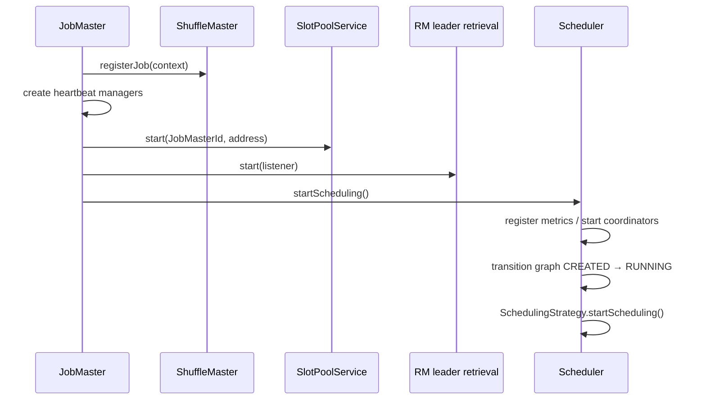

# Управление заданием, планирование и владение ресурсами Flink

Исследуемая ревизия: `068f428b29f4d9ee587fa1006d2f1a69b43c0000`. Это развивающаяся глава по непосредственно прочитанному коду. Полное чтение назначенного домена **не завершено**: окончательную границу прочитанного задаёт `readers/control.confirmed.jsonl`, а не наличие файла в инвентаре и не журнал вывода `control.exposures.jsonl`. Неподтверждённые файлы остаются непрочитанными. Прочитанные тесты ниже рассматриваются как спецификация сценариев; тесты не запускались. Исходники Flink не изменялись, сборка не выполнялась.

## 1. Объекты с разными сроками жизни

`JobMaster` — RPC endpoint, ответственный за один `ExecutionPlan`, с неизменяемым `JobMasterId` как fencing token. Его поля связывают план, `SchedulerNG`, slot pool, соединения с TaskManager и ResourceManager, heartbeat managers, shuffle master и partition tracker. Такое связывание не означает, что `JobMaster` реализует алгоритм размещения: `startScheduling`, `cancel`, обновление состояния task, checkpoint/savepoint и запросы к operator coordinator передаются scheduler. [JobMaster:144–250](https://github.com/apache/flink/blob/068f428b29f4d9ee587fa1006d2f1a69b43c0000/flink-runtime/src/main/java/org/apache/flink/runtime/jobmaster/JobMaster.java#L144), [создание scheduler](https://github.com/apache/flink/blob/068f428b29f4d9ee587fa1006d2f1a69b43c0000/flink-runtime/src/main/java/org/apache/flink/runtime/jobmaster/JobMaster.java#L423).

Полезно различать как минимум четыре идентичности:

| Идентичность | Какое владение ограничивает | Непосредственное свидетельство |
|---|---|---|
| `JobID` | Логическое задание, для которого регистрируется TaskManager | `registerTaskManager` отвергает другой JobID |
| `JobMasterId` | Действующая инстанция управляющего RPC endpoint | Наследование `FencedRpcEndpoint<JobMasterId>`, передача токена в pool и task gateway |
| `ExecutionGraphID` | Конкретный execution graph для задания | Новый ID в конструкторе; комментарий отдельно называет повторную submission, failover JM и rescaling |
| `ExecutionAttemptID` | Одна попытка выполнения конкретного subtask | Конструируется из graph ID, vertex ID и attempt number |

См. [ExecutionGraphID](https://github.com/apache/flink/blob/068f428b29f4d9ee587fa1006d2f1a69b43c0000/flink-runtime/src/main/java/org/apache/flink/runtime/executiongraph/DefaultExecutionGraph.java#L142), [создание attempt ID](https://github.com/apache/flink/blob/068f428b29f4d9ee587fa1006d2f1a69b43c0000/flink-runtime/src/main/java/org/apache/flink/runtime/executiongraph/Execution.java#L220), [проверку JobID](https://github.com/apache/flink/blob/068f428b29f4d9ee587fa1006d2f1a69b43c0000/flink-runtime/src/main/java/org/apache/flink/runtime/jobmaster/JobMaster.java#L804). Подмена этих идентичностей одним «идентификатором задачи» потеряла бы возможность отвергать сообщения от прошлой попытки или прошлого управляющего процесса.

`ExecutionVertex` может выполняться повторно; `Execution` хранит одну попытку: состояние, логический slot, allocation ID, state restore descriptor, produced partition descriptors и futures завершения. Поэтому новая попытка — самостоятельный объект состояния, а не возвращение завершённой попытки в RUNNING. `Execution` запрещает выход из terminal state. Реестр `currentExecutions` в графе индексирован полным attempt ID; неизвестное обновление состояния возвращает `false`, которое `JobMaster` преобразует в отрицательный ответ. [Execution:102–205](https://github.com/apache/flink/blob/068f428b29f4d9ee587fa1006d2f1a69b43c0000/flink-runtime/src/main/java/org/apache/flink/runtime/executiongraph/Execution.java#L102), [запрет выхода](https://github.com/apache/flink/blob/068f428b29f4d9ee587fa1006d2f1a69b43c0000/flink-runtime/src/main/java/org/apache/flink/runtime/executiongraph/Execution.java#L1669), [реестр попыток](https://github.com/apache/flink/blob/068f428b29f4d9ee587fa1006d2f1a69b43c0000/flink-runtime/src/main/java/org/apache/flink/runtime/executiongraph/DefaultExecutionGraph.java#L1593).

## 2. Исполнитель управляющего состояния и асинхронные операции

Контракт `SchedulerNG` прямо обещает отсутствие конкурентных вызовов: все обращения приходят из `ComponentMainThreadExecutor`. `SchedulerBase` проверяет этот контракт в lifecycle-методах, запросах графа и операциях checkpoint/savepoint. Граф также использует executor главного потока JobMaster. `start` графа устанавливает executor; до этого хранится dummy executor с диагностикой о необходимости инициализации. Это ограничение владения изменяемыми коллекциями графа и scheduler, а не запрет фоновых вычислений. [SchedulerNG:66–75](https://github.com/apache/flink/blob/068f428b29f4d9ee587fa1006d2f1a69b43c0000/flink-runtime/src/main/java/org/apache/flink/runtime/scheduler/SchedulerNG.java#L66), [инициализация graph executor](https://github.com/apache/flink/blob/068f428b29f4d9ee587fa1006d2f1a69b43c0000/flink-runtime/src/main/java/org/apache/flink/runtime/executiongraph/DefaultExecutionGraph.java#L375).

В `Execution.deploy` граница потоков выражена явно:

1. На main thread проверяются slot, состояние SCHEDULED, принадлежность payload, затем состояние становится DEPLOYING и фиксируется pending deployment.
2. Снимок `taskRestore` передаётся background executor для сериализации и возможного offload в blob storage.
3. Формирование `TaskDeploymentDescriptor`, обращающееся к execution graph, возвращается на main thread и повторно проверяет DEPLOYING.
4. Отправка `submitTask` и сериализация TDD происходят на background executor.
5. Обработка результата возвращается на main thread; очистка временного blob запускается асинхронно, `taskRestore` обнуляется.

Этот повторный state check закрывает промежуток, в котором cancel/failure мог сделать подготовленную операцию устаревшей. Успешный `submitTask` вызывает `notifyCompletedDeployment`, но сам не переводит попытку в RUNNING: INITIALIZING и RUNNING приходят как task state updates. [Полный deploy path](https://github.com/apache/flink/blob/068f428b29f4d9ee587fa1006d2f1a69b43c0000/flink-runtime/src/main/java/org/apache/flink/runtime/executiongraph/Execution.java#L575), [проверка после offload](https://github.com/apache/flink/blob/068f428b29f4d9ee587fa1006d2f1a69b43c0000/flink-runtime/src/main/java/org/apache/flink/runtime/executiongraph/Execution.java#L745), [обновления состояния](https://github.com/apache/flink/blob/068f428b29f4d9ee587fa1006d2f1a69b43c0000/flink-runtime/src/main/java/org/apache/flink/runtime/executiongraph/DefaultExecutionGraph.java#L1452).

Комментарии о lock-free/atomic transitions в начале `Execution` нельзя принимать за доказательство наличия CAS в текущей реализации: прочитанный `transitionState` сравнивает поле `state` с ожидаемым значением и присваивает новое; сериализация управления обеспечивается main-thread contract. Некоторые поля volatile, а accumulators имеют собственный lock. Это описание конкретной ревизии, не реконструкция по историческому комментарию.

Граница JobManager/TaskManager также требует точности. TaskManager исполняет потоковые задачи; утверждение «на JobManager никогда не выполняется user code» слишком сильное. `JobMaster.updateGlobalAggregate` десериализует пользовательскую `AggregateFunction` и вызывает `createAccumulator`, `add`, `getResult`; успешное завершение графа вызывает `JobVertex.finalizeOnMaster`. В этом же контуре существуют master hooks и operator coordinators. [Global aggregate](https://github.com/apache/flink/blob/068f428b29f4d9ee587fa1006d2f1a69b43c0000/flink-runtime/src/main/java/org/apache/flink/runtime/jobmaster/JobMaster.java#L999), [finalizeOnMaster](https://github.com/apache/flink/blob/068f428b29f4d9ee587fa1006d2f1a69b43c0000/flink-runtime/src/main/java/org/apache/flink/runtime/executiongraph/DefaultExecutionGraph.java#L1275).

## 3. Создание, запуск и остановка

`SchedulerBase` в конструкторе создаёт checkpoint store, checkpoint ID counter и tracker, затем через `ExecutionGraphFactory` создаёт и восстанавливает граф. На готовый граф устанавливаются listener внутренних task failures, job status listener и main-thread executor. Затем инициализируются operator coordinator holders. Это объясняет историческую сцепленность: восстановление state происходит до полного запуска scheduler и требует уже существующих holders; комментарии `SchedulerNG` и `SchedulerBase` прямо называют её препятствием вынесению coordinators в JobMaster. [SchedulerBase constructor](https://github.com/apache/flink/blob/068f428b29f4d9ee587fa1006d2f1a69b43c0000/flink-runtime/src/main/java/org/apache/flink/runtime/scheduler/SchedulerBase.java#L192), [createAndRestoreExecutionGraph](https://github.com/apache/flink/blob/068f428b29f4d9ee587fa1006d2f1a69b43c0000/flink-runtime/src/main/java/org/apache/flink/runtime/scheduler/SchedulerBase.java#L407), [объяснение сцепленности](https://github.com/apache/flink/blob/068f428b29f4d9ee587fa1006d2f1a69b43c0000/flink-runtime/src/main/java/org/apache/flink/runtime/scheduler/SchedulerBase.java#L1132).

Последовательность `JobMaster.onStart → startJobExecution`:

Источник: [JobMaster:1173–1207](https://github.com/apache/flink/blob/068f428b29f4d9ee587fa1006d2f1a69b43c0000/flink-runtime/src/main/java/org/apache/flink/runtime/jobmaster/JobMaster.java#L1173), [SchedulerBase.startScheduling](https://github.com/apache/flink/blob/068f428b29f4d9ee587fa1006d2f1a69b43c0000/flink-runtime/src/main/java/org/apache/flink/runtime/scheduler/SchedulerBase.java#L668), [DefaultScheduler.startSchedulingInternal](https://github.com/apache/flink/blob/068f428b29f4d9ee587fa1006d2f1a69b43c0000/flink-runtime/src/main/java/org/apache/flink/runtime/scheduler/DefaultScheduler.java#L248). Запуск RM leader retrieval означает возможность последующего подключения; это не синхронное получение всех slots перед запуском scheduler.

`JobMaster.onStop` запускает `stopJobExecution`. Сначала закрываются job metrics/status listener и вызывается `scheduler.closeAsync`; дальнейшие действия выполняются после его future на main thread: unregister shuffle job, disconnect TaskManagers/ResourceManager, stop RM leader retrieval, close slot pool и stop heartbeat managers. Ошибки сворачиваются в `JobMasterException`. При ошибке запуска сервисов предусмотрена попытка их остановки с сохранением suppressed exception. [Остановка](https://github.com/apache/flink/blob/068f428b29f4d9ee587fa1006d2f1a69b43c0000/flink-runtime/src/main/java/org/apache/flink/runtime/jobmaster/JobMaster.java#L1237).

`SchedulerBase.closeAsync` отличается от пользовательского cancel: он повышает версии всех vertices, отменяет pending slot requests, переводит graph в SUSPENDED и освобождает coordinators. После graph termination закрываются checkpoint store и ID counter, затем `CheckpointsCleaner`. Будущий результат close связан с завершением этой цепочки. `cancel` повышает версии и отменяет pending requests, но передаёт графу именно `cancel`, а не suspend. [close/cancel](https://github.com/apache/flink/blob/068f428b29f4d9ee587fa1006d2f1a69b43c0000/flink-runtime/src/main/java/org/apache/flink/runtime/scheduler/SchedulerBase.java#L710).

## 4. Размещение и защита от устаревших продолжений

`DefaultScheduler` разделяет policy (`SchedulingStrategy`), выбор slots (`ExecutionSlotAllocator`), действия с executions (`ExecutionOperations`), обработку отказов (`ExecutionFailureHandler`) и orchestration размещения (`ExecutionDeployer`). Вызов `allocateSlotsAndDeploy` сначала фиксирует новые версии vertices и извлекает текущие attempts, затем передаёт обе структуры deployer. [Состав scheduler](https://github.com/apache/flink/blob/068f428b29f4d9ee587fa1006d2f1a69b43c0000/flink-runtime/src/main/java/org/apache/flink/runtime/scheduler/DefaultScheduler.java#L171), [allocateSlotsAndDeploy](https://github.com/apache/flink/blob/068f428b29f4d9ee587fa1006d2f1a69b43c0000/flink-runtime/src/main/java/org/apache/flink/runtime/scheduler/DefaultScheduler.java#L484).

`DefaultExecutionDeployer` допускает вход только из CREATED, переводит attempts в SCHEDULED, запрашивает logical slots по attempt IDs, присваивает ресурсы и регистрирует произведённые partitions. Он ждёт завершения assignment/registration futures всей переданной группы, после чего обходит deployment handles. Каждая попытка повторно проверяет SCHEDULED и сохранённую vertex version. Устаревший успешный slot result освобождается, устаревшая ошибка не превращается в новый task failure. Ошибка timeout получения slot оборачивается в `NoResourceAvailableException`; registration produced partitions имеет отдельный timeout. [Deployer orchestration](https://github.com/apache/flink/blob/068f428b29f4d9ee587fa1006d2f1a69b43c0000/flink-runtime/src/main/java/org/apache/flink/runtime/scheduler/DefaultExecutionDeployer.java#L89), [assignment fence](https://github.com/apache/flink/blob/068f428b29f4d9ee587fa1006d2f1a69b43c0000/flink-runtime/src/main/java/org/apache/flink/runtime/scheduler/DefaultExecutionDeployer.java#L202), [deployment fence](https://github.com/apache/flink/blob/068f428b29f4d9ee587fa1006d2f1a69b43c0000/flink-runtime/src/main/java/org/apache/flink/runtime/scheduler/DefaultExecutionDeployer.java#L292).

`ExecutionVertexVersioner` — локальный счётчик модификаций каждого vertex. Он увеличивается при новом deployment или invalidation, а отложенное продолжение принимает снимок и проверяет равенство. Это самостоятельная защита внутри действующего JobMaster; RPC leader token решает другую задачу. `ExecutionVertexVersionerTest` задаёт сценарии unchanged/modified, неизвестной версии и фильтрации подмножества unmodified vertices. Прочитанные assertions подтверждают намерение контракта, а не результат исполнения тестов. [Versioner](https://github.com/apache/flink/blob/068f428b29f4d9ee587fa1006d2f1a69b43c0000/flink-runtime/src/main/java/org/apache/flink/runtime/scheduler/ExecutionVertexVersioner.java#L45), [тесты](https://github.com/apache/flink/blob/068f428b29f4d9ee587fa1006d2f1a69b43c0000/flink-runtime/src/test/java/org/apache/flink/runtime/scheduler/ExecutionVertexVersionerTest.java#L53).

## 5. Pool: требование, выделение, резервирование и возврат

В `DefaultDeclarativeSlotPool` хранятся разные величины: `totalResourceRequirements`, `fulfilledResourceRequirements`, набор выделенных/free slots и соответствие `AllocationID → matched requirement ResourceProfile`. Профиль фактически полученного slot может удовлетворять нескольким требованиям; выбранное соответствие нужно сохранить, чтобы корректно вычесть ресурс при возврате. [Поля и назначение](https://github.com/apache/flink/blob/068f428b29f4d9ee587fa1006d2f1a69b43c0000/flink-runtime/src/main/java/org/apache/flink/runtime/jobmaster/slotpool/DefaultDeclarativeSlotPool.java#L60).

Документация самого класса запрещает смешивать два способа учёта:

| Режим | Откуда берётся потребность | Что означает free/reserve |
|---|---|---|
| Legacy, DefaultScheduler | Запрос slot увеличивает requirement; освобождение уменьшает его через возвращённый `ResourceCounter` | Reservation тесно связана с требованием |
| Declarative, AdaptiveScheduler | Требования выводятся из текущих нужд всего задания | Можно многократно reserve/free без изменения requirements |

Это свидетельство контракта pool и его клиентов, не полное исследование ещё не прочитанного AdaptiveScheduler.

`offerSlots` принимает только нужные slots, повторный offer уже известного allocation ID возвращается как принятый без повторного добавления. Вначале обновляется fulfilled accounting и mapping, затем slots добавляются в pool и вызывается единственный new-slots listener. `registerSlots` — специальный путь для recovered TM в фазе restarting без выставленных requirements: не совпавший slot сопоставляется `ResourceProfile.ANY`, затем при reservation mapping меняется. [Приём offers](https://github.com/apache/flink/blob/068f428b29f4d9ee587fa1006d2f1a69b43c0000/flink-runtime/src/main/java/org/apache/flink/runtime/jobmaster/slotpool/DefaultDeclarativeSlotPool.java#L232), [recovery registration](https://github.com/apache/flink/blob/068f428b29f4d9ee587fa1006d2f1a69b43c0000/flink-runtime/src/main/java/org/apache/flink/runtime/jobmaster/slotpool/DefaultDeclarativeSlotPool.java#L289).

`reserveFreeSlot` проверяет достаточность actual profile. Если slot резервируется под другое требование, меняются mapping и fulfilled counters; для обычного предыдущего требования корректируется также total requirements, чтобы не недозаказать исходный профиль. Wildcard ANY не требует такой коррекции. `freeReservedSlot` освобождает payload, возвращает slot в free pool, уведомляет listener и сообщает ранее выполнявшееся requirement. Это ещё не физический возврат TaskManager. [Reserve/rematch](https://github.com/apache/flink/blob/068f428b29f4d9ee587fa1006d2f1a69b43c0000/flink-runtime/src/main/java/org/apache/flink/runtime/jobmaster/slotpool/DefaultDeclarativeSlotPool.java#L393), [freeReservedSlot](https://github.com/apache/flink/blob/068f428b29f4d9ee587fa1006d2f1a69b43c0000/flink-runtime/src/main/java/org/apache/flink/runtime/jobmaster/slotpool/DefaultDeclarativeSlotPool.java#L435).

Idle release требует одновременно избытка `fulfilled − total` и истечения `idleSlotTimeout` у свободного slot подходящего matched profile. После удаления slot уменьшается fulfilled counter, удаляется mapping и отправляется `TaskManagerGateway.freeSlot`. Неуспешный RPC только логируется: код ссылается на синхронизацию slot status следующим heartbeat. Следовательно локальное удаление allocation и подтверждение удалённого освобождения — разные события. [Idle release](https://github.com/apache/flink/blob/068f428b29f4d9ee587fa1006d2f1a69b43c0000/flink-runtime/src/main/java/org/apache/flink/runtime/jobmaster/slotpool/DefaultDeclarativeSlotPool.java#L553).

`DeclarativeSlotPoolService` добавляет lifecycle CREATED → STARTED → CLOSED, реестр зарегистрированных TaskManagers и RM connection manager. После подключения к RM он повторно объявляет все текущие requirements; сообщение содержит JobID, ApplicationID и JobManager address, а RPC `declareRequiredResources` получает JobMasterId. Offers от незарегистрированного TaskManager игнорируются. `createAllocatedSlotReport` сообщает physical slot number и allocation ID каждого slot данного TM. [Service lifecycle](https://github.com/apache/flink/blob/068f428b29f4d9ee587fa1006d2f1a69b43c0000/flink-runtime/src/main/java/org/apache/flink/runtime/jobmaster/slotpool/DeclarativeSlotPoolService.java#L127), [RM declaration/report](https://github.com/apache/flink/blob/068f428b29f4d9ee587fa1006d2f1a69b43c0000/flink-runtime/src/main/java/org/apache/flink/runtime/jobmaster/slotpool/DeclarativeSlotPoolService.java#L299).

Отдельный reservation учёт `DefaultScheduler` нужен local recovery: vertex сохраняет prior allocation до назначения нового либо успешного завершения; несколько vertices могут ссылаться на один allocation, поэтому используется reference counter. Этот reservation — предпочтение сохранения ресурсов для recovery, а не доказательство работающего task или физической занятости slot. [Reservation accounting](https://github.com/apache/flink/blob/068f428b29f4d9ee587fa1006d2f1a69b43c0000/flink-runtime/src/main/java/org/apache/flink/runtime/scheduler/DefaultScheduler.java#L497).

## 6. Регистрация, leadership и reconciliation

`FencedRpcEndpoint` задаёт контракт: RPC исполняется только при совпадении токена сообщения с токеном endpoint. Базовый класс хранит token; прочитанный `FencedPekkoRpcActor.handleRpcMessage` реализует проверку: требует `FencedMessage`, ненулевой expected token и `Objects.equals`; иначе возвращает `FencingTokenException` либо `UnknownMessageException`. Локальные self messages также оборачиваются текущим token. [FencedRpcEndpoint](https://github.com/apache/flink/blob/068f428b29f4d9ee587fa1006d2f1a69b43c0000/flink-rpc/flink-rpc-core/src/main/java/org/apache/flink/runtime/rpc/FencedRpcEndpoint.java#L28), [backend enforcement](https://github.com/apache/flink/blob/068f428b29f4d9ee587fa1006d2f1a69b43c0000/flink-rpc/flink-rpc-akka/src/main/java/org/apache/flink/runtime/rpc/pekko/FencedPekkoRpcActor.java#L63).

У JobMaster есть дополнительные проверки асинхронного подключения. RM leader notification ставится в `runAsync`; новое лидерство закрывает прежнее соединение и инициирует регистрацию. Успешный callback сначала проверяет объектную идентичность connection с текущим `resourceManagerConnection`; establishment затем сравнивает RM leader ID. Только после этого slot pool и partition tracker подключаются к gateway, регистрируется blocklist listener и начинается heartbeat monitoring. `disconnectResourceManager` от старого leader ID не запускает reconnect к новому лидеру. При shutdown address сбрасывается, чтобы позднее событие не запустило новое соединение. [RM connect/establish](https://github.com/apache/flink/blob/068f428b29f4d9ee587fa1006d2f1a69b43c0000/flink-runtime/src/main/java/org/apache/flink/runtime/jobmaster/JobMaster.java#L1339), [callback identity check](https://github.com/apache/flink/blob/068f428b29f4d9ee587fa1006d2f1a69b43c0000/flink-runtime/src/main/java/org/apache/flink/runtime/jobmaster/JobMaster.java#L1607), [disconnect filtering](https://github.com/apache/flink/blob/068f428b29f4d9ee587fa1006d2f1a69b43c0000/flink-runtime/src/main/java/org/apache/flink/runtime/jobmaster/JobMaster.java#L912).

TaskManager registration различает ResourceID и session UUID. Повтор той же сессии идемпотентно подтверждается; новая сессия с тем же ResourceID вызывает disconnect старого TM, потому что интерпретируется как restart. После RPC connect на main thread регистрируется pool ownership, gateway/location/session сохраняются и включается heartbeat monitoring. Offer slots разрешён только известному TM; task gateway оборачивается текущим JobMaster token. [TM registration](https://github.com/apache/flink/blob/068f428b29f4d9ee587fa1006d2f1a69b43c0000/flink-runtime/src/main/java/org/apache/flink/runtime/jobmaster/JobMaster.java#L804), [offerSlots](https://github.com/apache/flink/blob/068f428b29f4d9ee587fa1006d2f1a69b43c0000/flink-runtime/src/main/java/org/apache/flink/runtime/jobmaster/JobMaster.java#L740).

Heartbeat несёт не только liveness. От TM приходят deployment report и accumulator snapshots; к TM уходит allocated-slot report. `DefaultExecutionDeploymentReconciler` вычисляет unknown deployments как reported minus expected, а missing — expected, отсутствующие в reported, кроме PENDING. Неизвестные attempts JobMaster отменяет на TM, отсутствующие подтверждённые deployments переводит в FAILED через scheduler. Исключение PENDING принципиально: heartbeat может опередить доставку/подтверждение submitTask. [Алгоритм reconciliation](https://github.com/apache/flink/blob/068f428b29f4d9ee587fa1006d2f1a69b43c0000/flink-runtime/src/main/java/org/apache/flink/runtime/jobmaster/DefaultExecutionDeploymentReconciler.java#L41), [реакции JM](https://github.com/apache/flink/blob/068f428b29f4d9ee587fa1006d2f1a69b43c0000/flink-runtime/src/main/java/org/apache/flink/runtime/jobmaster/JobMaster.java#L284), [payload processing](https://github.com/apache/flink/blob/068f428b29f4d9ee587fa1006d2f1a69b43c0000/flink-runtime/src/main/java/org/apache/flink/runtime/jobmaster/JobMaster.java#L1684).

Полностью прочитанный `DefaultExecutionDeploymentReconcilerTest` содержит matching, missing, unknown, mixed и pending сценарии. Последний проверяет, что отсутствующий PENDING не становится missing, а неизвестный reported attempt остаётся unknown. Проверка тестами здесь установлена по assertions исходника, без запуска. [Тестовые сценарии](https://github.com/apache/flink/blob/068f428b29f4d9ee587fa1006d2f1a69b43c0000/flink-runtime/src/test/java/org/apache/flink/runtime/jobmaster/DefaultExecutionDeploymentReconcilerTest.java#L41).

## 7. Failure и региональное восстановление

При принятом task update `SchedulerBase` сначала находит attempt и применяет update в graph. Scheduler hook вызывается только если фактическое итоговое состояние совпало с заявленным; сейчас dispatch нужен для FINISHED и FAILED. Внутренняя ошибка execution graph направляется обратно в scheduler через listener, чтобы policy восстановления оставалась у scheduler. [Эффективное обновление](https://github.com/apache/flink/blob/068f428b29f4d9ee587fa1006d2f1a69b43c0000/flink-runtime/src/main/java/org/apache/flink/runtime/scheduler/SchedulerBase.java#L807), [internal task failure](https://github.com/apache/flink/blob/068f428b29f4d9ee587fa1006d2f1a69b43c0000/flink-runtime/src/main/java/org/apache/flink/runtime/executiongraph/Execution.java#L1333).

`DefaultScheduler` сообщает coordinator о failure с subtask index и attempt number, получает `FailureHandlingResult` от `ExecutionFailureHandler` и либо восстанавливает vertices, либо окончательно failJob. `ExecutionFailureHandler` отделяет область перезапуска (`FailoverStrategy`) от разрешения и задержки (`RestartBackoffTimeStrategy`). Для global failure область — все vertices. Классифицированная `NonRecoverableError`, включая вложенную причину, сразу даёт unrecoverable result; иначе `notifyFailure` сообщает, считается ли событие новой recovery attempt, `canRestart` решает допустимость, `getBackoffTime` задаёт delay. Счётчик рестартов увеличивается только для разрешённой новой recovery attempt, поэтому несколько concurrent exceptions не обязаны означать несколько рестартов. Failure labels возвращаются отдельным future; метрики дополняются после их готовности на main thread. [Failure dispatch](https://github.com/apache/flink/blob/068f428b29f4d9ee587fa1006d2f1a69b43c0000/flink-runtime/src/main/java/org/apache/flink/runtime/scheduler/DefaultScheduler.java#L277), [FailureHandler policy](https://github.com/apache/flink/blob/068f428b29f4d9ee587fa1006d2f1a69b43c0000/flink-runtime/src/main/java/org/apache/flink/runtime/executiongraph/failover/ExecutionFailureHandler.java#L177).

`RestartPipelinedRegionFailoverStrategy` обходит граф регионов в ширину. Начальная область содержит failed region. Для каждого включённого региона добавляются producer regions недоступных входных partitions и все consumer regions его выходов, затем правило повторяется до замыкания. Availability требует одновременно отсутствия временной отметки failure, подтверждения partition tracker/checker и reconsumable type либо специального `PIPELINED_APPROXIMATE`. `PartitionException` временно помечает соответствующий partition unavailable на время расчёта, даже если внешний checker считает его доступным. Из результирующих vertices исключаются CREATED: их ещё не нужно перезапускать. Identity sets не дают повторно обходить общие consumed-partition и consumer-vertex groups. Следовательно «перезапустить только упавший pipeline» недостаточно: потеря повторно используемого результата расширяет scope вверх, а повторное производство — вниз. [Region algorithm](https://github.com/apache/flink/blob/068f428b29f4d9ee587fa1006d2f1a69b43c0000/flink-runtime/src/main/java/org/apache/flink/runtime/executiongraph/failover/RestartPipelinedRegionFailoverStrategy.java#L97), [availability](https://github.com/apache/flink/blob/068f428b29f4d9ee587fa1006d2f1a69b43c0000/flink-runtime/src/main/java/org/apache/flink/runtime/executiongraph/failover/RestartPipelinedRegionFailoverStrategy.java#L290).

Два полностью прочитанных теста уточняют эти границы. `ExecutionFailureHandlerTest` различает обычный restart, подавление policy, nested unrecoverable cause, root/concurrent exceptions и global scope; unrecoverable failure считается root даже если backoff strategy не считает её новой attempt. `RestartPipelinedRegionFailoverStrategyTest` проверяет таблицу доступности двух blocking inputs, цепочку pipelined regions через blocking boundaries, CREATED exclusion, approximate recovery и hybrid edges. В hybrid сценарии HYBRID_SELECTIVE upstream включается в restart scope при availability checker, который по умолчанию возвращает true, поскольку тип не reconsumable. [Failure handler tests](https://github.com/apache/flink/blob/068f428b29f4d9ee587fa1006d2f1a69b43c0000/flink-runtime/src/test/java/org/apache/flink/runtime/executiongraph/failover/ExecutionFailureHandlerTest.java#L110), [region tests](https://github.com/apache/flink/blob/068f428b29f4d9ee587fa1006d2f1a69b43c0000/flink-runtime/src/test/java/org/apache/flink/runtime/executiongraph/failover/RestartPipelinedRegionFailoverStrategyTest.java#L174). Реальные результаты запуска этих тестов не получены.

В доказанном restart path порядок такой:

1. Зафиксировать новые версии выбранных vertices и добавить их в `verticesWaitingForRestart`; graph RUNNING → RESTARTING.
2. Отменить все pending slot requests этих vertices до отмены executions: иначе только что освобождённый slot может немедленно исполнить запрос той же отменяемой попытки.
3. Запустить cancellation всех current executions, сохранить failure snapshot для exception history.
4. По истечении restart delay дождаться также cancel future, затем на main thread взять только vertices с неизменившимися версиями.
5. Удалить их из pending set, resetForNewExecution, восстановить state, вызвать `SchedulingStrategy.restartTasks`.

[Последовательность restart](https://github.com/apache/flink/blob/068f428b29f4d9ee587fa1006d2f1a69b43c0000/flink-runtime/src/main/java/org/apache/flink/runtime/scheduler/DefaultScheduler.java#L358). Delay и cancellation могут идти одновременно; новое размещение начинается после обоих условий. Если более поздний failure/cancel изменил версию, старое отложенное продолжение не перезапускает vertex.

`SchedulerBase.restoreState` сначала сбрасывает end-of-data tracking. Без checkpoint coordinator он уведомляет coordinators об empty global restore либо subtask restore с `NO_CHECKPOINT`. При checkpointing он abort pending checkpoints до restore: комментарий отдельно связывает это с освобождением trigger и exactly-once. Global recovery восстанавливает state всего затронутого набора job vertices; local recovery вызывает restore для соответствующих job vertices и отдельно `subtaskReset` только нужным subtasks. Комментарий поясняет ограничение: checkpoint coordinator не знает точный subtask scope регионального восстановления; assignment для продолжающих работу attempts не действует. [Restore path](https://github.com/apache/flink/blob/068f428b29f4d9ee587fa1006d2f1a69b43c0000/flink-runtime/src/main/java/org/apache/flink/runtime/scheduler/SchedulerBase.java#L462).

## 8. Cancel, suspend, terminal и release — разные события

`JobMaster.cancel` вызывает `scheduler.cancel` и сразу возвращает `Acknowledge`. Это подтверждение команды; для окончания задания существует отдельный termination future. Graph переходит в CANCELLING, отменяет vertices и только после их завершения становится CANCELED. Окончательный failJob идёт через FAILING и cancellation; пользовательский cancel, пришедший во время FAILING, может привести к CANCELED. [Cancel RPC](https://github.com/apache/flink/blob/068f428b29f4d9ee587fa1006d2f1a69b43c0000/flink-runtime/src/main/java/org/apache/flink/runtime/jobmaster/JobMaster.java#L523), [graph cancel](https://github.com/apache/flink/blob/068f428b29f4d9ee587fa1006d2f1a69b43c0000/flink-runtime/src/main/java/org/apache/flink/runtime/executiongraph/DefaultExecutionGraph.java#L1032), [graph failJob](https://github.com/apache/flink/blob/068f428b29f4d9ee587fa1006d2f1a69b43c0000/flink-runtime/src/main/java/org/apache/flink/runtime/executiongraph/DefaultExecutionGraph.java#L1379).

Для `Execution.cancel` CREATED/SCHEDULED допускают непосредственное локальное завершение; DEPLOYING/INITIALIZING/RUNNING переходят в CANCELING и отправляют RPC отмены с retry. Отмена уже FINISHED execution дополнительно освобождает оставшиеся pipelined partitions. Если FINISHED приходит в CANCELING, отмена завершается: ждать отдельного CANCELED от TM уже нельзя. `suspend` локально и немедленно завершает активные attempts, не ожидая remote cancellation acknowledgment; graph требует atomic completion всех suspend futures. Даже локальный путь вызывает `startCancelling(0)` и может отправить cancel RPC, поэтому «suspend вообще не посылает RPC» также было бы неверно. [Execution.cancel/suspend](https://github.com/apache/flink/blob/068f428b29f4d9ee587fa1006d2f1a69b43c0000/flink-runtime/src/main/java/org/apache/flink/runtime/executiongraph/Execution.java#L852), [atomic cancellation helper](https://github.com/apache/flink/blob/068f428b29f4d9ee587fa1006d2f1a69b43c0000/flink-runtime/src/main/java/org/apache/flink/runtime/executiongraph/Execution.java#L1215), [graph suspend](https://github.com/apache/flink/blob/068f428b29f4d9ee587fa1006d2f1a69b43c0000/flink-runtime/src/main/java/org/apache/flink/runtime/executiongraph/DefaultExecutionGraph.java#L1102).

У attempt есть terminal-state future и отдельный release future. Первый завершается при установке terminal state после записи финальных accumulator/metrics, второй — после release assigned slot. Listeners и потребители terminal future должны видеть финальные метрики. Поздний heartbeat не перезаписывает accumulator завершённой попытки. Из финальных IO metrics удаляется объёмная детализация `resultPartitionBytes`, поскольку дальше она не используется. [Futures](https://github.com/apache/flink/blob/068f428b29f4d9ee587fa1006d2f1a69b43c0000/flink-runtime/src/main/java/org/apache/flink/runtime/executiongraph/Execution.java#L411), [release](https://github.com/apache/flink/blob/068f428b29f4d9ee587fa1006d2f1a69b43c0000/flink-runtime/src/main/java/org/apache/flink/runtime/executiongraph/Execution.java#L1610), [pre-completion action](https://github.com/apache/flink/blob/068f428b29f4d9ee587fa1006d2f1a69b43c0000/flink-runtime/src/main/java/org/apache/flink/runtime/executiongraph/Execution.java#L1654).

При глобальном FINISHED JobMaster освобождает job partitions и promote cluster partitions, затем передаёт архивированный `ExecutionGraphInfo` в completion actions. Ошибки release/promote логируются и не меняют успешно завершившееся задание; cleanup может быть доведён TaskExecutors после обнаружения закрытого JM. При других globally terminal states освобождаются все tracked partitions. [Terminal job cleanup](https://github.com/apache/flink/blob/068f428b29f4d9ee587fa1006d2f1a69b43c0000/flink-runtime/src/main/java/org/apache/flink/runtime/jobmaster/JobMaster.java#L1297).

## 9. Savepoint как управляемая остановка

`triggerSavepoint(cancelJob=true)` останавливает periodic checkpoint scheduler, ждёт успешного savepoint и затем запускает cancel. При ошибке savepoint periodic scheduler запускается снова. Возвращаемый path доказывает сохранение savepoint, но этот метод сам по себе не ждёт terminal state отменённого задания. `stopWithSavepoint` создаёт отдельную пару futures: synchronous savepoint и завершение всех executions; их согласует `StopWithSavepointTerminationManager`, реализация которого ещё требует полного чтения. Оба пути явно отвергают graph с blocking output. [Cancel-with-savepoint](https://github.com/apache/flink/blob/068f428b29f4d9ee587fa1006d2f1a69b43c0000/flink-runtime/src/main/java/org/apache/flink/runtime/scheduler/SchedulerBase.java#L939), [stop-with-savepoint](https://github.com/apache/flink/blob/068f428b29f4d9ee587fa1006d2f1a69b43c0000/flink-runtime/src/main/java/org/apache/flink/runtime/scheduler/SchedulerBase.java#L1075).

## 10. Runner и срок жизни leadership

`JobMasterServiceLeadershipRunner` владеет leader election, classloader lease, текущим `JobMasterServiceProcess` и отдельными gateway/result/termination futures. В отличие от main-thread scheduler здесь изменяемое состояние защищено lock; grant/revoke дополнительно сериализованы цепочкой `sequentialOperation`. Получив leadership, runner сначала асинхронно проверяет `JobResultStore.hasJobResultEntryAsync`: уже завершённый job не запускается вновь. Создание process, передача gateway/result и leadership confirmation привязаны к leader session ID; `runIfValidLeader` вызывает `hasLeadershipAsync` и повторно проверяет RUNNING перед действием. Новая process создаётся только когда close предыдущей уже завершён. [Runner responsibilities](https://github.com/apache/flink/blob/068f428b29f4d9ee587fa1006d2f1a69b43c0000/flink-runtime/src/main/java/org/apache/flink/runtime/jobmaster/JobMasterServiceLeadershipRunner.java#L51), [grant/check durable result](https://github.com/apache/flink/blob/068f428b29f4d9ee587fa1006d2f1a69b43c0000/flink-runtime/src/main/java/org/apache/flink/runtime/jobmaster/JobMasterServiceLeadershipRunner.java#L242), [validity check](https://github.com/apache/flink/blob/068f428b29f4d9ee587fa1006d2f1a69b43c0000/flink-runtime/src/main/java/org/apache/flink/runtime/jobmaster/JobMasterServiceLeadershipRunner.java#L486).

При revoke старый gateway future завершается ошибкой, создаётся новый pending future, сбрасывается флаг cancel текущего leader и закрывается process. Пользовательский cancel во время initialization может ждать gateway; запрос status при этом показывает CANCELLING вместо INITIALIZING. Закрытие runner прекращает дальнейший forwarding, сообщает SUSPENDED как runner result, ждёт process close, освобождает classloader lease и закрывает election. Результат job и завершение контейнера JobMaster снова являются разными событиями. [Cancel/status](https://github.com/apache/flink/blob/068f428b29f4d9ee587fa1006d2f1a69b43c0000/flink-runtime/src/main/java/org/apache/flink/runtime/jobmaster/JobMasterServiceLeadershipRunner.java#L186), [revoke](https://github.com/apache/flink/blob/068f428b29f4d9ee587fa1006d2f1a69b43c0000/flink-runtime/src/main/java/org/apache/flink/runtime/jobmaster/JobMasterServiceLeadershipRunner.java#L390).

`DefaultJobMasterServiceProcess` превращает асинхронное создание service в явные результаты. Initialization failure — `JobManagerRunnerResult.forInitializationFailure` с sparse archived graph; неожиданное завершение уже созданного service — инфраструктурная ошибка `jobMasterFailed`, а globally terminal state job — успешная доставка runner result независимо от того, FINISHED, FAILED или CANCELED сам job. Close во время незавершённого создания запоминается и закрывает service, когда тот появится; failure создания означает, что закрывать нечего. [Process construction](https://github.com/apache/flink/blob/068f428b29f4d9ee587fa1006d2f1a69b43c0000/flink-runtime/src/main/java/org/apache/flink/runtime/jobmaster/DefaultJobMasterServiceProcess.java#L84), [close](https://github.com/apache/flink/blob/068f428b29f4d9ee587fa1006d2f1a69b43c0000/flink-runtime/src/main/java/org/apache/flink/runtime/jobmaster/DefaultJobMasterServiceProcess.java#L146).

## 11. Dispatcher: admission, durable intent и cleanup

В этой ревизии Dispatcher учитывает приложения отдельно от jobs. Constructor восстанавливает `suspendedApplications`, `suspendedJobs`, связи job→application и dirty results; между recovered execution plans и dirty job results не должно быть пересечений по JobID. Аналогичная проверка есть для applications. `onStart` создаёт bootstrap и выбирает application/session recovery. В session mode application запускается раньше принадлежащих ему jobs: пользовательская логика может пропустить повторную submission уже выполненных jobs. Самостоятельный recovered job оборачивается в `SingleJobApplication`. [Recovered inventory](https://github.com/apache/flink/blob/068f428b29f4d9ee587fa1006d2f1a69b43c0000/flink-runtime/src/main/java/org/apache/flink/runtime/dispatcher/Dispatcher.java#L336), [recovery sequencing](https://github.com/apache/flink/blob/068f428b29f4d9ee587fa1006d2f1a69b43c0000/flink-runtime/src/main/java/org/apache/flink/runtime/dispatcher/Dispatcher.java#L702).

Job submission последовательно проверяет durable terminal result, active/waiting/suspended duplicates, полноту resource configuration и существование связанного application. `internalSubmitJob` резервирует JobID в outstanding set, ждёт termination старого runner с тем же ID, затем `persistAndRunJob` сначала записывает `ExecutionPlanWriter.putExecutionPlan`, а уже потом создаёт и запускает runner. Submission acknowledgment означает успешное принятие этой цепочки, а не выполнение operators. Ошибка submission запускает global cleanup и возвращает `JobSubmissionException`, сохраняя cleanup error как suppressed. [Admission](https://github.com/apache/flink/blob/068f428b29f4d9ee587fa1006d2f1a69b43c0000/flink-runtime/src/main/java/org/apache/flink/runtime/dispatcher/Dispatcher.java#L839), [persist-before-run](https://github.com/apache/flink/blob/068f428b29f4d9ee587fa1006d2f1a69b43c0000/flink-runtime/src/main/java/org/apache/flink/runtime/dispatcher/Dispatcher.java#L1277), [previous-runner barrier](https://github.com/apache/flink/blob/068f428b29f4d9ee587fa1006d2f1a69b43c0000/flink-runtime/src/main/java/org/apache/flink/runtime/dispatcher/Dispatcher.java#L2510).

Результат runner проверяется против текущей записи реестра по объектной идентичности. Initialization failure при RECOVERY трактуется как повод к fatal dispatcher failover с повторным восстановлением jobs; обычный globally terminal job идёт по протоколу завершения. SUSPENDED требует local cleanup, сохраняя durable intent для recovery. Для globally terminal job Dispatcher сохраняет `ExecutionGraphInfo`, опционально архивирует history, создаёт dirty `JobResultEntry` и только затем разрешает global cleanup. Ошибка записи dirty result направляется fatal handler: нельзя считать cleanup безопасно завершённым без durable маркера о том, что job уже закончен. [Runner result](https://github.com/apache/flink/blob/068f428b29f4d9ee587fa1006d2f1a69b43c0000/flink-runtime/src/main/java/org/apache/flink/runtime/dispatcher/Dispatcher.java#L1395), [terminal handling](https://github.com/apache/flink/blob/068f428b29f4d9ee587fa1006d2f1a69b43c0000/flink-runtime/src/main/java/org/apache/flink/runtime/dispatcher/Dispatcher.java#L2267).

Dirty/clean здесь — фаза удаления ресурсов, а не состояние обработки данных. Recovery dirty result запускает cleanup runner, не вычисление job. Job global cleanup ждёт появления dirty result приложения перед `markResultAsCleanAsync(jobId)`. Завершение application сначала доводит оставшиеся suspended jobs до cleanup, ждёт dirty markers всех jobs, создаёт archived application, сохраняет dirty application result, выполняет application cleanup и ждёт clean futures jobs; затем application result становится clean. Такая зависимость нужна для восстановления уборки после падения между записью результата и удалением artifacts. Конкретные cleaners, store atomicity и их тесты ещё требуют чтения, поэтому здесь установлен orchestration-порядок вызовов, не общая гарантия exactly-once cleanup. [Application termination](https://github.com/apache/flink/blob/068f428b29f4d9ee587fa1006d2f1a69b43c0000/flink-runtime/src/main/java/org/apache/flink/runtime/dispatcher/Dispatcher.java#L1012), [application clean](https://github.com/apache/flink/blob/068f428b29f4d9ee587fa1006d2f1a69b43c0000/flink-runtime/src/main/java/org/apache/flink/runtime/dispatcher/Dispatcher.java#L1207), [job clean](https://github.com/apache/flink/blob/068f428b29f4d9ee587fa1006d2f1a69b43c0000/flink-runtime/src/main/java/org/apache/flink/runtime/dispatcher/Dispatcher.java#L2178).

Есть два отдельных управляющих протокола. Обновление `JobResourceRequirements` блокирует параллельный update одного JobID, валидирует max parallelism, сохраняет требования в `ExecutionPlanWriter` на IO executor и только затем вызывает JobMaster; persistence failure явно означает «не применено». Client liveness включается лишь при positive initial heartbeat timeout, начальный срок выставляется после initialization runner; просроченный heartbeat вызывает cancel. Это не тот же heartbeat, которым JM следит за TM/RM. [Requirements update](https://github.com/apache/flink/blob/068f428b29f4d9ee587fa1006d2f1a69b43c0000/flink-runtime/src/main/java/org/apache/flink/runtime/dispatcher/Dispatcher.java#L2067), [client liveness](https://github.com/apache/flink/blob/068f428b29f4d9ee587fa1006d2f1a69b43c0000/flink-runtime/src/main/java/org/apache/flink/runtime/dispatcher/Dispatcher.java#L2022).

Прочитанный `RpcEndpoint` уточняет shutdown: во время асинхронного `onStop` endpoint уже не running, но может ещё обслуживать RPC до завершения stop future. `isRunning` доступен только на main thread; validation реализован Java assertion, а не обязательной production-проверкой. `MainThreadExecutor.schedule` использует отдельный таймер, который затем ставит `FutureTask` через gateway в endpoint thread; command не исполняется непосредственно timer thread. [RPC lifecycle contract](https://github.com/apache/flink/blob/068f428b29f4d9ee587fa1006d2f1a69b43c0000/flink-rpc/flink-rpc-core/src/main/java/org/apache/flink/runtime/rpc/RpcEndpoint.java#L74), [thread validation](https://github.com/apache/flink/blob/068f428b29f4d9ee587fa1006d2f1a69b43c0000/flink-rpc/flink-rpc-core/src/main/java/org/apache/flink/runtime/rpc/RpcEndpoint.java#L446), [timer routing](https://github.com/apache/flink/blob/068f428b29f4d9ee587fa1006d2f1a69b43c0000/flink-rpc/flink-rpc-core/src/main/java/org/apache/flink/runtime/rpc/RpcEndpoint.java#L516).

## 12. ResourceManager: отдельное владение ресурсами кластера

`ResourceManager` — fenced endpoint с собственным `ResourceManagerId`. Он владеет регистрациями JobMasters и TaskExecutors, `JobLeaderIdService`, `SlotManager`, cluster partition tracker, blocklist и delegation token distribution. JobMaster решает, как исполнять job; RM проверяет право этого JobMaster запрашивать ресурсы и связывает ресурсные требования с зарегистрированными workers. При старте RM запускает job-leader service, heartbeat managers, slot manager с текущим fencing token/main executor, delegation token manager и framework-specific initialization. Shutdown останавливает их, очищает локальные реестры и накапливает ошибки через suppressed exceptions. [RM composition/lifecycle](https://github.com/apache/flink/blob/068f428b29f4d9ee587fa1006d2f1a69b43c0000/flink-runtime/src/main/java/org/apache/flink/runtime/resourcemanager/ResourceManager.java#L123).

Регистрация JM проверяет два независимых результата: RPC connect с предоставленным JobMasterId и leader ID из HA `JobLeaderIdService`. Только совпадение позволяет `registerJobMasterInternal`. Новый leader заменяет старую регистрацию, но сохраняет требования (`RETAIN`). `declareRequiredResources` повторно сверяет JobMasterId с зарегистрированным и ждёт ready-to-serve future. Потеря heartbeat JM и потеря leadership также сохраняют требования; globally terminal disconnect удаляет job и очищает их (`CLEAR`). Это позволяет восстановившемуся JM повторно объявить потребность, не превращая каждую краткую потерю связи в немедленную отмену всей ресурсной ёмкости задания. [JM registration](https://github.com/apache/flink/blob/068f428b29f4d9ee587fa1006d2f1a69b43c0000/flink-runtime/src/main/java/org/apache/flink/runtime/resourcemanager/ResourceManager.java#L364), [requirements admission](https://github.com/apache/flink/blob/068f428b29f4d9ee587fa1006d2f1a69b43c0000/flink-runtime/src/main/java/org/apache/flink/runtime/resourcemanager/ResourceManager.java#L583), [retain/clear](https://github.com/apache/flink/blob/068f428b29f4d9ee587fa1006d2f1a69b43c0000/flink-runtime/src/main/java/org/apache/flink/runtime/resourcemanager/ResourceManager.java#L1137).

Регистрация TM проходит framework admission через `getWorkerNodeIfAcceptRegistration`; незнакомый worker может быть отвергнут. Асинхронный RPC-connect защищён сравнением future с последним future данного ResourceID. У принятой регистрации есть новый `InstanceID`; `sendSlotReport` и `notifySlotAvailable` проверяют его, поэтому сообщение от старой регистрации не освобождает ресурс новой. Первый slot report отдельно регистрирует TM в SlotManager и может привести к resource-limit rejection. Heartbeat report далее синхронизирует slot state и cluster partitions. Закрытие TM удаляет его из SlotManager/partition tracker и уведомляет все зарегистрированные JobMasters. [TM registration](https://github.com/apache/flink/blob/068f428b29f4d9ee587fa1006d2f1a69b43c0000/flink-runtime/src/main/java/org/apache/flink/runtime/resourcemanager/ResourceManager.java#L475), [slot availability fencing](https://github.com/apache/flink/blob/068f428b29f4d9ee587fa1006d2f1a69b43c0000/flink-runtime/src/main/java/org/apache/flink/runtime/resourcemanager/ResourceManager.java#L618), [TM disconnect fanout](https://github.com/apache/flink/blob/068f428b29f4d9ee587fa1006d2f1a69b43c0000/flink-runtime/src/main/java/org/apache/flink/runtime/resourcemanager/ResourceManager.java#L1177).

## 13. Fine-grained allocation и согласование slot state

`FineGrainedSlotManager` объединяет четыре компонента: `ResourceTracker` для requirements/acquired resources, `TaskManagerTracker` для capacity и pending workers, `ResourceAllocationStrategy` для расчёта размещения и `SlotStatusSyncer` для RPC/reconciliation. Проверка requirements и объявление требуемых workers могут откладываться и объединять несколько изменений. Результат strategy отдельно содержит allocations на зарегистрированных ресурсах, reservations на pending resources, новые pending workers и unfulfillable jobs. Максимум CPU/memory проверяется с учётом и registered, и pending capacity. [SlotManager composition](https://github.com/apache/flink/blob/068f428b29f4d9ee587fa1006d2f1a69b43c0000/flink-runtime/src/main/java/org/apache/flink/runtime/resourcemanager/slotmanager/FineGrainedSlotManager.java#L72), [matching orchestration](https://github.com/apache/flink/blob/068f428b29f4d9ee587fa1006d2f1a69b43c0000/flink-runtime/src/main/java/org/apache/flink/runtime/resourcemanager/slotmanager/FineGrainedSlotManager.java#L619).

Прочитанная `DefaultResourceAllocationStrategy` прямо отказывается от гарантии оптимальности и даже от обещания найти всякое существующее допустимое размещение. Она жадно использует registered resources раньше pending; blocked workers исключаются. Pending workers создаются с заранее заданным профилем; requirement, не помещающийся в worker profile, помечает job unfulfillable. Режим SLOTS предпочитает worker с меньшей utilization, MIN_RESOURCES — с большей; utilization считается максимумом доли CPU и доли total memory. Для pending capacity используется any-matching, чтобы меньше workers остались частично занятыми. Помимо требований jobs поддерживаются min total CPU/memory и reserve capacity, эквивалентная заданному числу redundant workers. [Strategy limits](https://github.com/apache/flink/blob/068f428b29f4d9ee587fa1006d2f1a69b43c0000/flink-runtime/src/main/java/org/apache/flink/runtime/resourcemanager/slotmanager/DefaultResourceAllocationStrategy.java#L46), [matching](https://github.com/apache/flink/blob/068f428b29f4d9ee587fa1006d2f1a69b43c0000/flink-runtime/src/main/java/org/apache/flink/runtime/resourcemanager/slotmanager/DefaultResourceAllocationStrategy.java#L299), [utilization](https://github.com/apache/flink/blob/068f428b29f4d9ee587fa1006d2f1a69b43c0000/flink-runtime/src/main/java/org/apache/flink/runtime/resourcemanager/slotmanager/DefaultResourceAllocationStrategy.java#L451).

При появлении TM без уже занятых slots SlotManager ищет совпадающий pending worker по total/default-slot profiles, предпочитая pending worker с reservations. Его pending allocations переходят на фактический InstanceID, после чего pending worker удаляется. TM с already allocated slots восстанавливается по report, не сопоставляется такому pending worker. Worker release также не равен slot free: strategy предлагает idle candidates; SlotManager вызывает `canBeReleased`, затем повторно проверяет неизменность `idleSince`, помечает worker unwanted и переобъявляет resource demand. Эта проверка защищает от использования worker во время удалённого canBeReleased. [Pending-worker registration](https://github.com/apache/flink/blob/068f428b29f4d9ee587fa1006d2f1a69b43c0000/flink-runtime/src/main/java/org/apache/flink/runtime/resourcemanager/slotmanager/FineGrainedSlotManager.java#L369), [idle release](https://github.com/apache/flink/blob/068f428b29f4d9ee587fa1006d2f1a69b43c0000/flink-runtime/src/main/java/org/apache/flink/runtime/resourcemanager/slotmanager/FineGrainedSlotManager.java#L888).

`DefaultSlotStatusSyncer.allocateSlot` создаёт AllocationID, отмечает slot PENDING и увеличивает acquired resources **до** `TaskExecutorGateway.requestSlot`. Иначе параллельный следующий расчёт считал бы эту ёмкость свободной. ACK переводит его в ALLOCATED; failure возвращает capacity, если allocation ещё актуален. Но heartbeat может обогнать ACK: если reported slot имеет известный PENDING allocation ID, report завершает allocation, удаляет pending marker и переводит его в ALLOCATED. Поздний RPC result после этого игнорируется. ALLOCATED, отсутствующий в полном report, освобождается; PENDING, отсутствующий в report, пока сохраняется, потому что report мог опередить allocation request. Неизвестный reported allocation восстанавливается в обоих trackers и заставляет пересчитать requirements. [Allocation protocol](https://github.com/apache/flink/blob/068f428b29f4d9ee587fa1006d2f1a69b43c0000/flink-runtime/src/main/java/org/apache/flink/runtime/resourcemanager/slotmanager/DefaultSlotStatusSyncer.java#L96), [report reconciliation](https://github.com/apache/flink/blob/068f428b29f4d9ee587fa1006d2f1a69b43c0000/flink-runtime/src/main/java/org/apache/flink/runtime/resourcemanager/slotmanager/DefaultSlotStatusSyncer.java#L244).

При очистке job RM может отправить `freeInactiveSlots`, но не уменьшает counters заранее: освобождение подтверждается последующим slot report, чтобы локальная capacity не опередила фактическую. Эта асимметрия существенна: allocation резервирует ёмкость заранее, reclamation возвращает её после наблюдения. [Inactive slot reclaim](https://github.com/apache/flink/blob/068f428b29f4d9ee587fa1006d2f1a69b43c0000/flink-runtime/src/main/java/org/apache/flink/runtime/resourcemanager/slotmanager/FineGrainedSlotManager.java#L328).

Полностью прочитанный `DefaultSlotStatusSyncerTest` содержит управляемые futures для ACK после free/remove, проверяет rollback timeout и reconciliation report, который освобождает исчезнувший ALLOCATED, сохраняя отсутствующий PENDING. Это отдельное тестовое свидетельство для гонки report/request. Тест не исполнялся. [Syncer tests](https://github.com/apache/flink/blob/068f428b29f4d9ee587fa1006d2f1a69b43c0000/flink-runtime/src/test/java/org/apache/flink/runtime/resourcemanager/slotmanager/DefaultSlotStatusSyncerTest.java#L66).

Внутри TM registration capacity задаётся `unusedResource − pendingResource`. PENDING сразу увеличивает pending; completion уменьшает pending и unused на одну и ту же величину, так что available capacity при ACK не списывается второй раз. Освобождение PENDING уменьшает pending, освобождение ALLOCATED увеличивает unused. Любая allocation снимает idle timestamp, последний free устанавливает его заново. Число free slots — совместимая метрика `max(defaultNumSlots − numberOfAllocations, 0)`, а не пересчёт многомерной capacity. В тесте один worker имеет 10 default slots, два allocations и 8 free slots, но фактически свободны 6 CPU и 700 MB после неравных allocations. [Registration accounting](https://github.com/apache/flink/blob/068f428b29f4d9ee587fa1006d2f1a69b43c0000/flink-runtime/src/main/java/org/apache/flink/runtime/resourcemanager/slotmanager/FineGrainedTaskManagerRegistration.java#L87), [compatibility slot count](https://github.com/apache/flink/blob/068f428b29f4d9ee587fa1006d2f1a69b43c0000/flink-runtime/src/main/java/org/apache/flink/runtime/resourcemanager/slotmanager/FineGrainedTaskManagerTracker.java#L335), [test statistics](https://github.com/apache/flink/blob/068f428b29f4d9ee587fa1006d2f1a69b43c0000/flink-runtime/src/test/java/org/apache/flink/runtime/resourcemanager/slotmanager/FineGrainedTaskManagerTrackerTest.java#L313).

`JobScopedResourceTracker` сохраняет двунаправленное соответствие actual resource profiles и требований, плюс excess resources. Уменьшение требований переводит лишние соответствия в excess; увеличение либо потеря ресурса пробует снова распределить excess. Очистка требований не означает потерю acquired resources. `DefaultResourceTracker` удаляет job tracker только когда исчезли и потребность, и оставшиеся ресурсы; loss после общего clear допускается и не создаёт новый tracker. Полностью прочитанные `JobScopedResourceTrackerTest`, `DefaultResourceTrackerTest`, `FineGrainedTaskManagerTrackerTest` и `FineGrainedTaskManagerRegistrationTest` проверяют эти переходы; они не запускались. [Job profile matching](https://github.com/apache/flink/blob/068f428b29f4d9ee587fa1006d2f1a69b43c0000/flink-runtime/src/main/java/org/apache/flink/runtime/resourcemanager/slotmanager/JobScopedResourceTracker.java#L59), [tracker lifetime](https://github.com/apache/flink/blob/068f428b29f4d9ee587fa1006d2f1a69b43c0000/flink-runtime/src/main/java/org/apache/flink/runtime/resourcemanager/slotmanager/DefaultResourceTracker.java#L43).

Для job-side pool прочитан также весь `DefaultDeclarativeSlotPoolTest`: duplicate offers не создают второго уведомления listener, idle release возвращает только excess, freeReservedSlot сохраняет прежний matched requirement и сам его не меняет. Rematch происходит при новом reserve; использование large slot под small requirement корректирует demand так, что исходная large потребность не теряется. [Pool test evidence](https://github.com/apache/flink/blob/068f428b29f4d9ee587fa1006d2f1a69b43c0000/flink-runtime/src/test/java/org/apache/flink/runtime/jobmaster/slotpool/DefaultDeclarativeSlotPoolTest.java#L589).

## 14. HA: выбор лидера, публикация адреса и владение планом

У `DefaultLeaderElectionService` есть registry contenders по `componentId` и один backend `LeaderElectionDriver`. Первый зарегистрированный contender создаёт driver, удаление последнего отсоединяет и закрывает его вне lock. Поэтому старый комментарий «handles a single LeaderContender» не описывает фактическую структуру этой ревизии. `DefaultLeaderElection` — отдельный handle компонента, делегирующий register/remove/confirm/hasLeadership parent service. [Registry/driver lifecycle](https://github.com/apache/flink/blob/068f428b29f4d9ee587fa1006d2f1a69b43c0000/flink-runtime/src/main/java/org/apache/flink/runtime/leaderelection/DefaultLeaderElectionService.java#L57), [component handle](https://github.com/apache/flink/blob/068f428b29f4d9ee587fa1006d2f1a69b43c0000/flink-runtime/src/main/java/org/apache/flink/runtime/leaderelection/DefaultLeaderElection.java#L30).

Issued leadership session и confirmed `LeaderInformation` разделены. Backend grant выдаёт session ID и уведомляет contenders; готовый компонент подтверждает session и адрес. Confirmation выполняется на leadership executor под lock, повторно требует driver.hasLeadership, текущий session и наличие регистрации, после чего публикует leader information. Устаревшее confirmation не публикуется. Grant/revoke обрабатываются последовательным executor; revoke очищает confirmed information и уведомляет contenders. При изменении внешнего leader information service восстанавливает его из своего confirmed состояния, включая empty до confirmation. Это защита публикации адреса, дополнительная к fencing прикладных RPC. [Confirmation](https://github.com/apache/flink/blob/068f428b29f4d9ee587fa1006d2f1a69b43c0000/flink-runtime/src/main/java/org/apache/flink/runtime/leaderelection/DefaultLeaderElectionService.java#L315), [revoke/repair](https://github.com/apache/flink/blob/068f428b29f4d9ee587fa1006d2f1a69b43c0000/flink-runtime/src/main/java/org/apache/flink/runtime/leaderelection/DefaultLeaderElectionService.java#L459).

`DefaultLeaderRetrievalService` независимо получает address/session из backend driver, уведомляет listener только при изменении хотя бы одного из них и игнорирует notifications/errors после stop. Это не проверка доступности endpoint: новый опубликованный адрес ещё должен пройти RPC connect и регистрацию. [Retrieval](https://github.com/apache/flink/blob/068f428b29f4d9ee587fa1006d2f1a69b43c0000/flink-runtime/src/main/java/org/apache/flink/runtime/leaderretrieval/DefaultLeaderRetrievalService.java#L86).

`DefaultExecutionPlanStore` хранит plans через `StateHandleStore` и различает локальное участие в плане (`addedExecutionPlans`) и его существование в storage. Recovery использует `getAndLock`, читает retrievable handle и сохраняет lock при успехе; failure освобождает lock. `putExecutionPlan` делает add-and-lock для отсутствующей записи, versioned replace только для собственного ранее добавленного/восстановленного plan и retry при конкурентном появлении/исчезновении. Local cleanup освобождает lock, global cleanup делает `releaseAndTryRemove` и считает невозможность удаления ошибкой. Update resource requirements восстанавливает plan, меняет его и сохраняет тем же путём. Backend lock semantics и version CAS нельзя вывести из этого класса без чтения конкретного StateHandleStore. [Recovery/write ownership](https://github.com/apache/flink/blob/068f428b29f4d9ee587fa1006d2f1a69b43c0000/flink-runtime/src/main/java/org/apache/flink/runtime/jobmanager/DefaultExecutionPlanStore.java#L135), [local/global cleanup](https://github.com/apache/flink/blob/068f428b29f4d9ee587fa1006d2f1a69b43c0000/flink-runtime/src/main/java/org/apache/flink/runtime/jobmanager/DefaultExecutionPlanStore.java#L270).

Filesystem result stores конкретизируют dirty/clean: dirty entry — JSON `<id>_DIRTY.json`, создаваемый с `NO_OVERWRITE`; clean либо переименовывает его в `<id>.json`, либо удаляет при `deleteOnCommit`. Recovery сканирует dirty files; application store дополнительно умеет читать сохранённый clean result. Значит dirty marker нужен для восстановления cleanup, но вечный tombstone завершённого JobID/ApplicationID не является безусловной гарантией: выбранная delete policy может его убрать. `AbstractThreadsafeJobResultStore` защищает операции локальным read/write lock и выполняет IO в отдельном executor; это само по себе не распределённый lock между процессами. [Job result persistence](https://github.com/apache/flink/blob/068f428b29f4d9ee587fa1006d2f1a69b43c0000/flink-runtime/src/main/java/org/apache/flink/runtime/highavailability/FileSystemJobResultStore.java#L155), [application result persistence](https://github.com/apache/flink/blob/068f428b29f4d9ee587fa1006d2f1a69b43c0000/flink-runtime/src/main/java/org/apache/flink/runtime/highavailability/FileSystemApplicationResultStore.java#L160), [local synchronization](https://github.com/apache/flink/blob/068f428b29f4d9ee587fa1006d2f1a69b43c0000/flink-runtime/src/main/java/org/apache/flink/runtime/highavailability/AbstractThreadsafeJobResultStore.java#L55).

## 15. ActiveResourceManager и внешние resource frameworks

`ActiveResourceManager` переводит декларации SlotManager в количество внешних workers заданного `WorkerResourceSpec`. Он отдельно учитывает requested-but-not-allocated futures, allocated-but-unregistered workers текущей attempt, recovered-but-unregistered workers и зарегистрированные workers. Счётчики pending и total увеличиваются до driver request; успешная allocation только создаёт worker identity и registration timeout. Регистрация TM через RM/SlotManager завершает pending-фазу. Ready-to-serve future ждёт регистрации recovered workers либо recovery timeout, чтобы не заказать новую ёмкость раньше восстановления старой. Ошибки запуска учитываются rate meter и могут включить cooldown. [Worker state accounting](https://github.com/apache/flink/blob/068f428b29f4d9ee587fa1006d2f1a69b43c0000/flink-runtime/src/main/java/org/apache/flink/runtime/resourcemanager/active/ActiveResourceManager.java#L91), [recovery gate](https://github.com/apache/flink/blob/068f428b29f4d9ee587fa1006d2f1a69b43c0000/flink-runtime/src/main/java/org/apache/flink/runtime/resourcemanager/active/ActiveResourceManager.java#L275), [request/timeout/cooldown](https://github.com/apache/flink/blob/068f428b29f4d9ee587fa1006d2f1a69b43c0000/flink-runtime/src/main/java/org/apache/flink/runtime/resourcemanager/active/ActiveResourceManager.java#L490).

При уменьшении demand освобождение идёт в порядке: явно unwanted workers, ещё не выделенные requests через future cancellation, starting workers и затем остальные registered workers подходящего profile. Точный внешний механизм изолирован в `ResourceManagerDriver`; abstract base передаёт ему event handler, main executor, IO executor и blocklist retriever. [Release reconciliation](https://github.com/apache/flink/blob/068f428b29f4d9ee587fa1006d2f1a69b43c0000/flink-runtime/src/main/java/org/apache/flink/runtime/resourcemanager/active/ActiveResourceManager.java#L327), [driver initialization](https://github.com/apache/flink/blob/068f428b29f4d9ee587fa1006d2f1a69b43c0000/flink-runtime/src/main/java/org/apache/flink/runtime/resourcemanager/active/AbstractResourceManagerDriver.java#L80).

| Событие | Kubernetes driver | YARN driver |
|---|---|---|
| Resource request | Создать pod с именем cluster/taskmanager/attempt/index и запомнить future по pod name | Вычислить priority/resource из process spec, поставить YARN ContainerRequest и future в очередь этого spec |
| Allocation считается полученной | Watch сообщил scheduled pod; API create ACK ещё недостаточен | Callback выделил matching container; future завершается до асинхронной подготовки launch context и запуска process |
| Устаревшая/лишняя allocation | Scheduled event без pending future игнорируется; cancellation/create race удаляет pod | Containers сверх pending requests возвращаются YARN; сверяется число запросов Flink и AMRMClient |
| Recovery внешних workers | Найти pods по labels; сохранить scheduled и nonterminated, удалить остальные; увеличить attempt ID | Принять containers previous attempts из ответа registerApplicationMaster |
| Worker termination | Terminated/deleted pod завершает pending request retryable error, сообщает RM и вызывает stopPod | AMRM completed callback сообщает RM diagnostics; NM start error освобождает container и сообщает termination |
| Закрытие driver | Закрыть watch и kube client; final deregistration отдельно cleanup cluster | Дождаться stop callbacks ранее освобождаемых containers через Phaser, затем остановить AMRM/NM clients; deregistration сообщает final status |

Источники: [Kubernetes request/recovery](https://github.com/apache/flink/blob/068f428b29f4d9ee587fa1006d2f1a69b43c0000/flink-kubernetes/src/main/java/org/apache/flink/kubernetes/KubernetesResourceManagerDriver.java#L173), [Kubernetes watch](https://github.com/apache/flink/blob/068f428b29f4d9ee587fa1006d2f1a69b43c0000/flink-kubernetes/src/main/java/org/apache/flink/kubernetes/KubernetesResourceManagerDriver.java#L356), [YARN request](https://github.com/apache/flink/blob/068f428b29f4d9ee587fa1006d2f1a69b43c0000/flink-yarn/src/main/java/org/apache/flink/yarn/YarnResourceManagerDriver.java#L265), [YARN allocation/launch](https://github.com/apache/flink/blob/068f428b29f4d9ee587fa1006d2f1a69b43c0000/flink-yarn/src/main/java/org/apache/flink/yarn/YarnResourceManagerDriver.java#L389).

Существенное следствие общей цепочки: внешний resource allocation future, запуск TaskExecutor process, регистрация TM в RM, назначение slot job и deployment execution — разные подтверждения. Полученный pod/container не доказывает готовность task. Прочитаны drivers целиком; их test suites, фабрики pod/container и остальной deployment code ещё не покрыты.

`PekkoRpcActor` подтверждает реальную сериализацию управляющих вызовов через actor message handling; `MainThreadValidatorUtil` запоминает текущий физический thread на входе в каждый вызов и сбрасывает на выходе. Термин «main thread» здесь нужно понимать как serial execution context endpoint, а не обещание неизменного thread ID на весь срок жизни actor. Remote responses сериализуются с проверкой frame size; futures отправляются асинхронным ответом. Состояние TERMINATING actor продолжает принимать RPC, что согласуется с lifecycle `RpcEndpoint`. [Actor processing](https://github.com/apache/flink/blob/068f428b29f4d9ee587fa1006d2f1a69b43c0000/flink-rpc/flink-rpc-akka/src/main/java/org/apache/flink/runtime/rpc/pekko/PekkoRpcActor.java#L168), [thread validator](https://github.com/apache/flink/blob/068f428b29f4d9ee587fa1006d2f1a69b43c0000/flink-rpc/flink-rpc-core/src/main/java/org/apache/flink/runtime/rpc/MainThreadValidatorUtil.java#L45).

## 16. AdaptiveScheduler: граф создаётся под доступную ёмкость

`AdaptiveScheduler` реализует тот же `SchedulerNG`, но не наследует `SchedulerBase`. Это отдельная state machine, способная жить без execution graph во время ожидания ресурсов и создавать новый graph после изменения parallelism. Constructor принимает только STREAMING job с положительной parallelism vertices и pipelined/pipelined-bounded inputs. Поэтому его нельзя автоматически распространить на произвольный batch/hybrid graph. Checkpoint store, ID counter и stats tracker принадлежат scheduler и переживают отдельные graph generations. [Adaptive structure/preconditions](https://github.com/apache/flink/blob/068f428b29f4d9ee587fa1006d2f1a69b43c0000/flink-runtime/src/main/java/org/apache/flink/runtime/scheduler/adaptive/AdaptiveScheduler.java#L174), [precondition implementation](https://github.com/apache/flink/blob/068f428b29f4d9ee587fa1006d2f1a69b43c0000/flink-runtime/src/main/java/org/apache/flink/runtime/scheduler/adaptive/AdaptiveScheduler.java#L638).

Desired capacity и sufficient capacity различны: desired выводится из job requirements и передаётся `DeclarativeSlotPool.setResourceRequirements`; sufficient означает, что slot allocator способен выбрать допустимую parallelism на имеющихся slots. При построении graph allocator выдаёт scheduling plan и assignment, graph получает выбранную parallelism, а исходная max parallelism сохраняется для согласованности между запусками. В REACTIVE mode desired parallelism выставляется на max; default wait timeout становится бесконечным, stabilization — нулевой. Изменение resource requirements через API в REACTIVE mode запрещено. [Desired/sufficient resources](https://github.com/apache/flink/blob/068f428b29f4d9ee587fa1006d2f1a69b43c0000/flink-runtime/src/main/java/org/apache/flink/runtime/scheduler/adaptive/AdaptiveScheduler.java#L1190), [reactive requirements](https://github.com/apache/flink/blob/068f428b29f4d9ee587fa1006d2f1a69b43c0000/flink-runtime/src/main/java/org/apache/flink/runtime/scheduler/adaptive/AdaptiveScheduler.java#L660).

Доказанная цепочка запуска: WaitingForResources → CreatingExecutionGraph → Executing. Первый state управляет resource wait timeout и stabilization. Создание graph и восстановление state идут на IO executor через `BackgroundTask`; результат возвращается на main executor. Abort у `BackgroundTask` предотвращает только ещё не начатую работу и не прерывает выполняющийся supplier; последовательная цепочка ждёт termination предыдущей задачи независимо от её успеха. Close scheduler aborts pending work и ждёт завершения background chain перед закрытием checkpoint services. Это предотвращает пересечение последовательных graph construction, но не делает уже начавшуюся тяжёлую операцию немедленно отменяемой. [Async construction](https://github.com/apache/flink/blob/068f428b29f4d9ee587fa1006d2f1a69b43c0000/flink-runtime/src/main/java/org/apache/flink/runtime/scheduler/adaptive/AdaptiveScheduler.java#L1511), [BackgroundTask semantics](https://github.com/apache/flink/blob/068f428b29f4d9ee587fa1006d2f1a69b43c0000/flink-runtime/src/main/java/org/apache/flink/runtime/scheduler/adaptive/BackgroundTask.java#L48).

Между расчётом scheduling plan и готовностью graph slots могут исчезнуть. `CreatingExecutionGraph` поэтому повторно пробует reservation/assignment: при неуспехе возвращается WaitingForResources, при успехе инициализирует coordinators, переводит graph в RUNNING, запускает coordinators и переходит Executing, который deploys vertices. Асинхронные callbacks защищены объектной идентичностью state (`expectedState == state`), аналогично local version fencing DefaultScheduler, но с другой единицей invalidation. State transition запрещён из state constructor/onLeave при уже идущем переходе. [Graph assignment state](https://github.com/apache/flink/blob/068f428b29f4d9ee587fa1006d2f1a69b43c0000/flink-runtime/src/main/java/org/apache/flink/runtime/scheduler/adaptive/CreatingExecutionGraph.java#L93), [state identity/reentrancy](https://github.com/apache/flink/blob/068f428b29f4d9ee587fa1006d2f1a69b43c0000/flink-runtime/src/main/java/org/apache/flink/runtime/scheduler/adaptive/AdaptiveScheduler.java#L1706).

В Executing появление ресурсов или изменение requirements сначала проверяется как изменение доступной vertex parallelism: лишний slot, который не меняет исполнимую parallelism, сам по себе не требует rescale. StateTransitionManager имеет отдельные phases Cooldown, Idling, Stabilizing, Stabilized и Transitioning. В Cooldown change запоминается, trigger игнорируется; в Stabilizing trigger допускает переход при desired resources, а после stabilization достаточно sufficient resources. Max-delay scheduled trigger ограничивает ожидание подходящего checkpoint. Phase callbacks также сверяют идентичность, а close отменяет scheduled futures. [Parallelism guard](https://github.com/apache/flink/blob/068f428b29f4d9ee587fa1006d2f1a69b43c0000/flink-runtime/src/main/java/org/apache/flink/runtime/scheduler/adaptive/Executing.java#L153), [phase machine](https://github.com/apache/flink/blob/068f428b29f4d9ee587fa1006d2f1a69b43c0000/flink-runtime/src/main/java/org/apache/flink/runtime/scheduler/adaptive/DefaultStateTransitionManager.java#L278).

Checkpoint completion служит естественным trigger rescale; после первого change заводится countdown checkpoint failures, чтобы серия неуспешных checkpoints также могла запустить проверку. Дополнительная optional active-checkpoint feature пытается ускорить rescale: проверяет periodic checkpointing, inflight checkpoint и min pause, ставит один retry, затем заново проверяет изменение parallelism. Если во время ожидания уже завершился periodic checkpoint и требуется новая pause, активный trigger отбрасывается. `triggerCheckpoint(false)` здесь не означает обход min-pause: эта проверка сделана до вызова. [Checkpoint/rescale coordination](https://github.com/apache/flink/blob/068f428b29f4d9ee587fa1006d2f1a69b43c0000/flink-runtime/src/main/java/org/apache/flink/runtime/scheduler/adaptive/Executing.java#L193), [completed/failed checkpoint triggers](https://github.com/apache/flink/blob/068f428b29f4d9ee587fa1006d2f1a69b43c0000/flink-runtime/src/main/java/org/apache/flink/runtime/scheduler/adaptive/Executing.java#L374).

Сам rescale переходит в Restarting с нулевым backoff и выбранной parallelism. Restarting отменяет весь текущий graph, ждёт globally terminal CANCELED, затем backoff и переходит к новому graph либо ожиданию ресурсов. После завершения старого graph прямое создание возможно, если ранее выбранная parallelism остаётся доступной либо достигнут desired demand; иначе ожидание повторяется. Перед заменой graph scheduler сохраняет следующие attempt numbers subtasks. Обычный failover использует ту же graph-recreation цепочку с restart policy/backoff. Это отличается от регионального reset attempts в DefaultScheduler: здесь единица активного восстановления — execution graph. [Rescale transition](https://github.com/apache/flink/blob/068f428b29f4d9ee587fa1006d2f1a69b43c0000/flink-runtime/src/main/java/org/apache/flink/runtime/scheduler/adaptive/Executing.java#L292), [Restarting state](https://github.com/apache/flink/blob/068f428b29f4d9ee587fa1006d2f1a69b43c0000/flink-runtime/src/main/java/org/apache/flink/runtime/scheduler/adaptive/Restarting.java#L51), [attempt numbers](https://github.com/apache/flink/blob/068f428b29f4d9ee587fa1006d2f1a69b43c0000/flink-runtime/src/main/java/org/apache/flink/runtime/scheduler/adaptive/AdaptiveScheduler.java#L1364).

`StateWithExecutionGraph` сохраняет coordinators при переходах между states с тем же graph и освобождает их при выходе в state без graph. Оно собирает failure metadata до update, поскольку update может deregister attempt; accepted FAILED update запускает onFailure только при фактическом FAILED. Savepoint completion отменяет job или возобновляет periodic scheduling только если state всё ещё текущий, чтобы поздний результат прежнего state не управлял новой стадией. [Shared graph state](https://github.com/apache/flink/blob/068f428b29f4d9ee587fa1006d2f1a69b43c0000/flink-runtime/src/main/java/org/apache/flink/runtime/scheduler/adaptive/StateWithExecutionGraph.java#L168), [savepoint callback guard](https://github.com/apache/flink/blob/068f428b29f4d9ee587fa1006d2f1a69b43c0000/flink-runtime/src/main/java/org/apache/flink/runtime/scheduler/adaptive/StateWithExecutionGraph.java#L312).

`StopWithSavepoint` различает завершение savepoint и завершение job: operation future успешно возвращает путь только при созданном savepoint и graph FINISHED. Внешний savepoint future может завершиться вне main context, поэтому completion сначала переносится во внутренний future через state-guarded main callback. Ошибка savepoint при продолжающемся job возвращает Executing и возобновляет periodic checkpoints; ошибка task ждёт результата savepoint и, если файл уже создан, обогащает failure исключением с его путём. `hasPendingStateTransition` предотвращает второй переход при гонке этих событий. Cancel допускается без ожидания savepoint: API отмены самого savepoint здесь нет, и исходник прямо фиксирует возможность создать файл одновременно с cancel, не вернув путь пользователю. [Dual completion and threading](https://github.com/apache/flink/blob/068f428b29f4d9ee587fa1006d2f1a69b43c0000/flink-runtime/src/main/java/org/apache/flink/runtime/scheduler/adaptive/StopWithSavepoint.java#L45), [failure coordination](https://github.com/apache/flink/blob/068f428b29f4d9ee587fa1006d2f1a69b43c0000/flink-runtime/src/main/java/org/apache/flink/runtime/scheduler/adaptive/StopWithSavepoint.java#L198), [cancel race](https://github.com/apache/flink/blob/068f428b29f4d9ee587fa1006d2f1a69b43c0000/flink-runtime/src/main/java/org/apache/flink/runtime/scheduler/adaptive/StopWithSavepoint.java#L156).

Allocator разделяет три решения: выбрать parallelism, сгруппировать execution vertices в shared slots, сопоставить группы physical slots. `determineParallelism` по контракту не меняет ресурсы. В реализации demand — число slots с UNKNOWN profile: сумма максимальных верхних границ parallelism по slot-sharing groups. Минимальная ёмкость — сумма максимальных нижних границ в каждой группе. Дополнительные slots распределяются между группами с учётом их диапазонов; vertex получает min(desired parallelism, выделенные группе slots). Это алгоритм счётной ёмкости slots, а не общий multidimensional optimizer CPU/memory. Перед reservation повторно проверяются все ожидаемые AllocationID; только после общей проверки создаются SharedSlot и LogicalSlot для execution vertices. [Parallelism/demand](https://github.com/apache/flink/blob/068f428b29f4d9ee587fa1006d2f1a69b43c0000/flink-runtime/src/main/java/org/apache/flink/runtime/scheduler/adaptive/allocator/SlotSharingSlotAllocator.java#L105), [reservation](https://github.com/apache/flink/blob/068f428b29f4d9ee587fa1006d2f1a69b43c0000/flink-runtime/src/main/java/org/apache/flink/runtime/scheduler/adaptive/allocator/SlotSharingSlotAllocator.java#L287).

Default sharing resolver объединяет subtasks разных vertices с одинаковым subtask index. TASKS mode создаёт число execution sharing groups по максимальной parallelism внутри исходной группы: non-colocated vertices раскладываются round-robin; colocated subtasks используют одну группу по CoLocationConstraint, а новая constraint выбирает наименее наполненную группу без второй subtask того же JobVertex. Colocation может ограничить равномерность: прочитанный тест для parallelism 1/2/3 получает группы 2/2/2 без ограничения и 1/2/3 с ним. [Grouping algorithm](https://github.com/apache/flink/blob/068f428b29f4d9ee587fa1006d2f1a69b43c0000/flink-runtime/src/main/java/org/apache/flink/runtime/scheduler/TaskBalancedExecutionSlotSharingGroupBuilder.java#L158), [constraint test](https://github.com/apache/flink/blob/068f428b29f4d9ee587fa1006d2f1a69b43c0000/flink-runtime/src/test/java/org/apache/flink/runtime/scheduler/adaptive/TaskBalancedSlotSharingResolverTest.java#L110). Simple matching берёт slots по iterator; SLOTS matching выбирает минимальную долю уже назначенных slots среди slots данного TM, доступных в начале этого расчёта; TASKS matching сначала берёт наиболее тяжёлую request group и назначает TM с минимальной накопленной task load. Начальные веса этих двух matching algorithms равны нулю: их нельзя описывать как измерение текущей CPU load процесса. Application preference минимизировать TM сначала ограничивает candidates TMs с наибольшим числом свободных slots; включение local recovery с прежними allocations выбирает StateLocalitySlotAssigner вместо DefaultSlotAssigner. [Resolver selection](https://github.com/apache/flink/blob/068f428b29f4d9ee587fa1006d2f1a69b43c0000/flink-runtime/src/main/java/org/apache/flink/runtime/scheduler/adaptive/allocator/SlotSharingSlotAllocator.java#L153), [SLOTS weights](https://github.com/apache/flink/blob/068f428b29f4d9ee587fa1006d2f1a69b43c0000/flink-runtime/src/main/java/org/apache/flink/runtime/scheduler/adaptive/allocator/SlotsBalancedSlotMatchingResolver.java#L41), [TASKS weights](https://github.com/apache/flink/blob/068f428b29f4d9ee587fa1006d2f1a69b43c0000/flink-runtime/src/main/java/org/apache/flink/runtime/scheduler/adaptive/allocator/TasksBalancedSlotMatchingResolver.java#L44).

Locality assigner жадно сортирует пары (новая sharing group, прежний AllocationID) по оценке потенциально локального managed keyed state. Оценка складывает размеры managed keyed handles chained operators и пересечения старых/новых key-group ranges; остальные виды state эта оценка не учитывает. Уже выбранные group и allocation исключаются, остальные распределяются без score. Даже нулевой размер state даёт положительный score при пересечении ranges, чтобы сохранить allocation. Это heuristic locality preference, без доказательства глобального максимума сохраняемых bytes. При разных выбранных parallelism смежных vertices `ForwardEdgesAdapter` на копии JobGraph меняет исходный forward edge на rebalance/ALL_TO_ALL и обновляет state mappers. [Locality score](https://github.com/apache/flink/blob/068f428b29f4d9ee587fa1006d2f1a69b43c0000/flink-runtime/src/main/java/org/apache/flink/runtime/scheduler/adaptive/allocator/StateLocalitySlotAssigner.java#L143), [managed keyed estimate](https://github.com/apache/flink/blob/068f428b29f4d9ee587fa1006d2f1a69b43c0000/flink-runtime/src/main/java/org/apache/flink/runtime/scheduler/adaptive/allocator/StateSizeEstimates.java#L102), [forward adaptation](https://github.com/apache/flink/blob/068f428b29f4d9ee587fa1006d2f1a69b43c0000/flink-runtime/src/main/java/org/apache/flink/runtime/scheduler/adaptive/ForwardEdgesAdapter.java#L43).

SharedSlot владеет payload physical slot и несколькими logical slots. Последний нормальный возврат logical slot запускает внешний callback освобождения reservation. При потере physical slot путь обратный: SharedSlot сначала переходит RELEASING, затем освобождает logical slots и подавляет повторный внешний callback. Список logical slots копируется до каскада, поскольку failure одного execution может синхронно вернуть другой slot. Полностью прочитанный `SharedSlotTest` проверяет оба направления, unique request IDs, запрет alive/unknown returns, взаимное освобождение двух payloads и запрет новой allocation внутри release. Это прочитанное тестовое свидетельство, тесты не запускались. [Ownership/release](https://github.com/apache/flink/blob/068f428b29f4d9ee587fa1006d2f1a69b43c0000/flink-runtime/src/main/java/org/apache/flink/runtime/scheduler/adaptive/allocator/SharedSlot.java#L38), [reentrant release test](https://github.com/apache/flink/blob/068f428b29f4d9ee587fa1006d2f1a69b43c0000/flink-runtime/src/test/java/org/apache/flink/runtime/scheduler/adaptive/allocator/SharedSlotTest.java#L190).

Полностью прочитаны также все test/fixture files в adaptive/allocator. `SlotSharingSlotAllocatorTest` проверяет границы sufficient capacity: два sharing groups могут запуститься на двух slots с parallelism 1, избыточные slots не повышают desired parallelism, нижние границы учитываются по максимальному minimum vertex внутри группы; потеря ожидаемых slots отклоняет reservation. Locality tests проверяют сохранение прежних allocations даже без managed keyed state и предпочтение allocation с большим оценённым объёмом при downscale. Matching test использует одинаковую ёмкость трёх TMs и сравнивает число назначенных slots либо task load; это ограниченный сценарий, без свидетельства оптимальности произвольной неоднородной конфигурации. [Capacity/reservation test](https://github.com/apache/flink/blob/068f428b29f4d9ee587fa1006d2f1a69b43c0000/flink-runtime/src/test/java/org/apache/flink/runtime/scheduler/adaptive/allocator/SlotSharingSlotAllocatorTest.java#L102), [locality tests](https://github.com/apache/flink/blob/068f428b29f4d9ee587fa1006d2f1a69b43c0000/flink-runtime/src/test/java/org/apache/flink/runtime/scheduler/adaptive/allocator/StateLocalitySlotAssignerTest.java#L51), [matching fixture](https://github.com/apache/flink/blob/068f428b29f4d9ee587fa1006d2f1a69b43c0000/flink-runtime/src/test/java/org/apache/flink/runtime/scheduler/adaptive/allocator/AbstractSlotMatchingResolverTest.java#L139).

Прочитанные state tests подтверждают переходы Created → Waiting → CreatingExecutionGraph → Executing, отказ assignment с возвратом ожидания, отмену графа при Restarting/Canceling и сохранение внешнего JobStatus текущего state, даже когда graph уже завершился, а async переход ещё не обработан. `StateWithExecutionGraphTest` отдельно покрывает suspend в этом окне и отсутствие globally-terminal callback для SUSPENDED. `StopWithSavepointTest` переставляет порядок FINISHED/savepoint completion, проверяет ожидание savepoint после task failure, обогащение ошибки уже созданным путём и единственность перехода при конкурентных ошибках. Это fixtures с управляемым executor; часть mock contexts упрощает state identity до «переход ещё не произошёл», поэтому полноту реальных interleavings по ним утверждать нельзя. [State/graph gap test](https://github.com/apache/flink/blob/068f428b29f4d9ee587fa1006d2f1a69b43c0000/flink-runtime/src/test/java/org/apache/flink/runtime/scheduler/adaptive/StateWithExecutionGraphTest.java#L44), [savepoint ordering tests](https://github.com/apache/flink/blob/068f428b29f4d9ee587fa1006d2f1a69b43c0000/flink-runtime/src/test/java/org/apache/flink/runtime/scheduler/adaptive/StopWithSavepointTest.java#L64), [mock identity simplification](https://github.com/apache/flink/blob/068f428b29f4d9ee587fa1006d2f1a69b43c0000/flink-runtime/src/test/java/org/apache/flink/runtime/scheduler/adaptive/MockStateWithExecutionGraphContext.java#L46).

Интеграционные исходники добавляют контекст эксплуатации. `AdaptiveSchedulerSimpleITCase` содержит успешное исполнение при доступной ёмкости ниже desired parallelism, cancel во время restart delay и восстановление после одного task failure. `AdaptiveSchedulerSlotSharingITCase` дважды запускает source/sink на одном physical slot; комментарий фиксирует гонку освобождения task slot и очистки RM requirements при JobMaster stop, из-за которой старый demand мог повторно запросить slot. Тест уменьшает TM slot timeout до 5 секунд как workaround. Это свидетельство реального различия job/task terminal completion и завершения распределённого resource cleanup; чтение теста не означает его запуск и не подтверждает устранение самой гонки. [Simple integration scenarios](https://github.com/apache/flink/blob/068f428b29f4d9ee587fa1006d2f1a69b43c0000/flink-runtime/src/test/java/org/apache/flink/runtime/scheduler/adaptive/AdaptiveSchedulerSimpleITCase.java#L79), [cleanup race comment](https://github.com/apache/flink/blob/068f428b29f4d9ee587fa1006d2f1a69b43c0000/flink-runtime/src/test/java/org/apache/flink/runtime/scheduler/adaptive/AdaptiveSchedulerSlotSharingITCase.java#L51).

Весь adaptive/timeline production и test corpus прочитан. Timeline — bounded in-memory история наблюдений rescale с отдельными UUID, resource-requirements epoch и attempt number внутри epoch. Новый rescale возможен после termination текущего; outcomes COMPLETED/FAILED/IGNORED принадлежат событию rescale и не равны JobStatus. Latest event каждого outcome хранится отдельно от FIFO, поэтому ID lookup snapshot объединяет bounded history и latest entries. Snapshot копирует list/map containers, сохраняя ссылки на mutable Rescale objects; из этих классов нельзя вывести deeply immutable snapshot либо durable HA recovery journal. Поле с именем Durable хранит только timestamps входа/выхода state. [Timeline storage/identity](https://github.com/apache/flink/blob/068f428b29f4d9ee587fa1006d2f1a69b43c0000/flink-runtime/src/main/java/org/apache/flink/runtime/scheduler/adaptive/timeline/DefaultRescaleTimeline.java#L41), [snapshot object references](https://github.com/apache/flink/blob/068f428b29f4d9ee587fa1006d2f1a69b43c0000/flink-runtime/src/main/java/org/apache/flink/runtime/scheduler/adaptive/timeline/RescalesStatsSnapshot.java#L41).

Timeline integration tests охватывают initial schedule, update requirements, новый TM, failover, pre/post parallelism и slot counts, а также merge незавершённого rescale с recoverable failure. History-enabled suite расширяет wall-clock cooldown/stabilization, чтобы до timer увидеть конкретную причину termination; это явно ограничивает детерминированность таймингового свидетельства. Два placeholder сценария в `RescaleTimelineITCase` disabled и не дают исполняемого свидетельства. [Trigger/merge scenarios](https://github.com/apache/flink/blob/068f428b29f4d9ee587fa1006d2f1a69b43c0000/flink-runtime/src/test/java/org/apache/flink/runtime/scheduler/adaptive/timeline/RescaleTimelineITCase.java#L77), [timer-window limitation](https://github.com/apache/flink/blob/068f428b29f4d9ee587fa1006d2f1a69b43c0000/flink-runtime/src/test/java/org/apache/flink/runtime/scheduler/adaptive/timeline/RescaleTimelineHistoryEnabledITCase.java#L53).

`DefaultStateTransitionManagerTest` полностью прочитан: deterministic clock проверяет desired/sufficient/revoked resources в разных phases, max-delay и игнорирование callback чужого phase, а также active-checkpoint trigger при входе в Stabilizing/Stabilized. `AdaptiveSchedulerClusterITCase` содержит scale down после потери TM, scale up после запуска TM и доступность первого checkpoint stats после rescale; это подтверждает intent lifetime checkpoint statistics вне отдельной graph generation. `ExecutingTest` также полностью прочитан: он проверяет deployment только CREATED/SCHEDULED vertices, rejected task updates, checkpoint-failure countdown/reset, stop-savepoint и active-trigger guard matrix (feature flag, coordinator, periodic configuration, inflight checkpoint, unchanged parallelism, min pause, retry deduplication и state change). Для последнего сценария scheduled retry после stop-savepoint не создаёт новый checkpoint. `AdaptiveSchedulerTest` теперь прочитан целиком; все назначенные файлы под scheduler/adaptive (production, timeline, allocator, tests и fixtures) покрыты подтверждёнными диапазонами. Это завершение одного поддерева, не всего control corpus. [Active trigger guards](https://github.com/apache/flink/blob/068f428b29f4d9ee587fa1006d2f1a69b43c0000/flink-runtime/src/test/java/org/apache/flink/runtime/scheduler/adaptive/ExecutingTest.java#L565), [min pause/retry dedup](https://github.com/apache/flink/blob/068f428b29f4d9ee587fa1006d2f1a69b43c0000/flink-runtime/src/test/java/org/apache/flink/runtime/scheduler/adaptive/ExecutingTest.java#L938). [Phase test evidence](https://github.com/apache/flink/blob/068f428b29f4d9ee587fa1006d2f1a69b43c0000/flink-runtime/src/test/java/org/apache/flink/runtime/scheduler/adaptive/DefaultStateTransitionManagerTest.java#L320), [checkpoint stats across rescale](https://github.com/apache/flink/blob/068f428b29f4d9ee587fa1006d2f1a69b43c0000/flink-runtime/src/test/java/org/apache/flink/runtime/scheduler/adaptive/AdaptiveSchedulerClusterITCase.java#L171). Полностью прочитанный `JobMasterServiceLeadershipRunnerTest`, напротив, уже даёт тестовое свидетельство сериализации grant/revoke, игнорирования stale result/address, invalidation gateway, cancel во время initialization и shutdown/classloader lifetime. Там есть regression на взаимодействие двух locks с latch и коротким `Thread.sleep`; чтение такого сценария не доказывает отсутствие всех interleavings и не заменяет запуск. [Runner test evidence](https://github.com/apache/flink/blob/068f428b29f4d9ee587fa1006d2f1a69b43c0000/flink-runtime/src/test/java/org/apache/flink/runtime/jobmaster/JobMasterServiceLeadershipRunnerTest.java#L151), [nested-lock regression](https://github.com/apache/flink/blob/068f428b29f4d9ee587fa1006d2f1a69b43c0000/flink-runtime/src/test/java/org/apache/flink/runtime/jobmaster/JobMasterServiceLeadershipRunnerTest.java#L700).

`AdaptiveSchedulerTest` уточняет семантику изменяемого lower bound. Если работающий graph имеет parallelism 4, а новый minimum равен 40 при недостаточной ёмкости, scheduler сохраняет работающий graph; добавление ещё нескольких slots не вызывает неисполняемый rescale. После накопления достаточной для нового minimum ёмкости rescale выполняется. При первом запуске minimum, который так и не достигнут до resource-wait timeout, приводит к FAILED без task submission; снижение minimum может разблокировать job, ожидающий без timeout. Поэтому minimum здесь ограничивает создание следующего graph, а изменение требования само по себе не отменяет прежний работающий graph. [Running lower-bound update](https://github.com/apache/flink/blob/068f428b29f4d9ee587fa1006d2f1a69b43c0000/flink-runtime/src/test/java/org/apache/flink/runtime/scheduler/adaptive/AdaptiveSchedulerTest.java#L1305), [initial insufficient minimum](https://github.com/apache/flink/blob/068f428b29f4d9ee587fa1006d2f1a69b43c0000/flink-runtime/src/test/java/org/apache/flink/runtime/scheduler/adaptive/AdaptiveSchedulerTest.java#L1370).

Тот же suite различает numRescales и numRestarts: rescale увеличивает оба, recovery failure — только restarts. Exception history сохраняет второй concurrent global failure внутри root entry, однако тест concurrent local failures явно ожидает пустой concurrent list с комментарием о будущей поддержке. Нельзя представлять эту историю как полный журнал каждой task error. Отдельный тест checkpoint-start-after-RUNNING использует Thread.sleep и polling; это ограниченное тайминговое свидетельство. Callback tests дополнительно проверяют перенос completed/failed checkpoint events в main execution context. [Metrics distinction](https://github.com/apache/flink/blob/068f428b29f4d9ee587fa1006d2f1a69b43c0000/flink-runtime/src/test/java/org/apache/flink/runtime/scheduler/adaptive/AdaptiveSchedulerTest.java#L501), [history limitation](https://github.com/apache/flink/blob/068f428b29f4d9ee587fa1006d2f1a69b43c0000/flink-runtime/src/test/java/org/apache/flink/runtime/scheduler/adaptive/AdaptiveSchedulerTest.java#L1855), [callback context](https://github.com/apache/flink/blob/068f428b29f4d9ee587fa1006d2f1a69b43c0000/flink-runtime/src/test/java/org/apache/flink/runtime/scheduler/adaptive/AdaptiveSchedulerTest.java#L2300).

## 17. Operator events: граница допустимой попытки

`JobMaster.sendOperatorEventToCoordinator` передаёт полный ExecutionAttemptID через scheduler в `DefaultOperatorCoordinatorHandler`. Handler ищет attempt в `executionGraph.getRegisteredExecutions()` и допускает только RUNNING либо INITIALIZING; неизвестная или уже не выполняющаяся попытка получает TaskNotRunningException. Отдельного сравнения с `vertex.getCurrentExecutionAttempt()` здесь нет: отбор опирается на полный ID, принадлежность registry данного graph и статус attempt, что также не исключает допустимые concurrent attempts. Затем OperatorID выбирает holder, которому передаются subtask index и attempt number. Исключение из пользовательского event handler вызывает global failure, тогда как неизвестный coordinator возвращает ошибку RPC. [JobMaster ingress](https://github.com/apache/flink/blob/068f428b29f4d9ee587fa1006d2f1a69b43c0000/flink-runtime/src/main/java/org/apache/flink/runtime/jobmaster/JobMaster.java#L664), [attempt/state guard](https://github.com/apache/flink/blob/068f428b29f4d9ee587fa1006d2f1a69b43c0000/flink-runtime/src/main/java/org/apache/flink/runtime/scheduler/DefaultOperatorCoordinatorHandler.java#L96).

Coordinator handler строит начальный map по initialized vertices, умеет добавить coordinators вновь initialized vertex и при dispose обходит все vertices, включая uninitialized и отсутствующие в своём map. Полностью прочитанный `DefaultOperatorCoordinatorHandlerTest` проверяет именно register/start и полный dispose; проверок stale event в этом test file нет. Механизмы координатора после этой границы разбираются в главе исполнения. [Handler lifecycle](https://github.com/apache/flink/blob/068f428b29f4d9ee587fa1006d2f1a69b43c0000/flink-runtime/src/main/java/org/apache/flink/runtime/scheduler/DefaultOperatorCoordinatorHandler.java#L63), [lifecycle test](https://github.com/apache/flink/blob/068f428b29f4d9ee587fa1006d2f1a69b43c0000/flink-runtime/src/test/java/org/apache/flink/runtime/scheduler/DefaultOperatorCoordinatorHandlerTest.java#L81).

Вычисление самих pipelined regions имеет два уровня. Logical graph объединяет vertices по `mustBePipelinedConsumed` edges в топологическом порядке; logical DAG не требует cycle pass. Scheduling graph сначала делает такое же объединение execution vertices, затем строит зависимости между получившимися группами через остальные edges и сливает strongly connected components. DAG исходных vertices после contraction связанных без направления pipelined groups может дать cyclic зависимости между groups: один blocking edge сам по себе поэтому не гарантирует окончательную region boundary. SCC реализован итеративным Tarjan с явным DFS stack, без рекурсии Java call stack. [Logical/raw compute](https://github.com/apache/flink/blob/068f428b29f4d9ee587fa1006d2f1a69b43c0000/flink-runtime/src/main/java/org/apache/flink/runtime/executiongraph/failover/LogicalPipelinedRegionComputeUtil.java#L35), [scheduling cycle merge](https://github.com/apache/flink/blob/068f428b29f4d9ee587fa1006d2f1a69b43c0000/flink-runtime/src/main/java/org/apache/flink/runtime/executiongraph/failover/SchedulingPipelinedRegionComputeUtil.java#L63), [iterative DFS](https://github.com/apache/flink/blob/068f428b29f4d9ee587fa1006d2f1a69b43c0000/flink-runtime/src/main/java/org/apache/flink/runtime/executiongraph/failover/StronglyConnectedComponentsComputeUtils.java#L81).

Полностью прочитанные compute tests включают mixed diamond, cyclic dependency после contraction и разделение vertices на PIPELINED_APPROXIMATE edges. SCC test строит cycle из 100000 vertices: это исходник stress-shaped unit scenario, не выполненный benchmark. Failover factory выбирает full либо region и отвергает неизвестное имя; factory test подтверждает region как default. Full strategy возвращает все vertices независимо от blocking/pipelined boundaries. [Cycle/approximate tests](https://github.com/apache/flink/blob/068f428b29f4d9ee587fa1006d2f1a69b43c0000/flink-runtime/src/test/java/org/apache/flink/runtime/executiongraph/failover/SchedulingPipelinedRegionComputeUtilTest.java#L436), [large SCC fixture](https://github.com/apache/flink/blob/068f428b29f4d9ee587fa1006d2f1a69b43c0000/flink-runtime/src/test/java/org/apache/flink/runtime/executiongraph/failover/StronglyConnectedComponentsComputeUtilsTest.java#L149).

## 18. Restart policy: допуск, объединение ошибок и задержка

`RestartBackoffTimeStrategy` определяет и право следующего restart, и оставшееся ожидание, и признак новой failure episode. Приоритет выбора — job config, затем cluster config, затем fallback. В pinned code fallback при checkpointing — ExponentialDelayRestartBackoffTimeStrategy, без checkpointing — NoRestart. Javadoc loader ещё называет FixedDelay; исполняемый метод и полностью прочитанный loader test сходятся на exponential. Это пример, где комментарий без чтения реализации дал бы неверную архитектуру. [Actual factory fallback](https://github.com/apache/flink/blob/068f428b29f4d9ee587fa1006d2f1a69b43c0000/flink-runtime/src/main/java/org/apache/flink/runtime/executiongraph/failover/RestartBackoffTimeStrategyFactoryLoader.java#L94), [test](https://github.com/apache/flink/blob/068f428b29f4d9ee587fa1006d2f1a69b43c0000/flink-runtime/src/test/java/org/apache/flink/runtime/executiongraph/failover/RestartBackoffTimeStrategyFactoryLoaderTest.java#L186).

FixedDelay считает каждое notifyFailure отдельной попыткой и отдаёт постоянную задержку. FailureRate хранит недавние timestamps, допускает configured число failures и после превышения сравнивает oldest с текущим wall clock; равенства interval недостаточно, условие строго больше. Exponential strategy объединяет все failures до включительно nextRestartTimestamp в одну episode и возвращает false из notifyFailure. Backoff getter возвращает оставшееся время до deadline, поэтому повторный запрос уменьшается с ходом часов. Следующая новая episode увеличивает экспоненту; jitter затем ограничивается initial/max bounds. Длительный интервал после запланированного restart deadline сбрасывает attempt counter, иначе срабатывает attemptsBeforeResetBackoff; фраза Javadoc об indefinitely не отменяет этого явного лимита. [Exponential episode/deadline](https://github.com/apache/flink/blob/068f428b29f4d9ee587fa1006d2f1a69b43c0000/flink-runtime/src/main/java/org/apache/flink/runtime/executiongraph/failover/ExponentialDelayRestartBackoffTimeStrategy.java#L98), [backoff calculation](https://github.com/apache/flink/blob/068f428b29f4d9ee587fa1006d2f1a69b43c0000/flink-runtime/src/main/java/org/apache/flink/runtime/executiongraph/failover/ExponentialDelayRestartBackoffTimeStrategy.java#L179), [failure-rate window](https://github.com/apache/flink/blob/068f428b29f4d9ee587fa1006d2f1a69b43c0000/flink-runtime/src/main/java/org/apache/flink/runtime/executiongraph/failover/FailureRateRestartBackoffTimeStrategy.java#L64).

Полностью прочитанные tests используют ManualClock для счётчиков, reset, max и объединения ошибок. Jitter test собирает 1000 случайных результатов и ожидает конкретное множество значений: это проверка ожидаемой выборки, не математическое доказательство распределения. Все эти tests прочитаны без запуска. [Merged episode tests](https://github.com/apache/flink/blob/068f428b29f4d9ee587fa1006d2f1a69b43c0000/flink-runtime/src/test/java/org/apache/flink/runtime/executiongraph/failover/ExponentialDelayRestartBackoffTimeStrategyTest.java#L282), [random sampling helper](https://github.com/apache/flink/blob/068f428b29f4d9ee587fa1006d2f1a69b43c0000/flink-runtime/src/test/java/org/apache/flink/runtime/executiongraph/failover/ExponentialDelayRestartBackoffTimeStrategyTest.java#L380).

## 19. Завершение consumer region и release промежуточных partitions

`RegionPartitionGroupReleaseStrategy` отслеживает unfinished vertices каждого pipelined region и unfinished consumer regions каждого scheduler-managed ConsumedPartitionGroup. При последнем finished vertex region сообщает завершение обратному индексу consumer views; release возвращается только для groups, у которых завершились все consumer regions и result type не persistent. Это решение о releasability; реальное удаление partition выполняется за пределами strategy. `vertexUnfinished` при reexecution снова открывает region и consumer views. Настройка может отключить release во время job, выбрав no-op strategy с расчётом на cleanup в конце job. [Completion/reopen](https://github.com/apache/flink/blob/068f428b29f4d9ee587fa1006d2f1a69b43c0000/flink-runtime/src/main/java/org/apache/flink/runtime/executiongraph/failover/partitionrelease/RegionPartitionGroupReleaseStrategy.java#L103), [release filter](https://github.com/apache/flink/blob/068f428b29f4d9ee587fa1006d2f1a69b43c0000/flink-runtime/src/main/java/org/apache/flink/runtime/executiongraph/failover/partitionrelease/RegionPartitionGroupReleaseStrategy.java#L142).

Strategy подписывается на topology updates, создаёт views новых regions и сохраняет прежние. Полностью прочитанные tests проверяют partial consumer completion, multi-operator downstream region, reopen и добавление нового region при сохранении старого finished state; вспомогательные tests проверяют idempotent region notifications и default-enabled factory. Это согласует resource lifetime с возможностью reexecution: finish одного consumer не является достаточным признаком освобождения общего результата. [Strategy test evidence](https://github.com/apache/flink/blob/068f428b29f4d9ee587fa1006d2f1a69b43c0000/flink-runtime/src/test/java/org/apache/flink/runtime/executiongraph/RegionPartitionGroupReleaseStrategyTest.java#L101), [topology update test](https://github.com/apache/flink/blob/068f428b29f4d9ee587fa1006d2f1a69b43c0000/flink-runtime/src/test/java/org/apache/flink/runtime/executiongraph/RegionPartitionGroupReleaseStrategyTest.java#L151).

## 20. Создание физического графа и граница lifetime subtask/attempt

`JobGraph` — mutable serializable DAG уровня JobVertex, с отдельными job/application IDs и serialized ExecutionConfig. `setExecutionConfig` сериализует переданный объект сразу; дальнейшая мутация исходного ExecutionConfig не меняет эту копию. При этом configs, classpaths и artifacts в других getters не образуют глубоко immutable snapshot. Topological traversal отвергает cycle. Название `getMaximumParallelism()` здесь означает максимум текущих parallelism JobVertex; это не отдельная верхняя граница keyed-state parallelism. [JobGraph config](https://github.com/apache/flink/blob/068f428b29f4d9ee587fa1006d2f1a69b43c0000/flink-runtime/src/main/java/org/apache/flink/runtime/jobgraph/JobGraph.java#L257).

`DefaultExecutionGraphBuilder` сериализует/offload JobInformation, создаёт deployment descriptor factory, затем graph. Ошибка генерации JSON plan даёт пустой display plan, но не прерывает создание job. Перед topological attach выполняется initializeOnMaster каждого JobVertex; это user hook, например для output directories/input splits. После attach builder создаёт state backend, checkpoint storage и master hooks. Context classloader временно заменяется на user classloader и восстанавливается finally. Dynamic graph в этой реализации явно пропускает checkpoint setup. `DefaultExecutionGraphFactory` сначала пробует восстановить initial checkpoint и лишь при его отсутствии рассматривает заданный savepoint: два источника restore имеют явный приоритет. [Builder order](https://github.com/apache/flink/blob/068f428b29f4d9ee587fa1006d2f1a69b43c0000/flink-runtime/src/main/java/org/apache/flink/runtime/executiongraph/DefaultExecutionGraphBuilder.java#L177), [master hook](https://github.com/apache/flink/blob/068f428b29f4d9ee587fa1006d2f1a69b43c0000/flink-runtime/src/main/java/org/apache/flink/runtime/executiongraph/DefaultExecutionGraphBuilder.java#L327), [factory restore](https://github.com/apache/flink/blob/068f428b29f4d9ee587fa1006d2f1a69b43c0000/flink-runtime/src/main/java/org/apache/flink/runtime/scheduler/DefaultExecutionGraphFactory.java#L169).

`ExecutionJobVertex` создаёт OperatorCoordinatorHolder уже в constructor, когда task vertices ещё могут быть uninitialized; частично созданные coordinators закрываются при ошибке последующего provider. Initialization требует известного положительного parallelism и выполняется один раз: создаёт IntermediateResult, subtask ExecutionVertex и input splits. Один synchronized блок кэширует serialized/offloaded TaskInformation для всех subtasks. Aggregate execution state вычисляется для отображения; комментарий прямо исключает его использование как coordination state. Например FINISHED только части subtasks отображается RUNNING. [Constructor/lazy initialization](https://github.com/apache/flink/blob/068f428b29f4d9ee587fa1006d2f1a69b43c0000/flink-runtime/src/main/java/org/apache/flink/runtime/executiongraph/ExecutionJobVertex.java#L164), [display aggregation](https://github.com/apache/flink/blob/068f428b29f4d9ee587fa1006d2f1a69b43c0000/flink-runtime/src/main/java/org/apache/flink/runtime/executiongraph/ExecutionJobVertex.java#L641).

`ExecutionVertex` сохраняет identity subtask и историю, а Execution заменяется при retry. Reset требует terminal state старого attempt, архивирует его, возвращает выданные input splits assigner, снимает finished count, повторно открывает partition-group release view и сбрасывает produced partitions; новый attempt получает следующий номер и регистрируется в graph. Deployment и transition notifications проходят только если объект Execution всё ещё current; это дополнительный identity guard к full attempt IDs в RPC. `ExecutionVertex.cancel()` захватывает конкретный Execution в локальную переменную и возвращает именно его release future, поэтому `ExecutionJobVertex.cancelWithFuture()` ждёт освобождения ресурсов всех subtasks. Javadoc о final state здесь слабее фактически возвращаемого future. [Reset](https://github.com/apache/flink/blob/068f428b29f4d9ee587fa1006d2f1a69b43c0000/flink-runtime/src/main/java/org/apache/flink/runtime/executiongraph/ExecutionVertex.java#L378), [cancel lifetime](https://github.com/apache/flink/blob/068f428b29f4d9ee587fa1006d2f1a69b43c0000/flink-runtime/src/main/java/org/apache/flink/runtime/executiongraph/ExecutionVertex.java#L465), [current-attempt notifications](https://github.com/apache/flink/blob/068f428b29f4d9ee587fa1006d2f1a69b43c0000/flink-runtime/src/main/java/org/apache/flink/runtime/executiongraph/ExecutionVertex.java#L543).

У `IntermediateResultPartition.canBeReleased` есть дополнительная граница для dynamic graph: недостаточно, чтобы все известные ConsumedPartitionGroup были releasable. Должны быть созданы все downstream JobVertex и initialized их ExecutionJobVertex; иначе ещё не проявившийся consumer мог бы потерять результат. Полностью прочитанный partition test сначала объявляет два будущих edges при единственном sink, подтверждает удержание partition, затем добавляет/initializes второй sink и проверяет release. Reset очищает releasable groups, produced flag и cache ShuffleDescriptors; при offloaded cache `IntermediateResult` инициирует удаление связанных blobs. [Release guards](https://github.com/apache/flink/blob/068f428b29f4d9ee587fa1006d2f1a69b43c0000/flink-runtime/src/main/java/org/apache/flink/runtime/executiongraph/IntermediateResultPartition.java#L82), [dynamic test](https://github.com/apache/flink/blob/068f428b29f4d9ee587fa1006d2f1a69b43c0000/flink-runtime/src/test/java/org/apache/flink/runtime/executiongraph/IntermediateResultPartitionTest.java#L168).

Физические связи хранятся shared `ConsumedPartitionGroup`/`ConsumerVertexGroup`, с индексами partition→consumer groups, subtask→consumed groups и partition→consumed groups. All-to-all связывает группы целиком; pointwise объединяет непрерывные partition ranges и переиспользует group для совпадающих intervals. Если dynamic consumer создаётся после завершения producer, новый group сразу получает finished count для уже произведённых partitions. `VertexInputInfoComputationUtils` балансирует количество subpartitions через целочисленные границы ranges; это ещё не балансировка по bytes. Static graph назначает consumer один subpartition; dynamic graph делит заранее созданное большее число subpartitions на ranges. Early broadcast содержит все данные в единственном subpartition, late broadcast читает полный range. [Group construction](https://github.com/apache/flink/blob/068f428b29f4d9ee587fa1006d2f1a69b43c0000/flink-runtime/src/main/java/org/apache/flink/runtime/executiongraph/EdgeManagerBuildUtil.java#L141), [range calculation](https://github.com/apache/flink/blob/068f428b29f4d9ee587fa1006d2f1a69b43c0000/flink-runtime/src/main/java/org/apache/flink/runtime/executiongraph/VertexInputInfoComputationUtils.java#L211).

Дополнительные полностью прочитанные tests проверяют lazy initialization guards, positive parallelism и max-parallelism fallback; release finished blocking partitions при reset; сохранение last allocation/location через последующие attempts без успешного назначения независимо от bounded execution history. History — FIFO архив без current attempt; валидный исторический номер может вернуть empty после eviction. Это ограниченная диагностическая память, не полный durable audit log. Все tests в этом фрагменте прочитаны без запуска. [Last assignment test](https://github.com/apache/flink/blob/068f428b29f4d9ee587fa1006d2f1a69b43c0000/flink-runtime/src/test/java/org/apache/flink/runtime/executiongraph/ExecutionVertexTest.java#L119), [history semantics](https://github.com/apache/flink/blob/068f428b29f4d9ee587fa1006d2f1a69b43c0000/flink-runtime/src/main/java/org/apache/flink/runtime/executiongraph/ExecutionHistory.java#L28).

У speculative execution понятие current шире: `SpeculativeExecutionVertex` хранит несколько зарегистрированных attempts и выбирает representative по приоритету progress state, где FINISHED выше RUNNING и INITIALIZING. Overrides отправляют deployment/state notifications для всех attempts; обычный identity guard одного ExecutionVertex к этому пути не применяется. Cancel/suspend/fail обходят всех конкурентов; termination future ждёт terminal state каждого. Input splits сохраняются в общей последовательности и независимо replay для каждой attempt. Полностью прочитанный test подтверждает, что завершение одного конкурента ещё не переводит job в FINISHED, пока второй не завершён/canceled. Поэтому ingress operator events правильно проверяет full registered attempt ID и допустимый state, а не равенство representative attempt. [Concurrent attempts](https://github.com/apache/flink/blob/068f428b29f4d9ee587fa1006d2f1a69b43c0000/flink-runtime/src/main/java/org/apache/flink/runtime/executiongraph/SpeculativeExecutionVertex.java#L79), [notification override](https://github.com/apache/flink/blob/068f428b29f4d9ee587fa1006d2f1a69b43c0000/flink-runtime/src/main/java/org/apache/flink/runtime/executiongraph/SpeculativeExecutionVertex.java#L256), [termination test](https://github.com/apache/flink/blob/068f428b29f4d9ee587fa1006d2f1a69b43c0000/flink-runtime/src/test/java/org/apache/flink/runtime/executiongraph/SpeculativeExecutionVertexTest.java#L137).

## 21. Что уточняют полный набор executiongraph tests и fixtures

Весь назначенный subtree executiongraph, включая tests и fixtures, теперь прочитан построчно; это локальное завершение одного раздела корпуса. Тесты не запускались. `ExecutionGraphSuspendTest` проверяет матрицу CREATED/DEPLOYING/RUNNING/FAILING/CANCELLING/RESTARTING и terminal states: suspend CREATED отменяет локально без RPC, DEPLOYING/RUNNING посылает cancel RPC, уже terminal graph не меняется. После SUSPENDED повторные failure/cancel/close и срабатывание отложенного restart не создают новую attempt. Отдельный restart test различает task failure после cancel, сохраняющий отмену, и explicit global scheduler failure во время CANCELLING, который может перевести graph в FAILING и затем FAILED. Поэтому абсолютная формулировка «cancel всегда побеждает любую ошибку» была бы неверной. [Suspend matrix](https://github.com/apache/flink/blob/068f428b29f4d9ee587fa1006d2f1a69b43c0000/flink-runtime/src/test/java/org/apache/flink/runtime/executiongraph/ExecutionGraphSuspendTest.java#L57), [global failure during cancel](https://github.com/apache/flink/blob/068f428b29f4d9ee587fa1006d2f1a69b43c0000/flink-runtime/src/test/java/org/apache/flink/runtime/executiongraph/ExecutionGraphRestartTest.java#L246), [task failure after cancel](https://github.com/apache/flink/blob/068f428b29f4d9ee587fa1006d2f1a69b43c0000/flink-runtime/src/test/java/org/apache/flink/runtime/executiongraph/ExecutionGraphRestartTest.java#L366).

`ExecutionTest.testExecutionCancelledDuringTaskRestoreOffload` блокирует blob write latch, отменяет attempt и затем разблокирует IO. Continuation завершается с IllegalStateException о смене execution state во время restore offload: это управляемый пример, зачем после background операции повторно проверять lifecycle. Другой test получает future из ExecutionVertex.cancel и продолжает только после освобождения slot; он не доказывает, что низкоуровневый terminal-state future и release future тождественны. `DefaultExecutionGraphDeploymentTest` читает metrics/accumulators прямо внутри terminal listener для FINISHED/FAILED/CANCELED и recovered FINISHED, поскольку registry к этому моменту уже может не содержать attempt. [Offload race test](https://github.com/apache/flink/blob/068f428b29f4d9ee587fa1006d2f1a69b43c0000/flink-runtime/src/test/java/org/apache/flink/runtime/executiongraph/ExecutionTest.java#L252), [listener observation](https://github.com/apache/flink/blob/068f428b29f4d9ee587fa1006d2f1a69b43c0000/flink-runtime/src/test/java/org/apache/flink/runtime/executiongraph/DefaultExecutionGraphDeploymentTest.java#L407).

Partition lifecycle tests разделяют cleanup owner. При finished blocking producer partition остаётся tracked. Когда terminal update исходит от TaskManager, который уже выполняет cleanup, JobMaster прекращает tracking; при JobMaster-origin failure/cancel он инициирует release. Pipelined finish/cancel и finish/suspend races проверяются отдельно с RPC и ShuffleMaster callbacks. Cache tests после finish/failover запускают отложенное IO удаление и считают blobs: all-to-all cache удаляется как общий group, pointwise — только затронутый group, остальные сохраняются. [Cleanup ownership tests](https://github.com/apache/flink/blob/068f428b29f4d9ee587fa1006d2f1a69b43c0000/flink-runtime/src/test/java/org/apache/flink/runtime/executiongraph/ExecutionPartitionLifecycleTest.java#L153), [pointwise cache retention](https://github.com/apache/flink/blob/068f428b29f4d9ee587fa1006d2f1a69b43c0000/flink-runtime/src/test/java/org/apache/flink/runtime/executiongraph/RemoveCachedShuffleDescriptorTest.java#L282).

Есть и границы доказательства самих tests. В ArchivedExecutionGraphTest summary-statistics loop получает и runtime, и «archived» значение из runtimeSnapshot; этот loop не проверяет перенос summary в archive, хотя последующие checkpoint count assertions сравнивают разные snapshots. BlobServer fixture заявляет проверку повторной загрузки content, но seenHashes — Set<byte[]> с identity equality массивов, поэтому этот assertion нельзя считать доказательством content deduplication. Archive production строит отдельные representations и копию bounded history, однако getters некоторых arrays/config containers сохраняют mutable references; слово readonly здесь означает отсутствие runtime actions, не доказанную глубокую immutability. [Summary comparison limitation](https://github.com/apache/flink/blob/068f428b29f4d9ee587fa1006d2f1a69b43c0000/flink-runtime/src/test/java/org/apache/flink/runtime/executiongraph/ArchivedExecutionGraphTest.java#L311), [hash set fixture](https://github.com/apache/flink/blob/068f428b29f4d9ee587fa1006d2f1a69b43c0000/flink-runtime/src/test/java/org/apache/flink/runtime/executiongraph/DefaultExecutionGraphDeploymentWithBlobServerTest.java#L57).

## 22. SchedulingStrategy: членство region и готовность данных

Весь назначенный scheduler/strategy subtree, включая tests и fixtures, также прочитан построчно. Strategy определяет, какие vertices можно передать SchedulerOperations.allocateSlotsAndDeploy; slot acquisition, attempt versioning и failure handling остаются отдельными слоями. В PipelinedRegionSchedulingStrategy unit scheduling — полный region с vertices в topology order; все должны быть CREATED. Источником считается region без внешнего non-pipelined input. Для blocking input нужны ALL_DATA_PRODUCED partitions; для pipelinable input достаточно, чтобы producer regions уже scheduled либо были выбраны в том же scheduling pass. После closure поиска кандидатов regions сортируются топологически и передаются scheduler. onPartitionConsumable в обоих рассмотренных strategies пуст; blocking продвижение приходит через FINISHED producer notification. [Region scheduling pass](https://github.com/apache/flink/blob/068f428b29f4d9ee587fa1006d2f1a69b43c0000/flink-runtime/src/main/java/org/apache/flink/runtime/scheduler/strategy/PipelinedRegionSchedulingStrategy.java#L224), [readiness](https://github.com/apache/flink/blob/068f428b29f4d9ee587fa1006d2f1a69b43c0000/flink-runtime/src/main/java/org/apache/flink/runtime/scheduler/strategy/PipelinedRegionSchedulingStrategy.java#L290).

ConsumedPartitionGroup может содержать producers одновременно внутри и снаружи consumer region. Тогда общий areAllPartitionsFinished не годится: внутренний producer ещё нельзя запустить, если ждать его результата перед scheduling того же region. Strategy выявляет такие cross-region groups и проверяет readiness только внешних partitions/producer regions. Полностью прочитанный test строит pointwise triangle с parallelism 4→3→2: pipelined edges объединяют vertices в два regions, blocking group пересекает оба. Сначала schedules region из пяти vertices; finish одного внешнего producer разрешает второй из четырёх. Замена blocking на hybrid позволяет initial scheduling обоих regions. Внутренний blocking edge сам по себе не препятствует scheduling общего region. Это отделяет алгоритм region membership от readiness checks. [Cross-region handling](https://github.com/apache/flink/blob/068f428b29f4d9ee587fa1006d2f1a69b43c0000/flink-runtime/src/main/java/org/apache/flink/runtime/scheduler/strategy/PipelinedRegionSchedulingStrategy.java#L336), [blocking triangle test](https://github.com/apache/flink/blob/068f428b29f4d9ee587fa1006d2f1a69b43c0000/flink-runtime/src/test/java/org/apache/flink/runtime/scheduler/strategy/PipelinedRegionSchedulingStrategyTest.java#L288), [hybrid variant](https://github.com/apache/flink/blob/068f428b29f4d9ee587fa1006d2f1a69b43c0000/flink-runtime/src/test/java/org/apache/flink/runtime/scheduler/strategy/PipelinedRegionSchedulingStrategyTest.java#L361).

VertexwiseSchedulingStrategy предназначена для batch и submits по одному vertex в топологическом порядке. Она подписана на topology updates, но notification лишь добавляет IDs в newVertices: следующий scheduling pass объединяет их с текущими candidates. Sources запускаются первыми; FINISHED producer выбирает downstream через InputConsumableDecider. Default decider требует все finished blocking partitions, а для pipelinable input — всех producers scheduled/выбранных в текущем pass. Дополнительный FINISHED guard допускает producer, восстановленный при JM failover без прохождения strategy scheduling. AllFinished policy ждёт нулевой unfinished count любого group; PartialFinished ждёт ноль для blocking и хотя бы один finished для остальных (путь используется для hybrid). [Vertexwise event loop](https://github.com/apache/flink/blob/068f428b29f4d9ee587fa1006d2f1a69b43c0000/flink-runtime/src/main/java/org/apache/flink/runtime/scheduler/strategy/VertexwiseSchedulingStrategy.java#L99), [default recovery guard](https://github.com/apache/flink/blob/068f428b29f4d9ee587fa1006d2f1a69b43c0000/flink-runtime/src/main/java/org/apache/flink/runtime/scheduler/strategy/DefaultInputConsumableDecider.java#L86), [partial policy](https://github.com/apache/flink/blob/068f428b29f4d9ee587fa1006d2f1a69b43c0000/flink-runtime/src/main/java/org/apache/flink/runtime/scheduler/strategy/PartialFinishedInputConsumableDecider.java#L55).

Tests vertexwise scheduling используют mock decider, поэтому доказывают интеграцию событий и порядок вызовов, не сами реальные readiness policies. Отдельные decider tests сравнивают blocking/hybrid cases. И здесь есть конкретная граница: named partial-hybrid test создаёт все partitions ALL_DATA_PRODUCED, затем повторно markFinished одного; fixture без duplicate guard уменьшает unfinished count ниже нуля. Он не изолирует boundary «ровно один finished», хотя production условие >=1 видно непосредственно в коде. Все tests прочитаны без выполнения. [Partial test setup](https://github.com/apache/flink/blob/068f428b29f4d9ee587fa1006d2f1a69b43c0000/flink-runtime/src/test/java/org/apache/flink/runtime/scheduler/strategy/PartialFinishedInputConsumableDeciderTest.java#L148), [fixture initial accounting](https://github.com/apache/flink/blob/068f428b29f4d9ee587fa1006d2f1a69b43c0000/flink-runtime/src/test/java/org/apache/flink/runtime/scheduler/strategy/TestingSchedulingTopology.java#L268).

Master hooks получают runtime context, а не только исходный JobVertex: initialize/finalize context отдаёт фактический execution parallelism, который AdaptiveScheduler мог изменить; finalize context также сообщает finished attempt number каждого subtask. `InputOutputFormatVertex` применяет это к output format initializeGlobal/finalizeGlobal, заново configure форматы при finalization, временно устанавливает user context classloader и восстанавливает его finally. Input initialization допускает не более одного InputFormat и делает его InputSplitSource. Это конкретный control-side user-code путь и передача identity успешной attempt в global output finalization; сама по себе передача номера не доказывает транзакционность внешнего sink. [Format master hooks](https://github.com/apache/flink/blob/068f428b29f4d9ee587fa1006d2f1a69b43c0000/flink-runtime/src/main/java/org/apache/flink/runtime/jobgraph/InputOutputFormatVertex.java#L56), [finished attempt context](https://github.com/apache/flink/blob/068f428b29f4d9ee587fa1006d2f1a69b43c0000/flink-runtime/src/main/java/org/apache/flink/runtime/jobgraph/InputOutputFormatVertex.java#L151).

## 23. Logical graph: forward constraints и конфигурация восстановления

Весь назначенный jobgraph subtree, включая production, tests и fixtures, прочитан построчно. ForwardGroup — ещё одно отношение между vertices: одинаковый parallelism для forward-connected operators; это не slot-sharing group и не failover region. Topological union объединяет группы forward producers, затем JobVertexForwardGroup требует не более одного положительного configured parallelism и берёт минимум заданных max parallelism. Проверка compile-time значения JobVertex не допускает, чтобы уже решённая group расходилась с исходным graph. StreamNode variant при выборе parallelism/max propagates значения в узлы; merge согласует unresolved значения и ужесточает max. [Forward group construction](https://github.com/apache/flink/blob/068f428b29f4d9ee587fa1006d2f1a69b43c0000/flink-runtime/src/main/java/org/apache/flink/runtime/jobgraph/forwardgroup/ForwardGroupComputeUtil.java#L42), [bounds](https://github.com/apache/flink/blob/068f428b29f4d9ee587fa1006d2f1a69b43c0000/flink-runtime/src/main/java/org/apache/flink/runtime/jobgraph/forwardgroup/JobVertexForwardGroup.java#L43).

IntermediateDataSet может переиспользоваться несколькими consumer edges, но addConsumer требует согласованных distribution/broadcast/forward flags. Отдельный numJobEdgesToCreate заранее объявляет количество ещё материализуемых edges; равенство фактическому consumers.size лежит под ранее рассмотренным guard «все future consumers созданы». JobEdge.updateDistributionPattern меняет и edge, и source dataset, включая mapper upstream/downstream channel state. Это mutable compilation/runtime planning metadata, которое требует согласованной фазы обновления. LogicalTopology wrappers сохраняют индексы graph и edge snapshots, а часть dataset getters обращается к обёрнутому JobVertex при каждом вызове; они не являются универсальным live-view для произвольной мутации graph. [Dataset consistency](https://github.com/apache/flink/blob/068f428b29f4d9ee587fa1006d2f1a69b43c0000/flink-runtime/src/main/java/org/apache/flink/runtime/jobgraph/IntermediateDataSet.java#L81), [edge update](https://github.com/apache/flink/blob/068f428b29f4d9ee587fa1006d2f1a69b43c0000/flink-runtime/src/main/java/org/apache/flink/runtime/jobgraph/JobEdge.java#L114).

JobResourceRequirements хранит copied unmodifiable map bounds по всем JobVertexID. DTO Parallelism допускает произвольные ints; отдельный validate собирает ошибки по unknown/missing vertices, положительным bounds и lower<=upper<=max. Значение -1 интерпретируется как1 для lower и max для upper лишь в локальных переменных validation; сам объект не переписывается. Requirements сериализуются в internal ExecutionPlan configuration, чтобы восстановление плана могло нести этот запрос. SavepointRestoreSettings, напротив, отдельно хранит, задан ли ignore-unclaimed явно: toConfiguration пишет только явно заданные options, сохраняя возможность downstream SQL/cluster config повлиять на unset values. [Validation](https://github.com/apache/flink/blob/068f428b29f4d9ee587fa1006d2f1a69b43c0000/flink-runtime/src/main/java/org/apache/flink/runtime/jobgraph/JobResourceRequirements.java#L111), [explicit savepoint options](https://github.com/apache/flink/blob/068f428b29f4d9ee587fa1006d2f1a69b43c0000/flink-runtime/src/main/java/org/apache/flink/runtime/jobgraph/SavepointRestoreSettings.java#L195).

CheckpointCoordinatorConfiguration нормализует timing: минимум interval/timeout10ms, min pause ограничен годом против overflow, обычный interval поднимается до min pause; backlog interval ниже10ms означает отключение periodic checkpoints во время backlog. Unaligned checkpoints запрещают concurrent count>1. Initial trigger delay рандомизирован: при paused sources до первого checkpoint диапазон от minPause до удвоенного minPause включительно, иначе до checkpoint interval, чтобы не запускать checkpoints всех jobs одновременно. JobCheckpointingSettings передаёт serialized application backend/storage/master-hook factories, а не уже инстанцированные на всех workers объекты. Это configuration transport; выполнение consistency protocol раскрыто в главе о checkpoint/state. [Timing normalization](https://github.com/apache/flink/blob/068f428b29f4d9ee587fa1006d2f1a69b43c0000/flink-runtime/src/main/java/org/apache/flink/runtime/jobgraph/tasks/CheckpointCoordinatorConfiguration.java#L131), [initial delay](https://github.com/apache/flink/blob/068f428b29f4d9ee587fa1006d2f1a69b43c0000/flink-runtime/src/main/java/org/apache/flink/runtime/jobgraph/tasks/CheckpointCoordinatorConfiguration.java#L312).

Полностью прочитанные jobgraph tests проверяют сериализацию плана/configuration, topological order и отклонение cycles, переиспользование dataset несколькими consumers, forward-group union и propagation согласованных bounds. JobTaskVertexTest специально бросает исключение из output master hooks и проверяет восстановление context classloader; отдельный case передаёт фактический execution parallelism, отличный от configured JobVertex parallelism. JobResourceRequirementsTest сериализует заведомо invalid lower>upper bounds и читает их обратно: transport не заменяет validate. SavepointRestoreSettingsTest проверяет round trip, при котором default values не становятся явно заданными опциями. Эти тесты прочитаны, но не запускались. [Master hook exception/classloader test](https://github.com/apache/flink/blob/068f428b29f4d9ee587fa1006d2f1a69b43c0000/flink-runtime/src/test/java/org/apache/flink/runtime/jobgraph/JobTaskVertexTest.java#L117), [actual parallelism](https://github.com/apache/flink/blob/068f428b29f4d9ee587fa1006d2f1a69b43c0000/flink-runtime/src/test/java/org/apache/flink/runtime/jobgraph/JobTaskVertexTest.java#L198), [transport without validation](https://github.com/apache/flink/blob/068f428b29f4d9ee587fa1006d2f1a69b43c0000/flink-runtime/src/test/java/org/apache/flink/runtime/jobgraph/JobResourceRequirementsTest.java#L155), [explicit flag round trip](https://github.com/apache/flink/blob/068f428b29f4d9ee587fa1006d2f1a69b43c0000/flink-runtime/src/test/java/org/apache/flink/runtime/jobgraph/SavepointRestoreSettingsTest.java#L154).

Признание partition reconsumable или наличие PIPELINED_APPROXIMATE ветвей в region/network code не устанавливает полноценную поддержку approximate local recovery scheduler-ом. В междоменном чтении найден ApproximateLocalRecoveryDownstreamITCase, помеченный @Disabled с причиной «Approximate local recovery has currently no scheduler support»; он задаёт узкий failed-task-and-downstream сценарий без checkpointing. DefaultSchedulerComponents.createSchedulerComponents прямо отклоняет этот JobGraph flag через checkArgument; DefaultSchedulerFactory передаёт flag в эту проверку. Поэтому описанные выше partition guards нужно читать как локальные механизмы, а не доказательство работоспособного полного профиля approximate recovery. [Production rejection](https://github.com/apache/flink/blob/068f428b29f4d9ee587fa1006d2f1a69b43c0000/flink-runtime/src/main/java/org/apache/flink/runtime/scheduler/DefaultSchedulerComponents.java#L76). [Disabled integration scenario](https://github.com/apache/flink/blob/068f428b29f4d9ee587fa1006d2f1a69b43c0000/flink-tests/src/test/java/org/apache/flink/test/checkpointing/ApproximateLocalRecoveryDownstreamITCase.java#L55). Полное чтение этого integration test отражено у владельца общего интеграционного корпуса, не в control ledger.

## 24. DefaultScheduler: shared slot, bulk и locality

SlotSharingExecutionSlotAllocator хранит один SharedSlot на identity ExecutionSlotSharingGroup (ESSG). Это конкретная группа execution vertices, выбранная внутри logical SlotSharingGroup; permission на sharing не означает, что все subtasks logical group займут один physical slot. Default allocator явно запрещает несколько concurrent attempts одного execution vertex в одном запросе. SharedSlot lazily запрашивает physical slot, а logical slot futures всех членов зависят от этого общего physical future. Resource profile берётся из logical SSG, если он известен, иначе суммируется по execution vertices. Потеря physical slot вызывает release payload и всех logical slots; нормальный возврат последнего logical slot удаляет SharedSlot и отменяет physical request через provider. [Allocator ownership](https://github.com/apache/flink/blob/068f428b29f4d9ee587fa1006d2f1a69b43c0000/flink-runtime/src/main/java/org/apache/flink/runtime/scheduler/SlotSharingExecutionSlotAllocator.java#L104), [release empty group](https://github.com/apache/flink/blob/068f428b29f4d9ee587fa1006d2f1a69b43c0000/flink-runtime/src/main/java/org/apache/flink/runtime/scheduler/SlotSharingExecutionSlotAllocator.java#L306).

Здесь scheduler.SharedSlot отличается от adaptive.allocator.SharedSlot, разобранного ранее. Default variant отслеживает futures по ExecutionVertexID и SlotRequestId; cancelLogicalSlotRequest влияет только на ещё pending future. После выдачи logical slot execution сама отвечает за его возврат. Физический release копирует список futures перед callbacks: failure одного payload может синхронно инициировать cancellation другого и изменить исходную коллекцию. State RELEASED выставляется до внешнего release callback, чтобы повторное опустошение не освободило shared ownership дважды. [Pending cancellation](https://github.com/apache/flink/blob/068f428b29f4d9ee587fa1006d2f1a69b43c0000/flink-runtime/src/main/java/org/apache/flink/runtime/scheduler/SharedSlot.java#L190), [reentrant release](https://github.com/apache/flink/blob/068f428b29f4d9ee587fa1006d2f1a69b43c0000/flink-runtime/src/main/java/org/apache/flink/runtime/scheduler/SharedSlot.java#L244).

Region allocation получает bulk всех ESSG requests и общую проверку fulfillability вместо отдельного batch request timeout в provider. Bulk хранит pending resource profiles и fulfilled AllocationIDs; failure physical future очищает pending, останавливая бессмысленную проверку. При bulk cancellation сначала отменяются pending requests, затем fulfilled: иначе освобождение уже выделенного слота могло бы тут же удовлетворить ещё не отменённую заявку того же bulk. Это порядок предотвращения локального перераспределения во время cleanup, а не атомарная cluster reservation всех слотов. [Bulk registration](https://github.com/apache/flink/blob/068f428b29f4d9ee587fa1006d2f1a69b43c0000/flink-runtime/src/main/java/org/apache/flink/runtime/scheduler/SlotSharingExecutionSlotAllocator.java#L188), [cancellation order](https://github.com/apache/flink/blob/068f428b29f4d9ee587fa1006d2f1a69b43c0000/flink-runtime/src/main/java/org/apache/flink/runtime/scheduler/SharingPhysicalSlotRequestBulk.java#L80).

LocalInputPreferredSlotSharingStrategy сначала соблюдает co-location value constraint (group ID, subtask index), затем ищет доступную ESSG producer-а той же logical SSG, затем любую доступную, затем создаёт новую. В ESSG может быть не более одного subtask каждого JobVertex. Обход batches по JobVertex сначала резервирует лучшие producer matches для всего vertex, только затем распределяет остаток, чтобы ранний произвольный выбор не занял лучший slot другого subtask. После topology update abstract strategy пересчитывает mapping и проверяет неизменность membership уже существующих ESSG. Для streaming TASKS DefaultSchedulerComponents вместо этого выбирает ранее рассмотренный balanced builder и NoOp physical selection; task load группы — число vertices, не измеренная CPU нагрузка. [Local sharing construction](https://github.com/apache/flink/blob/068f428b29f4d9ee587fa1006d2f1a69b43c0000/flink-runtime/src/main/java/org/apache/flink/runtime/scheduler/LocalInputPreferredSlotSharingStrategy.java#L157), [stable membership](https://github.com/apache/flink/blob/068f428b29f4d9ee587fa1006d2f1a69b43c0000/flink-runtime/src/main/java/org/apache/flink/runtime/scheduler/AbstractSlotSharingStrategy.java#L74), [mode selection](https://github.com/apache/flink/blob/068f428b29f4d9ee587fa1006d2f1a69b43c0000/flink-runtime/src/main/java/org/apache/flink/runtime/scheduler/DefaultSchedulerComponents.java#L96).

Locality preference имеет несколько уровней. State location, если известна, побеждает input locality. Иначе выбирается smallest nonempty set locations одной input group; groups с более чем восемью consumers либо более чем восемью producer location futures игнорируются, чтобы не стягивать большую batch/session нагрузку к одному месту. Synchronous wrapper учитывает только done/nonexceptional futures и проверяет isDone перед join. Для shared slot объединяются preferences всех его members, prior AllocationIDs и reserved allocations job; producers из текущего bulk исключены, иначе ожидание locations внутри pipelined region могло бы создать цикл. Предпочтение allocation/locality — вход алгоритма выбора, а не гарантия сохранения worker после failover. [Preference policy](https://github.com/apache/flink/blob/068f428b29f4d9ee587fa1006d2f1a69b43c0000/flink-runtime/src/main/java/org/apache/flink/runtime/scheduler/DefaultPreferredLocationsRetriever.java#L58), [bulk exclusions](https://github.com/apache/flink/blob/068f428b29f4d9ee587fa1006d2f1a69b43c0000/flink-runtime/src/main/java/org/apache/flink/runtime/scheduler/MergingSharedSlotProfileRetrieverFactory.java#L78).

SchedulingTopology adapter ограничивает dynamic initialization отдельным инвариантом: каждый mustBePipelinedConsumed input нового initialized набора должен иметь producer в том же новом наборе. Это сохраняет уже построенные scheduling regions. Для нового logical pipelined region любой внутренний ALL_TO_ALL edge, включая blocking, заставляет объединить все его execution vertices в один scheduling region: иначе общий blocking input способен создать scheduling deadlock. Когда внутри только pointwise, используется ранее разобранный union/SCC algorithm. Co-located same-index tasks дополнительно проверяются на принадлежность одному region, чтобы restart не разделил связанную пару. Wrappers получают live state через suppliers; region membership и lazy consumed-group sets имеют другой срок жизни. [Incremental guard](https://github.com/apache/flink/blob/068f428b29f4d9ee587fa1006d2f1a69b43c0000/flink-runtime/src/main/java/org/apache/flink/runtime/scheduler/adapter/DefaultExecutionTopology.java#L192), [all-to-all collapse](https://github.com/apache/flink/blob/068f428b29f4d9ee587fa1006d2f1a69b43c0000/flink-runtime/src/main/java/org/apache/flink/runtime/scheduler/adapter/DefaultExecutionTopology.java#L367), [co-location region check](https://github.com/apache/flink/blob/068f428b29f4d9ee587fa1006d2f1a69b43c0000/flink-runtime/src/main/java/org/apache/flink/runtime/scheduler/adapter/DefaultExecutionTopology.java#L446).

ExecutionGraphHandler показывает конкретную границу threading checkpoint ingress: вызов assertRunningInMainThread получает текущий CheckpointCoordinator, затем acknowledge/decline/metrics обработка передаётся ioExecutor; исключение логируется внутри этой работы. Это не означает, что весь coordinator protocol работает на scheduler main thread. Partition-state lookup сначала ищет полный producer attempt ID среди registered executions, затем допускает fallback текущей producer attempt только при точном совпадении ID; иначе возвращает PartitionProducerDisposedException. Legacy input-split request также требует зарегистрированную attempt и fail-ит JobVertex, если split невозможно сериализовать. [Checkpoint dispatch](https://github.com/apache/flink/blob/068f428b29f4d9ee587fa1006d2f1a69b43c0000/flink-runtime/src/main/java/org/apache/flink/runtime/scheduler/ExecutionGraphHandler.java#L128), [partition attempt check](https://github.com/apache/flink/blob/068f428b29f4d9ee587fa1006d2f1a69b43c0000/flink-runtime/src/main/java/org/apache/flink/runtime/scheduler/ExecutionGraphHandler.java#L166).

Default stop-with-savepoint имеет собственный ordered manager/handler, отдельный от AdaptiveScheduler state. Savepoint future может завершиться вне main thread, поэтому manager сначала через handleAsync обрабатывает его на main executor, затем присоединяет termination handler отдельным Runnable, даже когда task termination уже завершена. Handler ждёт successful savepoint и только FINISHED всех executions. Если savepoint creation failed, periodic checkpoint scheduling возобновляется и result завершается ошибкой. Если savepoint создан, но task termination содержит CANCELED/FAILED, вызывается global failure и возвращается NonRecoverable StopWithSavepointStoppingException с сохранённым path: файл consistent, но внешние transactions могут остаться uncommitted. Успешное создание файла и успешная остановка являются разными исходами. [Callback ordering](https://github.com/apache/flink/blob/068f428b29f4d9ee587fa1006d2f1a69b43c0000/flink-runtime/src/main/java/org/apache/flink/runtime/scheduler/stopwithsavepoint/StopWithSavepointTerminationManager.java#L61), [inconsistent termination](https://github.com/apache/flink/blob/068f428b29f4d9ee587fa1006d2f1a69b43c0000/flink-runtime/src/main/java/org/apache/flink/runtime/scheduler/stopwithsavepoint/StopWithSavepointTerminationHandlerImpl.java#L167), [exception contract](https://github.com/apache/flink/blob/068f428b29f4d9ee587fa1006d2f1a69b43c0000/flink-runtime/src/main/java/org/apache/flink/runtime/scheduler/stopwithsavepoint/StopWithSavepointStoppingException.java#L27).

Exception history — диагностическое представление failure episode. Snapshot собирает failed executions из restart set, кроме root object; RootExceptionHistoryEntry переводит task/location в archived fields и хранит concurrent entries. Failure labels поступают асинхронно: до completion getter отдаёт empty map; поле future transient, а resolved map сериализуется. Наличие concurrent entry означает попадание в одно обрабатываемое restart episode, а не доказанный causal order независимых сбоев. Resource accounting имеет ещё одну границу: SsgNetworkMemoryCalculationUtils дополняет лишь известный ResourceProfile с нулевой network memory, суммируя оценки ShuffleMaster по JobVertices; UNKNOWN и явно заданный network budget остаются вне этого enrichment. Это planning estimate, а не измерение текущего потребления. [History snapshot](https://github.com/apache/flink/blob/068f428b29f4d9ee587fa1006d2f1a69b43c0000/flink-runtime/src/main/java/org/apache/flink/runtime/scheduler/exceptionhistory/FailureHandlingResultSnapshot.java#L63), [async labels](https://github.com/apache/flink/blob/068f428b29f4d9ee587fa1006d2f1a69b43c0000/flink-runtime/src/main/java/org/apache/flink/runtime/scheduler/exceptionhistory/ExceptionHistoryEntry.java#L120), [network estimate](https://github.com/apache/flink/blob/068f428b29f4d9ee587fa1006d2f1a69b43c0000/flink-runtime/src/main/java/org/apache/flink/runtime/scheduler/SsgNetworkMemoryCalculationUtils.java#L59).

## 25. Adaptive batch: поздняя материализация и speculative attempts

AdaptiveBatchScheduler — расширение DefaultScheduler, в отличие от самостоятельной streaming AdaptiveScheduler state machine. Factory допускает только BATCH с blocking или hybrid exchanges, строит dynamic ExecutionGraph и VertexwiseSchedulingStrategy. Здесь выбран SimpleExecutionSlotAllocator: один physical slot на attempt без slot sharing, co-location и local recovery из default shared allocator. Это позволяет иметь concurrent speculative attempts одного execution vertex. InputConsumableDecider зависит от hybrid policy: ALL_PRODUCERS_FINISHED → AllFinished, ONLY_FINISHED_PRODUCERS → PartialFinished, UNFINISHED_PRODUCERS → Default. Speculation прямо запрещает последний режим и по умолчанию выбирает ONLY_FINISHED_PRODUCERS. Batch JM recovery включается лишь одновременно с config flag и ShuffleMaster.supportsBatchSnapshot. [Factory constraints](https://github.com/apache/flink/blob/068f428b29f4d9ee587fa1006d2f1a69b43c0000/flink-runtime/src/main/java/org/apache/flink/runtime/scheduler/adaptivebatch/AdaptiveBatchSchedulerFactory.java#L248), [hybrid policy](https://github.com/apache/flink/blob/068f428b29f4d9ee587fa1006d2f1a69b43c0000/flink-runtime/src/main/java/org/apache/flink/runtime/scheduler/adaptivebatch/AdaptiveBatchSchedulerFactory.java#L323), [allocator](https://github.com/apache/flink/blob/068f428b29f4d9ee587fa1006d2f1a69b43c0000/flink-runtime/src/main/java/org/apache/flink/runtime/scheduler/adaptivebatch/AdaptiveBatchSchedulerFactory.java#L366).

JobVertex с заданным parallelism можно initialize сразу после initialization upstream: hybrid consumption тогда может начаться до finish producer-ов. Нерешённый parallelism ждёт finished всех upstream JobVertices и их partition byte metrics. Decider берёт ceil(sum non-broadcast bytes / target bytes per task), ограничивает min/max, затем согласует input ranges; когда все inputs broadcast, берёт minimum. Source coordinators асинхронно infer source parallelism: несколько source results объединяются max, итог ограничивается vertex max. Для чистого source это initial parallelism, для source с input — minimum против расчёта по upstream bytes. Scheduling continuation возвращается на main executor и проверяет execution vertex version, чтобы поздняя inference не оживила отменённую/перезапущенную работу. [Initialization branches](https://github.com/apache/flink/blob/068f428b29f4d9ee587fa1006d2f1a69b43c0000/flink-runtime/src/main/java/org/apache/flink/runtime/scheduler/adaptivebatch/AdaptiveBatchScheduler.java#L671), [source inference](https://github.com/apache/flink/blob/068f428b29f4d9ee587fa1006d2f1a69b43c0000/flink-runtime/src/main/java/org/apache/flink/runtime/scheduler/adaptivebatch/AdaptiveBatchScheduler.java#L609), [byte-based estimate](https://github.com/apache/flink/blob/068f428b29f4d9ee587fa1006d2f1a69b43c0000/flink-runtime/src/main/java/org/apache/flink/runtime/scheduler/adaptivebatch/DefaultVertexParallelismAndInputInfosDecider.java#L256).

Runtime optimization может добавить JobVertices: master initialization → attach в ExecutionGraph → обновление logical topology/display plan → согласование result distribution metadata. Fine-grained subpartition statistics можно сжать только когда созданы все future consumers, все consumer JobVertices initialized и у всех их tasks рассчитаны input bytes; при restart finished producer partition statistics инвалидируются. Для hybrid input inputBytes enrichment пропускается. Сохранение byte estimates и реальных shuffle partitions — разные обязанности. [Dynamic extension](https://github.com/apache/flink/blob/068f428b29f4d9ee587fa1006d2f1a69b43c0000/flink-runtime/src/main/java/org/apache/flink/runtime/scheduler/adaptivebatch/AdaptiveBatchScheduler.java#L260), [statistics lifetime guard](https://github.com/apache/flink/blob/068f428b29f4d9ee587fa1006d2f1a69b43c0000/flink-runtime/src/main/java/org/apache/flink/runtime/scheduler/adaptivebatch/AdaptiveBatchScheduler.java#L514).

Slow-task detector периодически работает на main executor и рассматривает initialized unfinished JobVertices после достижения finished ratio. Он сортирует finished attempts по elapsed/input bytes, берёт первые round(parallelism×ratio), выбирает upper median и умножает duration на multiplier; additionally нужен абсолютный lower bound. Это сортировка по нормализованному времени, а не по моменту завершения, несмотря на формулировку first finished в комментарии. Elapsed считается с DEPLOYING; CREATED, CANCELING и terminal attempts исключаются. При неизвестных bytes с обеих сторон сравниваются durations. Это эвристика straggler detection, не измерение CPU throughput. [Detector baseline](https://github.com/apache/flink/blob/068f428b29f4d9ee587fa1006d2f1a69b43c0000/flink-runtime/src/main/java/org/apache/flink/runtime/scheduler/slowtaskdetector/ExecutionTimeBasedSlowTaskDetector.java#L192), [candidate filter](https://github.com/apache/flink/blob/068f428b29f4d9ee587fa1006d2f1a69b43c0000/flink-runtime/src/main/java/org/apache/flink/runtime/scheduler/slowtaskdetector/ExecutionTimeBasedSlowTaskDetector.java#L231).

Speculative handler сначала временно blocklist-ит slow nodes, затем создаёт недостающие attempts до configured concurrent limit у поддерживающих это vertices и заранее устанавливает gateways в coordinators. Первая finished attempt отменяет оставшиеся; failed attempt архивируется, освобождая место будущей speculative attempt. Если другая attempt ещё может завершиться и ошибка не PartitionException, сбой обрабатывается локально без полного vertex restart; partition error либо отсутствие жизнеспособной attempt возвращает обычный failover. Local handling всё равно проходит restart policy recording и может fail-ить job при исчерпанном budget. Успех speculative attempt не доказывает безопасность произвольных повторяемых внешних side effects: support flag и sink protocol остаются самостоятельными условиями. [Spawn/block/gateways](https://github.com/apache/flink/blob/068f428b29f4d9ee587fa1006d2f1a69b43c0000/flink-runtime/src/main/java/org/apache/flink/runtime/scheduler/adaptivebatch/DefaultSpeculativeExecutionHandler.java#L205), [failure distinction](https://github.com/apache/flink/blob/068f428b29f4d9ee587fa1006d2f1a69b43c0000/flink-runtime/src/main/java/org/apache/flink/runtime/scheduler/adaptivebatch/DefaultSpeculativeExecutionHandler.java#L166), [policy budget](https://github.com/apache/flink/blob/068f428b29f4d9ee587fa1006d2f1a69b43c0000/flink-runtime/src/main/java/org/apache/flink/runtime/scheduler/adaptivebatch/AdaptiveBatchScheduler.java#L472).

У dynamic graph optimization есть явная несовместимость с batch progress recovery: AdaptiveExecutionHandlerFactory выбирает NonAdaptiveExecutionHandler для любого JobGraph и для StreamGraph при enabled batch recovery; только StreamGraph без этого recovery получает DefaultAdaptiveExecutionHandler. Последний сначала применяет стратегии к finished operators, потом просит AdaptiveGraphManager материализовать downstream vertices и уведомляет scheduler. Стратегии загружаются user classloader-ом по configured class names и вызываются последовательно; они являются ещё одним user/extensible code path на control side. [Profile boundary](https://github.com/apache/flink/blob/068f428b29f4d9ee587fa1006d2f1a69b43c0000/flink-runtime/src/main/java/org/apache/flink/runtime/scheduler/adaptivebatch/AdaptiveExecutionHandlerFactory.java#L36), [optimization before graph extension](https://github.com/apache/flink/blob/068f428b29f4d9ee587fa1006d2f1a69b43c0000/flink-runtime/src/main/java/org/apache/flink/runtime/scheduler/adaptivebatch/DefaultAdaptiveExecutionHandler.java#L79).

Batch progress recovery опирается на job-event replay и shuffle/coordinator snapshots, а не на streaming task state checkpoint. CREATED переводится в RECONCILING; replay восстанавливает initialization parallelism/input ranges, затем отбрасывает trailing finished events после последнего события с coordinator/shuffle snapshots. Восстановленные attempts получают прежние IDs, location, accumulators и IO metrics; snapshots поддерживающих coordinators reset-ятся с NO_CHECKPOINT. Если все coordinators поддерживают batch snapshot, reset нужны unfinished tasks; если не все и vertex уже finished, пометка откладывает полный JobVertex reset до первого будущего restart; если vertex ещё unfinished, reset-ится весь vertex. Closure может расширяться через region failover и другие vertices с unrecovered coordinator. [Replay boundary](https://github.com/apache/flink/blob/068f428b29f4d9ee587fa1006d2f1a69b43c0000/flink-runtime/src/main/java/org/apache/flink/runtime/scheduler/adaptivebatch/DefaultBatchJobRecoveryHandler.java#L257), [coordinator reset policy](https://github.com/apache/flink/blob/068f428b29f4d9ee587fa1006d2f1a69b43c0000/flink-runtime/src/main/java/org/apache/flink/runtime/scheduler/adaptivebatch/DefaultBatchJobRecoveryHandler.java#L447).

Reconciliation сравнивает full ResultPartitionIDs с фактически найденными ShuffleMaster partitions после ожидания previous-worker timeout. Unfinished producer означает release; finished producer с ещё не initialized либо unfinished consumers — mandatory reserve; когда все consumers finished, partition optional. Наличие mandatory partition восстанавливает tracker descriptors и byte metrics, отсутствие добавляет producer в restart closure с учётом consumability. Completion возвращается на main executor; после recovery graph допускает лишь CREATED либо FINISHED vertices. Snapshot coordinator/shuffle привязывается к finish events на whole-vertex finish либо по min pause. Ошибка replay/reconciliation очищает event log и передаёт scheduler global failure path. Это сохраняет пригодный batch progress только при согласованном snapshot/event/shuffle evidence, а не объявляет любой старый FINISHED task безусловно восстановленным. [Partition comparison](https://github.com/apache/flink/blob/068f428b29f4d9ee587fa1006d2f1a69b43c0000/flink-runtime/src/main/java/org/apache/flink/runtime/scheduler/adaptivebatch/DefaultBatchJobRecoveryHandler.java#L713), [reservation policy](https://github.com/apache/flink/blob/068f428b29f4d9ee587fa1006d2f1a69b43c0000/flink-runtime/src/main/java/org/apache/flink/runtime/scheduler/adaptivebatch/DefaultBatchJobRecoveryHandler.java#L773), [snapshot triggers](https://github.com/apache/flink/blob/068f428b29f4d9ee587fa1006d2f1a69b43c0000/flink-runtime/src/main/java/org/apache/flink/runtime/scheduler/adaptivebatch/DefaultBatchJobRecoveryHandler.java#L372).

Range decider работает с прямоугольниками partition range × subpartition range и их byte estimates. Pointwise сначала ограничивает число slices до min(total subpartitions, 32×maxParallelism); intra-key correlation вместо этого удерживает целый producer partition. Общие contiguous slice intervals нарезаются по byte limit, который bisection сдвигает к допустимому parallelism. Если legal byte-balanced вариант не найден, сначала fallback распределяет число slices, затем caller может вернуться к обычному count-based input mapping. Это последовательная эвристика с явным fallback, не глобальный оптимум размещения. [Pointwise slices](https://github.com/apache/flink/blob/068f428b29f4d9ee587fa1006d2f1a69b43c0000/flink-runtime/src/main/java/org/apache/flink/runtime/scheduler/adaptivebatch/util/PointwiseVertexInputInfoComputer.java#L125), [threshold adjustment](https://github.com/apache/flink/blob/068f428b29f4d9ee587fa1006d2f1a69b43c0000/flink-runtime/src/main/java/org/apache/flink/runtime/scheduler/adaptivebatch/util/VertexParallelismAndInputInfosDeciderUtils.java#L75), [fallback chain](https://github.com/apache/flink/blob/068f428b29f4d9ee587fa1006d2f1a69b43c0000/flink-runtime/src/main/java/org/apache/flink/runtime/scheduler/adaptivebatch/util/VertexParallelismAndInputInfosDeciderUtils.java#L313).

All-to-all различает intra-input correlation (один key нельзя split-ить между tasks) и inter-input correlation (при split одной стороны matching key другой стороны нужно продублировать). Для inter-correlated inputs статистика агрегируется по typeNumber; skew threshold равен max(median column bytes×factor, configured threshold), target не ниже среднего non-skew column/task budget. При разрешённом split producer ranges разделяются на slices, затем Cartesian product между сторонами сохраняет matching combinations. Повторяющийся slice внутри одного final task учитывается один раз при byte packing через object set. Разные producer partition counts либо отсутствие fine-grained statistics отключают соответствующий split. Broadcast получает все нужные partitions/subpartitions у каждого consumer. Эти correlation flags — семантический вход планирования, а не свойство, выводимое scheduler-ом из произвольного user operator. [Correlation distinction](https://github.com/apache/flink/blob/068f428b29f4d9ee587fa1006d2f1a69b43c0000/flink-runtime/src/main/java/org/apache/flink/runtime/scheduler/adaptivebatch/BlockingInputInfo.java#L39), [Cartesian construction](https://github.com/apache/flink/blob/068f428b29f4d9ee587fa1006d2f1a69b43c0000/flink-runtime/src/main/java/org/apache/flink/runtime/scheduler/adaptivebatch/util/AllToAllVertexInputInfoComputer.java#L212), [split eligibility](https://github.com/apache/flink/blob/068f428b29f4d9ee587fa1006d2f1a69b43c0000/flink-runtime/src/main/java/org/apache/flink/runtime/scheduler/adaptivebatch/util/AggregatedBlockingInputInfo.java#L159).

Статистические containers не являются глубоко immutable: outer maps могут быть unmodifiable, но long arrays остаются ссылками. AllToAllBlockingResultInfo отдельно cache-ирует агрегированные column bytes; после появления cache record/reset partition info становятся no-op. Explicit cleanup fine-grained map и получение aggregate cache — разные действия, поэтому lifecycle нельзя описывать одним универсальным флагом «статистика ещё изменяема». Лог Optimized the balanced data distribution фиксирует отличие ranges от count-based mapping, не измеренный выигрыш времени или throughput. [Aggregate cache semantics](https://github.com/apache/flink/blob/068f428b29f4d9ee587fa1006d2f1a69b43c0000/flink-runtime/src/main/java/org/apache/flink/runtime/scheduler/adaptivebatch/AllToAllBlockingResultInfo.java#L126), [cached getter](https://github.com/apache/flink/blob/068f428b29f4d9ee587fa1006d2f1a69b43c0000/flink-runtime/src/main/java/org/apache/flink/runtime/scheduler/adaptivebatch/AllToAllBlockingResultInfo.java#L203), [log meaning](https://github.com/apache/flink/blob/068f428b29f4d9ee587fa1006d2f1a69b43c0000/flink-runtime/src/main/java/org/apache/flink/runtime/scheduler/adaptivebatch/util/VertexParallelismAndInputInfosDeciderUtils.java#L693).

Весь назначенный adaptivebatch subtree, включая tests и fixtures, теперь прочитан построчно. Тесты не запускались. AdaptiveBatchSchedulerTest проверяет ожидание всех finished inputs перед неизвестным downstream parallelism, согласование forward parallelism, reset одного потерянного producer metric и раннюю initialization заранее известного parallelism. Его fixture сознательно использует NoMainThreadCheckComponentMainThreadExecutor из-за FLINK-38970; эти проверки нельзя использовать как доказательство main-thread confinement. [Fixture limitation](https://github.com/apache/flink/blob/068f428b29f4d9ee587fa1006d2f1a69b43c0000/flink-runtime/src/test/java/org/apache/flink/runtime/scheduler/adaptivebatch/AdaptiveBatchSchedulerTest.java#L99).

BatchJobRecoveryTest перебирает speculation и blocking/hybrid режимы, сериализует JobGraph и использует filesystem event store. Проверяются сохранение IDs finished attempts, восстановление tracker descriptors, повторное назначение возвращённых source splits при двух последовательных partition failures и расширенный reset при coordinator без batch snapshot. Однако getPartitionWithMetrics возвращает подготовленную коллекцию, partition metrics содержат нулевые byte counts, состояния задач меняются вручную; DummyTierFactory возвращает null producer/consumer и пустой master agent. Поэтому тест доказывает scheduler reconciliation и assignment lineage в этой fixture, но не чтение восстановленных данных настоящим remote tier. [Recovery fixture](https://github.com/apache/flink/blob/068f428b29f4d9ee587fa1006d2f1a69b43c0000/flink-runtime/src/test/java/org/apache/flink/runtime/scheduler/adaptivebatch/BatchJobRecoveryTest.java#L1131), [dummy tier](https://github.com/apache/flink/blob/068f428b29f4d9ee587fa1006d2f1a69b43c0000/flink-runtime/src/test/java/org/apache/flink/runtime/scheduler/adaptivebatch/DummyTierFactory.java#L40).

SpeculativeExecutionTest проверяет bounded attempts, освобождение места failed attempt, отмену pending и deployed peers после winner, различие обычной ошибки и PartitionException, сохранение фактической failed attempt в history и отказ job при запрещённом restart даже с живым competitor. Период detector выставлен в один день, slow notifications вызываются напрямую, placement использует test allocator: связка detector → реальное размещение → выигрыш времени здесь не проверяется. [Direct slow-task trigger fixture](https://github.com/apache/flink/blob/068f428b29f4d9ee587fa1006d2f1a69b43c0000/flink-runtime/src/test/java/org/apache/flink/runtime/scheduler/adaptivebatch/SpeculativeExecutionTest.java#L490).

Range tests задают точные byte volumes, parallelism и partition/subpartition rectangles для skew, broadcast, mixed pointwise/all-to-all и correlation flags. Их общий correctness helper объединяет ranges для проверки покрытия; correlated helper строит множества Cartesian pairs для двух типов input. Покрытие множества не устанавливает multiplicity каждой пары, поэтому из этих assertions нельзя вывести универсальное exactly-once распределение произвольного набора correlated inputs. [Coverage helper](https://github.com/apache/flink/blob/068f428b29f4d9ee587fa1006d2f1a69b43c0000/flink-runtime/src/test/java/org/apache/flink/runtime/scheduler/adaptivebatch/VertexInputInfoComputerTestUtil.java#L220).

Дополнительно полностью прочитаны scheduler metrics, slow-task detector и stop-with-savepoint tests. У проверки порядка StopWithSavepointTerminationManagerTest используется containsAll, а не ordered assertion; порядок установлен production chain, сам этот assertion его не доказывает. StateTimeMetricTest регистрирует имя test, но извлекает только JobStatus names и проверяет элементы без nonempty assertion; selection cases могут пройти на пустом наборе. В AllSubTasksRunningOrFinishedStateTimeMetrics накопленная длительность при выходе из epoch присваивается, а не суммируется; total-time test содержит только один уже законченный epoch и не проверяет потерю более ранних завершённых epochs. Это границы конкретных assertions, а не результаты запуска тестов. [Unordered assertion](https://github.com/apache/flink/blob/068f428b29f4d9ee587fa1006d2f1a69b43c0000/flink-runtime/src/test/java/org/apache/flink/runtime/scheduler/stopwithsavepoint/StopWithSavepointTerminationManagerTest.java#L81), [metric selection fixture](https://github.com/apache/flink/blob/068f428b29f4d9ee587fa1006d2f1a69b43c0000/flink-runtime/src/test/java/org/apache/flink/runtime/scheduler/metrics/StateTimeMetricTest.java#L62), [epoch assignment](https://github.com/apache/flink/blob/068f428b29f4d9ee587fa1006d2f1a69b43c0000/flink-runtime/src/main/java/org/apache/flink/runtime/scheduler/metrics/AllSubTasksRunningOrFinishedStateTimeMetrics.java#L168).

## 26. Heartbeat как отдельный failure detector

Полностью прочитаны все назначенные main/test classes heartbeat package. Тесты не запускались. DefaultHeartbeatMonitor имеет атомарный переход из RUNNING в один из TIMEOUT, UNREACHABLE или CANCELED. Отсутствие входящего heartbeat запускает timeout; отдельно configured число последовательных failed RPC запускает unreachable. HeartbeatManagerImpl засчитывает в этот счётчик только RecipientUnreachableException. Успешный RPC сбрасывает счётчик, но не обновляет lastHeartbeat; входящий heartbeat обновляет timestamp и пересоздаёт timeout, но не возвращает terminal monitor в RUNNING. Timeout/unreachable callback вызывается не более одного раза благодаря CAS, а не благодаря количеству scheduled tasks. [Monitor transitions](https://github.com/apache/flink/blob/068f428b29f4d9ee587fa1006d2f1a69b43c0000/flink-runtime/src/main/java/org/apache/flink/runtime/heartbeat/DefaultHeartbeatMonitor.java#L113), [RPC failure filter](https://github.com/apache/flink/blob/068f428b29f4d9ee587fa1006d2f1a69b43c0000/flink-runtime/src/main/java/org/apache/flink/runtime/heartbeat/HeartbeatManagerImpl.java#L245).

Sender сам планирует следующий обход после текущего и для каждого target извлекает отдельный payload. RPC completion возвращается на переданный main executor. Пассивный manager отвечает только уже monitored request origin; receiveHeartbeat при ненулевом payload вызывает listener даже если monitor для origin отсутствует. Следовательно, package сам не обеспечивает registration/session fencing payload: его обязан проверять владелец listener и входящий RPC endpoint. stop ставит volatile flag, отменяет monitors и очищает map; callback completion после удаления target становится no-op при lookup. [Payload and known target distinction](https://github.com/apache/flink/blob/068f428b29f4d9ee587fa1006d2f1a69b43c0000/flink-runtime/src/main/java/org/apache/flink/runtime/heartbeat/HeartbeatManagerImpl.java#L206), [sender scheduling](https://github.com/apache/flink/blob/068f428b29f4d9ee587fa1006d2f1a69b43c0000/flink-runtime/src/main/java/org/apache/flink/runtime/heartbeat/HeartbeatManagerSenderImpl.java#L80).

HeartbeatManagerTest проверяет payload exchange, replacement timer, sender/receiver interplay с настоящим scheduled executor, timeout после stop, подавление timeout после unmonitor, initial timestamp и configured unreachable threshold. В testHeartbeatManagerResetsFailedRpcCountOnSuccessfulRpc запланированы четыре ответа failure, failure, success, failure, но loop сравнивает i с текущим размером Queue, из которой каждый вызов удаляет элемент. Поэтому фактически выполняются только первые два failures, а reset при success этот test не проверяет. Production reset установлен чтением метода reportHeartbeatRpcSuccess. [Shrinking queue assertion gap](https://github.com/apache/flink/blob/068f428b29f4d9ee587fa1006d2f1a69b43c0000/flink-runtime/src/test/java/org/apache/flink/runtime/heartbeat/HeartbeatManagerTest.java#L628).

## 27. Job-event store: сохранение progress без per-event durability ACK

Полностью прочитан назначенный jobmaster/event subtree, включая tests и fixtures. FileSystemJobEventStore создаёт job-specific каталог под HA storage; при start читает только непрерывную последовательность events.0, events.1 и далее до первого отсутствующего индекса. Запись идёт в одном scheduled executor; writeEvent возвращает после enqueue, не после durable completion. Record содержит type, byte length и serialized payload; cutBlock закрывает текущий файл, следующий event открывает новый с NO_OVERWRITE. Ошибка serialize/write/periodic flush переводит store в corrupted, закрывает stream и делает будущие writes no-op. Эта ошибка логируется, но async API не возвращает failure future scheduler-у. [Asynchronous writer](https://github.com/apache/flink/blob/068f428b29f4d9ee587fa1006d2f1a69b43c0000/flink-runtime/src/main/java/org/apache/flink/runtime/jobmaster/event/FileSystemJobEventStore.java#L240), [contiguous files](https://github.com/apache/flink/blob/068f428b29f4d9ee587fa1006d2f1a69b43c0000/flink-runtime/src/main/java/org/apache/flink/runtime/jobmaster/event/FileSystemJobEventStore.java#L190).

Finished event хранит snapshot futures transient; serializer ожидает каждый coordinator snapshot и shuffle snapshot через get без timeout в writer thread. Поэтому pending snapshot задерживает последующие records и periodic flush того же executor. FsBatchFlushOutputStream переносит накопленные bytes в underlying stream и вызывает flush, но store не вызывает sync. Сам sync wrapper делегирует underlying stream без предварительного flush своего буфера. Сохранность отдельных records нельзя приравнивать к synchronous fsync commit. Serializer interfaces имеют version 1, но file framing не сохраняет отдельную версию; generic и finished codecs не проверяют переданный version. Это внутренний формат закреплённой revision, не доказанный cross-version protocol. [Snapshot wait](https://github.com/apache/flink/blob/068f428b29f4d9ee587fa1006d2f1a69b43c0000/flink-runtime/src/main/java/org/apache/flink/runtime/jobmaster/event/ExecutionVertexFinishedEvent.java#L152), [flush/sync distinction](https://github.com/apache/flink/blob/068f428b29f4d9ee587fa1006d2f1a69b43c0000/flink-runtime/src/main/java/org/apache/flink/runtime/jobmaster/event/FsBatchFlushOutputStream.java#L101).

Read выполняется синхронно. EOF внутри header/payload закрывает текущий file и продолжает следующий; другие read/deserialize exceptions выходят как IOException. JobEventManager вызывает startReplay → replayOneEvent до null → finalizeReplay, ловит Throwable и возвращает false; восстановительный handler решает дальнейший failure path. Поэтому допустимый неполный хвост, replay failure и полный committed progress являются разными исходами. Ранее разобранное отсечение finished events после последнего snapshot boundary дополняет этот file-level механизм. [EOF handling](https://github.com/apache/flink/blob/068f428b29f4d9ee587fa1006d2f1a69b43c0000/flink-runtime/src/main/java/org/apache/flink/runtime/jobmaster/event/FileSystemJobEventStore.java#L295), [manager replay](https://github.com/apache/flink/blob/068f428b29f4d9ee587fa1006d2f1a69b43c0000/flink-runtime/src/main/java/org/apache/flink/runtime/jobmaster/event/JobEventManager.java#L81).

FileSystemJobEventStoreTest проверяет последовательный stop/restart, сохранение events при двух concurrent submitters, очистку каталога, file segmentation и пропуск намеренно испорченного tail перед следующим файлом. Concurrent и corrupted-tail assertions проверяют набор, а не полный порядок. FsBatchFlushOutputStreamTest считает вызовы flush на границах buffer, не проверяет durable bytes. Finished-event codec test использует completed futures, null shuffle snapshot и сравнивает четыре IO counters; failure/pending snapshot и совместимость версий им не проверены. Тесты прочитаны, не запускались. [Truncated tail scenario](https://github.com/apache/flink/blob/068f428b29f4d9ee587fa1006d2f1a69b43c0000/flink-runtime/src/test/java/org/apache/flink/runtime/jobmaster/event/FileSystemJobEventStoreTest.java#L176), [codec fixture](https://github.com/apache/flink/blob/068f428b29f4d9ee587fa1006d2f1a69b43c0000/flink-runtime/src/test/java/org/apache/flink/runtime/jobmaster/event/ExecutionVertexFinishedEventTest.java#L45).

## 28. SlotPool bridge: matching, reentrancy и разные timeout policies

DefaultSlotPoolServiceSchedulerFactory связывает выбранный scheduler с конкретным pool API: Default и AdaptiveBatch используют DeclarativeSlotPoolBridge, streaming Adaptive — DeclarativeSlotPoolService без imperative request bridge. Для BATCH конфигурация Adaptive либо REACTIVE заменяется AdaptiveBatch; default зависит от dynamic graph. Для STREAMING REACTIVE выбирает Adaptive. Local recovery request matching включается только для streaming; batch получает предупреждение и simple matcher. Нельзя выводить выбранный runtime только из одного config enum без JobType и dynamic-graph flag. [Factory selection](https://github.com/apache/flink/blob/068f428b29f4d9ee587fa1006d2f1a69b43c0000/flink-runtime/src/main/java/org/apache/flink/runtime/jobmaster/DefaultSlotPoolServiceSchedulerFactory.java#L236).

Bridge хранит pending request IDs отдельно от fulfilled allocation IDs и прибавляет requirement перед allocation. При matched batch сначала удаляются pending и резервируются все слоты, только затем завершаются futures: reentrant scheduler callbacks иначе могли бы забрать slot, уже предназначенный другой request. Cancellation тоже копирует и очищает pending перед failure callbacks. В streaming TASKS mode allocation откладывается до стабильности requirements и полного matching всех pending; пока полный набор не найден, частичный matching отбрасывается. Это локальная выдача имеющихся slots, а не atomic reservation во внешнем cluster manager. [Reserve before fulfill](https://github.com/apache/flink/blob/068f428b29f4d9ee587fa1006d2f1a69b43c0000/flink-runtime/src/main/java/org/apache/flink/runtime/jobmaster/slotpool/DeclarativeSlotPoolBridge.java#L320), [deferred full matching](https://github.com/apache/flink/blob/068f428b29f4d9ee587fa1006d2f1a69b43c0000/flink-runtime/src/main/java/org/apache/flink/runtime/jobmaster/slotpool/DeclarativeSlotPoolBridge.java#L281).

Timeout имеет три разных смысла. Explicit normal request timeout считает время данного future. Legacy batch request timeout считает непрерывное отсутствие хотя бы одного подходящего resource profile среди всех free и allocated slots; он не требует немедленно свободного slot и не проверяет одновременную выполнимость нескольких requests. Region bulk checker вместо этого сопоставляет все pending с разными reusable slots, исключая indefinite occupied и already fulfilled allocations этого же bulk. Его matching greedy, first-fit, без backtracking; это конкретная эвристика fulfillability, не общий оптимальный matcher гетерогенных ресурсов. Scheduler может отключить legacy batch check в пользу bulk check. Недостаток ресурсов немедленно fail-ит только non-batch pending requests. [Legacy batch policy](https://github.com/apache/flink/blob/068f428b29f4d9ee587fa1006d2f1a69b43c0000/flink-runtime/src/main/java/org/apache/flink/runtime/jobmaster/slotpool/DeclarativeSlotPoolBridge.java#L570), [bulk matching](https://github.com/apache/flink/blob/068f428b29f4d9ee587fa1006d2f1a69b43c0000/flink-runtime/src/main/java/org/apache/flink/runtime/jobmaster/slotpool/PhysicalSlotRequestBulkCheckerImpl.java#L148).

TasksBalancedRequestSlotMatchingStrategy сортирует requests по task load убыванию, выбирает минимальную TM load через per-profile heaps, затем увеличивает load выбранного TM и перестраивает его remaining slots. Это плановый task-count/load view, не измеренные CPU utilization или latency. ResourceRequestPreMappings защищает ресурсные квоты от раннего wildcard request: сначала exact fine-grained profile, затем ANY для остатка fine-grained, затем UNKNOWN request для остатка slots. Builder не строит произвольный общий matching всех oversized profiles; ограничения алгоритма нельзя скрывать общим словом resource-aware. При использовании flexible quota освобождается одна прежняя base quota того же request profile. PreferredAllocation matcher сначала greedy подбирает прежние AllocationIDs и лишь затем вызывает fallback с обновлённой load. [Load heaps](https://github.com/apache/flink/blob/068f428b29f4d9ee587fa1006d2f1a69b43c0000/flink-runtime/src/main/java/org/apache/flink/runtime/jobmaster/slotpool/TasksBalancedRequestSlotMatchingStrategy.java#L130), [quota stages](https://github.com/apache/flink/blob/068f428b29f4d9ee587fa1006d2f1a69b43c0000/flink-runtime/src/main/java/org/apache/flink/runtime/jobmaster/slotpool/ResourceRequestPreMappings.java#L249).

Registered slot, free slot и assigned payload — три учёта. DefaultAllocatedSlotPool хранит all registered slots, free subset и per-TM index; utilization — доля reserved slots этого TM. FreeSlotTracker копирует IDs, но использует live lookup callbacks; reserve в tracker защищает лишь текущий selection pass, реальный reserve выполняет pool. SingleLogicalSlot.releaseSlot переводит ALIVE → RELEASING, fail-ит execution payload и ждёт terminal future перед возвратом owner. Physical-slot release fail-ит payload и сразу завершает logical release, помечая RELEASED: последующий terminal callback уже не возвращает его owner повторно. CAS assignment payload не делает весь pool lock-free — остальной учёт принадлежит control executor. [Logical release ownership](https://github.com/apache/flink/blob/068f428b29f4d9ee587fa1006d2f1a69b43c0000/flink-runtime/src/main/java/org/apache/flink/runtime/jobmaster/slotpool/SingleLogicalSlot.java#L127), [physical release](https://github.com/apache/flink/blob/068f428b29f4d9ee587fa1006d2f1a69b43c0000/flink-runtime/src/main/java/org/apache/flink/runtime/jobmaster/slotpool/SingleLogicalSlot.java#L180).

Blocklist pool отвергает новые allocations blocked TM, но подтверждает уже принятый duplicate offer, чтобы не вызвать failover живой задачи. Возвращаемый slot такого TM физически освобождается вместо включения в reusable pool; blocklist не означает немедленное убийство всех running tasks. Resource-requirement connection manager повторяет последнее объявление с exponential backoff 1 ms–10 s; identity текущего requirements object прекращает старые retry chains, disconnect — тоже. Disconnected declaration по контракту игнорируется, поэтому reannouncement после connection принадлежит внешнему lifecycle. Весь назначенный slotpool package, включая production, tests и fixtures, теперь прочитан построчно. Тесты не запускались. [Blocked duplicates](https://github.com/apache/flink/blob/068f428b29f4d9ee587fa1006d2f1a69b43c0000/flink-runtime/src/main/java/org/apache/flink/runtime/jobmaster/slotpool/BlocklistDeclarativeSlotPool.java#L100), [latest declaration retry](https://github.com/apache/flink/blob/068f428b29f4d9ee587fa1006d2f1a69b43c0000/flink-runtime/src/main/java/org/apache/flink/runtime/jobmaster/slotpool/DefaultDeclareResourceRequirementServiceConnectionManager.java#L94).

Прочитанные tests уже различают эти policies. SlotPoolBatchSlotRequestTest оставляет две pending заявки при одном занятом matching slot и проверяет отсутствие timeout; удаление последнего подходящего TM затем запускает timeout. Позднее чтение fixtures уточнило, что PhysicalSlotRequestUtils.batchRequest игнорирует переданный ResourceProfile и всегда создаёт UNKNOWN request; этот test подтверждает правило для wildcard requests, а различение конкретных profiles установлено production веткой, не данным сценарием. Bulk checker tests исключают indefinite и собственные fulfilled allocations, но используют UNKNOWN profiles и не проверяют полноту heterogeneous first-fit. Тест с именем testFulfilledBulkIsNotCancelled повторяет pending setup без markFulfilled; отдельный testBulkFulfilledOnCheck действительно проверяет состояние FULFILLED. TasksBalancedRequestSlotMatchingStrategyTest явно ожидает empty result для small, big и UNKNOWN requests при трёх big slots, подтверждая exact-profile pre-mapping limitation. Тесты не запускались. [Occupied-slot timeout fixture](https://github.com/apache/flink/blob/068f428b29f4d9ee587fa1006d2f1a69b43c0000/flink-runtime/src/test/java/org/apache/flink/runtime/jobmaster/slotpool/SlotPoolBatchSlotRequestTest.java#L99), [exact-profile restriction test](https://github.com/apache/flink/blob/068f428b29f4d9ee587fa1006d2f1a69b43c0000/flink-runtime/src/test/java/org/apache/flink/runtime/jobmaster/slotpool/TasksBalancedRequestSlotMatchingStrategyTest.java#L77).

SingleLogicalSlotTest проверяет один fail/owner return при десяти concurrent releaseSlot вызовах и отсутствие ожидания terminal state при physical release. В fixture testSlotRelease имеется returnSlotResponseFuture, но SlotOwner callback его не использует: API owner return синхронный void. Поэтому этот test подтверждает ожидание payload terminal и вызов owner, а не отдельное асинхронное подтверждение owner. [Release fixture](https://github.com/apache/flink/blob/068f428b29f4d9ee587fa1006d2f1a69b43c0000/flink-runtime/src/test/java/org/apache/flink/runtime/jobmaster/slotpool/SingleLogicalSlotTest.java#L142).

Остальные прочитанные pool tests проверяют requirement increments/decrements, reentrant cancellation при close, приём offers без RM connection, restart registration и deferred выдачу после накопления 1/2/4/7/10/32 slots. Общая bridge matrix — simple либо preferred-simple matcher × zero/20 ms stability interval × defer; TasksBalanced проверяется отдельными fixtures. TestingDeclarativeSlotPool всегда сообщает stable=true и игнорирует регистрацию listeners, поэтому bridge tests с ним не доказывают реальный stability timer. Service connect test отдельно проверяет reannouncement текущих requirements с JobID/address. Retry tests вручную прокручивают scheduled retries и проверяют отмену old declaration после newer object, disconnect или close; wall-clock backoff и переупорядочивание уже отправленных RPC не моделируются. [Bridge matrix](https://github.com/apache/flink/blob/068f428b29f4d9ee587fa1006d2f1a69b43c0000/flink-runtime/src/test/java/org/apache/flink/runtime/jobmaster/slotpool/AbstractDeclarativeSlotPoolBridgeTest.java#L59), [always-stable fixture](https://github.com/apache/flink/blob/068f428b29f4d9ee587fa1006d2f1a69b43c0000/flink-runtime/src/test/java/org/apache/flink/runtime/jobmaster/slotpool/TestingDeclarativeSlotPool.java#L143), [retry override test](https://github.com/apache/flink/blob/068f428b29f4d9ee587fa1006d2f1a69b43c0000/flink-runtime/src/test/java/org/apache/flink/runtime/jobmaster/slotpool/DefaultDeclareResourceRequirementServiceConnectionManagerTest.java#L142).

Blocklist tests подтверждают duplicate-offer acceptance и освобождение slot через fake TaskExecutorGateway вместо recycle после block. Location tests подтверждают resource hard filter, TM/host preference и reserved allocation exclusion fallback; provider spread test размещает две последовательные заявки на разных fake TMs, а preferred input перебивает spread preference. Это результаты assertions над planning objects и callback gateways, не измерение распределённого throughput. [Blocked-slot release test](https://github.com/apache/flink/blob/068f428b29f4d9ee587fa1006d2f1a69b43c0000/flink-runtime/src/test/java/org/apache/flink/runtime/jobmaster/slotpool/BlocklistDeclarativeSlotPoolTest.java#L250), [locality overrides spread](https://github.com/apache/flink/blob/068f428b29f4d9ee587fa1006d2f1a69b43c0000/flink-runtime/src/test/java/org/apache/flink/runtime/jobmaster/slotpool/PhysicalSlotProviderImplWithSpreadOutStrategyTest.java#L68).

## 29. Service ownership, deployment ledger и значение result

Дополнительное чтение JobMaster contracts/factories уточняет границы lifetime. JobManagerSharedServices владеет future scheduled pool, IO pool, library cache и ShuffleMaster; каждый JobMaster использует их и по контракту не должен закрывать shared auxiliaries. Defaults двух pools — число CPU cores, отдельные config values меняют размеры; ShuffleMaster.start вызывается при создании shared services. Shared shutdown сначала останавливает executors, затем закрывает ShuffleMaster, затем library cache. DefaultJobMasterServiceFactory создаёт JobMaster асинхронно на переданном executor, выдаёт новый ResourceID и JobMasterId из leader UUID, создаёт per-job partition/deployment trackers и вызывает start до возврата service future. Process factory при initialization failure создаёт sparse archived graph с исходными JobID/name/type/checkpoint settings/time. [Shared ownership](https://github.com/apache/flink/blob/068f428b29f4d9ee587fa1006d2f1a69b43c0000/flink-runtime/src/main/java/org/apache/flink/runtime/jobmaster/JobManagerSharedServices.java#L50), [creation boundary](https://github.com/apache/flink/blob/068f428b29f4d9ee587fa1006d2f1a69b43c0000/flink-runtime/src/main/java/org/apache/flink/runtime/jobmaster/factories/DefaultJobMasterServiceFactory.java#L98).

DefaultExecutionDeploymentTracker содержит host→attempt set, обратный attempt→host index и отдельное множество pending. Completed deployment здесь означает TaskExecutor ACK, не RUNNING. Heartbeat reconciliation не считает отсутствующую pending attempt потерянной: submit RPC и heartbeat могут пересечься; неизвестную reported attempt при этом всё ещё нужно отменить. JobMasterExecutionDeploymentReconciliationTest поднимает настоящий JobMaster с TestingRpcService, вручную отправляет heartbeat и проверяет cancel unknown attempt плюс FAILED job при missing acknowledged attempt. Другой case задерживает submit ACK, сообщает pending attempt и проверяет отсутствие cancellation после ACK. Автоматический heartbeat timeout fixture практически отключён большим interval; это проверка payload reconciliation, не timing failure detection в cluster. [Tracker states](https://github.com/apache/flink/blob/068f428b29f4d9ee587fa1006d2f1a69b43c0000/flink-runtime/src/main/java/org/apache/flink/runtime/jobmaster/DefaultExecutionDeploymentTracker.java#L33), [delayed ACK test](https://github.com/apache/flink/blob/068f428b29f4d9ee587fa1006d2f1a69b43c0000/flink-runtime/src/test/java/org/apache/flink/runtime/jobmaster/JobMasterExecutionDeploymentReconciliationTest.java#L157).

Fencing применяется по конкретному направлению и методу. JobMasterGateway является FencedRpcGateway<JobMasterId>; RpcTaskManagerGateway добавляет JobMasterId к submitTask. Его cancelTask, updatePartitions, checkpoint notifications и operator events передают ExecutionAttemptID, а freeSlot — AllocationID без отдельного JobMasterId аргумента. Поэтому утверждение «каждое control RPC содержит leader token» неверно: worker-side guards и attempt/allocation identities нужно рассматривать для каждого endpoint отдельно. Registration DTO дополнительно несёт TaskManager session UUID, отличный от ResourceID и JM leader token. [Outbound adapter](https://github.com/apache/flink/blob/068f428b29f4d9ee587fa1006d2f1a69b43c0000/flink-runtime/src/main/java/org/apache/flink/runtime/jobmaster/RpcTaskManagerGateway.java#L57), [registration session](https://github.com/apache/flink/blob/068f428b29f4d9ee587fa1006d2f1a69b43c0000/flink-runtime/src/main/java/org/apache/flink/runtime/jobmaster/TaskManagerRegistrationInformation.java#L31).

JobManagerRunnerResult.isSuccess означает отсутствие initialization failure у runner; это не синоним FINISHED job. Runtime outcome остаётся в ExecutionGraphInfo. JobResult хранит globally terminal status либо null для unknown status, serialized accumulators и optional SerializedThrowable. isSuccess допускает FINISHED либо null без Throwable; toJobExecutionResult принимает только FINISHED, преобразует CANCELED в JobCancellationException, FAILED в JobExecutionException, null — в illegal-status error. createFrom принимает terminal ExecutionGraph, nonglobally terminal status переводит в null и сохраняет cause только для FAILED; net runtime считается от INITIALIZING до terminal timestamp с clamp нуля при изменении часов. Это разные совместимые представления состояния API, которые нельзя свести к одному boolean success. [Runner result flag](https://github.com/apache/flink/blob/068f428b29f4d9ee587fa1006d2f1a69b43c0000/flink-runtime/src/main/java/org/apache/flink/runtime/jobmaster/JobManagerRunnerResult.java#L41), [JobResult conversion](https://github.com/apache/flink/blob/068f428b29f4d9ee587fa1006d2f1a69b43c0000/flink-runtime/src/main/java/org/apache/flink/runtime/jobmaster/JobResult.java#L161), [graph conversion](https://github.com/apache/flink/blob/068f428b29f4d9ee587fa1006d2f1a69b43c0000/flink-runtime/src/main/java/org/apache/flink/runtime/jobmaster/JobResult.java#L284).

JobResultTest отдельно подтверждает null-status/no-cause success flag, FAILED required cause и CANCELED conversion без cause даже при ErrorInfo в archived fixture. Он не проверяет conversion null/SUSPENDED. JobManagerSharedServicesTest измеряет доступную concurrency реальных executors через blocking latches для CPU default и configured 8 future/5 IO threads; shutdown failure aggregation им не проверяется. DefaultSlotPoolServiceSchedulerFactoryTest проверяет type/config selection и все восемь local-recovery×JobType×load-mode matcher combinations; старое имя batch test упоминает Default, но assertion требует AdaptiveBatch. Все эти тесты прочитаны, не запускались. [Result cases](https://github.com/apache/flink/blob/068f428b29f4d9ee587fa1006d2f1a69b43c0000/flink-runtime/src/test/java/org/apache/flink/runtime/jobmaster/JobResultTest.java#L57), [pool capacity fixture](https://github.com/apache/flink/blob/068f428b29f4d9ee587fa1006d2f1a69b43c0000/flink-runtime/src/test/java/org/apache/flink/runtime/jobmaster/JobManagerSharedServicesTest.java#L121).

Полностью прочитан JobMasterTest (2763 строки). Его registration cases проверяют wrong JobID rejection, duplicate same-session acknowledgement и disconnect прежнего gateway при новом session UUID того же ResourceID. Heartbeat cases проверяют timeout/unreachable disconnect и повторную регистрацию RM. Shutdown case удерживает scheduler close future, затем блокирует pool cleanup и присылает поздний RM disconnect: connect count остаётся один, что подтверждает прекращение reconnect после начала shutdown. При failed последнем slot TaskExecutor отключается, кроме случая, когда partition tracker ещё удерживает его partitions. Эти lifetime ownership cases используют реальный JobMaster и fake TaskExecutor/RM gateways. [Session replacement](https://github.com/apache/flink/blob/068f428b29f4d9ee587fa1006d2f1a69b43c0000/flink-runtime/src/test/java/org/apache/flink/runtime/jobmaster/JobMasterTest.java#L1834), [stalled cleanup](https://github.com/apache/flink/blob/068f428b29f4d9ee587fa1006d2f1a69b43c0000/flink-runtime/src/test/java/org/apache/flink/runtime/jobmaster/JobMasterTest.java#L2398).

Legacy input-split tests распределяют четыре splits между двумя attempts и после искусственного FAILED проверяют возврат splits только failed execution при regional recovery либо всех при global recovery. Regional case помечен FailsWithAdaptiveScheduler: streaming Adaptive перезапускает весь graph. Partition-state test проверяет FINISHED producer через клонированный полный attempt ID и PartitionProducerDisposedException для другого attempt ID. GetPartitionWithMetrics test проверяет текущие/поздно зарегистрированные TMs, раннее завершение при наличии expected set, release позднего ненужного ответа и отсутствие новых fetch после завершения collection; descriptors и byte arrays синтетические. Комментарий «after timeout» в этом сценарии не устанавливает, что completion вызван именно истечением wall-clock deadline: expected set уже доступен. [Split return](https://github.com/apache/flink/blob/068f428b29f4d9ee587fa1006d2f1a69b43c0000/flink-runtime/src/test/java/org/apache/flink/runtime/jobmaster/JobMasterTest.java#L1032), [late metrics response](https://github.com/apache/flink/blob/068f428b29f4d9ee587fa1006d2f1a69b43c0000/flink-runtime/src/test/java/org/apache/flink/runtime/jobmaster/JobMasterTest.java#L2111).

Границы checkpoint assertions различаются. Savepoint restore и restored-checkpoint stats cases стартуют JM, дают slots и дожидаются deployment/RUNNING. В testCheckpointPrecedesSavepointRecovery store заранее содержит checkpoint 1; test лишь конструирует JM без start/deployment и проверяет тот же store, поэтому сам assertion не устанавливает прохождение restore priority path для всех schedulers. Allocated-slot-report test прямо назван probabilistic regression check FLINK-12863 и использует специальный test pool; его нельзя считать исчерпывающим доказательством отсутствия race. Global aggregate case выполняет сериализованную user AggregateFunction на JM и проверяет независимые named accumulators. Эти tests не запускались. [Preloaded checkpoint assertion](https://github.com/apache/flink/blob/068f428b29f4d9ee587fa1006d2f1a69b43c0000/flink-runtime/src/test/java/org/apache/flink/runtime/jobmaster/JobMasterTest.java#L859), [probabilistic test contract](https://github.com/apache/flink/blob/068f428b29f4d9ee587fa1006d2f1a69b43c0000/flink-runtime/src/test/java/org/apache/flink/runtime/jobmaster/JobMasterTest.java#L406).

JobMasterServiceLeadershipRunnerTest полностью прочитан (914 строк). Он удерживает previous process close future и проверяет, что новый leadership grant не подтверждается раньше; серия десяти grant/revoke во время blocked close использует лишь следующий допустимый process. Поздний result прежнего leader не завершает runner, поздний address не подтверждает leadership, прежний gateway future инвалидируется. Cancel во время initialization ждёт gateway; initialization failure либо exceptional result завершают cancellation ошибкой. При close незавершённой job runner возвращает normal JobManagerRunnerResult с SUSPENDED graph и isSuccess=true — прямое подтверждение различия runner success и job FINISHED. Dirty JobResultStore entry приводит к FAILED archived result вместо нового запуска. [Stale result](https://github.com/apache/flink/blob/068f428b29f4d9ee587fa1006d2f1a69b43c0000/flink-runtime/src/test/java/org/apache/flink/runtime/jobmaster/JobMasterServiceLeadershipRunnerTest.java#L484), [serialized transitions](https://github.com/apache/flink/blob/068f428b29f4d9ee587fa1006d2f1a69b43c0000/flink-runtime/src/test/java/org/apache/flink/runtime/jobmaster/JobMasterServiceLeadershipRunnerTest.java#L151), [dirty-result suppression](https://github.com/apache/flink/blob/068f428b29f4d9ee587fa1006d2f1a69b43c0000/flink-runtime/src/test/java/org/apache/flink/runtime/jobmaster/JobMasterServiceLeadershipRunnerTest.java#L676).

Отдельный nested-lock regression case использует настоящий DefaultLeaderElectionService с test driver и два CheckedThread для close versus revoke/grant. Вход во внутренний synchronized block не наблюдается непосредственно; fixture прямо добавляет sleep 5 ms, чтобы повысить вероятность нужного interleaving. Этот тест является конкретным regression scenario, не исчерпывающим перебором lock ordering. JobMaster service процессы в прочих cases являются injected test objects; распределённый HA backend и JVM crash ими не моделируются. Тесты не запускались. [Lock-interleaving limit](https://github.com/apache/flink/blob/068f428b29f4d9ee587fa1006d2f1a69b43c0000/flink-runtime/src/test/java/org/apache/flink/runtime/jobmaster/JobMasterServiceLeadershipRunnerTest.java#L751).

DefaultJobMasterServiceProcessTest проверяет ещё один уровень результата: initialization failure превращается в normal runner result с JobInitializationException, failure info и global exception-history entry; закрытие уже созданного незавершённого service даёт exceptional process result с JobNotFinishedException. Gateway/address и termination failure передаются из injected service. Здесь не происходит создания настоящего JM или HA backend. JobMasterSchedulerTest, напротив, создаёт JM с TestingRpcService, но подставляет scheduler, у которого startScheduling выбрасывает исключение, и проверяет JobMasterException в completion action. [Process result boundaries](https://github.com/apache/flink/blob/068f428b29f4d9ee587fa1006d2f1a69b43c0000/flink-runtime/src/test/java/org/apache/flink/runtime/jobmaster/DefaultJobMasterServiceProcessTest.java#L57), [scheduler-start failure](https://github.com/apache/flink/blob/068f428b29f4d9ee587fa1006d2f1a69b43c0000/flink-runtime/src/test/java/org/apache/flink/runtime/jobmaster/JobMasterSchedulerTest.java#L65).

Есть и сценарии с реальным MiniCluster: JobExecutionITCase использует три TM по одному slot, strict co-location, общую SlotSharingGroup и POINTWISE PIPELINED edge; receiver проверяет ровно 42, 1337 и EOF. JobRecoveryITCase запускает parallelism 10 с общей группой и без неё; receiver subtask 0 один раз падает до чтения данных, после одного restart job должна завершиться с теми же проверками. Флаг «уже падал» — static volatile в той же JVM; checkpoint, межпроцессное сохранение этого флага и внешняя transactional sink здесь не проверяются. [Co-location execution](https://github.com/apache/flink/blob/068f428b29f4d9ee587fa1006d2f1a69b43c0000/flink-runtime/src/test/java/org/apache/flink/runtime/jobmaster/JobExecutionITCase.java#L45), [task failure recovery](https://github.com/apache/flink/blob/068f428b29f4d9ee587fa1006d2f1a69b43c0000/flink-runtime/src/test/java/org/apache/flink/runtime/jobmaster/JobRecoveryITCase.java#L59).

JobIntermediateDatasetReuseTest проверяет повторное потребление BLOCKING_PERSISTENT dataset другой job по IntermediateDataSetID: равные parallelism 1 и 64 успешны, несовпадение 1↔2 даёт ClusterDatasetCorruptedException. После потери TM прежний dataset недоступен несмотря на настроенные retries; новый producer job с другим JobID повторно создаёт dataset, затем consumer успешен. Receiver проверяет все 100 ожидаемых значений и EOF. Это cluster partition lifetime, отличный от долговечности checkpoint state. [Cross-job partition reuse and loss](https://github.com/apache/flink/blob/068f428b29f4d9ee587fa1006d2f1a69b43c0000/flink-runtime/src/test/java/org/apache/flink/runtime/jobmaster/JobIntermediateDatasetReuseTest.java#L119).

JobMasterPartitionReleaseTest доходит до JM через TestingRpcService, но заменяет partition tracker: FINISHED assertion объединяет released и promoted IDs, поэтому не доказывает правильное распределение двух IDs между категориями; FAILED assertion проверяет release обоих. JobMasterQueryableStateTest проверяет регистрацию, lookup и удаление location для key group 0, wrong JobID и конфликт имени между vertices. Его fake TM только ACK-ает submission; чтение самих queryable-state values и восстановление регистрации после failover не входят в сценарий. Все перечисленные тесты прочитаны, но не запускались. [Release/promotion assertion](https://github.com/apache/flink/blob/068f428b29f4d9ee587fa1006d2f1a69b43c0000/flink-runtime/src/test/java/org/apache/flink/runtime/jobmaster/JobMasterPartitionReleaseTest.java#L138), [location registry](https://github.com/apache/flink/blob/068f428b29f4d9ee587fa1006d2f1a69b43c0000/flink-runtime/src/test/java/org/apache/flink/runtime/jobmaster/JobMasterQueryableStateTest.java#L176).

Назначенное поддерево jobmaster теперь прочитано полностью: production, tests и fixtures, включая event и slotpool. Fixtures важны для интерпретации assertions: TestingJobMasterGateway возвращает callback result напрямую, игнорирует многие timeout/cause, metrics/end-of-data методы являются no-op, а stopTrackingAndReleasePartitions просто возвращает completed future. Default builder savepoint возвращает путь или случайную строку без сохранения state. TestingLogicalSlot при release сразу вызывает owner и не ждёт terminal payload future, в отличие от рассмотренного production SingleLogicalSlot. Поэтому тест с такими defaults не устанавливает сетевую fencing, durable savepoint или production release ordering. Это завершение одного поддерева; остальной control corpus остаётся открытым. [Gateway defaults](https://github.com/apache/flink/blob/068f428b29f4d9ee587fa1006d2f1a69b43c0000/flink-runtime/src/test/java/org/apache/flink/runtime/jobmaster/utils/TestingJobMasterGatewayBuilder.java#L130), [no-op release](https://github.com/apache/flink/blob/068f428b29f4d9ee587fa1006d2f1a69b43c0000/flink-runtime/src/test/java/org/apache/flink/runtime/jobmaster/utils/TestingJobMasterGateway.java#L591), [logical-slot fixture](https://github.com/apache/flink/blob/068f428b29f4d9ee587fa1006d2f1a69b43c0000/flink-runtime/src/test/java/org/apache/flink/runtime/jobmaster/TestingLogicalSlot.java#L102).

DefaultSchedulerTest полностью прочитан (2376 строк). Он проверяет ожидание всех slot futures перед deployment группы, порядок явного schedule list, возврат slot для устаревшей vertex version, отсутствие воздействия старого deployment callback на новую generation и сброс vertex в CREATED перед restart callback. Failure, cancel и close увеличивают version. При cancel во время RESTARTING job остаётся CANCELLING, пока другой running attempt не сообщит CANCELED. Отдельный fixture возвращает slots прямо в pending requests: failover сначала отменяет requests перезапускаемых vertices, чтобы освобождение slots не вызвало каскад бесполезных назначений. Это direct scheduler tests с test allocator и manual restart executor, не распределённые failure experiments. [Deployment/version guards](https://github.com/apache/flink/blob/068f428b29f4d9ee587fa1006d2f1a69b43c0000/flink-runtime/src/test/java/org/apache/flink/runtime/scheduler/DefaultSchedulerTest.java#L518), [cancel waits](https://github.com/apache/flink/blob/068f428b29f4d9ee587fa1006d2f1a69b43c0000/flink-runtime/src/test/java/org/apache/flink/runtime/scheduler/DefaultSchedulerTest.java#L1094), [cancel requests before slot reuse](https://github.com/apache/flink/blob/068f428b29f4d9ee587fa1006d2f1a69b43c0000/flink-runtime/src/test/java/org/apache/flink/runtime/scheduler/DefaultSchedulerTest.java#L1196).

Checkpoint cases используют настоящий coordinator с синтетическими task states и ACK: restart отменяет pending checkpoint; stateful master hook восстанавливается из завершённого checkpoint; ошибка добавления в injected completed store делает trigger future exceptional. Partition registration future блокирует deployment, failure/timeout ведут к failover, а поздно зарегистрированный partition старого attempt освобождается извне и не попадает в tracker. Blocking output запрещает periodic checkpoint и оба savepoint пути, пока upstream vertices не FINISHED и downstream не RUNNING. Shutdown cases удерживают checkpoint services перед cleaner и проверяют completion scheduler close future в main thread после завершения cleaner с другого потока; fixture использует sleep 50 ms из-за отмеченной в комментарии race композиции futures. [Store failure](https://github.com/apache/flink/blob/068f428b29f4d9ee587fa1006d2f1a69b43c0000/flink-runtime/src/test/java/org/apache/flink/runtime/scheduler/DefaultSchedulerTest.java#L887), [late partition cleanup](https://github.com/apache/flink/blob/068f428b29f4d9ee587fa1006d2f1a69b43c0000/flink-runtime/src/test/java/org/apache/flink/runtime/scheduler/DefaultSchedulerTest.java#L1747), [blocking-output checkpoint guard](https://github.com/apache/flink/blob/068f428b29f4d9ee587fa1006d2f1a69b43c0000/flink-runtime/src/test/java/org/apache/flink/runtime/scheduler/DefaultSchedulerTest.java#L1837), [close thread](https://github.com/apache/flink/blob/068f428b29f4d9ee587fa1006d2f1a69b43c0000/flink-runtime/src/test/java/org/apache/flink/runtime/scheduler/DefaultSchedulerTest.java#L2022).

Некоторые assertions в этом файле слабее названия: несколько anySatisfy вызывают boolean matchesFailure без assert результата; в truncation case нет отдельного size assertion. Terminal job-status hook fixture наполняет onJobStatusList, но дважды проверяет onCreatedJobList, поэтому не устанавливает вызов соответствующего terminal hook. Проверка failure labels через map(...).contains(...) содержательна. Однако полное чтение самого ExceptionHistoryEntryTestingUtils выявляет более широкое ограничение: matcher сравнивает future labels с Map, инвертирует равенство task name и затем объединяет весь результат с location match через OR. Совпадения location достаточно для true независимо от exception/timestamp/labels/name; даже прямой assertThat(matchesFailure(...)).isTrue() поэтому не подтверждает все перечисленные поля. Эти ограничения относятся к указанным assertions, не доказывают ошибку production алгоритма. Тесты не запускались. [Matcher implementation](https://github.com/apache/flink/blob/068f428b29f4d9ee587fa1006d2f1a69b43c0000/flink-runtime/src/test/java/org/apache/flink/runtime/scheduler/exceptionhistory/ExceptionHistoryEntryTestingUtils.java#L83), [Ignored match result](https://github.com/apache/flink/blob/068f428b29f4d9ee587fa1006d2f1a69b43c0000/flink-runtime/src/test/java/org/apache/flink/runtime/scheduler/DefaultSchedulerTest.java#L1387), [truncation assertion](https://github.com/apache/flink/blob/068f428b29f4d9ee587fa1006d2f1a69b43c0000/flink-runtime/src/test/java/org/apache/flink/runtime/scheduler/DefaultSchedulerTest.java#L1574), [hook assertion](https://github.com/apache/flink/blob/068f428b29f4d9ee587fa1006d2f1a69b43c0000/flink-runtime/src/test/java/org/apache/flink/runtime/scheduler/DefaultSchedulerTest.java#L1944).

Дополнительные scheduler tests связывают allocation ownership с lifecycle: SharedSlotTest проверяет возврат последнего logical slot, exactly-once external release callback при reentrant release и отсутствие ConcurrentModificationException, когда payload.fail возвращает другой logical slot во время release. Это reentrancy в одном потоке. SlotSharingExecutionSlotAllocatorTest показывает, что отмена одного bulk не отменяет logical request другого bulk, который удерживает тот же shared physical slot; physical profile рассчитывается на всю execution group, даже если текущий bulk запросил часть её vertices. SimpleExecutionSlotAllocatorTest отдельно проверяет сохранение завершённого logical allocation при cancel request и удаление allocation после slot release. Все используют fake physical providers; способность реального RM выделять capacity здесь не измеряется. [Reentrant shared release](https://github.com/apache/flink/blob/068f428b29f4d9ee587fa1006d2f1a69b43c0000/flink-runtime/src/test/java/org/apache/flink/runtime/scheduler/SharedSlotTest.java#L237), [bulk isolation](https://github.com/apache/flink/blob/068f428b29f4d9ee587fa1006d2f1a69b43c0000/flink-runtime/src/test/java/org/apache/flink/runtime/scheduler/SlotSharingExecutionSlotAllocatorTest.java#L357), [completed-request cancellation](https://github.com/apache/flink/blob/068f428b29f4d9ee587fa1006d2f1a69b43c0000/flink-runtime/src/test/java/org/apache/flink/runtime/scheduler/SimpleExecutionSlotAllocatorTest.java#L154).

Locality tests проверяют приоритет state location, отбрасывание pending/failed/cancelled input-location futures, ограничение fan-in/fan-out, выбор input с меньшим числом locations и сохранение повторяющихся location hints как веса. LocalInputPreferredSlotSharingStrategyTest добавляет late topology vertices без пересоздания прежних groups; TaskBalancedPreferredSlotSharingStrategyTest проверяет разницу числа tasks между slots не более единицы и co-location constraints, без измерения CPU. SsgNetworkMemoryCalculationUtilsTest подставляет ShuffleMaster с формулой 10000×channels+subpartitions; assertions доказывают подсчёт topology descriptors и учёт reuse одного blocking dataset, а не фактическое потребление сетевой памяти. DefaultSchedulerBatchSchedulingTest использует настоящий bridge с одним physical slot для пяти независимых tasks, но завершает fake TM submissions синтетическими state updates. [Location weighting](https://github.com/apache/flink/blob/068f428b29f4d9ee587fa1006d2f1a69b43c0000/flink-runtime/src/test/java/org/apache/flink/runtime/scheduler/MergingSharedSlotProfileRetrieverTest.java#L92), [task-count balance](https://github.com/apache/flink/blob/068f428b29f4d9ee587fa1006d2f1a69b43c0000/flink-runtime/src/test/java/org/apache/flink/runtime/scheduler/TaskBalancedPreferredSlotSharingStrategyTest.java#L91), [test memory formula](https://github.com/apache/flink/blob/068f428b29f4d9ee587fa1006d2f1a69b43c0000/flink-runtime/src/test/java/org/apache/flink/runtime/scheduler/SsgNetworkMemoryCalculationUtilsTest.java#L340), [batch slots fixture](https://github.com/apache/flink/blob/068f428b29f4d9ee587fa1006d2f1a69b43c0000/flink-runtime/src/test/java/org/apache/flink/runtime/scheduler/DefaultSchedulerBatchSchedulingTest.java#L96).

DefaultSchedulerComponentsFactoryTest прямо проверяет отказ для approximate local recovery вместе с PipelinedRegionScheduler. Наличие approximate reconnect в network code не устанавливает поддерживаемую scheduler конфигурацию. DefaultExecutionGraphFactoryTest действительно читает сохранённую checkpoint metadata с unmatched operator ID: strict restore отклонён, allowNonRestoredState принимает checkpoint 42; task state bytes в fixture пусты, tasks не запускаются. SchedulerUtilsTest проверяет регистрацию shared state в recovered embedded store и разрешение placeholder к прежнему handle; его custom factory игнорирует переданный CLAIM и создаёт registry с DEFAULT, поэтому этот case не различает claim modes. Все перечисленные тесты прочитаны, но не запускались. [Approximate recovery rejected](https://github.com/apache/flink/blob/068f428b29f4d9ee587fa1006d2f1a69b43c0000/flink-runtime/src/test/java/org/apache/flink/runtime/scheduler/DefaultSchedulerComponentsFactoryTest.java#L60), [restore metadata](https://github.com/apache/flink/blob/068f428b29f4d9ee587fa1006d2f1a69b43c0000/flink-runtime/src/test/java/org/apache/flink/runtime/scheduler/DefaultExecutionGraphFactoryTest.java#L101), [shared-state test factory](https://github.com/apache/flink/blob/068f428b29f4d9ee587fa1006d2f1a69b43c0000/flink-runtime/src/test/java/org/apache/flink/runtime/scheduler/SchedulerUtilsTest.java#L130).

Полное чтение SchedulerTestingUtils дополнительно ограничивает checkpoint и timeout evidence: helper enableCheckpointing по умолчанию отключает periodic trigger через Long.MAX_VALUE и устанавливает exactlyOnce=false; простой acknowledgePendingCheckpoint передаёт ACK без task-state snapshot. Его newSlotSharingExecutionSlotAllocatorFactory выставляет indefinite occupation и TestingPhysicalSlotRequestBulkChecker, который лишь сохраняет bulk/timeout без таймера и проверки. Поэтому ожидание 5 ms в упомянутом batch scheduling test само по себе не проверяет работу production bulk timeout checker. TestExecutionOperationsDecorator записывает deploy/cancel/failure перед delegate, так что его counters означают вызовы операций; TestExecutionSlotAllocator имитирует возврат capacity созданием нового logical slot для произвольного pending request. [Checkpoint fixture settings](https://github.com/apache/flink/blob/068f428b29f4d9ee587fa1006d2f1a69b43c0000/flink-runtime/src/test/java/org/apache/flink/runtime/scheduler/SchedulerTestingUtils.java#L126), [allocator helper](https://github.com/apache/flink/blob/068f428b29f4d9ee587fa1006d2f1a69b43c0000/flink-runtime/src/test/java/org/apache/flink/runtime/scheduler/SchedulerTestingUtils.java#L423), [capture-only checker](https://github.com/apache/flink/blob/068f428b29f4d9ee587fa1006d2f1a69b43c0000/flink-runtime/src/test/java/org/apache/flink/runtime/scheduler/TestingPhysicalSlotRequestBulkChecker.java#L33).

Та же ошибка композиции условий обнаружена в predicate-варианте ExceptionHistoryEntryMatcher: location совпадение через OR перекрывает остальные поля. Это ограничивает и tests других schedulers, если они используют этот matcher. Отдельный ArchivedTaskManagerLocationMatcher сравнивает все location fields корректно, а ExceptionHistoryEntryTest напрямую проверяет exception, timestamp, task name, labels и global flag; эти assertions не зависят от ошибочного entry matcher. [Predicate entry matcher](https://github.com/apache/flink/blob/068f428b29f4d9ee587fa1006d2f1a69b43c0000/flink-runtime/src/test/java/org/apache/flink/runtime/scheduler/exceptionhistory/ExceptionHistoryEntryMatcher.java#L85), [direct entry assertions](https://github.com/apache/flink/blob/068f428b29f4d9ee587fa1006d2f1a69b43c0000/flink-runtime/src/test/java/org/apache/flink/runtime/scheduler/exceptionhistory/ExceptionHistoryEntryTest.java#L40).

Adapter tests подтверждают сохранение прежнего region object при поздней инициализации BLOCKING downstream и отказ, если новые vertices через PIPELINED edge присоединяются к уже существующему region. UpdatePartitionConsumersTest рассматривает blocking edge внутри более широкого pipelined region: consumer уже deployed с UnknownShuffleDescriptor, а FINISHED producer вызывает updatePartitions с правильным dataset и NettyShuffleDescriptor. Это проверка control metadata через fake gateway, без передачи records. RootExceptionHistoryEntryTest использует рассмотренный слабый entry matcher; FailureHandlingResultSnapshotTest отдельно содержит прямые assertions identity root execution и точного набора concurrent failed executions. [Stable region identity and restriction](https://github.com/apache/flink/blob/068f428b29f4d9ee587fa1006d2f1a69b43c0000/flink-runtime/src/test/java/org/apache/flink/runtime/scheduler/adapter/DefaultExecutionTopologyTest.java#L249), [late consumer partition update](https://github.com/apache/flink/blob/068f428b29f4d9ee587fa1006d2f1a69b43c0000/flink-runtime/src/test/java/org/apache/flink/runtime/jobmanager/scheduler/UpdatePartitionConsumersTest.java#L133), [snapshot direct assertions](https://github.com/apache/flink/blob/068f428b29f4d9ee587fa1006d2f1a69b43c0000/flink-runtime/src/test/java/org/apache/flink/runtime/scheduler/exceptionhistory/FailureHandlingResultSnapshotTest.java#L153).

Назначенное поддерево scheduler теперь полностью прочитано, включая adapter, exception history, task execution load, tests и все benchmark fixtures. Эти fixtures по умолчанию создают source/sink с parallelism 4000 либо 10 для smoke tests, подставляют logical slots и синтетические states. Некоторые bypass scheduling strategy и вызывают Execution.deploy напрямую; failover benchmark принудительно завершает cancellation и вручную запускает restart executor. Их smoke tests не содержат assertions о производительности или корректности обработанных данных. Название end-to-end в директории означает путь внутри scheduler fixture; здесь оно не устанавливает прохождение реального TM, сети, storage и внешнего sink. Ничего из benchmarks и tests не запускалось. [Benchmark setup boundaries](https://github.com/apache/flink/blob/068f428b29f4d9ee587fa1006d2f1a69b43c0000/flink-runtime/src/test/java/org/apache/flink/runtime/scheduler/benchmark/SchedulerBenchmarkUtils.java#L105), [forced cancellation/restart](https://github.com/apache/flink/blob/068f428b29f4d9ee587fa1006d2f1a69b43c0000/flink-runtime/src/test/java/org/apache/flink/runtime/scheduler/benchmark/e2e/HandleGlobalFailureAndRestartAllTasksBenchmark.java#L78).

## 30. Dispatcher leadership recovery и границы cleanup

DefaultDispatcherRunner сериализует generations через previousDispatcherLeaderProcessTerminationFuture: новый process создаётся на grant, но start вызывается только после завершения всех прежних close futures. Shutdown status передаётся только от текущего process object при running=true. Подтверждение leader address передаётся в LeaderElection с UUID session; собственный guard текущего process в этом callback отсутствует, поэтому проверку session нельзя приписывать одному runner. close сначала меняет running под lock, затем закрывает election вне этого lock и останавливает process. Первый вызов возвращает combined future election+process; повторный возвращает сохранённый process termination future. [Generation ordering](https://github.com/apache/flink/blob/068f428b29f4d9ee587fa1006d2f1a69b43c0000/flink-runtime/src/main/java/org/apache/flink/runtime/dispatcher/runner/DefaultDispatcherRunner.java#L123), [callback ownership](https://github.com/apache/flink/blob/068f428b29f4d9ee587fa1006d2f1a69b43c0000/flink-runtime/src/main/java/org/apache/flink/runtime/dispatcher/runner/DefaultDispatcherRunner.java#L153).

AbstractDispatcherLeaderProcess имеет CREATED→RUNNING→STOPPED под lock. Setup service допускается один раз и только RUNNING; неожиданное завершение service вызывает close и fatal handler. Close ставит STOPPED до ожидания service close, затем composeAfterwards вызывает onClose. Его supplyUnsynchronizedIfRunning проверяет state под lock, но выполняет I/O вне lock, поэтому наличие проверки не означает блокировку revoke на всю recovery operation. Финальное создание Dispatcher снова защищено RUNNING guard. [Process states and close](https://github.com/apache/flink/blob/068f428b29f4d9ee587fa1006d2f1a69b43c0000/flink-runtime/src/main/java/org/apache/flink/runtime/dispatcher/runner/AbstractDispatcherLeaderProcess.java#L97), [I/O guard boundary](https://github.com/apache/flink/blob/068f428b29f4d9ee587fa1006d2f1a69b43c0000/flink-runtime/src/main/java/org/apache/flink/runtime/dispatcher/runner/AbstractDispatcherLeaderProcess.java#L195).

SessionDispatcherLeaderProcess запускает ExecutionPlanStore и ApplicationStore, читает dirty JobResults на ioExecutor, затем восстанавливает только plans jobs, которых нет среди dirty results. Dirty ApplicationResults читаются параллельно; recovery applications ждёт обе группы job metadata. Каждый recovered plan и dirty job result обязан иметь ApplicationID: из них строятся active и terminal JobInfo коллекции для ApplicationStoreEntry.getApplication. Dirty applications повторно не запускаются. Dispatcher создаётся после завершения всех recovery futures и получает все четыре группы и persistence writers. События added/removed execution plan сериализуются через onGoingRecoveryOperation. Added job сначала запрашивает associated application; существующая application подавляет повторный submit, а FlinkApplicationNotFoundException приводит к wrapping в SingleJobApplication. Это различает recovery job и lifetime application. [Recovery dependency chain](https://github.com/apache/flink/blob/068f428b29f4d9ee587fa1006d2f1a69b43c0000/flink-runtime/src/main/java/org/apache/flink/runtime/dispatcher/runner/SessionDispatcherLeaderProcess.java#L175), [ApplicationID requirement](https://github.com/apache/flink/blob/068f428b29f4d9ee587fa1006d2f1a69b43c0000/flink-runtime/src/main/java/org/apache/flink/runtime/dispatcher/runner/SessionDispatcherLeaderProcess.java#L321), [external added-plan handling](https://github.com/apache/flink/blob/068f428b29f4d9ee587fa1006d2f1a69b43c0000/flink-runtime/src/main/java/org/apache/flink/runtime/dispatcher/runner/SessionDispatcherLeaderProcess.java#L434).

DefaultResourceCleaner моделирует зависимость удаления явно: prioritized resources выполняются последовательно в порядке добавления и должны успешно закончиться прежде любых regular resources; regular cleanups стартуют параллельно и aggregate future ждёт всех. Каждый ресурс имеет собственный retryWithDelay с fixed/exponential/disabled стратегией. Entry требует main thread; cleanup callback получает cleanupExecutor, а plain thenCompose сам по себе не переводит все continuations на main thread. Dispatcher factory ставит local cleanup runner registry первым, затем plan store, blob и metrics; global cleanup после runner добавляет HA artifacts, а registry и metrics очищает локально. Application cleaner имеет только параллельные ApplicationWriter и BlobServer callbacks. [Cleanup ordering](https://github.com/apache/flink/blob/068f428b29f4d9ee587fa1006d2f1a69b43c0000/flink-runtime/src/main/java/org/apache/flink/runtime/dispatcher/cleanup/DefaultResourceCleaner.java#L175), [concrete resource ownership](https://github.com/apache/flink/blob/068f428b29f4d9ee587fa1006d2f1a69b43c0000/flink-runtime/src/main/java/org/apache/flink/runtime/dispatcher/cleanup/DispatcherResourceCleanerFactory.java#L93).

DefaultJobManagerRunnerRegistry удаляет runner из map до вызова closeAsync; сам registry не сохраняет его failed close future для повторной попытки. Повторная local cleanup отсутствующей записи завершится успешно. Это нужно учитывать при интерпретации общего «retry каждого ресурса»: callback может уже изменить собственную membership. OnMainThreadJobManagerRunnerRegistry проверяет main thread и для чтения, и для изменения, но предоставляет явный getWrappedDelegate для обхода safeguard. JobMasterServiceLeadershipRunnerFactory регистрирует classloader lease по JobID и обязательному ApplicationID, разрешает jars/classpaths, десериализует user instances StreamGraph и передаёт lease runner для lifetime ownership. [Unregister before close](https://github.com/apache/flink/blob/068f428b29f4d9ee587fa1006d2f1a69b43c0000/flink-runtime/src/main/java/org/apache/flink/runtime/dispatcher/DefaultJobManagerRunnerRegistry.java#L85), [classloader lease wiring](https://github.com/apache/flink/blob/068f428b29f4d9ee587fa1006d2f1a69b43c0000/flink-runtime/src/main/java/org/apache/flink/runtime/dispatcher/JobMasterServiceLeadershipRunnerFactory.java#L92).

CheckpointResourcesCleanupRunner реализует JobManagerRunner без восстановления ExecutionGraph: start публикует normal runner result из terminal JobResult, а cleanup checkpoint services начинается асинхронно после этого. closeAsync ждёт отдельный cleanupFuture; gateway и cancel недоступны. Store восстанавливается с CLAIM, чтобы разрешить удаление shared state, включая исходные artifacts; shutdown store и checkpoint ID counter агрегирует исключения. CheckpointsCleaner.closeAsync вызывается через success continuation после cleanupCheckpoints, поэтому ошибка предыдущей стадии не означает успешного закрытия cleaner. Публикация terminal result здесь предшествует завершению cleanup. [Result versus cleanup lifetime](https://github.com/apache/flink/blob/068f428b29f4d9ee587fa1006d2f1a69b43c0000/flink-runtime/src/main/java/org/apache/flink/runtime/dispatcher/cleanup/CheckpointResourcesCleanupRunner.java#L92), [CLAIM semantics](https://github.com/apache/flink/blob/068f428b29f4d9ee587fa1006d2f1a69b43c0000/flink-runtime/src/main/java/org/apache/flink/runtime/dispatcher/cleanup/CheckpointResourcesCleanupRunner.java#L124).

DispatcherCachedOperationsHandler подавляет повторный trigger с тем же AsynchronousJobOperationKey, пока operation присутствует в cache; savepoint и stop-with-savepoint используют общий cache. Trigger ACK возвращается сразу после регистрации future, status endpoint отдельно возвращает OperationResult, unknown key даёт исключение. Повторный запрос с тем же key не проверяет совпадение arguments. Это scoped cache deduplication, ещё не доказательство долговечного exactly-once trigger после cache expiry или смены Dispatcher; реализация cache теперь прочитана, её основные tests также прочитаны. [Cached operation boundary](https://github.com/apache/flink/blob/068f428b29f4d9ee587fa1006d2f1a69b43c0000/flink-runtime/src/main/java/org/apache/flink/runtime/dispatcher/DispatcherCachedOperationsHandler.java#L78).

FileArchivedApplicationStore хранит завершённые applications для запросов UI: создаёт новый UUID directory при каждом конструировании, пишет Java serialization в обычный FileOutputStream, держит weighted object cache и details cache с TTL/capacity. Eviction details удаляет файл, indices и job details; close удаляет directory. Здесь нет восстановления прежнего directory, atomic rename или fsync, поэтому file-backed archive не является HA recovery store. Счётчики JobsOverview в этой реализации накопительные и не уменьшаются при eviction; MemoryArchivedApplicationStore вычисляет overview по текущим cache entries. Memory store по умолчанию не ограничивает TTL/capacity, а его jobId index не очищается при eviction/close, хотя lookup отсутствующей application возвращает empty. Это разные политики history serving, не checkpoint state ownership. Основные tests обеих archive stores теперь прочитаны. [File archive write and deletion](https://github.com/apache/flink/blob/068f428b29f4d9ee587fa1006d2f1a69b43c0000/flink-runtime/src/main/java/org/apache/flink/runtime/dispatcher/FileArchivedApplicationStore.java#L316), [unique directory](https://github.com/apache/flink/blob/068f428b29f4d9ee587fa1006d2f1a69b43c0000/flink-runtime/src/main/java/org/apache/flink/runtime/dispatcher/FileArchivedApplicationStore.java#L353), [memory-store policy](https://github.com/apache/flink/blob/068f428b29f4d9ee587fa1006d2f1a69b43c0000/flink-runtime/src/main/java/org/apache/flink/runtime/dispatcher/MemoryArchivedApplicationStore.java#L60).

CompletedOperationCache хранит ongoing operations в ConcurrentHashMap, завершённые results — в Guava cache с expire-after-write. Проверка contains и register остаются разными вызовами; thread-safe cache не превращает их пару в atomic deduplication. Completion публикует success/failure tracker перед удалением ongoing tracker. Получение завершённого результата помечает shared access future; polling IN_PROGRESS этого не делает. closeAsync ждёт access futures известных ongoing/completed operations и ограничивает ожидание cache duration в целых секундах. Eviction также помечает result accessed, чтобы shutdown не ждал недоступный результат. Это ожидание observation результата, не cancellation и не commit протокол операции. При duration.getSeconds()==0 expire-after-write не устанавливается; close timeout использует те же seconds. [Cache transitions](https://github.com/apache/flink/blob/068f428b29f4d9ee587fa1006d2f1a69b43c0000/flink-runtime/src/main/java/org/apache/flink/runtime/rest/handler/async/CompletedOperationCache.java#L133), [shutdown observation barrier](https://github.com/apache/flink/blob/068f428b29f4d9ee587fa1006d2f1a69b43c0000/flink-runtime/src/main/java/org/apache/flink/runtime/rest/handler/async/CompletedOperationCache.java#L182).

CompletedOperationCacheTest проверяет TTL и его отключение через ManualTicker, завершение shutdown после access либо eviction и запрет новой регистрации при close. Два contains cases используют completedFuture(null), хотя OperationResult.success требует non-null result: completion callback в этом случае выбрасывает исключение до удаления ongoing entry, а возвращённый dependent future не сохраняется. Поэтому эти cases не устанавливают попадание null operation в completed cache и могут проходить по ongoing entry. DispatcherCachedOperationsHandlerTest проверяет последовательные повторы savepoint/stop, корректные arguments и отдельный status lookup; retry trigger не считается чтением результата. Checkpoint spy присутствует в fixture, но checkpoint trigger test cases в файле отсутствуют. Concurrent requests, cache expiry с повторным запуском, смена leader и долговечность deduplication ими не проверяются. Тесты не запускались. [Null-result contains cases](https://github.com/apache/flink/blob/068f428b29f4d9ee587fa1006d2f1a69b43c0000/flink-runtime/src/test/java/org/apache/flink/runtime/rest/handler/async/CompletedOperationCacheTest.java#L166), [non-null result contract](https://github.com/apache/flink/blob/068f428b29f4d9ee587fa1006d2f1a69b43c0000/flink-runtime/src/main/java/org/apache/flink/runtime/rest/handler/async/OperationResult.java#L69), [handler repeat evidence](https://github.com/apache/flink/blob/068f428b29f4d9ee587fa1006d2f1a69b43c0000/flink-runtime/src/test/java/org/apache/flink/runtime/dispatcher/DispatcherCachedOperationsHandlerTest.java#L107).

Archive-store tests действительно пишут и повторно загружают файлы после eviction object cache, проверяют удаление файла по TTL через ManualTicker и удаление directory при close. Inherited cases проверяют capacity 10, details и lookup. Fixture генерирует одну job на application со случайным terminal status; partial application matcher сравнивает ID/name/status/job count, не полное содержимое. ArchivedApplicationStoreITCase запускает реальный MiniCluster с подставленной File/Memory archive implementation, выполняет NoOp SingleJobApplication до FINISHED и проверяет listJobs; другой case закрывает кластер с blocking invokable после latch. Он не запрашивает SUSPENDED result после shutdown и не перезапускает прежний archive store. Ни один из этих cases не является crash durability проверкой. Тесты не запускались. [Disk reload and cleanup](https://github.com/apache/flink/blob/068f428b29f4d9ee587fa1006d2f1a69b43c0000/flink-runtime/src/test/java/org/apache/flink/runtime/dispatcher/FileArchivedApplicationStoreTest.java#L140), [archive MiniCluster integration](https://github.com/apache/flink/blob/068f428b29f4d9ee587fa1006d2f1a69b43c0000/flink-runtime/src/test/java/org/apache/flink/runtime/dispatcher/ArchivedApplicationStoreITCase.java#L56), [partial matcher](https://github.com/apache/flink/blob/068f428b29f4d9ee587fa1006d2f1a69b43c0000/flink-runtime/src/test/java/org/apache/flink/runtime/dispatcher/ArchivedApplicationStoreTestUtils.java#L189).

DefaultResourceCleanerTest удерживает два regular cleanup futures и проверяет ожидание обоих даже при ошибке первого; high/medium priority cases задерживают последующие callbacks до завершения предшественника. Retry cases считают три вызова одного callback после двух failures, тогда как другой callback допускает только один вызов. Application cleaner tests проверяют ту же параллельную агрегацию без priority phase. Registry tests отдельно подтверждают unregister даже при exceptional close и non-blocking cleanup с незавершённым termination future; повтор cleanup после ошибки в этих tests не выполняется. CleanupRetryStrategyFactoryTest проверяет конфигурацию и saturation delay арифметически, не измеряя real-time задержки. Реальные HA/filesystem artifacts в этих callback tests не удаляются; тесты не запускались. [Cleanup dependency tests](https://github.com/apache/flink/blob/068f428b29f4d9ee587fa1006d2f1a69b43c0000/flink-runtime/src/test/java/org/apache/flink/runtime/dispatcher/cleanup/DefaultResourceCleanerTest.java#L145), [registry removal on error](https://github.com/apache/flink/blob/068f428b29f4d9ee587fa1006d2f1a69b43c0000/flink-runtime/src/test/java/org/apache/flink/runtime/dispatcher/DefaultJobManagerRunnerRegistryTest.java#L148).

CheckpointResourcesCleanupRunnerTest полностью прочитан (637 строк): latch задерживает создание checkpoint services; start возвращается, closeAsync остаётся pending до shutdown обоих services. Ошибка shutdown store не предотвращает попытку shutdown counter и наоборот; cancel отвергается до/после start/close и не отменяет cleanupFuture. Job info доступно отдельно от startup. Fixture возвращает injected stores без completed checkpoints и игнорирует recoveryClaimMode при их создании: тест не подтверждает удаление реальных shared-state artifacts в CLAIM и не проверяет закрытие CheckpointsCleaner после ошибки. Эти tests не запускались. [Delayed cleanup and errors](https://github.com/apache/flink/blob/068f428b29f4d9ee587fa1006d2f1a69b43c0000/flink-runtime/src/test/java/org/apache/flink/runtime/dispatcher/cleanup/CheckpointResourcesCleanupRunnerTest.java#L109), [empty injected service boundary](https://github.com/apache/flink/blob/068f428b29f4d9ee587fa1006d2f1a69b43c0000/flink-runtime/src/test/java/org/apache/flink/runtime/dispatcher/cleanup/CheckpointResourcesCleanupRunnerTest.java#L615).

DefaultDispatcherRunnerTest полностью прочитан (381 строк): fake leader processes с удержанными close futures показывают, что третий process ждёт завершения обоих предшественников. Shutdown status прежнего process и status после runner close игнорируются. Case позднего leader address после revoke проверяет hasLeadershipAsync=false, но не отсутствие самого confirmLeadershipAsync вызова; границу проверки UUID следует связывать с election implementation. Здесь TestingLeaderElection и injected processes, без сетевого HA backend. Factory cleanup tests также используют callbacks вместо blob/plan deletion; реальный metric group, напротив, проверяется числом зарегистрированных job groups 1→0. Тесты не запускались. [Multiple generations test](https://github.com/apache/flink/blob/068f428b29f4d9ee587fa1006d2f1a69b43c0000/flink-runtime/src/test/java/org/apache/flink/runtime/dispatcher/runner/DefaultDispatcherRunnerTest.java#L280), [late leader address assertion](https://github.com/apache/flink/blob/068f428b29f4d9ee587fa1006d2f1a69b43c0000/flink-runtime/src/test/java/org/apache/flink/runtime/dispatcher/runner/DefaultDispatcherRunnerTest.java#L256).

SessionDispatcherLeaderProcessTest полностью прочитан (1077 строк): plan/application dirty results исключают повторный recovery, removed plan передаёт точный JobID service, а ошибки recovery и submission доходят до fatal handler. Удержанный dispatcher termination future доказывает, что stop обоих stores следует после service termination; close во время plan/application recovery не допускает service creation. Проверки отсутствия callback используют окно 10 ms с latch/future, а stores и Dispatcher gateway подставлены. Case duplicate false-positive оставляет requestApplication future незавершённым и проверяет только отсутствие fatal error за 10 ms; он не проверяет успешное завершение запроса существующей application. Поэтому этот test сам по себе не устанавливает eventual progress duplicate handling. Тесты не запускались. [Shutdown ordering](https://github.com/apache/flink/blob/068f428b29f4d9ee587fa1006d2f1a69b43c0000/flink-runtime/src/test/java/org/apache/flink/runtime/dispatcher/runner/SessionDispatcherLeaderProcessTest.java#L501), [close during recovery](https://github.com/apache/flink/blob/068f428b29f4d9ee587fa1006d2f1a69b43c0000/flink-runtime/src/test/java/org/apache/flink/runtime/dispatcher/runner/SessionDispatcherLeaderProcessTest.java#L604), [pending duplicate lookup](https://github.com/apache/flink/blob/068f428b29f4d9ee587fa1006d2f1a69b43c0000/flink-runtime/src/test/java/org/apache/flink/runtime/dispatcher/runner/SessionDispatcherLeaderProcessTest.java#L983).

DefaultDispatcherRunnerITCase соединяет реальный Dispatcher с TestingRpcService, TestingLeaderElection и in-memory persistence: submit application→revoke→grant сохраняет точный JobID в listJobs. Отдельный case удерживает fake JobManagerRunner termination и не допускает подтверждения третьей leadership до завершения первого runner; комментарий прямо называет его probabilistic, внутри есть sleep(1 ms). ZooKeeperDefaultDispatcherRunnerTest использует настоящий ZooKeeper ExecutionPlanStore и BlobServer с HA storage, но Dispatcher election тестовая, result stores embedded, ApplicationStore standalone. После revoke/regrant он отменяет recovered job, проверяет CANCELED, исчезновение plans из ZooKeeper и пустой HA directory после закрытия. Это более сильное evidence реального удаления metadata/blob artifacts, однако не проверка потери ZooKeeper session, сетевого разделения, crash recovery и обработки records. Все эти tests только прочитаны. [In-memory leadership recovery](https://github.com/apache/flink/blob/068f428b29f4d9ee587fa1006d2f1a69b43c0000/flink-runtime/src/test/java/org/apache/flink/runtime/dispatcher/runner/DefaultDispatcherRunnerITCase.java#L150), [probabilistic runner termination case](https://github.com/apache/flink/blob/068f428b29f4d9ee587fa1006d2f1a69b43c0000/flink-runtime/src/test/java/org/apache/flink/runtime/dispatcher/runner/DefaultDispatcherRunnerITCase.java#L189), [ZooKeeper cleanup assertions](https://github.com/apache/flink/blob/068f428b29f4d9ee587fa1006d2f1a69b43c0000/flink-runtime/src/test/java/org/apache/flink/runtime/dispatcher/runner/ZooKeeperDefaultDispatcherRunnerTest.java#L223).

Полное чтение Dispatcher fixtures уточняет смысл дальнейших tests: TestingDispatcher по умолчанию использует no-op plan/application writers, embedded results и fake runner factories; его default cleaners отключают retries. JobMasterTester регистрирует fake TaskExecutor, собирает deployment descriptors и синтетически посылает task states. Его «non-empty snapshot» имеет operator-state handle, но ByteStreamStateHandle содержит ноль bytes: checkpoint coordinator проходит control protocol без выполнения user operators. TestingResourceCleanerFactory и application-вариант последовательно блокируются на future.get каждого callback, в отличие от production asynchronous parallel regular phase. [Dispatcher defaults](https://github.com/apache/flink/blob/068f428b29f4d9ee587fa1006d2f1a69b43c0000/flink-runtime/src/test/java/org/apache/flink/runtime/dispatcher/TestingDispatcher.java#L185), [synthetic checkpoint state](https://github.com/apache/flink/blob/068f428b29f4d9ee587fa1006d2f1a69b43c0000/flink-runtime/src/test/java/org/apache/flink/runtime/dispatcher/JobMasterTester.java#L75), [blocking test cleaner](https://github.com/apache/flink/blob/068f428b29f4d9ee587fa1006d2f1a69b43c0000/flink-runtime/src/test/java/org/apache/flink/runtime/dispatcher/cleanup/TestingResourceCleanerFactory.java#L65).

DispatcherApplicationResourceCleanupTest полностью прочитан (400 строк): injected FINISHED notification запускает dirty-result→archive ACK→global cleanup→mark clean цепочку. Futures/latches задерживают dirty creation, cleanup и archive, показывая соответствующие barriers; закрытие Dispatcher отменяет application termination future. Dirty-write failure вызывает fatal error; clean-mark failure проверяется отсутствием fatal error за 100 ms и наличием ранее записанного dirty ID, без новой leadership и повторного cleanup. Здесь TestingApplication сразу возвращает submit ACK, status RUNNING задаёт callback, а terminal notification посылает сам test. Это evidence порядка control операций, без исполнения application jobs и без удаления реальных artifacts подставленным cleaner. Тесты не запускались. [Dirty-before-cleanup](https://github.com/apache/flink/blob/068f428b29f4d9ee587fa1006d2f1a69b43c0000/flink-runtime/src/test/java/org/apache/flink/runtime/dispatcher/DispatcherApplicationResourceCleanupTest.java#L140), [clean failure boundary](https://github.com/apache/flink/blob/068f428b29f4d9ee587fa1006d2f1a69b43c0000/flink-runtime/src/test/java/org/apache/flink/runtime/dispatcher/DispatcherApplicationResourceCleanupTest.java#L271), [archive barrier](https://github.com/apache/flink/blob/068f428b29f4d9ee587fa1006d2f1a69b43c0000/flink-runtime/src/test/java/org/apache/flink/runtime/dispatcher/DispatcherApplicationResourceCleanupTest.java#L314).

DispatcherResourceCleanupTest полностью прочитан (942 строки): FINISHED/CANCELED вызывают global cleanup, SUSPENDED и close — local; terminal result, пришедший во время held runner close, переключает cleanup к global. Dirty creation precedes cleanup, mark clean следует после global callback, archive ACK задерживает job termination. Same-JobID resubmit после SUSPENDED ждёт held runner termination; duplicate submit ещё running job возвращает DuplicateJobSubmissionException без cleanup callbacks. Эти tests используют fake runner result и test cleaner callbacks; сообщение «including HA» в одном комментарии не означает реальное удаление HA artifacts данным fixture. Failure создания dirty result fatal; failure mark clean проверяется отсутствием fatal error 100 ms и наличием dirty JobID, без restart/retry. Archive-only-failed configuration отдельно пропускает FINISHED и принимает FAILED. Ничего не запускалось. [Same-ID close barrier](https://github.com/apache/flink/blob/068f428b29f4d9ee587fa1006d2f1a69b43c0000/flink-runtime/src/test/java/org/apache/flink/runtime/dispatcher/DispatcherResourceCleanupTest.java#L422), [duplicate preservation](https://github.com/apache/flink/blob/068f428b29f4d9ee587fa1006d2f1a69b43c0000/flink-runtime/src/test/java/org/apache/flink/runtime/dispatcher/DispatcherResourceCleanupTest.java#L457), [archive gate](https://github.com/apache/flink/blob/068f428b29f4d9ee587fa1006d2f1a69b43c0000/flink-runtime/src/test/java/org/apache/flink/runtime/dispatcher/DispatcherResourceCleanupTest.java#L694).

DispatcherCleanupITCase полностью прочитан (632 строки): production cleaner с пятью injected failures вызывает plan/application cleanup ровно шесть раз; non-cancellable dirty job cleanup отвергает cancel и затем помечает result clean после held registry future. «AfterLeadershipChange» создаёт второй Dispatcher вручную с recovered dirty collections и теми же in-memory stores: первый cleanup падает при отключённых retries, второй заканчивает удаление plan/application metadata и clean marking, ровно два вызова. Это устанавливает повторный cleanup по dirty intent в данных fixtures; реальный DispatcherRunner/election transfer здесь не выполняется. Job case содержит настоящий JobMaster/checkpoint coordinator, но JobMasterTester подставляет TaskExecutor, synthetic states и нулевые state bytes. Application cases используют synthetic FINISHED. Никакого process crash и восстановления filesystem checkpoint bytes этот файл не проверяет; tests не запускались. [Explicit dirty recovery on second Dispatcher](https://github.com/apache/flink/blob/068f428b29f4d9ee587fa1006d2f1a69b43c0000/flink-runtime/src/test/java/org/apache/flink/runtime/dispatcher/DispatcherCleanupITCase.java#L269), [application recovery](https://github.com/apache/flink/blob/068f428b29f4d9ee587fa1006d2f1a69b43c0000/flink-runtime/src/test/java/org/apache/flink/runtime/dispatcher/DispatcherCleanupITCase.java#L478), [synthetic task/checkpoint path](https://github.com/apache/flink/blob/068f428b29f4d9ee587fa1006d2f1a69b43c0000/flink-runtime/src/test/java/org/apache/flink/runtime/dispatcher/DispatcherCleanupITCase.java#L562).

DispatcherApplicationTest полностью прочитан (964 строки). Пять одновременных RPC submissions одного ApplicationID дают одну successful submission и ровно четыре DuplicateApplicationSubmissionException; ранее recovered, dirty-terminal и clean-terminal applications тоже отвергают duplicate. Эти cases относятся к application result lifetime и не заменяют cache deduplication checkpoint/savepoint triggers. В application bootstrap profile recovered jobs сначала остаются в suspended maps и создают runner только после recoverJob RPC; завершение application вместо recovery создаёт cleanup runner для оставшихся suspended jobs. Даже завершённая job может оставаться dirty с pending termination future до завершения владеющей application. Bootstrap с ранее terminal result не запускает execute и при включённом shutdown-on-finish возвращает SUCCEEDED. Отдельный case реально записывает по четыре bytes двух application blobs и проверяет сохранение только recovered ApplicationID уже при Dispatcher construction. Основные execution/cancel cases используют TestingApplication callbacks и fake runner results; cancel ACK показывает вызов cancel callback, не завершение jobs. Tests прочитаны, не запускались. [Concurrent application duplicates](https://github.com/apache/flink/blob/068f428b29f4d9ee587fa1006d2f1a69b43c0000/flink-runtime/src/test/java/org/apache/flink/runtime/dispatcher/DispatcherApplicationTest.java#L309), [suspended recovery](https://github.com/apache/flink/blob/068f428b29f4d9ee587fa1006d2f1a69b43c0000/flink-runtime/src/test/java/org/apache/flink/runtime/dispatcher/DispatcherApplicationTest.java#L482), [job clean waits application](https://github.com/apache/flink/blob/068f428b29f4d9ee587fa1006d2f1a69b43c0000/flink-runtime/src/test/java/org/apache/flink/runtime/dispatcher/DispatcherApplicationTest.java#L599), [blob retention](https://github.com/apache/flink/blob/068f428b29f4d9ee587fa1006d2f1a69b43c0000/flink-runtime/src/test/java/org/apache/flink/runtime/dispatcher/DispatcherApplicationTest.java#L903).

DispatcherTest полностью прочитан (2405 строк вместе со всеми внутренними factories). Submit ACK допускает INITIALIZING: удержанное создание JobMaster не блокирует submission и status/details, но savepoint и resource-requirements update отклоняются как unavailable. Cancellation fixture вручную меняет INITIALIZING→CANCELLING→CANCELED через future, поэтому не устанавливает поведение running tasks. Пять concurrent JobID submissions дают четыре duplicate failures; globally terminated dirty/clean results дополнительно устанавливают isGloballyTerminated=true. Aggregate details/overview не скрывают job при ошибке её JobMaster query: tests проверяют FlinkException с конкретным JobID и вложенный TimeoutException. MDC context регистрируется на submit/recovery, а unregister после termination проверяется polling, поскольку это независимый dependent callback. [Initialization contract](https://github.com/apache/flink/blob/068f428b29f4d9ee587fa1006d2f1a69b43c0000/flink-runtime/src/test/java/org/apache/flink/runtime/dispatcher/DispatcherTest.java#L399), [aggregate query failure](https://github.com/apache/flink/blob/068f428b29f4d9ee587fa1006d2f1a69b43c0000/flink-runtime/src/test/java/org/apache/flink/runtime/dispatcher/DispatcherTest.java#L1411), [MDC completion dependency](https://github.com/apache/flink/blob/068f428b29f4d9ee587fa1006d2f1a69b43c0000/flink-runtime/src/test/java/org/apache/flink/runtime/dispatcher/DispatcherTest.java#L601).

Resource requirements tests используют реальный Adaptive scheduler для validation/persist-error cases: invalid empty requirements не применяются; exception writer даёт HTTP 500 и прежние requirements сохраняются. Concurrent update case удерживает fake JobMaster ACK: второй update той же job получает HTTP 409, update другой job остаётся независимо pending; после общего ACK оба завершаются. Это serialization на JobID, не atomic transaction между plan store и scheduler при лидерской смене. Отдельные cases реально удаляют filesystem savepoint с пустой CheckpointMetadata и локальные job blobs по четыре bytes; они не содержат task-state payload. BlockingTerminationJobManagerService fixture вызывает super.closeAsync из whenComplete, но не compose возвращённый future; поэтому его artificial held future нельзя считать доказательством ожидания всех production runner cleanup stages. Все tests только прочитаны. Назначенное поддерево runtime/dispatcher, включая main, tests, runner и cleanup fixtures, теперь прочитано целиком; весь control корпус ещё не закончен. [Persist before apply/error](https://github.com/apache/flink/blob/068f428b29f4d9ee587fa1006d2f1a69b43c0000/flink-runtime/src/test/java/org/apache/flink/runtime/dispatcher/DispatcherTest.java#L1703), [per-job update guard](https://github.com/apache/flink/blob/068f428b29f4d9ee587fa1006d2f1a69b43c0000/flink-runtime/src/test/java/org/apache/flink/runtime/dispatcher/DispatcherTest.java#L1847), [held close fixture](https://github.com/apache/flink/blob/068f428b29f4d9ee587fa1006d2f1a69b43c0000/flink-runtime/src/test/java/org/apache/flink/runtime/dispatcher/DispatcherTest.java#L2228).

## 31. Process lifetime и generations ResourceManager

ResourceManagerServiceImpl отделяет process context от leader instance. Factory создаёт заново SlotManager, trackers/syncer/allocation strategy, JobLeaderIdService и metric groups на каждую RM generation; RpcService, HA services, token manager и ioExecutor приходят из общего ResourceManagerProcessContext. Grant/revoke сериализуются собственным single-thread handleLeaderEventExecutor; lock защищает running/current instance/session. Новый RM конструируется сразу, но start ждёт combined termination futures всех предшественников, затем проверяет identity текущего leader object. Его startedFuture публикует true без повторной identity проверки после asynchronous startup; confirmLeadershipAsync выполняется на ioExecutor с исходным UUID, поэтому окончательное fencing позднего confirm относится также к election implementation. Termination прежнего RM не завершает serviceTerminationFuture, если object уже не current. [Generation lifetime](https://github.com/apache/flink/blob/068f428b29f4d9ee587fa1006d2f1a69b43c0000/flink-runtime/src/main/java/org/apache/flink/runtime/resourcemanager/ResourceManagerServiceImpl.java#L248), [current object termination guard](https://github.com/apache/flink/blob/068f428b29f4d9ee587fa1006d2f1a69b43c0000/flink-runtime/src/main/java/org/apache/flink/runtime/resourcemanager/ResourceManagerServiceImpl.java#L292), [per-generation runtime services](https://github.com/apache/flink/blob/068f428b29f4d9ee587fa1006d2f1a69b43c0000/flink-runtime/src/main/java/org/apache/flink/runtime/resourcemanager/ResourceManagerFactory.java#L88).

Deregister ждёт startedFuture captured RM и повторно проверяет identity под lock; если service недоступен или лидер сменился, возвращает completed void после warning. Поэтому успешное завершение этого future в такой ветке не означает deregistration во внешнем resource system. Close меняет running=false, закрывает election и RM, forwards accumulated RM termination и shutdownNow leader-event executor. Election close failure завершает serviceTerminationFuture exceptionally. Factory supportMultiLeaderSession по умолчанию true; false заставляет service закрыться после revoke. [Deregister availability boundary](https://github.com/apache/flink/blob/068f428b29f4d9ee587fa1006d2f1a69b43c0000/flink-runtime/src/main/java/org/apache/flink/runtime/resourcemanager/ResourceManagerServiceImpl.java#L128), [close and revoke](https://github.com/apache/flink/blob/068f428b29f4d9ee587fa1006d2f1a69b43c0000/flink-runtime/src/main/java/org/apache/flink/runtime/resourcemanager/ResourceManagerServiceImpl.java#L162).

ResourceManagerServiceImplTest полностью прочитан (535 строк) вместе с TestingResourceManagerFactory/TestingResourceManager. Held initialization задерживает leader confirmation, held termination задерживает start следующей generation и service close; current RM termination завершает service, noncurrent termination — нет. supportMultiLeaderSession=false завершает service при revoke. Metrics test проверяет unregister/reregister трёх leader metrics; deregister без RM явно ожидает успешный future. Factory использует production RM base и runtime services, но initialize/terminate/deregister подставляет callbacks, worker registration не поддерживает, ready future всегда завершён. Проверки «ещё не завершено» ограничены 50 ms. Тест не включает backend election, реальные workers и case позднего startup completion после revoke; не запускался. [Held generation termination](https://github.com/apache/flink/blob/068f428b29f4d9ee587fa1006d2f1a69b43c0000/flink-runtime/src/test/java/org/apache/flink/runtime/resourcemanager/ResourceManagerServiceImplTest.java#L218), [noncurrent termination](https://github.com/apache/flink/blob/068f428b29f4d9ee587fa1006d2f1a69b43c0000/flink-runtime/src/test/java/org/apache/flink/runtime/resourcemanager/ResourceManagerServiceImplTest.java#L347), [fake RM boundary](https://github.com/apache/flink/blob/068f428b29f4d9ee587fa1006d2f1a69b43c0000/flink-runtime/src/test/java/org/apache/flink/runtime/resourcemanager/TestingResourceManagerFactory.java#L207).

DefaultJobLeaderIdService хранит pending leader future до появления ненулевого JobMaster UUID. После loss создаёт новый pending future, после смены найденного leader — новый completed future; прежние callers сохраняют ранее возвращённый future, а lost-leadership callback несёт старый fencing ID. Timeout имеет отдельный UUID и timeoutLock; отмена scheduled future обнуляет current timeout ID. В runnable нет самостоятельного running/validity guard: callback передаёт captured UUID, который принимающая сторона должна проверить через isValidTimeout. DefaultJobLeaderIdServiceTest полностью прочитан (350 строк) и специально запускает отменённый timer вручную: notifyJobTimeout всё равно вызывается, но его UUID уже invalid; новый timer после loss valid. Это generation fencing таймера, не гарантия физического отсутствия позднего callback. Callback вызывается непосредственно из retrieval/scheduled caller; сервис не переводит его на RM main thread. Tests используют mock/manual executor и SettableLeaderRetrievalService, без HA backend и real-time задержек, не запускались. [Future generations](https://github.com/apache/flink/blob/068f428b29f4d9ee587fa1006d2f1a69b43c0000/flink-runtime/src/main/java/org/apache/flink/runtime/resourcemanager/DefaultJobLeaderIdService.java#L243), [timeout UUID](https://github.com/apache/flink/blob/068f428b29f4d9ee587fa1006d2f1a69b43c0000/flink-runtime/src/main/java/org/apache/flink/runtime/resourcemanager/DefaultJobLeaderIdService.java#L320), [stale timer test](https://github.com/apache/flink/blob/068f428b29f4d9ee587fa1006d2f1a69b43c0000/flink-runtime/src/test/java/org/apache/flink/runtime/resourcemanager/DefaultJobLeaderIdServiceTest.java#L238).

ResourceManagerDriver contract отделяет allocation handle от TaskExecutor readiness: requestResource future должен завершиться в RPC main thread до попытки launch и регистрации TM, а последующая launch failure приходит через onWorkerTerminated. Cancel future означает отмену потребности и требует от driver попытки отмены external request. Поэтому successful allocation future не является readiness barrier. StandaloneResourceManager вообще не создаёт workers, принимает ResourceID зарегистрировавшегося worker и возвращает ready future сразу. Startup сначала отключает fail-unfulfillable и включает его только при положительном startup delay; zero/negative сами не включают обратно. StandaloneResourceManagerTest проверяет false→true для 1 ms и отсутствие второго callback за 50 ms для −1 ms, но не zero. Active factory удаляет total-process/total-Flink-memory из копии RM config для dynamic fine-grained worker sizing; standalone runtime config игнорирует шесть min/max limits slots/CPU/memory. Tests только прочитаны. [Driver completion ordering contract](https://github.com/apache/flink/blob/068f428b29f4d9ee587fa1006d2f1a69b43c0000/flink-runtime/src/main/java/org/apache/flink/runtime/resourcemanager/active/ResourceManagerDriver.java#L70), [standalone startup policy](https://github.com/apache/flink/blob/068f428b29f4d9ee587fa1006d2f1a69b43c0000/flink-runtime/src/main/java/org/apache/flink/runtime/resourcemanager/StandaloneResourceManager.java#L110), [startup test limits](https://github.com/apache/flink/blob/068f428b29f4d9ee587fa1006d2f1a69b43c0000/flink-runtime/src/test/java/org/apache/flink/runtime/resourcemanager/StandaloneResourceManagerTest.java#L62).

RM registration tests уточняют два уровня fencing. ResourceManagerJobMasterTest полностью прочитан (298 строк): wrong ResourceManagerId отклоняет RPC с FencingTokenException, wrong JobMasterId даёт нормально завершённый future с RegistrationResponse.Failure; retrieval-start failure, напротив, делает future exceptional и сообщает fatal error. ResourceManagerTaskExecutorTest полностью прочитан (480 строк): duplicate registration того же ResourceID создаёт новый InstanceID при неизменном числе TMs=1. Held первый connect получает RPC timeout, второй succeeds, затем release первого и sleep(1 ms) не удаляют новый registration/slot report в данном case. Это проверка callback generation с fake gateways и test RPC, без reconnect настоящего TM. Slot reports синтетические; assigned-task details сравниваются с точными counts 0/1. ResourceManagerHATest проверяет grant UUID→RM fencing token и termination после revoke через TestingLeaderElection, а не внешний HA backend. Все tests не запускались. [Two fencing levels](https://github.com/apache/flink/blob/068f428b29f4d9ee587fa1006d2f1a69b43c0000/flink-runtime/src/test/java/org/apache/flink/runtime/resourcemanager/ResourceManagerJobMasterTest.java#L209), [new registration InstanceID](https://github.com/apache/flink/blob/068f428b29f4d9ee587fa1006d2f1a69b43c0000/flink-runtime/src/test/java/org/apache/flink/runtime/resourcemanager/ResourceManagerTaskExecutorTest.java#L165), [late registration case](https://github.com/apache/flink/blob/068f428b29f4d9ee587fa1006d2f1a69b43c0000/flink-runtime/src/test/java/org/apache/flink/runtime/resourcemanager/ResourceManagerTaskExecutorTest.java#L193).

WorkerResourceSpec описывает CPU, task heap/offheap, network, managed memory, число slots и external resources; getTotalMemSize суммирует эти четыре memory categories и не равен полному JVM/process budget. SlotManagerUtils одинаково делит эти dimensions по default slots и заменяет UNKNOWN requirement на default profile; FineGrainedTaskManagerSlot создаётся динамически с AllocationID и никогда FREE, getSlotId не поддерживает. SlotManagerConfiguration проверяет допустимость целого числа workers отдельно для min/max slots, CPU и memory: ceil(min/worker)≤floor(max/worker). Tests сравнивают arithmetic, включая 1 TB×1 000 000 slots, а не выделяют такие ресурсы. ResourceAllocationStrategy допускает мутацию input arguments по контракту; result builders удерживают переданные collections, внешняя unmodifiable map в ResourceAllocationResult не замораживает nested maps. Это структуры владения одного control flow, не автоматически immutable concurrent snapshots. [Worker memory subset](https://github.com/apache/flink/blob/068f428b29f4d9ee587fa1006d2f1a69b43c0000/flink-runtime/src/main/java/org/apache/flink/runtime/resourcemanager/WorkerResourceSpec.java#L131), [dynamic slot identity](https://github.com/apache/flink/blob/068f428b29f4d9ee587fa1006d2f1a69b43c0000/flink-runtime/src/main/java/org/apache/flink/runtime/resourcemanager/slotmanager/FineGrainedTaskManagerSlot.java#L56), [worker-count bounds](https://github.com/apache/flink/blob/068f428b29f4d9ee587fa1006d2f1a69b43c0000/flink-runtime/src/main/java/org/apache/flink/runtime/resourcemanager/slotmanager/SlotManagerConfiguration.java#L90), [strategy mutation contract](https://github.com/apache/flink/blob/068f428b29f4d9ee587fa1006d2f1a69b43c0000/flink-runtime/src/main/java/org/apache/flink/runtime/resourcemanager/slotmanager/ResourceAllocationStrategy.java#L31).

ResourceManagerPartitionLifecycleTest полностью прочитан (272 строки): два fake TaskExecutors посылают synthetic cluster partition reports; исчезновение одного partition либо disconnect одного TaskExecutor вызывает release callback для dataset на оставшемся TaskExecutor. Assertion проверяет contains(datasetID), а не полную коллекцию и не завершение physical deletion. ShuffleDescriptors fixture не содержит local-resource location, bytes partitions не создаются. Это control wiring от heartbeat к tracker/release, отдельно от данных и report-driven completion, разобранных в главе execution. Тест не запускался. [Report loss→release callback](https://github.com/apache/flink/blob/068f428b29f4d9ee587fa1006d2f1a69b43c0000/flink-runtime/src/test/java/org/apache/flink/runtime/resourcemanager/ResourceManagerPartitionLifecycleTest.java#L86).

ActiveResourceManagerTest полностью прочитан (1256 строк) с driver/event-handler fixtures. При уменьшении declaration test освобождает сначала unwanted registered worker, затем отменяет pending request future, затем releases starting worker и последний registered worker. Request failure и termination до/после registration вызывают replacement только при сохранённой declaration; direct request без declaration после termination не создаёт замену. Worker registration timeout начинается после allocation future: fixture ждёт 100 ms при pending allocation, затем регистрирует worker в пределах 50 ms; assumption пропускает assertion registration-success на слишком медленной машине. Retry-rate cases сравнивают wall-clock request timestamps с нижней границей 50 ms. Recovered readiness cases непосредственно вызывают onWorkerRegistered либо ждут reconcile timeout, без prior-pending assertion и без реальных containers. SlotManager и driver подставлены; TestingResourceManagerDriver возвращает callbacks напрямую, не обеспечивает сам main-thread completion/cancel protocol и игнорирует BlockedNodeRetriever. Эти tests подтверждают ветви Active RM control accounting, не deployment-specific driver implementation; не запускались. [Excess worker release order](https://github.com/apache/flink/blob/068f428b29f4d9ee587fa1006d2f1a69b43c0000/flink-runtime/src/test/java/org/apache/flink/runtime/resourcemanager/active/ActiveResourceManagerTest.java#L194), [allocation time excluded](https://github.com/apache/flink/blob/068f428b29f4d9ee587fa1006d2f1a69b43c0000/flink-runtime/src/test/java/org/apache/flink/runtime/resourcemanager/active/ActiveResourceManagerTest.java#L943), [direct recovered readiness fixture](https://github.com/apache/flink/blob/068f428b29f4d9ee587fa1006d2f1a69b43c0000/flink-runtime/src/test/java/org/apache/flink/runtime/resourcemanager/active/ActiveResourceManagerTest.java#L1028).

ResourceManagerTest полностью прочитан (1001 строка). Held readyToServeFuture действительно задерживает processResourceRequirements: test проверяет отсутствие callback на RM main thread перед completion, затем ждёт его. Real HeartbeatServices с 1 ms timeout либо injected RecipientUnreachableException приводят к disconnect fake JM/TaskExecutor; TaskExecutor case также ждёт stopWorker callback. Blocklist tests синхронизируют exact blocked-node sets зарегистрированным JMs и исключают disconnected JM; с synthetic reports 3+5 slots overview после block показывает total=8, free=3, blockedFree=5. Часть cases использует настоящий FineGrainedSlotManager, но его builder по умолчанию ставит TestingResourceAllocationStrategy и infinite slot request timeout; это не доказательство production allocation policy. Terminal-vs-nonterminal disconnect helper ждёт только addJob callback, а default TestingJobLeaderIdService.getLeaderId остаётся pending, поэтому этот helper не устанавливает успешную полную регистрацию JM. Tests не запускались. [Readiness processing barrier](https://github.com/apache/flink/blob/068f428b29f4d9ee587fa1006d2f1a69b43c0000/flink-runtime/src/test/java/org/apache/flink/runtime/resourcemanager/ResourceManagerTest.java#L326), [blocked overview arithmetic](https://github.com/apache/flink/blob/068f428b29f4d9ee587fa1006d2f1a69b43c0000/flink-runtime/src/test/java/org/apache/flink/runtime/resourcemanager/ResourceManagerTest.java#L702), [fixture allocation strategy](https://github.com/apache/flink/blob/068f428b29f4d9ee587fa1006d2f1a69b43c0000/flink-runtime/src/test/java/org/apache/flink/runtime/resourcemanager/slotmanager/FineGrainedSlotManagerBuilder.java#L28).

Полностью прочитаны AbstractFineGrainedSlotManagerITCase (849 строк), concrete DefaultResourceAllocationStrategy ITCase (258) и base fixture (251). Они соединяют настоящие SlotManager/trackers/syncer/strategy с fake TaskExecutor RPC: requestSlot Tuple7 проверяет JobID, ApplicationID, profile, address и RM fencing token; после injected TimeoutException/SlotAllocationException происходит новый request и исчезает прежний AllocationID. Название timeout case здесь означает manually completed exceptional future, не истечение таймера. Empty/clear requirements перед поздним TM registration предотвращают новый slot request; повтор absolute declaration не создаёт дополнительный worker за окно 50 ms. Pending request уже учитывается как acquired, поэтому missing resources могут быть empty ещё до TaskExecutor ACK; unregister возвращает missing requirement. Idle timeout только объявляет unwanted worker: registered slots остаются до отдельного unregister. [Request tuple and fencing](https://github.com/apache/flink/blob/068f428b29f4d9ee587fa1006d2f1a69b43c0000/flink-runtime/src/test/java/org/apache/flink/runtime/resourcemanager/slotmanager/AbstractFineGrainedSlotManagerITCase.java#L155), [injected request failure](https://github.com/apache/flink/blob/068f428b29f4d9ee587fa1006d2f1a69b43c0000/flink-runtime/src/test/java/org/apache/flink/runtime/resourcemanager/slotmanager/AbstractFineGrainedSlotManagerITCase.java#L635), [pending accounting](https://github.com/apache/flink/blob/068f428b29f4d9ee587fa1006d2f1a69b43c0000/flink-runtime/src/test/java/org/apache/flink/runtime/resourcemanager/slotmanager/FineGrainedSlotManagerDefaultResourceAllocationStrategyITCase.java#L96), [idle declaration versus removal](https://github.com/apache/flink/blob/068f428b29f4d9ee587fa1006d2f1a69b43c0000/flink-runtime/src/test/java/org/apache/flink/runtime/resourcemanager/slotmanager/FineGrainedSlotManagerDefaultResourceAllocationStrategyITCase.java#L233).

Есть ограничения assertions: oversized-request case очередит processResourceRequirements и сразу читает count=0 без completion barrier; два late ACK/report cases сразу проверяют отсутствие System.exit после очереди main-thread operation. Поэтому они отдельно не доказывают обработку соответствующей операции до assertion. Base fixture затем действительно ждёт close на main executor и сохраняет suppressed exceptions, однако это не заменяет конкретную assertion нужного результата. Security-manager cases tagged FailsOnJava25. Tests только прочитаны, не запускались. [No allocation assertion timing](https://github.com/apache/flink/blob/068f428b29f4d9ee587fa1006d2f1a69b43c0000/flink-runtime/src/test/java/org/apache/flink/runtime/resourcemanager/slotmanager/FineGrainedSlotManagerDefaultResourceAllocationStrategyITCase.java#L76), [late ACK assertion timing](https://github.com/apache/flink/blob/068f428b29f4d9ee587fa1006d2f1a69b43c0000/flink-runtime/src/test/java/org/apache/flink/runtime/resourcemanager/slotmanager/AbstractFineGrainedSlotManagerITCase.java#L770).

FineGrainedSlotManagerTest полностью прочитан (1172 строки), с injected strategy results. Empty ResourceRequirements означает zero demand, но не вызывает freeInactiveSlots; clearResourceRequirements, после которого дальнейшие updates не ожидаются, отправляет такой callback зарегистрированным TMs с JobID. Pending worker сопоставляется поздней registration только при пустом slot report и совпадении total/default profiles; уже allocated или resource-mismatched TM не снимает pending reservation. При cap CPU/memory на 1.5 workers второй полноценный TM registration REJECTED и tracker остаётся с одним. Allocation-cap case слабее: считает число nonempty declarations, не numNeeded внутри declaration. Requirement-check coalescing использует 50 ms delay и assumption о скорости fixture; metrics case отдельно вызывает periodic manual timer и main-thread barrier, затем проверяет gauges 4 total/3 available→2/2 после unregister. `waitResultConsumedBeforeRelease` setter в test config builder не передаётся в build и не устанавливает такое поведение. Tests не запускались. [Empty versus clear](https://github.com/apache/flink/blob/068f428b29f4d9ee587fa1006d2f1a69b43c0000/flink-runtime/src/test/java/org/apache/flink/runtime/resourcemanager/slotmanager/FineGrainedSlotManagerTest.java#L938), [pending worker matching](https://github.com/apache/flink/blob/068f428b29f4d9ee587fa1006d2f1a69b43c0000/flink-runtime/src/test/java/org/apache/flink/runtime/resourcemanager/slotmanager/FineGrainedSlotManagerTest.java#L216), [metric timer barrier](https://github.com/apache/flink/blob/068f428b29f4d9ee587fa1006d2f1a69b43c0000/flink-runtime/src/test/java/org/apache/flink/runtime/resourcemanager/slotmanager/FineGrainedSlotManagerTest.java#L1140).

DefaultResourceAllocationStrategyTest полностью прочитан (830 строк). SLOTS distribution сравнивает число requests на TM, MIN_RESOURCES предпочитает уже используемый TM и упаковывает все шесть requests на одном; external resource profile направляет request к соответствующему worker. Existing pending capacity используется до создания нового worker; слишком большой profile становится unfulfillable без allocation, blocked registered worker не используется. Redundancy вычисляется по available capacity, включая свободную часть busy worker, а unused pending worker освобождается перед сохранением idle registered reserve. Minimum CPU/memory требуют округления числа default workers вверх; tests проверяют plan counts и ResourceCounter, не containers, CPU performance или действительное резервирование памяти. Case с названием MinRequiredMemoryLimitInTryFulfillWithRequirement фактически передаёт minRequiredCPU и MemorySize.ZERO, поэтому memory-with-demand proof из него не следует. Tests не запускались. [Packing and distribution](https://github.com/apache/flink/blob/068f428b29f4d9ee587fa1006d2f1a69b43c0000/flink-runtime/src/test/java/org/apache/flink/runtime/resourcemanager/slotmanager/DefaultResourceAllocationStrategyTest.java#L93), [redundant available capacity](https://github.com/apache/flink/blob/068f428b29f4d9ee587fa1006d2f1a69b43c0000/flink-runtime/src/test/java/org/apache/flink/runtime/resourcemanager/slotmanager/DefaultResourceAllocationStrategyTest.java#L548), [mislabeled memory case](https://github.com/apache/flink/blob/068f428b29f4d9ee587fa1006d2f1a69b43c0000/flink-runtime/src/test/java/org/apache/flink/runtime/resourcemanager/slotmanager/DefaultResourceAllocationStrategyTest.java#L676).

TestingResourceManagerGateway полностью прочитан (578 строк): default registration/slot-report/deregister paths возвращают synthetic success, overview содержит фиксированные counts, cluster partitions release/report завершаются без удаления bytes; эти defaults не обеспечивают fencing validation. AbstractResourceManagerHandler получает RM gateway через getNow и при отсутствии немедленно возвращает REST 404, а не ждёт leader discovery. Назначенное поддерево runtime/resourcemanager, включая production, tests и fixtures, теперь прочитано целиком; весь control корпус остаётся незавершённым. [Fixture defaults](https://github.com/apache/flink/blob/068f428b29f4d9ee587fa1006d2f1a69b43c0000/flink-runtime/src/test/java/org/apache/flink/runtime/resourcemanager/utils/TestingResourceManagerGateway.java#L322), [RM gateway availability](https://github.com/apache/flink/blob/068f428b29f4d9ee587fa1006d2f1a69b43c0000/flink-runtime/src/main/java/org/apache/flink/runtime/rest/handler/resourcemanager/AbstractResourceManagerHandler.java#L84).

## 32. RPC proxy: транспорт, fencing и completion

Полностью прочитаны PekkoInvocationHandler (416 строк), FencedPekkoInvocationHandler (124), PekkoRpcService (592) и RpcGatewayUtils (81). Proxy различает инфраструктурные методы и gateway RPC: void отправляется через tell без response future, CompletableFuture через ask, остальные return types блокируют caller на get с timeout. Duration из первого @RpcTimeout параметра меняет ask timeout. AskTimeoutException превращается в TimeoutException либо RecipientUnreachableException; такой timeout не является отменой исполнения метода у получателя. Здесь нет request journal, deduplication или rollback; downstream callers должны отдельно определять безопасный повтор своей операции. [Invocation return/timeout paths](https://github.com/apache/flink/blob/068f428b29f4d9ee587fa1006d2f1a69b43c0000/flink-rpc/flink-rpc-akka/src/main/java/org/apache/flink/runtime/rpc/pekko/PekkoInvocationHandler.java#L217), [timeout mapping](https://github.com/apache/flink/blob/068f428b29f4d9ee587fa1006d2f1a69b43c0000/flink-rpc/flink-rpc-akka/src/main/java/org/apache/flink/runtime/rpc/pekko/PekkoInvocationHandler.java#L378).

Local invocation сохраняет references аргументов без serialization, если не включён force serialization; @Local сохраняет эту ветку даже при force. Remote invocation сериализуется. Runnable/Callable main-thread actions допускаются только для local actor. Fenced proxy оборачивает ask/tell токеном из supplier; connected gateway захватывает фиксированный fencingToken, self gateway читает текущий token endpoint. Поэтому уже полученный remote gateway не обновляет свой fence после новой generation. START/STOP superclass отправляет прямо actor control messages, а не через overridden tell. [Local/remote representation](https://github.com/apache/flink/blob/068f428b29f4d9ee587fa1006d2f1a69b43c0000/flink-rpc/flink-rpc-akka/src/main/java/org/apache/flink/runtime/rpc/pekko/PekkoInvocationHandler.java#L299), [fenced envelopes](https://github.com/apache/flink/blob/068f428b29f4d9ee587fa1006d2f1a69b43c0000/flink-rpc/flink-rpc-akka/src/main/java/org/apache/flink/runtime/rpc/pekko/FencedPekkoInvocationHandler.java#L88), [fixed versus current token](https://github.com/apache/flink/blob/068f428b29f4d9ee587fa1006d2f1a69b43c0000/flink-rpc/flink-rpc-akka/src/main/java/org/apache/flink/runtime/rpc/pekko/PekkoRpcService.java#L237).

Connect сначала resolves actor address, затем handshake с gateway class и protocol VERSION=2, создаёт proxy на actor-system dispatcher и guards completion context classloader. Это проверка protocol/interface совместимости; успешный connect не означает успешный domain RPC или принятую регистрацию JobMaster. Service хранит actor→endpoint под lock; close идемпотентно ставит stopped, посылает TERMINATE всем endpoints и ждёт их termination futures, затем завершает отдельный supervisor termination executor и actor system через composeAfterwards. Returned completion также guards Flink context classloader; это защита loader context, не перенаправление arbitrary dependent callback на endpoint main thread. [Handshake and completion](https://github.com/apache/flink/blob/068f428b29f4d9ee587fa1006d2f1a69b43c0000/flink-rpc/flink-rpc-akka/src/main/java/org/apache/flink/runtime/rpc/pekko/PekkoRpcService.java#L489), [service shutdown ownership](https://github.com/apache/flink/blob/068f428b29f4d9ee587fa1006d2f1a69b43c0000/flink-rpc/flink-rpc-akka/src/main/java/org/apache/flink/runtime/rpc/pekko/PekkoRpcService.java#L407).

RpcService.getScheduledExecutor прямо исключает isolation endpoint state; ActorSystemScheduledExecutorAdapter выполняет callbacks на shared dispatcher. ScalaFutureUtils завершает Java future в direct execution context, а ClassLoadingUtils лишь временно меняет context loader при forward completion. ClassLoadingUtilsTest проверяет same-thread/direct-executor wrappers и thenApply, установленный до completion исходного future; он не проверяет late attachment или endpoint serialization. MainThreadValidationTest при выключенных Java assertions возвращается без проверки; при включённых проверяет AssertionError прямого вызова endpoint, а void self-RPC не имеет отдельного response assertion. ScheduledFutureAdapterTest проверяет delegation к fake Future и ordering по deadline/sequence, не реальное scheduling. Все эти файлы полностью прочитаны, tests не запускались. [Shared scheduler contract](https://github.com/apache/flink/blob/068f428b29f4d9ee587fa1006d2f1a69b43c0000/flink-rpc/flink-rpc-core/src/main/java/org/apache/flink/runtime/rpc/RpcService.java#L112), [direct future conversion](https://github.com/apache/flink/blob/068f428b29f4d9ee587fa1006d2f1a69b43c0000/flink-rpc/flink-rpc-akka/src/main/java/org/apache/flink/runtime/concurrent/pekko/ScalaFutureUtils.java#L37), [guard completion test](https://github.com/apache/flink/blob/068f428b29f4d9ee587fa1006d2f1a69b43c0000/flink-rpc/flink-rpc-core/src/test/java/org/apache/flink/runtime/concurrent/ClassLoadingUtilsTest.java#L89), [assertions-enabled boundary](https://github.com/apache/flink/blob/068f428b29f4d9ee587fa1006d2f1a69b43c0000/flink-rpc/flink-rpc-akka/src/test/java/org/apache/flink/runtime/rpc/pekko/MainThreadValidationTest.java#L34).

RpcSystem.load использует ServiceLoader и PriorityQueue, но обходит её iterator, а не poll: первый element минимален, полный sorted fallback order из этого кода не следует. RpcSystemTest содержит только два loaders и successful highest-priority loader; failure fallback при трёх и более loaders не проверяется. PekkoRpcSystemLoader извлекает bundled jar в первый configured temp directory и загружает через SubmoduleClassLoader; CleanupOnCloseRpcSystem закрывает delegate, затем best-effort classloader и temp file. Exception delegate.close до try blocks пропускает последние cleanup stages. Loader ITCase проверяет not-null loading и symbolic-link paths, не отдельный cleanup assertion. Test-only FallbackPekkoRpcSystemLoader может запускать Maven для dependencies; здесь он только прочитан и не вызывался. [Loader selection](https://github.com/apache/flink/blob/068f428b29f4d9ee587fa1006d2f1a69b43c0000/flink-rpc/flink-rpc-core/src/main/java/org/apache/flink/runtime/rpc/RpcSystem.java#L95), [two-loader test scope](https://github.com/apache/flink/blob/068f428b29f4d9ee587fa1006d2f1a69b43c0000/flink-rpc/flink-rpc-core/src/test/java/org/apache/flink/runtime/rpc/RpcSystemTest.java#L35), [jar extraction](https://github.com/apache/flink/blob/068f428b29f4d9ee587fa1006d2f1a69b43c0000/flink-rpc/flink-rpc-akka-loader/src/main/java/org/apache/flink/runtime/rpc/pekko/PekkoRpcSystemLoader.java#L62), [cleanup ordering](https://github.com/apache/flink/blob/068f428b29f4d9ee587fa1006d2f1a69b43c0000/flink-rpc/flink-rpc-core/src/main/java/org/apache/flink/runtime/rpc/CleanupOnCloseRpcSystem.java#L50).

PekkoRpcServiceTest полностью прочитан (417 строк): пять endpoint onStop futures удерживаются после подтверждённого входа в callbacks; service termination и actor system termination остаются pending. После их completion service закрывается; один injected failing onStop всё равно закрывает actor system и возвращает failure. Fixed-delay cancellation происходит внутри первого held runnable; test не видит второго callback за 50 ms. В periodic fixed-rate/fixed-delay timing assertions finalTime измеряется в nanoseconds, но сравнивается с tries*delay без перевода milliseconds, поэтому указанный 40 ms lower bound этими assertions не устанавливается. Single schedule case переводит время в milliseconds корректно. Tests не запускались. [Shutdown barrier](https://github.com/apache/flink/blob/068f428b29f4d9ee587fa1006d2f1a69b43c0000/flink-rpc/flink-rpc-akka/src/test/java/org/apache/flink/runtime/rpc/pekko/PekkoRpcServiceTest.java#L336), [failing endpoint shutdown](https://github.com/apache/flink/blob/068f428b29f4d9ee587fa1006d2f1a69b43c0000/flink-rpc/flink-rpc-akka/src/test/java/org/apache/flink/runtime/rpc/pekko/PekkoRpcServiceTest.java#L291), [periodic timing units](https://github.com/apache/flink/blob/068f428b29f4d9ee587fa1006d2f1a69b43c0000/flink-rpc/flink-rpc-akka/src/test/java/org/apache/flink/runtime/rpc/pekko/PekkoRpcServiceTest.java#L164).

PekkoUtils полностью прочитан (626 строк): remoting использует classic Netty, Artery выключен; transport failure detector намеренно получает очень большие heartbeat/pause значения. Это отдельный механизм от Flink HeartbeatManager. Actor dispatcher, remote dispatcher и single-thread supervisor dispatcher имеют отдельные настройки. TLS требует одновременно RPC SSL и internal SSL flags, security config включает mutual authentication. Bootstrap различает advertised и bind address/port, пробует следующий port range element лишь при bind/channel failure; custom Config имеет приоритет над generated config. ActorSystemBootstrapToolsTest действительно конструирует десять concurrent actor systems на port 0 и удерживает occupied ServerSocket для BindException case; здесь tests лишь прочитаны. [Transport and detector](https://github.com/apache/flink/blob/068f428b29f4d9ee587fa1006d2f1a69b43c0000/flink-rpc/flink-rpc-akka/src/main/java/org/apache/flink/runtime/rpc/pekko/PekkoUtils.java#L240), [TLS flags](https://github.com/apache/flink/blob/068f428b29f4d9ee587fa1006d2f1a69b43c0000/flink-rpc/flink-rpc-akka/src/main/java/org/apache/flink/runtime/rpc/pekko/PekkoUtils.java#L308), [port-range retry](https://github.com/apache/flink/blob/068f428b29f4d9ee587fa1006d2f1a69b43c0000/flink-rpc/flink-rpc-akka/src/main/java/org/apache/flink/runtime/rpc/pekko/ActorSystemBootstrapTools.java#L103).

RobustActorSystem устанавливает fatal uncaught handler и после завершения actor-system termination фильтрует NoClassDefFoundError/ClassNotFoundException: исходник прямо объясняет, что некоторые Pekko shutdown actions не связаны с termination future и могут встретить уже закрытый RPC classloader. Поэтому actor-system termination не означает буквальное отсутствие любого последующего backend cleanup action. RobustActorSystemTest проверяет direct injection этих errors до/после termination, а не воспроизводит реальный late shutdown race. DeadLettersActor отвечает RecipientUnreachable только на RPC Message с sender; no-sender branch пишет debug, не добавляет retry или domain acknowledgment. [Post-termination boundary](https://github.com/apache/flink/blob/068f428b29f4d9ee587fa1006d2f1a69b43c0000/flink-rpc/flink-rpc-akka/src/main/java/org/apache/flink/runtime/rpc/pekko/RobustActorSystem.java#L121), [dead letters](https://github.com/apache/flink/blob/068f428b29f4d9ee587fa1006d2f1a69b43c0000/flink-rpc/flink-rpc-akka/src/main/java/org/apache/flink/runtime/rpc/pekko/DeadLettersActor.java#L45).

SupervisorActor полностью прочитан (404 строки) вместе с test (270). Он отделяет internal termination future endpoint от external future caller: external forward происходит после child termination на отдельном terminationFutureExecutor production service. Если actor остановился без завершённого internal future, external завершается RpcException. Непойманная failure одного RPC actor помечает его и siblings failed и завершает весь ActorSystem; strategy запрещает restart. Это отличается от domain RPC exception, возвращённой обычным response path. SupervisorActorTest использует реальные простые actors для normal/exceptional stop, missing internal completion и sibling failure; fixture передаёт actor dispatcher как termination executor, поэтому отдельную production completion thread здесь не проверяет. Tests не запускались. [Failure blast radius](https://github.com/apache/flink/blob/068f428b29f4d9ee587fa1006d2f1a69b43c0000/flink-rpc/flink-rpc-akka/src/main/java/org/apache/flink/runtime/rpc/pekko/SupervisorActor.java#L143), [internal/external termination](https://github.com/apache/flink/blob/068f428b29f4d9ee587fa1006d2f1a69b43c0000/flink-rpc/flink-rpc-akka/src/main/java/org/apache/flink/runtime/rpc/pekko/SupervisorActor.java#L281), [sibling test](https://github.com/apache/flink/blob/068f428b29f4d9ee587fa1006d2f1a69b43c0000/flink-rpc/flink-rpc-akka/src/test/java/org/apache/flink/runtime/rpc/pekko/SupervisorActorTest.java#L149).

CustomSSLEngineProvider разделяет comma-separated protocols, создаёт SSLContext("TLS") лениво под synchronized и выставляет enabled protocols/ciphers отдельно для каждого engine. CustomSSLEngineProviderTest полностью прочитан (181 строка): в отличие от config-only PekkoUtilsTest он выполняет настоящий socket handshake между созданными provider engines через Netty SslHandler и проверяет TLSv1.3 либо fallback TLSv1.2 при ограниченных ciphers, включая совпадение server/client session. Это TLS engine evidence; Flink gateway invocation или смену лидерства тест не выполняет. Здесь он не запускался. [Protocol-list engine implementation](https://github.com/apache/flink/blob/068f428b29f4d9ee587fa1006d2f1a69b43c0000/flink-rpc/flink-rpc-akka/src/main/java/org/apache/flink/runtime/rpc/pekko/CustomSSLEngineProvider.java#L74), [socket TLS evidence](https://github.com/apache/flink/blob/068f428b29f4d9ee587fa1006d2f1a69b43c0000/flink-rpc/flink-rpc-akka/src/test/java/org/apache/flink/runtime/rpc/pekko/CustomSSLEngineProviderTest.java#L101).

PekkoRpcActorTest полностью прочитан (1000 строк, включая все endpoint fixtures). До start запрос получает EndpointNotStartedException; connect/address resolution может завершиться раньше start. Во время held onStop actor ещё выполняет RPC/main-thread commands: специальный case блокирует первый RPC, завершает onStop future и показывает, что actor ждёт выхода первого RPC, второй queued RPC уже не исполняет и отвечает RecipientUnreachable; counter остаётся равен одному. Это точная граница shutdown, а не немедленная остановка всех действий при вызове closeAsync. Есть проверка повторного использования endpoint name после termination и создания нового endpoint внутри dependent termination callback: latter подтверждает отсутствие supervisor deadlock в production completion wiring. Double-TERMINATE counting case сам помечен probabilistic. [Prestart failure](https://github.com/apache/flink/blob/068f428b29f4d9ee587fa1006d2f1a69b43c0000/flink-rpc/flink-rpc-akka/src/test/java/org/apache/flink/runtime/rpc/pekko/PekkoRpcActorTest.java#L129), [RPC during termination and final cut-off](https://github.com/apache/flink/blob/068f428b29f4d9ee587fa1006d2f1a69b43c0000/flink-rpc/flink-rpc-akka/src/test/java/org/apache/flink/runtime/rpc/pekko/PekkoRpcActorTest.java#L356), [completion callback creates endpoint](https://github.com/apache/flink/blob/068f428b29f4d9ee587fa1006d2f1a69b43c0000/flink-rpc/flink-rpc-akka/src/test/java/org/apache/flink/runtime/rpc/pekko/PekkoRpcActorTest.java#L488).

MessageSerializationTest и handshake test полностью прочитаны: два actual remote ActorSystems передают serializable integer; local nonserializable argument приходит тем же object reference, remote вариант отвергается IOException. Payload больше configured 32000 bytes даёт request future TimeoutException; это case потери ответа на transport limit, не transaction outcome. Handshake mismatch version/interface даёт HandshakeException. Отдельный remote-response case PekkoRpcActorTest внедряет failing readObject и ожидает RpcException. RemoteRpcInvocation constructor проверяет только Serializable marker; глубокая serialization выполняется его writeObject, а wrapper bytes читаются system classloader. RpcSerializedValue сериализует response в bytes и deserializes supplied loader. Все tests здесь только прочитаны. [Local versus remote argument evidence](https://github.com/apache/flink/blob/068f428b29f4d9ee587fa1006d2f1a69b43c0000/flink-rpc/flink-rpc-akka/src/test/java/org/apache/flink/runtime/rpc/pekko/MessageSerializationTest.java#L74), [oversized request timeout](https://github.com/apache/flink/blob/068f428b29f4d9ee587fa1006d2f1a69b43c0000/flink-rpc/flink-rpc-akka/src/test/java/org/apache/flink/runtime/rpc/pekko/MessageSerializationTest.java#L132), [response deserialization failure](https://github.com/apache/flink/blob/068f428b29f4d9ee587fa1006d2f1a69b43c0000/flink-rpc/flink-rpc-akka/src/test/java/org/apache/flink/runtime/rpc/pekko/PekkoRpcActorTest.java#L216).

Oversized response имеет иной observable failure, чем oversized request: PekkoRpcActorOversizedResponseMessageTest (201 строка) ожидает явный RpcException с frame size для synchronous/asynchronous remote response; local communication с отключённой forced serialization возвращает большой object успешно. RemotePekkoRpcActorTest (175 строк) проверяет null/SerializedValue replies и RecipientUnreachable после graceful endpoint/service close. Название «immediately» в этих cases подтверждается типом exception вместо TimeoutException; elapsed latency bound не измеряется. Process kill и network partition не моделируются. Все файлы полностью прочитаны, tests не запускались. [Response frame limit](https://github.com/apache/flink/blob/068f428b29f4d9ee587fa1006d2f1a69b43c0000/flink-rpc/flink-rpc-akka/src/test/java/org/apache/flink/runtime/rpc/pekko/PekkoRpcActorOversizedResponseMessageTest.java#L76), [graceful remote service close](https://github.com/apache/flink/blob/068f428b29f4d9ee587fa1006d2f1a69b43c0000/flink-rpc/flink-rpc-akka/src/test/java/org/apache/flink/runtime/rpc/pekko/RemotePekkoRpcActorTest.java#L149).

ContextClassLoadingSettingTest полностью прочитан (499 строк) и прямо описывает timing limitation synchronous dependent future callbacks: если future уже completed, callback выполняется test caller. assertIsFlinkClassLoader допускает либо pretend Flink loader, либо временный test loader; такие assertions исключают Pekko plugin loader, но не устанавливают единственный completion thread/loader для всех timings. Scheduler callbacks отдельно проверяют strict pretend loader, а remote PickyObject readObject проверяет context при deserialization. Tests не запускались. [Explicit probabilistic scope](https://github.com/apache/flink/blob/068f428b29f4d9ee587fa1006d2f1a69b43c0000/flink-rpc/flink-rpc-akka/src/test/java/org/apache/flink/runtime/rpc/pekko/ContextClassLoadingSettingTest.java#L65), [accepted loaders](https://github.com/apache/flink/blob/068f428b29f4d9ee587fa1006d2f1a69b43c0000/flink-rpc/flink-rpc-akka/src/test/java/org/apache/flink/runtime/rpc/pekko/ContextClassLoadingSettingTest.java#L401).

Модуль flink-rpc теперь прочитан целиком по всем назначенным text files: Java production/tests, POM, service registrations, NOTICE и каждая license copy. Binary test keystore/truststore учитываются inventory отдельно и не называются прочитанным кодом. Packaging подтверждает boundary: backend Pekko 1.7.1 и Netty поставляются в отдельном bundled jar, loader исключает direct production linkage и transitive visibility Pekko/Scala; сам historical artifact name akka сохранён. POM не выполнялись, сборки и tests не запускались. [Backend packaging](https://github.com/apache/flink/blob/068f428b29f4d9ee587fa1006d2f1a69b43c0000/flink-rpc/flink-rpc-akka/pom.xml#L34), [loader isolation packaging](https://github.com/apache/flink/blob/068f428b29f4d9ee587fa1006d2f1a69b43c0000/flink-rpc/flink-rpc-akka-loader/pom.xml#L48).

## 33. HA services: lifetime и удаление pointers

AbstractHaServices полностью прочитан (333 строки): один DefaultLeaderElectionService разделяется между per-component elections; JobResultStore/ApplicationResultStore и BlobStoreService сохраняются в service instance, а plan/application/checkpoint factories создаются backend-specific methods. close пробует blob close, election close и internalClose с aggregation suppressed failures. cleanupAllData сначала выполняет internalCleanup pointers, только затем blob cleanup; если pointer cleanup бросает Exception, blob deletion пропускается. Это защита от dangling pointers, не atomic cross-store transaction. globalCleanupAsync(jobID, executor) вызывает лишь backend job metadata cleanup и не помечает JobResult clean — последним управляет Dispatcher cleanup chain. Javadoc internalCleanup о продолжении всех cleanup steps шире actual conditional blob path. [Cleanup ordering](https://github.com/apache/flink/blob/068f428b29f4d9ee587fa1006d2f1a69b43c0000/flink-runtime/src/main/java/org/apache/flink/runtime/highavailability/AbstractHaServices.java#L198), [per-job boundary](https://github.com/apache/flink/blob/068f428b29f4d9ee587fa1006d2f1a69b43c0000/flink-runtime/src/main/java/org/apache/flink/runtime/highavailability/AbstractHaServices.java#L227).

AbstractHaServicesTest полностью прочитан (284 строки), не запускался. Fixture регистрирует callbacks в queue и при успешном cleanup проверяет contains HA_CLEANUP/HA_CLOSE/BLOB_CLEANUP. Это не ordered assertion; failure case проверяет exception и contains close callbacks, но не отдельное отсутствие BLOB_CLEANUP. Строгий pointer-before-blob invariant следует из production control flow; tests дают более узкое callback evidence. Job cleanup проверяет точный JobID, а injected JobResultStore бросил бы AssertionError при mark-clean. Ни distributed store, ни реальные blob bytes здесь не создаются. [Callback assertion scope](https://github.com/apache/flink/blob/068f428b29f4d9ee587fa1006d2f1a69b43c0000/flink-runtime/src/test/java/org/apache/flink/runtime/highavailability/AbstractHaServicesTest.java#L55).

HighAvailabilityServices contract отличает close (внешние данные сохраняются) от cleanupAllData (recovery после полного cleanup невозможен). closeWithOptionalClean ловит Throwable cleanup, всё равно вызывает close и затем rethrows accumulated failure. Default globalCleanupAsync — completed no-op; конкретный backend обязан переопределить для удаления metadata. ClientHighAvailabilityServices ограничен REST leader retrieval. HighAvailabilityServicesUtils при NONE создаёт EmbeddedHaServices для available-or-embedded path либо fixed-address StandaloneHaServices для configured cluster path; ZOOKEEPER создаёт BlobStore и Curator wrapper, KUBERNETES/custom factory загружается context classloader. Factory test проверяет identity static fake services и storage-path concatenation, не backend recovery. Все эти contracts/factories и test прочитаны целиком. [Close versus cleanup](https://github.com/apache/flink/blob/068f428b29f4d9ee587fa1006d2f1a69b43c0000/flink-runtime/src/main/java/org/apache/flink/runtime/highavailability/HighAvailabilityServices.java#L216), [mode factories](https://github.com/apache/flink/blob/068f428b29f4d9ee587fa1006d2f1a69b43c0000/flink-runtime/src/main/java/org/apache/flink/runtime/highavailability/HighAvailabilityServicesUtils.java#L59).

StandaloneHaServices/AbstractNonHaServices прочитаны полностью: results/application store принадлежат instance, checkpoint factory и StandaloneExecutionPlanStore создаются заново при запросе, BlobStore — VoidBlobStore. Election/retrieval используют fixed DEFAULT_LEADER_ID; confirmLeadershipAsync у standalone — completed no-op. Grant/revoke и retrieval start callback синхронны под lock, поэтому сами эти implementations не дают RPC main-thread isolation. StandaloneLeaderElectionTest проверяет correct/wrong UUID и revoke при close; StandaloneHaServicesTest — фиксированные addresses и UNKNOWN для legacy JobMaster retriever. Эти tests не содержат внешнего HA quorum или process failover. [Non-HA service ownership](https://github.com/apache/flink/blob/068f428b29f4d9ee587fa1006d2f1a69b43c0000/flink-runtime/src/main/java/org/apache/flink/runtime/highavailability/nonha/AbstractNonHaServices.java#L60), [synchronous standalone callbacks](https://github.com/apache/flink/blob/068f428b29f4d9ee587fa1006d2f1a69b43c0000/flink-runtime/src/main/java/org/apache/flink/runtime/leaderelection/StandaloneLeaderElection.java#L49).

EmbeddedLeaderService полностью прочитан (594 строки): под lock хранит proposed leader, confirmed leader/address и UUID generation. Из HashSet выбирает первого contender; confirm принимает только тот же proposed object и UUID, stale confirm возвращает successful completed future без изменения state. Grant/retrieval notifications выполняются через предоставленный executor; queued Runnable удерживает captured contender/listener и не проверяет running при исполнении, поэтому поздний callback после stop возможен. EmbeddedLeaderServiceTest специально выполняет pending grant/revoke после close/shutdown; он проверяет отсутствие преждевременного service shutdown, но не отсутствие позднего callback. EmbeddedHaServicesTest с direct executor проверяет exclusive per-job/RM election, retrieval и stale confirmation после dispatcher revoke/regrant. Tests только прочитаны. [Proposed confirmation fencing](https://github.com/apache/flink/blob/068f428b29f4d9ee587fa1006d2f1a69b43c0000/flink-runtime/src/main/java/org/apache/flink/runtime/highavailability/nonha/embedded/EmbeddedLeaderService.java#L246), [captured notification callbacks](https://github.com/apache/flink/blob/068f428b29f4d9ee587fa1006d2f1a69b43c0000/flink-runtime/src/main/java/org/apache/flink/runtime/highavailability/nonha/embedded/EmbeddedLeaderService.java#L524), [late notification fixture](https://github.com/apache/flink/blob/068f428b29f4d9ee587fa1006d2f1a69b43c0000/flink-runtime/src/test/java/org/apache/flink/runtime/highavailability/nonha/embedded/EmbeddedLeaderServiceTest.java#L37).

EmbeddedHaServices.close явно shuts down per-job services, ResourceManager и REST service, затем AbstractNonHaServices.close только устанавливает shutdown flag. DispatcherLeaderService в этом списке отсутствует; его getter не проверяет outer shutdown flag. Поэтому из этого close нельзя вывести прекращение dispatcher election/retrieval. Прочитанный EmbeddedHaServicesTest не содержит соответствующего close assertion; это ограничение embedded lifecycle в pinned source, не утверждение о durable backend. EmbeddedHaServicesWithLeadershipControl сохраняет PerJobCheckpointRecoveryFactory и при новом completed store переносит checkpoints references лишь после shutdown предыдущего store; такой fixture позволяет in-process leadership tests, но не создаёт external durability. [Embedded close boundary](https://github.com/apache/flink/blob/068f428b29f4d9ee587fa1006d2f1a69b43c0000/flink-runtime/src/main/java/org/apache/flink/runtime/highavailability/nonha/embedded/EmbeddedHaServices.java#L161), [checkpoint fixture generations](https://github.com/apache/flink/blob/068f428b29f4d9ee587fa1006d2f1a69b43c0000/flink-runtime/src/main/java/org/apache/flink/runtime/highavailability/nonha/embedded/EmbeddedHaServicesWithLeadershipControl.java#L39).

ZooKeeperLeaderElectionDriver (278 строк) использует LeaderLatch и TreeCache connection_info nodes. Его ConnectionState listener только логирует CONNECTED/SUSPENDED/RECONNECTED/LOST; revoke приходит через LeaderLatch.notLeader, а grant генерирует новый UUID. Publication проверяет latch leadership и передаёт повторную проверку в ZooKeeper write helper. TreeCache change events принимаются лишь при running и latch leadership; callbacks grant/revoke самостоятельного running guard не имеют, поэтому enclosing election service fencing остаётся существенным. Close удаляет listener, закрывает cache/latch и не закрывает общий Curator. ZooKeeperLeaderRetrievalDriver (233 строки) очищает cached leader на SUSPENDED только по policy, на LOST всегда; RECONNECTED читает TreeCache заново. Close удаляет watchers при active connection кроме ResourceManager path; callbacks сами не проверяют running. Backend connection tests разобраны ниже. [Latch callback boundary](https://github.com/apache/flink/blob/068f428b29f4d9ee587fa1006d2f1a69b43c0000/flink-runtime/src/main/java/org/apache/flink/runtime/leaderelection/ZooKeeperLeaderElectionDriver.java#L172), [retrieval clearance policy](https://github.com/apache/flink/blob/068f428b29f4d9ee587fa1006d2f1a69b43c0000/flink-runtime/src/main/java/org/apache/flink/runtime/leaderretrieval/ZooKeeperLeaderRetrievalDriver.java#L174).

ZooKeeperLeaderElectionHaServices полностью прочитан: один процессный latch координирует component connection_info, но plan/application/checkpoint metadata и filesystem job/application results — разные stores. internalCleanupJobData удаляет job leader path; прочие job artifacts удаляются отдельными Dispatcher cleaners. Global cleanup удаляет own namespace и поднимается по пустым parent nodes, останавливаясь на NotEmpty. Curator wrapper удаляет unhandled-error listener перед client.close. [Backend store separation](https://github.com/apache/flink/blob/068f428b29f4d9ee587fa1006d2f1a69b43c0000/flink-runtime/src/main/java/org/apache/flink/runtime/highavailability/zookeeper/ZooKeeperLeaderElectionHaServices.java#L68), [job leader cleanup](https://github.com/apache/flink/blob/068f428b29f4d9ee587fa1006d2f1a69b43c0000/flink-runtime/src/main/java/org/apache/flink/runtime/highavailability/zookeeper/ZooKeeperLeaderElectionHaServices.java#L118).

Connection handling tests полностью прочитаны: election test (261 строка) использует actual ZooKeeper server restart/stop и Curator/DefaultLeaderElectionService. Default SUSPENDED ждёт revoke; tolerate-suspended=true после brief restart не наблюдает revoke к моменту RECONNECTED, а LOST при session timeout 1 s ждёт revoke даже с tolerance. LOST cleanup fixture очищает accumulated fatal errors, поэтому case не доказывает их отсутствие. Retrieval test (351 строка) пишет synthetic persistent leader bytes непосредственно в ZooKeeper, проверяет empty notification после suspension, отсутствие notification за 100 ms при ON_LOST policy и возвращение old/new address после reconnect. Reconnect assertions сравнивают address, не session UUID. Jobs/tasks/records здесь не запускаются; tests в исследовании не исполнялись. [Election connection injection](https://github.com/apache/flink/blob/068f428b29f4d9ee587fa1006d2f1a69b43c0000/flink-runtime/src/test/java/org/apache/flink/runtime/leaderelection/ZooKeeperLeaderElectionConnectionHandlingTest.java#L66), [LOST error handling fixture](https://github.com/apache/flink/blob/068f428b29f4d9ee587fa1006d2f1a69b43c0000/flink-runtime/src/test/java/org/apache/flink/runtime/leaderelection/ZooKeeperLeaderElectionConnectionHandlingTest.java#L174), [retrieval reconnect scope](https://github.com/apache/flink/blob/068f428b29f4d9ee587fa1006d2f1a69b43c0000/flink-runtime/src/test/java/org/apache/flink/runtime/leaderretrieval/ZooKeeperLeaderRetrievalConnectionHandlingTest.java#L175).

ZooKeeperLeaderElectionDriverTest полностью прочитан (473 строки): publication→actual retriever проверяет полный LeaderInformation, empty publication и node removal дают empty change. Nonleader publication case проверяет отсутствие change за 50 ms. Три drivers на общем Curator последовательно выбирают ровно одного leader, закрывают его и ждут следующего; между выборами fixture спит 100 ms как mitigation указанного CURATOR-645 watcher race. Это не proof отсутствия race при немедленном churn и не process failover. Тест только прочитан. [Publication evidence](https://github.com/apache/flink/blob/068f428b29f4d9ee587fa1006d2f1a69b43c0000/flink-runtime/src/test/java/org/apache/flink/runtime/leaderelection/ZooKeeperLeaderElectionDriverTest.java#L91), [election race mitigation](https://github.com/apache/flink/blob/068f428b29f4d9ee587fa1006d2f1a69b43c0000/flink-runtime/src/test/java/org/apache/flink/runtime/leaderelection/ZooKeeperLeaderElectionDriverTest.java#L257).

ZooKeeperLeaderElectionTest полностью прочитан (676 строк): десять contenders последовательно проходят election→publication→retrieval exact address/UUID→graceful close; replacement case повторяет тридцать смен среди трёх contenders, создавая новые services. Это реальная ZooKeeper election progression, но «dies» в комментарии означает close election/service, не kill процесса. Ephemeral-node case закрывает и driver, и underlying Curator, затем ждёт node-deleted и empty retrieval; он не изолирует удаление только от driver.close. Direct notLeader case лишь вызывает driver callback вручную, не лишает LeaderLatch leadership, и показывает сохранение прежних bytes; его нельзя считать session-loss model. Injected create exception возвращается driver error listener; ACL provider background exception достигает fatal handler. «Write only once» ограничено отсутствием второго event за 5 ms. Tests не запускались. [Repeated election scope](https://github.com/apache/flink/blob/068f428b29f4d9ee587fa1006d2f1a69b43c0000/flink-runtime/src/test/java/org/apache/flink/runtime/leaderelection/ZooKeeperLeaderElectionTest.java#L147), [ephemeral cleanup fixture](https://github.com/apache/flink/blob/068f428b29f4d9ee587fa1006d2f1a69b43c0000/flink-runtime/src/test/java/org/apache/flink/runtime/leaderelection/ZooKeeperLeaderElectionTest.java#L416), [manual notLeader](https://github.com/apache/flink/blob/068f428b29f4d9ee587fa1006d2f1a69b43c0000/flink-runtime/src/test/java/org/apache/flink/runtime/leaderelection/ZooKeeperLeaderElectionTest.java#L508).

ZooKeeperLeaderRetrievalTest полностью прочитан (271 строка). Он соединяет real ZooKeeper leader discovery с реальным ServerSocket для выбора connecting interface, но external-process fixture остаётся другим driver в том же процессе, с direct isLeader/notLeader и sleep 1 s. UnknownHost либо IOException допускают ранний выход/skip из connectivity case. Timeout case без leader возвращает InetAddress.getLocalHost. Это discovery/connectivity evidence, не restart JobMaster или восстановление job state; tests здесь не запускались. [Connecting-interface fixture](https://github.com/apache/flink/blob/068f428b29f4d9ee587fa1006d2f1a69b43c0000/flink-runtime/src/test/java/org/apache/flink/runtime/leaderretrieval/ZooKeeperLeaderRetrievalTest.java#L114).

Dependency ZooKeeperUtils прочитана только в точном диапазоне 420–545 (полный файл здесь не заявлен). writeLeaderInformationToZooKeeper сериализует address/UUID, затем loop проверяет hasLeadershipCheck, отдельно checkExists и ephemeralOwner текущей ZooKeeper session. Свой node обновляет setData; чужой удаляет; отсутствующий создаёт EPHEMERAL, повторяя при NoNode/NodeExists races. Эти действия не объединены ZooKeeper transaction и setData/delete не передают version check. Поэтому supplier check — повторная local leadership проверка, а не atomic storage fencing вместе с записью; отдельный stale-writer guarantee из этого helper не следует. Session ownership и enclosing service UUID guards остаются разными механизмами. [Exact publication helper](https://github.com/apache/flink/blob/068f428b29f4d9ee587fa1006d2f1a69b43c0000/flink-runtime/src/main/java/org/apache/flink/runtime/util/ZooKeeperUtils.java#L452).

DefaultLeaderElectionServiceTest полностью прочитан (1484 строки) вместе с TestingLeaderElectionDriver/contender fixtures. Driver создаётся лениво при start первого contender и закрывается после deregistration последнего; повторное componentId до close отвергается, последовательные generations drivers допускаются. Revoke backend сохраняет прежние external bytes (service уже не владелец), тогда как close component при ещё удерживаемом leadership удаляет его information. Corrupt/missing leader information исправляется только для registered components; unknown component сохраняется. Stale confirmation не меняет current UUID и identity fake backend register. Manual executor проверяет delayed grant/revoke после deregistration и exact revoke count, закрывая пробел simple embedded fixture. [Lazy driver lifetime](https://github.com/apache/flink/blob/068f428b29f4d9ee587fa1006d2f1a69b43c0000/flink-runtime/src/test/java/org/apache/flink/runtime/leaderelection/DefaultLeaderElectionServiceTest.java#L226), [delayed deregistered callbacks](https://github.com/apache/flink/blob/068f428b29f4d9ee587fa1006d2f1a69b43c0000/flink-runtime/src/test/java/org/apache/flink/runtime/leaderelection/DefaultLeaderElectionServiceTest.java#L411), [stale confirmation](https://github.com/apache/flink/blob/068f428b29f4d9ee587fa1006d2f1a69b43c0000/flink-runtime/src/test/java/org/apache/flink/runtime/leaderelection/DefaultLeaderElectionServiceTest.java#L1038).

HasLeadership cases меняют backend AtomicBoolean до обработки queued revoke; query после обработки возвращает false даже если component ранее видел UUID. Два deadlock tests используют реальные threads/latches: driver lock при close/grant и contender lock при revoke/confirmation. Последний ждёт оба futures, contenderLeadership=false и empty backend information. Registration-time grant race использует sleep 100 ms как simulation, без полного deterministic entry barrier. Большинство других cases используют direct/manual executor и AtomicReference вместо distributed backend; TestingDriver publication/delete guard проверяет fake leadership под ReentrantLock, что не следует переносить на atomic ZooKeeper write semantics. Tests прочитаны, не запускались. [Nested lock confirmation](https://github.com/apache/flink/blob/068f428b29f4d9ee587fa1006d2f1a69b43c0000/flink-runtime/src/test/java/org/apache/flink/runtime/leaderelection/DefaultLeaderElectionServiceTest.java#L1272), [driver fixture storage](https://github.com/apache/flink/blob/068f428b29f4d9ee587fa1006d2f1a69b43c0000/flink-runtime/src/test/java/org/apache/flink/runtime/leaderelection/TestingLeaderElectionDriver.java#L101).

LeaderChangeClusterComponentsTest полностью прочитан (216 строк). Здесь уже запускаются actual TestingMiniCluster с двумя TaskManagers по два slots и parallelism 4, но HA — EmbeddedHaServicesWithLeadershipControl, grant/revoke вызываются вручную. JobMaster case удерживает прежний job-result future incomplete после revoke, затем grant и SUCCESS. Dispatcher case получает result без present terminal status после revoke, затем явно повторно submit того же JobGraph и ждёт SUCCESS; это не automatic durable plan recovery. ResourceManager case проверяет reconnect count=2 после revoke/grant и nonnull retrieved UUID, без сравнения со старым. Единственный invokable блокируется wait и управляется static flag; records и checkpoint payload не создаются. Tests не запускались. [Cluster leadership scenarios](https://github.com/apache/flink/blob/068f428b29f4d9ee587fa1006d2f1a69b43c0000/flink-runtime/src/test/java/org/apache/flink/runtime/leaderelection/LeaderChangeClusterComponentsTest.java#L102), [task fixture](https://github.com/apache/flink/blob/068f428b29f4d9ee587fa1006d2f1a69b43c0000/flink-runtime/src/test/java/org/apache/flink/runtime/leaderelection/LeaderChangeClusterComponentsTest.java#L185).

ApplicationResultStore хранит terminal result и cleanup intent dirty→clean отдельно от running application state. Options требуют read-after-write filesystem consistency; DELETE_ON_COMMIT по умолчанию true, поэтому clean result после cleanup удалён и не обеспечивает постоянный duplicate-execution guard. Retained clean lookup требует false. AbstractThreadsafeApplicationResultStore защищает отдельные IO operations ReadWriteLock, но createDirtyResultAsync выполняет existence check под read lock, отпускает его и лишь затем queues write lock; полного atomic check-and-create между этими двумя stages нет. Embedded implementation делает put, а не putIfAbsent. Это не отменяет Dispatcher per-ApplicationID guards, но сам store нельзя представлять distributed compare-and-set журналом. [Store lifecycle contract](https://github.com/apache/flink/blob/068f428b29f4d9ee587fa1006d2f1a69b43c0000/flink-runtime/src/main/java/org/apache/flink/runtime/highavailability/ApplicationResultStore.java#L28), [separate check/write locks](https://github.com/apache/flink/blob/068f428b29f4d9ee587fa1006d2f1a69b43c0000/flink-runtime/src/main/java/org/apache/flink/runtime/highavailability/AbstractThreadsafeApplicationResultStore.java#L54), [delete default](https://github.com/apache/flink/blob/068f428b29f4d9ee587fa1006d2f1a69b43c0000/flink-runtime/src/main/java/org/apache/flink/runtime/highavailability/ApplicationResultStoreOptions.java#L59).

Полностью прочитаны application result model/store/contracts и FileSystemApplicationResultStoreFileOperationsTest (346 строк). Contract tests последовательны, mutations завершаются join перед следующим вызовом; concurrent check/write gap они не проверяют. Filesystem tests используют actual temporary files и manual executor: directory создаётся при первой обработанной операции, dirty JSON file непустой, clean удаляет dirty, повторное clean сохраняет exact bytes, delete-on-commit удаляет оба paths. JSON checks подтверждают version=1, ApplicationID/state, а clean lookup contract также имя; crash во время write/rename и несколько store instances не моделируются. Tests только прочитаны. [Sequential duplicate contract](https://github.com/apache/flink/blob/068f428b29f4d9ee587fa1006d2f1a69b43c0000/flink-runtime/src/test/java/org/apache/flink/runtime/highavailability/ApplicationResultStoreContractTest.java#L47), [actual filesystem lifecycle](https://github.com/apache/flink/blob/068f428b29f4d9ee587fa1006d2f1a69b43c0000/flink-runtime/src/test/java/org/apache/flink/runtime/highavailability/FileSystemApplicationResultStoreFileOperationsTest.java#L127), [byte-preserving repeated clean](https://github.com/apache/flink/blob/068f428b29f4d9ee587fa1006d2f1a69b43c0000/flink-runtime/src/test/java/org/apache/flink/runtime/highavailability/FileSystemApplicationResultStoreFileOperationsTest.java#L201).

JobResultStore имеет ту же dirty→clean cleanup роль; filesystem file-operations test полностью прочитан (312 строк). Manual executor проверяет lazy mkdir и появление dirty bytes только после обработки queued IO, rename к clean, сохранение exact clean bytes при повторном mark-clean и отсутствие обоих файлов при delete-on-commit=true. JSON roundtrip сравнивает JobID, JobStatus, net runtime, serialized throwable и accumulator results, version=1. Contract tests выполняют mutations последовательно через join; они не устанавливают concurrent multi-writer или crash-atomic semantics. Tests не запускались. [Delete-on-commit evidence](https://github.com/apache/flink/blob/068f428b29f4d9ee587fa1006d2f1a69b43c0000/flink-runtime/src/test/java/org/apache/flink/runtime/highavailability/FileSystemJobResultStoreFileOperationsTest.java#L205), [result roundtrip](https://github.com/apache/flink/blob/068f428b29f4d9ee587fa1006d2f1a69b43c0000/flink-runtime/src/test/java/org/apache/flink/runtime/highavailability/FileSystemJobResultStoreFileOperationsTest.java#L244).

LeaderRetrievalDriver contract прямо допускает callbacks после close; LeaderRetrievalEventHandler обязан фильтровать такие события и duplicate information. DefaultLeaderRetrievalServiceTest полностью прочитан: fake driver синхронно передаёт address/UUID, empty→null pair, повтор той же information подавляется, fatal error после stop игнорируется. Здесь нет distributed backend; driver.close — no-op, поэтому test проверяет enclosing service filter. SettableLeaderRetrievalService — отдельная test fixture с no-op stop и заменяемым listener при start; её более слабый lifecycle не следует переносить на production service. Tests не запускались. [Explicit late callback contract](https://github.com/apache/flink/blob/068f428b29f4d9ee587fa1006d2f1a69b43c0000/flink-runtime/src/main/java/org/apache/flink/runtime/leaderretrieval/LeaderRetrievalEventHandler.java#L23), [filter evidence](https://github.com/apache/flink/blob/068f428b29f4d9ee587fa1006d2f1a69b43c0000/flink-runtime/src/test/java/org/apache/flink/runtime/leaderretrieval/DefaultLeaderRetrievalServiceTest.java#L93).

TestingRetrievalBase полностью прочитан (114 строк): waitForNewLeader принимает только nonempty information с address != oldAddress; UUID в этом predicate не участвует. Следовательно, tests, ожидающие этот helper, сами по себе не подтверждают смену session при неизменном address. waitForEmptyLeaderInformation сбрасывает oldAddress. TestingLeaderBase меняет свой isLeader лишь при consuming waitForLeader/waitForRevokeLeader, поэтому этот getter показывает обработанное fixture событие, а не непосредственную live backend query. [Address-only wait predicate](https://github.com/apache/flink/blob/068f428b29f4d9ee587fa1006d2f1a69b43c0000/flink-runtime/src/test/java/org/apache/flink/runtime/leaderelection/TestingRetrievalBase.java#L45).

AbstractHAJobRunITCase (109 строк) и AbstractHAApplicationRunITCase (115) полностью прочитаны: включают ZooKeeper HA, инициализируют filesystem, submit единственный no-op JobGraph либо SingleJobApplication и poll FINISHED при running MiniCluster с deadline 30 s; затем вызывают пустой по умолчанию posttermination hook. В самих abstract bodies нет failure injection, restart или checkpoint/record workload. Они устанавливают successful execution в HA configuration, но не recovery guarantee. Subclass hooks требуют отдельного чтения. Tests не запускались. [Job HA-mode body](https://github.com/apache/flink/blob/068f428b29f4d9ee587fa1006d2f1a69b43c0000/flink-runtime/src/test/java/org/apache/flink/runtime/highavailability/AbstractHAJobRunITCase.java#L85), [application HA-mode body](https://github.com/apache/flink/blob/068f428b29f4d9ee587fa1006d2f1a69b43c0000/flink-runtime/src/test/java/org/apache/flink/runtime/highavailability/AbstractHAApplicationRunITCase.java#L87).

## 34. Kubernetes HA: lease и versioned ConfigMap update

KubernetesLeaderElectionDriver (261 строка), retrieval driver (142), KubernetesLeaderElector (188) и KubernetesLeaderElectionHaServices (241) полностью прочитаны. Один cluster ConfigMap содержит lease annotation и per-component leader information; process lockIdentity создаётся отдельно от нового session UUID каждого grant. Fabric8 ConfigMapLock настроен leaseDuration/renewDeadline/retryPeriod и releaseOnCancel. hasLeadership здесь сравнивает наличие lockIdentity как substring annotation, не отдельно parsing JSON expiry. run отменяет предыдущую session и запускает следующую под lock; stop отменяет session и ждёт graceful executor shutdown до 30 s. Driver revoke callback вызывает listener и run следующей election; callbacks собственного running guard не имеют, а elector.run отвергает перезапуск после executor shutdown. [Elector lifecycle](https://github.com/apache/flink/blob/068f428b29f4d9ee587fa1006d2f1a69b43c0000/flink-kubernetes/src/main/java/org/apache/flink/kubernetes/kubeclient/resources/KubernetesLeaderElector.java#L128), [identity predicate](https://github.com/apache/flink/blob/068f428b29f4d9ee587fa1006d2f1a69b43c0000/flink-kubernetes/src/main/java/org/apache/flink/kubernetes/kubeclient/resources/KubernetesLeaderElector.java#L176).

Publication проверяет lockIdentity внутри update function, применённой к прочитанному ConfigMap. В лично прочитанном Fabric8FlinkKubeClient диапазоне 281–429 attemptCheckAndUpdateConfigMap читает map, применяет function и отправляет update с lockResourceVersion; retry заново читает map, разрешён для KubernetesClientException. Это versioned update конкретного ConfigMap, более тесно связывающий identity check и сохранение прочитанной версии. Exception во время update оборачивается PossibleInconsistentStateException: timeout/error не устанавливает, что mutation точно отсутствует. Fabric8FlinkKubeClient теперь полностью прочитан (429 строк); client tests и Fabric8 dependency internals ещё не закрыты; atomic transaction across ConfigMap и external filesystem payload не утверждается. [Publication predicate](https://github.com/apache/flink/blob/068f428b29f4d9ee587fa1006d2f1a69b43c0000/flink-kubernetes/src/main/java/org/apache/flink/kubernetes/highavailability/KubernetesLeaderElectionDriver.java#L151), [versioned update and uncertain error](https://github.com/apache/flink/blob/068f428b29f4d9ee587fa1006d2f1a69b43c0000/flink-kubernetes/src/main/java/org/apache/flink/kubernetes/kubeclient/Fabric8FlinkKubeClient.java#L302).

Retrieval добавленный map сообщает лишь при nonempty leader information, modified сообщает и empty, deleted игнорирует: comment передаёт обработку удаления election стороне. Close закрывает watch, но callback running guard отсутствует; enclosing DefaultLeaderRetrievalService filter нужен и этому backend. HA service создаёт shared watcher и cached watch executor, отдельные filesystem result stores, cluster map для plans/applications и per-job map для checkpoints; checkpoint factory создаётся withoutLeadershipValidation, остальные store details ещё исследуются. Cleanup останавливает watches перед удалением map; internalCleanupJobData удаляет per-job map, а comment о необходимости удалить job leader address не сопровождается таким действием в этом method body. [Retrieval event handling](https://github.com/apache/flink/blob/068f428b29f4d9ee587fa1006d2f1a69b43c0000/flink-kubernetes/src/main/java/org/apache/flink/kubernetes/highavailability/KubernetesLeaderRetrievalDriver.java#L96), [job cleanup boundary](https://github.com/apache/flink/blob/068f428b29f4d9ee587fa1006d2f1a69b43c0000/flink-kubernetes/src/main/java/org/apache/flink/kubernetes/highavailability/KubernetesLeaderElectionHaServices.java#L216).

KubernetesStateHandleStore полностью прочитан (682 строки). Сначала storage.store записывает payload, затем Base64 serialized handle публикуется в ConfigMap. При обычной неудаче новой записи payload удаляется, а PossibleInconsistentStateException намеренно сохраняет его: pointer мог быть записан. replace не использует переданный resourceVersion: existence/delete-marker check выполняется внутри свежей map update; success удаляет old payload, uncertainty сохраняет old и new. На повтор add exact одинаковые bytes принимаются как уже выполненная mutation. release/releaseAll — no-op: это не ZooKeeper per-reader locks. [Payload/pointer and uncertain add](https://github.com/apache/flink/blob/068f428b29f4d9ee587fa1006d2f1a69b43c0000/flink-kubernetes/src/main/java/org/apache/flink/kubernetes/highavailability/KubernetesStateHandleStore.java#L206), [replace lifetime](https://github.com/apache/flink/blob/068f428b29f4d9ee587fa1006d2f1a69b43c0000/flink-kubernetes/src/main/java/org/apache/flink/kubernetes/highavailability/KubernetesStateHandleStore.java#L266).

releaseAndTryRemove сначала сохраняет delete marker, затем discardState внешнего payload, затем удаляет map entry. Reads/listing скрывают marked entries, следующий remove может закончить незавершённую очистку. Corrupt serialized entries пропускаются listing и могут удаляться/перезаписываться без восстановления payload; clearEntries удаляет pointers без discard payload. Это protocol из нескольких store operations, не единая transaction с filesystem. [Marker/discard/remove stages](https://github.com/apache/flink/blob/068f428b29f4d9ee587fa1006d2f1a69b43c0000/flink-kubernetes/src/main/java/org/apache/flink/kubernetes/highavailability/KubernetesStateHandleStore.java#L474), [clear only metadata](https://github.com/apache/flink/blob/068f428b29f4d9ee587fa1006d2f1a69b43c0000/flink-kubernetes/src/main/java/org/apache/flink/kubernetes/highavailability/KubernetesStateHandleStore.java#L532).

Ограничение «only leader updates» из class Javadoc зависит от constructor argument: isValidOperation возвращает true при lockIdentity=null. KubernetesLeaderElectionHaServices выбирает withoutLeadershipValidation для checkpoint factory; она передаёт null и state-handle store, и checkpoint counter. Таким образом, local identity validation этого слоя отсутствует в указанном production checkpoint path; безопасность нельзя объяснить одним общим Javadoc. getAndIncrement counter при отказе update бросает KubernetesException, а setCount ждёт future и не проверяет false result; running flag служит start/shutdown, не guard для get/increment. Terminal shutdown удаляет counter key, nonterminal сохраняет. [Nullable validation bypass](https://github.com/apache/flink/blob/068f428b29f4d9ee587fa1006d2f1a69b43c0000/flink-kubernetes/src/main/java/org/apache/flink/kubernetes/highavailability/KubernetesStateHandleStore.java#L562), [factory passes null](https://github.com/apache/flink/blob/068f428b29f4d9ee587fa1006d2f1a69b43c0000/flink-kubernetes/src/main/java/org/apache/flink/kubernetes/highavailability/KubernetesCheckpointRecoveryFactory.java#L122), [counter refusal handling](https://github.com/apache/flink/blob/068f428b29f4d9ee587fa1006d2f1a69b43c0000/flink-kubernetes/src/main/java/org/apache/flink/kubernetes/highavailability/KubernetesCheckpointIDCounter.java#L109).

KubernetesStateHandleStoreTest полностью прочитан (1102 строки) вместе с base (206) и fixture (208). Fixture хранит исходные mutable ConfigMap objects в HashMap, синхронно применяет updateFunction и не проверяет resource version; grant вызывается вручную, annotation записывается как lockIdentity string. Поэтому tests проверяют store branching и discard accounting, не API-server compare-and-set race. Cases явно подтверждают: uncertain add/replace не discard payload; known failure discard только new; lost leadership replace возвращается нормально, сохраняет old и discard new; first discard failure оставляет hidden marker, second remove завершает cleanup; clearEntries сохраняет underlying payload. Same-content retry сначала применяет mutation, затем бросает synthetic KubernetesClientException, на втором вызове принимает те же bytes; это direct-executor simulation, не dropped HTTP reply. Tests не запускались. [Uncertain replacement fixture](https://github.com/apache/flink/blob/068f428b29f4d9ee587fa1006d2f1a69b43c0000/flink-kubernetes/src/test/java/org/apache/flink/kubernetes/highavailability/KubernetesStateHandleStoreTest.java#L612), [marker retry assertions](https://github.com/apache/flink/blob/068f428b29f4d9ee587fa1006d2f1a69b43c0000/flink-kubernetes/src/test/java/org/apache/flink/kubernetes/highavailability/KubernetesStateHandleStoreTest.java#L980), [mutable map fake](https://github.com/apache/flink/blob/068f428b29f4d9ee587fa1006d2f1a69b43c0000/flink-kubernetes/src/test/java/org/apache/flink/kubernetes/highavailability/KubernetesTestFixture.java#L131).

Driver unit tests полностью прочитаны: external-modification case сначала получает faulty information event, затем test сам вызывает publish с исправленными bytes; он не показывает automatic correction без enclosing DefaultLeaderElectionService. Revoke case проверяет отсутствие legacy LEADER_ADDRESS_KEY/LEADER_SESSION_ID_KEY, тогда как publication использует per-component key, поэтому это не proof очистки актуальной записи. Counter test (277 строк) подтверждает nonleader increment exception и silent setCount no-op, terminal deletion и SUSPENDED retention. В failed-shutdown case после missing-map error map создаётся заново и shutdown вызывается второй раз; running уже false, поэтому второй успех не доказывает retry cleanup. Tests не запускались. [Explicit correction in fixture](https://github.com/apache/flink/blob/068f428b29f4d9ee587fa1006d2f1a69b43c0000/flink-kubernetes/src/test/java/org/apache/flink/kubernetes/highavailability/KubernetesLeaderElectionDriverTest.java#L143), [shutdown failure case](https://github.com/apache/flink/blob/068f428b29f4d9ee587fa1006d2f1a69b43c0000/flink-kubernetes/src/test/java/org/apache/flink/kubernetes/highavailability/KubernetesCheckpointIDCounterTest.java#L140).

KubernetesStateHandleStoreITCase (126 строк) и election/retrieval ITCase (153) полностью прочитаны вместе с KubernetesExtension (83). Extension требует ITCASE_KUBECONFIG и пропускает suite при его отсутствии; использует внешний cluster, не автоматически запущенный fake server. Три real clients/electors выбирают одного leader, после чего stores последовательно add одного key; surviving value соответствует elected identity. Concurrent lease transition между check/update не инъецируется. Discovery case проверяет exact address/UUID как первоначальному, так и поздно подключённому retriever; lease/retry/renew выставлены на час для выявления зависимости от нового event. Это API integration при stable leadership, не failover processing. Tests не запускались. [Real cluster prerequisite](https://github.com/apache/flink/blob/068f428b29f4d9ee587fa1006d2f1a69b43c0000/flink-kubernetes/src/test/java/org/apache/flink/kubernetes/KubernetesExtension.java#L48), [three stores case](https://github.com/apache/flink/blob/068f428b29f4d9ee587fa1006d2f1a69b43c0000/flink-kubernetes/src/test/java/org/apache/flink/kubernetes/highavailability/KubernetesStateHandleStoreITCase.java#L93).

KubernetesHighAvailabilityRecoverFromSavepointITCase полностью прочитан (257 строк). MiniCluster с Kubernetes HA явно создаёт savepoint, cancel старый job, ждёт CANCELED и submit нового JobGraph с SavepointRestoreSettings; затем ждёт successful result. Source сохраняет union-list marker «уже выполнялся» и при восстановлении прекращает emitting. Keyed ValueState обновляется, но sink discards records, восстановленные keyed values не сравниваются. Нет process kill или leadership revoke; это explicit savepoint restore, не automatic leader recovery. Trigger helper проглатывает exceptions и возвращает null до успешного savepoint. Test не запускался. [Explicit cancel/resubmit restore](https://github.com/apache/flink/blob/068f428b29f4d9ee587fa1006d2f1a69b43c0000/flink-kubernetes/src/test/java/org/apache/flink/kubernetes/highavailability/KubernetesHighAvailabilityRecoverFromSavepointITCase.java#L109), [restored source marker](https://github.com/apache/flink/blob/068f428b29f4d9ee587fa1006d2f1a69b43c0000/flink-kubernetes/src/test/java/org/apache/flink/kubernetes/highavailability/KubernetesHighAvailabilityRecoverFromSavepointITCase.java#L237).

KubernetesSharedInformer полностью прочитан (251 строка): один informer executor сериализует registry/watch changes; event task читает latest object из shared indexer, а не переданный add/update payload. Он сравнивает resourceVersion и может объединять промежуточные изменения. Для каждого watch callbackQueue и callbackLock сохраняют порядок consumption даже на cached executor; это очередь notifications, не persisted event log. Watch.close лишь completes future для async deregistration и не очищает уже поставленные callbacks. SharedInformerITCase (295 строк) с real Kubernetes проверяет add/update/delete и blocked callback progression до значения 30; assertion монотонности допускает пропуски intermediate values. Проверки callback-drain после close нет. Tests не запускались. [Latest-indexed state processing](https://github.com/apache/flink/blob/068f428b29f4d9ee587fa1006d2f1a69b43c0000/flink-kubernetes/src/main/java/org/apache/flink/kubernetes/kubeclient/resources/KubernetesSharedInformer.java#L182), [per-watch queue](https://github.com/apache/flink/blob/068f428b29f4d9ee587fa1006d2f1a69b43c0000/flink-kubernetes/src/main/java/org/apache/flink/kubernetes/kubeclient/resources/KubernetesSharedInformer.java#L221), [blocked callback test](https://github.com/apache/flink/blob/068f428b29f4d9ee587fa1006d2f1a69b43c0000/flink-kubernetes/src/test/java/org/apache/flink/kubernetes/kubeclient/resources/KubernetesSharedInformerITCase.java#L109).

KubernetesLeaderElectorITCase полностью прочитан (263 строки). Три clients демонстрируют смену identity после graceful stop выбранного elector, а не kill процесса. Lifecycle case задерживает manual scheduler дольше renewDeadline=100 ms, запускает renewal task и ждёт revoke. Последний reacquire assertion строит assertThatFuture(...).as(...), но не вызывает eventuallySucceeds; из этого case нельзя вывести проверенный повторный grant. Отдельный stop case действительно ждёт lost event. KubernetesUtils полностью прочитан (698 строк): application/plan/checkpoint payload сохраняется FileSystemStateStorageHelper, execution-plan store получает NoOpExecutionPlanStoreWatcher; checkpoint recovery передаёт recovered checkpoints в SharedStateRegistry с RecoveryClaimMode. Test-only чтение, запусков не было. [Renewal expiry case](https://github.com/apache/flink/blob/068f428b29f4d9ee587fa1006d2f1a69b43c0000/flink-kubernetes/src/test/java/org/apache/flink/kubernetes/kubeclient/resources/KubernetesLeaderElectorITCase.java#L167), [missing terminal reacquire assertion](https://github.com/apache/flink/blob/068f428b29f4d9ee587fa1006d2f1a69b43c0000/flink-kubernetes/src/test/java/org/apache/flink/kubernetes/kubeclient/resources/KubernetesLeaderElectorITCase.java#L214), [plan store watcher](https://github.com/apache/flink/blob/068f428b29f4d9ee587fa1006d2f1a69b43c0000/flink-kubernetes/src/main/java/org/apache/flink/kubernetes/utils/KubernetesUtils.java#L309).

Fabric8FlinkKubeClientTest полностью прочитан (675 строк) с KubernetesClientTestBase (305) и KubernetesTestBase (140). Это mock HTTP/CRUD server: GET/PUT failure подставляется как HTTP 500; исчерпание GET retries не даёт PossibleInconsistentStateException, исчерпание PUT retries даёт, callback/request count равен configuredRetries+1. Эти cases подтверждают классификацию uncertain outcome, не реальный потерянный ответ после successful API commit. Отдельный real-cluster Fabric8FlinkKubeClientITCase (149 строк) запускает три concurrent workers по одному отдельному key, каждый десять раз read-increment-update всего ConfigMap; итог values содержит только 10. Это evidence отсутствия lost updates соседних keys в данном run setup, без смены lease, crash или same-key конкуренции. Tests не запускались. [Failure classification](https://github.com/apache/flink/blob/068f428b29f4d9ee587fa1006d2f1a69b43c0000/flink-kubernetes/src/test/java/org/apache/flink/kubernetes/kubeclient/Fabric8FlinkKubeClientTest.java#L585), [real concurrent whole-map update](https://github.com/apache/flink/blob/068f428b29f4d9ee587fa1006d2f1a69b43c0000/flink-kubernetes/src/test/java/org/apache/flink/kubernetes/kubeclient/Fabric8FlinkKubeClientITCase.java#L94).

Kubernetes deployment code прочитан от ClusterClientFactory через ClusterDescriptor к session/application entrypoints. Factory генерирует clusterId, descriptor создаёт Deployment и accompanying resources, failure path лишь best-effort удаляет cluster deployment. Client provider заново разрешает REST service endpoint и использует StandaloneClientHAServices: внешний client идёт через service, а HA pod entrypoint рекламирует own pod IP. Application path загружает local artifacts перед deployment; uploader пишет по basename, existing target без overwrite пропускает без checksum verification. В pod application entrypoint filesystem/plugins и security устанавливаются до fetch artifacts и PackagedProgram retrieval. ResourceManagerFactory создаёт ActiveResourceManager с Kubernetes driver; отдельные clients получают dedicated IO pool (default4). [Deployment and residual cleanup](https://github.com/apache/flink/blob/068f428b29f4d9ee587fa1006d2f1a69b43c0000/flink-kubernetes/src/main/java/org/apache/flink/kubernetes/KubernetesClusterDescriptor.java#L249), [external REST via service](https://github.com/apache/flink/blob/068f428b29f4d9ee587fa1006d2f1a69b43c0000/flink-kubernetes/src/main/java/org/apache/flink/kubernetes/KubernetesClusterDescriptor.java#L105), [artifact target behavior](https://github.com/apache/flink/blob/068f428b29f4d9ee587fa1006d2f1a69b43c0000/flink-kubernetes/src/main/java/org/apache/flink/kubernetes/artifact/DefaultKubernetesArtifactUploader.java#L80).

Pod factories и все decorators теперь прочитаны полностью. Порядок имеет observable side effects: InternalServiceDecorator меняет non-HA JobManager address до FlinkConfMountDecorator сериализации config; Kerberos decorator меняет keytab path на mount path до той же сериализации. ConfigMap исключает kubeconfig/local conf/bind-host options. TaskManager pod получает restartPolicy=Never: новые workers управляются ResourceManager, а не container restart; node blocklist превращается в scheduling affinity с исключением перечисленных nodes. PersistentVolumeClaimMountDecorator только ссылается на уже существующие claims, проверяет имена/paths/conflicts и задаёт readOnly; не создаёт PVC, не доказывает filesystem durability и не объединяет storage с checkpoints. [Configuration side effect order](https://github.com/apache/flink/blob/068f428b29f4d9ee587fa1006d2f1a69b43c0000/flink-kubernetes/src/main/java/org/apache/flink/kubernetes/kubeclient/factory/KubernetesJobManagerFactory.java#L70), [worker restart/placement policy](https://github.com/apache/flink/blob/068f428b29f4d9ee587fa1006d2f1a69b43c0000/flink-kubernetes/src/main/java/org/apache/flink/kubernetes/kubeclient/decorators/InitTaskManagerDecorator.java#L83), [PVC references](https://github.com/apache/flink/blob/068f428b29f4d9ee587fa1006d2f1a69b43c0000/flink-kubernetes/src/main/java/org/apache/flink/kubernetes/kubeclient/decorators/PersistentVolumeClaimMountDecorator.java#L260).

KubernetesClusterDescriptorTest полностью прочитан (296 строк): mock API проверяет spec/config/REST URL; kill case прямо сохраняет accompanying Services/ConfigMaps, поскольку mock не выполняет Kubernetes garbage collection. Два application cases проглатывают deployment Exception, затем делают retrieve и проверяют созданные resources; отдельный no-jar case использует assertThatNoException. Это не запуск пользовательского workload в pod. ArtifactUploaderTest (228 строк) и DummyFs прочитаны: DummyFs — LocalFileSystem с counters; existing empty target приводит к zero create calls, checksum/content equivalence test отсутствует. Tests не запускались. [Mock GC boundary](https://github.com/apache/flink/blob/068f428b29f4d9ee587fa1006d2f1a69b43c0000/flink-kubernetes/src/test/java/org/apache/flink/kubernetes/KubernetesClusterDescriptorTest.java#L129), [skip existing artifact](https://github.com/apache/flink/blob/068f428b29f4d9ee587fa1006d2f1a69b43c0000/flink-kubernetes/src/test/java/org/apache/flink/kubernetes/artifact/DefaultKubernetesArtifactUploaderTest.java#L154).

KubernetesResourceManagerDriverTest полностью прочитан (594 строки): cancellation удерживает createPod future и проверяет, что stop ещё не вызван; после completion создание cancelled resource компенсируется stopPod с точным именем. Scheduled onAdded завершает request future в main thread, termination/deleted/error callbacks проверяют stop и worker-terminated notification; deleted pending pod покрыт отдельно без scheduled/terminated status. Previous terminated worker исключается из recovered list и удаляется, HTTP_GONE wrapper приводит к закрытию старого и созданию нового watch. Все эти случаи используют TestingFlinkKubeClient и TestingKubernetesPod с фиксированными booleans, не реальный pod lifecycle или job checkpoint recovery. Tests не запускались. [Cancel during creation](https://github.com/apache/flink/blob/068f428b29f4d9ee587fa1006d2f1a69b43c0000/flink-kubernetes/src/test/java/org/apache/flink/kubernetes/KubernetesResourceManagerDriverTest.java#L66), [stale resource version watch](https://github.com/apache/flink/blob/068f428b29f4d9ee587fa1006d2f1a69b43c0000/flink-kubernetes/src/test/java/org/apache/flink/kubernetes/KubernetesResourceManagerDriverTest.java#L286).

Полностью прочитаны также parameter/CLI tests, все decorator/factory tests, их base fixtures и оба YAML pod templates. Template suites проверяют сохранение init/sidecar containers, volumes и пользовательских полей при переопределении CPU/memory; сравнение env через Map само по себе не доказывает уникальность env names. InitTaskManagerDecoratorTest проверяет Never restart и точный affinity selector с исключением blocked nodes. PVC suite проверяет claim references, readOnly в обоих местах, absolute/unique mount paths, DNS names и отказ при volume-name conflict; живой filesystem не используется. Factory tests сравнивают Deployment/Pod specs, ConfigMap bytes и Base64 keytab. В JobManager case отключения decorators helper фильтрует только ConfigMap даже при проверке имени keytab Secret, поэтому эта отдельная assertion не доказывает отсутствие Secret. Все эти tests прочитаны, не запускались. [Template assertions](https://github.com/apache/flink/blob/068f428b29f4d9ee587fa1006d2f1a69b43c0000/flink-kubernetes/src/test/java/org/apache/flink/kubernetes/kubeclient/decorators/DecoratorWithPodTemplateTestBase.java#L73), [worker placement assertion](https://github.com/apache/flink/blob/068f428b29f4d9ee587fa1006d2f1a69b43c0000/flink-kubernetes/src/test/java/org/apache/flink/kubernetes/kubeclient/decorators/InitTaskManagerDecoratorTest.java#L276), [PVC validation assertions](https://github.com/apache/flink/blob/068f428b29f4d9ee587fa1006d2f1a69b43c0000/flink-kubernetes/src/test/java/org/apache/flink/kubernetes/kubeclient/decorators/PersistentVolumeClaimMountDecoratorTest.java#L198), [ConfigMap-only helper](https://github.com/apache/flink/blob/068f428b29f4d9ee587fa1006d2f1a69b43c0000/flink-kubernetes/src/test/java/org/apache/flink/kubernetes/kubeclient/factory/KubernetesJobManagerFactoryTest.java#L459).

Модуль flink-kubernetes теперь закрыт дословным чтением назначенных text files, включая POM, notices, service registrations и test resources; это не означает готовности всего control corpus. POM закрепляет Fabric8 7.3.1, заменяет default Vert.x client на OkHttp и переносит зависимости в shaded namespaces с согласованием multi-release classes. Service descriptors регистрируют KubernetesClusterClientFactory и KubernetesSessionClusterExecutorFactory. [Dependency/client boundary](https://github.com/apache/flink/blob/068f428b29f4d9ee587fa1006d2f1a69b43c0000/flink-kubernetes/pom.xml#L65).

## 35. YARN: request queue, запуск контейнера и остановка

YarnResourceManagerDriver полностью прочитан (878 строк), как и process-spec adapter, reflective compatibility helpers и driver test (1061 строка). Initialize запускает AMRM client, регистрирует application master, сообщает previous-attempt containers в onPreviousAttemptWorkersRecovered, затем запускает NodeManager client. Adapter сохраняет отдельный Priority для каждого TaskExecutorProcessSpec; одинаковый spec повторно использует priority. CPU переводится в integer virtual cores, memory — в MiB, превышение maximum capability даёт empty result; configured external resource проверяется против полученного maximum. Это mapping allocation requests, не task execution priority. [Initialization and recovered containers](https://github.com/apache/flink/blob/068f428b29f4d9ee587fa1006d2f1a69b43c0000/flink-yarn/src/main/java/org/apache/flink/yarn/YarnResourceManagerDriver.java#L182), [spec mapping](https://github.com/apache/flink/blob/068f428b29f4d9ee587fa1006d2f1a69b43c0000/flink-yarn/src/main/java/org/apache/flink/yarn/TaskExecutorProcessSpecContainerResourcePriorityAdapter.java#L103).

Driver хранит FIFO futures по process spec, добавляет соответствующий YARN ContainerRequest и ускоряет heartbeat на время pending allocations. Cancel callback синхронно удаляет future и matching request, проверяет равенство размеров внутренних и client queues; callers обязаны соблюдать main-thread ownership, сам handle не переключает executor. Allocation callback группирует containers по priority, проверяет queue consistency и завершает worker future **до** asynchronous launch-context construction и startContainerAsync. Поэтому успешный request future означает выданный container, не запущенный/зарегистрированный TaskExecutor. Context строится IO executor, continuation выполняется в main thread; preparation/start error сообщается позднее через onWorkerTerminated, excess containers возвращаются YARN. [Cancellation and request bookkeeping](https://github.com/apache/flink/blob/068f428b29f4d9ee587fa1006d2f1a69b43c0000/flink-yarn/src/main/java/org/apache/flink/yarn/YarnResourceManagerDriver.java#L288), [allocation before launch](https://github.com/apache/flink/blob/068f428b29f4d9ee587fa1006d2f1a69b43c0000/flink-yarn/src/main/java/org/apache/flink/yarn/YarnResourceManagerDriver.java#L429), [launch continuation](https://github.com/apache/flink/blob/068f428b29f4d9ee587fa1006d2f1a69b43c0000/flink-yarn/src/main/java/org/apache/flink/yarn/YarnResourceManagerDriver.java#L481).

Allocation/completed/start-error callbacks проходят main-thread executor с fatal-error wrapper; onShutdownRequest и AMRM onError обращаются к ResourceEventHandler непосредственно, поэтому правило «все callbacks сначала main thread» здесь неверно. isRunning подавляет error reporting после termination, но не является общим guard для queued actions. releaseResource регистрирует Phaser party, вызывает NodeManager stop и YARN release; success и error stop callbacks одинаково arriveAndDeregister. terminate выставляет running=false и блокирующе ждёт Phaser перед stop обоих clients, без локального timeout. Это ожидание ответа на stop, а не подтверждение физического удаления контейнера: error тоже освобождает wait. Deregistration отдельно сообщает final status и удаляет application files, даже если unregister сообщил IOException/YarnException. [Callback thread boundary](https://github.com/apache/flink/blob/068f428b29f4d9ee587fa1006d2f1a69b43c0000/flink-yarn/src/main/java/org/apache/flink/yarn/YarnResourceManagerDriver.java#L659), [termination wait](https://github.com/apache/flink/blob/068f428b29f4d9ee587fa1006d2f1a69b43c0000/flink-yarn/src/main/java/org/apache/flink/yarn/YarnResourceManagerDriver.java#L211), [stop error releases party](https://github.com/apache/flink/blob/068f428b29f4d9ee587fa1006d2f1a69b43c0000/flink-yarn/src/main/java/org/apache/flink/yarn/YarnResourceManagerDriver.java#L818).

Compatibility paths ограничивают обещания размещения/восстановления. AMRMClientAsyncReflector ловит Throwable при обновлении blocklist и лишь пишет warning; driver всё равно заменяет lastBlockedNodes, поэтому повторный request с тем же набором не повторяет failed update. ContainerRequestReflector может создать request без node label при отсутствующем constructor или reflective invocation failure. Previous-attempt response helper при отсутствии API/ошибке возвращает empty list; это graceful compatibility fallback, не доказательство отсутствия прежних containers. ResourceInformationReflector аналогично может вернуть empty map или не добавить external resource после invocation failure. [Best-effort blocklist](https://github.com/apache/flink/blob/068f428b29f4d9ee587fa1006d2f1a69b43c0000/flink-yarn/src/main/java/org/apache/flink/yarn/AMRMClientAsyncReflector.java#L91), [cached blocklist update](https://github.com/apache/flink/blob/068f428b29f4d9ee587fa1006d2f1a69b43c0000/flink-yarn/src/main/java/org/apache/flink/yarn/YarnResourceManagerDriver.java#L358), [label fallback](https://github.com/apache/flink/blob/068f428b29f4d9ee587fa1006d2f1a69b43c0000/flink-yarn/src/main/java/org/apache/flink/yarn/ContainerRequestReflector.java#L91).

Driver test и оба TestingYarn*Async clients прочитаны полностью. Fake clients заменяют init/start/stop и все operations локальными injected functions; реальный YARN service не стартует. Tests проверяют pending cancel без запуска container, release→terminate с удержанным stop callback, освобождение ожидания success/error, повторный request из worker-termination listener, blocklist delta и разделение process specs. Completion/restart scenarios сами задают listener, который вызывает requestResource; это не проверка полного ActiveResourceManager recovery или сохранности records. Previous-attempt fixture возвращает один заранее построенный container; no AM process kill. Tests не запускались. [Stop wait tests](https://github.com/apache/flink/blob/068f428b29f4d9ee587fa1006d2f1a69b43c0000/flink-yarn/src/test/java/org/apache/flink/yarn/YarnResourceManagerDriverTest.java#L252), [test installs replacement policy](https://github.com/apache/flink/blob/068f428b29f4d9ee587fa1006d2f1a69b43c0000/flink-yarn/src/test/java/org/apache/flink/yarn/YarnResourceManagerDriverTest.java#L528), [fake lifecycle](https://github.com/apache/flink/blob/068f428b29f4d9ee587fa1006d2f1a69b43c0000/flink-yarn/src/test/java/org/apache/flink/yarn/TestingYarnAMRMClientAsync.java#L149).

YarnClusterDescriptor полностью прочитан (1936 строк): session/application deployment сначала создаёт application ID и проверяет resource limits, затем staging resources и AM launch context; application mode допускает не более одного pipeline jar, Python обходится отдельно. По умолчанию HA cluster ID равен YARN application ID; activated HA задаёт application attempts и через reflection просит keep-containers-across-attempts. Если соответствующего Hadoop API нет, invocation helper только пишет debug и ничего не делает. Само выставление этой опции не доказывает успешный AM failover. deployInternal в обоих public paths передаёт detached=false. После submit descriptor опрашивает report каждые 250 ms без своего timeout и считает RUNNING **или FINISHED** успешным выходом из loop; это не проверка REST readiness либо task processing. Retrieve отдельно отклоняет final application status. [HA submission settings](https://github.com/apache/flink/blob/068f428b29f4d9ee587fa1006d2f1a69b43c0000/flink-yarn/src/main/java/org/apache/flink/yarn/YarnClusterDescriptor.java#L894), [deployment polling](https://github.com/apache/flink/blob/068f428b29f4d9ee587fa1006d2f1a69b43c0000/flink-yarn/src/main/java/org/apache/flink/yarn/YarnClusterDescriptor.java#L1255), [unsupported submission API](https://github.com/apache/flink/blob/068f428b29f4d9ee587fa1006d2f1a69b43c0000/flink-yarn/src/main/java/org/apache/flink/yarn/YarnClusterDescriptor.java#L1632).

Failure cleanup имеет несколько разных границ. Resource-validation failure явно best-effort kills application; позднее перед submit регистрируется JVM shutdown hook, который создаёт собственный YarnClient, kills application и удаляет staging directory. Hook удаляется только при successful report; обычное исключение deploy не исполняет его синхронно. Ошибки staging до установки hook не получают универсальной компенсации в этом method. Explicit killCluster вызывает kill и затем file cleanup. Descriptor.close лишь stop client, если client не shared. Нельзя считать эти branches общей транзакцией deployment и artifacts. [Shutdown hook installation](https://github.com/apache/flink/blob/068f428b29f4d9ee587fa1006d2f1a69b43c0000/flink-yarn/src/main/java/org/apache/flink/yarn/YarnClusterDescriptor.java#L1255), [hook owns separate client](https://github.com/apache/flink/blob/068f428b29f4d9ee587fa1006d2f1a69b43c0000/flink-yarn/src/main/java/org/apache/flink/yarn/YarnClusterDescriptor.java#L1699).

YarnApplicationFileUploader (555 строк) и YarnLocalResourceDescriptor (204) полностью прочитаны. Staging directory — home/.flink/applicationId с owner-only permissions при создании. Local files копируются прямо в final destination с overwrite=true, затем задаётся replication; temp+rename commit этого слоя нет. После copy uploader до четырёх раз читает listStatus с паузами 100 ms, а при исчерпании FileNotFound fallback использует local modification time и продолжает. Это ограниченный metadata visibility workaround, не checksum verification или atomic multi-file publication. Provided shared libraries регистрируются PUBLIC с size/mtime и могут использовать YARN cache; остальные обычно APPLICATION. Duplicate relative shared-library keys отклоняются; env descriptor содержит key/path/size/mtime/visibility/type, без content digest. Classpath разделяет libraries/plugins/usrlib и сортируется, inclusion mode задаёт позицию user jars. [Final-path overwrite](https://github.com/apache/flink/blob/068f428b29f4d9ee587fa1006d2f1a69b43c0000/flink-yarn/src/main/java/org/apache/flink/yarn/YarnApplicationFileUploader.java#L395), [visibility retry and fallback](https://github.com/apache/flink/blob/068f428b29f4d9ee587fa1006d2f1a69b43c0000/flink-yarn/src/main/java/org/apache/flink/yarn/YarnApplicationFileUploader.java#L196), [descriptor fields](https://github.com/apache/flink/blob/068f428b29f4d9ee587fa1006d2f1a69b43c0000/flink-yarn/src/main/java/org/apache/flink/yarn/YarnLocalResourceDescriptor.java#L151).

Прочитаны YARN entrypoints, Utils и ResourceManagerFactory. Factory явно возвращает supportMultiLeaderSession=false: восстановление workers опирается на YARN registration response, а один AM process может регистрироваться только один раз. Таким образом, HA для этого deployment нельзя описывать как произвольный повторный grant тому же RM process. Entrypoint берёт hostname из NM_HOST, задаёт advertised JobManager/REST address и при отсутствии настроек REST ports выбирает bind port 0 (entrypoint test отдельно подтверждает fallback к явно настроенному REST port и precedence явного bind port); TaskExecutorRunner использует переданный YARN hostname как host/node ID. Worker spec factory округляет default CPU вверх до positive integer до adapter conversion. Utils.createTaskExecutorContext читает tokens из локального Hadoop token file, исключает AMRMToken и при ошибке чтения лишь логирует, возвращая context; безусловной гарантии готовых credentials из успешного context construction нет. Utils.deleteApplicationFiles также лишь логирует IOException/false deletion, поэтому успешный kill/deregister method не подтверждает полную очистку files. [Single AM registration constraint](https://github.com/apache/flink/blob/068f428b29f4d9ee587fa1006d2f1a69b43c0000/flink-yarn/src/main/java/org/apache/flink/yarn/entrypoint/YarnResourceManagerFactory.java#L69), [container token boundary](https://github.com/apache/flink/blob/068f428b29f4d9ee587fa1006d2f1a69b43c0000/flink-yarn/src/main/java/org/apache/flink/yarn/Utils.java#L443), [best-effort file deletion](https://github.com/apache/flink/blob/068f428b29f4d9ee587fa1006d2f1a69b43c0000/flink-yarn/src/main/java/org/apache/flink/yarn/Utils.java#L146).

FlinkYarnSessionCli (977 строк) и status monitor (102) полностью прочитаны. CLI attached mode владеет monitor/executor и при завершении interactive loop вызывает cluster shutdown, client close, executor graceful shutdown и best-effort properties deletion; detached mode лишь логирует connection details. Properties file хранит application ID и encoded dynamic properties, пишется прямо FileOutputStream без atomic rename и после записи делается readable-for-all; отдельные явные YARN options выключают resume-from-properties mode. Это client convenience metadata, не recovery journal. Monitor опрашивает report каждую секунду: FAILED/KILLED → FAILED, **все остальные YARN states → SUCCEEDED**, включая RUNNING/NEW, поэтому это локальный «не выявлен failure» сигнал, а не terminal job success. close отменяет scheduled future без ожидания callback drain. [CLI attached lifecycle](https://github.com/apache/flink/blob/068f428b29f4d9ee587fa1006d2f1a69b43c0000/flink-yarn/src/main/java/org/apache/flink/yarn/cli/FlinkYarnSessionCli.java#L626), [properties persistence](https://github.com/apache/flink/blob/068f428b29f4d9ee587fa1006d2f1a69b43c0000/flink-yarn/src/main/java/org/apache/flink/yarn/cli/FlinkYarnSessionCli.java#L954), [monitor mapping](https://github.com/apache/flink/blob/068f428b29f4d9ee587fa1006d2f1a69b43c0000/flink-yarn/src/main/java/org/apache/flink/yarn/cli/YarnApplicationStatusMonitor.java#L74).

YarnFileStageTest полностью прочитан (431 строка) с YarnTestUtils и uploader unit tests (232). В отличие от client callback fixtures, staging suite действительно создаёт MiniDFSCluster и проверяет nested/single/symlink uploads: сверяет полный map относительных имён и readUTF contents, затем EOF каждого file. Это evidence успешного переноса файлов в нормальном сценарии; interrupted copy, crash и multi-file publication не инъецируются. S3 ITCase (172) переиспользует helper с external credentials и filesystem/classpath/version assumptions, дополнительным assume exists для random-prefix base path и RetryOnException; из исходника нельзя считать такой case безусловно исполняемым. Здесь все tests лишь прочитаны. [MiniDFS fixture](https://github.com/apache/flink/blob/068f428b29f4d9ee587fa1006d2f1a69b43c0000/flink-yarn/src/test/java/org/apache/flink/yarn/YarnFileStageTest.java#L74), [exact content verification](https://github.com/apache/flink/blob/068f428b29f4d9ee587fa1006d2f1a69b43c0000/flink-yarn/src/test/java/org/apache/flink/yarn/YarnFileStageTest.java#L396), [S3 preconditions](https://github.com/apache/flink/blob/068f428b29f4d9ee587fa1006d2f1a69b43c0000/flink-yarn/src/test/java/org/apache/flink/yarn/YarnFileStageTestS3ITCase.java#L125).

Весь назначенный непустой текст модуля flink-yarn теперь прочитан, включая POM/resources; пустой krb5.keytab содержит ноль source lines. Соседний flink-yarn-tests закрыт отдельным последующим чтением, описанным ниже. YarnClusterDescriptorTest (1102), UtilsTest (721), FlinkYarnSessionCliTest (610), entrypoint tests и fixtures подтверждают command strings, config/ship-path decisions, client ownership и properties precedence. Они не доводят deployment до реально работающего AM: resource-limit failures ожидаются до submit, максимум vcores подставлен, положительные cases проверяют отдельные helpers/specs. Token test декодирует credentials от test provider со статическими zero-byte fields; KerberosRunner test использует пустой keytab file и сравнивает module configuration, не успешный authentication handshake. Tests прочитаны, не запускались. [Fake cluster capability](https://github.com/apache/flink/blob/068f428b29f4d9ee587fa1006d2f1a69b43c0000/flink-yarn/src/test/java/org/apache/flink/yarn/YarnClusterDescriptorTest.java#L910), [static token provider](https://github.com/apache/flink/blob/068f428b29f4d9ee587fa1006d2f1a69b43c0000/flink-yarn/src/test/java/org/apache/flink/yarn/token/TestYarnAMDelegationTokenProvider.java#L33), [runner checks security config](https://github.com/apache/flink/blob/068f428b29f4d9ee587fa1006d2f1a69b43c0000/flink-yarn/src/test/java/org/apache/flink/yarn/YarnTaskExecutorRunnerTest.java#L46).

В соседнем flink-yarn-tests полностью прочитаны YARNHighAvailabilityITCase (466), YarnTestJob (116), YarnTestBase (1334) и file finder. Base запускает настоящий MiniYARNCluster с двумя NodeManagers и ищет уже собранные dist jar/yarn.classpath; отдельные entrypoints работают в контейнерных JVM. Shared fixture меняет process-global env/streams и прямо запрещает parallel tests. runTest cleanup лишь ждёт до десяти секунд исчезновения nonterminal applications, не проверяет success. Это инфраструктурная интеграция, отличная от injected driver callbacks; запусков здесь не было. [Real MiniYARN setup and dist prerequisite](https://github.com/apache/flink/blob/068f428b29f4d9ee587fa1006d2f1a69b43c0000/flink-yarn-tests/src/test/java/org/apache/flink/yarn/YarnTestBase.java#L795), [terminal application cleanup condition](https://github.com/apache/flink/blob/068f428b29f4d9ee587fa1006d2f1a69b43c0000/flink-yarn-tests/src/test/java/org/apache/flink/yarn/YarnTestBase.java#L309).

HA case действительно выполняет pkill AM, ждёт disappearance старых PIDs и YARN application attempt>=2, затем обращается за result того же JobID. Другой case останавливает TaskExecutor через NodeManager container API и ждёт numRestarts>=1. Это fault injection, которого нет в ранее рассмотренных unit suites. Но waitForJobTermination только удаляет marker и ждёт future<JobResult>, не проверяя isSuccess/throwable/status result. Job source бесконечно emitting 0, sink discards; checkpointing, checkpointed state и сравнение record counts не включены. Поэтому этот test source подтверждает сценарий AM replacement/graph recovery и task restart detection, но не доказательство asserted successful completion или сохранности processing records. Tests прочитаны, не запускались. [AM replacement scenario](https://github.com/apache/flink/blob/068f428b29f4d9ee587fa1006d2f1a69b43c0000/flink-yarn-tests/src/test/java/org/apache/flink/yarn/YARNHighAvailabilityITCase.java#L155), [result assertion boundary](https://github.com/apache/flink/blob/068f428b29f4d9ee587fa1006d2f1a69b43c0000/flink-yarn-tests/src/test/java/org/apache/flink/yarn/YARNHighAvailabilityITCase.java#L318), [stateless fixture source](https://github.com/apache/flink/blob/068f428b29f4d9ee587fa1006d2f1a69b43c0000/flink-yarn-tests/src/test/java/org/apache/flink/yarn/testjob/YarnTestJob.java#L87).

Другие прочитанные MiniYARN suites дают отдельные evidence: capacity/session tests проверяют REST-reported slots/config и application name; FIFO ждёт log transition RUNNING→FINISHED обычного WordCount, затем kills session (kill branch ловит Throwable, включая assertions). Application/SQL suites ждут YARN FINISHED, не сравнивают output records; SQL использует blackhole sink, а subprocess exit code не проверяется. Configuration suite сравнивает реальные container memory allocations и REST hardware/slots (heap с tolerance 15%); priority suite проверяет report priority, не конкуренцию нескольких applications. Ни один из этих нормальных deployment scenarios не усиливает HA case до checkpoint/record guarantees. [Real resource assertions](https://github.com/apache/flink/blob/068f428b29f4d9ee587fa1006d2f1a69b43c0000/flink-yarn-tests/src/test/java/org/apache/flink/yarn/YarnConfigurationITCase.java#L144), [SQL result boundary](https://github.com/apache/flink/blob/068f428b29f4d9ee587fa1006d2f1a69b43c0000/flink-yarn-tests/src/test/java/org/apache/flink/yarn/SqlYARNApplicationITCase.java#L130).

Secured FIFO suite, в отличие от пустого-keytab unit test, устанавливает SecureTestEnvironment и требует login-success/keytab log messages в application-scoped JobManager и TaskManager logs. Проверка AMRMToken присутствия для JobManager положительная; TaskManager negative check возвращает false также при отсутствии credential file, так что она одна не доказывает наличие прочитанных worker credentials. Отдельный UtilsTest действительно сериализует два synthetic tokens, вызывает createTaskExecutorContext и декодирует context bytes: HDFS token сохранён, AMRMToken исключён. ACL comparison проходит по имеющимся container entries без отдельного nonempty assertion. SecureTestEnvironment dependency body здесь пока не прочитан; заявляется только непосредственно видимый setup/calls, не полный security protocol proof. Tests прочитаны, не запускались. [Login/token checks](https://github.com/apache/flink/blob/068f428b29f4d9ee587fa1006d2f1a69b43c0000/flink-yarn-tests/src/test/java/org/apache/flink/yarn/YARNSessionFIFOSecuredITCase.java#L194), [missing credential file returns false](https://github.com/apache/flink/blob/068f428b29f4d9ee587fa1006d2f1a69b43c0000/flink-yarn-tests/src/test/java/org/apache/flink/yarn/YarnTestBase.java#L713), [decoded token filtering](https://github.com/apache/flink/blob/068f428b29f4d9ee587fa1006d2f1a69b43c0000/flink-yarn-tests/src/test/java/org/apache/flink/yarn/UtilsTest.java#L156).

Весь назначенный текст flink-yarn-tests теперь прочитан, включая README/POM/resources. POM требует предварительно собранного flink-dist, копирует examples и создаёт yarn.classpath; integration execution закрепляет forkCount=1, а legacy JUnit search semantics flag сохраняет override lifecycle methods. Archive/cache job helpers действительно сравнивают localized content, но caller test, использующий их для recovery, в этом модуле не найден; сами bodies не равны выполненному интеграционному сценарию. Полнота чтения двух YARN модулей не завершает оставшиеся REST/client/container/distribution и runtime helper/test части control corpus. [Test execution prerequisites](https://github.com/apache/flink/blob/068f428b29f4d9ee587fa1006d2f1a69b43c0000/flink-yarn-tests/pom.xml#L273).

## 36. Container application entrypoints и локальный process lifecycle

Прочитаны все production Java files flink-container: StandaloneApplicationClusterEntryPoint, shared configuration/artifact utilities, parser, ApplicationModeMiniCluster и MiniClusterJobEntryPoint. Standalone path устанавливает plugins/filesystem и security context до artifact fetching, задаёт fixed JobID/savepoint restore settings через config, создаёт application dispatcher с StandaloneResourceManager и явно поддерживает reactive mode. MiniCluster entrypoint использует тот же parser и application-mode dispatcher, но владеет обоими control/worker services в одном JVM. Это описание существующего Flink launcher, не рекомендация embedding runtime для Ariadne. [Shared program retrieval](https://github.com/apache/flink/blob/068f428b29f4d9ee587fa1006d2f1a69b43c0000/flink-container/src/main/java/org/apache/flink/container/entrypoint/ApplicationClusterEntryPointUtils.java#L51), [application dispatcher composition](https://github.com/apache/flink/blob/068f428b29f4d9ee587fa1006d2f1a69b43c0000/flink-container/src/main/java/org/apache/flink/container/entrypoint/ApplicationModeMiniCluster.java#L107).

ApplicationModeMiniCluster разделяет applicationShutDownFuture и closeRequestedFuture: close request не должен выглядеть как successful application finish. Fatal JVM/OOM error принудительно завершает процесс; иной component fatal error инициирует close (после close request лишь warning), потому что здесь нет внешнего replacement worker/controller внутри JVM. closeAsync сохраняет один in-flight future через CAS. До running startup branch возвращает stopDispatcher без ожидания lock held by failed start; когда running, сначала фиксирует, завершён ли dispatcher нормально, затем останавливает dispatcher для suspension jobs **до** TaskManagers. HA cleanup выбирается по состоянию dispatcher до этой остановки: normal application shutdown допускает cleanup, external/failed close сохраняет HA metadata для process-supervisor restart. Успешно completed shutdown future здесь проверяется без inspection application status value. [Failure policy](https://github.com/apache/flink/blob/068f428b29f4d9ee587fa1006d2f1a69b43c0000/flink-container/src/main/java/org/apache/flink/container/entrypoint/ApplicationModeMiniCluster.java#L157), [ordered close and cleanup choice](https://github.com/apache/flink/blob/068f428b29f4d9ee587fa1006d2f1a69b43c0000/flink-container/src/main/java/org/apache/flink/container/entrypoint/ApplicationModeMiniCluster.java#L200).

MiniClusterJobEntryPoint выбирает единственного closer между main и shutdown hook через STOPPING CAS; main ждёт application-shutdown либо close-request, closes с timeout30s, hook с timeout4s перед JVM safeguard5s. tryClose также удаляет web temp directory. Если application status future отсутствует/exceptional либо close неуспешен, exit code становится runtime failure; иначе берётся application processExitCode. Это process exit protocol, а не durable signal ACK. Unit suites (258+154 строк) полностью прочитаны: реальный local cluster с latches проверяет startup failure, close during blocked start и ожидание уже начатого close; parser tests лишь config settings, не живой savepoint restore. Большой subprocess ITCase также прочитан полностью; его evidence уточнено ниже. Tests не запускались. [Main/hook ownership](https://github.com/apache/flink/blob/068f428b29f4d9ee587fa1006d2f1a69b43c0000/flink-container/src/main/java/org/apache/flink/container/entrypoint/MiniClusterJobEntryPoint.java#L149), [exit status decision](https://github.com/apache/flink/blob/068f428b29f4d9ee587fa1006d2f1a69b43c0000/flink-container/src/main/java/org/apache/flink/container/entrypoint/MiniClusterJobEntryPoint.java#L177), [concurrent close test](https://github.com/apache/flink/blob/068f428b29f4d9ee587fa1006d2f1a69b43c0000/flink-container/src/test/java/org/apache/flink/container/entrypoint/ApplicationModeMiniClusterTest.java#L219).

MiniClusterJobEntryPointITCase полностью прочитан (1706 строк). Он запускает отдельные JVM через ProcessBuilder с настоящим ZooKeeper fixture и local filesystem HA storage. Config фиксирует JobID, shutdown-on-finish=false и DELETE_ON_COMMIT=false для обоих result stores. Finished/failed-application cases перезапускают процесс, ждут REST overview и сохраняют main-invocations=1; standalone variant использует отдельный TaskManager process. Это конкретная retained-result configuration, не общий unlimited deduplication contract. Другой case с shutdown-on-finish=true проверяет application exit code, удаление ZooKeeper namespace и web directory; отдельный injected cleanup failure даёт runtime failure exit2 даже после SUCCEEDED. [Retention-specific fixture](https://github.com/apache/flink/blob/068f428b29f4d9ee587fa1006d2f1a69b43c0000/flink-container/src/test/java/org/apache/flink/container/entrypoint/MiniClusterJobEntryPointITCase.java#L160), [no rerun after finished application](https://github.com/apache/flink/blob/068f428b29f4d9ee587fa1006d2f1a69b43c0000/flink-container/src/test/java/org/apache/flink/container/entrypoint/MiniClusterJobEntryPointITCase.java#L197), [cleanup failure exit](https://github.com/apache/flink/blob/068f428b29f4d9ee587fa1006d2f1a69b43c0000/flink-container/src/test/java/org/apache/flink/container/entrypoint/MiniClusterJobEntryPointITCase.java#L656).

Checkpoint recovery cases включают checkpoint interval500ms и ждут latest/completed/id>=3 до SIGTERM либо destroyForcibly. Второй процесс должен опубликовать latest/restored/id>=зафиксированного, is_savepoint=false, job RUNNING и main-invocations=2. Repeated restart loop допускает несколько failed process attempts до успешного restore в общем deadline2min. Explicit stop-with-savepoint проверяет отсутствие failure-cause, затем новый HA namespace исключает recovery старого graph; restored metadata обязана содержать is_savepoint=true и точный external_path. Это полноценные process/checkpoint restore paths по исходнику. Но UnboundedJob использует DataGeneratorSource(index→index,10/s) и DiscardingSink, без сравнения recovered values/record sequence: result не равен proof exactly-once output. Tests прочитаны, не запускались. [SIGTERM/SIGKILL checkpoint restore assertions](https://github.com/apache/flink/blob/068f428b29f4d9ee587fa1006d2f1a69b43c0000/flink-container/src/test/java/org/apache/flink/container/entrypoint/MiniClusterJobEntryPointITCase.java#L314), [savepoint restore independent namespace](https://github.com/apache/flink/blob/068f428b29f4d9ee587fa1006d2f1a69b43c0000/flink-container/src/test/java/org/apache/flink/container/entrypoint/MiniClusterJobEntryPointITCase.java#L460), [job fixture](https://github.com/apache/flink/blob/068f428b29f4d9ee587fa1006d2f1a69b43c0000/flink-container/src/test/java/org/apache/flink/container/entrypoint/MiniClusterJobEntryPointITCase.java#L1591).

Fatal-error cases удаляют submitted-plan payload после kill и ждут exit2 с сохранением execution-plan ZooKeeper node; worker case использует task ignoring interrupts до cancellation-timeout fatal exit. SIGTERM during slow cleanup проверяет конечный marker cleanup, а OOM-after-close case требует forced exit2. Другие cases действительно проверяют JMX connection, число RPC threads>4 при настроенном pool16, configured/default ask timeout и IO pool, plugin failure labels и точные device IDs, записанные task. Changelog plugin лишь записывает факт createStorage и возвращает in-memory implementation; это не durability test changelog. По этим checks можно устанавливать wiring/lifecycle boundaries, без переноса их на не проверенные crash/record invariants. [Fatal cancellation timeout fixture](https://github.com/apache/flink/blob/068f428b29f4d9ee587fa1006d2f1a69b43c0000/flink-container/src/test/java/org/apache/flink/container/entrypoint/MiniClusterJobEntryPointITCase.java#L591), [thread-pool assertion](https://github.com/apache/flink/blob/068f428b29f4d9ee587fa1006d2f1a69b43c0000/flink-container/src/test/java/org/apache/flink/container/entrypoint/MiniClusterJobEntryPointITCase.java#L854), [in-memory plugin boundary](https://github.com/apache/flink/blob/068f428b29f4d9ee587fa1006d2f1a69b43c0000/flink-container/src/test/java/org/apache/flink/container/entrypoint/MiniClusterJobEntryPointITCase.java#L1616).

Весь назначенный текст flink-container теперь прочитан, включая POM и test resources. Runtime/clients dependencies помечены provided; Curator test dependency обслуживает реальный ZooKeeper fixture описанного subprocess suite. Полнота этого модуля не означает завершения оставшихся control files.

## 37. Distribution scripts: процесс, readiness и configuration

Прочитаны полностью shell launchers flink-dist, shared config.sh/bash-java-utils.sh, default config.yaml и весь flink-dist-scala. Foreground scripts выполняют exec Java с выбранным role class; console path записывает собственный PID перед exec. Daemon path запускает background JVM и считает start успешным, если PID numeric и kill -0 ещё видит процесс. Ни REST readiness, ни worker registration, ни job RUNNING при этом не ожидаются. PID-directory flock используется только при наличии утилиты и сериализует список PID/log index, не runtime ownership. Start-cluster запускает masters лишь для ZooKeeper HA, затем workers через local/SSH/pdsh fanout. [Foreground role mapping](https://github.com/apache/flink/blob/068f428b29f4d9ee587fa1006d2f1a69b43c0000/flink-dist/src/main/flink-bin/bin/flink-console.sh#L32), [background start condition](https://github.com/apache/flink/blob/068f428b29f4d9ee587fa1006d2f1a69b43c0000/flink-dist/src/main/flink-bin/bin/flink-daemon.sh#L135), [worker fanout](https://github.com/apache/flink/blob/068f428b29f4d9ee587fa1006d2f1a69b43c0000/flink-dist/src/main/flink-bin/bin/config.sh#L483).

Daemon stop сначала удаляет PID из списка, посылает SIGTERM и, только при наличии timeout, ждёт десять секунд через tail --pid, затем при timeout посылает SIGKILL. После SIGKILL второго ожидания нет. Это process control, не checkpoint/savepoint completion acknowledgement. Stop-cluster начинает с workers, затем masters; в remote SSH branch команды отправляются через nohup background без ожидания runtime stop на удалённом host. В отличие от Java shutdown future, shell exit этих веток сам по себе не устанавливает завершение cleanup. [Stop implementation](https://github.com/apache/flink/blob/068f428b29f4d9ee587fa1006d2f1a69b43c0000/flink-dist/src/main/flink-bin/bin/flink-daemon.sh#L96), [remove PID before stop](https://github.com/apache/flink/blob/068f428b29f4d9ee587fa1006d2f1a69b43c0000/flink-dist/src/main/flink-bin/bin/flink-daemon.sh#L152), [cluster stop order](https://github.com/apache/flink/blob/068f428b29f4d9ee587fa1006d2f1a69b43c0000/flink-dist/src/main/flink-bin/bin/stop-cluster.sh#L25).

config.sh разрешает symlinks, выбирает env defaults и получает flattened configuration через Java BashJavaUtils, затем извлекает shell-facing fields. Classpath собирается sorted из lib и требует ровно один flink-dist jar. Resource utility возвращает ровно две prefixed lines: JVM memory arguments и dynamic configs; launcher переносит их в JVM_ARGS/CLI. Default distribution config включает localhost bind/advertise, region failover, process memory и один slot, а checkpoint interval/HA storage находятся лишь в закомментированных примерах. Наличие этих комментариев не включает recovery. Config migration/parser scripts прямо перезаписывают config.yaml результатом utility, без temporary-file rename. Scripts прочитаны, не выполнялись; Java utility body остаётся отдельной зависимостью, distribution tests дочитаны ниже. [Configuration bridge](https://github.com/apache/flink/blob/068f428b29f4d9ee587fa1006d2f1a69b43c0000/flink-dist/src/main/flink-bin/bin/config.sh#L215), [resource result shape](https://github.com/apache/flink/blob/068f428b29f4d9ee587fa1006d2f1a69b43c0000/flink-dist/src/main/flink-bin/bin/bash-java-utils.sh#L195), [commented checkpoint template](https://github.com/apache/flink/blob/068f428b29f4d9ee587fa1006d2f1a69b43c0000/flink-dist/src/main/resources/config.yaml#L135).

Весь назначенный текст flink-dist и flink-dist-scala теперь прочитан, включая POM, assembly descriptors, logging configs и bundled notices/licenses. Packaging отделяет Scala jar, Log4j jars и BashJavaUtils-only jar; lib/table/planner-loader и opt/plugins состав задают assembly files, без утверждения фактического build result. BashJavaUtilsITCase (366) и JavaBashTestBase (51) запускают настоящие shell wrappers при наличии assembled distribution, проверяют две resource-result lines, согласование heap/metaspace с dynamic configs, exact migration keys/values и remove/replace conditions, а также log-prefix filtering со специальными символами. Base только читает merged stdout до EOF, без explicit waitFor/exit-code assertion. Эти tests не проверяют cluster readiness/recovery и здесь не запускались. [Separate utility packaging](https://github.com/apache/flink/blob/068f428b29f4d9ee587fa1006d2f1a69b43c0000/flink-dist/pom.xml#L709), [script integration prerequisite](https://github.com/apache/flink/blob/068f428b29f4d9ee587fa1006d2f1a69b43c0000/flink-dist/src/test/java/org/apache/flink/dist/BashJavaUtilsITCase.java#L48), [process output helper](https://github.com/apache/flink/blob/068f428b29f4d9ee587fa1006d2f1a69b43c0000/flink-dist/src/test/java/org/apache/flink/dist/JavaBashTestBase.java#L45).

## 38. Application driver: повтор main, identity jobs и завершение

Полностью прочитаны PackagedProgramApplication (808), EmbeddedExecutor (289), их application dispatcher factories, ApplicationJobUtils, JobStatusPollingUtils, ClientUtils, StreamContextEnvironment и JobNameBasedJobIdManager. Application execute переводит state в RUNNING, schedules пользовательский main и возвращает completed ACK; это принятие запуска driver, не terminal result. Основной callback state transitions направлен mainThreadExecutor. В coupled mode driver ждёт results всех jobs и unwrap проверяет JobResult.isSuccess; в decoupled mode main completion запускает cancel оставшихся jobs и лишь затем FINISHED. cancel/dispose отменяют scheduled task и completion future; disposing branch не инициирует cancel jobs как manual cancellation. Finish/cancel/fail сначала запрашивают статусы, отменяют только nonglobally-terminal jobs и после RPC ACK отдельно ждут terminal status/result. [Immediate application ACK](https://github.com/apache/flink/blob/068f428b29f4d9ee587fa1006d2f1a69b43c0000/flink-clients/src/main/java/org/apache/flink/client/deployment/application/PackagedProgramApplication.java#L216), [terminal jobs before state transition](https://github.com/apache/flink/blob/068f428b29f4d9ee587fa1006d2f1a69b43c0000/flink-clients/src/main/java/org/apache/flink/client/deployment/application/PackagedProgramApplication.java#L549).

Recovery снова вызывает main с recovered suspended/terminal JobInfo. При fixed base JobID StreamContextEnvironment создаёт JobNameBasedJobIdManager: первый job сохраняет base ID, recovered IDs группируются строго по имени и сортируются по circular name-derived index; повторные одинаковые names расходуют deque по порядку. Новые IDs выводятся из hash имени с probing занятых IDs. Это схема сопоставления jobs конкретного application, не content hash графа и не replay journal произвольных side effects main. EmbeddedExecutor при fixed-ID option не resubmit terminal ID, а suspended ID восстанавливает через recoverJob; новый StreamGraph upload/serialization завершается до submitJob, затем initialization polling лишь ждёт выхода из INITIALIZING, а не достижения RUNNING. [Name/occurrence identity](https://github.com/apache/flink/blob/068f428b29f4d9ee587fa1006d2f1a69b43c0000/flink-clients/src/main/java/org/apache/flink/client/program/JobNameBasedJobIdManager.java#L73), [recover/skip branch](https://github.com/apache/flink/blob/068f428b29f4d9ee587fa1006d2f1a69b43c0000/flink-clients/src/main/java/org/apache/flink/client/deployment/application/executors/EmbeddedExecutor.java#L157), [initialization boundary](https://github.com/apache/flink/blob/068f428b29f4d9ee587fa1006d2f1a69b43c0000/flink-clients/src/main/java/org/apache/flink/client/ClientUtils.java#L149).

HA application/job ID fixing требует cluster ID формата32hex; legacy HA cluster string при отсутствии cluster ID преобразуется через Java hashCode в AbstractID. HA streaming count ограничен одним job на environment, synthetic failed-job diagnostics ограничивает total/streaming counts одним. Эти counters принадлежат экземпляру StreamContextEnvironment. Persistable application entry выдаётся лишь при userJarInfo: entry восстанавливает jar через PermanentBlobService и заново строит PackagedProgram из config/classpaths/args. ClientUtils сохраняет и восстанавливает context classloader и обе context environments через finally. Это явная process/context ownership, без утверждения атомарности external user-main side effects. [ID/count configuration](https://github.com/apache/flink/blob/068f428b29f4d9ee587fa1006d2f1a69b43c0000/flink-clients/src/main/java/org/apache/flink/client/deployment/application/ApplicationJobUtils.java#L57), [entry reconstruction](https://github.com/apache/flink/blob/068f428b29f4d9ee587fa1006d2f1a69b43c0000/flink-clients/src/main/java/org/apache/flink/client/deployment/application/PackagedProgramApplicationEntry.java#L88), [context cleanup](https://github.com/apache/flink/blob/068f428b29f4d9ee587fa1006d2f1a69b43c0000/flink-clients/src/main/java/org/apache/flink/client/ClientUtils.java#L112).

Узкая exceptional-path граница видна непосредственно в runApplicationEntryPoint: если main падает до списка jobs и включён synthetic failed job, submitFailedJob.thenAccept завершает jobIdsFuture только по успешному ACK. Returned stage не связан с этим future на exceptional path. Следовательно, exceptional completion данного RPC сама по себе оставляет application execution future pending в этой ветке до внешней отмены; достижимость через конкретный transport failure ещё не исследована; полностью прочитанный unit suite проверяет здесь только successful synthetic-submit ACK. Аналогично JobStatusPollingUtils повторяет лишь успешный nonterminal status, любой failed status/result RPC завершает result exceptionally; общего бесконечного retry RPC failures здесь нет. [Synthetic failure branch](https://github.com/apache/flink/blob/068f428b29f4d9ee587fa1006d2f1a69b43c0000/flink-clients/src/main/java/org/apache/flink/client/deployment/application/PackagedProgramApplication.java#L710), [poll error path](https://github.com/apache/flink/blob/068f428b29f4d9ee587fa1006d2f1a69b43c0000/flink-clients/src/main/java/org/apache/flink/client/deployment/application/JobStatusPollingUtils.java#L86).

PackagedProgramApplicationTest полностью прочитан (1503): TestingDispatcherGateway подставляет ACK/status/result, manual executor задерживает cleanup до добавления jobs и проверяет cancel оставшихся, cleanup-failure fatal callback, сохранение application FINISHED при cluster shutdown failure, dispose без cluster shutdown, terminal recovered ID без submit/recover и running recovered ID только через recover. Synthetic failed-job case ожидает успешный ACK; exceptional RPC из указанной ветки не инжектируется. JobStatusPollingUtilsTest (178) проверяет число успешных nonterminal polls и возвращает FAILED JobResult обычным value — unwrap failure принадлежит вызывающему application driver. ID suite (301) подтверждает same-name order, different-name association, integer/long overflow и missing base rejection; entry suite (202) использует настоящий BlobServer с VoidBlobStore, без durable external store failover. Tests прочитаны, не запускались. [Controlled cleanup scheduling](https://github.com/apache/flink/blob/068f428b29f4d9ee587fa1006d2f1a69b43c0000/flink-clients/src/test/java/org/apache/flink/client/deployment/application/PackagedProgramApplicationTest.java#L237), [synthetic submission happy ACK](https://github.com/apache/flink/blob/068f428b29f4d9ee587fa1006d2f1a69b43c0000/flink-clients/src/test/java/org/apache/flink/client/deployment/application/PackagedProgramApplicationTest.java#L1075), [ID ordering tests](https://github.com/apache/flink/blob/068f428b29f4d9ee587fa1006d2f1a69b43c0000/flink-clients/src/test/java/org/apache/flink/client/program/JobNameBasedJobIdManagerTest.java#L195).

PackagedProgramApplicationITCase (283) даёт более сильный in-process сценарий: реально запускает MiniCluster, ждёт blocking operator RUNNING, отзывает dispatcher leadership, требует first result без terminal status, возвращает leadership и после unblock требует второй result.isSuccess=true, FINISHED и остановку cluster. Несмотря на HA_MODE=ZOOKEEPER, injected services — EmbeddedHaServicesWithLeadershipControl; реальный ZooKeeper/network process loss здесь не проверяется. Dirty-result case заранее записывает FINISHED result в EmbeddedJobResultStore и проверяет dirty→clean после восстановления, а failed-main case проверяет synthetic archived graph ID/name/exception. Checkpoint/record equality эти fixtures не устанавливают. [Explicit revoke/grant and successful result](https://github.com/apache/flink/blob/068f428b29f4d9ee587fa1006d2f1a69b43c0000/flink-clients/src/test/java/org/apache/flink/client/deployment/application/PackagedProgramApplicationITCase.java#L98), [dirty result fixture](https://github.com/apache/flink/blob/068f428b29f4d9ee587fa1006d2f1a69b43c0000/flink-clients/src/test/java/org/apache/flink/client/deployment/application/PackagedProgramApplicationITCase.java#L155).

## 39. REST client: повтор запроса, trigger и результат

RestClusterClient полностью прочитан (1208) вместе с retry/config/header helpers и всеми его tests. Client владеет HTTP client, четырьмя IO threads, отдельным retry scheduler и client HA retriever. Каждая retry attempt заново получает текущий REST leader URL; HTTP body/files сохраняются теми же. Generic sendRequest использует bounded fixed retry при ConnectException, SocketTimeoutException, Netty connect timeout, IOException или HTTP503. SUSPENDED job status и result без terminal status превращаются в специальный unknown-state exception и получают отдельный outer retry. Polling in-progress resource увеличивает задержку10ms→2s и не имеет собственного общего deadline/limit; отдельный failed request исчерпывает request retry и завершает poll exceptionally. [Services and close](https://github.com/apache/flink/blob/068f428b29f4d9ee587fa1006d2f1a69b43c0000/flink-clients/src/main/java/org/apache/flink/client/program/rest/RestClusterClient.java#L279), [request retry and leader refresh](https://github.com/apache/flink/blob/068f428b29f4d9ee587fa1006d2f1a69b43c0000/flink-clients/src/main/java/org/apache/flink/client/program/rest/RestClusterClient.java#L1102), [polling progression](https://github.com/apache/flink/blob/068f428b29f4d9ee587fa1006d2f1a69b43c0000/flink-clients/src/main/java/org/apache/flink/client/program/rest/RestClusterClient.java#L902).

CoordinationRequest сериализуется Java SerializedValue и проходит тот же generic request retry. Этот caller не добавляет command identity/dedup key; при неоднозначном IO failure повтор transport request разрешён, а exactly-once application effect из успешного ответа не следует. Cancellation future лишь переводит REST response в ACK. Detached savepoint/stop возвращает trigger ID сразу; attached вариант polls QueueStatus.COMPLETED, проверяет failureCause и возвращает location. Checkpoint trigger аналогично ждёт completed resource и checkpoint ID. Идентичная String return type detached/attached не означает одинаковую семантику. [Coordination caller](https://github.com/apache/flink/blob/068f428b29f4d9ee587fa1006d2f1a69b43c0000/flink-clients/src/main/java/org/apache/flink/client/program/rest/RestClusterClient.java#L587), [cancel acknowledgement](https://github.com/apache/flink/blob/068f428b29f4d9ee587fa1006d2f1a69b43c0000/flink-clients/src/main/java/org/apache/flink/client/program/rest/RestClusterClient.java#L505), [trigger versus completed savepoint](https://github.com/apache/flink/blob/068f428b29f4d9ee587fa1006d2f1a69b43c0000/flink-clients/src/main/java/org/apache/flink/client/program/rest/RestClusterClient.java#L664).

Session executor сериализует StreamGraph, submits, затем ждёт выхода из INITIALIZING; descriptor закрывается при возврате async chain, первоначальный ClusterClient закрывается callback после этой chain. JobClient adapter создаёт ClusterClient на каждый запрос и закрывает его async completion callback, включая synchronous retriever failure cleanup; heartbeat bridge future discarded. Это client resource ownership, не ownership работающей job. RestClusterClient.close однократен через running CAS, закрывает retry pool, HTTP client, IO pool, затем retriever и HA services с logged failures. GracefulShutdown helper не гарантирует second await после shutdownNow, поэтому возврат close нельзя автоматически приравнять к physical termination каждого thread. [Session submit ownership](https://github.com/apache/flink/blob/068f428b29f4d9ee587fa1006d2f1a69b43c0000/flink-clients/src/main/java/org/apache/flink/client/deployment/executors/AbstractSessionClusterExecutor.java#L99), [per-request bridge lifetime](https://github.com/apache/flink/blob/068f428b29f4d9ee587fa1006d2f1a69b43c0000/flink-clients/src/main/java/org/apache/flink/client/deployment/ClusterClientJobClientAdapter.java#L152).

RestClusterClientTest (1519) запускает настоящий HTTP TestRestServerEndpoint, но его handlers synthetic: submit/cancel лишь ставят boolean, result/status берутся из заданного iterator, coordination handler deserializes и echoes payload. Retry tests инжектируют IOException до super.sendRequest, затем HTTP503; maxRetryAttempts=3 даёт четыре attempts,404 завершает без retry. Это не потеря ответа после durable command application. Coordination tests проверяют payload equality и job-not-found error, без checkpoint/failover/dedup сценария. Checkpoint/savepoint suites (228+357) проверяют request type/flags/directory/trigger ID и supplied metadata; real snapshots не создаются. Savepoint failure test ловит expected exception, но не fail при unexpected success; dataset-list test ловит Exception и печатает stacktrace. Tests прочитаны, не запускались. [Pre-send IO injection](https://github.com/apache/flink/blob/068f428b29f4d9ee587fa1006d2f1a69b43c0000/flink-clients/src/test/java/org/apache/flink/client/program/rest/RestClusterClientTest.java#L243), [bounded submission retry assertion](https://github.com/apache/flink/blob/068f428b29f4d9ee587fa1006d2f1a69b43c0000/flink-clients/src/test/java/org/apache/flink/client/program/rest/RestClusterClientTest.java#L844), [coordination echo only](https://github.com/apache/flink/blob/068f428b29f4d9ee587fa1006d2f1a69b43c0000/flink-clients/src/test/java/org/apache/flink/client/program/rest/RestClusterClientTest.java#L1176).

## 40. Подготовка program, artifacts и CLI completion

Полностью прочитаны CliFrontend (1509), parser (723), option/config classes, PackagedProgram (717), retriever/utils/descriptor, все artifact fetchers и их tests. CLI выбирает application target по имени, оканчивающемуся application, и deploys application с jar URI/config/args; session/local path исполняет main в client context. Effective config складывается из global, selected custom CLI и program options. Generic CLI идёт перед YARN/default, а default всегда active и потому стоит последним. Security context устанавливается с dynamic properties перед parseAndRun. Cluster actions владеют descriptor и client через try-with-resources. Обычный cancel печатает «Cancelled» после cancel ACK без terminal-state poll; savepoint/stop attached ждут location, detached ждут trigger ID с client timeout. [Execution target branch](https://github.com/apache/flink/blob/068f428b29f4d9ee587fa1006d2f1a69b43c0000/flink-clients/src/main/java/org/apache/flink/client/cli/CliFrontend.java#L175), [cancel user-visible boundary](https://github.com/apache/flink/blob/068f428b29f4d9ee587fa1006d2f1a69b43c0000/flink-clients/src/main/java/org/apache/flink/client/cli/CliFrontend.java#L688), [client scope](https://github.com/apache/flink/blob/068f428b29f4d9ee587fa1006d2f1a69b43c0000/flink-clients/src/main/java/org/apache/flink/client/cli/CliFrontend.java#L1183).

PackagedProgram проверяет jar/main, извлекает nested lib/*.jar в уникальные temporary files с deleteOnExit и создаёт user classloader. Main invocation включает current-thread System.exit monitoring, отражённые user exceptions передаются отдельно. close best-effort закрывает classloader и удаляет extracted files, ошибки debug logged. Plan preview также исполняет main в StreamPlanEnvironment; при suppressOutput временно заменяет process-global System.out/err и восстанавливает их/context classloader в finally. Это не passive parser jar. Explicit class provider лишь сохраняет имя, а actual class loading выполняет PackagedProgram; manifest discovery требует ровно один entry jar и предпочитает program-class перед Main-Class. [Program resources](https://github.com/apache/flink/blob/068f428b29f4d9ee587fa1006d2f1a69b43c0000/flink-clients/src/main/java/org/apache/flink/client/program/PackagedProgram.java#L139), [nested extraction and close](https://github.com/apache/flink/blob/068f428b29f4d9ee587fa1006d2f1a69b43c0000/flink-clients/src/main/java/org/apache/flink/client/program/PackagedProgram.java#L524), [preview invokes main](https://github.com/apache/flink/blob/068f428b29f4d9ee587fa1006d2f1a69b43c0000/flink-clients/src/main/java/org/apache/flink/client/program/PackagedProgramUtils.java#L124).

ArtifactFetchManager проверяет наличие baseDir/basename target до выбора fetcher и возвращает existing file без checksum/source URI match. HTTP/FS fetchers копируют прямо в final target, без temp-rename или integrity commit; local fetcher лишь возвращает исходный path. HTTP GET добавляет configured headers, но explicit connect/read timeouts в этом body нет. Поэтому наличие file не является доказательством полного и соответствующего URI artifact после сбоя/конкуренции. Tests (264+39) используют local FS и настоящий HTTP server, но pseudo-jar пустой, а assertFetchedFile сравнивает только existence/name/length. Existing-target test явно требует fetchCount=0; interrupted copy/concurrent basename collision здесь не проверяются. Tests прочитаны, не запускались. [Existence cache before fetching](https://github.com/apache/flink/blob/068f428b29f4d9ee587fa1006d2f1a69b43c0000/flink-clients/src/main/java/org/apache/flink/client/program/artifact/ArtifactFetchManager.java#L144), [direct HTTP target copy](https://github.com/apache/flink/blob/068f428b29f4d9ee587fa1006d2f1a69b43c0000/flink-clients/src/main/java/org/apache/flink/client/program/artifact/HttpArtifactFetcher.java#L41), [assertion scope](https://github.com/apache/flink/blob/068f428b29f4d9ee587fa1006d2f1a69b43c0000/flink-clients/src/test/java/org/apache/flink/client/program/artifact/ArtifactFetchManagerTest.java#L214).

LocalExecutor поддерживает только attached mode и создаёт per-job MiniCluster; PerJobMiniClusterFactory запускает его до async submission chain, отдаёт MiniClusterJobClient с SHUTDOWN_CLUSTER и при failure создания client вызывает closeAsync без ожидания cleanup в возвращаемой chain. MiniClusterClient.close сам по себе no-op; shutDownCluster отдельно ждёт closeAsync. WebSubmissionExecutor, напротив, оборачивает StreamGraph в SingleJobApplication и вызывает submitApplication; его JobClient разрешает только job ID, чтобы main не блокировал web submission ожиданием result. Это различие client lifetime/finalization, а не предложение использовать Flink runtime внутри Ariadne. [Per-job owner](https://github.com/apache/flink/blob/068f428b29f4d9ee587fa1006d2f1a69b43c0000/flink-clients/src/main/java/org/apache/flink/client/program/PerJobMiniClusterFactory.java#L70), [web application submission](https://github.com/apache/flink/blob/068f428b29f4d9ee587fa1006d2f1a69b43c0000/flink-clients/src/main/java/org/apache/flink/client/deployment/application/executors/WebSubmissionExecutor.java#L44).

PerJobMiniClusterFactoryTest (245), ClientHeartbeatTest (133), ClientUtilsTest (126) и StreamContextEnvironmentTest (221) также прочитаны полностью. Первые два используют настоящий local MiniCluster: result completion/cancellation сопровождается isRunning=false; heartbeat отсутствует→job cancelled, heartbeat каждые50ms сохраняет RUNNING после двух1s timeouts, disabled policy тоже сохраняет RUNNING. Config guard tests, напротив, останавливаются на throwing executor marker и не запускают cluster. Initialization tests явно проверяют, что обычная runtime failure в FAILED JobResult не выбрасывается helper, а специальная JobInitializationException выбрасывается. Это прямое test evidence различия initialization completion и successful job execution. Tests не запускались. [Heartbeat scenarios](https://github.com/apache/flink/blob/068f428b29f4d9ee587fa1006d2f1a69b43c0000/flink-clients/src/test/java/org/apache/flink/client/ClientHeartbeatTest.java#L57), [initialization non-error handling boundary](https://github.com/apache/flink/blob/068f428b29f4d9ee587fa1006d2f1a69b43c0000/flink-clients/src/test/java/org/apache/flink/client/ClientUtilsTest.java#L67).

Оставшиеся CLI suites прочитаны целиком: cancel/savepoint/stop используют DummyClusterDescriptor и TestingClusterClient, который по умолчанию возвращает готовый ACK/path/случайный trigger ID, не создаёт cluster и имеет пустой close. Assertions проверяют forwarding directory/format/drain/detached flags, stdout и errors; реальные snapshot/drain этим не установлены. Info tests действительно вызывают main для preview и проверяют JSON parallelism, list tests используют mocked client и сортировку startTime. ClientTest (524) использует настоящий MiniCluster, но его custom executor игнорирует переданный pipeline и submits заранее созданный StreamGraph с новым JobID; проверяются ограничения detached results, single-execute/config guard и submission messaging, без record equality/recovery. DefaultPackagedProgramRetrieverITCase (731) строит local jars/classloaders, recursive/symlink classpaths и preview graph metadata; cluster не запускает. Maven fixtures специально исключают user jars из parent Surefire classpath. Tests прочитаны, не запускались. [Synthetic client defaults](https://github.com/apache/flink/blob/068f428b29f4d9ee587fa1006d2f1a69b43c0000/flink-clients/src/test/java/org/apache/flink/client/program/TestingClusterClient.java#L48), [substituted graph executor](https://github.com/apache/flink/blob/068f428b29f4d9ee587fa1006d2f1a69b43c0000/flink-clients/src/test/java/org/apache/flink/client/program/ClientTest.java#L495), [preview helper](https://github.com/apache/flink/blob/068f428b29f4d9ee587fa1006d2f1a69b43c0000/flink-clients/src/test/java/org/apache/flink/client/program/DefaultPackagedProgramRetrieverITCase.java#L677), [test classpath build](https://github.com/apache/flink/blob/068f428b29f4d9ee587fa1006d2f1a69b43c0000/flink-clients/pom.xml#L128).

## 41. Resource profile, budget и process footprint

Clusterframework production и все его tests прочитаны полностью. ResourceProfile.isMatching — точное равенство, кроме ANY offering и UNKNOWN requirement; больший объём ресурсов сам по себе не совпадает. Отдельный allFieldsNoLessThan сравнивает CPU, четыре memory dimensions и требуемые external resources покомпонентно. Именно его использует ResourceBudgetManager: reserve вычитает при достаточном остатке, release проверяет верхнюю границу total. Budget не хранит allocation identity и потому не устанавливает exactly-once release владельца. Arithmetic сохраняет специальные sentinels: ANY даже при subtract/умножении на0 остаётся ANY; UNKNOWN распространяется раньше zero branch. Tests (568+74) явно проверяют exact-match rejection при лишнем GPU, capacity matrix, underflow, overflow, sentinel serialization identity и bounded reserve/release. Tests прочитаны, не запускались. [Exact matching](https://github.com/apache/flink/blob/068f428b29f4d9ee587fa1006d2f1a69b43c0000/flink-runtime/src/main/java/org/apache/flink/runtime/clusterframework/types/ResourceProfile.java#L260), [componentwise capacity](https://github.com/apache/flink/blob/068f428b29f4d9ee587fa1006d2f1a69b43c0000/flink-runtime/src/main/java/org/apache/flink/runtime/clusterframework/types/ResourceProfile.java#L299), [budget mutation](https://github.com/apache/flink/blob/068f428b29f4d9ee587fa1006d2f1a69b43c0000/flink-runtime/src/main/java/org/apache/flink/runtime/clusterframework/types/ResourceBudgetManager.java#L56), [matching test matrix](https://github.com/apache/flink/blob/068f428b29f4d9ee587fa1006d2f1a69b43c0000/flink-runtime/src/test/java/org/apache/flink/runtime/clusterframework/types/ResourceProfileTest.java#L124).

WorkerResourceSpec не равен process footprint: TaskExecutorProcessUtils добавляет framework heap/off-heap, metaspace и overhead к task/network/managed memory. Generated dynamic config фиксирует network/overhead min=max, slots и external-resource values; CPU берётся из explicit option, затем positive fallback, затем numberOfSlots. TaskExecutorProcessUtilsTest (761) проверяет пять вариантов explicit memory configuration и derived remainder, который может не совпадать с fraction, но обязан попасть в min/max. BootstrapTools напрямую пишет config через FileWriter/PrintWriter, без temporary rename/checkError; его test (299) проверяет local YAML roundtrip и точные строки OS quoting, без interrupted-write или запуска external shell. SlotID обозначает resource+index (dynamic sentinel=-1), AllocationID — выдачу physical slot, SlotRequestId — logical request; SlotProfile отдельно несёт task/physical requirements и reserved graph allocations. [Process conversion](https://github.com/apache/flink/blob/068f428b29f4d9ee587fa1006d2f1a69b43c0000/flink-runtime/src/main/java/org/apache/flink/runtime/clusterframework/TaskExecutorProcessUtils.java#L158), [memory derivation tests](https://github.com/apache/flink/blob/068f428b29f4d9ee587fa1006d2f1a69b43c0000/flink-runtime/src/test/java/org/apache/flink/runtime/clusterframework/TaskExecutorProcessUtilsTest.java#L280), [config writer](https://github.com/apache/flink/blob/068f428b29f4d9ee587fa1006d2f1a69b43c0000/flink-runtime/src/main/java/org/apache/flink/runtime/clusterframework/BootstrapTools.java#L72).

## 42. Deployment descriptor: identity, partition location и offloading

Все assigned deployment production и tests прочитаны полностью. TaskDeploymentDescriptor связывает JobID, ExecutionAttemptID, AllocationID, restore metadata, produced partitions и input gates. Job/task information можно передать inline или PermanentBlobKey; loadBigData кэширует shared deserialized metadata по JobID/blob key, но отдаёт каждому descriptor deepCopy конфигурации. Shared blobs не удаляются при чтении, поскольку нужны повторному восстановлению. Restore загружается отдельно, затем input gates; это загрузка описания восстановления, не подтверждение окончания restore task. [Descriptor identity](https://github.com/apache/flink/blob/068f428b29f4d9ee587fa1006d2f1a69b43c0000/flink-runtime/src/main/java/org/apache/flink/runtime/deployment/TaskDeploymentDescriptor.java#L121), [load and deep copies](https://github.com/apache/flink/blob/068f428b29f4d9ee587fa1006d2f1a69b43c0000/flink-runtime/src/main/java/org/apache/flink/runtime/deployment/TaskDeploymentDescriptor.java#L273).

Factory формирует ResultPartitionID с producer attempt. Known location требует наличия partition descriptor, pipelined consumability либо allDataProduced и состояния producer из RUNNING/INITIALIZING/FINISHED/SCHEDULED/DEPLOYING; комментарий про только RUNNING/FINISHED уже фактического условия. BATCH допускает UnknownShuffleDescriptor, STREAMING требует known. Hybrid only-finished mode принудительно оставляет descriptor unknown до FINISHED. Кэш хранит последовательные compressed groups, где unknown заменяется actual descriptor по неизменному index; сериализация очищает очередь только после успешного serializer return. Threshold offload измеряется descriptorCount×consumerCount, а не bytes. Input gate сохраняет все descriptors для index mapping, отдельно публикует реально consumed ranges и требует один contiguous subpartition range для descriptor. Persistent cluster dataset дополнительно проверяет равенство producer/consumer parallelism и выбирает partition по subtask index/subpartition0. [Availability and unknown branch](https://github.com/apache/flink/blob/068f428b29f4d9ee587fa1006d2f1a69b43c0000/flink-runtime/src/main/java/org/apache/flink/runtime/deployment/TaskDeploymentDescriptorFactory.java#L328), [offload criterion](https://github.com/apache/flink/blob/068f428b29f4d9ee587fa1006d2f1a69b43c0000/flink-runtime/src/main/java/org/apache/flink/runtime/deployment/TaskDeploymentDescriptorFactory.java#L527), [unknown replacement](https://github.com/apache/flink/blob/068f428b29f4d9ee587fa1006d2f1a69b43c0000/flink-runtime/src/main/java/org/apache/flink/runtime/deployment/InputGateDeploymentDescriptor.java#L258).

ShuffleDescriptorTest (280) перебирает все producer ExecutionState и подтверждает перечисленные available states. Factory/cache tests (290+230) используют testing graph/blob writer и manual partition finishing; direct executor специально устраняет гонку test fixture. TaskDeploymentDescriptorTest (244) запускает настоящий BlobServer с VoidBlobStore и проверяет равные, но разные task configuration copies; это не durable-store failover. Остальные tests проверяют descriptor serialization и overlapping/unordered range mapping. Ни network data transfer, ни data recovery этим сами по себе не установлены; tests прочитаны, не запускались. [State matrix](https://github.com/apache/flink/blob/068f428b29f4d9ee587fa1006d2f1a69b43c0000/flink-runtime/src/test/java/org/apache/flink/runtime/deployment/ShuffleDescriptorTest.java#L61), [cache copy test](https://github.com/apache/flink/blob/068f428b29f4d9ee587fa1006d2f1a69b43c0000/flink-runtime/src/test/java/org/apache/flink/runtime/deployment/TaskDeploymentDescriptorTest.java#L162).

## 43. Submitted application/plan store и watcher boundary

DefaultApplicationStore (328), DefaultExecutionPlanStore (435), их store/writer/util interfaces, standalone stores, HA persistence factory, ZooKeeper watcher и перечисленные ниже store suites прочитаны полностью. Оба default store используют local lock/running и собственный added-ID set: recovery делает getAndLock→retrieveState, при failure release; put создаёт addAndLock либо versioned replace только для ранее добавленного/восстановленного ID. Concurrent already-exists/not-exists races повторяют loop. Stop сначала снимает running, затем releaseAll; local plan cleanup только release, global cleanup требует successful releaseAndTryRemove перед удалением из own set. Job resource requirements меняют recovered plan и записывают через put под тем же reentrant local lock. Backend atomicity принадлежит StateHandleStore, local synchronized её не устанавливает. [Application store ownership](https://github.com/apache/flink/blob/068f428b29f4d9ee587fa1006d2f1a69b43c0000/flink-runtime/src/main/java/org/apache/flink/runtime/jobmanager/DefaultApplicationStore.java#L175), [plan requirements persistence](https://github.com/apache/flink/blob/068f428b29f4d9ee587fa1006d2f1a69b43c0000/flink-runtime/src/main/java/org/apache/flink/runtime/jobmanager/DefaultExecutionPlanStore.java#L253), [local/global cleanup](https://github.com/apache/flink/blob/068f428b29f4d9ee587fa1006d2f1a69b43c0000/flink-runtime/src/main/java/org/apache/flink/runtime/jobmanager/DefaultExecutionPlanStore.java#L270).

Watcher interface прямо разрешает callbacks после stop и false-positive add events. DefaultExecutionPlanStore фильтрует callbacks по running/added set и синхронно вызывает listener под local lock; Throwable логируется без callback retry. ZooKeeperExecutionPlanStoreWatcher передаёт CHILD_ADDED/REMOVED, игнорирует CHILD_UPDATED, connection loss/suspension только логирует; его running используется для lifecycle stop, не для child callback guard. Поэтому event notification нельзя приравнять к journal replay или гарантированному command delivery. StandaloneApplicationStore/StandaloneExecutionPlanStore вообще не сохраняют put: recovery empty/null и ID list empty. Успешный вызов writer без учёта выбранного implementation не доказывает durable submission. [Watcher limitations](https://github.com/apache/flink/blob/068f428b29f4d9ee587fa1006d2f1a69b43c0000/flink-runtime/src/main/java/org/apache/flink/runtime/jobmanager/ExecutionPlanStoreWatcher.java#L21), [default callback filtering](https://github.com/apache/flink/blob/068f428b29f4d9ee587fa1006d2f1a69b43c0000/flink-runtime/src/main/java/org/apache/flink/runtime/jobmanager/DefaultExecutionPlanStore.java#L392), [ZooKeeper event switch](https://github.com/apache/flink/blob/068f428b29f4d9ee587fa1006d2f1a69b43c0000/flink-runtime/src/main/java/org/apache/flink/runtime/jobmanager/ZooKeeperExecutionPlanStoreWatcher.java#L113), [standalone no persistence](https://github.com/apache/flink/blob/068f428b29f4d9ee587fa1006d2f1a69b43c0000/flink-runtime/src/main/java/org/apache/flink/runtime/jobmanager/StandaloneApplicationStore.java#L45).

Default store tests (279+484) используют TestingStateHandleStore: проверяют forwarding resourceVersion, release после failed recovery, false remove→exception, post-stop callback filtering и requirements roundtrip через map handles. ZooKeeper suites (297+371) используют настоящий embedded ZooKeeper, но payload — serialized ByteStreamStateHandle; verifyRecovered сравнивает name/ID, не исполняет application/plan. Две live store instances удерживают lock одного entry: удаление другой instance сначала падает, после stop первой проходит. Plan suite отдельно ждёт callback о добавлении другого job ID; watcher test (120) проверяет add/remove с filesystem state helper. Ни session expiration/network partition, ни process crash/failover здесь не инжектируются. Standalone suites (54+52) прямо требуют, что успешный put оставляет IDs empty и recovery empty/null. Tests прочитаны, не запускались. [Post-stop filtering tests](https://github.com/apache/flink/blob/068f428b29f4d9ee587fa1006d2f1a69b43c0000/flink-runtime/src/test/java/org/apache/flink/runtime/jobmanager/DefaultExecutionPlanStoreTest.java#L331), [application two-store lock](https://github.com/apache/flink/blob/068f428b29f4d9ee587fa1006d2f1a69b43c0000/flink-runtime/src/test/java/org/apache/flink/runtime/jobmanager/ZooKeeperApplicationStoreITCase.java#L230), [plan foreign add and lock](https://github.com/apache/flink/blob/068f428b29f4d9ee587fa1006d2f1a69b43c0000/flink-runtime/src/test/java/org/apache/flink/runtime/jobmanager/ZooKeeperExecutionPlansStoreITCase.java#L216).

BlobsCleanupITCase (289) использует настоящий MiniCluster1×2slots, загружает пустой required jar и проверяет finish/cancel/FAILED после одного restart и missing-blob submission failure, затем ожидает исчезновения job_-directories у найденных blobStore_-directories. Список parent directories может оказаться пустым, child list=null helper считает пустым; assertion относится к наблюдаемому local filesystem, не к external durable-store GC. SlotCountExceedingParallelismTest (219) действительно submits batch graph с parallelism8 при4slots и BLOCKING edges, однако setup вместо set вызывает Configuration.get(option, expectedParallelism) и отбрасывает return. В invokables эти отсутствующие keys читаются с default0: sender emits0, receiver expects0. Следовательно, этот suite проверяет завершение пустой workload при slot shortage, но его комментарий о проверке expected data не подтверждён ненулевым набором records. Tests прочитаны, не запускались. [Blob terminal cases and local cleanup](https://github.com/apache/flink/blob/068f428b29f4d9ee587fa1006d2f1a69b43c0000/flink-runtime/src/test/java/org/apache/flink/runtime/jobmanager/BlobsCleanupITCase.java#L185), [discarded configuration reads](https://github.com/apache/flink/blob/068f428b29f4d9ee587fa1006d2f1a69b43c0000/flink-runtime/src/test/java/org/apache/flink/runtime/jobmanager/SlotCountExceedingParallelismTest.java#L110), [zero default sender](https://github.com/apache/flink/blob/068f428b29f4d9ee587fa1006d2f1a69b43c0000/flink-runtime/src/test/java/org/apache/flink/runtime/jobmanager/SlotCountExceedingParallelismTest.java#L143).

## 44. Process owner: initialization, shutdown и working directory

Весь assigned entrypoint production/test corpus прочитан полностью. ClusterEntrypoint сначала устанавливает security manager, plugins/filesystems, security context и default uncaught handler, затем под lock создаёт resource ID/working directory, RPC system/service, IO pool, delegation tokens, HA, BlobServer и metrics; tokens obtains до обращения BlobServer к external filesystem. Default component factory начинает REST endpoint, создаёт ResourceManagerService и DispatcherRunner, запускает ResourceManager и leader retrievers. REST executor существует отдельно от cluster IO pool; pool default равен4×CPU cores и проверяется positive. Partial startup failure закрывает созданные части и ждёт combined future; entrypoint startup cleanup ограничен30s. [Entrypoint startup](https://github.com/apache/flink/blob/068f428b29f4d9ee587fa1006d2f1a69b43c0000/flink-runtime/src/main/java/org/apache/flink/runtime/entrypoint/ClusterEntrypoint.java#L223), [service ownership](https://github.com/apache/flink/blob/068f428b29f4d9ee587fa1006d2f1a69b43c0000/flink-runtime/src/main/java/org/apache/flink/runtime/entrypoint/ClusterEntrypoint.java#L334), [component creation order](https://github.com/apache/flink/blob/068f428b29f4d9ee587fa1006d2f1a69b43c0000/flink-runtime/src/main/java/org/apache/flink/runtime/entrypoint/component/DefaultDispatcherResourceManagerComponentFactory.java#L149).

Первый shutdown CAS фиксирует ApplicationStatus, graceful/process-failure и cleanupHaData; последующие вызовы получают тот же terminationFuture. External closeAsync выбирает UNKNOWN/PROCESS_FAILURE/cleanupHaData=false, normal dispatcher completion выбирает graceful с HA cleanup. Fatal error непосредственно forceProcessExit(2), не проходит эту cleanup chain. Component shutdown сначала ждёт DispatcherOperationCaches.closeAsync, закрывает REST, затем optional deregisterApplication, останавливает retrievers и закрывает dispatcher runner/ResourceManagerService. После component entrypoint закрывает blob/HA/archive/metrics/IO/RPC, RPC-system classloader и directories. Это выбранный lifecycle порядок; successful executor shutdown future не доказывает завершение каждого thread после shutdownNow (см. границу ExecutorUtils в главе04). Synchronous throw из отдельного cleanup supplier не инжектируется прочитанными entrypoint tests; универсальная гарантия завершения при таком throw здесь не устанавливается. [Shutdown CAS and chain](https://github.com/apache/flink/blob/068f428b29f4d9ee587fa1006d2f1a69b43c0000/flink-runtime/src/main/java/org/apache/flink/runtime/entrypoint/ClusterEntrypoint.java#L582), [component ordering](https://github.com/apache/flink/blob/068f428b29f4d9ee587fa1006d2f1a69b43c0000/flink-runtime/src/main/java/org/apache/flink/runtime/entrypoint/component/DispatcherResourceManagerComponent.java#L145), [external close policy](https://github.com/apache/flink/blob/068f428b29f4d9ee587fa1006d2f1a69b43c0000/flink-runtime/src/main/java/org/apache/flink/runtime/entrypoint/ClusterEntrypoint.java#L480).

WorkingDirectory.create очищает tmp при каждом создании, сохраняя localState/blobStorage/slotAllocationSnapshots. Cleanup всегда удаляет unique web tmp, а process working directory удаляет при graceful либо nondeterministic envelope. Флаг determinism происходит от explicit resource ID и map переносит его без пересчёта; path base всё ещё может выбираться случайно из configured temp directories, поэтому флаг не является самостоятельным доказательством одинакового полного path при последующем запуске. Session archive storage отдельно выбирается memory/file; это observability archive, не submitted plan store. FileJobGraphRetriever читает serialized JobGraph с диска и добавляет relative user classpaths, не исполняя job. [Working-directory contents](https://github.com/apache/flink/blob/068f428b29f4d9ee587fa1006d2f1a69b43c0000/flink-runtime/src/main/java/org/apache/flink/runtime/entrypoint/WorkingDirectory.java#L37), [cleanup policy](https://github.com/apache/flink/blob/068f428b29f4d9ee587fa1006d2f1a69b43c0000/flink-runtime/src/main/java/org/apache/flink/runtime/entrypoint/ClusterEntrypoint.java#L658), [base path selection](https://github.com/apache/flink/blob/068f428b29f4d9ee587fa1006d2f1a69b43c0000/flink-runtime/src/main/java/org/apache/flink/runtime/entrypoint/ClusterEntrypointUtils.java#L201).

ClusterEntrypointTest (486) проверяет callback-based HA cleanup/deregistration policy и directory retention/deletion через testing dispatcher runner. Отдельный real JVM subprocess ждёт marker, получает SIGTERM, должен завершиться за10s и удалить marker в shutdown hook. ComponentTest (161) вручную completes fake resource-manager termination и проверяет fatal while-running/no fatal после close. ClusterUncaughtExceptionHandlerITCase (145) запускает реальный JVM с uncaught throwing thread и требует unsigned fatal exit code; ограничен Linux/Mac и помечен FailsOnJava25. Остальные parser/retriever/working-directory tests локальные, без job processing/recovery. Tests прочитаны, не запускались. [Policy assertions](https://github.com/apache/flink/blob/068f428b29f4d9ee587fa1006d2f1a69b43c0000/flink-runtime/src/test/java/org/apache/flink/runtime/entrypoint/ClusterEntrypointTest.java#L145), [SIGTERM subprocess](https://github.com/apache/flink/blob/068f428b29f4d9ee587fa1006d2f1a69b43c0000/flink-runtime/src/test/java/org/apache/flink/runtime/entrypoint/ClusterEntrypointTest.java#L238), [uncaught exit fixture](https://github.com/apache/flink/blob/068f428b29f4d9ee587fa1006d2f1a69b43c0000/flink-runtime/src/test/java/org/apache/flink/runtime/entrypoint/ClusterUncaughtExceptionHandlerITCase.java#L56).

## 45. REST transport, handler lifetime и coordination request

RestServerEndpoint (779), RestClient (908), abstract handler/leader/tracker и coordination route/schema прочитаны полностью. Server регистрирует versioned routes и unversioned alias default version, нормализует path parameter names при overlap check и требует unique handler instances. Netty pipeline: SSL→HTTP codec→multipart uploads→content aggregate→configured inbound factories→chunk writer→router→pipeline error handler. Отдельные boss/worker event loops принадлежат server. Start не допускает restart; shutdown ждёт handler futures, затем channel и event-loop groups. Narrow exceptional-path граница в shutDownInternal: failed channel.close завершает channelFuture exceptionally, но discarded thenRun не выполняется и собственный channelTerminationFuture остаётся pending. Конкретная transport достижимость и server-test coverage этой ветки пока открыты. [Server pipeline](https://github.com/apache/flink/blob/068f428b29f4d9ee587fa1006d2f1a69b43c0000/flink-runtime/src/main/java/org/apache/flink/runtime/rest/RestServerEndpoint.java#L206), [handler-first shutdown and channel chain](https://github.com/apache/flink/blob/068f428b29f4d9ee587fa1006d2f1a69b43c0000/flink-runtime/src/main/java/org/apache/flink/runtime/rest/RestServerEndpoint.java#L382).

LeaderRetrievalHandler берёт gateway.getNow: отсутствующий gateway немедленно даёт503, без ожидания leader future. Shared AbstractHandler синхронно парсит body/parameters, вызывает handleRequest и продолжает future до отправки response/error, затем deregisters request и best-effort удаляет uploads. EndpointNotStartedException тоже даёт503. InFlightRequestTracker — Phaser с одним root party; closeHandlerAsync завершается до awaitAsync, который deregisters root и ждёт phase termination. До самой termination register ещё может succeed; отдельного admission-closed flag здесь нет. Tests (83) проверяют register rejection после завершённой termination, не во время pending drain. AbstractHandlerTest (359) проверяет actual HTTP OOM message и mock-channel file cleanup после processing future; unknown-field assertion разрешает response=null и не требует completed response. Tests прочитаны, не запускались. [Leader absence](https://github.com/apache/flink/blob/068f428b29f4d9ee587fa1006d2f1a69b43c0000/flink-runtime/src/main/java/org/apache/flink/runtime/rest/handler/LeaderRetrievalHandler.java#L74), [request finalization](https://github.com/apache/flink/blob/068f428b29f4d9ee587fa1006d2f1a69b43c0000/flink-runtime/src/main/java/org/apache/flink/runtime/rest/handler/AbstractHandler.java#L194), [tracker phase](https://github.com/apache/flink/blob/068f428b29f4d9ee587fa1006d2f1a69b43c0000/flink-runtime/src/main/java/org/apache/flink/runtime/rest/handler/InFlightRequestTracker.java#L34).

ClientCoordinationHandler извлекает JobID/operatorUid и SerializedValue payload, вызывает deliverCoordinationRequestToCoordinator и сериализует response только после завершения RPC future. В JSON body нет отдельного command ID/dedup token; это прямой request/response поверх generic client retry из§39, без нового checkpoint/durability механизма в handler. HeadersTest (49) проверяет только URL/parameter type. Поэтому успешный HTTP ответ не следует трактовать как durable journal commit; смысл response остаётся контрактом конкретного coordinator. [Handler bridge](https://github.com/apache/flink/blob/068f428b29f4d9ee587fa1006d2f1a69b43c0000/flink-runtime/src/main/java/org/apache/flink/runtime/rest/handler/job/coordination/ClientCoordinationHandler.java#L70), [request body](https://github.com/apache/flink/blob/068f428b29f4d9ee587fa1006d2f1a69b43c0000/flink-runtime/src/main/java/org/apache/flink/runtime/rest/messages/job/coordination/ClientCoordinationRequestBody.java#L33).

RestClient создаёт одноразовое HTTP connection с Connection:close; connect затем write/parse stages используют supplied executor, transport event loop отдельно. PendingRequestFutures хранит terminal future после connect и rechecks isRunning после registration, чтобы close не пропустил racing request. Owned internal group shutdown listener fails/clears connect и terminal futures; borrowed external group намеренно не закрывается, но в этой ветке отсутствует completion собственного terminationFuture и notify pending. RestClientTest (606) реально открывает local ServerSocket без ответа; deferred executor изолирует pending-future mechanism от channelInactive и требует точную IllegalStateException+drained set. External-group test лишь вызывает closeAsync без await и проверяет, что чужая group не shut down, поэтому completion gap не покрывает. No command-effect rollback/dedup из failed response future не следует. Tests прочитаны, не запускались. [Request lifetime tracking](https://github.com/apache/flink/blob/068f428b29f4d9ee587fa1006d2f1a69b43c0000/flink-runtime/src/main/java/org/apache/flink/runtime/rest/RestClient.java#L618), [ownership-specific shutdown](https://github.com/apache/flink/blob/068f428b29f4d9ee587fa1006d2f1a69b43c0000/flink-runtime/src/main/java/org/apache/flink/runtime/rest/RestClient.java#L353), [deferred executor assertion](https://github.com/apache/flink/blob/068f428b29f4d9ee587fa1006d2f1a69b43c0000/flink-runtime/src/test/java/org/apache/flink/runtime/rest/RestClientTest.java#L393), [external group test boundary](https://github.com/apache/flink/blob/068f428b29f4d9ee587fa1006d2f1a69b43c0000/flink-runtime/src/test/java/org/apache/flink/runtime/rest/RestClientTest.java#L130).

RestServerEndpointITCase (1273) полностью прочитан: настоящий HTTP/TLS/mutual-auth/certificate-pinning transport с synthetic handlers проверяет overtaking requests, content limits, multipart bytes «hello», version selection/aliases, redirect и unavailable RPC→503. Closing test специально сначала вызывает server.closeAsync, затем отправляет новый request, пока custom handler closeFuture pending; после завершения custom close сервер ждёт in-flight response и лишь затем заканчивает shutdown. Другой case держит один handler открытым и проверяет rejection уже закрытого handler через ConnectionClosedException. Это подтверждает staged lifetime, а не запрет всех новых запросов в момент вызова closeAsync. Failed serverChannel.close или abnormal event-loop shutdown здесь не инжектируются. Tests прочитаны, не запускались. [Handler-close gate and response drain](https://github.com/apache/flink/blob/068f428b29f4d9ee587fa1006d2f1a69b43c0000/flink-runtime/src/test/java/org/apache/flink/runtime/rest/RestServerEndpointITCase.java#L576), [rejected closed handler](https://github.com/apache/flink/blob/068f428b29f4d9ee587fa1006d2f1a69b43c0000/flink-runtime/src/test/java/org/apache/flink/runtime/rest/RestServerEndpointITCase.java#L621).

FileUploadHandler и FileUploads передают владение request-specific directory от multipart decoder к handler lifetime; close удаляет directory рекурсивно. FileUploadHandlerITCase (574) и MultipartUploadExtension (492) используют настоящий HTTP transport: verifier сравнивает все bytes файлов, custom filename tests проверяют basename и игнорирование ../, malformed/unknown-attribute payload tests требуют пустой upload directory. Файлы могут превышать JSON content limit: extension отправляет файл размером5043444 bytes при JSON limit1MiB. Проверка DeleteOnExitHook относится к JVM registry временных файлов; abrupt connection loss и crash recovery задания этим не проверяются. Tests прочитаны, не запускались. [Upload cleanup](https://github.com/apache/flink/blob/068f428b29f4d9ee587fa1006d2f1a69b43c0000/flink-runtime/src/main/java/org/apache/flink/runtime/rest/handler/FileUploads.java#L64), [malformed cleanup](https://github.com/apache/flink/blob/068f428b29f4d9ee587fa1006d2f1a69b43c0000/flink-runtime/src/test/java/org/apache/flink/runtime/rest/FileUploadHandlerITCase.java#L381), [filename and byte assertions](https://github.com/apache/flink/blob/068f428b29f4d9ee587fa1006d2f1a69b43c0000/flink-runtime/src/test/java/org/apache/flink/runtime/rest/FileUploadHandlerITCase.java#L438).

AbstractAsynchronousOperationHandlers сначала вызывает triggerOperation, затем создаёт operation key и регистрирует future; HTTP trigger response не ждёт завершения самой операции. Status COMPLETED содержит как success, так и failure payload; неизвестный key даёт404. CompletedOperationCache использует ConcurrentHashMap для ongoing и Guava TTL cache для завершённых результатов, без persistent store. Close запрещает новую registration, ждёт обращения к final results/eviction либо timeout; polling IN_PROGRESS не снимает ожидание. TTL disabled определяется cacheDuration.getSeconds()==0, а shutdown timeout тоже использует целые seconds. Unit tests (430+182) с controlled futures/ManualTicker подтверждают polling, failure payload, unknown key, access/eviction и close; tests не запускались. [Trigger ordering](https://github.com/apache/flink/blob/068f428b29f4d9ee587fa1006d2f1a69b43c0000/flink-runtime/src/main/java/org/apache/flink/runtime/rest/handler/async/AbstractAsynchronousOperationHandlers.java#L119), [cache ownership and close](https://github.com/apache/flink/blob/068f428b29f4d9ee587fa1006d2f1a69b43c0000/flink-runtime/src/main/java/org/apache/flink/runtime/rest/handler/async/CompletedOperationCache.java#L133), [controlled polling test](https://github.com/apache/flink/blob/068f428b29f4d9ee587fa1006d2f1a69b43c0000/flink-runtime/src/test/java/org/apache/flink/runtime/rest/handler/async/AbstractAsynchronousOperationHandlersTest.java#L96).

Узкая exceptional-path граница: OperationResult.success требует nonnull result; successful null future бросает из cache completion callback до удаления ongoing entry, а возвращённый whenComplete stage здесь игнорируется. Тест с именем containsChecksCompletedOperations передаёт именно completedFuture(null), но проверяет лишь contains=true, что справедливо и для оставшегося IN_PROGRESS. Поэтому он не доказывает SUCCESS transition для null. Влияние на конкретный operational caller этим наблюдением не устанавливается. [Non-null success](https://github.com/apache/flink/blob/068f428b29f4d9ee587fa1006d2f1a69b43c0000/flink-runtime/src/main/java/org/apache/flink/runtime/rest/handler/async/OperationResult.java#L69), [callback ordering](https://github.com/apache/flink/blob/068f428b29f4d9ee587fa1006d2f1a69b43c0000/flink-runtime/src/main/java/org/apache/flink/runtime/rest/handler/async/CompletedOperationCache.java#L142), [limited assertion](https://github.com/apache/flink/blob/068f428b29f4d9ee587fa1006d2f1a69b43c0000/flink-runtime/src/test/java/org/apache/flink/runtime/rest/handler/async/CompletedOperationCacheTest.java#L166).

JobSubmitHandler десериализует ExecutionPlan на supplied executor, получает BlobServer address/port, загружает jars/artifacts и только затем submitApplication(new SingleJobApplication(plan)); response URL появляется после ACK. File map строится Collectors.toMap по basename до count check: duplicate keys могут бросить до intended BAD_REQUEST branch. JobSubmitHandlerTest (343) использует реальный BlobServer с VoidBlobStore, direct executor и synthetic dispatcher ACK; file handling assertion проверяет presence/count blob keys, а не выполнение задания. CountMismatch case не имеет fail при success и игнорирует findThrowable return в catch, поэтому независимым доказательством rejection не служит. Tests прочитаны, не запускались. [Submission bridge](https://github.com/apache/flink/blob/068f428b29f4d9ee587fa1006d2f1a69b43c0000/flink-runtime/src/main/java/org/apache/flink/runtime/rest/handler/job/JobSubmitHandler.java#L83), [weak mismatch assertion](https://github.com/apache/flink/blob/068f428b29f4d9ee587fa1006d2f1a69b43c0000/flink-runtime/src/test/java/org/apache/flink/runtime/rest/handler/job/JobSubmitHandlerTest.java#L184), [blob-key fixture](https://github.com/apache/flink/blob/068f428b29f4d9ee587fa1006d2f1a69b43c0000/flink-runtime/src/test/java/org/apache/flink/runtime/rest/handler/job/JobSubmitHandlerTest.java#L230).

Graph-based REST handlers запрашивают ExecutionGraphInfo через cache и преобразуют его на отдельном supplied executor. Vertex/subtask/attempt routes выбирают current executions, затем bounded execution history; отсутствующий historical entry даёт404 даже при valid attempt number. JobDetails IO metrics берут representative current attempt каждого subtask, тогда как TaskManagers view группирует все concurrent current attempts по resource location и отдельно считает representative tasks для aggregate state. Следовательно, эти observability projections имеют различную агрегацию и не являются журналом работы всех попыток. Backpressure ratio — ms-per-second metric /1000 с default0, thresholds0.10/0.5; это metric snapshot, не flow-control command. JobExecutionResultHandler запрашивает JobResult только после globally terminal JobStatus; resource-requirements update bridge ждёт RPC future, не отдельное достижение нового parallelism всеми tasks. [Graph/executor boundary](https://github.com/apache/flink/blob/068f428b29f4d9ee587fa1006d2f1a69b43c0000/flink-runtime/src/main/java/org/apache/flink/runtime/rest/handler/job/AbstractExecutionGraphHandler.java#L74), [representative job metrics](https://github.com/apache/flink/blob/068f428b29f4d9ee587fa1006d2f1a69b43c0000/flink-runtime/src/main/java/org/apache/flink/runtime/rest/handler/job/JobDetailsHandler.java#L225), [concurrent execution grouping](https://github.com/apache/flink/blob/068f428b29f4d9ee587fa1006d2f1a69b43c0000/flink-runtime/src/main/java/org/apache/flink/runtime/rest/handler/job/JobVertexTaskManagersHandler.java#L133), [terminal result gate](https://github.com/apache/flink/blob/068f428b29f4d9ee587fa1006d2f1a69b43c0000/flink-runtime/src/main/java/org/apache/flink/runtime/rest/handler/job/JobExecutionResultHandler.java#L66).

CheckpointHandlers и SavepointHandlers не используют local CompletedOperationCache: они создают AsynchronousJobOperationKey(JobID, request TriggerId либо fresh ID), вызывают Dispatcher gateway trigger с infinite RPC timeout и возвращают trigger response после ACK. Polling получает operation status от Dispatcher; UnknownOperationKeyException преобразуется404, failure становится COMPLETED с SerializedThrowable. Checkpoint trigger явно отвергает INCREMENTAL до RPC. Savepoint выбирает configured/default directory, format и CANCEL/SAVEPOINT; stop выбирает TERMINATE при drain=true либо SUSPEND. Savepoint disposal, напротив, использует local async cache и fresh key, а dataset deletion переводит void RPC result в nonnull SerializableVoid. Это разные lifetime/ownership протоколы; наличие request TriggerId в REST handler само по себе не доказывает durable dedup при restart Dispatcher. [Checkpoint bridge](https://github.com/apache/flink/blob/068f428b29f4d9ee587fa1006d2f1a69b43c0000/flink-runtime/src/main/java/org/apache/flink/runtime/rest/handler/job/checkpoints/CheckpointHandlers.java#L129), [savepoint bridge](https://github.com/apache/flink/blob/068f428b29f4d9ee587fa1006d2f1a69b43c0000/flink-runtime/src/main/java/org/apache/flink/runtime/rest/handler/job/savepoints/SavepointHandlers.java#L136), [stop mode](https://github.com/apache/flink/blob/068f428b29f4d9ee587fa1006d2f1a69b43c0000/flink-runtime/src/main/java/org/apache/flink/runtime/rest/handler/job/savepoints/SavepointHandlers.java#L189).

CheckpointHandlersTest (387), SavepointHandlersTest (317), StopWithSavepointHandlersTest (292) и helper (82) используют synthetic gateways с immediate ACK, predefined checkpoint ID/location и controlled OperationResult. Они проверяют forwarding key/type/default directory, success/failure payload, unknown404; missing-directory REST cases содержат явный fail-if-success и проверяют400. Они не выполняют checkpoint данных, восстановление либо duplicate retry после process failover. Legacy RescalingHandlers безусловно возвращает503 в обоих trigger/status handleRequest, несмотря на существование PATCH/GET headers и parallelism parameter; adaptive resource-requirements update и rescale-history observability являются отдельными routes. Tests прочитаны, не запускались. [REST directory rejection assertion](https://github.com/apache/flink/blob/068f428b29f4d9ee587fa1006d2f1a69b43c0000/flink-runtime/src/test/java/org/apache/flink/runtime/rest/handler/job/savepoints/SavepointHandlersTest.java#L154), [checkpoint synthetic fixture](https://github.com/apache/flink/blob/068f428b29f4d9ee587fa1006d2f1a69b43c0000/flink-runtime/src/test/java/org/apache/flink/runtime/rest/handler/job/checkpoints/CheckpointHandlersTest.java#L90), [legacy disabled trigger/status](https://github.com/apache/flink/blob/068f428b29f4d9ee587fa1006d2f1a69b43c0000/flink-runtime/src/main/java/org/apache/flink/runtime/rest/handler/job/rescaling/RescalingHandlers.java#L49).

Metric handlers читают MetricStore: simple endpoint при неизвестном metric/component возвращает пустой список; aggregate endpoint вычисляет min/max/avg/sum/skew на supplied executor. Ненумерическое значение пропускает весь соответствующий metric; отсутствие значений для одного requested metric немедленно возвращает пустой общий response, даже если предыдущие metrics уже накоплены. Skew — mean absolute deviation / mean ×100 с cap100 и zero-mean→0; он предполагает positive/zero dataset. AggregatingMetricsHandlerTestBase (422) с injected dumps и direct executor проверяет численные результаты/filter, а watermark test (182) использует mock values и допускает partial/missing response. Это наблюдаемая проекция, не подтверждение обработки watermark в operator. [Aggregation missing-value branch](https://github.com/apache/flink/blob/068f428b29f4d9ee587fa1006d2f1a69b43c0000/flink-runtime/src/main/java/org/apache/flink/runtime/rest/handler/job/metrics/AbstractAggregatingMetricsHandler.java#L210), [skew formula](https://github.com/apache/flink/blob/068f428b29f4d9ee587fa1006d2f1a69b43c0000/flink-runtime/src/main/java/org/apache/flink/runtime/rest/handler/job/metrics/DoubleAccumulator.java#L258), [mock partial watermark](https://github.com/apache/flink/blob/068f428b29f4d9ee587fa1006d2f1a69b43c0000/flink-runtime/src/test/java/org/apache/flink/runtime/rest/handler/job/metrics/JobVertexWatermarksHandlerTest.java#L122).

Rescale config/history/overview/summary/details handlers получают timeline snapshots из ExecutionGraphInfo, при отсутствии adaptive statistics возвращают404 и могут архивировать ErrorResponseBody. Их tests (97+162+164+149+319) вручную собирают Rescale и RescalesStatsSnapshot; details test дополнительно проверяет lookup latest entry вне retained history и archive path union для latest/history. Это проверка observability модели, а не инициирование scheduler rescale. Все упомянутые tests прочитаны, не запускались. [Rescale projection](https://github.com/apache/flink/blob/068f428b29f4d9ee587fa1006d2f1a69b43c0000/flink-runtime/src/main/java/org/apache/flink/runtime/rest/handler/job/rescales/JobRescaleDetailsHandler.java#L74), [latest/history test](https://github.com/apache/flink/blob/068f428b29f4d9ee587fa1006d2f1a69b43c0000/flink-runtime/src/test/java/org/apache/flink/runtime/rest/handler/job/rescales/JobRescaleDetailsHandlerTest.java#L168).

DefaultExecutionGraphCache (157) индексирует JobID и использует wall-clock TTL; concurrent putIfAbsent/replace выбирает один RPC request для valid entry, callers получают dependent identity future. Failed entry удаляется, expired replacement отменяет old entry future, close лишь ставит running=false и очищает map, без отмены исходного RPC. Test (303) с synthetic gateway проверяет hits/TTL/failure cleanup и десять concurrent callers→один запрос, не смену leader с устаревшим ответом. MetricFetcherImpl (284) выставляет lastUpdateTime перед асинхронными запросами и не ждёт их в update(); in-flight gate ждёт metric-query branches, но отдельно запущенный job-details callback не входит в combined future. Timestamp означает начало сбора, не завершённый coherent snapshot. [Graph cache ownership](https://github.com/apache/flink/blob/068f428b29f4d9ee587fa1006d2f1a69b43c0000/flink-runtime/src/main/java/org/apache/flink/runtime/rest/handler/legacy/DefaultExecutionGraphCache.java#L64), [metric update gate](https://github.com/apache/flink/blob/068f428b29f4d9ee587fa1006d2f1a69b43c0000/flink-runtime/src/main/java/org/apache/flink/runtime/rest/handler/legacy/metrics/MetricFetcherImpl.java#L109), [independent job callback](https://github.com/apache/flink/blob/068f428b29f4d9ee587fa1006d2f1a69b43c0000/flink-runtime/src/main/java/org/apache/flink/runtime/rest/handler/legacy/metrics/MetricFetcherImpl.java#L141).

MetricStore (706) хранит per-attempt metrics и дублирует representative attempt в subtask/task projection; при отсутствии representative mapping incoming attempt считается representative. JobMetricStoreSnapshot и unmodifiable accessors оборачивают исходные concurrent maps, без deep copy. Cleanup использует job/subtask/current-attempt metadata; retainAttempts удаляет только отсутствующие attempts ниже максимального current, поэтому более новые номера может сохранять (test398 явно оставляет1/4/5 при current1/4). Для terminal subtasks чистятся только idle/backpressure/busy transient metrics. MutableIOMetrics использует terminal IOMetrics либо live attempt store; missing live metric/store ставит completeness=false, но absent jobMetrics и terminal null IOMetrics оставляют initial flags=true и нулевой вклад. Поэтому completeness нельзя расширять до универсального доказательства полноты всей работы. MetricFetcherTest (383)/MetricStoreTest (398) используют synthetic dumps/gateways, delayed future и локальную metadata; tests прочитаны, не запускались. [Live snapshot wrapper](https://github.com/apache/flink/blob/068f428b29f4d9ee587fa1006d2f1a69b43c0000/flink-runtime/src/main/java/org/apache/flink/runtime/rest/handler/legacy/metrics/MetricStore.java#L242), [attempt retention](https://github.com/apache/flink/blob/068f428b29f4d9ee587fa1006d2f1a69b43c0000/flink-runtime/src/main/java/org/apache/flink/runtime/rest/handler/legacy/metrics/MetricStore.java#L631), [IO completeness branches](https://github.com/apache/flink/blob/068f428b29f4d9ee587fa1006d2f1a69b43c0000/flink-runtime/src/main/java/org/apache/flink/runtime/rest/handler/util/MutableIOMetrics.java#L79).

TaskExecutor file routes запрашивают upload через ResourceManager, cache хранят CompletableFuture<TransientBlobKey> по Tuple2(ResourceID, filename), затем transient BlobService.getFile и HandlerUtils.transferFile выполняются на channel executor. Eviction удаляет local blob после completion key future. Error path вызывает invalidate(ResourceID), хотя реальный key — Tuple2; этим вызовом matching cached failed future не удаляется, до TTL возможен повтор того же failure. File handler future завершается после вызова void transferFile, без ожидания последнего channel write; сам transferFile закрывает file/channel в transport listener, использует FileRegion без SSL и ChunkedFile при SSL. Это отдельная граница от JSON response future, который связан с LastHttpContent write future. [File key and transport](https://github.com/apache/flink/blob/068f428b29f4d9ee587fa1006d2f1a69b43c0000/flink-runtime/src/main/java/org/apache/flink/runtime/rest/handler/taskmanager/AbstractTaskManagerFileHandler.java#L107), [error invalidation argument](https://github.com/apache/flink/blob/068f428b29f4d9ee587fa1006d2f1a69b43c0000/flink-runtime/src/main/java/org/apache/flink/runtime/rest/handler/taskmanager/AbstractTaskManagerFileHandler.java#L203), [file write lifetime](https://github.com/apache/flink/blob/068f428b29f4d9ee587fa1006d2f1a69b43c0000/flink-runtime/src/main/java/org/apache/flink/runtime/rest/handler/util/HandlerUtils.java#L232).

AbstractTaskManagerFileHandlerTest (223) проверяет file bytes, cache reuse и TTL expiry с local BlobServer и queue-based fake upload. TestingChannelHandlerContext (293) выполняет FileRegion.transferTo синхронно в локальный файл, использует ImmediateEventExecutor и всегда successful channel promise; TestingChannelPipeline (380) — stubs, SSL handler отсутствует. Поэтому тесты не проверяют failed async channel write, error invalidation/retry либо реальный ResourceManager→TaskExecutor RPC. StaticFileServerHandlerTest (64) проверяет только304 Connection:close; широкий HTTP static-file transport отдельно покрывает ранее прочитанный RestServerEndpointITCase. Tests прочитаны, не запускались. [File cache fixture](https://github.com/apache/flink/blob/068f428b29f4d9ee587fa1006d2f1a69b43c0000/flink-runtime/src/test/java/org/apache/flink/runtime/rest/handler/taskmanager/AbstractTaskManagerFileHandlerTest.java#L119), [synchronous fake writes](https://github.com/apache/flink/blob/068f428b29f4d9ee587fa1006d2f1a69b43c0000/flink-runtime/src/test/java/org/apache/flink/runtime/rest/handler/taskmanager/TestingChannelHandlerContext.java#L66).

TaskManager details test (242) проверяет injected memory/shuffle metrics и explicit unknown TaskExecutor→404 assertion. Log/profiling-list negative tests (121/126) ловят exception, но не fail при success. ProfilingHandlerTest (120) в unknown case дополнительно устанавливает callback для requestProfilingList, тогда как production вызывает requestProfiling; этот case не подтверждает intended injection в используемый RPC. StdoutFileHandlerTest (160) явно проверяет special FileNotFound→HTTP200 с explanatory text и other exception→exceptional future через тот же immediate fake channel. Поэтому HTTP200 этого diagnostic route не гарантирует наличие stdout file. Tests прочитаны, не запускались. [Profiling negative fixture](https://github.com/apache/flink/blob/068f428b29f4d9ee587fa1006d2f1a69b43c0000/flink-runtime/src/test/java/org/apache/flink/runtime/rest/handler/taskmanager/TaskManagerProfilingHandlerTest.java#L87), [stdout special result](https://github.com/apache/flink/blob/068f428b29f4d9ee587fa1006d2f1a69b43c0000/flink-runtime/src/test/java/org/apache/flink/runtime/rest/handler/taskmanager/TaskManagerStdoutFileHandlerTest.java#L95).

REST SerializedThrowableSerializer (58) пишет readable class/stack-trace и binary serialized-throwable с Java serialization самого SerializedThrowable wrapper. Deserializer (56) восстанавливает wrapper только из binary field с system classloader; display fields не являются fallback representation в этом decoder. Test (75) проверяет generic Exception/cause/suppressed wrapper messages и stack string, не corruption/missing-class/JSON-only fallback. Request/ResponseMarshallingTestBase (70/92) сериализуют и десериализуют fixture одним strict mapper; default assertion — equals либо subclass override, generic response type строится из supplied parameters. Эти schema tests не являются доказательством cross-version/network/recovery compatibility. Tests прочитаны, не запускались. [Throwable JSON encoding](https://github.com/apache/flink/blob/068f428b29f4d9ee587fa1006d2f1a69b43c0000/flink-runtime/src/main/java/org/apache/flink/runtime/rest/messages/json/SerializedThrowableSerializer.java#L45), [binary decoding](https://github.com/apache/flink/blob/068f428b29f4d9ee587fa1006d2f1a69b43c0000/flink-runtime/src/main/java/org/apache/flink/runtime/rest/messages/json/SerializedThrowableDeserializer.java#L42), [roundtrip base](https://github.com/apache/flink/blob/068f428b29f4d9ee587fa1006d2f1a69b43c0000/flink-runtime/src/test/java/org/apache/flink/runtime/rest/messages/RestResponseMarshallingTestBase.java#L57).

Дополнительная граница schema verification находится в самих DTO: DashboardConfiguration.Features.equals/hashCode не включают webRescaleEnabled; JobAccumulatorsInfo сравнивает только userAccumulators, пропуская jobAccumulators и serializedUserAccumulators; JobExceptionsInfoWithHistory.ExceptionInfo пропускает taskManagerId. Поэтому default equals assertion round-trip base не проверяет сохранность этих полей. Это статическая граница силы assertion, а не утверждение об ошибке JSON serializer либо воспроизведённой потере данных. Application exception projection отдельно копирует и разворачивает список, затем применяет maxSize, чтобы вернуть новые записи первыми; она не вводит durable failure log. [Feature equality](https://github.com/apache/flink/blob/068f428b29f4d9ee587fa1006d2f1a69b43c0000/flink-runtime/src/main/java/org/apache/flink/runtime/rest/messages/DashboardConfiguration.java#L166), [accumulator equality](https://github.com/apache/flink/blob/068f428b29f4d9ee587fa1006d2f1a69b43c0000/flink-runtime/src/main/java/org/apache/flink/runtime/rest/messages/JobAccumulatorsInfo.java#L84), [exception equality](https://github.com/apache/flink/blob/068f428b29f4d9ee587fa1006d2f1a69b43c0000/flink-runtime/src/main/java/org/apache/flink/runtime/rest/messages/JobExceptionsInfoWithHistory.java#L248), [application history projection](https://github.com/apache/flink/blob/068f428b29f4d9ee587fa1006d2f1a69b43c0000/flink-runtime/src/main/java/org/apache/flink/runtime/rest/messages/ApplicationExceptionsInfoWithHistory.java#L95).

Checkpoint REST statistics — самостоятельная схема наблюдения: generateCheckpointStatistics преобразует Completed/Failed/Pending stats в polymorphic payload, при необходимости включает task map, а внутренний SnapshotType переводит в CHECKPOINT/UNALIGNED_CHECKPOINT/SAVEPOINT/SYNC_SAVEPOINT. FULL и INCREMENTAL этим compatibility enum не различаются; savepoint с unaligned flag отвергается. alignment_buffered при таком преобразовании задаётся0. Историческое state_size сохранено ради WebUI compatibility, рядом существует checkpointed_size. Это проекция stats, не новый механизм фиксации checkpoint. Дополнительные ограничения equals: CheckpointStatistics пропускает checkpointedSize, CompletedSubtaskCheckpointStatistics не сравнивает inherited index, а CheckpointConfigInfo сравнивает changelogStorage через ссылочное ==. Статическое чтение этих методов не заменяет исполнения marshalling tests. [Stats generation](https://github.com/apache/flink/blob/068f428b29f4d9ee587fa1006d2f1a69b43c0000/flink-runtime/src/main/java/org/apache/flink/runtime/rest/messages/checkpoints/CheckpointStatistics.java#L310), [REST type mapping](https://github.com/apache/flink/blob/068f428b29f4d9ee587fa1006d2f1a69b43c0000/flink-runtime/src/main/java/org/apache/flink/runtime/rest/messages/checkpoints/CheckpointStatistics.java#L428), [checkpoint equality](https://github.com/apache/flink/blob/068f428b29f4d9ee587fa1006d2f1a69b43c0000/flink-runtime/src/main/java/org/apache/flink/runtime/rest/messages/checkpoints/CheckpointStatistics.java#L260), [subtask equality](https://github.com/apache/flink/blob/068f428b29f4d9ee587fa1006d2f1a69b43c0000/flink-runtime/src/main/java/org/apache/flink/runtime/rest/messages/checkpoints/SubtaskCheckpointStatistics.java#L219), [config equality](https://github.com/apache/flink/blob/068f428b29f4d9ee587fa1006d2f1a69b43c0000/flink-runtime/src/main/java/org/apache/flink/runtime/rest/messages/checkpoints/CheckpointConfigInfo.java#L157).

REST compatibility test infrastructure проверяет восемь extracted representations: URL, method, status code, file-upload flag, path/query keys и generated request/response schemas. Path keys должны совпадать в обоих направлениях; query routine проходит только старые keys, запрещая удаление и optional→mandatory для существующего key. Добавление нового mandatory query key этим routine непосредственно не отвергается: reverse check классифицирует изменение как compatible, а snapshot update подтверждает новую форму. Schema traversal проверяет типы/старые object fields/array items/string enums, но не выполняет реальные запросы или user payload processing; custom serialization может иметь schema type any. Поэтому это конкретная структурная проверка API внутри версии, не универсальная совместимость поведения. Тестовая инфраструктура прочитана, не запускалась. [Routines](https://github.com/apache/flink/blob/068f428b29f4d9ee587fa1006d2f1a69b43c0000/flink-runtime/src/test/java/org/apache/flink/runtime/rest/compatibility/CompatibilityRoutines.java#L131), [query comparison](https://github.com/apache/flink/blob/068f428b29f4d9ee587fa1006d2f1a69b43c0000/flink-runtime/src/test/java/org/apache/flink/runtime/rest/compatibility/CompatibilityRoutines.java#L164), [directional classification](https://github.com/apache/flink/blob/068f428b29f4d9ee587fa1006d2f1a69b43c0000/flink-runtime/src/test/java/org/apache/flink/runtime/rest/compatibility/CompatibilityRoutine.java#L69), [snapshot update requirement](https://github.com/apache/flink/blob/068f428b29f4d9ee587fa1006d2f1a69b43c0000/flink-runtime/src/test/java/org/apache/flink/runtime/rest/compatibility/RestAPIStabilityTestUtils.java#L120).

RestExternalHandlersITCase (207) поднимает реальный REST server/client, загружает SPI factories и проверяет priority order, затем ожидает ошибку с twice-rewritten URI. RestSSLEndpointVerificationITCase (206) проверяет сертификат SAN через реальный handshake и success127.0.0.1/mismatch127.0.0.2; RestServerSSLAuthITCase (163) ожидает SSLException при несовместимом truststore и certificate fingerprint. Эти tests подтверждают intent transport assertions с synthetic gateway, не execution/recovery задания. Tests прочитаны, не запускались. [SPI/URI assertion](https://github.com/apache/flink/blob/068f428b29f4d9ee587fa1006d2f1a69b43c0000/flink-runtime/src/test/java/org/apache/flink/runtime/rest/RestExternalHandlersITCase.java#L125), [SAN negative assertion](https://github.com/apache/flink/blob/068f428b29f4d9ee587fa1006d2f1a69b43c0000/flink-runtime/src/test/java/org/apache/flink/runtime/rest/RestSSLEndpointVerificationITCase.java#L125), [TLS authentication failure](https://github.com/apache/flink/blob/068f428b29f4d9ee587fa1006d2f1a69b43c0000/flink-runtime/src/test/java/org/apache/flink/runtime/rest/RestServerSSLAuthITCase.java#L100).

В YARN значение application attempts зависит от контекста HA. `YarnClusterDescriptor` при активированном HA читает `APPLICATION_ATTEMPTS` с fallback `YarnConfiguration.DEFAULT_RM_AM_MAX_ATTEMPTS` и затем включает поддержку HA; без HA fallback равен `1`. Явная конфигурация переопределяет оба fallback. Поэтому значения `1` и `2` в разных контекстах документации нельзя автоматически считать противоречием: `2` здесь приходит из зависимости Hadoop, а не из литерала Flink. [Фактическое ветвление](https://github.com/apache/flink/blob/068f428b29f4d9ee587fa1006d2f1a69b43c0000/flink-yarn/src/main/java/org/apache/flink/yarn/YarnClusterDescriptor.java#L897).

Дополнительная граница REST-тестов: `JobExceptionsHandlerTest` строит synthetic execution graph и проверяет фильтрацию, порядок, ограничение размера и сведения о concurrent exceptions. Его matcher явно сравнивает `TaskManagerId`, хотя DTO equality это поле пропускает; при этом matcher сохраняет ожидаемые failure labels, но не сравнивает их значение в `matchesSafely`. `JobExecutionResultHandlerTest` получает состояния RUNNING/FINISHED от fake gateway и проверяет IN_PROGRESS/COMPLETED и отображение not-found, без реального выполнения задания. `JobDetailsHandlerTest` сравнивает `RawJson.toString()` с тем же представлением fixture, поэтому эта assertion не является проверкой HTTP JSON. Все перечисленные тесты прочитаны, не запускались. [Matcher](https://github.com/apache/flink/blob/068f428b29f4d9ee587fa1006d2f1a69b43c0000/flink-runtime/src/test/java/org/apache/flink/runtime/rest/handler/job/JobExceptionsHandlerTest.java#L759), [Результат synthetic gateway](https://github.com/apache/flink/blob/068f428b29f4d9ee587fa1006d2f1a69b43c0000/flink-runtime/src/test/java/org/apache/flink/runtime/rest/handler/job/JobExecutionResultHandlerTest.java#L64), [RawJson assertion](https://github.com/apache/flink/blob/068f428b29f4d9ee587fa1006d2f1a69b43c0000/flink-runtime/src/test/java/org/apache/flink/runtime/rest/handler/job/JobDetailsHandlerTest.java#L120).

Оставшиеся REST tests уточняют пределы oracle. `JobStatusHandlerTest` явно сохраняет `INITIALIZING`, полученный от synthetic gateway. `JobVertexBackPressureHandlerTest` задаёт representative attempts напрямую и проверяет отдельные ratios concurrent attempts; специальная map очищается при обходе, чтобы детерминированно проверить отсутствие исключения при pruning. Это наблюдаемость метрик, не проверка scheduler recovery. В `JobExecutionResultResponseBodyTest` строка 110 сравнивает `actual.getStatus()` с ним же; последующие проверки полей `JobResult` используют expected. `SavepointTriggerRequestBodyTest` перебирает cancel=true/false, но custom roundtrip assertion сравнивает только directory, trigger ID и format; соседний stop-with-savepoint test отдельно сравнивает drain. `JobResultDeserializerTest` проверяет неизвестное скалярное поле, ошибочный тип runtime и неполный результат; неизвестный вложенный объект его fixture не покрывает. Tests прочитаны, не запускались. [INITIALIZING](https://github.com/apache/flink/blob/068f428b29f4d9ee587fa1006d2f1a69b43c0000/flink-runtime/src/test/java/org/apache/flink/runtime/rest/handler/job/JobStatusHandlerTest.java#L61), [Pruning fixture](https://github.com/apache/flink/blob/068f428b29f4d9ee587fa1006d2f1a69b43c0000/flink-runtime/src/test/java/org/apache/flink/runtime/rest/handler/job/JobVertexBackPressureHandlerTest.java#L438), [Status self-comparison](https://github.com/apache/flink/blob/068f428b29f4d9ee587fa1006d2f1a69b43c0000/flink-runtime/src/test/java/org/apache/flink/runtime/rest/messages/job/JobExecutionResultResponseBodyTest.java#L110), [Savepoint assertion](https://github.com/apache/flink/blob/068f428b29f4d9ee587fa1006d2f1a69b43c0000/flink-runtime/src/test/java/org/apache/flink/runtime/rest/messages/job/savepoints/SavepointTriggerRequestBodyTest.java#L95), [Scalar unknown field](https://github.com/apache/flink/blob/068f428b29f4d9ee587fa1006d2f1a69b43c0000/flink-runtime/src/test/java/org/apache/flink/runtime/rest/messages/json/JobResultDeserializerTest.java#L49).

## 46. Граница завершённого чтения

Все 388 013 текстовых строк исходного назначения control прочитаны буквально: 2451 text file, включая production, tests, SPI/configuration/assembly resources. Для каждого сохранены подтверждения фактически прочитанных диапазонов; проверка объединения диапазонов не обнаружила пропусков, SHA-256 всех назначенных текстовых файлов совпадает с pinned inventory. Два бинарных файла исходного назначения остаются отдельными inventory entries и не объявляются прочитанным исходным кодом. Это закрытие только control-домена, не всего checkout. Тесты исследованы как исходные assertions и fixtures, без запуска. Архитектура собственного движка Ariadne и будущие ADR остаются последующим этапом; переданный после этого закрытия остаток текстовых `flink-tests/src/test/resources/` будет исследован отдельно в главе 09 без изменения исходного owner и denominator.
