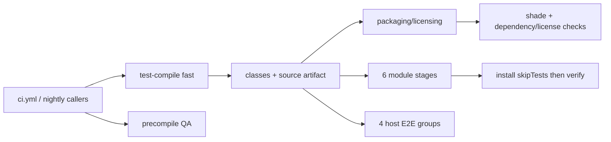

# Сборка, границы модулей, архитектурные проверки и web-поверхность

Статус: **progress**. Это исследование исходников, не принятое решение о новом ядре Ariadne. Ревизия Flink: `068f428b29f4d9ee587fa1006d2f1a69b43c0000`. Обязательство области `root` — 7 069 файлов и 678 568 строк текстовых файлов. Эта глава покрывает только явно перечисленные ниже прочитанные файлы. Остальные остаются открытыми в [реестре](../reading-status.jsonl). Сборки, тесты Flink и установка зависимостей Flink не выполнялись.

## Потребность и критерии приёмки исследования

**As a developer, I want to** понимать, где Flink проводит границы API/runtime/planner/connectors, как эти границы проверяются и какая часть системы отвечает за сборку и web-интерфейс.

**Acceptance criteria: as a developer, I can** пройти от каждого описанного ограничения до конкретной проверки на закреплённой ревизии, отличить правило от его исключений и увидеть непрочитанную область. **As a system, I got** воспроизводимый реестр диапазонов без двойного счёта. Полная приёмка всей области требует чтения оставшихся файлов; наличие этой главы её не закрывает.

Связи: [карта исследования](../README.md), [API/сериализация/Python](04-api-types-serialization-python.md), [управление и scheduler](01-control-plane-scheduling.md), [исполнение и сеть](02-task-execution-network-backpressure.md), [Table/SQL](05-table-sql-planner-runtime.md), [коннекторы](06-connectors-formats-storage-metrics.md).

## 1. Reactor — состав продукта, а не граф исполнения задачи

Полностью прочитан корневой [`pom.xml`, 2 457 строк](https://github.com/apache/flink/blob/068f428b29f4d9ee587fa1006d2f1a69b43c0000/pom.xml). Это Maven parent/aggregator версии `2.5-SNAPSHOT`. Перечень [модулей, строки 71–110](https://github.com/apache/flink/blob/068f428b29f4d9ee587fa1006d2f1a69b43c0000/pom.xml#L71) включает core/core-api, runtime, streaming-java, новые datastream/datastream-api, table, Python, connectors, state-backends, RPC, web, clients, deployment, tests и distribution. Наличие нескольких API-модулей не доказывает наличие нескольких конкурирующих планировщиков: причинный переход от API к исполняемому графу изучается в главе 04.

Root зависимости наследуются модулями; dependencyManagement задаёт версии, но сам по себе не означает подключение каждой библиотеки ко всем артефактам. Внешние shaded-артефакты подключаются отдельно. [Предупреждение в строках 339–346](https://github.com/apache/flink/blob/068f428b29f4d9ee587fa1006d2f1a69b43c0000/pom.xml#L339) запрещает помещать ряд исходных библиотек в общее управление версиями из-за влияния на транзитивные зависимости Hadoop. Это ограничение упаковки/совместимости classpath, не семантика доставки записей.

## 2. Языковая совместимость зависит от профиля

В [properties, строки 134–145](https://github.com/apache/flink/blob/068f428b29f4d9ee587fa1006d2f1a69b43c0000/pom.xml#L134) исходный синтаксис Java — 11, target по умолчанию — 17. Нельзя свести это к утверждению «весь проект Java 11» или «весь проект Java 17». Профиль `java11-target` меняет target на 11; `java17-target` добавляет `flink-tests-java17` и явно оставляет source 11; `java21-target` задаёт source/target 21. Release меняет target на 11. Это прочитанные объявления Maven; прочитанные комбинации CI/JDK описаны в разделе 9; остальные дочерние POM остаются в inventory.

В [настройке compiler, строки 2140–2158](https://github.com/apache/flink/blob/068f428b29f4d9ee587fa1006d2f1a69b43c0000/pom.xml#L2140) `release` очищен, потому что используются `--add-exports`; следовательно комментарий «только Java 11 APIs» не следует воспринимать как доказательство полноценной проверки через `--release 11`. [Enforcer, строки 1874–1895](https://github.com/apache/flink/blob/068f428b29f4d9ee587fa1006d2f1a69b43c0000/pom.xml#L1874) задаёт Maven 3.9.16, Java version property и ограничение версии Hadoop.

## 3. Границы реализации защищены сборкой

[Enforcer, строки 1952–1990](https://github.com/apache/flink/blob/068f428b29f4d9ee587fa1006d2f1a69b43c0000/pom.xml#L1952) запрещает прямую зависимость от `flink-rpc-akka`, направляя к loader и `RpcSystem#load`/testing service. Аналогично production-зависимости от Scala-suffixed table-planner направляются к Table API или planner-loader, с явным исключением для test scope. Это подтверждает намерение изолировать реализации за точками загрузки. Сам внутренний classloading ещё не прочитан этой областью и здесь не описывается как проверенный.

[Shade, строки 2008–2096](https://github.com/apache/flink/blob/068f428b29f4d9ee587fa1006d2f1a69b43c0000/pom.xml#L2008) удаляет bundled logging properties/signatures/ненужные Maven POM, объединяет `META-INF/services`, агрегирует NOTICE, создаёт dependency-reduced POM. Поэтому упаковка влияет на обнаружение сервисов и конфликты зависимостей. Нельзя механически переносить только Java-классы и ожидать идентичную загрузку.

`dependency-convergence` по умолчанию имеет phase `none`; включается отдельным профилем. Профиль `fast` пропускает ряд проверок. Поэтому название успешной Maven-команды без профилей/фаз недостаточно для утверждения, что все архитектурные и совместимые границы проверены.

## 4. API-контракт проверяется отдельно от допустимости зависимости

Полностью прочитаны [`ProductionCodeArchitectureBase`, 46 строк](https://github.com/apache/flink/blob/068f428b29f4d9ee587fa1006d2f1a69b43c0000/flink-architecture-tests/flink-architecture-tests-production/src/main/java/org/apache/flink/architecture/ProductionCodeArchitectureBase.java), [`ArchitectureTest`, 40 строк](https://github.com/apache/flink/blob/068f428b29f4d9ee587fa1006d2f1a69b43c0000/flink-architecture-tests/flink-architecture-tests-production/src/test/java/org/apache/flink/architecture/ArchitectureTest.java) и все четыре подключённые rule-класса.

`ArchitectureTest` импортирует `org.apache.flink`, исключает test, Scala и shaded code. Base подключает API annotations, Table API, connectors и checkpoint configuration. Это не универсальное доказательство архитектуры для всех языков и всех зависимостей. README production-модуля отдельно требует добавлять проверяемые модули test dependencies; фактический список classpath описан ниже; полной эквивалентности reactor нет.

[`ApiAnnotationRules`, 178 строк](https://github.com/apache/flink/blob/068f428b29f4d9ee587fa1006d2f1a69b43c0000/flink-architecture-tests/flink-architecture-tests-production/src/main/java/org/apache/flink/architecture/rules/ApiAnnotationRules.java#L48) требует явной visibility-аннотации публичных API-классов вне internal packages. Public methods ограничивают leaf-типы аргументов/возврата public API, а PublicEvolving допускает PublicEvolving. Есть исключения для deprecated/experimental/internal, внешних и shaded типов. Production-вызовы `VisibleForTesting` ограничены с исключениями для самого тестового метода, своего класса и пары enclosing/enclosed class.

Ряд правил обёрнут `freeze(...)`. Это допускает сохранённый baseline существующих нарушений, а не означает абсолютную чистоту дерева. Прочитаны stored.rules и все шесть связанных baseline-файлов: public leaf types (104 строки), PublicEvolving leaf types (248), visibility (238), VisibleForTesting calls (18), format-options package (1) и connector dependencies (685). Они содержат исключения для serializers/context/graph/window/network классов и конкретных внутренних вызовов. Это сохранённые записи, а не результаты запуска на текущих compiled classes. Connector baseline перечисляет связи файлового source/sink, compaction operators, serializers, legacy filesystem/table bridges, datagen и print sink с внутренними типами. Наличие записи в stored.rules не доказывает актуальность всех исторических правил. Весь tracked subtree flink-architecture-tests (36 текстовых файлов, 4 092 строки) теперь прочитан дословно; тесты и импорт compiled classes не выполнялись.

После полного чтения [Conditions.java](https://github.com/apache/flink/blob/068f428b29f4d9ee587fa1006d2f1a69b43c0000/flink-architecture-tests/flink-architecture-tests-base/src/main/java/org/apache/flink/architecture/common/Conditions.java#L57) уточняется охват leaf types: проверяются также declared exceptions, массивы приводятся к базовому компоненту, generic arguments обходятся рекурсивно. При этом leaf class без Java source filename пропускается. [SourcePredicates](https://github.com/apache/flink/blob/068f428b29f4d9ee587fa1006d2f1a69b43c0000/flink-architecture-tests/flink-architecture-tests-base/src/main/java/org/apache/flink/architecture/common/SourcePredicates.java#L49) требует source metadata и использует `filename.contains(".java")`; это ограниченная статическая проверка, не доказательство полной замкнутости public API.

Полностью прочитанный [production POM](https://github.com/apache/flink/blob/068f428b29f4d9ee587fa1006d2f1a69b43c0000/flink-architecture-tests/flink-architecture-tests-production/pom.xml#L69) перечисляет core/runtime, Table/SQL, три in-tree connectors и model module. Это явный входной classpath, к которому могут добавляться транзитивные зависимости; равенство всему reactor здесь не утверждается. Тест запускается в одном JVM с общим максимальным heap, а dependency-convergence специально пропускается в этом модуле.

[`ConnectorRules`, 81 строка](https://github.com/apache/flink/blob/068f428b29f4d9ee587fa1006d2f1a69b43c0000/flink-architecture-tests/flink-architecture-tests-production/src/main/java/org/apache/flink/architecture/rules/ConnectorRules.java#L61) ограничивает non-deprecated connector-классы public/public-evolving типами Flink за пределами connector packages. Но разрешает другие connectors, `org.apache.flink.util..` и внешние типы; вложенные public-классы тоже учитываются. Краткая формула «connector зависит только от public API» требует этих оговорок и frozen baseline.

## 5. Конфигурация checkpoint имеет узкую статическую защиту

[`CheckpointingConfigurationAccessRules`, 195 строк](https://github.com/apache/flink/blob/068f428b29f4d9ee587fa1006d2f1a69b43c0000/flink-architecture-tests/flink-architecture-tests-production/src/main/java/org/apache/flink/architecture/rules/CheckpointingConfigurationAccessRules.java#L64) ограничивает прямые `Configuration.get/getOptional` для трёх checkpoint options, направляя вызовы к helper-методам с валидацией. Reflection на поля/сигнатуры делает переименование fail-fast при загрузке rule-класса.

Это **эвристика уровня метода**: она ищет доступ к запрещённому полю в том же origin method, не доказывает dataflow конкретного аргумента `get`. Вызовы из `CheckpointingOptions` целиком разрешены; whitelist методов дополнительно разрешает `CheckpointConfig.configure`. Нельзя приписывать этому правилу полную проверку всех путей конфигурации checkpoint или корректность самого snapshot-протокола.

[`TableApiRules`, 131 строка](https://github.com/apache/flink/blob/068f428b29f4d9ee587fa1006d2f1a69b43c0000/flink-architecture-tests/flink-architecture-tests-production/src/main/java/org/apache/flink/architecture/rules/TableApiRules.java#L57) отделяет public static `ConfigOption` в `*Options`/FactoryUtil от DynamicTableFactory, проверяет package/visibility connector/format options и visibility публичных Table API модулей по source location. Это статическая дисциплина API, отдельная от Table planner/runtime в главе 05.

## 6. Unit и integration выполняются разными execution одной системы

[Surefire, строки 1766–1853](https://github.com/apache/flink/blob/068f428b29f4d9ee587fa1006d2f1a69b43c0000/pom.xml#L1766) запускает unit-pattern `*Test`/`*Tests` в phase `test`, остальные классы в `integration-test`, исключая unit-pattern и Scala-generated `$` classes. Integration execution отключает reuseForks и использует отдельные fork/memory limits. Это Surefire, не предположение о Maven Failsafe по названию integration.

По умолчанию передаются checkpoint/buffer-debloat randomization, случайное включение changelog backend и опциональный seed. JUnit parallel feature включён, но classes/methods по умолчанию `same_thread`; concurrency opt-in. Поэтому включённый parallel engine не доказывает параллельное исполнение каждого теста. Чтение этих настроек не заменяет запуск и не даёт pass/fail результата.

Полностью прочитаны общие test architecture rules/base и README/POM этого модуля. В отличие от production import, правила для тестов определены централизованно, но подключаются по отдельным модулям с локальным classpath и baseline. TestNamingRules допускает `*Test`, `*Tests`, `*ITCase`, хотя часть Javadoc ещё описывает более узкий pattern. ITCaseRules проверяет используемый MiniCluster resource/extension, с различием internal runtime и публичной extension; BanJunit4Rules не включён в common base автоматически. NestedTestClassRules проверяет inner-class форму конкретных member tests с no-arg constructor и отдельно запрещает private @Nested; формулировка description про наличие @Nested сильнее фактически проверяемого первого условия.

## 7. Web-модуль собирает отдельный клиент и Java-обработчики

Полностью прочитан [`flink-runtime-web/pom.xml`, 360 строк](https://github.com/apache/flink/blob/068f428b29f4d9ee587fa1006d2f1a69b43c0000/flink-runtime-web/pom.xml). Java-артефакт зависит от runtime/clients и shaded сетевых/JSON библиотек; из dashboard включается ресурс `web/**`. Frontend Maven plugin задаёт Node 22.16.0/npm 10.9.0, `npm ci`, lint, `test:ci`, build. Профиль `fast` отключает Node tests; `skip-webui-build` пропускает frontend plugin с отдельным skip для lint/test executions. Наличие web JAR и backend-сборки само по себе не доказывает свежесть или проверку UI.

Полностью прочитаны [StatusService](https://github.com/apache/flink/blob/068f428b29f4d9ee587fa1006d2f1a69b43c0000/flink-runtime-web/web-dashboard/src/app/services/status.service.ts#L72), [MetricsService](https://github.com/apache/flink/blob/068f428b29f4d9ee587fa1006d2f1a69b43c0000/flink-runtime-web/web-dashboard/src/app/services/metrics.service.ts#L63) и [ConfigService](https://github.com/apache/flink/blob/068f428b29f4d9ee587fa1006d2f1a69b43c0000/flink-runtime-web/web-dashboard/src/app/services/config.service.ts#L42). Status получает `/config`, создаёт shared refresh stream из interval, navigation, force refresh и visibility events, с debounce 300 ms. Это polling для наблюдения, не транспорт записей между операторами.

MetricsService выполняет HTTP GET по job/vertex/subtask endpoints. В `loadMetrics` timestamp создаётся браузером через `Date.now()`: это время получения представления, не доказательство времени измерения runtime. Агрегированные значения уже приходят от backend; клиент выбирает min/max/avg/sum/skew. Watermarks переводятся в JavaScript Number, выбирается минимум; отсутствие прогресса/Long.MIN sentinel представляется NaN. В этой клиентской карте нет точного 64-битного integer-протокола и подтверждений durable обработки записей.

Прочитаны также StatusService/MetricsService tests: проверяются config boot, первое debounced refresh, числовое преобразование метрик, browser timestamp, aggregate selection и sentinel/empty watermark. Они используют подставленный HTTP client и fake timers, не доказывают согласованность метрик с checkpoint и не запускались в исследовании.

### Web submission — отдельный путь построения и отправки программы

Полностью прочитанный [WebSubmissionExtension](https://github.com/apache/flink/blob/068f428b29f4d9ee587fa1006d2f1a69b43c0000/flink-runtime-web/src/main/java/org/apache/flink/runtime/webmonitor/WebSubmissionExtension.java#L99) регистрирует upload/list/run/run-application/delete и два plan handlers. Для jar-run создаётся отдельный executor. [JarRunHandler](https://github.com/apache/flink/blob/068f428b29f4d9ee587fa1006d2f1a69b43c0000/flink-runtime-web/src/main/java/org/apache/flink/runtime/webmonitor/handlers/JarRunHandler.java#L90) копирует конфигурацию, применяет запрос, формирует savepoint restore settings и `PackagedProgram`, затем асинхронно вызывает ApplicationRunner через DispatcherGateway. Завершение future закрывает packaged program; ошибка превращается в HTTP400, пустой список jobs тоже ошибка, ответ содержит первый JobID. Это завершение операции submission, не завершение обработки данных.

[JarPlanHandler](https://github.com/apache/flink/blob/068f428b29f4d9ee587fa1006d2f1a69b43c0000/flink-runtime-web/src/main/java/org/apache/flink/runtime/webmonitor/handlers/JarPlanHandler.java#L95) строит JobGraph в executor и выдаёт JSON plan без отправки job; packaged program закрывается try-with-resources. [JarHandlerUtils](https://github.com/apache/flink/blob/068f428b29f4d9ee587fa1006d2f1a69b43c0000/flink-runtime-web/src/main/java/org/apache/flink/runtime/webmonitor/handlers/utils/JarHandlerUtils.java#L99) задаёт precedence body/query/default, jar/classpath/arguments. `applyToConfiguration` также создаёт packaged program для извлечения зависимостей; его локальное закрытие в этом методе отсутствует. Конечные последствия для extracted libraries/classloader ещё требуют чтения PackagedProgram и тестов — здесь не объявляется доказанный leak.

Полностью прочитанный [WebFrontendBootstrap](https://github.com/apache/flink/blob/068f428b29f4d9ee587fa1006d2f1a69b43c0000/flink-runtime-web/src/main/java/org/apache/flink/runtime/webmonitor/utils/WebFrontendBootstrap.java#L111) устанавливает SSL первым, затем HTTP codec/upload handler/aggregator, ServiceLoader inbound handlers в порядке priority, chunked writer/router/error handler. Его shutdown закрывает server channel и инициирует graceful shutdown event-loop groups. Это HTTP pipeline; его buffers и handlers нельзя смешивать с record channels главы 02.

### История для UI — восстанавливаемый cache архивов

Полностью прочитаны [HistoryServer](https://github.com/apache/flink/blob/068f428b29f4d9ee587fa1006d2f1a69b43c0000/flink-runtime-web/src/main/java/org/apache/flink/runtime/webmonitor/history/HistoryServer.java#L187), ArchiveStorage, FileArchiveStorage, RocksDBArchiveStorage и CompositeArchiveRetainedStrategy. HistoryServer читает архивы завершённых jobs/applications из настроенных внешних директорий, очищает локальный web cache при создании, выбирает file/RocksDB representation и eager/lazy режим. В eager режиме выполняется периодический fetch; lazy делает первоначальный fetch и периодический cleanup, дальнейший request fetch разобран ниже по handler.

Этот RocksDB — **хранилище JSON для истории**, отдельное от keyed state backend. [WriteOptions отключает WAL](https://github.com/apache/flink/blob/068f428b29f4d9ee587fa1006d2f1a69b43c0000/flink-runtime-web/src/main/java/org/apache/flink/runtime/webmonitor/history/RocksDBArchiveStorage.java#L249), а HistoryServer удаляет локальную директорию при shutdown. Это согласуется с ролью cache поверх внешних архивов и не свидетельствует о durability streaming state. FileArchiveStorage заменяет cache-файл через delete/write; атомарность checkpoint-протокола из этого метода не следует. Retention объединяет count и modification-time TTL через allMatch — ограничения истории не определяют срок хранения managed state.

После полного чтения обоих history fetchers и всех Java-файлов в их `history`/`history/retaining` production- и test-пакетах установлены дополнительные ограничения. Retention count применяется отдельно при обходе каждой refresh directory. Превышение retention вызывает удаление **внешнего архива**, затем local cache; удаление уже исчезнувших снаружи архивов из local cache контролируется отдельным cleanup flag. Для application удаляется директория вместе с job archives. Это политика истории, которую нельзя принять за безусловно вечный аудит.

`lazyProcessJobArchive` читает коллекцию archived JSON, synchronously пишет overview/job summary, а detail entries передаёт fixed executor. Поэтому lazy означает разделённое заполнение cache, а не доказанное построчное чтение внешнего файла по HTTP-запросу. [AbstractHistoryServerHandler.loadResource](https://github.com/apache/flink/blob/068f428b29f4d9ee587fa1006d2f1a69b43c0000/flink-runtime-web/src/main/java/org/apache/flink/runtime/webmonitor/history/AbstractHistoryServerHandler.java#L317) может инициировать fetch и ждать detail future прямо из request callback. Название async task само по себе не означает неблокирующий HTTP-path.

Чтение [HistoryServerArchiveFetcherTest](https://github.com/apache/flink/blob/068f428b29f4d9ee587fa1006d2f1a69b43c0000/flink-runtime-web/src/test/java/org/apache/flink/runtime/webmonitor/history/HistoryServerArchiveFetcherTest.java#L143) и application/handler/storage/retention tests подтверждает описанные **проверяемые сценарии**: оба backend, eager/lazy stages, latch-controlled detail writes, empty archive, сохранение последнего overview при всех malformed entries, prefix sibling preservation и cleanup. Это прочитанные assertions, не результаты запуска. Async detail writer логирует отдельную IOException и продолжает до CREATED; статус metadata нельзя понимать как подтверждение сохранения каждой detail entry.

[HistoryServerTest](https://github.com/apache/flink/blob/068f428b29f4d9ee587fa1006d2f1a69b43c0000/flink-runtime-web/src/test/java/org/apache/flink/runtime/webmonitor/history/HistoryServerTest.java#L104) полностью прочитан: часть сценариев поднимает MiniCluster и исполняет finite job, часть использует синтетические завершённые графы/архивы. Таймеры/latches/polling здесь ограничивают ожидание; тесты не являются прогоном отказоустойчивости stream state и в исследовании не запускались.

Graph rendering, оставшиеся frontend services, часть jar handlers и их тесты ещё не прочитаны. Взаимодействие web с управлением заданием проходит через указанные gateway; индивидуальные записи обрабатываются runtime, разобранным в главе 02.

## 8. Внешний ресурс — plugin discovery, отдельно от record/state ownership

Полностью прочитаны **все 14 tracked текстовых файлов** модуля `flink-external-resources`, включая Java, POM, shell и service/test resources, всего 972 строки. Это узкая закрытая область чтения, не завершение всей назначенной области и не исполненная приёмка. Module POM содержит единственный GPU plugin; [service registration](https://github.com/apache/flink/blob/068f428b29f4d9ee587fa1006d2f1a69b43c0000/flink-external-resources/flink-external-resource-gpu/src/main/resources/META-INF/services/org.apache.flink.api.common.externalresource.ExternalResourceDriverFactory#L16) связывает factory с driver.

[GPUDriver](https://github.com/apache/flink/blob/068f428b29f4d9ee587fa1006d2f1a69b43c0000/flink-external-resources/flink-external-resource-gpu/src/main/java/org/apache/flink/externalresource/gpu/GPUDriver.java#L63) проверяет path/executable и положительное количество, запускает discovery process с deadline 10 s, при любом выходе вызывает destroyForcibly. Используется первая строка stdout, IDs разбираются по запятым и превращаются в immutable Set<GPUInfo>. Java driver сам не сверяет размер результата с requested amount; достаточность в стандартном пути проверяет script. Process сначала ожидается, затем читаются stdout/stderr — это не потоковый неблокирующий вывод subprocess.

Стандартный script получает GPU indexes через локальную утилиту и вызывает [gpu-discovery-common.sh](https://github.com/apache/flink/blob/068f428b29f4d9ee587fa1006d2f1a69b43c0000/flink-external-resources/flink-external-resource-gpu/src/main/resources/gpu-discovery-common.sh#L31). Без coordination выбираются первые N; с coordination локальный flock защищает файл index→PPID, занятость освобождается по проверке отсутствия процесса. Это локальная координация discovery, без представленного здесь distributed lease/fencing или snapshot operator state. Scheduling/resource plumbing вне этого модуля остаётся отдельной зависимостью, а не доказанным следствием обнаружения GPU ID.

Прочитанные Java tests используют тестовый script, проверяют config/errors/count и exit status; реальные GPU ими не доказываются. Shell fixture имеет ограничение статической проверки: циклы `for i in output1`/`for j in output2` сравнивают literal names вместо элементов массивов, поэтому название теста не доказывает disjoint device allocation. Fixtures и тесты прочитаны, не запускались; production-код по ним не изменён.

## 9. CI разделяет быструю компиляцию, QA, module tests и E2E

Полностью прочитаны [ci.yml](https://github.com/apache/flink/blob/068f428b29f4d9ee587fa1006d2f1a69b43c0000/.github/workflows/ci.yml#L42), [nightly.yml](https://github.com/apache/flink/blob/068f428b29f4d9ee587fa1006d2f1a69b43c0000/.github/workflows/nightly.yml#L35), все 485 строк [reusable template](https://github.com/apache/flink/blob/068f428b29f4d9ee587fa1006d2f1a69b43c0000/.github/workflows/template.flink-ci.yml#L70), composite actions job_init/run_mvn, scripts compile/compile_ci, stage, test_controller, Maven helpers, watchdogs и artifact create/unpack. Это исследование объявленного пути; ни один из этих scripts не запускался.

Обычный workflow выбирает Java17; nightly — Java11, Java21 и AdaptiveScheduler на Java17 отдельными callers. Обычный push игнорирует docs/Markdown и некоторые tooling paths. Pre-compile checks объявлены отдельным job, а reusable CI не имеет зависимости needs на этот job: это параллельные ветви, не доказанный последовательный gate. Полностью прочитанный [pre-compile template](https://github.com/apache/flink/blob/068f428b29f4d9ee587fa1006d2f1a69b43c0000/.github/workflows/template.pre-compile-checks.yml#L62) находит последний зелёный ci.yml run по branch/status, пытается получить SHA для Spotless ratchet, при неуспехе fetch делает полную проверку. Checkstyle и root RAT выполняются отдельно, без компиляции. Последний зелёный SHA — база форматирования, не точка восстановления исполняемой задачи.

Начальный compile делает `test-compile -Dfast`, сохраняет classes и исходники в артефакт. [create_build_artifact](https://github.com/apache/flink/blob/068f428b29f4d9ee587fa1006d2f1a69b43c0000/tools/ci/create_build_artifact.sh#L22) удаляет JAR, Git, node/node_modules и build-target link. Downstream заново собирает JAR, но [unpack](https://github.com/apache/flink/blob/068f428b29f4d9ee587fa1006d2f1a69b43c0000/tools/ci/unpack_build_artifact.sh#L36) искусственно делает class/timestamp новее Java/Scala source на 5 секунд для Maven up-to-date. Это ускорение CI, не механизм durable восстановления job или доказательство новой clean-компиляции каждого downstream job.

Packaging/licensing отдельно вызывает compile_ci. [compile.sh](https://github.com/apache/flink/blob/068f428b29f4d9ee587fa1006d2f1a69b43c0000/tools/ci/compile.sh#L61) по умолчанию включает staged deployment, convergence и shade DEBUG, затем Javadoc, optional dependencies, Scala suffix, shaded-artifact и license проверки. Явно пустой MVN_LICENSE_CHECK_ARGS отключает эти блоки. Лог многопоточной сборки перегруппируется по thread, чтобы dependency/license parsers видели непрерывные plugin blocks. Все parser/checker implementations этого модуля теперь прочитаны; их фактические ограничения описаны ниже. Успешная compilation не равна их прохождению.

Module-test matrix состоит из core/python/table/connect/tests/misc. [stage.sh](https://github.com/apache/flink/blob/068f428b29f4d9ee587fa1006d2f1a69b43c0000/tools/ci/stage.sh#L131) задаёт явные списки; misc исключает остальные группы. Compile использует `-am`, test selection — нет. [test_controller](https://github.com/apache/flink/blob/068f428b29f4d9ee587fa1006d2f1a69b43c0000/tools/ci/test_controller.sh#L80) сначала делает install с skipTests, затем verify с OpenSSL, double-free, запретом обновления frozen baseline и forced RPC invocation serialization. Python stage вызывает отдельный lint-python script; его имя не раскрывает полный состав проверок до чтения. E2E разделены на четыре группы и работают на host отдельно от container module tests, с явным non-root исполнением module tests.

Два watchdog решают разные задачи CI. [watchdog.sh](https://github.com/apache/flink/blob/068f428b29f4d9ee587fa1006d2f1a69b43c0000/tools/ci/watchdog.sh#L55) проверяет mtime stdout/Maven logs каждые 20 секунд, порог тишины по умолчанию 900 секунд. Это не проверка прогресса stream/channel/checkpoint: активный лог может скрывать зависание полезной работы. [uploading_watchdog](https://github.com/apache/flink/blob/068f428b29f4d9ee587fa1006d2f1a69b43c0000/tools/ci/uploading_watchdog.sh#L67) считает остаток абсолютного job budget от сохранённого start time, реально предупреждает на 95% и резервирует 2 минуты перед kill; комментарии про 80%/1 минуту устарели. В обоих scripts command запускается через shell expansion переменной, это не чтение pipeline-строки как нового shell-кода. Это наблюдение исходника, не воспроизведённый сбой CI.

### Конкретные границы статической проверки упаковки

Прочитан весь [shade.sh](https://github.com/apache/flink/blob/068f428b29f4d9ee587fa1006d2f1a69b43c0000/tools/ci/shade.sh#L22). Для dist JAR он ищет определённые исходные package prefixes (ASM, Guava, обе Jackson, Netty, ZooKeeper/Curator, Python/Hadoop) и требует наличие Snappy. Для S3 variants проверяет наличие и точное содержимое FileSystemFactory service descriptor. Это конкретные проверки списка archive entries, не общее доказательство отсутствия classloader-конфликтов. Read-only исследование не меняло JAR или эти правила.

Это граф CI-объявлений закреплённой ревизии, отдельно от [графа исполнения streaming job](00-architecture-overview.md).

### Dependency и license QA используют разрешённое Maven дерево и текстовые эвристики

Весь tracked module `tools/ci/flink-ci-tools` — 26 текстовых файлов, включая все Java implementations/tests, POM и service/logging/allowance resources — прочитан дословно. [ShadeOptionalChecker](https://github.com/apache/flink/blob/068f428b29f4d9ee587fa1006d2f1a69b43c0000/tools/ci/flink-ci-tools/src/main/java/org/apache/flink/tools/ci/optional/ShadeOptionalChecker.java#L156) требует optional на bundled dependency или её предке в разрешённом дереве; при отсутствии транзитивных direct dependencies делает ранний выход, исключая common root dependencies. Это защита от утечки bundled classes через Maven transitivity. [DependencyTree](https://github.com/apache/flink/blob/068f428b29f4d9ee587fa1006d2f1a69b43c0000/tools/ci/flink-ci-tools/src/main/java/org/apache/flink/tools/ci/utils/shared/DependencyTree.java#L45) сохраняет один occurrence и один parent для group/artifact/version/classifier; scope/optional не входят в lookup key, первая запись побеждает. Это не полный граф всех возможных путей зависимостей.

[ParserUtils](https://github.com/apache/flink/blob/068f428b29f4d9ee587fa1006d2f1a69b43c0000/tools/ci/flink-ci-tools/src/main/java/org/apache/flink/tools/ci/utils/shared/ParserUtils.java#L31) ожидает максимум один plugin block на module; повторный block перезапишет результат. DependencyParser принимает старые и новые имена Maven plugin, восстанавливает вложенность из текстового дерева; ShadeParser реально принимает `default` execution наряду с `shade-flink`/`shade-dist`, несмотря на более узкий JavaDoc. DeployParser определяет skipped deployment по строке непосредственно после header. Поэтому формат/целостность лога — часть входного контракта QA, что объясняет serial dependency tree и regroup compile logs.

[ScalaSuffixChecker](https://github.com/apache/flink/blob/068f428b29f4d9ee587fa1006d2f1a69b43c0000/tools/ci/flink-ci-tools/src/main/java/org/apache/flink/tools/ci/suffixcheck/ScalaSuffixChecker.java#L101) классифицирует Scala зависимость по group/artifact, исключает test scope и loader-isolated RPC/planner. Затем ищет определённые текстовые artifactId patterns в POM с ограниченной глубиной обхода, исключает dev docs/E2E modules. Это дисциплина имён и зависимостей, отдельная от фактической runtime classloader isolation.

[NoticeFileChecker](https://github.com/apache/flink/blob/068f428b29f4d9ee587fa1006d2f1a69b43c0000/tools/ci/flink-ci-tools/src/main/java/org/apache/flink/tools/ci/licensecheck/NoticeFileChecker.java#L111) объединяет shade/copy dependencies и отбирает deployed/directly bundled modules. Многошаговое косвенное включение через non-deployed module явно оставлено TODO. Отсутствующие/дублированные зависимости критичны; лишние tolerable/suppressed, с явным allowance для flink-python. [JarFileChecker](https://github.com/apache/flink/blob/068f428b29f4d9ee587fa1006d2f1a69b43c0000/tools/ci/flink-ci-tools/src/main/java/org/apache/flink/tools/ci/licensecheck/JarFileChecker.java#L64) проверяет NOTICE/LICENSE и известные текстовые patterns/path exceptions; пустой test JAR без class files пропускает. Сам launcher предупреждает, что это поиск типичных ошибок, требующий отдельного manual review. Исследование описывает механизм QA, не даёт юридического заключения о будущих заимствованиях.

Все девять test files прочитаны: synthetic Maven logs проверяют оба spellings, classifier/scope/optional, tree key first occurrence; другие tests создают synthetic JAR и проверяют presence/path/pattern rules. Дополнительный LICENSE в META-INF помечен Disabled. Эти fixtures показывают границы утверждений, но тесты в текущей работе не запускались.

### Документация и repository automation имеют отдельные жизненные циклы

Все tracked текстовые файлы `.github/` (18 файлов, 2 300 строк) теперь прочитаны, включая schedules, composite actions и весь community-review shell. [nightly-trigger](https://github.com/apache/flink/blob/068f428b29f4d9ee587fa1006d2f1a69b43c0000/.github/workflows/nightly-trigger.yml#L69) пропускает unchanged SHA только после зелёного предыдущего nightly; failed/cancelled повторяет, manual bypasses skip. Dispatch идёт по branch ref, поэтому наблюдённый currentSha и реально выбранный при старте commit надо различать. Это CI retry policy, отдельно от job failover.

Docs check запускается по docs-only PR path; scheduled documentation publication строит выбранные release/master ветви и external documentation modules. [docs.sh](https://github.com/apache/flink/blob/068f428b29f4d9ee587fa1006d2f1a69b43c0000/.github/workflows/docs.sh#L30) выполняет submodule init, Hugo, Java/Python API generation. Следовательно published documentation — отдельный build artifact с внешними входами, не доказательство равенства текущему API/runtime. В текущем исследовании gitlink theme остаётся явно не загруженным; эти scripts не выполнялись. Review/stale automation изменяет PR metadata по расписанию и не участвует в record execution или восстановлении state; исследование не отправляло её API mutations.

## 10. Интеграционные проверки восстанавливают конкретный контракт, а не все внешние эффекты

Полностью прочитаны [CheckpointAcknowledgeFailureITCase](https://github.com/apache/flink/blob/068f428b29f4d9ee587fa1006d2f1a69b43c0000/flink-tests/src/test/java/org/apache/flink/test/checkpointing/CheckpointAcknowledgeFailureITCase.java#L61) и [CheckpointSyncPhaseTimeoutITCase](https://github.com/apache/flink/blob/068f428b29f4d9ee587fa1006d2f1a69b43c0000/flink-tests/src/test/java/org/apache/flink/test/checkpointing/CheckpointSyncPhaseTimeoutITCase.java#L58). Первый поднимает MiniCluster с dedicated RPC, создаёт 128KB случайного несжимаемого state при frame limit 64KB и ожидает CheckpointException с AskTimeoutException. Это проверка недоставляемого oversized ACK, а не сценария «координатор принял ACK, ответ потерялся». Completion job failure дополнительно завершает ожидаемый test future, hard guard — 5 минут. Второй намеренно блокирует snapshot на latch, задаёт sync-phase timeout 50ms, запрещает restart и проверяет точную причину failure. Эти tests прочитаны, не запускались; границы протокола из [главы 02](02-task-execution-network-backpressure.md) остаются отдельным source evidence.

[RegionFailoverITCase](https://github.com/apache/flink/blob/068f428b29f4d9ee587fa1006d2f1a69b43c0000/flink-tests/src/test/java/org/apache/flink/test/checkpointing/RegionFailoverITCase.java#L159) строит три независимых pipelined regions через заранее распределённые keys без keyBy shuffle, отключает chaining, добавляет disconnected source graph и последовательно вызывает failures в region0/последнем region. Проверяются восстановленные union/list state и конечные значения keyed accumulation. Last-completed checkpoint фиксируется специальным test store при add, без ожидания task-side notification. Но [ValidatingSink](https://github.com/apache/flink/blob/068f428b29f4d9ee587fa1006d2f1a69b43c0000/flink-tests/src/test/java/org/apache/flink/test/checkpointing/RegionFailoverITCase.java#L392) использует `counts.merge(key,value,max)` и checkpointed map: повторный одинаковый вызов может не менять результат. Поэтому final map assertions нельзя превратить в доказательство отсутствия внешних повторных append/INSERT.

Полностью прочитаны E2E README, run-nightly/run-single, test-runner-common, все 1 021 строка common.sh и общий exit helper. [run-nightly](https://github.com/apache/flink/blob/068f428b29f4d9ee587fa1006d2f1a69b43c0000/flink-end-to-end-tests/run-nightly-tests.sh#L86) перечисляет четыре группы shell scenarios; Java E2E verify вызывается только внутри group4. Название run-nightly не означает, что каждый invocation выполняет все группы или все tests. Некоторые сценарии явно пропускают стандартный анализ exception/error logs; альтернативные assertions надо читать в самом test script. Большинство конкретных scripts/classes ещё остаётся в inventory.

[test-runner-common](https://github.com/apache/flink/blob/068f428b29f4d9ee587fa1006d2f1a69b43c0000/flink-end-to-end-tests/test-scripts/test-runner-common.sh#L32) сохраняет conf/lib/plugins, перед каждым test включает unaligned checkpoints, выполняет command и выбирает default/skip/custom log validation. Отдельные scripts могут переопределять config. Успех зависит от command exit и общего EXIT_CODE. Cleanup после успешной проверки удаляет временные данные/логи и останавливает cluster; exit callbacks отдельно возвращают config и прекращают процессы. Это test harness lifecycle, не промышленный восстановитель streaming job.

[common.sh](https://github.com/apache/flink/blob/068f428b29f4d9ee587fa1006d2f1a69b43c0000/flink-end-to-end-tests/test-scripts/common.sh#L381) фильтрует явные allowlists error/exception lines, использует REST/log polling и сортированный output hash для разных проверок. Часть ожиданий имеет локальный timeout, часть ждёт без локального deadline и зависит от внешнего watchdog. `wait_num_checkpoints` фактически сравнивает checkpoint ID из текста log, а не вычисляет число успешно завершённых checkpoints. Это ограничение наблюдения теста; restore authority находится в completed checkpoint metadata/store, описанных в [главе 03](03-state-checkpoints-windows-timers.md).

### Согласованность operator state и полнота данных — разные assertions

Полностью прочитан [StreamCheckpointingITCase](https://github.com/apache/flink/blob/068f428b29f4d9ee587fa1006d2f1a69b43c0000/flink-tests/src/test/java/org/apache/flink/test/checkpointing/StreamCheckpointingITCase.java#L59) и весь его [StreamFaultToleranceTestBase](https://github.com/apache/flink/blob/068f428b29f4d9ee587fa1006d2f1a69b43c0000/flink-tests/src/test/java/org/apache/flink/test/checkpointing/StreamFaultToleranceTestBase.java#L55). Base выбирает full/region failover, 3 TaskManagers по 4 slots, interval 500ms и unlimited fixed-delay restart с нулевой задержкой. Программа checkpoint-ит source index и счётчики filter/map, использует keyed ValueState и одноразовую искусственную ошибку. PostSubmit сравнивает суммарные restored counters и prefix totals. Sink ничего не пишет. Source создаёт случайный suffix без сохранения состояния RNG, но тест проверяет стабильную prefix/count проекцию. Поэтому он иллюстрирует согласованность этого managed state, без доказательства воспроизводимости всех payload bytes или внешних effects.

[CoStreamCheckpointingITCase](https://github.com/apache/flink/blob/068f428b29f4d9ee587fa1006d2f1a69b43c0000/flink-tests/src/test/java/org/apache/flink/test/checkpointing/CoStreamCheckpointingITCase.java#L80) строит fan-out от одного source: filtered branch соединяется с direct branch через two-input operator. Полностью прочитанный handler flatMap2 явно игнорирует второй input; stateful left counter и downstream counters проверяются после failure. Это полезный barrier-forwarding/recovery сценарий multi-input, но не acceptance произвольного join двух независимых источников. Реальные stateful join semantics разобраны в [главе 05](05-table-sql-planner-runtime.md).

[CheckpointFailureManagerITCase](https://github.com/apache/flink/blob/068f428b29f4d9ee587fa1006d2f1a69b43c0000/flink-tests/src/test/java/org/apache/flink/test/checkpointing/CheckpointFailureManagerITCase.java#L94) отдельно внедряет failure создания coordinator metadata stream и async snapshot supplier, запрещает restart и проверяет сообщение exceeded tolerable failure. Это показывает, почему набор успешных task snapshots недостаточен без coordinator finalization. [UnalignedCheckpointFailureHandlingITCase](https://github.com/apache/flink/blob/068f428b29f4d9ee587fa1006d2f1a69b43c0000/flink-tests/src/test/java/org/apache/flink/test/checkpointing/UnalignedCheckpointFailureHandlingITCase.java#L102) использует backend без operator snapshot для изоляции channel-state persistence; намеренно выбрасывает exceptions при closeAndGetHandle и последующем cleanup close, затем ожидает успешный следующий manual checkpoint. Полностью прочитаны все вложенные factories/delegates/assertions; test execution в этой работе отсутствует.

Прочитаны все 767 строк [flink-tests POM](https://github.com/apache/flink/blob/068f428b29f4d9ee587fa1006d2f1a69b43c0000/flink-tests/pom.xml#L306). Classloading fixtures упаковываются в отдельные JAR в process-test-classes, после чего их исходные test classes удаляются из общего test output. Следовательно запуск отдельного .class мимо Maven lifecycle может потерять проверяемую границу пользовательского classloader. Compile/tests/assembly descriptors и migration-generated resources — разные inputs; optional profile генерации migration data не является самим прогоном restore совместимости. Дочерние assembly descriptors и большинство этих тестов ещё остаются непрочитанными.

### Downstream-only recovery и изменение chaining требуют отдельных доказательств

Полностью прочитан [ApproximateLocalRecoveryDownstreamITCase](https://github.com/apache/flink/blob/068f428b29f4d9ee587fa1006d2f1a69b43c0000/flink-tests/src/test/java/org/apache/flink/test/checkpointing/ApproximateLocalRecoveryDownstreamITCase.java#L48). Он описывает отказ map с перезапуском map+sink при продолжающем source, включая две map instances и spanning records. Но **весь класс Disabled** с причиной «Approximate local recovery has currently no scheduler support»; checkpointing в этих сценариях не включён, приёмник ValidatingAtMostOnceSink проверяет прогресс индексов, а не полноту всех записей. Поэтому поддержка переподключения PIPELINED_APPROXIMATE в [сетевом слое](02-task-execution-network-backpressure.md) не доказывает доступность согласованного end-to-end downstream-only recovery в этом pin. Полный scheduler path оценивается по [главе 01](01-control-plane-scheduling.md), без переноса названия теста в гарантию продукта.

[CdrRecoveryRaceITCase](https://github.com/apache/flink/blob/068f428b29f4d9ee587fa1006d2f1a69b43c0000/flink-tests/src/test/java/org/apache/flink/test/checkpointing/CdrRecoveryRaceITCase.java#L34) сам явно помечает свой сценарий как incomplete/not reliable regression guard: 30 быстрых BATCH запусков с blocking exchanges не гарантируют воспроизведение race при END_OF_INPUT внутри recovery mailbox. Временная искусственная задержка не включена в committed product/test path. Это smoke-сценарий, не детерминированный тест отказа; в нашей работе он не запускался.

[ChainingMaxParallelismStateLossITCase](https://github.com/apache/flink/blob/068f428b29f4d9ee587fa1006d2f1a69b43c0000/flink-tests/src/test/java/org/apache/flink/test/checkpointing/ChainingMaxParallelismStateLossITCase.java#L109) создаёт canonical savepoint при chaining OFF, затем восстанавливает при ON, объединяя keyed head maxParallelism128 со stateful downstream64 либо256. Для hashmap/rocksdb обеих конфигураций ожидается отказ с recorded-different-maximum-parallelism. Это acceptance явного отклонения несовместимой топологии, а не успешной произвольной перестройки chains. Полностью прочитаны fixtures, operator/keyed state и assertions; результаты запуска отсутствуют.

### Changelog integration: журнал состояния, materialization и локальный cache

Полностью прочитаны шесть файлов семейства ChangelogRecovery: base, обычные failure tests, rescale, switch-env, switch-state-backend и local recovery. [Base](https://github.com/apache/flink/blob/068f428b29f4d9ee587fa1006d2f1a69b43c0000/flink-tests/src/test/java/org/apache/flink/test/checkpointing/ChangelogRecoveryITCaseBase.java#L122) задаёт HashMap/RocksDB incremental/nonincremental matrix, DFS журнал, отдельно checkpoint/materialization intervals. File merging и unaligned здесь явно отключены. Один branch считает keyed frequencies, второй создаёт processing-time window state, но ничего не выдаёт. Source хранит статический неизменяемый input в test JVM и checkpoint-ит индекс; это воспроизводимый test source в пределах этой среды, без проверки внешнего source retention.

[ChangelogRecoveryITCase](https://github.com/apache/flink/blob/068f428b29f4d9ee587fa1006d2f1a69b43c0000/flink-tests/src/test/java/org/apache/flink/test/checkpointing/ChangelogRecoveryITCase.java#L42) различает restore только log tail, log+materialized handles и tolerated materialization failure; predicates ожидают completed checkpoints/изменение materialization handle IDs перед искусственным отказом. Rescale задаёт 2→4 и 4→2; switch-env строит новый job из последнего external checkpoint. Regular waitAndAssert сравнивает итоговую map frequencies, но [CollectionSink](https://github.com/apache/flink/blob/068f428b29f4d9ee587fa1006d2f1a69b43c0000/flink-tests/src/test/java/org/apache/flink/test/checkpointing/ChangelogRecoveryITCaseBase.java#L399) объединяет результаты через max: это проверка восстановленного счётчика, не количества внешних side effects.

[ChangelogLocalRecoveryITCase](https://github.com/apache/flink/blob/068f428b29f4d9ee587fa1006d2f1a69b43c0000/flink-tests/src/test/java/org/apache/flink/test/checkpointing/ChangelogLocalRecoveryITCase.java#L136) включает local recovery, ждёт materialization, завершает TaskManager, создаёт новый и ждёт RUNNING. Последний triggerCheckpoint future не ожидается; assertion попадания в local cache или сравнения sink result в этом методе нет. Поэтому local cache остаётся оптимизацией, authority/remote fallback нужно выводить из [runtime state paths](03-state-checkpoints-windows-timers.md), а не из названия integration test. CLAIM switching scenario тоже заканчивается requestJobResult без явной проверки serialized failure/final map. Все эти tests прочитаны, не запускались; несовпадение силы названия и фактических assertions отражено явно.

### Event-time окна: восстанавливаются state, таймеры и позиция источника

Полностью прочитаны все 857 строк [EventTimeWindowCheckpointingITCase](https://github.com/apache/flink/blob/068f428b29f4d9ee587fa1006d2f1a69b43c0000/flink-tests/src/test/java/org/apache/flink/test/checkpointing/EventTimeWindowCheckpointingITCase.java#L83), а также все три импортированных helper files. Матрица включает memory/file HashMap, RocksDB full/incremental/ZooKeeper и ForSt incremental. Источник генерирует события для 100 keys, а watermark намеренно отстаёт, оставляя незавершённые окна и таймеры. Tumbling/sliding, reduce, full-pane и keyed global counting проверяют восстановление разных компонентов окна. Это дополняет production-разбор [главы 03](03-state-checkpoints-windows-timers.md); tests здесь не запускались.

[FailingSource](https://github.com/apache/flink/blob/068f428b29f4d9ee587fa1006d2f1a69b43c0000/flink-tests/src/test/java/org/apache/flink/test/checkpointing/utils/FailingSource.java#L86) выполняет generator и увеличение emission index под checkpoint lock, сохраняет индекс и восстанавливает его. При этом INITIAL и STATEFUL_CHECKPOINT_COMPLETED объявлены одним Long.MIN_VALUE. Поэтому ожидание перед искусственным отказом может закончиться сразу, если qualifying snapshot ещё не заменил sentinel на checkpointId. Этот helper сам по себе не гарантирует completed checkpoint перед отказом; наличие успешного recovery надо оценивать по полному сценарию, а не комментарию wait loop.

[ValidatingSink](https://github.com/apache/flink/blob/068f428b29f4d9ee587fa1006d2f1a69b43c0000/flink-tests/src/test/java/org/apache/flink/test/checkpointing/utils/ValidatingSink.java#L99) сохраняет и восстанавливает map счётчиков как operator state. Window validators проверяют суммы/последовательность результатов; финальный ResultChecker допускает count не меньше ожидаемого. Это проверка согласованного state внутри job, не доказательство единственности внешнего INSERT. [LocalRecoveryITCase](https://github.com/apache/flink/blob/068f428b29f4d9ee587fa1006d2f1a69b43c0000/flink-tests/src/test/java/org/apache/flink/test/checkpointing/LocalRecoveryITCase.java#L45) делегирует этой матрице tumbling/sliding tests с разными сочетаниями local backup/recovery и backends; локальная копия остаётся оптимизацией restore.

[CheckpointStoreITCase](https://github.com/apache/flink/blob/068f428b29f4d9ee587fa1006d2f1a69b43c0000/flink-tests/src/test/java/org/apache/flink/test/checkpointing/CheckpointStoreITCase.java#L55) блокирует создание store latch-ом и многократно запрашивает статус INITIALIZING. Это проверяет отзывчивость control path при инициализации store, затем завершение после разблокирования и task failure; factory возвращает standalone store, без инъекции отказа удалённого HA-хранилища. [StateHandleReuseITCase](https://github.com/apache/flink/blob/068f428b29f4d9ee587fa1006d2f1a69b43c0000/flink-tests/src/test/java/org/apache/flink/test/checkpointing/StateHandleReuseITCase.java#L46) возвращает один static incremental handle в нескольких mock snapshots и ожидает завершения job. Это сценарий повторного использования объекта с RPC serialization boundary, не измерение дедупликации байтов в storage.

### Завершение, отказ и явное отбрасывание channel state

[CheckpointAfterAllTasksFinishedITCase](https://github.com/apache/flink/blob/068f428b29f4d9ee587fa1006d2f1a69b43c0000/flink-tests/src/test/java/org/apache/flink/test/checkpointing/CheckpointAfterAllTasksFinishedITCase.java#L157) проверяет final checkpoint и restore с уже законченным branch. В полном failover collecting sink намеренно допускает 20 либо 40 записей в малой ветке: до сохранения finished marker неперсистентный source может начать заново. `finish`, сохранённый finished state и уникальность внешнего эффекта — разные границы.

[IgnoreInFlightDataITCase](https://github.com/apache/flink/blob/068f428b29f4d9ee587fa1006d2f1a69b43c0000/flink-tests/src/test/java/org/apache/flink/test/checkpointing/IgnoreInFlightDataITCase.java#L119) включает EXACTLY_ONCE и одновременно явно задаёт ignored in-flight checkpointId1. После восстановления ожидается сумма **меньше полной**, соответствующая намеренно отброшенным channel records. Название consistency enum нельзя читать отдельно от специальных restore overrides. Этот тест повторяет job при Exception, увеличивая interval; локального ограничения числа попыток нет, он зависит от внешнего test timeout.

[RecoveredStateFilteringLargeRecordITCase](https://github.com/apache/flink/blob/068f428b29f4d9ee587fa1006d2f1a69b43c0000/flink-tests/src/test/java/org/apache/flink/test/checkpointing/RecoveredStateFilteringLargeRecordITCase.java#L116) проходит три фазы restore/rescale со случайным parallelism1..8, большими записями, inflight buffers и двумя включёнными filtering flags. Сценарий предназначен для инварианта одного pre-filter buffer в flight и recovery-of-recovered-checkpoint. Discarding sink и случайное содержимое не проверяют полноту/детерминизм бизнес-данных. Все перечисленные files прочитаны полностью, не выполнялись.

Отдельно полностью прочитанный новый [FailingCheckpointedSource](https://github.com/apache/flink/blob/068f428b29f4d9ee587fa1006d2f1a69b43c0000/flink-test-utils-parent/flink-test-utils-connector/src/main/java/org/apache/flink/test/util/source/FailingCheckpointedSource.java#L345) используется all-window и processing-time tests. Он хранит sequence split, приостанавливается до snapshot, вооружает конкретный checkpointId и ждёт completion callback перед отказом. Позиция и выдача последовательны в mailbox; после restore enumerator не выдаёт свежий split. Это test source с фиксированным parallelism, без rescale-контракта. В processing-time validator, в отличие от event-time minimum-count checker, превышение per-record count1/3 явно проваливает test. Обе проверки работают с checkpointed sink map, а не с внешней транзакцией.

[CheckpointIntervalDuringBacklogITCase](https://github.com/apache/flink/blob/068f428b29f4d9ee587fa1006d2f1a69b43c0000/flink-tests/src/test/java/org/apache/flink/test/checkpointing/CheckpointIntervalDuringBacklogITCase.java#L92) проверяет наличие snapshot entries до/после переключения HybridSource и точный sorted output. Это не измерение заданного interval и не счётчик completed checkpoints. Сценарий полного отключения checkpoint во время backlog помечен Disabled. [ManualCheckpointITCase](https://github.com/apache/flink/blob/068f428b29f4d9ee587fa1006d2f1a69b43c0000/flink-tests/src/test/java/org/apache/flink/test/checkpointing/ManualCheckpointITCase.java#L73) отдельно ожидает trigger future и archived completed counts при periodic enabled/disabled; восстановления и бизнес-output assertions в нём нет.

### State handles: формат, местоположение и ownership

Полностью прочитанный [FileMergingChannelStateITCase](https://github.com/apache/flink/blob/068f428b29f4d9ee587fa1006d2f1a69b43c0000/flink-tests/src/test/java/org/apache/flink/test/checkpointing/FileMergingChannelStateITCase.java#L123) проверяет в metadata непустые channel handles типа SegmentFileStateHandle, положительный размер и handles у stateless mapper. После restore ожидаются точные конечные counts по 16 словам. Его sink записывает последнее накопленное значение и восстанавливает map; это подтверждает конкретный путь merged channel state, не число внешних вызовов.

[SavepointFormatITCase](https://github.com/apache/flink/blob/068f428b29f4d9ee587fa1006d2f1a69b43c0000/flink-tests/src/test/java/org/apache/flink/test/checkpointing/SavepointFormatITCase.java#L233) перебирает backend/incremental/changelog/format, проверяет классы handles, переносит каталог savepoint и ждёт RUNNING после CLAIM restore. Следующего checkpoint и сравнения значений здесь нет. [ResumeCheckpointAfterClaimedNativeSavepointITCase](https://github.com/apache/flink/blob/068f428b29f4d9ee587fa1006d2f1a69b43c0000/flink-tests/src/test/java/org/apache/flink/test/checkpointing/ResumeCheckpointAfterClaimedNativeSavepointITCase.java#L94) проверяет более длинную цепочку: native savepoint → CLAIM → incremental checkpoint со ссылками на унаследованные SST → restore этого checkpoint → ещё один completed checkpoint. Assertions требуют непустых shared paths и абсолютного savepoint prefix. Auto-compaction специально отключён, чтобы сохранялся исследуемый ownership/path случай. Формат сериализации и доступность файлов связаны, но проверяются отдельными шагами ([глава 03](03-state-checkpoints-windows-timers.md), [глава 04](04-api-types-serialization-python.md)).

[UnalignedCheckpointCompatibilityITCase](https://github.com/apache/flink/blob/068f428b29f4d9ee587fa1006d2f1a69b43c0000/flink-tests/src/test/java/org/apache/flink/test/checkpointing/UnalignedCheckpointCompatibilityITCase.java#L111) переключает aligned/unaligned режим между запуском и restore для checkpoint/savepoint. Равенство объединённого output проверяется только для savepoint; для external checkpoint оно явно пропущено. Используемый AccumulatingIntegerSink держит pending lists в heap и переносит точный checkpointId в accumulator; это специальный test fixture без persisted pending-transaction protocol.

[TimersSavepointITCase](https://github.com/apache/flink/blob/068f428b29f4d9ee587fa1006d2f1a69b43c0000/flink-tests/src/test/java/org/apache/flink/test/checkpointing/TimersSavepointITCase.java#L103) отдельно проверяет callback таймера из старого 1.12 raw-state fixture. Source restore намеренно задаёт emittedCount2; assertion — срабатывание latch, не полный output. Исходный test прочитан, binary fixture ещё не исследован. Ни один из перечисленных tests в этой фазе не выполнялся.

Полностью прочитанный [SnapshotFileMergingCompatibilityITCase](https://github.com/apache/flink/blob/068f428b29f4d9ee587fa1006d2f1a69b43c0000/flink-tests/src/test/java/org/apache/flink/test/checkpointing/SnapshotFileMergingCompatibilityITCase.java#L106) соединяет четыре cluster lifecycle, CLAIM/NO_CLAIM, переключение merging, across-boundary и retention. Assertions классов handles и наличия keyed state присутствуют. Но [verifyCheckpointExist](https://github.com/apache/flink/blob/068f428b29f4d9ee587fa1006d2f1a69b43c0000/flink-tests/src/test/java/org/apache/flink/test/checkpointing/SnapshotFileMergingCompatibilityITCase.java#L357) начинает с true и объединяет keyed file existence через OR, поэтому false от конкретного keyed handle не проваливает этот reduction. Отдельные operator-directory checks могут вернуть false. Это ограничение фактической силы cleanup assertions; production ownership выводится из [главы 03](03-state-checkpoints-windows-timers.md), не из одного имени IT case. Тест не запускался.

[ResumeCheckpointManuallyITCase](https://github.com/apache/flink/blob/068f428b29f4d9ee587fa1006d2f1a69b43c0000/flink-tests/src/test/java/org/apache/flink/test/checkpointing/ResumeCheckpointManuallyITCase.java#L330), включая используемый merging test helper, также прочитан полностью. Он запускает три job из external checkpoint pointer, ждёт checkpoints и cancellation terminal state. CLAIM восстанавливает последний checkpoint, остальные режимы повторно используют исходный. Business output не сравнивается; ingestion-time присваивается текущими часами. Это проверка restore/store lifecycle в backend/HA/local-recovery matrix.

Полностью прочитан [RescaleCheckpointManuallyITCase](https://github.com/apache/flink/blob/068f428b29f4d9ee587fa1006d2f1a69b43c0000/flink-tests/src/test/java/org/apache/flink/test/checkpointing/RescaleCheckpointManuallyITCase.java#L154): RocksDB/ForSt, sync/async, 3→4 и 4→3 при maxParallelism13. Он сохраняет keyed count/sum после первого набора, затем добавляет свежие записи и сверяет значения с key-group assignment. Unaligned явно отключён. Collecting sink использует Set, поэтому одинаковые повторные emissions схлопываются. Это отдельное доказательство redistribution managed state, без гарантии отсутствия повторных side effects. Оба tests прочитаны, не запускались.

Полностью прочитан [MapStateNullValueCheckpointingITCase](https://github.com/apache/flink/blob/068f428b29f4d9ee587fa1006d2f1a69b43c0000/flink-tests/src/test/java/org/apache/flink/test/checkpointing/MapStateNullValueCheckpointingITCase.java#L129), включая nullable String и null-unsafe Int serializer scenarios. Non-null восстановленное значение сравнивается. Но mapper сам безусловно добавляет null-key в возвращаемый HashMap из результата MapState.get; последующий containsKey этого HashMap не различает отсутствующий ключ и сохранённое null в исходном MapState. Полный контракт null presence требует проверки MapState.contains или equivalent enumeration в другом evidence; данный IT case её не содержит. Тест не запускался.

### Completion notification — отдельный наблюдаемый этап

Полностью прочитаны [StreamCheckpointNotifierITCase](https://github.com/apache/flink/blob/068f428b29f4d9ee587fa1006d2f1a69b43c0000/flink-tests/src/test/java/org/apache/flink/test/checkpointing/StreamCheckpointNotifierITCase.java#L54) и [NotifyCheckpointAbortedITCase](https://github.com/apache/flink/blob/068f428b29f4d9ee587fa1006d2f1a69b43c0000/flink-tests/src/test/java/org/apache/flink/test/checkpointing/NotifyCheckpointAbortedITCase.java#L167). Первый собирает task-side списки callback IDs, проверяет непустоту, отсутствие повторных IDs и failed checkpoint ID. Он прямо признаёт, что не проверяет уведомление для каждого успешно завершённого checkpoint. Assertion «последний ID не равен failed ID» также сам по себе не доказывает строго более поздний ID. Второй раздельно внедряет ошибку coordinator store-add и async sink snapshot, проверяя abort callbacks у map/sink для aligned/unaligned вариантов. Source callback в verifyAllOperators не проверяется. Следовательно durable completion и факт доставки каждого callback остаются разными событиями ([глава 03](03-state-checkpoints-windows-timers.md)).

[StateCheckpointedITCase](https://github.com/apache/flink/blob/068f428b29f4d9ee587fa1006d2f1a69b43c0000/flink-tests/src/test/java/org/apache/flink/test/checkpointing/StateCheckpointedITCase.java#L101) проверяет сохранённые counts и max-merge map, но при отказе до первого checkpoint лишь пишет inconclusive warning: закомментированный guard не проваливает тест. В [ContinuousFileProcessingCheckpointITCase](https://github.com/apache/flink/blob/068f428b29f4d9ee587fa1006d2f1a69b43c0000/flink-tests/src/test/java/org/apache/flink/test/checkpointing/ContinuousFileProcessingCheckpointITCase.java#L204) приёмник действительно отвергает повторную строку в восстановленном checkpointed set и ждёт два completion callbacks перед отказом. При этом весь pipelined-region вариант исключён assumption из-за указанного endless-running случая. Разница между тестами сохранена явно; оба прочитаны полностью, не запускались.

### Upgrade и rescale опираются на идентичность state, не на идентичность records

[RestoreUpgradedJobITCase](https://github.com/apache/flink/blob/068f428b29f4d9ee587fa1006d2f1a69b43c0000/flink-tests/src/test/java/org/apache/flink/test/checkpointing/RestoreUpgradedJobITCase.java#L140) переставляет операторы, сохраняет UID, меняет тип проходящих records Integer→String и добавляет операторы с пустым state. Проверяются восстановленные operator-list IDs и сумма output. Сам state при этом остаётся Integer; это не arbitrary schema migration. Новый source намеренно выдаёт свежие 100 records, а не восстанавливает позицию прежнего источника.

[RescalingITCase](https://github.com/apache/flink/blob/068f428b29f4d9ee587fa1006d2f1a69b43c0000/flink-tests/src/test/java/org/apache/flink/test/checkpointing/RescalingITCase.java#L174) раздельно исследует keyed key-group assignment при maxParallelism13, derived maximum, list-state перераспределение семи частей и union-state репликацию. Sum assertions не проверяют точную идентичность всех частей, а collecting Set схлопывает одинаковые emissions. Сценарий с ожидаемым исключением non-partitioned state ловит IllegalStateException, но не содержит fail при отсутствии исключения. Это границы test oracle, а не вывод о невозможности production rescale. Реальные assigners разобраны в [главе 03](03-state-checkpoints-windows-timers.md).

Полностью прочитаны [StatefulJobSnapshotMigrationITCase](https://github.com/apache/flink/blob/068f428b29f4d9ee587fa1006d2f1a69b43c0000/flink-tests/src/test/java/org/apache/flink/test/checkpointing/StatefulJobSnapshotMigrationITCase.java#L156), [broadcast migration](https://github.com/apache/flink/blob/068f428b29f4d9ee587fa1006d2f1a69b43c0000/flink-tests/src/test/java/org/apache/flink/test/checkpointing/StatefulJobWBroadcastStateMigrationITCase.java#L149) и оба общих helpers. Проверяются list/union values, keyed Long state, namespace-specific event/processing timers и точное перечисление трёх broadcast maps. Verification источники переиздают четыре фиксированных tuple, сдвигают watermark и проверяют заранее сохранённые строки. [Harness](https://github.com/apache/flink/blob/068f428b29f4d9ee587fa1006d2f1a69b43c0000/flink-tests/src/test/java/org/apache/flink/test/checkpointing/utils/SnapshotMigrationTestBase.java#L348) ждёт точные accumulator values в пределах deadline, не требует естественного завершения job. Старые binary fixtures ещё не исследованы; tests не выполнялись. Эти сценарии задают конкретные migration contracts, не общее обещание совместимости любого UDF.

### Unaligned integration: topology, восстановленный verifier и его ограничения

Полностью прочитаны [UnalignedCheckpointITCase](https://github.com/apache/flink/blob/068f428b29f4d9ee587fa1006d2f1a69b43c0000/flink-tests/src/test/java/org/apache/flink/test/checkpointing/UnalignedCheckpointITCase.java#L294), все 1214 строк [общего harness](https://github.com/apache/flink/blob/068f428b29f4d9ee587fa1006d2f1a69b43c0000/flink-tests/src/test/java/org/apache/flink/test/checkpointing/UnalignedCheckpointTestBase.java#L155), shared shuffle fixture, [rescale scenario](https://github.com/apache/flink/blob/068f428b29f4d9ee587fa1006d2f1a69b43c0000/flink-tests/src/test/java/org/apache/flink/test/checkpointing/UnalignedCheckpointRescaleITCase.java#L643) и [same-upstream fan-out scenario](https://github.com/apache/flink/blob/068f428b29f4d9ee587fa1006d2f1a69b43c0000/flink-tests/src/test/java/org/apache/flink/test/checkpointing/UnalignedCheckpointRescaleSameUpstreamITCase.java#L100).

Harness закрепляет DefaultScheduler, строит LOCAL/REMOTE/MIXED размещение и выдаёт возрастающие sequences с проверяемым header. Enumerator/reader сохраняют splits и синхронизируют тестовые restart/completion counters. В map/snapshot/restore/close вводятся отдельные отказы. Verifier сохраняет последнюю позицию и anomaly counters в operator state; после rollback проверяет логическую последовательность относительно восстановленного state. Это осмысленная проверка channel-state recovery, отдельная от транзакционного приёмника внешних effects.

Нельзя переносить все assertions из JavaDoc в результаты: обычный checkCounters проверяет zero gap/order/duplicate counters и число failures, но не сравнивает inputs/outputs и не проверяет непосредственно число completed checkpoints. Более того, [общий catch](https://github.com/apache/flink/blob/068f428b29f4d9ee587fa1006d2f1a69b43c0000/flink-tests/src/test/java/org/apache/flink/test/checkpointing/UnalignedCheckpointTestBase.java#L232) допускает исключение с TestException в cause chain и возвращает pointer/null без checkCounters; это нужно учитывать при оценке конкретного generation mode. Reader после более 100 подряд aborts способен увеличить собственный тестовый completed counter для выхода из livelock. Это не authoritative число durable checkpoints.

Rescale-вариант делает три фазы: terminal failure с сохранённым checkpoint → восстановление с новым parallelism и новый checkpoint → восстановление второго checkpoint при случайно выбранном старом/новом parallelism. В его обычном verifier есть input/output count equality и BitSet duplicate check. Но broadcast handlers игнорируют broadcast records, а custom-partitioner sink лишь создаёт нагрузку, без business assertions. Комментарий предлагает отключить custom case, хотя строки параметров присутствуют. Same-upstream CONNECT/UNION сценарий ждёт inflight checkpoint после 2→4 restore и использует DiscardingSink: он проверяет жизнеспособность этого пути, без сравнения records. Все выводы основаны на полном чтении соответствующих файлов; тесты здесь не запускались.

### Полный checkpointing integration subtree прочитан, общая кампания остаётся открытой

Все 66 tracked текстовых файлов `flink-tests/src/test/java/org/apache/flink/test/checkpointing/`, включая utils и все 24 886 строк, прочитаны дословно. Это узкая завершённая область; binary resources, общие зависимости вне subtree и остальной `flink-tests` остаются отдельным обязательством. Ни один из этих tests не запускался.

Полностью прочитанный [AutoRescalingITCase](https://github.com/apache/flink/blob/068f428b29f4d9ee587fa1006d2f1a69b43c0000/flink-tests/src/test/java/org/apache/flink/test/checkpointing/AutoRescalingITCase.java#L217) связывает AdaptiveScheduler с REST resource requirements: первая партия обрабатывается, завершается новый checkpoint, source latch закрывается, обновляются parallelism bounds всех vertices, ожидаются task/slot counts и latch открывается вновь. JobID сохраняется. Обычный test source выдаёт свежую партию после restart/rescale; collecting Set и предварительное опустошение output ограничивают применимость бизнес-выводов. Проверяется keyed redistribution и list/union state, не прозрачная миграция произвольного внешнего источника. Production transition описан в [главе 01](01-control-plane-scheduling.md).

[SavepointITCase](https://github.com/apache/flink/blob/068f428b29f4d9ee587fa1006d2f1a69b43c0000/flink-tests/src/test/java/org/apache/flink/test/checkpointing/SavepointITCase.java#L173) полностью прочитан, включая 1768 строк с nested fixtures/filesystem factory. Drain=true вызывает endInput и finish перед snapshot; без drain endInput не ожидается. Ошибка создания snapshot и ошибка callback после уже созданного savepoint проходят разными путями. После completion-callback failure stop future сообщает созданный path и stopping exception, а job переходит FAILED/FAILING — сохранённый recovery point не равен успешной остановке. Это согласуется с manager/handler path [главы 01](01-control-plane-scheduling.md).

В этом же файле CLAIM/LEGACY различаются cleanup ownership, есть перенос каталога и entropy paths; NO_CLAIM independence scenario помечен Disabled. Некоторые guards слабее имени: цикл ChainingStrategy не применяет значение к оператору, unknown-path сценарий не требует исключения обязательным fail, а StatefulCounter.restoreState проверяет размер списка и получает array без отдельного byte-for-byte сравнения с ожидаемым снимком. Эти границы не отменяют assertions drain/finish/failure paths, но не позволяют приписать им дополнительные гарантии.

Полностью прочитанный [mixed-exchange scenario](https://github.com/apache/flink/blob/068f428b29f4d9ee587fa1006d2f1a69b43c0000/flink-tests/src/test/java/org/apache/flink/test/checkpointing/UnalignedCheckpointRescaleWithMixedExchangesITCase.java#L124) строит пять DAG shapes и три последовательных restore с случайными parallelisms, ожидая inflight checkpoints; business output не сравнивается. [UnalignedCheckpointStressITCase](https://github.com/apache/flink/blob/068f428b29f4d9ee587fa1006d2f1a69b43c0000/flink-tests/src/test/java/org/apache/flink/test/checkpointing/UnalignedCheckpointStressITCase.java#L155) задаёт 20-секундный цикл: четыре источника → union/connect → processing-time window → throttling → отказ после выбранного checkpoint-ID progress. Он проверяет целостность payload bytes, а не полноту или порядок всех records. ID difference здесь не равно числу completion callbacks. Наличие класса Stress не означает длительный production soak; в текущем исследовании даже этот 20-секундный сценарий не выполнялся.

## 11. Полный tools subtree: правила, исключения и выпуск артефакта

Все 79 tracked текстовых файлов `tools/` — 9 154 строки — прочитаны дословно, включая Azure YAML/shell, Java CI tools/tests/resources, Maven XML и release scripts. Это завершение чтения узкого subtree; вся область root (7 069 файлов) и весь корпус оцениваются по ledger, а не по этой локальной вехе. Ни один build/deploy/cleanup/release script не выполнялся.

Azure [jobs-template](https://github.com/apache/flink/blob/068f428b29f4d9ee587fa1006d2f1a69b43c0000/tools/azure-pipelines/jobs-template.yml#L25) тоже разделяет fast compile и независимый QA job; six module tests зависят от compile artifacts. E2E templates отдельно строят бинарный дистрибутив с явно отключённой license/structural QA и запускают нужную группу. Поэтому перенос списка jobs без условий, окружения, отдельных QA и артефактов не воспроизводит набор проверок. Это прочитанные declarations, без проверки их исполнения Azure service.

[Checkstyle config](https://github.com/apache/flink/blob/068f428b29f4d9ee587fa1006d2f1a69b43c0000/tools/maven/checkstyle.xml#L53) включает suppression filter и comment filter. Правила ограничивают imports оригинальных библиотек в пользу Flink shaded variants/utilities, Java naming/Javadoc/style. Все shared/core/runtime/optimizer/Java17 suppression files прочитаны с конкретными class lists и path patterns: legacy tests, copied/generated classes и части production packages исключены из отдельных проверок. Следовательно формула «Checkstyle passed» требует знания scope и exceptions. [SpotBugs filter](https://github.com/apache/flink/blob/068f428b29f4d9ee587fa1006d2f1a69b43c0000/tools/maven/spotbugs-exclude.xml#L20) содержит широкий список исключений, включая nullness/resource/synchronization categories; наличие этого файла не доказывает активность плагина в конкретной сборке или отсутствие таких ошибок.

[create_binary_release](https://github.com/apache/flink/blob/068f428b29f4d9ee587fa1006d2f1a69b43c0000/tools/releasing/create_binary_release.sh#L59) строит flink-dist с release profile и skipTests, собирает license skeleton, создаёт tar/hash/signatures; имя со Scala2.12 сохраняется ради naming compatibility и само по себе не описывает всё содержимое runtime. Python release проверяет версии имён packages и наличие 15 wheels. [create_source_release](https://github.com/apache/flink/blob/068f428b29f4d9ee587fa1006d2f1a69b43c0000/tools/releasing/create_source_release.sh#L60) использует pristine clone и явные rsync exclusions, в том числе docs themes/Git/GitHub metadata. Поэтому Git checkout, source release и binary distribution имеют разный состав.

[update_japicmp_configuration](https://github.com/apache/flink/blob/068f428b29f4d9ee587fa1006d2f1a69b43c0000/tools/releasing/update_japicmp_configuration.sh#L71) меняет reference version и PublicEvolving checks по типу ветви, отдельные scripts синхронизируют Maven/docs/Python/generated REST версии. Это управление выпуском API, отличное от state serializer compatibility ([глава 04](04-api-types-serialization-python.md)). Все команды изучались как исходный текст; ветка/revision Flink сохранена неизменной.

Корневые wrappers mvnw/mvnw.cmd и `.mvn` settings также полностью прочитаны: закреплены wrapper3.3.4, Maven3.9.16 и distribution SHA256; shell/Windows cache и download paths различаются. JVM exports позволяют доступ к javac internals. Эти настройки фиксируют build toolchain, не версию Python client runtime и не формат durable state. Root CI entrypoint отдельно указывает custom Apache Azure pipeline, поэтому файл с общим именем не обязательно является реально выбранной service definition.

## 12. Web module: local artifacts, application submission и HA ownership

Весь production Java subtree `flink-runtime-web/src/main/java/` — 52 файла, 6880 строк — прочитан дословно. Frontend, часть tests и NOTICE resources остаются открытыми; завершение Java subtree не означает закрытие module или общих runtime/client dependencies. Сервисы не запускались.

[JarUploadHandler](https://github.com/apache/flink/blob/068f428b29f4d9ee587fa1006d2f1a69b43c0000/flink-runtime-web/src/main/java/org/apache/flink/runtime/webmonitor/handlers/JarUploadHandler.java#L73) принимает один загруженный файл с расширением .jar и перемещает его в local jarDir под UUID_filename на executor. HTTP200/UploadStatus.success означает завершённое перемещение. [JarListHandler](https://github.com/apache/flink/blob/068f428b29f4d9ee587fa1006d2f1a69b43c0000/flink-runtime-web/src/main/java/org/apache/flink/runtime/webmonitor/handlers/JarListHandler.java#L97) отдельно читает manifests и пытается загрузить entry classes для description; ошибки отдельных entries пропускаются. [JarDeleteHandler](https://github.com/apache/flink/blob/068f428b29f4d9ee587fa1006d2f1a69b43c0000/flink-runtime-web/src/main/java/org/apache/flink/runtime/webmonitor/handlers/JarDeleteHandler.java#L67) удаляет локальный файл, не отменяет выполняющийся job. Jar ID проходит отдельную filename-only parameter conversion.

[JarRunApplicationHandler](https://github.com/apache/flink/blob/068f428b29f4d9ee587fa1006d2f1a69b43c0000/flink-runtime-web/src/main/java/org/apache/flink/runtime/webmonitor/handlers/JarRunApplicationHandler.java#L94) формирует effective configuration, выбирает EmbeddedExecutor, применяет program/restore settings и создаёт ApplicationID. В HA mode при отсутствии fixed JobID он выводится из ApplicationID; JAR предварительно загружается в permanent blob, JarInfo передаётся вместе с PackagedProgramApplication в DispatcherGateway.submitApplication. Без HA этот handler не делает такого blob upload. Local artifact directory, HA recovery artifact и сохранённый execution plan имеют разные owners/lifetimes ([глава 01](01-control-plane-scheduling.md)).

| Операция | Ответ по прочитанным headers | Подтверждаемая граница |
|---|---|---|
| upload | HTTP200, filename, success | Файл перемещён в локальный каталог |
| plan GET/POST | HTTP200, JobPlanInfo | Построен план; deployment отсутствует в этом handler |
| run | HTTP200, jobid и выведенный applicationId | Результат submission path; дальнейший lifecycle job отдельно |
| run-application | HTTP202, applicationid | Gateway подтвердил submission application; не completion всех jobs |
| delete | HTTP200, empty response | Локальный JAR удалён |

Все DTO/query/path/header classes также полностью прочитаны. `claimMode` имеет приоритет над deprecated `restoreMode` в обычном JarRunRequestBody; application request содержит отдельный ApplicationID. Nullable JSON и query/default configuration разрешаются handler context, а наличие request field не доказывает успешный restore. `allowNonRestoredState` использует Boolean.valueOf, parallelism parameter здесь только Integer.valueOf; содержательная validation находится дальше по вызовам. Полная схема не сводится к формату HTTP200.

Прочитанный legacy HttpRequestHandler принимает multipart chunks на disk и передаёт изменённый request дальше после LastHttpContent; PipelineErrorHandler переводит необработанные ошибки в HTTP500. Наличие этих классов само по себе не доказывает их включение в каждый современный REST pipeline. Конкретные attachment paths вне прочитанного WebFrontendBootstrap и runtime REST dependencies учитываются отдельно. LogUrlUtil проверяет/нормализует scheme log URL, не устанавливает доступность или полноту внешних logs. Web observation остаётся отдельным слоем относительно record/state durability.

Java test subtree `flink-runtime-web/src/test/java/` —40файлов/7456строк — также полностью прочитан; fixtures и inherited base bodies вне модуля учитываются отдельно. [JarSubmissionITCase](https://github.com/apache/flink/blob/068f428b29f4d9ee587fa1006d2f1a69b43c0000/flink-runtime-web/src/test/java/org/apache/flink/runtime/webmonitor/handlers/JarSubmissionITCase.java#L58) использует реальный BlobServer, но TestingDispatcherGateway возвращает немедленный ACK. Его upload/list/plan/run/delete lifecycle не доказывает исполнение task или восстановление external sink. Parameter tests захватывают построенный ExecutionPlan либо PackagedProgramApplication и сверяют настройки; это проверка передачи restore intent, не успешного чтения savepoint.

[WebFrontendITCase](https://github.com/apache/flink/blob/068f428b29f4d9ee587fa1006d2f1a69b43c0000/flink-runtime-web/src/test/java/org/apache/flink/runtime/webmonitor/WebFrontendITCase.java#L319) действительно определяет MiniCluster с2TaskManagers×4slots и HTTP-клиент: cancel проверяет202, затем отдельно ждёт terminal job; coordinator POST проверяет лишь nonnull serializedCoordinationResult. Нет crash/replay/dedup assertions для внешнего запроса. [WebSubmissionExtensionTest](https://github.com/apache/flink/blob/068f428b29f4d9ee587fa1006d2f1a69b43c0000/flink-runtime-web/src/test/java/org/apache/flink/runtime/webmonitor/WebSubmissionExtensionTest.java#L89) фиксирует разные Thread identities для20последовательных run calls, не разные процессы или durable isolation. Эти тесты в исследовании только прочитаны, не запущены.

Весь test subtree вместе с service/logging resources и5420-строчным [rest_api_v1.snapshot](https://github.com/apache/flink/blob/068f428b29f4d9ee587fa1006d2f1a69b43c0000/flink-runtime-web/src/test/resources/rest_api_v1.snapshot#L1) теперь прочитан дословно. Snapshot содержит typed shape и success status, но IDs/serialized coordination/часть metrics обозначены type any, async operation обозначена generic Object. Даже полный fixture не описывает произвольные payload semantics или durability. Содержимое fixture не исполнялось и не регенерировалось.

## 13. Generated documentation имеет отбор и ручные schema overrides

Весь модуль `flink-docs/` — 35 текстовых файлов, 5151 строка, включая production, tests, fixtures, service registration, POM и README — прочитан дословно. Генераторы и тесты не запускались; результат опубликованной сборки остаётся отдельным input.

[ConfigurationOptionLocator](https://github.com/apache/flink/blob/068f428b29f4d9ee587fa1006d2f1a69b43c0000/flink-docs/src/main/java/org/apache/flink/docs/util/ConfigurationOptionLocator.java#L143) использует явный список module/package, нерекурсивный поиск имён Options/Config/Parameters, исключения классов, annotations и reflection публичных полей точного типа ConfigOption. Это не исчерпывающий scan всех возможностей runtime. [ConfigOptionsDocGenerator](https://github.com/apache/flink/blob/068f428b29f4d9ee587fa1006d2f1a69b43c0000/flink-docs/src/main/java/org/apache/flink/docs/configuration/ConfigOptionsDocGenerator.java#L269) распределяет options по самому длинному prefix, формирует sections/suffix keys и enum descriptions. OverrideDefault может изменить **показанное** значение default, не runtime ConfigOption.defaultValue. Наличие строки generated config docs следует связывать с её источником, а отсутствие строки не доказывает отсутствие опции.

[OpenApiSpecGenerator](https://github.com/apache/flink/blob/068f428b29f4d9ee587fa1006d2f1a69b43c0000/flink-docs/src/main/java/org/apache/flink/docs/rest/OpenApiSpecGenerator.java#L125) получает specs от DocumentingRestEndpoint, фильтрует API version и documentation exclusions, требует уникальные operation IDs. Он вручную исправляет ID/serialized-throwable schemas, upload requests и generic async-result variants. [Response generation](https://github.com/apache/flink/blob/068f428b29f4d9ee587fa1006d2f1a69b43c0000/flink-docs/src/main/java/org/apache/flink/docs/rest/OpenApiSpecGenerator.java#L441) описывает только success status из headers; реальные HTTP400/500 paths надо читать в handlers. Static model converter context сохраняет накопленные schemas между вызовами; наличие component schema само по себе не является поддержанным route данного version.

Runtime и SQL Gateway используют разные documenting endpoint adapters и пропускают тестовую V0. [HTML generator](https://github.com/apache/flink/blob/068f428b29f4d9ee587fa1006d2f1a69b43c0000/flink-docs/src/main/java/org/apache/flink/docs/rest/RestAPIDocGenerator.java#L104) имеет отдельный JSON-schema path с ручной подстановкой nested async results и additional fields. Это build-time представление интерфейса; оно не проверяет работающий cluster, delivery semantics внешних сигналов или durability операций ([глава 01](01-control-plane-scheduling.md), [глава 02](02-task-execution-network-backpressure.md)).

[Runtime freshness IT](https://github.com/apache/flink/blob/068f428b29f4d9ee587fa1006d2f1a69b43c0000/flink-docs/src/test/java/org/apache/flink/docs/rest/RuntimeOpenRestAPIDocsCompletenessITCase.java#L42) и отдельный SQL Gateway IT генерируют HTML/YAML для каждой non-V0 версии и сравнивают с committed files. Они проверяют синхронность текста с генератором; работающий REST server, ошибочные ответы и фактическое восстановление job в этих тестах отсутствуют. Unit fixtures проверяют duplicate operation IDs и schema name clashes, additional fields и exact HTML config tables.

[Configuration completeness IT](https://github.com/apache/flink/blob/068f428b29f4d9ee587fa1006d2f1a69b43c0000/flink-docs/src/test/java/org/apache/flink/docs/configuration/ConfigOptionsDocsCompletenessITCase.java#L157) получает expected options из того же locator. При сопоставлении documented и existing values сравнивает default/description, но не извлечённый type; deduplication существующих options отдельно включает type в equals. Четыре класса исключены из обычного duplicate consolidation. Отдельный [locator test](https://github.com/apache/flink/blob/068f428b29f4d9ee587fa1006d2f1a69b43c0000/flink-docs/src/test/java/org/apache/flink/docs/util/ConfigurationOptionLocatorTest.java#L59) ищет файлы с `@Documentation.Section` вне allowlist, сохраняя ограничения filename pattern и src/main/java. Это полезная дополнительная проверка конкретных annotations, не универсальное доказательство полноты всех runtime options.

Есть узкая слабость exclusion fixtures: [TestExcludeMessageHeaders](https://github.com/apache/flink/blob/068f428b29f4d9ee587fa1006d2f1a69b43c0000/flink-docs/src/test/java/org/apache/flink/docs/rest/data/TestExcludeMessageHeaders.java#L55) игнорирует переданные URL/description и всегда возвращает `/test/excluded`; unit tests проверяют отсутствие переданных `/test/exclude1` и `/test/exclude2`. Поэтому сами эти string assertions не доказывают исключение реального fixed endpoint fixture. Production annotation filter прочитан отдельно; это наблюдение о силе теста по исходнику, без запуска или заявления об эксплуатационном сбое.

POM подключает генерацию к package только в opt-in profiles `generate-rest-docs`/`generate-config-docs`; runtime, SQL Gateway, web extension и backend classes находятся на compile classpath для discovery. Сам module пропускает deployment и dependency-convergence execution. README даёт команды регенерации, но в текущем исследовании команды не выполнялись.

## 14. Dashboard: polling/projection и ошибки наблюдаемости

[Angular bootstrap](https://github.com/apache/flink/blob/068f428b29f4d9ee587fa1006d2f1a69b43c0000/flink-runtime-web/web-dashboard/src/main.ts#L47) подключает DI HTTP interceptor, hash routes и app initializer `StatusService.boot`. Это отдельный HTTP-клиент runtime ([глава01](01-control-plane-scheduling.md)), не второй scheduler. Его browser online indicator начинается true и обновляется window online/offline events; он не подтверждает здоровье JobManager или durability записей.

[JobService](https://github.com/apache/flink/blob/068f428b29f4d9ee587fa1006d2f1a69b43c0000/flink-runtime-web/web-dashboard/src/app/services/job.service.ts#L198) собирает checkpoint subtask details с concurrency6. Истёкший checkpoint history entry с HTTP404 превращается в null конкретного vertex; другая ошибка прерывает весь сбор. Отсутствие stats не означает потерю durable checkpoint. Обычный `loadJob` пробрасывает ожидаемый404, но завершает stream без нового значения при других ошибках; overview/application list тоже используют EMPTY. TaskManager list error превращается в пустой список, а detail error передаётся caller. Это различимые UI policies, которые нельзя читать как единый достоверный снимок topology.

[AppInterceptor](https://github.com/apache/flink/blob/068f428b29f4d9ee587fa1006d2f1a69b43c0000/flink-runtime-web/web-dashboard/src/app/app.interceptor.ts#L42) добавляет credentials, обрабатывает redirect Location и показывает некоторые server messages. Expected404 и несколько URL/messages исключены из notification. Bodyless network/server errors увеличивают browser counter, **любой** успешный HTTP response сбрасывает его. Этот counter не является runtime heartbeat detector. Ошибка после notification всё равно пробрасывается дальше; service-level catch может превратить её в EMPTY или marker.

Job/stream graphs строятся как local projection HTTP response с объединением plan nodes и vertex detail, а изменение desired parallelism делает GET requirements → заменяет указанные upperBound → PUT. Нижние bounds остаются прежними, фактическое rescale выполняется control plane. [JarService](https://github.com/apache/flink/blob/068f428b29f4d9ee587fa1006d2f1a69b43c0000/flink-runtime-web/web-dashboard/src/app/services/jar.service.ts#L62) передаёт run args в body и query, plan graph не является deployment. Local ReplaySubject(1) и Map в JobLocalService хранят выбранные данные только в browser lifetime.

[TaskManager detail polling](https://github.com/apache/flink/blob/068f428b29f4d9ee587fa1006d2f1a69b43c0000/flink-runtime-web/web-dashboard/src/app/pages/task-manager/task-manager-detail-poll.ts#L36) создаёт notFound flag на subscriber через defer; switchMap заменяет незавершённый load новым.404 выдаёт absence marker и прекращает следующие loads, а non404 оставляет polling активным. Тесты используют Subject ticks и mocks. Прочитанные service/interceptor tests проверяют URL, projections, error forwarding и notification counters; живой browser/cluster не запускались, перенос исполнения не проверялся.

## 15. Общие connector test suites: проверяемое окно и external effects

[SourceTestSuiteBase](https://github.com/apache/flink/blob/068f428b29f4d9ee587fa1006d2f1a69b43c0000/flink-test-utils-parent/flink-connector-test-utils/src/main/java/org/apache/flink/connector/testframe/testsuites/SourceTestSuiteBase.java#L281) определяет bounded single/multiple splits, idle reader, nondrain canonical savepoint/restart с4splits иparallelism4→4/2→4/4→2, а также single-split TaskManager failure. Проверка unbounded результатов использует checkpoint-aware CollectResultIterator; при savepoint сохраняется тот же iterator и меняется JobClient. Поэтому видимая exactly-once последовательность результата не равна наблюдению всех внутренних UDF вызовов или external effects ([глава03](03-state-checkpoints-windows-timers.md), [глава06](06-connectors-formats-storage-metrics.md)). Unsupported source/sink settings могут abort-ить отдельный template; название suite не означает, что каждый connector прошёл каждую комбинацию.

[CollectIteratorAssert](https://github.com/apache/flink/blob/068f428b29f4d9ee587fa1006d2f1a69b43c0000/flink-test-utils-parent/flink-connector-test-utils/src/main/java/org/apache/flink/connector/testframe/utils/CollectIteratorAssert.java#L68) сопоставляет record со следующим expected каждого split; общий межsplit order не задан. EXACTLY_ONCE отвергает неожиданные/повторные значения внутри прочитанного окна. AT_LEAST_ONCE дополнительно допускает значения из expected lists. При nonnull limit assertion прекращает чтение после достижения числа matches и отключает final missing-data check: хвост не проверяется, а раннее завершение iterator само по себе не вызывает short-count failure. Unordered helper отдельно требует уникальные expected values, но limit имеет ту же границу. Это ограничения конкретных assertion bodies по исходнику, без запуска и без обобщения на весь Flink.

[SinkTestSuiteBase](https://github.com/apache/flink/blob/068f428b29f4d9ee587fa1006d2f1a69b43c0000/flink-test-utils-parent/flink-connector-test-utils/src/main/java/org/apache/flink/connector/testframe/testsuites/SinkTestSuiteBase.java#L225) проверяет bounded basic sink и управляемый halfway-source stop/savepoint/rescale, читая фактические данные через external reader. До и после restore он сортирует expected/полученные записи и повторяет polling до совпадения semantic. После достаточного результата не остаётся наблюдение за неограниченным будущим хвостом; поздние дубли вне окна не исключены этой проверкой. Здесь нет отдельной инъекции crash между внешним эффектом и ACK, нет атомарности нескольких sinks. В текущем коде sink context поддержан V2, хотя сообщение об ошибке ещё называет V1.

Тестовый [FromElementsSourceReader](https://github.com/apache/flink/blob/068f428b29f4d9ee587fa1006d2f1a69b43c0000/flink-test-utils-parent/flink-connector-test-utils/src/main/java/org/apache/flink/connector/testframe/source/FromElementsSourceReader.java#L75) хранит emittedNum, возвращает его как singleton split и после restore берёт первый split. Он рассчитан на source parallelism1. Несмотря на comment о checkpoint completion, gate limitedNum открывается в snapshotState105–109; notifyCheckpointComplete только пишет log. Always-completed availability и MORE_AVAILABLE на паузе/после unbounded exhaustion относятся к synthetic fixture, не к рекомендуемому production source admission protocol.

Полностью прочитаны оба suite, ordered/unordered assertion helpers, все7 source/enumerator/split fixture files, environment interfaces/MiniClusterTestEnvironment, JUnit extensions/annotations и базовые external interfaces/container wrapper. Остальные containers, context implementations/settings и test utilities продолжаются по inventory. Ни один suite в исследовании не запускался.

[MiniClusterTestEnvironment](https://github.com/apache/flink/blob/068f428b29f4d9ee587fa1006d2f1a69b43c0000/flink-test-utils-parent/flink-connector-test-utils/src/main/java/org/apache/flink/connector/testframe/environment/MiniClusterTestEnvironment.java#L122) делает JM failover через revoke/grant embedded leadership, TM failover через terminate/waitNoTask/start; isolateNetwork явно unsupported. Это нужно отличать от отдельного container/network environment и потери физического хоста. ExternalSystemDataReader требует отсутствия дубликатов между poll calls как условия самого oracle. Поэтому сила проверки определяется также конкретной реализацией внешнего test reader и его visibility.

JUnit provider строит external factory×declared semantic matrix, создаёт fresh context и регистрирует after-test close. ConnectorTestingExtension запускает environment/external system на class lifetime. Это harness resource lifecycle, не platform coordinator protocol; недоступная комбинация может завершиться abort ещё до data assertions.

Весь container Java subtree testframe прочитан. [FlinkContainers](https://github.com/apache/flink/blob/068f428b29f4d9ee587fa1006d2f1a69b43c0000/flink-test-utils-parent/flink-connector-test-utils/src/main/java/org/apache/flink/connector/testframe/container/FlinkContainers.java#L217) стартует optional HA service → JM → REST readiness → TMs → registered count; при JM restart пересоздаёт REST client, поскольку host-mapped port может измениться. Restart TMs останавливает все TM containers, вызывает callback и запускает их. Это container lifecycle, не произвольная модель host/network failure. [FlinkContainerTestEnvironment.isolateNetwork](https://github.com/apache/flink/blob/068f428b29f4d9ee587fa1006d2f1a69b43c0000/flink-test-utils-parent/flink-connector-test-utils/src/main/java/org/apache/flink/connector/testframe/container/FlinkContainerTestEnvironment.java#L177) имеет пустое тело, callback не вызывается: одна реализация ClusterControllable не исполняет такую fault injection, тогда как MiniCluster явно её отвергает. Наличие метода нельзя засчитывать как успешный network partition test.

Configurator формирует JM/TM images и network aliases, а host checkpoint/HA binds в прочитанном коде присоединяет к JM. ImageBuilder умеет собрать base из уже собранного flink-dist либо использовать заданный image; named base cache проверяется по наличию image. Поэтому воспроизводимость такого теста зависит от настроенного image/storage, а описанные defaults не являются production deployment recommendation. Docker/CLI/build scripts только читались, ничего не выполнялось.

Модуль `flink-test-utils-parent/flink-connector-test-utils/` теперь полностью прочитан, включая POM, main/test helpers и resources. [Его собственный SinkTestSuiteBaseTest](https://github.com/apache/flink/blob/068f428b29f4d9ee587fa1006d2f1a69b43c0000/flink-test-utils-parent/flink-connector-test-utils/src/test/java/org/apache/flink/connector/testframe/testsuites/SinkTestSuiteBaseTest.java#L28) объявляет только AT_LEAST_ONCE и использует heap-map external context. Этот reader возвращает полный текущий list при каждом poll, несмотря на общий no-duplicate-across-polls contract; такой fixture не доказывает transactional sink behavior. Assertion unit tests проверяют bounded no-limit short/excess/order cases, а упомянутый limit edge отдельно не проверяют.

TestingSplitEnumeratorContext явно manual/non-concurrent: сохраняет assignments/events в maps, игнорирует attemptNumber в overload и исполняет callAsync через manual executor. SourceReaderTestBase проверяет count/distinct/min/max и cursor snapshot, но не checkpoint durability/restore transport; его dangling-thread check лишь печатает строку. Такие helpers полезны для локального протокола, а production thread ownership/fencing требуют runtime source и интеграционных цепочек.

## 16. Migration fixture generation отделена от проверки restore

Весь `flink-migration-test-utils/` прочитан дословно:8файлов/1380строк. [MigrationTestsSnapshotGenerator](https://github.com/apache/flink/blob/068f428b29f4d9ee587fa1006d2f1a69b43c0000/flink-test-utils-parent/flink-migration-test-utils/src/main/java/org/apache/flink/test/migration/MigrationTestsSnapshotGenerator.java#L107) выбирает version и MigrationTest classes через явный список либо scan java/scala names. [SnapshotGeneratorUtils](https://github.com/apache/flink/blob/068f428b29f4d9ee587fa1006d2f1a69b43c0000/flink-test-utils-parent/flink-migration-test-utils/src/main/java/org/apache/flink/test/migration/SnapshotGeneratorUtils.java#L51) вызывает generator annotations, включая nonpublic methods ancestors. Он не выполняет произвольные `@Test` методы проверки восстановления. Наличие или успешная генерация fixture не заменяет migration assertions из[главы03](03-state-checkpoints-windows-timers.md) и serializer compatibility из[главы04](04-api-types-serialization-python.md).

Для генерации вручную воспроизводится subset JUnit lifecycle: static registered extensions запускаются перед созданием instance, generator calls обёрнуты instance callbacks; JUnit4 ExternalResource rules поддержаны отдельно. JUnit5 adapter поддерживает RegisterExtension callbacks/parameter resolvers, BeforeEach/AfterEach и TempDir fields; ExtendWith и полный JUnit engine не выполняются. Сбор/закрытие ресурсов влияет на корректность создания fixture, но не является runtime checkpoint coordination. Resource most_recently_published_version содержит v2_3; это marker диапазона migration tests, тогда как исследуемый source POM2.5-SNAPSHOT. Генератор не запускался, бинарные старые snapshots по-прежнему не объявлены проверенными.

## 17. Embedded cluster harness: от test context до исполнения

[MiniClusterExtension](https://github.com/apache/flink/blob/068f428b29f4d9ee587fa1006d2f1a69b43c0000/flink-test-utils-parent/flink-test-utils/src/main/java/org/apache/flink/test/junit5/MiniClusterExtension.java#L101) делегирует class-level cluster lifecycle InternalMiniClusterExtension, а перед каждым test устанавливает context factory для StreamExecutionEnvironment. Инъекция client кешируется в JUnit store с закрытием: точный RestClusterClient type выбирает REST client, прочие поддержанные client parameters получают embedded client. JUnit4 MiniClusterWithClientResource отдельно закрывает context/clients перед завершением cluster. [AbstractTestBase](https://github.com/apache/flink/blob/068f428b29f4d9ee587fa1006d2f1a69b43c0000/flink-test-utils-parent/flink-test-utils/src/main/java/org/apache/flink/test/util/AbstractTestBase.java#L68) по умолчанию переиспользует один embedded cluster на1TM/4slots между test methods; AfterEach пробует отменить оставшиеся jobs и игнорирует cancellation exceptions. Это определяет test isolation, но не моделирует долговременное внешнее хранилище или смену физического хоста.

[TestStreamEnvironment](https://github.com/apache/flink/blob/068f428b29f4d9ee587fa1006d2f1a69b43c0000/flink-test-utils-parent/flink-test-utils/src/main/java/org/apache/flink/streaming/util/TestStreamEnvironment.java#L80) создаёт executor loader с конкретным MiniCluster. [MiniClusterPipelineExecutorServiceLoader](https://github.com/apache/flink/blob/068f428b29f4d9ee587fa1006d2f1a69b43c0000/flink-test-utils-parent/flink-test-utils/src/main/java/org/apache/flink/test/util/MiniClusterPipelineExecutorServiceLoader.java#L79) явно перезаписывает target=minicluster, attached=true и jar/classpath settings. Execute подготавливает StreamGraph и вызывает miniCluster.submitJob, после submission completion возвращая MiniClusterJobClient. Эта future сама не означает завершения обработки или checkpoint; дальнейшее ожидание результата принадлежит client/environment и runtime цепочке из[главы01](01-control-plane-scheduling.md).

[MiniClusterResource](https://github.com/apache/flink/blob/068f428b29f4d9ee587fa1006d2f1a69b43c0000/flink-runtime/src/test/java/org/apache/flink/runtime/testutils/MiniClusterResource.java#L203) клонирует cluster config, принудительно задаёт temporary working directory и, если checkpoint directory отсутствует, добавляет отдельную temporary filesystem directory. Также подставляет managed memory80m при отсутствии, выбирает свободные RPC/REST ports и запускает MiniCluster с borrowed static RPC system. After пытается cancel оставшиеся jobs, ждёт cluster close с timeout, логирует cleanup errors и удаляет temporary folder. [InternalMiniClusterExtension](https://github.com/apache/flink/blob/068f428b29f4d9ee587fa1006d2f1a69b43c0000/flink-runtime/src/test/java/org/apache/flink/runtime/testutils/InternalMiniClusterExtension.java#L78) предоставляет callbacks для разных registration scopes, фактический scope задаётся caller. Таким образом, restore test на этом default storage не означает проверенную доступность checkpoint после потери физического host; для такого вывода нужны собственные storage/failure settings теста.

Effective configuration требует чтения context factory: checkpointing.randomization включает часть вариантов checkpoint/recovery, но отдельные randomize calls находятся вне этого gate. [PseudoRandomValueSelector](https://github.com/apache/flink/blob/068f428b29f4d9ee587fa1006d2f1a69b43c0000/flink-runtime/src/test/java/org/apache/flink/runtime/testutils/PseudoRandomValueSelector.java#L69) сохраняет явно заданную option; выбор делается только при её отсутствии. Seed берётся из system property test.randomization.seed, затем git command, затем EnvironmentInformation, затем constant fallback; per-option выбор зависит от test name и option key. Поэтому конфигурацию из тела test следует читать вместе с defaults/context, не считать каждое возможное сочетание одновременно доказанным.

Object reuse тоже не следует выводить из названия base class. [MultipleProgramsTestBase](https://github.com/apache/flink/blob/068f428b29f4d9ee587fa1006d2f1a69b43c0000/flink-test-utils-parent/flink-test-utils/src/main/java/org/apache/flink/test/util/MultipleProgramsTestBase.java#L110) умеет два enum modes, но default parameters возвращает только CLUSTER; JUnit4 base аналогичен. JavaProgramTestBase отдельно содержит два test entry points, однако комментарий о collection backend не соответствует наличию такого entry point в прочитанном теле. Это описание конкретного harness, не результат запуска тестов. Runtime ownership, checkpoint state и API serializer contracts описаны отдельно в[главе02](02-task-execution-network-backpressure.md),[главе03](03-state-checkpoints-windows-timers.md),[главе04](04-api-types-serialization-python.md).

[UpsertTestSink](https://github.com/apache/flink/blob/068f428b29f4d9ee587fa1006d2f1a69b43c0000/flink-test-utils-parent/flink-test-utils/src/main/java/org/apache/flink/connector/upserttest/sink/UpsertTestSink.java#L33) явно ограничен testing/parallelism1. Writer держит последнее значение ключа в heap map, flush добавляет entries в file и очищает map; committer/transaction здесь нет. [Read helper](https://github.com/apache/flink/blob/068f428b29f4d9ee587fa1006d2f1a69b43c0000/flink-test-utils-parent/flink-test-utils/src/main/java/org/apache/flink/connector/upserttest/sink/UpsertTestFileUtil.java#L157) снова сводит весь файл в latest-value map, а getNumberOfRecords возвращает число уникальных ключей, не число физических appends. Поэтому final upsert equality не доказывает отсутствие повторной записи. Table factory получает primary-key projection либо весь physical row, отбрасывает UPDATE_BEFORE и задаёт sink parallelism1. Это test observation model, не готовый протокол внешних effects или multi-sink atomicity из[главы06](06-connectors-formats-storage-metrics.md).

[RescalingBenchmark](https://github.com/apache/flink/blob/068f428b29f4d9ee587fa1006d2f1a69b43c0000/flink-test-utils-parent/flink-test-utils/src/test/java/org/apache/flink/state/benchmark/RescalingBenchmark.java#L109) использует operator harness: раскладывает generated keys по старым key groups/subtasks, делает snapshots, repackages/repartitions state и initializeState одного target subtask. Это локальный инструмент измерения state initialization, не scheduler/host migration. Его own tests1→2и2→1 готовят только target subtask0 и не сравнивают restored values; backend helper tests отдельно проверяют создание/state access/applyToAllKeys. Из названия benchmark нельзя вывести успешный распределённый rescale. Код прочитан, benchmark и tests не запускались.

Модуль flink-test-utils теперь полностью прочитан по text inventory:61файл/9695строк, включая static datasets, test resources, security/process helpers, benchmark harness и POM. Это закрывает чтение конкретного модуля, но не всего test-utils-parent или остальных end-to-end tests. Локальные list sinks и metrics listeners держат object references в heap; security helpers управляют test JVM/KDC; packaging assertions проверяют имена jar entries и наличие service file, а не его content. Ни один helper или test в исследовании не выполнялся.

## 18. JUnit support: владение test resources и наблюдение

Полностью прочитан flink-test-utils-junit:65текстовых файлов/6442строки. Модуль предоставляет callbacks, latches, executors, parameter/retry templates и logging instrumentation; runtime lifecycle и гарантии восстановления определяются production цепочками в[главе01](01-control-plane-scheduling.md),[главе02](02-task-execution-network-backpressure.md),[главе03](03-state-checkpoints-windows-timers.md). Его полное чтение закрывает отдельную часть evidence infrastructure, не весь upstream corpus.

[SharedReference](https://github.com/apache/flink/blob/068f428b29f4d9ee587fa1006d2f1a69b43c0000/flink-test-utils-parent/flink-test-utils-junit/src/main/java/org/apache/flink/testutils/junit/SharedReference.java#L24) сериализует test reference identity, но его контракт явно ограничен тем же JVM. JUnit4 SharedObjects и JUnit5 SharedObjectsExtension разрешают IDs через static registry и очищают registry/objects после test. Это объясняет передачу latches/queues между test thread и embedded UDF; такие ссылки не являются durable object refs и не моделируют обмен после потери процесса. Вызовы get не дают visibility guarantees, applySync/consumeSync используют monitor самого объекта.

[ManuallyTriggeredScheduledExecutorService](https://github.com/apache/flink/blob/068f428b29f4d9ee587fa1006d2f1a69b43c0000/flink-test-utils-parent/flink-test-utils-junit/src/main/java/org/apache/flink/core/testutils/ManuallyTriggeredScheduledExecutorService.java#L41) не создаёт worker threads: execute/schedule кладут callbacks в очереди, tests выбирают момент trigger. ScheduledTask хранит delay/period как metadata; это не полноценная эмуляция wall clock или production executor shutdown. [FlinkCompletableFutureAssert](https://github.com/apache/flink/blob/068f428b29f4d9ee587fa1006d2f1a69b43c0000/flink-test-utils-parent/flink-test-utils-junit/src/main/java/org/apache/flink/core/testutils/FlinkCompletableFutureAssert.java#L148) eventually methods ждут Future.get без timeout; failure helper допускает также interruption/cancellation. Поэтому вывод о времени реакции/реальных races требует читать executor/future type test fixture, а не только имя assertion. Эти тела прочитаны полностью; исполнения нет.

[CustomExtension](https://github.com/apache/flink/blob/068f428b29f4d9ee587fa1006d2f1a69b43c0000/flink-test-utils-parent/flink-test-utils-junit/src/main/java/org/apache/flink/core/testutils/CustomExtension.java#L23) отделяет resource before/after от scope: AllCallbackWrapper управляет class lifetime, EachCallbackWrapper — method lifetime. TestContainerExtension создаёт supplier container до test scope и останавливает после. RetryingTestContainerExtension повторяет startup container с image pull; эти попытки относятся к test infrastructure. TestExecutorResource/Extension вызывают shutdown без ожидания termination; CheckedThread.sync отдельно join-ит, проверяет завершение и передаёт пойманный Throwable. Поэтому thread/resource isolation следует выводить из полного fixture lifecycle. Контейнеры/потоки в исследовании не запускались.

[ParameterizedTestExtension](https://github.com/apache/flink/blob/068f428b29f4d9ee587fa1006d2f1a69b43c0000/flink-test-utils-parent/flink-test-utils-junit/src/main/java/org/apache/flink/testutils/junit/extensions/parameterized/ParameterizedTestExtension.java#L43) работает через TestTemplate: вызывает единственный inherited static Parameters provider, создаёт contexts из Collection/Object[][], затем подключает field injection либо parameter resolver к конкретной template invocation. Наличие class annotation extension не делает ordinary Test параметризованным. Это подтверждает границу режимов format tests из[главы06](06-connectors-formats-storage-metrics.md). Default display name и current test name участвуют также в seeded randomization, рассмотренной выше.

[RetryExtension](https://github.com/apache/flink/blob/068f428b29f4d9ee587fa1006d2f1a69b43c0000/flink-test-utils-parent/flink-test-utils-junit/src/main/java/org/apache/flink/testutils/junit/extensions/retry/RetryExtension.java#L56) создаёт до times+1 template invocations; промежуточный подходящий Throwable становится TestAbortedException для следующей попытки, успех прекращает оставшиеся contexts. JUnit4 RetryRule вместо этого повторяет Statement. Это повтор тестового метода, отдельный от restart attempts execution graph и operator replay. Own tests проверяют counters, class/method annotation precedence и некоторые exception variants; они прочитаны, не запускались.

[TestSignalHandler](https://github.com/apache/flink/blob/068f428b29f4d9ee587fa1006d2f1a69b43c0000/flink-test-utils-parent/flink-test-utils-junit/src/main/java/org/apache/flink/util/TestSignalHandler.java#L38) — OS signal logger, после log вызывает предыдущий handler. Это не внешний durable signal API. [LoggerAuditingExtension](https://github.com/apache/flink/blob/068f428b29f4d9ee587fa1006d2f1a69b43c0000/flink-test-utils-parent/flink-test-utils-junit/src/main/java/org/apache/flink/testutils/logging/LoggerAuditingExtension.java#L76) копирует LogEvent в memory queue; JobIDLoggingUtil проверяет MDC key/value и expected message regex. Такие assertions связывают событие с job, но не фиксируют запись в durable audit store. Default module log resource выключает root logger, отдельные tests устанавливают собственные logger configs.

Интеграционные helpers S3/OSS явно умеют skipped assumption при отсутствии test credentials. Поэтому наличие test source и даже общий зелёный build без знания executed/skipped matrix нельзя считать проверкой удалённого storage. В исследовании эти getters не вызывались, значения environment не читались и cloud services не использовались.

## 19. Source test fixtures: управляемый сбой и границы cursor evidence

Полностью прочитан flink-test-utils-connector:12текстовых файлов/1897строк. FailingCheckpointedSource и его unit tests формируют управляемую цепочку source reader position → arming snapshot → completion callback → synthetic failure → restored split position. [Tests](https://github.com/apache/flink/blob/068f428b29f4d9ee587fa1006d2f1a69b43c0000/flink-test-utils-parent/flink-test-utils-connector/src/test/java/org/apache/flink/test/util/source/FailingCheckpointedSourceTest.java#L67) вручную двигают reader, проверяют pause/availability и callback protocol, отдельно проверяют abort/rearm и возвращённые enumerator splits. Они не запускают распределённый runtime или actual durable store. Интеграционное применение этого fixture в полностью прочитанном checkpointing test subtree разобрано в разделе11 выше.

[Default TestSourceReader](https://github.com/apache/flink/blob/068f428b29f4d9ee587fa1006d2f1a69b43c0000/flink-test-utils-parent/flink-test-utils-connector/src/main/java/org/apache/flink/test/util/source/TestSourceReader.java#L61) немедленно завершает input, возвращает empty state и completed availability. Singleton TestSplit хранит только fixed identity; пустой serializer не представляет реальный source offset. SingleSplitEnumerator.assign flag не включён в checkpoint. Это skeleton для конкретного test override; переносить такие defaults в production source restore нельзя без полноценного state protocol из[главы06](06-connectors-formats-storage-metrics.md).

[TestReaderOutput](https://github.com/apache/flink/blob/068f428b29f4d9ee587fa1006d2f1a69b43c0000/flink-test-utils-parent/flink-test-utils-connector/src/main/java/org/apache/flink/test/util/source/TestReaderOutput.java#L39) сохраняет object references, игнорирует timestamps/watermarks/idle и возвращает тот же output для split. Поэтому timestamp/watermark calls в SourcePatternExamplesTest не доказывают propagation этих metadata. Custom-enumerator example определяет snapshot/restore overrides, но сам method проверяет только reader emissions; отдельный noop example проверяет serializer roundtrip. Тела examples и assertions прочитаны полностью, не запускались.

## 20. Test catalogs и classloader artifacts

[Файловый test catalog](https://github.com/apache/flink/blob/068f428b29f4d9ee587fa1006d2f1a69b43c0000/flink-test-utils-parent/flink-table-filesystem-test-utils/src/main/java/org/apache/flink/table/file/testutils/catalog/TestFileSystemCatalog.java#L260) хранит definition отдельно от data: catalog/db/table/schema/table_schema.json и catalog/db/table/data. Schema envelope содержит kind TABLE/MATERIALIZED_TABLE и properties, сериализованные CatalogPropertiesUtil; при чтении файловой таблицы path заменяется inferred data directory. createTable создаёт директории и пишет JSON с NO_OVERWRITE, alter/convert напрямую открывают schema file с OVERWRITE. Здесь нет собственного lock/CAS/version/temporary-rename transaction; отсутствие protocol не переносится на другие catalog implementations из[главы05](05-table-sql-planner-runtime.md).

[Table factory](https://github.com/apache/flink/blob/068f428b29f4d9ee587fa1006d2f1a69b43c0000/flink-test-utils-parent/flink-table-filesystem-test-utils/src/main/java/org/apache/flink/table/file/testutils/TestFileSystemTableFactory.java#L51) делегирует другой connector его factory; для test-filesystem создаёт FileSystemTableSource/Sink. Batch mode убирает source.monitor-interval, streaming сохраняет. [IT](https://github.com/apache/flink/blob/068f428b29f4d9ee587fa1006d2f1a69b43c0000/flink-test-utils-parent/flink-table-filesystem-test-utils/src/test/java/org/apache/flink/table/file/testutils/catalog/TestFileSystemCatalogITCase.java#L41) определяет реальный TableEnvironment CSV insert→await→select для4rows в batch/stream modes, отдельный datagen count10 и values test sink. Все используют local temporary directory; concurrent schema writers, оборванная перезапись, checkpoint restore и физическая потеря host здесь не проверяются. Unit bodies проверяют schema/keys/options/refresh metadata и factory boundedness; исходники прочитаны, tests не выполнялись.

Модуль table-filesystem-test-utils целиком прочитан:12text files/2009lines. Малый clients-test-utils также целиком прочитан:4files/219lines. Его POM собирает раздельные job/lib/additional artifact jars для classloader tests; job из5integers→map×2→DiscardingSink не является проверкой внешнего sink durability. Artifacts не собирались и бинарные jar outputs не исследовались.

Весь фиксированный **текстовый** corpus flink-test-utils-parent/ закрыт чтением: 221файл/29477строк, все7child modules и parent POM. Полнота subtree сверена с неизменным inventory и подтверждёнными диапазонами ledger; это не закрывает tests других Flink modules, frontend/docs или бинарные fixtures. Все упомянутые tests и commands исследовались как source.

## 21. End-to-end recovery: orchestration, test job, наблюдаемый результат

Статус раздела: **progress**. Полностью прочитан текстовый модуль flink-datastream-allround-test:20файлов/2856строк, включая POM, schema и disabled debug test. Также полностью прочитаны common.sh, test-runner-common.sh, common_utils.sh, common_ha.sh, common_ssl.sh и пять сценариев resume/savepoint/local-recovery/HA. Остальные E2E modules и их launch matrices остаются открыты. Scripts не sourcing, distribution не запускалась, Maven/Avro generation не выполнялись.

**As a developer I want to** проследить recovery test от параметров запуска до восстанавливаемого состояния и конкретного assertion. **Acceptance criteria: as a developer I can** назвать область состояния, механизм сбоя, способ выбора restore point и наблюдаемый oracle для прочитанной цепочки; отличить это от executed-test evidence. Для указанного subtree source-reading criterion выполнен, общее исследование не завершено.

### 21.1. Кто управляет сценарием

[run_test](https://github.com/apache/flink/blob/068f428b29f4d9ee587fa1006d2f1a69b43c0000/flink-end-to-end-tests/test-scripts/test-runner-common.sh#L32) — внешний shell harness: сохраняет конфигурацию distribution, выставляет unaligned checkpoints, исполняет переданную команду, затем оценивает exit status и выбранные log/output checks. Cleanup восстанавливает директории и останавливает процессы. [common.sh](https://github.com/apache/flink/blob/068f428b29f4d9ee587fa1006d2f1a69b43c0000/flink-end-to-end-tests/test-scripts/common.sh#L168) задаёт локальные HA paths и предоставляет CLI/REST/process helpers. Это тестовый внешний lifecycle; checkpoint coordination исполняет runtime из[главы03](03-state-checkpoints-windows-timers.md), а не shell loop.

У helpers разные наблюдаемые факты. REST polling подтверждает ответ/состояние endpoint; metric sample подтверждает прогресс выбранного operator subtask; [wait_num_checkpoints](https://github.com/apache/flink/blob/068f428b29f4d9ee587fa1006d2f1a69b43c0000/flink-end-to-end-tests/test-scripts/common.sh#L820) извлекает последний checkpoint ID из log, а не подсчитывает все успешные checkpoints. [find_latest_completed_checkpoint](https://github.com/apache/flink/blob/068f428b29f4d9ee587fa1006d2f1a69b43c0000/flink-end-to-end-tests/test-scripts/common.sh#L902) выбирает metadata path по файловому listing/version sort, не десериализует состояние. Log validators содержат allowlists ожидаемых ошибок. Совокупность проверок нужно читать в контексте вызывающего сценария, а не превращать каждый helper в самостоятельное доказательство durability.

### 21.2. Как устроен allround graph и его состояние

[DataStreamAllroundTestProgram](https://github.com/apache/flink/blob/068f428b29f4d9ee587fa1006d2f1a69b43c0000/flink-end-to-end-tests/flink-datastream-allround-test/src/main/java/org/apache/flink/streaming/tests/DataStreamAllroundTestProgram.java#L1) строит source → keyed artificial state → operator state, после чего разводит две ветки. Одна проходит tumbling windows, custom serializer operators, optional injected failure и keyed sequence checker; другая — sliding windows и checker их членства. Sink печатает сообщения о нарушениях. Stable operator UIDs позволяют сопоставлять state при повторном запуске; это конкретный пример связи topology identity и restore из[главы01](01-control-plane-scheduling.md).

[SequenceGeneratorSource](https://github.com/apache/flink/blob/068f428b29f4d9ee587fa1006d2f1a69b43c0000/flink-end-to-end-tests/flink-datastream-allround-test/src/main/java/org/apache/flink/streaming/tests/SequenceGeneratorSource.java#L116) хранит диапазоны ключей с per-key sequence counters в operator list state и event-time progress в union list state. Increment sequence и collect защищены checkpoint lock. Restore перераспределяет диапазоны и выбирает maximum union event time. Random generator для выбора ключа/времени/payload не сохраняется; event-time counter увеличивается до lock. Здесь проверяется восстановление sequence/state contract, а не byte-identical replay всей истории событий.

[ArtificialKeyedStateMapper](https://github.com/apache/flink/blob/068f428b29f4d9ee587fa1006d2f1a69b43c0000/flink-end-to-end-tests/flink-datastream-allround-test/src/main/java/org/apache/flink/streaming/tests/artificialstate/ArtificialKeyedStateMapper.java#L66) перед map обновляет зарегистрированные state builders. ValueState заменяется результатом generator; MapState получает returned puts без предварительного clear; ListState обновляется generator result. В factory list generator преобразует уже существующие элементы, не добавляя текущий event: на fresh empty list эта конкретная генерация не создаёт непустой payload list. Это ограничивает нагрузку на list payload serialization в данном job; общий ListState restore protocol исследуется отдельно в[главе03](03-state-checkpoints-windows-timers.md).

[ArtificalOperatorStateMapper](https://github.com/apache/flink/blob/068f428b29f4d9ee587fa1006d2f1a69b43c0000/flink-end-to-end-tests/flink-datastream-allround-test/src/main/java/org/apache/flink/streaming/tests/artificialstate/ArtificalOperatorStateMapper.java#L116) имеет явный restore oracle: broadcast map должен содержать точный набор прежних subtask indexes и values; union list — каждый прежний index ровно один раз. Snapshot записывает полную одинаковую broadcast map и собственный index в union state. На fresh start проверяется пустота. Так проверяется redistribution operator state при изменении parallelism, отдельно от continuity входных records.

### 21.3. Сбой, повторный запуск и граница гарантии

[FailureMapper](https://github.com/apache/flink/blob/068f428b29f4d9ee587fa1006d2f1a69b43c0000/flink-end-to-end-tests/flink-datastream-allround-test/src/main/java/org/apache/flink/streaming/tests/FailureMapper.java#L1) использует per-attempt counters records/completed checkpoints и бросает synthetic exception при порогах и допустимом attempt number. [Resume externalized checkpoints](https://github.com/apache/flink/blob/068f428b29f4d9ee587fa1006d2f1a69b43c0000/flink-end-to-end-tests/test-scripts/test_resume_externalized_checkpoints.sh#L27) останавливает/роняет job, находит retained checkpoint metadata, запускает job с restore path и новым parallelism, ждёт progress и проверяет отсутствие output alerts. [Resume savepoint](https://github.com/apache/flink/blob/068f428b29f4d9ee587fa1006d2f1a69b43c0000/flink-end-to-end-tests/test-scripts/test_resume_savepoint.sh#L1) использует stop-with-savepoint и новый запуск. Это проверка согласованного состояния source/operators/checkers в выбранном сценарии.

[SemanticsCheckMapper](https://github.com/apache/flink/blob/068f428b29f4d9ee587fa1006d2f1a69b43c0000/flink-end-to-end-tests/flink-datastream-allround-test/src/main/java/org/apache/flink/streaming/tests/SemanticsCheckMapper.java#L1) хранит последний sequence по ключу, обновляет state и проверяет difference=1 для EXACTLY_ONCE либо difference<=1 для AT_LEAST_ONCE. [SlidingWindowCheckMapper](https://github.com/apache/flink/blob/068f428b29f4d9ee587fa1006d2f1a69b43c0000/flink-end-to-end-tests/flink-datastream-allround-test/src/main/java/org/apache/flink/streaming/tests/SlidingWindowCheckMapper.java#L79) сохраняет seen events/count и last sequence, проверяет adjacency внутри отсортированного окна, членство в последовательных окнах и monotonic progress. Это managed-state oracles; внешняя запись в БД и её повтор после сбоя здесь отсутствуют. Конечный хвост незакрытых окон этот mapper сам не flush-проверяет.

HA scripts убивают и поднимают локальные JVM, используют доступные локальные checkpoint/HA paths и log/metric observations. Они не моделируют исчезновение физического хоста вместе с локальным диском. Local-recovery script дополнительно проверяет logged local/remote restore counts; тело соответствующего StickyJob ещё предстоит прочитать. Полная launch matrix аргументов пока не закрыта. В[factory](https://github.com/apache/flink/blob/068f428b29f4d9ee587fa1006d2f1a69b43c0000/flink-end-to-end-tests/flink-datastream-allround-test/src/main/java/org/apache/flink/streaming/tests/DataStreamAllroundTestJobFactory.java#L392) фактически поддерживаются hashmap/rocks; комментарии со старым file default и file.async не определяют исполнение. Не делаем вывод о результате CI без прочитанного вызывающего matrix и фактического run evidence.

[AllroundMiniClusterTest](https://github.com/apache/flink/blob/068f428b29f4d9ee587fa1006d2f1a69b43c0000/flink-end-to-end-tests/flink-datastream-allround-test/src/test/java/org/apache/flink/streaming/tests/AllroundMiniClusterTest.java#L38) помечен Disabled для ручной отладки. Его наличие не означает дополнительный автоматический recovery run. POM генерирует Avro классы из прочитанной schema; generated outputs не создавались и не объявляются прочитанными tracked source files.

### 21.4. Закрытая launch matrix и sticky allocation job

После написания21.3 дословно дочитаны все291строка [run-nightly-tests.sh](https://github.com/apache/flink/blob/068f428b29f4d9ee587fa1006d2f1a69b43c0000/flink-end-to-end-tests/run-nightly-tests.sh#L86), single-test wrapper, README и parent POM. Предыдущее ограничение о неизвестных caller arguments для этой matrix снято: group1 явно передаёт поддержанные hashmap/rocks, варианты исходного/нового parallelism и retained-checkpoint failure modes; group2 задаёт HA variants. Labels async/sync передаются как старый file.async parameter, который прочитанная factory не использует. Это различие labels и активной конфигурации, а не доказательство двух реально различных snapshot implementations. Остальные scripts из matrix ещё читаются; перечисление command не даёт credit телу вызываемого файла или успешному run.

Group4 [условно включает local recovery](https://github.com/apache/flink/blob/068f428b29f4d9ee587fa1006d2f1a69b43c0000/flink-end-to-end-tests/run-nightly-tests.sh#L245), пропуская его с adaptive-scheduler profile. Java E2E запускается отдельным Maven profile; [parent POM](https://github.com/apache/flink/blob/068f428b29f4d9ee587fa1006d2f1a69b43c0000/flink-end-to-end-tests/pom.xml#L94) связывает его с integration-test, ограничивает forkCount1 из-за общего flink-dist и выключает default executions. Поэтому обычный source build и реально выполненная полная E2E matrix — разные факты.

Текстовый local-recovery-and-allocation module закрыт полностью:2файла/581строка. [StickyAllocationAndLocalRecoveryTestJob](https://github.com/apache/flink/blob/068f428b29f4d9ee587fa1006d2f1a69b43c0000/flink-end-to-end-tests/flink-local-recovery-and-allocation-test/src/main/java/org/apache/flink/streaming/tests/StickyAllocationAndLocalRecoveryTestJob.java#L140) использует checkpointed monotonic source keys → keyed state inflation → PrintSink. В operator union state сохраняются task identity, allocation ID, PID и ожидаемый виновник сбоя. При restore subtask ищет собственную прежнюю запись и принимает прежнюю allocation либо факт, что её JVM была убита. После checkpoint completion выбранный subtask бросает exception или вызывает JVM halt; source после заданного числа attempts завершает работу. Это причинная цепочка для sticky allocation/local restore, дополняющая scheduler из[главы01](01-control-plane-scheduling.md) и local-state lifetime из[главы03](03-state-checkpoints-windows-timers.md).

Ключевая sanity check требует отсутствия ранее записанного value для нового monotonic key. Job не сверяет все восстановленные random payload values с эталоном и не пишет business records во внешний sink. Shell дополнительно проверяет logged local/remote restore counts. Все эти тела прочитаны полностью, но сценарий не исполнялся: source architecture и область его assertions установлены без утверждения о результатах запуска.

### 21.5. Topology upgrade и schema evolution: identity не равна факту restore

Полностью прочитаны stream-stateful-job-upgrade module2/359, его shell scenario86lines и state-evolution module3/305. [Upgrade program](https://github.com/apache/flink/blob/068f428b29f4d9ee587fa1006d2f1a69b43c0000/flink-end-to-end-tests/flink-stream-stateful-job-upgrade-test/src/main/java/org/apache/flink/streaming/tests/StatefulStreamJobUpgradeTestProgram.java#L158) меняет порядок stateMap1/stateMap2 при сохранении их UIDs, добавляет stateMap3 и wrapper типа event. Это иллюстрирует необходимые составляющие эволюции графа: стабильная operator identity, совместимые state descriptors/serializers и явный restore point. Проверяющий state function сообщает ошибку чужого payload label, но принимает null state.

В закреплённом [shell scenario](https://github.com/apache/flink/blob/068f428b29f4d9ee587fa1006d2f1a69b43c0000/flink-end-to-end-tests/test-scripts/test_stateful_stream_job_upgrade.sh#L60) savepoint создаётся и его directory проверяется; второй command на77–79 не получает этот path через -s или иной явный restore argument. Прочитанные program/factory также его не устанавливают. Поэтому именно эта цепочка source не доказывает restore старого state в новый graph: fresh state проходит null-ветку verifier. Это статически установленная граница test evidence, не воспроизведённый runtime incident и не характеристика общего Flink savepoint mechanism из[глав03](03-state-checkpoints-windows-timers.md) и[04](04-api-types-serialization-python.md).

[StatefulStreamingJob](https://github.com/apache/flink/blob/068f428b29f4d9ee587fa1006d2f1a69b43c0000/flink-end-to-end-tests/flink-state-evolution-test/src/main/java/org/apache/flink/test/StatefulStreamingJob.java#L83) отдельно упражняет ValueState с Avro Address, Tuple2 и Either. При существующем Address проверяет appno default123 из прочитанной schema; null state инициализируется. Сам module не содержит driver, который доказывает наличие старого checkpoint и применение новой schema. Нужны caller/config и сериализованный restore chain; generated classes и historical binary snapshots здесь не создавались и не проверялись. Наличие schema/default check не заменяет такого доказательства.

После этой границы дочитаны historical [migration53lines](https://github.com/apache/flink/blob/068f428b29f4d9ee587fa1006d2f1a69b43c0000/flink-end-to-end-tests/test-scripts/test_state_migration.sh#L22) и [evolution78lines](https://github.com/apache/flink/blob/068f428b29f4d9ee587fa1006d2f1a69b43c0000/flink-end-to-end-tests/test-scripts/test_state_evolution.sh#L55) drivers: они явно передают -s с историческими paths1.6/1.7, ждут progress и используют прежний cancel-with-savepoint CLI. Они отсутствуют в прочитанной active nightly command matrix. Эти scripts устанавливают намерение test chain, но доступность старых artifacts и успешный запуск на исследуемой версии не подтверждены.

### 21.6. FileSink: checkpoint protocol проверяется конечными файлами

Полностью прочитаны file-sink module2/248, test_file_sink.sh231 и все три S3 helpers80/127/175. [FileSinkProgram](https://github.com/apache/flink/blob/068f428b29f4d9ee587fa1006d2f1a69b43c0000/flink-end-to-end-tests/flink-file-sink-test/src/main/java/org/apache/flink/connector/file/sink/FileSinkProgram.java#L59) связывает checkpointed generator → keyBy → FileSink с key buckets и OnCheckpointRollingPolicy. Generator создаёт60000уникальных integers; collect и продвижение cursor идут под checkpoint lock. После генерации source остаётся idle, позволяя дальнейшим checkpoints завершить публикацию файлов. Source cursor и pending/finished sink state — разные части единой recovery цепочки; production FileSink protocol подробно разобран в[главе06](06-connectors-formats-storage-metrics.md).

[Shell scenario](https://github.com/apache/flink/blob/068f428b29f4d9ee587fa1006d2f1a69b43c0000/flink-end-to-end-tests/test-scripts/test_file_sink.sh#L128) включает full failover, после checkpoint progress убивает один TM, затем два, поднимает замену и ждёт restarts. Он читает только part-* files, сортирует содержимое без dedup, ждёт минимум60000строк, отменяет job, затем сравнивает hash всего результата с эталоном. Следовательно этот oracle обнаруживает пропуски/повторы в итоговом наборе integers и проверяет содержимое опубликованных файлов, выходя за границу одного managed-state checker. Сортировка не проверяет глобальный порядок публикации. Произвольные внешние writes, atomic visibility нескольких разных sinks и потеря storage host здесь не моделируются.

Matrix запускает local и S3 variants, каждый с dynamic/static OpenSSL mutual TLS. В данном S3 scenario [helper](https://github.com/apache/flink/blob/068f428b29f4d9ee587fa1006d2f1a69b43c0000/flink-end-to-end-tests/test-scripts/common_s3_seaweedfs.sh#L45) поднимает локальный Docker gateway; [operations](https://github.com/apache/flink/blob/068f428b29f4d9ee587fa1006d2f1a69b43c0000/flink-end-to-end-tests/test-scripts/common_s3_operations.sh#L109) скачивают выбранные files для той же проверки. Это отдельный backend scenario, не автоматически проверка реального remote service. Другой [common_s3 helper](https://github.com/apache/flink/blob/068f428b29f4d9ee587fa1006d2f1a69b43c0000/flink-end-to-end-tests/test-scripts/common_s3.sh#L25) завершает script с0 при отсутствии credentials; executed/skipped status существенен для оценки test coverage. Helpers только читались, containers не запускались и environment values не запрашивались.

### 21.7. TTL: проверяемый clock и история независимо от TTL state

Полностью прочитан TTL E2E module18/1709 и shell85. [Program](https://github.com/apache/flink/blob/068f428b29f4d9ee587fa1006d2f1a69b43c0000/flink-end-to-end-tests/flink-stream-state-ttl-test/src/main/java/org/apache/flink/streaming/tests/DataStreamStateTTLTestProgram.java#L60) строит random keyed updates → TTL verifier → print failures, включает cleanupFullSnapshot и оборачивает backend в StubStateBackend с custom TtlTimeProvider. Это специальное устройство теста; production TTL policy и cleanup из[главы03](03-state-checkpoints-windows-timers.md) не подменяются этим wrapper.

[Verifier](https://github.com/apache/flink/blob/068f428b29f4d9ee587fa1006d2f1a69b43c0000/flink-end-to-end-tests/flink-stream-state-ttl-test/src/main/java/org/apache/flink/streaming/tests/TtlVerifyUpdateFunction.java#L90) хранит TTL state пяти видов и отдельную keyed list history с timestamp для каждого verifier. Для одного update читает before → меняет → читает after при frozen clock, дописывает history и сравнивает оба результата с вычисленной моделью. Value ожидает последний nonexpired update; List фильтрует каждый element по TTL; Map выбирает последний update каждого map key; Reduce/Aggregate сбрасывают accumulator при истёкшем интервале между обновлениями. Независимая history позволяет проверить семантику истечения после restore; эта history не получает TTL и растёт, поэтому test workload не является production retention design.

[MonotonicTTLTimeProvider](https://github.com/apache/flink/blob/068f428b29f4d9ee587fa1006d2f1a69b43c0000/flink-end-to-end-tests/flink-stream-state-ttl-test/src/main/java/org/apache/flink/streaming/tests/MonotonicTTLTimeProvider.java#L40) использует static lock/state: сериализованные backend/verifier instances внутри JVM видят одну frozen timestamp, включая обращения из compaction threads. Вне freeze wall clock ограничивается последним возвращённым значением. Это test clock synchronization в JVM, не durable logical clock и не event-time watermark. Source создаёт новые random updates без checkpointed RNG/cursor; проверка опирается на сохранённые operator histories, а не на повтор идентичного будущего random stream.

[Shell](https://github.com/apache/flink/blob/068f428b29f4d9ee587fa1006d2f1a69b43c0000/flink-end-to-end-tests/test-scripts/test_stream_state_ttl.sh#L59) ждёт progress, берёт savepoint, отменяет job и явно передаёт path в -s при новом запуске, затем проверяет output failures. Фактические backend parameters нужно сопоставлять с program: shell передаёт state_backend, а getConfiguredStateBackend читает StateBackendOptions.STATE_BACKEND.key(). Один label hashmap/rocks из nightly matrix сам по себе не доказывает выбранный wrapper backend. Это source configuration boundary; тест не запускался, факт успешного restore и выбранного backend не заявляется.

Сопоставление с[StateBackendOptions46–50](https://github.com/apache/flink/blob/068f428b29f4d9ee587fa1006d2f1a69b43c0000/flink-core/src/main/java/org/apache/flink/configuration/StateBackendOptions.java#L46-L50) уточняет boundary: key здесь state.backend.type, default hashmap; alias state.backend сам по себе не меняет ParameterTool lookup. У allround factory собственный option state_backend, но[setupEnvironment274–287](https://github.com/apache/flink/blob/068f428b29f4d9ee587fa1006d2f1a69b43c0000/flink-end-to-end-tests/flink-datastream-allround-test/src/main/java/org/apache/flink/streaming/tests/DataStreamAllroundTestJobFactory.java#L274-L287) пропускает setupStateBackend при false, переданном TTL program. Поэтому прочитанный shell argument rocks не выбирает RocksDB в этом specific wrapper path без дополнительного state.backend.type argument. Вывод проверен совместно с reader state по закреплённым definitions; production backend configuration этим не изменяется.

### 21.8. Deployment metadata и network memory имеют разные failure domains

Полностью прочитаны heavy-deployment module2/246 и его shell52, netty-shuffle-memory module2/219 и shell46. [HeavyDeploymentStressTestProgram](https://github.com/apache/flink/blob/068f428b29f4d9ee587fa1006d2f1a69b43c0000/flink-end-to-end-tests/flink-heavy-deployment-stress-test/src/main/java/org/apache/flink/deployment/HeavyDeploymentStressTestProgram.java#L112) создаёт множество union list states, после завершённого checkpoint роняет source subtask0, а в restored initialize немедленно завершает source. Shell задаёт5TM×20slots,100subtasks и40×40partitions/state, раздувая restore/deployment metadata. Сценарий упражняет доставку больших state descriptors/handles через control plane; restored body не сверяет каждое сохранённое значение. Связь с lifecycle deployments изложена в[главе01](01-control-plane-scheduling.md).

[NettyShuffleMemoryControlTestProgram](https://github.com/apache/flink/blob/068f428b29f4d9ee587fa1006d2f1a69b43c0000/flink-end-to-end-tests/flink-netty-shuffle-memory-control-test/src/main/java/org/apache/flink/streaming/tests/NettyShuffleMemoryControlTestProgram.java#L91) создаёт timed source2048-byte strings → shuffle → dummy sink с разными slot sharing groups. Shell задаёт80sources/20sinks,120seconds и ограничение network/direct-memory на5TM. Oracle — завершение нагрузки без memory failure и общие runner checks; checkpoint/recovery protocol в этом job отсутствует. Комментарий о зависимости чувствительности от JDK не является измерением текущего запуска. Buffer ownership, backpressure и Netty allocation, на которые нацелен сценарий, разобраны по production source в[главе02](02-task-execution-network-backpressure.md). Оба stress scenarios только прочитаны, не запускались.

### 21.9. Artifact distribution и failure metadata

Полностью прочитаны distributed-cache-via-blob module2/219, failure-enricher module5/247 и shell77. [Cache test program](https://github.com/apache/flink/blob/068f428b29f4d9ee587fa1006d2f1a69b43c0000/flink-end-to-end-tests/flink-distributed-cache-via-blob-test/src/main/java/org/apache/flink/streaming/tests/DistributedCacheViaBlobTestProgram.java#L39) регистрирует file/directory, затем внутри map получает task-local cache copies, проверяет отличающийся path, file length и имя дочернего файла, отдаёт прочитанный текст в FileSink. Это artifact localization, связанная с Blob/FileCache lifecycle из[главы02](02-task-execution-network-backpressure.md); данный body не реализует durable data channel или user-object lifetime protocol. Упомянутое в комментарии удаление original file в теле program не выполняется; caller ещё открыт.

[Failure enrichment scenario](https://github.com/apache/flink/blob/068f428b29f4d9ee587fa1006d2f1a69b43c0000/flink-end-to-end-tests/test-scripts/test_failure_enricher.sh#L24) размещает jar в plugins и включает class allowlist; SPI resource указывает factory. Job всегда бросает RuntimeException, plugin возвращает completed future label type=user (direct FlinkException классифицируется как system), shell ждёт FAILED и ищет label в REST exceptions. Так цепочка связывает plugin loading → failure handling → REST projection из[главы01](01-control-plane-scheduling.md). Она не доказывает восстановление job, долговечную доставку внешнего сигнала или transactional audit. Все источники и resource прочитаны, plugin не собирался/загружался и job не запускался.

### 21.10. RocksDB memory workload: bound метрики и bound процесса

Закрыты текстом rocksdb-state-memory-control module2/287 и shell117. [Program](https://github.com/apache/flink/blob/068f428b29f4d9ee587fa1006d2f1a69b43c0000/flink-end-to-end-tests/flink-rocksdb-state-memory-control-test/src/main/java/org/apache/flink/streaming/tests/RocksDBStateMemoryControlTestProgram.java#L51) создаёт ветки накопления Value/List/Map state и tumbling window. [Shell](https://github.com/apache/flink/blob/068f428b29f4d9ee587fa1006d2f1a69b43c0000/flink-end-to-end-tests/test-scripts/test_rocksdb_state_memory_control.sh#L43) задаёт managed-memory300m, два subtasks, большой payload и checkpoint interval600000ms; после10000records progress отменяет job и сравнивает max logged block-cache-usage двух window-contents instances с200000000bytes. Это targeted cache/write-buffer workload, связанный с backend resource ownership из[главы03](03-state-checkpoints-windows-timers.md), а не измерение всего process RSS или test recovery correctness. Helper при отсутствии samples возвращает0, поэтому один upper-bound result без подтверждения наличия metric observations недостаточен. Измерения и execution здесь не выполнялись.

### 21.11. CLI lifecycle и queryable state наблюдают разные границы

Закрыты CLI module2/222 и script190. [PeriodicStreamingJob](https://github.com/apache/flink/blob/068f428b29f4d9ee587fa1006d2f1a69b43c0000/flink-end-to-end-tests/flink-cli-test/src/main/java/org/apache/flink/streaming/tests/PeriodicStreamingJob.java#L55) создаёт finite periodic source → keyed processing-time5second sum → FileSink; хранит source progress в list state. Collect защищён checkpoint lock, но ms counter двигается вне lock, cancel пустой. Это CLI fixture, не эталон source recovery design. [Shell](https://github.com/apache/flink/blob/068f428b29f4d9ee587fa1006d2f1a69b43c0000/flink-end-to-end-tests/test-scripts/test_cli.sh#L72) проверяет attached completion, WordCount output row count, logged slot requests, info graph labels, detached list states и cancel. Он подтверждал бы control/client interaction при исполнении, не independently durable stream protocol. Здесь только source reading.

Queryable-state module закрыт8files/783lines вместе с scripts57/166/44. [Producer](https://github.com/apache/flink/blob/068f428b29f4d9ee587fa1006d2f1a69b43c0000/flink-end-to-end-tests/flink-queryable-state-test/src/main/java/org/apache/flink/streaming/tests/queryablestate/QsStateProducer.java#L152) хранит EmailId→EmailInformation внутри одного fixed outer key MapState и регистрирует query name. Checkpoint completion печатает количество entries, зафиксированное snapshot hook. [Client](https://github.com/apache/flink/blob/068f428b29f4d9ee587fa1006d2f1a69b43c0000/flink-end-to-end-tests/flink-queryable-state-test/src/main/java/org/apache/flink/streaming/tests/queryablestate/QsStateClient.java#L64) ждёт существования state, запрашивает map, принудительно десериализует entries и печатает count. POM разделяет producer artifact и standalone client с его dependencies. Это отдельный query protocol из[главы06](06-connectors-formats-storage-metrics.md), не межоператорный record edge и не API внешних сигналов.

[Restart-TM script](https://github.com/apache/flink/blob/068f428b29f4d9ee587fa1006d2f1a69b43c0000/flink-end-to-end-tests/test-scripts/test_queryable_state_restart_tm.sh#L49) ждёт checkpoint completion по REST, запрашивает state, убивает TM, запускает новый, ждёт ещё checkpoints и проверяет current count>=last snapshot count. Он не сверяет все keys/values с эталоном, не доказывает согласованный cross-key snapshot и может наблюдать уже обновлённый после restore live state. Comment о HA не заменяет body start_cluster. Test source без checkpointed RNG создаёт новые random IDs; count oracle относится к сохранённому MapState, не идентичности будущих source records. Job/containers/client здесь не запускались.

### 21.12. Метрики: registration → exposition → scrape → query

Целиком прочитаны metrics-availability module3/276 и metrics-reporter-prometheus module3/420. [Availability IT](https://github.com/apache/flink/blob/068f428b29f4d9ee587fa1006d2f1a69b43c0000/flink-end-to-end-tests/flink-metrics-availability-test/src/test/java/org/apache/flink/metrics/tests/MetricsAvailabilityITCase.java#L90) запускает standalone1TM и через REST retries ищет JM metric numRegisteredTaskManagers, затем metric ID TotalMemorySegments у зарегистрированных TMs. Это availability registry/REST path из[главы06](06-connectors-formats-storage-metrics.md), не проверка численной точности gauge и не processing job.

[Prometheus IT](https://github.com/apache/flink/blob/068f428b29f4d9ee587fa1006d2f1a69b43c0000/flink-end-to-end-tests/flink-metrics-reporter-prometheus-test/src/test/java/org/apache/flink/metrics/prometheus/tests/PrometheusReporterEndToEndITCase.java#L124) параметризует jar в lib/plugins/обоих местах, находит reporter ports по logs, задаёт scrape targets внешнему Prometheus3.11.2 и запрашивает две metric series. Oracle требует получить first result value и преобразовать в int; конкретное значение/полнота всех series не сравниваются. Windows исключён assumption, binary archive скачивался бы через DownloadCache. В исследовании скачивание, standalone cluster и exporter не запускались; bodies/resources прочитаны. Эта цепочка показывает transport/packaging наблюдаемости, а не durable task progress или distributed snapshot состояния.

### 21.13. Java E2E harness: локальная distribution и внешние процессы

Весь flink-end-to-end-tests-common закрыт дословным чтением:37text files/3562lines, production helpers, tests, SPI и POM; inventory-minus-personal-confirmed пуст. [LocalStandaloneFlinkResource](https://github.com/apache/flink/blob/068f428b29f4d9ee587fa1006d2f1a69b43c0000/flink-end-to-end-tests/flink-end-to-end-tests-common/src/main/java/org/apache/flink/tests/util/flink/LocalStandaloneFlinkResource.java#L78) копирует собранную distribution во временную directory, применяет jar/config instructions и запускает local scripts. Первичная готовность требует REST с хотя бы одним TM, затем resource ждёт точное заданное число TMs. На failure пытается сохранить logs, после завершения останавливает процессы и удаляет temporary directory. Это поясняет фактическую среду Java E2E выше; topology физических хостов здесь не создаётся.

[AutoClosableProcess](https://github.com/apache/flink/blob/068f428b29f4d9ee587fa1006d2f1a69b43c0000/flink-end-to-end-tests/flink-end-to-end-tests-common/src/main/java/org/apache/flink/tests/util/AutoClosableProcess.java#L114) читает stdout/stderr отдельными threads, blocking mode ждёт exit и проверяет exit code; default timeout30seconds. Close вызывает destroy и wait10seconds, без forced-kill или join output readers. Retry global deadline проверяется между attempts. Поэтому process exit, окончание output draining и release всех descendants не следует смешивать с runtime task termination из[главы02](02-task-execution-network-backpressure.md).

[FlinkDistribution](https://github.com/apache/flink/blob/068f428b29f4d9ee587fa1006d2f1a69b43c0000/flink-end-to-end-tests/flink-end-to-end-tests-common/src/main/java/org/apache/flink/tests/util/flink/FlinkDistribution.java#L220) строит CLI command и извлекает JobID из разных сообщений для attached/detached режима. SQL path поддерживает embedded/gateway CLI, JDBC и REST; REST helper завершает polling как на FINISHED, так и на ERROR. Возврат helper не гарантирует успешный business operation без дополнительной проверки результата вызывающим test. Config и jar edits относятся к temporary distribution, а JobController — пустой marker, не второй scheduler.

[DownloadCache](https://github.com/apache/flink/blob/068f428b29f4d9ee587fa1006d2f1a69b43c0000/flink-end-to-end-tests/flink-end-to-end-tests-common/src/main/java/org/apache/flink/tests/util/cache/AbstractDownloadCache.java#L118) выбирает cached file по URL hash либо запускает wget, перемещает downloaded artifact и копирует caller path. SPI выбирает ровно одну успешно созданную factory, при отсутствии — temporary no-cache fallback. Это test artifact cache: в прочитанном пути нет content checksum validation или собственного concurrent-download transaction. Cache presence нельзя превращать в доказательство версии/целостности внешнего binary. Никакие downloads не выполнялись.

Own tests проверяют line replacement, symlink copy existence и передачу динамических parameters в logged/parsed JM arguments. DynamicParameterITCase ждёт финальную Classpath строку, чтобы не читать недописанный argument block, и включает rolled logs. Это полезная граница наблюдаемости startup; data correctness, remote recovery и бизнес-эффекты эти assertions не проверяют. Tests только прочитаны.

### 21.14. Duplicate classes/resources: intended loader oracle и текущая связь с caller

Дословно закрыты оба parent-child-classloading modules7files/333lines, classloader script102 и distributed-cache caller40. В двух jars находятся одноимённые ParentChildTestingVehicle с разными constants и одноимённые properties resources. [Program](https://github.com/apache/flink/blob/068f428b29f4d9ee587fa1006d2f1a69b43c0000/flink-end-to-end-tests/flink-parent-child-classloading-test-program/src/main/java/org/apache/flink/streaming/tests/ClassLoaderTestProgram.java#L45) вызывает class method, getResourceAsStream и getResources, формируя строку с выбранным class/resource и порядком enumeration. Это конкретный workload для loader policy из[главы04](04-api-types-serialization-python.md).

[Script](https://github.com/apache/flink/blob/068f428b29f4d9ee587fa1006d2f1a69b43c0000/flink-end-to-end-tests/test-scripts/test_streaming_classloader.sh#L33) задаёт parent-first, child-first с default parent patterns и child-first с другим pattern, ожидая результат в output file. Однако текущий прочитанный program отдаёт строку в DiscardingSink и не обрабатывает output argument. Эти commands отсутствуют в прочитанной active nightly matrix. Поэтому они описывают intended test policy, но не засчитываются как готовый исполнимый oracle всей цепочки на текущем pin. Ничего не запускалось и test sources не исправлялись.

Также закрыт[caller distributed-cache program](https://github.com/apache/flink/blob/068f428b29f4d9ee587fa1006d2f1a69b43c0000/flink-end-to-end-tests/test-scripts/test_streaming_distributed_cache_via_blob.sh#L24): он передаёт sample file/directory и сравнивает текст из ожидаемого path; original input не удаляет. Это уточняет открытую границу21.9: отсутствие original file и complete cached-directory content этим сценарием не доказываются. Современный FileSink path/file layout нужно сопоставлять с caller assumptions, прежде чем объявлять такой исторический script подтверждённым run evidence.

### 21.15. Test filesystem plugins проверяют classloader isolation

Целиком прочитан flink-plugins-test:13text files/893lines, включая оба independently прочитанных похожих FS implementations, POM и SPI. [Dummy factory](https://github.com/apache/flink/blob/068f428b29f4d9ee587fa1006d2f1a69b43c0000/flink-end-to-end-tests/flink-plugins-test/dummy-fs/src/main/java/org/apache/flink/fs/dummy/DummyFSFactory.java#L39) при create пытается загрузить class второго plugin и требует ClassNotFoundException; [вторая factory](https://github.com/apache/flink/blob/068f428b29f4d9ee587fa1006d2f1a69b43c0000/flink-end-to-end-tests/flink-plugins-test/another-dummy-fs/src/main/java/org/apache/flink/fs/anotherdummy/AnotherDummyFSFactory.java#L39) проверяет обратное. Это targeted visibility assertion для plugin boundary из[главы04](04-api-types-serialization-python.md) и filesystem discovery из[главы06](06-connectors-formats-storage-metrics.md).

Обе FS обслуживают статическую heap map path→UTF-8 bytes, возвращают file-only status, zero time/replication и запрещают mutations. isDistributedFS=true — ответ интерфейса fixture, не физическое распределение/remote durability. Input stream оборачивает byte array с seek/getPos; работа с тяжёлыми durable objects или checkpoint storage этим не реализуется. Module сам не запускает эти factory assertions: jar должен быть установлен и create вызван конкретным deployment test. Artifacts не собирались и plugins не загружались.

### 21.16. SQL graph: составной streaming запрос и другой batch oracle

Целиком прочитаны stream-sql module2/404 и shell44, batch-sql module8/554. [StreamSQLTestProgram](https://github.com/apache/flink/blob/068f428b29f4d9ee587fa1006d2f1a69b43c0000/flink-end-to-end-tests/flink-stream-sql-test/src/main/java/org/apache/flink/sql/tests/StreamSQLTestProgram.java#L88) регистрирует две DataStream-backed tables со schema rowtime/watermark, строит OVER COUNT → keyed TUMBLE → interval join со вторым input → non-keyed20second aggregate. Table переводится обратно в append DataStream и FileSink с checkpoint rolling. Так workload связывает schema/watermarks, Table planner, multi-input state и destination path, которые отдельно разобраны в[главах04](04-api-types-serialization-python.md),[05](05-table-sql-planner-runtime.md) и[06](06-connectors-formats-storage-metrics.md).

Source progress ms сохраняется в operator list state; collect всех keys и продвижение ms идут под checkpoint lock. KillMapper сравнивает checkpointed saved count и transient attempt count, вызывая synthetic failure при условии1/1. Source cancel пустой; workload не предлагается как production connector. [Shell](https://github.com/apache/flink/blob/068f428b29f4d9ee587fa1006d2f1a69b43c0000/flink-end-to-end-tests/test-scripts/test_streaming_sql.sh#L22) выбирает planner packaging, запускает job и сверяет hash трёх отсортированных output rows. Listing включает visible и hidden part files, поэтому это проверка конечного результата scenario, не oracle исключительно committed-only visibility во время обработки. Реальный run в исследовании отсутствует.

[BatchSQLTest](https://github.com/apache/flink/blob/068f428b29f4d9ee587fa1006d2f1a69b43c0000/flink-end-to-end-tests/flink-batch-sql-test/src/test/java/org/apache/flink/sql/tests/BatchSQLTest.java#L71) создаёт MiniCluster2TM×1slot, custom bounded generators и CSV filesystem sink, ждёт job result и сравнивает весь единственный output file с тремя точными rows. Active parameter содержит только ALL_EXCHANGES_BLOCKING; hybrid variants закомментированы. Прочитанный[SQL resource](https://github.com/apache/flink/blob/068f428b29f4d9ee587fa1006d2f1a69b43c0000/flink-end-to-end-tests/flink-batch-sql-test/src/test/resources/sql-job-query.sql#L17) использует constant cnt42 вместо streaming OVER COUNT, поэтому expected1980 относится к другому запросу, а не к эквивалентности batch/stream outputs. Generator eagerly собирает input List в heap, then SourceProvider выдаёт RowData; этот bounded fixture не определяет industrial streaming source admission. SQL test sources/POM/SPI/resources только прочитаны.

### 21.17. Quickstart artifact и клиентский collect

Закрыты quickstart-test2/138, dummy-dependency2/59 и shell101. [QuickstartExample](https://github.com/apache/flink/blob/068f428b29f4d9ee587fa1006d2f1a69b43c0000/flink-end-to-end-tests/flink-quickstart-test/src/main/java/org/apache/flink/quickstarts/test/QuickstartExample.java#L31) создаёт bounded sequence, вызывает helper из отдельной dependency и получает records через collectAsync/execute/iterator, сравнивая итоговый count. Это клиентский result path из[главы04](04-api-types-serialization-python.md), без внешнего sink effect/recovery oracle.

[Shell](https://github.com/apache/flink/blob/068f428b29f4d9ee587fa1006d2f1a69b43c0000/flink-end-to-end-tests/test-scripts/test_quickstarts.sh#L45) генерирует archetype, заменяет example, добавляет dependency, собирает и проверяет jar listing: runtime API packages должны отсутствовать, user program/dependency должны попадать в artifact. Positive shell check отвергает только одновременное отсутствие обоих проверяемых class paths, так что сами строки проверок не доказывают индивидуальное наличие каждого class. Фактический program call helper дополняет эту packaging цепочку при реальном исполнении. Никакие archetype/build/CLI commands в исследовании не выполнялись.

### 21.18. Scala dependency boundary и serializer fixture

Весь scala E2E module прочитан:8text files/582lines. [ScalaFreeITCase](https://github.com/apache/flink/blob/068f428b29f4d9ee587fa1006d2f1a69b43c0000/flink-end-to-end-tests/flink-end-to-end-tests-scala/src/test/java/org/apache/flink/tests/scala/ScalaFreeITCase.java#L58) задаёт три packaging variants: Java job без Scala в lib, Java с custom Kryo без Scala в lib и Scala-written job с user-provided Scala. POM намеренно выбирает2.11.12 и создаёт отдельные jobs/scala jars. ScalaJob пользуется Java API и методом2.11, отсутствующим в более новых Scala. Это targeted runtime classpath boundary, связанная с[главой04](04-api-types-serialization-python.md), не требование писать Flink operators на Scala и не универсальная совместимость всех Scala versions.

Jobs выключают chaining для прохождения serialization edge; тест ждёт attached completion, не сравнивая business output. NonPojoSerializer записывает int, при чтении потребляет его и создаёт default NonPojo, поэтому сам fixture не доказывает roundtrip произвольных значений. Bodies не содержат отдельного terminal result sink/assertion; работоспособность этих graphs на данном pin не проверялась запуском. Source corpus и packaging instructions прочитаны, jars не собирались.

### 21.19. JDBC result и asynchronous Table submission

Закрыты jdbc-driver module2/191, restclient module3/233, table-api module6/511 и вызывающие shell scripts44/37. [FlinkDriverExample](https://github.com/apache/flink/blob/068f428b29f4d9ee587fa1006d2f1a69b43c0000/flink-end-to-end-tests/flink-end-to-end-tests-jdbc-driver/src/main/java/org/apache/flink/table/jdbc/driver/tests/FlinkDriverExample.java#L47) через SQL gateway JDBC выполняет DDL, получает job ID от INSERT, опрашивает SHOW JOBS до FINISHED, затем SELECT читает четыре CSV-backed rows и сортирует в local output.dat. [Shell](https://github.com/apache/flink/blob/068f428b29f4d9ee587fa1006d2f1a69b43c0000/flink-end-to-end-tests/test-scripts/test_sql_jdbc_driver.sh#L24) сверяет hash. Это последовательная read-after-job-completion цепочка; transaction across sinks, recovery и durable signal не проверяются.

[AsyncScalarFunctionExample](https://github.com/apache/flink/blob/068f428b29f4d9ee587fa1006d2f1a69b43c0000/flink-end-to-end-tests/flink-end-to-end-tests-table-api/src/main/java/org/apache/flink/table/test/async/AsyncScalarFunctionExample.java#L52) создаёт datagen10products, mock lookup с two-thread executor и CompletableFuture, затем blackhole sink. Execute возвращает TableResult от executeInsert без await. [Unit wrapper](https://github.com/apache/flink/blob/068f428b29f4d9ee587fa1006d2f1a69b43c0000/flink-end-to-end-tests/flink-end-to-end-tests-table-api/src/test/java/org/apache/flink/table/test/async/AsyncScalarFunctionTest.java#L31) также не ждёт result.await, поэтому его reach-end oracle относится к setup/submission, не полной asynchronous processing. Main ждёт await, но catches Throwable и только логирует. Эти границы существенны для оценки утверждений о готовности по exit status; ни один путь здесь не запускался.

Join example строит tiny batch left outer join с custom empty POJO type и DiscardingSink. POM намеренно включает user Scala2.13.18 рядом с planner loader для проверки classpath isolation; shell проверяет завершение, не значения joined rows. [RestClientITCase](https://github.com/apache/flink/blob/068f428b29f4d9ee587fa1006d2f1a69b43c0000/flink-end-to-end-tests/flink-end-to-end-tests-restclient/src/test/java/org/apache/flink/runtime/rest/RestClientITCase.java#L50) отдельно обращался бы к raw GitHub master JSON с default certificates, принимая HTTP-layer RestClientException как признак завершённого TLS handshake. Это transport/trust test с внешним mutable payload, не pinned source evidence и не workflow test. Внешний URL не запрашивался. Runtime client/planner boundaries связаны с[главами01](01-control-plane-scheduling.md),[04](04-api-types-serialization-python.md) и[05](05-table-sql-planner-runtime.md).

### 21.20. SQL distribution tests: plans, remote UDFs и materialized result

Полностью прочитаны SQL E2E module17/1601 и sql-client-test8/716. [SqlITCaseBase](https://github.com/apache/flink/blob/068f428b29f4d9ee587fa1006d2f1a69b43c0000/flink-end-to-end-tests/flink-end-to-end-tests-sql/src/test/java/org/apache/flink/table/sql/SqlITCaseBase.java#L130) параметризует streaming/batch, отправляет SQL в local distribution с checkpoint interval5s, затем до20seconds ждёт точного unordered содержимого non-hidden output files. Часть scenarios преобразует Debezium changelog в final map по primary key: INSERT/UPDATE_AFTER заменяет значение, delete удаляет. Это final materialized-row oracle; повтор идентичного upsert может исчезнуть при materialization и не является доказательством однократной внешней записи.

[Remote plan case](https://github.com/apache/flink/blob/068f428b29f4d9ee587fa1006d2f1a69b43c0000/flink-end-to-end-tests/flink-end-to-end-tests-sql/src/test/java/org/apache/flink/table/sql/CompileAndExecuteRemotePlanITCase.java#L59) работает только в streaming variant: compile → force recompile → execute plan и compile-and-execute второго plan в local MiniDFS, проверяет два result sets и имена двух JSON plan files. Это сохранение/исполнение compiled plan из[главы05](05-table-sql-planner-runtime.md), не runtime checkpoint. Remote-jar scenarios отдельно копируют UDF toolbox в MiniDFS и упражняют ADD JAR/USING JAR и разные function scopes; generated Hadoop classpath и jar dependencies определены POM. Windows ограничен assumption. Внешний HDFS service не использовался, MiniDFS и distribution не запускались.

Прочитанные SQL resources упражняют CTAS, CTAS внутри StatementSet, mini-batch count UDAF, regex scalar UDF и pushed watermark. [TestScanTableSourceWithWatermarkPushDown](https://github.com/apache/flink/blob/068f428b29f4d9ee587fa1006d2f1a69b43c0000/flink-end-to-end-tests/flink-sql-client-test/src/main/java/org/apache/flink/table/toolbox/TestScanTableSourceWithWatermarkPushDown.java#L85) сохраняет supplied strategy и сам передаёт её fromSource через DataStreamScanProvider. Два fixture rows и projection-only SQL подтверждали бы корректное включение generated strategy/classloader path при исполнении; window firing/watermark chronology здесь отдельно не сравниваются.

[SqlClientITCase](https://github.com/apache/flink/blob/068f428b29f4d9ee587fa1006d2f1a69b43c0000/flink-end-to-end-tests/flink-sql-client-test/src/test/java/SqlClientITCase.java#L233) использует shared1TM container cluster, исключает jobs предыдущих tests, ждёт одного нового FINISHED job и читает UpsertTestFileUtil count. Append/Upsert scenarios ожидают три materialized unique records, MATCH_RECOGNIZE — один. Упомянутый в разделе17 helper сворачивает записи по ключам; здесь не сравниваются все business field values и физическое число writes. Связь source bounded end/watermark→CEP match→sink flush выражена в сценарии, но recovery failure injection отсутствует. Все Java/SQL/POM/SPI resources только прочитаны.

### 21.21. SQL Gateway: session lifetime и два вида materialized refresh

Весь gateway E2E module прочитан:6text files/1065lines. [SqlGatewayE2ECase](https://github.com/apache/flink/blob/068f428b29f4d9ee587fa1006d2f1a69b43c0000/flink-end-to-end-tests/flink-sql-gateway-test/src/test/java/org/apache/flink/table/gateway/SqlGatewayE2ECase.java#L88) владеет local distribution и Hive container; клиентская сессия владеет catalog/configuration, а streaming job выполняется в TaskManagers. Три client modes — Hive JDBC, REST и gateway CLI — исполняют SQL resource с synchronous DML и проверкой CSV1. POM копирует Hive/test-filesystem jars и Hadoop classpath, а resource setup меняет planner jar placement. Это отдельные client/session и distributed job lifetimes; совпадение сессии с job не предполагается. Gateway control plane подробнее разобран в[главе05](05-table-sql-planner-runtime.md), распределённое исполнение — в[главе02](02-task-execution-network-backpressure.md).

Continuous materialized table scenario создаёт local test-filesystem catalog с file catalog store, вставляет Alice/Bob и ждёт ровно два rows. Затем задаёт savepoint directory, выполняет SUSPEND, добавляет Charlie и RESUME; polling ожидает ровно три rows. Таким образом показана предполагаемая цепочка table metadata → refresh job → управляемая приостановка с сохранением → восстановление refresh. Это не произвольный crash между двумя records: остановкой управляет API, failure injection отсутствует. Query session переключается в batch для чтения результата; freshness10s и polling deadline5min не являются checkpoint interval и recovery SLA.

Full refresh scenario добавляет embedded workflow scheduler в session и minute freshness. Partition expression выбирает календарную дату. Первые assertions допускают результат для today **или** tomorrow и исключают yesterday; после suspend/resume допускают count2 в одной из этих двух дат. Затем explicit manual refresh трёх partitions проверяет все три ожидаемых результата. Поэтому automatic scheduling oracle слабее полного сравнения всех partitions. Здесь scheduler обновлений таблицы относится к отдельному прикладному уровню над execution scheduler из[главы01](01-control-plane-scheduling.md); он не заменяет mailbox и checkpoint protocol.

[HiveContainer](https://github.com/apache/flink/blob/068f428b29f4d9ee587fa1006d2f1a69b43c0000/flink-end-to-end-tests/flink-sql-gateway-test/src/test/java/org/apache/flink/table/gateway/containers/HiveContainer.java#L58) открывает metastore/Namenode ports, проверяет HTTP response после старта и при остановке best-effort копирует три log files. Это test harness readiness и diagnostics, не транзакционный протокол. Source/POM/resources прочитаны, но distribution, Docker и SQL jobs не запускались и не компилировались; наличие scenario не утверждает его исполнимость на данном pin. Между gateway clients, catalog metadata и recoverable job state сохранены отдельные границы владения.

### 21.22. Python yield, keyed timer и boundary of input

Полностью прочитан Python E2E module9/476 и shell217. [DataStream job](https://github.com/apache/flink/blob/068f428b29f4d9ee587fa1006d2f1a69b43c0000/flink-end-to-end-tests/flink-python-test/python/datastream/data_stream_job.py#L34) связывает bounded FileSource → JSON parser → timestamp assigner → keyBy(orderId) → Python KeyedProcessFunction → FileSink. Python generator выдаёт строку через yield, затем регистрирует event-time timer; on_timer тоже выдаёт строку через yield. Таким образом yield является способом emit из вызова UDF, а не автоматическим checkpoint Python instruction pointer. Владение keyed state/timers и Python runner протокол описываются в[главе04](04-api-types-serialization-python.md); durable recovery механизмы находятся в[главе03](03-state-checkpoints-windows-timers.md).

В этом fixture watermark strategy не генерирует периодических watermarks: current_watermark остаётся MIN до bounded end-of-input/MAX. Поэтому timer регистрируется на MIN+1500, а не на timestamp документа+1500. Single parallelism делает output и timer behavior предсказуемыми; конец входа позволяет FileSink commit pending files без periodic checkpoints. [Shell oracle](https://github.com/apache/flink/blob/068f428b29f4d9ee587fa1006d2f1a69b43c0000/flink-end-to-end-tests/test-scripts/test_pyflink.sh#L164) сравнивает все восемь input-derived rows и восемь одинаковых timer messages после sort. Это содержательный bounded end-to-end output check, но не тест непрерывного watermark advancement, crash replay или automatic acknowledgement каждого yield.

Другие пути в module проверяют передачу Python files, requirements, executable/archive и Java jars/classpaths; Java batch/stream entrypoints collect и сравнивают ordered2,3,4. Python Table word-count path возвращается после execute_insert без явного await; SQL-client shell отдельно ждёт FINISHED. Debug-log guard проверяет count<0, поэтому zero сам по себе этим условием не отвергается. Все packaging/build/run команды только прочитаны; Python environment и jobs не запускались. Эти примеры показывают API emit и dependency boundary, не реализованную семантику будущего Ariadne durable channel.

### 21.23. TPC-H: bounded query pipeline и пределы comparator

Прочитаны весь tpch-test module3/352, driver shell101 и все28text query/schema resources. [Driver](https://github.com/apache/flink/blob/068f428b29f4d9ee587fa1006d2f1a69b43c0000/flink-end-to-end-tests/test-scripts/test_tpch.sh#L22) сначала генерирует scale0.01 tables и копирует queries/expected из Airlift dependency, затем открывает одну SQL Client session для22 последовательных synchronous batch inserts. Source CSV schemas отделены от query-specific single-parallelism filesystem sinks. Adaptive auto-parallelism отключён; query parallelism2. Modified SQL resources заменяют несколько expressions, а YAML source schema осталась отдельным legacy resource и этим driver не читается. Внешний Airlift jar не входит в закреплённый text inventory: его query payload нельзя считать дословно прочитанным здесь.

[Generator](https://github.com/apache/flink/blob/068f428b29f4d9ee587fa1006d2f1a69b43c0000/flink-end-to-end-tests/flink-tpch-test/src/main/java/org/apache/flink/table/tpch/TpchDataGenerator.java#L52) собирает всю таблицу в StringBuilder перед записью; это test-data preparation, а не streaming ingestion/backpressure. [Comparator](https://github.com/apache/flink/blob/068f428b29f4d9ee587fa1006d2f1a69b43c0000/flink-end-to-end-tests/flink-tpch-test/src/main/java/org/apache/flink/table/tpch/TpchResultComparator.java#L39) требует не более одного output partition, сравнивает long точно, double после округления с1% допуском и text после удаления quotes/trim. В expected-first short-circuit read loop последняя unmatched expected line может быть потреблена до actual EOF без увеличения counter: отсутствие одного завершающего actual row не всегда обнаруживается последующим count check. Это source observation о конкретном oracle, не воспроизведённый failure и не характеристика SQL runtime.

Сценарий связывает packaging→table schema→batch planner/runtime→filesystem result, дополняя[главу05](05-table-sql-planner-runtime.md). Он не измеряет continuous processing latency, recovery, exactly-once external effects или industrial scale. Никакие data generation, dependency download, query jobs и comparator executions в исследовании не выполнялись.

### 21.24. Исторический registry harness и внешняя граница корпуса

Полностью прочитаны registry E2E module2/163 и три относящихся shell files404lines. [POM](https://github.com/apache/flink/blob/068f428b29f4d9ee587fa1006d2f1a69b43c0000/flink-end-to-end-tests/flink-confluent-schema-registry/pom.xml#L43) включает внешний connector artifact и schema registry format, генерирует Avro User schema и указывает consumer main class. В закреплённом module inventory присутствуют только POM и schema, самого consumer Java source нет. Поэтому из прочитанного harness нельзя восстановить его внутреннюю job topology или утверждать исполнимость entrypoint на этом pin.

[Scenario](https://github.com/apache/flink/blob/068f428b29f4d9ee587fa1006d2f1a69b43c0000/flink-end-to-end-tests/test-scripts/test_confluent_schema_registry.sh#L59) регистрирует schema, посылает три records и сравнивает string/Avro результаты по именам; helpers скачивали бы внешние distributions, опрашивали service registration и subjects, выполняли cleanup. Это dependency/protocol integration на краю Flink и не доказательство его внутреннего checkpoint или multi-sink atomicity. Внешние artifacts не скачивались и не читались; службы не запускались. Эти upstream test dependencies не являются предложением инфраструктуры для Ariadne. Связь serialization/schema и runtime connectors раскрывается в[главах04](04-api-types-serialization-python.md) и[06](06-connectors-formats-storage-metrics.md).

### 21.25. Deployment ownership: application, session и infrastructure restart

Дословно прочитаны common Docker/Kubernetes/YARN helpers, семь Kubernetes drivers и четыре YAML templates. [Application driver](https://github.com/apache/flink/blob/068f428b29f4d9ee587fa1006d2f1a69b43c0000/flink-end-to-end-tests/test-scripts/test_kubernetes_application.sh#L45) создаёт cluster под application и после FINISHED ожидает его teardown; поэтому oracle читает JobManager log. [Session driver](https://github.com/apache/flink/blob/068f428b29f4d9ee587fa1006d2f1a69b43c0000/flink-end-to-end-tests/test-scripts/test_kubernetes_session.sh#L71) сначала создаёт session cluster, затем отправляет bounded WordCount и копирует output для hash. Это два разных владельца lifetime: application cluster привязан к приложению, session обслуживает отдельную submission. Kubernetes deployment/controller управляет процессами; Flink control plane внутри них управляет jobs/tasks. Эти уровни не являются конкурирующими schedulers одного состояния; их разделение прослежено в[главе01](01-control-plane-scheduling.md).

[HA scenario](https://github.com/apache/flink/blob/068f428b29f4d9ee587fa1006d2f1a69b43c0000/flink-end-to-end-tests/test-scripts/test_kubernetes_application_ha.sh#L51) использует Kubernetes HA services, file:///flink-ha и[pod template](https://github.com/apache/flink/blob/068f428b29f4d9ee587fa1006d2f1a69b43c0000/flink-end-to-end-tests/test-scripts/container-scripts/kubernetes-pod-template.yaml#L40), который монтирует host /tmp. После checkpoint-log threshold driver убивает PID1 JobManager container, ожидает restore log в том же pod и последующий checkpoint log, затем проверяет удаление ConfigMaps/pods после cancel. Это container-process recovery при сохранённом hostPath, не потеря физического узла. Helper wait_num_checkpoints фактически сравнивает последний logged checkpoint ID, а не число успешных checkpoints; source observation не заменяет проверку восстановленного business state.

Embedded deployment разделяет standalone-job Kubernetes Job, ClusterIP service и TaskManager Deployment. User jars берутся из hostPath; TM output /cache — emptyDir. Поэтому перепланирование pod не гарантирует сохранность такого output. SQL application driver проходит gateway session/scripts→native application→blackhole job; Python application собирает image с Python dependencies. В обоих oracle — FINISHED log, а не result rows. Docker helper берёт внешний mutable dev-master image-template repository, Kubernetes helper создаёт single-host minikube none-driver и меняет host settings; это test infrastructure instructions, не предлагаемый production deployment Ariadne.

[Secure YARN helper](https://github.com/apache/flink/blob/068f428b29f4d9ee587fa1006d2f1a69b43c0000/flink-end-to-end-tests/test-scripts/common_yarn_docker.sh#L109) отдельно готовит Hadoop containers, ждёт два NodeManagers, копирует distribution, задаёт Kerberos principal/keytab и проверяет FINISHED вместе с final SUCCEEDED. Его HDFS output/readiness/authentication цепочки не смешиваются с durable record acknowledgement. Shell cache helper использует basename/existence без собственной checksum/lock, отличаясь от URL-hash Java cache в21.13. Все scripts/templates только прочитаны: кластер, image builds, privileged commands, downloads и tests не выполнялись.

### 21.26. Materialized application restart, адресация и authentication

[Kubernetes materialized-table driver](https://github.com/apache/flink/blob/068f428b29f4d9ee587fa1006d2f1a69b43c0000/flink-end-to-end-tests/test-scripts/test_kubernetes_materialized_table.sh#L186) проводит gateway session с file catalog store и test-filesystem catalog через external object-store fixture к native application. Continuous refresh job получает monitoring source; SUSPEND задаёт savepoint directory и ждёт удаления application deployment, RESUME создаёт новый deployment, driver ждёт checkpoint log и строку starting-from-savepoint. Это управляемый перенос refresh lifetime между двумя application executions; исходных business rows и их результата сценарий не сравнивает. Неиспользованный path argument в helper не устанавливает source path, а session catalog определяет размещение. В get_operation_result отдельное условие использует literal result_kind вместо переменной; работоспособность harness не подтверждалась. Цепочка metadata→refresh management→savepoint restart дополняет21.21 и[главу05](05-table-sql-planner-runtime.md).

[NAT compose](https://github.com/apache/flink/blob/068f428b29f4d9ee587fa1006d2f1a69b43c0000/flink-end-to-end-tests/test-scripts/container-scripts/docker-compose.nat.yml#L53) явно разделяет bind host/port внутри container и advertised RPC/data address, доступный другим процессам через Docker host. Два TaskManagers публикуют разные внешние ports при одинаковых внутренних. Это существенная deployment boundary для[network architecture](02-task-execution-network-backpressure.md): socket binding и location, сообщённый peers, должны согласовываться отдельно. Oracle — bounded WordCount output hash, а не network partition recovery. Обычный embedded Compose использует shared host volumes и job exit status, затем тот же output hash.

[YARN Kerberos driver](https://github.com/apache/flink/blob/068f428b29f4d9ee587fa1006d2f1a69b43c0000/flink-end-to-end-tests/test-scripts/test_yarn_application_kerberos_docker.sh#L44) задаёт p3/один slot на TM для распределения по worker containers, ждёт application SUCCEEDED, проверяет delegation-token log и negative submission без keytab. HDFS output лишь печатается. Python YARN driver упражняет доставку packages/files/archive для Java-Python и Python entrypoints; собственного сравнения terminal rows в нём нет. Authentication, artifact shipping, job completion и record durability поэтому остаются разными проверяемыми свойствами. Scripts/compose только прочитаны, инфраструктура и jobs не запускались.

### 21.27. Process signals, submission smoke и результат

[MiniCluster shell scenario](https://github.com/apache/flink/blob/068f428b29f4d9ee587fa1006d2f1a69b43c0000/flink-end-to-end-tests/test-scripts/test_minicluster.sh#L65) проверял бы три разных исхода: bounded WordCount exit0 плюс output hash; unbounded TopSpeedWindowing RUNNING, JVM options и непосредственный java process, затем SIGTERM/exit143/log и отсутствие JVM; nonexistent job class exit1/log. Это процессный supervisor contract и graceful/failed lifetime, дополняющий[главу01](01-control-plane-scheduling.md). SIGTERM не имеет durable message identity, acknowledgement или inbox replay и не реализует будущие внешние workflow signals Ariadne.

[Streaming-examples driver](https://github.com/apache/flink/blob/068f428b29f4d9ee587fa1006d2f1a69b43c0000/flink-end-to-end-tests/test-scripts/test_streaming_examples.sh#L20) прямо ограничивает oracle graph generation/submission в standalone session: detached CLI success не сравнивает output и не ждёт terminal processing. Walkthrough driver дополнительно генерирует/собирает archetype и инспектирует user jar, но его list-check передаёт captured output как filename и имеет условие, расходящееся с комментарием; этот source observation не подтверждался запуском. Table shaded-dependencies driver вообще инспектирует bytecode/package allowlists, а не выполняет operator graph.

Batch WordCount driver параметризует filesystem/object-store/dummy inputs и сравнивает конечный output hash; missing Azure credentials возвращают exit0 skip до submission. Legacy external-emulator driver ссылается на отсутствующий в pinned inventory job artifact, поэтому его job behavior не выводится из shell. Common Docker fileserver scripts обслуживают один HTTP request, а не непрерывный durable stream. Эти разные границы объясняют, почему один общий зелёный E2E label без выбранного driver/oracle не задаёт семантику надёжности. Все scripts только прочитаны; выполненных проверок runtime нет.

### 21.28. TPC-DS: bounded plan exercise и статистика planner

Прочитаны driver153, job program205, schema provider587, schema/value wrappers152, formatter275 и comparator256lines; весь TPC-DS module ещё **не закрыт**: statistics provider прочитан пока1–400/1354, query/answer corpus остаётся в работе. [Job](https://github.com/apache/flink/blob/068f428b29f4d9ee587fa1006d2f1a69b43c0000/flink-end-to-end-tests/flink-tpcds-test/src/main/java/org/apache/flink/table/tpcds/TpcdsTestProgram.java#L94) создаёт batch TableEnvironment, регистрирует24 CSV-backed tables и последовательно исполняет103 query variants. Schema результата определяет single-file legacy CSV sink с overwrite; для каждого INSERT ожидается JobExecutionResult. Внешний driver затем форматирует эталонные answers и сравнивает results. Это законченная bounded query chain, а не потоковый source cursor protocol.

[Driver](https://github.com/apache/flink/blob/068f428b29f4d9ee587fa1006d2f1a69b43c0000/flink-end-to-end-tests/test-scripts/test_tpcds.sh#L58) задаёт Default или AdaptiveBatch scheduler. Для второго включает adaptive parallelism, speculation, adaptive broadcast/skew join; эти knobs упражняют planner/runtime взаимодействие из[глав05](05-table-sql-planner-runtime.md) и[01](01-control-plane-scheduling.md). Fixed qualification statistics относятся к scale1GB/seed19620718, не измеряют текущие input data. [CatalogTableStats](https://github.com/apache/flink/blob/068f428b29f4d9ee587fa1006d2f1a69b43c0000/flink-end-to-end-tests/flink-tpcds-test/src/main/java/org/apache/flink/table/tpcds/stats/CatalogTableStats.java#L41) применяет table и column statistics двумя последовательными catalog calls, не заявляя их транзакционную атомарность.

[Comparator](https://github.com/apache/flink/blob/068f428b29f4d9ee587fa1006d2f1a69b43c0000/flink-end-to-end-tests/flink-tpcds-test/src/main/java/org/apache/flink/table/tpcds/utils/TpcdsResultComparator.java#L84) проверяет row counts до сравнения, сохраняет trailing empty columns, допускает несколько null literals и absolute numeric deviation0.01. Query34/77/79 имеют специальные ordering exceptions; в query79 zero-based row19 пропущен между проверкой pair17/18 и tail начиная20. Это точное ограничение source oracle, не воспроизведённая ошибка runtime. Formatter выбирает отдельные NULLS_FIRST/SQL_SERVER fixtures и нормализует три исходных формата. Answers/queries ещё не считаются прочитанными. Generator download/checksum/build/job/comparator не запускались; benchmark result или throughput measurements отсутствуют.

## Оставшееся чтение

Следующие цепочки: module-specific ArchUnit подключения вне полностью прочитанного flink-architecture-tests; остальные module-specific build/resources вне завершённых root/.mvn/tools/.github; оставшиеся runtime-web frontend, tests и resources после полного production Java subtree; integration и end-to-end tests; остальные docs/build/resources по inventory. Всё это остаётся в исходном объёме задания. Краткие индивидуальные выводы и точные диапазоны прочитанных файлов зарегистрированы в [root ledger](../readers/root.confirmed.jsonl); сам исходный текст находится в закреплённом upstream checkout, уникальное покрытие вычисляется [инструментом](../tools/coverage.py).
