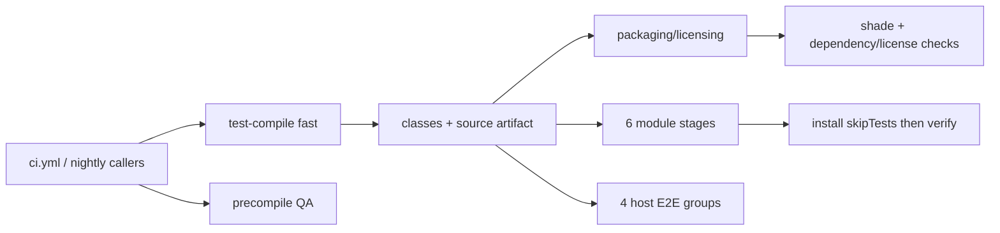

# Сборка, границы модулей, архитектурные проверки и web-поверхность

Статус: **progress**. Это исследование исходников, не принятое решение о новом ядре Ariadne. Ревизия Flink: `068f428b29f4d9ee587fa1006d2f1a69b43c0000`. Обязательство области `root` — 7 069 файлов и 678 568 строк текстовых файлов. Эта глава покрывает только явно перечисленные ниже прочитанные файлы. Остальные остаются открытыми в [реестре](../reading-status.jsonl). Сборки, тесты Flink и установка зависимостей не выполнялись.

## Потребность и критерии приёмки исследования

**As a developer, I want to** понимать, где Flink проводит границы API/runtime/planner/connectors, как эти границы проверяются и какая часть системы отвечает за сборку и web-интерфейс.

**Acceptance criteria: as a developer, I can** пройти от каждого описанного ограничения до конкретной проверки на закреплённой ревизии, отличить правило от его исключений и увидеть непрочитанную область. **As a system, I got** воспроизводимый реестр диапазонов без двойного счёта. Полная приёмка всей области требует чтения оставшихся файлов; наличие этой главы её не закрывает.

Связи: [карта исследования](../README.md), [API/сериализация/Python](04-api-types-serialization-python.md), [управление и scheduler](01-control-plane-scheduling.md), [исполнение и сеть](02-task-execution-network-backpressure.md), [Table/SQL](05-table-sql-planner-runtime.md), [коннекторы](06-connectors-formats-storage-metrics.md).

## 1. Reactor — состав продукта, а не граф исполнения задачи

Полностью прочитан корневой [`pom.xml`, 2 457 строк](https://github.com/apache/flink/blob/068f428b29f4d9ee587fa1006d2f1a69b43c0000/pom.xml). Это Maven parent/aggregator версии `2.5-SNAPSHOT`. Перечень [модулей, строки 71–110](https://github.com/apache/flink/blob/068f428b29f4d9ee587fa1006d2f1a69b43c0000/pom.xml#L71) включает core/core-api, runtime, streaming-java, новые datastream/datastream-api, table, Python, connectors, state-backends, RPC, web, clients, deployment, tests и distribution. Наличие нескольких API-модулей не доказывает наличие нескольких конкурирующих планировщиков: причинный переход от API к исполняемому графу изучается в главе 04.

Root зависимости наследуются модулями; dependencyManagement задаёт версии, но сам по себе не означает подключение каждой библиотеки ко всем артефактам. Внешние shaded-артефакты подключаются отдельно. [Предупреждение в строках 339–346](https://github.com/apache/flink/blob/068f428b29f4d9ee587fa1006d2f1a69b43c0000/pom.xml#L339) запрещает помещать ряд исходных библиотек в общее управление версиями из-за влияния на транзитивные зависимости Hadoop. Это ограничение упаковки/совместимости classpath, не семантика доставки записей.

## 2. Языковая совместимость зависит от профиля

В [properties, строки 134–145](https://github.com/apache/flink/blob/068f428b29f4d9ee587fa1006d2f1a69b43c0000/pom.xml#L134) исходный синтаксис Java — 11, target по умолчанию — 17. Нельзя свести это к утверждению «весь проект Java 11» или «весь проект Java 17». Профиль `java11-target` меняет target на 11; `java17-target` добавляет `flink-tests-java17` и явно оставляет source 11; `java21-target` задаёт source/target 21. Release меняет target на 11. Это прочитанные объявления Maven; прочитанные комбинации CI/JDK описаны в разделе 9; остальные дочерние POM остаются в inventory.

В [настройке compiler, строки 2140–2158](https://github.com/apache/flink/blob/068f428b29f4d9ee587fa1006d2f1a69b43c0000/pom.xml#L2140) `release` очищен, потому что используются `--add-exports`; следовательно комментарий «только Java 11 APIs» не следует воспринимать как доказательство полноценной проверки через `--release 11`. [Enforcer, строки 1874–1895](https://github.com/apache/flink/blob/068f428b29f4d9ee587fa1006d2f1a69b43c0000/pom.xml#L1874) задаёт Maven 3.9.16, Java version property и ограничение версии Hadoop.

## 3. Границы реализации защищены сборкой

[Enforcer, строки 1952–1990](https://github.com/apache/flink/blob/068f428b29f4d9ee587fa1006d2f1a69b43c0000/pom.xml#L1952) запрещает прямую зависимость от `flink-rpc-akka`, направляя к loader и `RpcSystem#load`/testing service. Аналогично production-зависимости от Scala-suffixed table-planner направляются к Table API или planner-loader, с явным исключением для test scope. Это подтверждает намерение изолировать реализации за точками загрузки. Сам внутренний classloading ещё не прочитан этой областью и здесь не описывается как проверенный.

[Shade, строки 2008–2096](https://github.com/apache/flink/blob/068f428b29f4d9ee587fa1006d2f1a69b43c0000/pom.xml#L2008) удаляет bundled logging properties/signatures/ненужные Maven POM, объединяет `META-INF/services`, агрегирует NOTICE, создаёт dependency-reduced POM. Поэтому упаковка влияет на обнаружение сервисов и конфликты зависимостей. Нельзя механически переносить только Java-классы и ожидать идентичную загрузку.

`dependency-convergence` по умолчанию имеет phase `none`; включается отдельным профилем. Профиль `fast` пропускает ряд проверок. Поэтому название успешной Maven-команды без профилей/фаз недостаточно для утверждения, что все архитектурные и совместимые границы проверены.

## 4. API-контракт проверяется отдельно от допустимости зависимости

Полностью прочитаны [`ProductionCodeArchitectureBase`, 46 строк](https://github.com/apache/flink/blob/068f428b29f4d9ee587fa1006d2f1a69b43c0000/flink-architecture-tests/flink-architecture-tests-production/src/main/java/org/apache/flink/architecture/ProductionCodeArchitectureBase.java), [`ArchitectureTest`, 40 строк](https://github.com/apache/flink/blob/068f428b29f4d9ee587fa1006d2f1a69b43c0000/flink-architecture-tests/flink-architecture-tests-production/src/test/java/org/apache/flink/architecture/ArchitectureTest.java) и все четыре подключённые rule-класса.

`ArchitectureTest` импортирует `org.apache.flink`, исключает test, Scala и shaded code. Base подключает API annotations, Table API, connectors и checkpoint configuration. Это не универсальное доказательство архитектуры для всех языков и всех зависимостей. README production-модуля отдельно требует добавлять проверяемые модули test dependencies; фактический список classpath описан ниже; полной эквивалентности reactor нет.

[`ApiAnnotationRules`, 178 строк](https://github.com/apache/flink/blob/068f428b29f4d9ee587fa1006d2f1a69b43c0000/flink-architecture-tests/flink-architecture-tests-production/src/main/java/org/apache/flink/architecture/rules/ApiAnnotationRules.java#L48) требует явной visibility-аннотации публичных API-классов вне internal packages. Public methods ограничивают leaf-типы аргументов/возврата public API, а PublicEvolving допускает PublicEvolving. Есть исключения для deprecated/experimental/internal, внешних и shaded типов. Production-вызовы `VisibleForTesting` ограничены с исключениями для самого тестового метода, своего класса и пары enclosing/enclosed class.

Ряд правил обёрнут `freeze(...)`. Это допускает сохранённый baseline существующих нарушений, а не означает абсолютную чистоту дерева. Прочитаны stored.rules и все шесть связанных baseline-файлов: public leaf types (104 строки), PublicEvolving leaf types (248), visibility (238), VisibleForTesting calls (18), format-options package (1) и connector dependencies (685). Они содержат исключения для serializers/context/graph/window/network классов и конкретных внутренних вызовов. Это сохранённые записи, а не результаты запуска на текущих compiled classes. Connector baseline перечисляет связи файлового source/sink, compaction operators, serializers, legacy filesystem/table bridges, datagen и print sink с внутренними типами. Наличие записи в stored.rules не доказывает актуальность всех исторических правил. Весь tracked subtree flink-architecture-tests (36 текстовых файлов, 4 092 строки) теперь прочитан дословно; тесты и импорт compiled classes не выполнялись.

После полного чтения [Conditions.java](https://github.com/apache/flink/blob/068f428b29f4d9ee587fa1006d2f1a69b43c0000/flink-architecture-tests/flink-architecture-tests-base/src/main/java/org/apache/flink/architecture/common/Conditions.java#L57) уточняется охват leaf types: проверяются также declared exceptions, массивы приводятся к базовому компоненту, generic arguments обходятся рекурсивно. При этом leaf class без Java source filename пропускается. [SourcePredicates](https://github.com/apache/flink/blob/068f428b29f4d9ee587fa1006d2f1a69b43c0000/flink-architecture-tests/flink-architecture-tests-base/src/main/java/org/apache/flink/architecture/common/SourcePredicates.java#L49) требует source metadata и использует `filename.contains(".java")`; это ограниченная статическая проверка, не доказательство полной замкнутости public API.

Полностью прочитанный [production POM](https://github.com/apache/flink/blob/068f428b29f4d9ee587fa1006d2f1a69b43c0000/flink-architecture-tests/flink-architecture-tests-production/pom.xml#L69) перечисляет core/runtime, Table/SQL, три in-tree connectors и model module. Это явный входной classpath, к которому могут добавляться транзитивные зависимости; равенство всему reactor здесь не утверждается. Тест запускается в одном JVM с общим максимальным heap, а dependency-convergence специально пропускается в этом модуле.

[`ConnectorRules`, 81 строка](https://github.com/apache/flink/blob/068f428b29f4d9ee587fa1006d2f1a69b43c0000/flink-architecture-tests/flink-architecture-tests-production/src/main/java/org/apache/flink/architecture/rules/ConnectorRules.java#L61) ограничивает non-deprecated connector-классы public/public-evolving типами Flink за пределами connector packages. Но разрешает другие connectors, `org.apache.flink.util..` и внешние типы; вложенные public-классы тоже учитываются. Краткая формула «connector зависит только от public API» требует этих оговорок и frozen baseline.

## 5. Конфигурация checkpoint имеет узкую статическую защиту

[`CheckpointingConfigurationAccessRules`, 195 строк](https://github.com/apache/flink/blob/068f428b29f4d9ee587fa1006d2f1a69b43c0000/flink-architecture-tests/flink-architecture-tests-production/src/main/java/org/apache/flink/architecture/rules/CheckpointingConfigurationAccessRules.java#L64) ограничивает прямые `Configuration.get/getOptional` для трёх checkpoint options, направляя вызовы к helper-методам с валидацией. Reflection на поля/сигнатуры делает переименование fail-fast при загрузке rule-класса.

Это **эвристика уровня метода**: она ищет доступ к запрещённому полю в том же origin method, не доказывает dataflow конкретного аргумента `get`. Вызовы из `CheckpointingOptions` целиком разрешены; whitelist методов дополнительно разрешает `CheckpointConfig.configure`. Нельзя приписывать этому правилу полную проверку всех путей конфигурации checkpoint или корректность самого snapshot-протокола.

[`TableApiRules`, 131 строка](https://github.com/apache/flink/blob/068f428b29f4d9ee587fa1006d2f1a69b43c0000/flink-architecture-tests/flink-architecture-tests-production/src/main/java/org/apache/flink/architecture/rules/TableApiRules.java#L57) отделяет public static `ConfigOption` в `*Options`/FactoryUtil от DynamicTableFactory, проверяет package/visibility connector/format options и visibility публичных Table API модулей по source location. Это статическая дисциплина API, отдельная от Table planner/runtime в главе 05.

## 6. Unit и integration выполняются разными execution одной системы

[Surefire, строки 1766–1853](https://github.com/apache/flink/blob/068f428b29f4d9ee587fa1006d2f1a69b43c0000/pom.xml#L1766) запускает unit-pattern `*Test`/`*Tests` в phase `test`, остальные классы в `integration-test`, исключая unit-pattern и Scala-generated `$` classes. Integration execution отключает reuseForks и использует отдельные fork/memory limits. Это Surefire, не предположение о Maven Failsafe по названию integration.

По умолчанию передаются checkpoint/buffer-debloat randomization, случайное включение changelog backend и опциональный seed. JUnit parallel feature включён, но classes/methods по умолчанию `same_thread`; concurrency opt-in. Поэтому включённый parallel engine не доказывает параллельное исполнение каждого теста. Чтение этих настроек не заменяет запуск и не даёт pass/fail результата.

Полностью прочитаны общие test architecture rules/base и README/POM этого модуля. В отличие от production import, правила для тестов определены централизованно, но подключаются по отдельным модулям с локальным classpath и baseline. TestNamingRules допускает `*Test`, `*Tests`, `*ITCase`, хотя часть Javadoc ещё описывает более узкий pattern. ITCaseRules проверяет используемый MiniCluster resource/extension, с различием internal runtime и публичной extension; BanJunit4Rules не включён в common base автоматически. NestedTestClassRules проверяет inner-class форму конкретных member tests с no-arg constructor и отдельно запрещает private @Nested; формулировка description про наличие @Nested сильнее фактически проверяемого первого условия.

## 7. Web-модуль собирает отдельный клиент и Java-обработчики

Полностью прочитан [`flink-runtime-web/pom.xml`, 360 строк](https://github.com/apache/flink/blob/068f428b29f4d9ee587fa1006d2f1a69b43c0000/flink-runtime-web/pom.xml). Java-артефакт зависит от runtime/clients и shaded сетевых/JSON библиотек; из dashboard включается ресурс `web/**`. Frontend Maven plugin задаёт Node 22.16.0/npm 10.9.0, `npm ci`, lint, `test:ci`, build. Профиль `fast` отключает Node tests; `skip-webui-build` пропускает frontend plugin с отдельным skip для lint/test executions. Наличие web JAR и backend-сборки само по себе не доказывает свежесть или проверку UI.

Полностью прочитаны [StatusService](https://github.com/apache/flink/blob/068f428b29f4d9ee587fa1006d2f1a69b43c0000/flink-runtime-web/web-dashboard/src/app/services/status.service.ts#L72), [MetricsService](https://github.com/apache/flink/blob/068f428b29f4d9ee587fa1006d2f1a69b43c0000/flink-runtime-web/web-dashboard/src/app/services/metrics.service.ts#L63) и [ConfigService](https://github.com/apache/flink/blob/068f428b29f4d9ee587fa1006d2f1a69b43c0000/flink-runtime-web/web-dashboard/src/app/services/config.service.ts#L42). Status получает `/config`, создаёт shared refresh stream из interval, navigation, force refresh и visibility events, с debounce 300 ms. Это polling для наблюдения, не транспорт записей между операторами.

MetricsService выполняет HTTP GET по job/vertex/subtask endpoints. В `loadMetrics` timestamp создаётся браузером через `Date.now()`: это время получения представления, не доказательство времени измерения runtime. Агрегированные значения уже приходят от backend; клиент выбирает min/max/avg/sum/skew. Watermarks переводятся в JavaScript Number, выбирается минимум; отсутствие прогресса/Long.MIN sentinel представляется NaN. В этой клиентской карте нет точного 64-битного integer-протокола и подтверждений durable обработки записей.

Прочитаны также StatusService/MetricsService tests: проверяются config boot, первое debounced refresh, числовое преобразование метрик, browser timestamp, aggregate selection и sentinel/empty watermark. Они используют подставленный HTTP client и fake timers, не доказывают согласованность метрик с checkpoint и не запускались в исследовании.

### Web submission — отдельный путь построения и отправки программы

Полностью прочитанный [WebSubmissionExtension](https://github.com/apache/flink/blob/068f428b29f4d9ee587fa1006d2f1a69b43c0000/flink-runtime-web/src/main/java/org/apache/flink/runtime/webmonitor/WebSubmissionExtension.java#L99) регистрирует upload/list/run/run-application/delete и два plan handlers. Для jar-run создаётся отдельный executor. [JarRunHandler](https://github.com/apache/flink/blob/068f428b29f4d9ee587fa1006d2f1a69b43c0000/flink-runtime-web/src/main/java/org/apache/flink/runtime/webmonitor/handlers/JarRunHandler.java#L90) копирует конфигурацию, применяет запрос, формирует savepoint restore settings и `PackagedProgram`, затем асинхронно вызывает ApplicationRunner через DispatcherGateway. Завершение future закрывает packaged program; ошибка превращается в HTTP400, пустой список jobs тоже ошибка, ответ содержит первый JobID. Это завершение операции submission, не завершение обработки данных.

[JarPlanHandler](https://github.com/apache/flink/blob/068f428b29f4d9ee587fa1006d2f1a69b43c0000/flink-runtime-web/src/main/java/org/apache/flink/runtime/webmonitor/handlers/JarPlanHandler.java#L95) строит JobGraph в executor и выдаёт JSON plan без отправки job; packaged program закрывается try-with-resources. [JarHandlerUtils](https://github.com/apache/flink/blob/068f428b29f4d9ee587fa1006d2f1a69b43c0000/flink-runtime-web/src/main/java/org/apache/flink/runtime/webmonitor/handlers/utils/JarHandlerUtils.java#L99) задаёт precedence body/query/default, jar/classpath/arguments. `applyToConfiguration` также создаёт packaged program для извлечения зависимостей; его локальное закрытие в этом методе отсутствует. Конечные последствия для extracted libraries/classloader ещё требуют чтения PackagedProgram и тестов — здесь не объявляется доказанный leak.

Полностью прочитанный [WebFrontendBootstrap](https://github.com/apache/flink/blob/068f428b29f4d9ee587fa1006d2f1a69b43c0000/flink-runtime-web/src/main/java/org/apache/flink/runtime/webmonitor/utils/WebFrontendBootstrap.java#L111) устанавливает SSL первым, затем HTTP codec/upload handler/aggregator, ServiceLoader inbound handlers в порядке priority, chunked writer/router/error handler. Его shutdown закрывает server channel и инициирует graceful shutdown event-loop groups. Это HTTP pipeline; его buffers и handlers нельзя смешивать с record channels главы 02.

### История для UI — восстанавливаемый cache архивов

Полностью прочитаны [HistoryServer](https://github.com/apache/flink/blob/068f428b29f4d9ee587fa1006d2f1a69b43c0000/flink-runtime-web/src/main/java/org/apache/flink/runtime/webmonitor/history/HistoryServer.java#L187), ArchiveStorage, FileArchiveStorage, RocksDBArchiveStorage и CompositeArchiveRetainedStrategy. HistoryServer читает архивы завершённых jobs/applications из настроенных внешних директорий, очищает локальный web cache при создании, выбирает file/RocksDB representation и eager/lazy режим. В eager режиме выполняется периодический fetch; lazy делает первоначальный fetch и периодический cleanup, дальнейший request fetch разобран ниже по handler.

Этот RocksDB — **хранилище JSON для истории**, отдельное от keyed state backend. [WriteOptions отключает WAL](https://github.com/apache/flink/blob/068f428b29f4d9ee587fa1006d2f1a69b43c0000/flink-runtime-web/src/main/java/org/apache/flink/runtime/webmonitor/history/RocksDBArchiveStorage.java#L249), а HistoryServer удаляет локальную директорию при shutdown. Это согласуется с ролью cache поверх внешних архивов и не свидетельствует о durability streaming state. FileArchiveStorage заменяет cache-файл через delete/write; атомарность checkpoint-протокола из этого метода не следует. Retention объединяет count и modification-time TTL через allMatch — ограничения истории не определяют срок хранения managed state.

После полного чтения обоих history fetchers и всех Java-файлов в их `history`/`history/retaining` production- и test-пакетах установлены дополнительные ограничения. Retention count применяется отдельно при обходе каждой refresh directory. Превышение retention вызывает удаление **внешнего архива**, затем local cache; удаление уже исчезнувших снаружи архивов из local cache контролируется отдельным cleanup flag. Для application удаляется директория вместе с job archives. Это политика истории, которую нельзя принять за безусловно вечный аудит.

`lazyProcessJobArchive` читает коллекцию archived JSON, synchronously пишет overview/job summary, а detail entries передаёт fixed executor. Поэтому lazy означает разделённое заполнение cache, а не доказанное построчное чтение внешнего файла по HTTP-запросу. [AbstractHistoryServerHandler.loadResource](https://github.com/apache/flink/blob/068f428b29f4d9ee587fa1006d2f1a69b43c0000/flink-runtime-web/src/main/java/org/apache/flink/runtime/webmonitor/history/AbstractHistoryServerHandler.java#L317) может инициировать fetch и ждать detail future прямо из request callback. Название async task само по себе не означает неблокирующий HTTP-path.

Чтение [HistoryServerArchiveFetcherTest](https://github.com/apache/flink/blob/068f428b29f4d9ee587fa1006d2f1a69b43c0000/flink-runtime-web/src/test/java/org/apache/flink/runtime/webmonitor/history/HistoryServerArchiveFetcherTest.java#L143) и application/handler/storage/retention tests подтверждает описанные **проверяемые сценарии**: оба backend, eager/lazy stages, latch-controlled detail writes, empty archive, сохранение последнего overview при всех malformed entries, prefix sibling preservation и cleanup. Это прочитанные assertions, не результаты запуска. Async detail writer логирует отдельную IOException и продолжает до CREATED; статус metadata нельзя понимать как подтверждение сохранения каждой detail entry.

[HistoryServerTest](https://github.com/apache/flink/blob/068f428b29f4d9ee587fa1006d2f1a69b43c0000/flink-runtime-web/src/test/java/org/apache/flink/runtime/webmonitor/history/HistoryServerTest.java#L104) полностью прочитан: часть сценариев поднимает MiniCluster и исполняет finite job, часть использует синтетические завершённые графы/архивы. Таймеры/latches/polling здесь ограничивают ожидание; тесты не являются прогоном отказоустойчивости stream state и в исследовании не запускались.

Graph rendering, оставшиеся frontend services, часть jar handlers и их тесты ещё не прочитаны. Взаимодействие web с управлением заданием проходит через указанные gateway; индивидуальные записи обрабатываются runtime, разобранным в главе 02.

## 8. Внешний ресурс — plugin discovery, отдельно от record/state ownership

Полностью прочитаны **все 14 tracked текстовых файлов** модуля `flink-external-resources`, включая Java, POM, shell и service/test resources, всего 972 строки. Это узкая закрытая область чтения, не завершение всей назначенной области и не исполненная приёмка. Module POM содержит единственный GPU plugin; [service registration](https://github.com/apache/flink/blob/068f428b29f4d9ee587fa1006d2f1a69b43c0000/flink-external-resources/flink-external-resource-gpu/src/main/resources/META-INF/services/org.apache.flink.api.common.externalresource.ExternalResourceDriverFactory#L16) связывает factory с driver.

[GPUDriver](https://github.com/apache/flink/blob/068f428b29f4d9ee587fa1006d2f1a69b43c0000/flink-external-resources/flink-external-resource-gpu/src/main/java/org/apache/flink/externalresource/gpu/GPUDriver.java#L63) проверяет path/executable и положительное количество, запускает discovery process с deadline 10 s, при любом выходе вызывает destroyForcibly. Используется первая строка stdout, IDs разбираются по запятым и превращаются в immutable Set<GPUInfo>. Java driver сам не сверяет размер результата с requested amount; достаточность в стандартном пути проверяет script. Process сначала ожидается, затем читаются stdout/stderr — это не потоковый неблокирующий вывод subprocess.

Стандартный script получает GPU indexes через локальную утилиту и вызывает [gpu-discovery-common.sh](https://github.com/apache/flink/blob/068f428b29f4d9ee587fa1006d2f1a69b43c0000/flink-external-resources/flink-external-resource-gpu/src/main/resources/gpu-discovery-common.sh#L31). Без coordination выбираются первые N; с coordination локальный flock защищает файл index→PPID, занятость освобождается по проверке отсутствия процесса. Это локальная координация discovery, без представленного здесь distributed lease/fencing или snapshot operator state. Scheduling/resource plumbing вне этого модуля остаётся отдельной зависимостью, а не доказанным следствием обнаружения GPU ID.

Прочитанные Java tests используют тестовый script, проверяют config/errors/count и exit status; реальные GPU ими не доказываются. Shell fixture имеет ограничение статической проверки: циклы `for i in output1`/`for j in output2` сравнивают literal names вместо элементов массивов, поэтому название теста не доказывает disjoint device allocation. Fixtures и тесты прочитаны, не запускались; production-код по ним не изменён.

## 9. CI разделяет быструю компиляцию, QA, module tests и E2E

Полностью прочитаны [ci.yml](https://github.com/apache/flink/blob/068f428b29f4d9ee587fa1006d2f1a69b43c0000/.github/workflows/ci.yml#L42), [nightly.yml](https://github.com/apache/flink/blob/068f428b29f4d9ee587fa1006d2f1a69b43c0000/.github/workflows/nightly.yml#L35), все 485 строк [reusable template](https://github.com/apache/flink/blob/068f428b29f4d9ee587fa1006d2f1a69b43c0000/.github/workflows/template.flink-ci.yml#L70), composite actions job_init/run_mvn, scripts compile/compile_ci, stage, test_controller, Maven helpers, watchdogs и artifact create/unpack. Это исследование объявленного пути; ни один из этих scripts не запускался.

Обычный workflow выбирает Java17; nightly — Java11, Java21 и AdaptiveScheduler на Java17 отдельными callers. Обычный push игнорирует docs/Markdown и некоторые tooling paths. Pre-compile checks объявлены отдельным job, а reusable CI не имеет зависимости needs на этот job: это параллельные ветви, не доказанный последовательный gate. Полностью прочитанный [pre-compile template](https://github.com/apache/flink/blob/068f428b29f4d9ee587fa1006d2f1a69b43c0000/.github/workflows/template.pre-compile-checks.yml#L62) находит последний зелёный ci.yml run по branch/status, пытается получить SHA для Spotless ratchet, при неуспехе fetch делает полную проверку. Checkstyle и root RAT выполняются отдельно, без компиляции. Последний зелёный SHA — база форматирования, не точка восстановления исполняемой задачи.

Начальный compile делает `test-compile -Dfast`, сохраняет classes и исходники в артефакт. [create_build_artifact](https://github.com/apache/flink/blob/068f428b29f4d9ee587fa1006d2f1a69b43c0000/tools/ci/create_build_artifact.sh#L22) удаляет JAR, Git, node/node_modules и build-target link. Downstream заново собирает JAR, но [unpack](https://github.com/apache/flink/blob/068f428b29f4d9ee587fa1006d2f1a69b43c0000/tools/ci/unpack_build_artifact.sh#L36) искусственно делает class/timestamp новее Java/Scala source на 5 секунд для Maven up-to-date. Это ускорение CI, не механизм durable восстановления job или доказательство новой clean-компиляции каждого downstream job.

Packaging/licensing отдельно вызывает compile_ci. [compile.sh](https://github.com/apache/flink/blob/068f428b29f4d9ee587fa1006d2f1a69b43c0000/tools/ci/compile.sh#L61) по умолчанию включает staged deployment, convergence и shade DEBUG, затем Javadoc, optional dependencies, Scala suffix, shaded-artifact и license проверки. Явно пустой MVN_LICENSE_CHECK_ARGS отключает эти блоки. Лог многопоточной сборки перегруппируется по thread, чтобы dependency/license parsers видели непрерывные plugin blocks. Все parser/checker implementations этого модуля теперь прочитаны; их фактические ограничения описаны ниже. Успешная compilation не равна их прохождению.

Module-test matrix состоит из core/python/table/connect/tests/misc. [stage.sh](https://github.com/apache/flink/blob/068f428b29f4d9ee587fa1006d2f1a69b43c0000/tools/ci/stage.sh#L131) задаёт явные списки; misc исключает остальные группы. Compile использует `-am`, test selection — нет. [test_controller](https://github.com/apache/flink/blob/068f428b29f4d9ee587fa1006d2f1a69b43c0000/tools/ci/test_controller.sh#L80) сначала делает install с skipTests, затем verify с OpenSSL, double-free, запретом обновления frozen baseline и forced RPC invocation serialization. Python stage вызывает отдельный lint-python script; его имя не раскрывает полный состав проверок до чтения. E2E разделены на четыре группы и работают на host отдельно от container module tests, с явным non-root исполнением module tests.

Два watchdog решают разные задачи CI. [watchdog.sh](https://github.com/apache/flink/blob/068f428b29f4d9ee587fa1006d2f1a69b43c0000/tools/ci/watchdog.sh#L55) проверяет mtime stdout/Maven logs каждые 20 секунд, порог тишины по умолчанию 900 секунд. Это не проверка прогресса stream/channel/checkpoint: активный лог может скрывать зависание полезной работы. [uploading_watchdog](https://github.com/apache/flink/blob/068f428b29f4d9ee587fa1006d2f1a69b43c0000/tools/ci/uploading_watchdog.sh#L67) считает остаток абсолютного job budget от сохранённого start time, реально предупреждает на 95% и резервирует 2 минуты перед kill; комментарии про 80%/1 минуту устарели. В обоих scripts command запускается через shell expansion переменной, это не чтение pipeline-строки как нового shell-кода. Это наблюдение исходника, не воспроизведённый сбой CI.

### Конкретные границы статической проверки упаковки

Прочитан весь [shade.sh](https://github.com/apache/flink/blob/068f428b29f4d9ee587fa1006d2f1a69b43c0000/tools/ci/shade.sh#L22). Для dist JAR он ищет определённые исходные package prefixes (ASM, Guava, обе Jackson, Netty, ZooKeeper/Curator, Python/Hadoop) и требует наличие Snappy. Для S3 variants проверяет наличие и точное содержимое FileSystemFactory service descriptor. Это конкретные проверки списка archive entries, не общее доказательство отсутствия classloader-конфликтов. Read-only исследование не меняло JAR или эти правила.

Это граф CI-объявлений закреплённой ревизии, отдельно от [графа исполнения streaming job](00-architecture-overview.md).

### Dependency и license QA используют разрешённое Maven дерево и текстовые эвристики

Весь tracked module `tools/ci/flink-ci-tools` — 26 текстовых файлов, включая все Java implementations/tests, POM и service/logging/allowance resources — прочитан дословно. [ShadeOptionalChecker](https://github.com/apache/flink/blob/068f428b29f4d9ee587fa1006d2f1a69b43c0000/tools/ci/flink-ci-tools/src/main/java/org/apache/flink/tools/ci/optional/ShadeOptionalChecker.java#L156) требует optional на bundled dependency или её предке в разрешённом дереве; при отсутствии транзитивных direct dependencies делает ранний выход, исключая common root dependencies. Это защита от утечки bundled classes через Maven transitivity. [DependencyTree](https://github.com/apache/flink/blob/068f428b29f4d9ee587fa1006d2f1a69b43c0000/tools/ci/flink-ci-tools/src/main/java/org/apache/flink/tools/ci/utils/shared/DependencyTree.java#L45) сохраняет один occurrence и один parent для group/artifact/version/classifier; scope/optional не входят в lookup key, первая запись побеждает. Это не полный граф всех возможных путей зависимостей.

[ParserUtils](https://github.com/apache/flink/blob/068f428b29f4d9ee587fa1006d2f1a69b43c0000/tools/ci/flink-ci-tools/src/main/java/org/apache/flink/tools/ci/utils/shared/ParserUtils.java#L31) ожидает максимум один plugin block на module; повторный block перезапишет результат. DependencyParser принимает старые и новые имена Maven plugin, восстанавливает вложенность из текстового дерева; ShadeParser реально принимает `default` execution наряду с `shade-flink`/`shade-dist`, несмотря на более узкий JavaDoc. DeployParser определяет skipped deployment по строке непосредственно после header. Поэтому формат/целостность лога — часть входного контракта QA, что объясняет serial dependency tree и regroup compile logs.

[ScalaSuffixChecker](https://github.com/apache/flink/blob/068f428b29f4d9ee587fa1006d2f1a69b43c0000/tools/ci/flink-ci-tools/src/main/java/org/apache/flink/tools/ci/suffixcheck/ScalaSuffixChecker.java#L101) классифицирует Scala зависимость по group/artifact, исключает test scope и loader-isolated RPC/planner. Затем ищет определённые текстовые artifactId patterns в POM с ограниченной глубиной обхода, исключает dev docs/E2E modules. Это дисциплина имён и зависимостей, отдельная от фактической runtime classloader isolation.

[NoticeFileChecker](https://github.com/apache/flink/blob/068f428b29f4d9ee587fa1006d2f1a69b43c0000/tools/ci/flink-ci-tools/src/main/java/org/apache/flink/tools/ci/licensecheck/NoticeFileChecker.java#L111) объединяет shade/copy dependencies и отбирает deployed/directly bundled modules. Многошаговое косвенное включение через non-deployed module явно оставлено TODO. Отсутствующие/дублированные зависимости критичны; лишние tolerable/suppressed, с явным allowance для flink-python. [JarFileChecker](https://github.com/apache/flink/blob/068f428b29f4d9ee587fa1006d2f1a69b43c0000/tools/ci/flink-ci-tools/src/main/java/org/apache/flink/tools/ci/licensecheck/JarFileChecker.java#L64) проверяет NOTICE/LICENSE и известные текстовые patterns/path exceptions; пустой test JAR без class files пропускает. Сам launcher предупреждает, что это поиск типичных ошибок, требующий отдельного manual review. Исследование описывает механизм QA, не даёт юридического заключения о будущих заимствованиях.

Все девять test files прочитаны: synthetic Maven logs проверяют оба spellings, classifier/scope/optional, tree key first occurrence; другие tests создают synthetic JAR и проверяют presence/path/pattern rules. Дополнительный LICENSE в META-INF помечен Disabled. Эти fixtures показывают границы утверждений, но тесты в текущей работе не запускались.

### Документация и repository automation имеют отдельные жизненные циклы

Все tracked текстовые файлы `.github/` (18 файлов, 2 300 строк) теперь прочитаны, включая schedules, composite actions и весь community-review shell. [nightly-trigger](https://github.com/apache/flink/blob/068f428b29f4d9ee587fa1006d2f1a69b43c0000/.github/workflows/nightly-trigger.yml#L69) пропускает unchanged SHA только после зелёного предыдущего nightly; failed/cancelled повторяет, manual bypasses skip. Dispatch идёт по branch ref, поэтому наблюдённый currentSha и реально выбранный при старте commit надо различать. Это CI retry policy, отдельно от job failover.

Docs check запускается по docs-only PR path; scheduled documentation publication строит выбранные release/master ветви и external documentation modules. [docs.sh](https://github.com/apache/flink/blob/068f428b29f4d9ee587fa1006d2f1a69b43c0000/.github/workflows/docs.sh#L30) выполняет submodule init, Hugo, Java/Python API generation. Следовательно published documentation — отдельный build artifact с внешними входами, не доказательство равенства текущему API/runtime. В текущем исследовании gitlink theme остаётся явно не загруженным; эти scripts не выполнялись. Review/stale automation изменяет PR metadata по расписанию и не участвует в record execution или восстановлении state; исследование не отправляло её API mutations.

## Оставшееся чтение

Следующие цепочки: module-specific ArchUnit подключения вне полностью прочитанного flink-architecture-tests; CI tools/workflows; непрочитанные runtime-web services/jar handlers/frontend и тесты; integration и end-to-end tests; остальные docs/build/resources по inventory. Всё это остаётся в исходном объёме задания. Краткие индивидуальные выводы и точные диапазоны прочитанных файлов зарегистрированы в [root ledger](../readers/root.confirmed.jsonl); сам исходный текст находится в закреплённом upstream checkout, уникальное покрытие вычисляется [инструментом](../tools/coverage.py).
