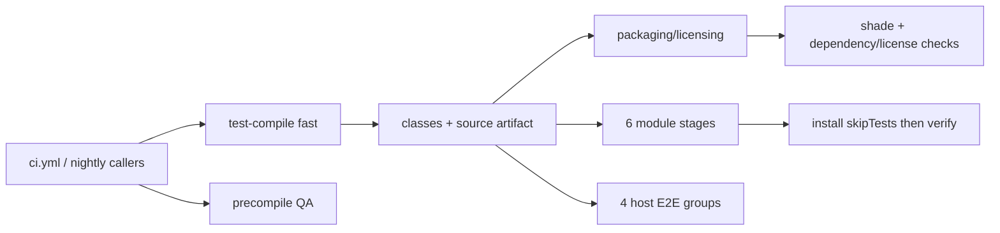

# Сборка, границы модулей, архитектурные проверки и web-поверхность

Статус: **progress**. Это исследование исходников, не принятое решение о новом ядре Ariadne. Ревизия Flink: `068f428b29f4d9ee587fa1006d2f1a69b43c0000`. Обязательство области `root` — 7 069 файлов и 678 568 строк текстовых файлов. Эта глава покрывает только явно перечисленные ниже прочитанные файлы. Остальные остаются открытыми в [реестре](../reading-status.jsonl). Сборки, тесты Flink и установка зависимостей Flink не выполнялись.

## Потребность и критерии приёмки исследования

**As a developer, I want to** понимать, где Flink проводит границы API/runtime/planner/connectors, как эти границы проверяются и какая часть системы отвечает за сборку и web-интерфейс.

**Acceptance criteria: as a developer, I can** пройти от каждого описанного ограничения до конкретной проверки на закреплённой ревизии, отличить правило от его исключений и увидеть непрочитанную область. **As a system, I got** воспроизводимый реестр диапазонов без двойного счёта. Полная приёмка всей области требует чтения оставшихся файлов; наличие этой главы её не закрывает.

Связи: [карта исследования](../README.md), [API/сериализация/Python](04-api-types-serialization-python.md), [управление и scheduler](01-control-plane-scheduling.md), [исполнение и сеть](02-task-execution-network-backpressure.md), [Table/SQL](05-table-sql-planner-runtime.md), [коннекторы](06-connectors-formats-storage-metrics.md).

## 1. Reactor — состав продукта, а не граф исполнения задачи

Полностью прочитан корневой [`pom.xml`, 2 457 строк](https://github.com/apache/flink/blob/068f428b29f4d9ee587fa1006d2f1a69b43c0000/pom.xml). Это Maven parent/aggregator версии `2.5-SNAPSHOT`. Перечень [модулей, строки 71–110](https://github.com/apache/flink/blob/068f428b29f4d9ee587fa1006d2f1a69b43c0000/pom.xml#L71) включает core/core-api, runtime, streaming-java, новые datastream/datastream-api, table, Python, connectors, state-backends, RPC, web, clients, deployment, tests и distribution. Наличие нескольких API-модулей не доказывает наличие нескольких конкурирующих планировщиков: причинный переход от API к исполняемому графу изучается в главе 04.

Root зависимости наследуются модулями; dependencyManagement задаёт версии, но сам по себе не означает подключение каждой библиотеки ко всем артефактам. Внешние shaded-артефакты подключаются отдельно. [Предупреждение в строках 339–346](https://github.com/apache/flink/blob/068f428b29f4d9ee587fa1006d2f1a69b43c0000/pom.xml#L339) запрещает помещать ряд исходных библиотек в общее управление версиями из-за влияния на транзитивные зависимости Hadoop. Это ограничение упаковки/совместимости classpath, не семантика доставки записей.

## 2. Языковая совместимость зависит от профиля

В [properties, строки 134–145](https://github.com/apache/flink/blob/068f428b29f4d9ee587fa1006d2f1a69b43c0000/pom.xml#L134) исходный синтаксис Java — 11, target по умолчанию — 17. Нельзя свести это к утверждению «весь проект Java 11» или «весь проект Java 17». Профиль `java11-target` меняет target на 11; `java17-target` добавляет `flink-tests-java17` и явно оставляет source 11; `java21-target` задаёт source/target 21. Release меняет target на 11. Это прочитанные объявления Maven; прочитанные комбинации CI/JDK описаны в разделе 9; остальные дочерние POM остаются в inventory.

В [настройке compiler, строки 2140–2158](https://github.com/apache/flink/blob/068f428b29f4d9ee587fa1006d2f1a69b43c0000/pom.xml#L2140) `release` очищен, потому что используются `--add-exports`; следовательно комментарий «только Java 11 APIs» не следует воспринимать как доказательство полноценной проверки через `--release 11`. [Enforcer, строки 1874–1895](https://github.com/apache/flink/blob/068f428b29f4d9ee587fa1006d2f1a69b43c0000/pom.xml#L1874) задаёт Maven 3.9.16, Java version property и ограничение версии Hadoop.

## 3. Границы реализации защищены сборкой

[Enforcer, строки 1952–1990](https://github.com/apache/flink/blob/068f428b29f4d9ee587fa1006d2f1a69b43c0000/pom.xml#L1952) запрещает прямую зависимость от `flink-rpc-akka`, направляя к loader и `RpcSystem#load`/testing service. Аналогично production-зависимости от Scala-suffixed table-planner направляются к Table API или planner-loader, с явным исключением для test scope. Это подтверждает намерение изолировать реализации за точками загрузки. Сам внутренний classloading ещё не прочитан этой областью и здесь не описывается как проверенный.

[Shade, строки 2008–2096](https://github.com/apache/flink/blob/068f428b29f4d9ee587fa1006d2f1a69b43c0000/pom.xml#L2008) удаляет bundled logging properties/signatures/ненужные Maven POM, объединяет `META-INF/services`, агрегирует NOTICE, создаёт dependency-reduced POM. Поэтому упаковка влияет на обнаружение сервисов и конфликты зависимостей. Нельзя механически переносить только Java-классы и ожидать идентичную загрузку.

`dependency-convergence` по умолчанию имеет phase `none`; включается отдельным профилем. Профиль `fast` пропускает ряд проверок. Поэтому название успешной Maven-команды без профилей/фаз недостаточно для утверждения, что все архитектурные и совместимые границы проверены.

## 4. API-контракт проверяется отдельно от допустимости зависимости

Полностью прочитаны [`ProductionCodeArchitectureBase`, 46 строк](https://github.com/apache/flink/blob/068f428b29f4d9ee587fa1006d2f1a69b43c0000/flink-architecture-tests/flink-architecture-tests-production/src/main/java/org/apache/flink/architecture/ProductionCodeArchitectureBase.java), [`ArchitectureTest`, 40 строк](https://github.com/apache/flink/blob/068f428b29f4d9ee587fa1006d2f1a69b43c0000/flink-architecture-tests/flink-architecture-tests-production/src/test/java/org/apache/flink/architecture/ArchitectureTest.java) и все четыре подключённые rule-класса.

`ArchitectureTest` импортирует `org.apache.flink`, исключает test, Scala и shaded code. Base подключает API annotations, Table API, connectors и checkpoint configuration. Это не универсальное доказательство архитектуры для всех языков и всех зависимостей. README production-модуля отдельно требует добавлять проверяемые модули test dependencies; фактический список classpath описан ниже; полной эквивалентности reactor нет.

[`ApiAnnotationRules`, 178 строк](https://github.com/apache/flink/blob/068f428b29f4d9ee587fa1006d2f1a69b43c0000/flink-architecture-tests/flink-architecture-tests-production/src/main/java/org/apache/flink/architecture/rules/ApiAnnotationRules.java#L48) требует явной visibility-аннотации публичных API-классов вне internal packages. Public methods ограничивают leaf-типы аргументов/возврата public API, а PublicEvolving допускает PublicEvolving. Есть исключения для deprecated/experimental/internal, внешних и shaded типов. Production-вызовы `VisibleForTesting` ограничены с исключениями для самого тестового метода, своего класса и пары enclosing/enclosed class.

Ряд правил обёрнут `freeze(...)`. Это допускает сохранённый baseline существующих нарушений, а не означает абсолютную чистоту дерева. Прочитаны stored.rules и все шесть связанных baseline-файлов: public leaf types (104 строки), PublicEvolving leaf types (248), visibility (238), VisibleForTesting calls (18), format-options package (1) и connector dependencies (685). Они содержат исключения для serializers/context/graph/window/network классов и конкретных внутренних вызовов. Это сохранённые записи, а не результаты запуска на текущих compiled classes. Connector baseline перечисляет связи файлового source/sink, compaction operators, serializers, legacy filesystem/table bridges, datagen и print sink с внутренними типами. Наличие записи в stored.rules не доказывает актуальность всех исторических правил. Весь tracked subtree flink-architecture-tests (36 текстовых файлов, 4 092 строки) теперь прочитан дословно; тесты и импорт compiled classes не выполнялись.

После полного чтения [Conditions.java](https://github.com/apache/flink/blob/068f428b29f4d9ee587fa1006d2f1a69b43c0000/flink-architecture-tests/flink-architecture-tests-base/src/main/java/org/apache/flink/architecture/common/Conditions.java#L57) уточняется охват leaf types: проверяются также declared exceptions, массивы приводятся к базовому компоненту, generic arguments обходятся рекурсивно. При этом leaf class без Java source filename пропускается. [SourcePredicates](https://github.com/apache/flink/blob/068f428b29f4d9ee587fa1006d2f1a69b43c0000/flink-architecture-tests/flink-architecture-tests-base/src/main/java/org/apache/flink/architecture/common/SourcePredicates.java#L49) требует source metadata и использует `filename.contains(".java")`; это ограниченная статическая проверка, не доказательство полной замкнутости public API.

Полностью прочитанный [production POM](https://github.com/apache/flink/blob/068f428b29f4d9ee587fa1006d2f1a69b43c0000/flink-architecture-tests/flink-architecture-tests-production/pom.xml#L69) перечисляет core/runtime, Table/SQL, три in-tree connectors и model module. Это явный входной classpath, к которому могут добавляться транзитивные зависимости; равенство всему reactor здесь не утверждается. Тест запускается в одном JVM с общим максимальным heap, а dependency-convergence специально пропускается в этом модуле.

[`ConnectorRules`, 81 строка](https://github.com/apache/flink/blob/068f428b29f4d9ee587fa1006d2f1a69b43c0000/flink-architecture-tests/flink-architecture-tests-production/src/main/java/org/apache/flink/architecture/rules/ConnectorRules.java#L61) ограничивает non-deprecated connector-классы public/public-evolving типами Flink за пределами connector packages. Но разрешает другие connectors, `org.apache.flink.util..` и внешние типы; вложенные public-классы тоже учитываются. Краткая формула «connector зависит только от public API» требует этих оговорок и frozen baseline.

## 5. Конфигурация checkpoint имеет узкую статическую защиту

[`CheckpointingConfigurationAccessRules`, 195 строк](https://github.com/apache/flink/blob/068f428b29f4d9ee587fa1006d2f1a69b43c0000/flink-architecture-tests/flink-architecture-tests-production/src/main/java/org/apache/flink/architecture/rules/CheckpointingConfigurationAccessRules.java#L64) ограничивает прямые `Configuration.get/getOptional` для трёх checkpoint options, направляя вызовы к helper-методам с валидацией. Reflection на поля/сигнатуры делает переименование fail-fast при загрузке rule-класса.

Это **эвристика уровня метода**: она ищет доступ к запрещённому полю в том же origin method, не доказывает dataflow конкретного аргумента `get`. Вызовы из `CheckpointingOptions` целиком разрешены; whitelist методов дополнительно разрешает `CheckpointConfig.configure`. Нельзя приписывать этому правилу полную проверку всех путей конфигурации checkpoint или корректность самого snapshot-протокола.

[`TableApiRules`, 131 строка](https://github.com/apache/flink/blob/068f428b29f4d9ee587fa1006d2f1a69b43c0000/flink-architecture-tests/flink-architecture-tests-production/src/main/java/org/apache/flink/architecture/rules/TableApiRules.java#L57) отделяет public static `ConfigOption` в `*Options`/FactoryUtil от DynamicTableFactory, проверяет package/visibility connector/format options и visibility публичных Table API модулей по source location. Это статическая дисциплина API, отдельная от Table planner/runtime в главе 05.

## 6. Unit и integration выполняются разными execution одной системы

[Surefire, строки 1766–1853](https://github.com/apache/flink/blob/068f428b29f4d9ee587fa1006d2f1a69b43c0000/pom.xml#L1766) запускает unit-pattern `*Test`/`*Tests` в phase `test`, остальные классы в `integration-test`, исключая unit-pattern и Scala-generated `$` classes. Integration execution отключает reuseForks и использует отдельные fork/memory limits. Это Surefire, не предположение о Maven Failsafe по названию integration.

По умолчанию передаются checkpoint/buffer-debloat randomization, случайное включение changelog backend и опциональный seed. JUnit parallel feature включён, но classes/methods по умолчанию `same_thread`; concurrency opt-in. Поэтому включённый parallel engine не доказывает параллельное исполнение каждого теста. Чтение этих настроек не заменяет запуск и не даёт pass/fail результата.

Полностью прочитаны общие test architecture rules/base и README/POM этого модуля. В отличие от production import, правила для тестов определены централизованно, но подключаются по отдельным модулям с локальным classpath и baseline. TestNamingRules допускает `*Test`, `*Tests`, `*ITCase`, хотя часть Javadoc ещё описывает более узкий pattern. ITCaseRules проверяет используемый MiniCluster resource/extension, с различием internal runtime и публичной extension; BanJunit4Rules не включён в common base автоматически. NestedTestClassRules проверяет inner-class форму конкретных member tests с no-arg constructor и отдельно запрещает private @Nested; формулировка description про наличие @Nested сильнее фактически проверяемого первого условия.

## 7. Web-модуль собирает отдельный клиент и Java-обработчики

Полностью прочитан [`flink-runtime-web/pom.xml`, 360 строк](https://github.com/apache/flink/blob/068f428b29f4d9ee587fa1006d2f1a69b43c0000/flink-runtime-web/pom.xml). Java-артефакт зависит от runtime/clients и shaded сетевых/JSON библиотек; из dashboard включается ресурс `web/**`. Frontend Maven plugin задаёт Node 22.16.0/npm 10.9.0, `npm ci`, lint, `test:ci`, build. Профиль `fast` отключает Node tests; `skip-webui-build` пропускает frontend plugin с отдельным skip для lint/test executions. Наличие web JAR и backend-сборки само по себе не доказывает свежесть или проверку UI.

Полностью прочитаны [StatusService](https://github.com/apache/flink/blob/068f428b29f4d9ee587fa1006d2f1a69b43c0000/flink-runtime-web/web-dashboard/src/app/services/status.service.ts#L72), [MetricsService](https://github.com/apache/flink/blob/068f428b29f4d9ee587fa1006d2f1a69b43c0000/flink-runtime-web/web-dashboard/src/app/services/metrics.service.ts#L63) и [ConfigService](https://github.com/apache/flink/blob/068f428b29f4d9ee587fa1006d2f1a69b43c0000/flink-runtime-web/web-dashboard/src/app/services/config.service.ts#L42). Status получает `/config`, создаёт shared refresh stream из interval, navigation, force refresh и visibility events, с debounce 300 ms. Это polling для наблюдения, не транспорт записей между операторами.

MetricsService выполняет HTTP GET по job/vertex/subtask endpoints. В `loadMetrics` timestamp создаётся браузером через `Date.now()`: это время получения представления, не доказательство времени измерения runtime. Агрегированные значения уже приходят от backend; клиент выбирает min/max/avg/sum/skew. Watermarks переводятся в JavaScript Number, выбирается минимум; отсутствие прогресса/Long.MIN sentinel представляется NaN. В этой клиентской карте нет точного 64-битного integer-протокола и подтверждений durable обработки записей.

Прочитаны также StatusService/MetricsService tests: проверяются config boot, первое debounced refresh, числовое преобразование метрик, browser timestamp, aggregate selection и sentinel/empty watermark. Они используют подставленный HTTP client и fake timers, не доказывают согласованность метрик с checkpoint и не запускались в исследовании.

### Web submission — отдельный путь построения и отправки программы

Полностью прочитанный [WebSubmissionExtension](https://github.com/apache/flink/blob/068f428b29f4d9ee587fa1006d2f1a69b43c0000/flink-runtime-web/src/main/java/org/apache/flink/runtime/webmonitor/WebSubmissionExtension.java#L99) регистрирует upload/list/run/run-application/delete и два plan handlers. Для jar-run создаётся отдельный executor. [JarRunHandler](https://github.com/apache/flink/blob/068f428b29f4d9ee587fa1006d2f1a69b43c0000/flink-runtime-web/src/main/java/org/apache/flink/runtime/webmonitor/handlers/JarRunHandler.java#L90) копирует конфигурацию, применяет запрос, формирует savepoint restore settings и `PackagedProgram`, затем асинхронно вызывает ApplicationRunner через DispatcherGateway. Завершение future закрывает packaged program; ошибка превращается в HTTP400, пустой список jobs тоже ошибка, ответ содержит первый JobID. Это завершение операции submission, не завершение обработки данных.

[JarPlanHandler](https://github.com/apache/flink/blob/068f428b29f4d9ee587fa1006d2f1a69b43c0000/flink-runtime-web/src/main/java/org/apache/flink/runtime/webmonitor/handlers/JarPlanHandler.java#L95) строит JobGraph в executor и выдаёт JSON plan без отправки job; packaged program закрывается try-with-resources. [JarHandlerUtils](https://github.com/apache/flink/blob/068f428b29f4d9ee587fa1006d2f1a69b43c0000/flink-runtime-web/src/main/java/org/apache/flink/runtime/webmonitor/handlers/utils/JarHandlerUtils.java#L99) задаёт precedence body/query/default, jar/classpath/arguments. `applyToConfiguration` также создаёт packaged program для извлечения зависимостей; его локальное закрытие в этом методе отсутствует. Конечные последствия для extracted libraries/classloader ещё требуют чтения PackagedProgram и тестов — здесь не объявляется доказанный leak.

Полностью прочитанный [WebFrontendBootstrap](https://github.com/apache/flink/blob/068f428b29f4d9ee587fa1006d2f1a69b43c0000/flink-runtime-web/src/main/java/org/apache/flink/runtime/webmonitor/utils/WebFrontendBootstrap.java#L111) устанавливает SSL первым, затем HTTP codec/upload handler/aggregator, ServiceLoader inbound handlers в порядке priority, chunked writer/router/error handler. Его shutdown закрывает server channel и инициирует graceful shutdown event-loop groups. Это HTTP pipeline; его buffers и handlers нельзя смешивать с record channels главы 02.

### История для UI — восстанавливаемый cache архивов

Полностью прочитаны [HistoryServer](https://github.com/apache/flink/blob/068f428b29f4d9ee587fa1006d2f1a69b43c0000/flink-runtime-web/src/main/java/org/apache/flink/runtime/webmonitor/history/HistoryServer.java#L187), ArchiveStorage, FileArchiveStorage, RocksDBArchiveStorage и CompositeArchiveRetainedStrategy. HistoryServer читает архивы завершённых jobs/applications из настроенных внешних директорий, очищает локальный web cache при создании, выбирает file/RocksDB representation и eager/lazy режим. В eager режиме выполняется периодический fetch; lazy делает первоначальный fetch и периодический cleanup, дальнейший request fetch разобран ниже по handler.

Этот RocksDB — **хранилище JSON для истории**, отдельное от keyed state backend. [WriteOptions отключает WAL](https://github.com/apache/flink/blob/068f428b29f4d9ee587fa1006d2f1a69b43c0000/flink-runtime-web/src/main/java/org/apache/flink/runtime/webmonitor/history/RocksDBArchiveStorage.java#L249), а HistoryServer удаляет локальную директорию при shutdown. Это согласуется с ролью cache поверх внешних архивов и не свидетельствует о durability streaming state. FileArchiveStorage заменяет cache-файл через delete/write; атомарность checkpoint-протокола из этого метода не следует. Retention объединяет count и modification-time TTL через allMatch — ограничения истории не определяют срок хранения managed state.

После полного чтения обоих history fetchers и всех Java-файлов в их `history`/`history/retaining` production- и test-пакетах установлены дополнительные ограничения. Retention count применяется отдельно при обходе каждой refresh directory. Превышение retention вызывает удаление **внешнего архива**, затем local cache; удаление уже исчезнувших снаружи архивов из local cache контролируется отдельным cleanup flag. Для application удаляется директория вместе с job archives. Это политика истории, которую нельзя принять за безусловно вечный аудит.

`lazyProcessJobArchive` читает коллекцию archived JSON, synchronously пишет overview/job summary, а detail entries передаёт fixed executor. Поэтому lazy означает разделённое заполнение cache, а не доказанное построчное чтение внешнего файла по HTTP-запросу. [AbstractHistoryServerHandler.loadResource](https://github.com/apache/flink/blob/068f428b29f4d9ee587fa1006d2f1a69b43c0000/flink-runtime-web/src/main/java/org/apache/flink/runtime/webmonitor/history/AbstractHistoryServerHandler.java#L317) может инициировать fetch и ждать detail future прямо из request callback. Название async task само по себе не означает неблокирующий HTTP-path.

Чтение [HistoryServerArchiveFetcherTest](https://github.com/apache/flink/blob/068f428b29f4d9ee587fa1006d2f1a69b43c0000/flink-runtime-web/src/test/java/org/apache/flink/runtime/webmonitor/history/HistoryServerArchiveFetcherTest.java#L143) и application/handler/storage/retention tests подтверждает описанные **проверяемые сценарии**: оба backend, eager/lazy stages, latch-controlled detail writes, empty archive, сохранение последнего overview при всех malformed entries, prefix sibling preservation и cleanup. Это прочитанные assertions, не результаты запуска. Async detail writer логирует отдельную IOException и продолжает до CREATED; статус metadata нельзя понимать как подтверждение сохранения каждой detail entry.

[HistoryServerTest](https://github.com/apache/flink/blob/068f428b29f4d9ee587fa1006d2f1a69b43c0000/flink-runtime-web/src/test/java/org/apache/flink/runtime/webmonitor/history/HistoryServerTest.java#L104) полностью прочитан: часть сценариев поднимает MiniCluster и исполняет finite job, часть использует синтетические завершённые графы/архивы. Таймеры/latches/polling здесь ограничивают ожидание; тесты не являются прогоном отказоустойчивости stream state и в исследовании не запускались.

Graph rendering, оставшиеся frontend services, часть jar handlers и их тесты ещё не прочитаны. Взаимодействие web с управлением заданием проходит через указанные gateway; индивидуальные записи обрабатываются runtime, разобранным в главе 02.

## 8. Внешний ресурс — plugin discovery, отдельно от record/state ownership

Полностью прочитаны **все 14 tracked текстовых файлов** модуля `flink-external-resources`, включая Java, POM, shell и service/test resources, всего 972 строки. Это узкая закрытая область чтения, не завершение всей назначенной области и не исполненная приёмка. Module POM содержит единственный GPU plugin; [service registration](https://github.com/apache/flink/blob/068f428b29f4d9ee587fa1006d2f1a69b43c0000/flink-external-resources/flink-external-resource-gpu/src/main/resources/META-INF/services/org.apache.flink.api.common.externalresource.ExternalResourceDriverFactory#L16) связывает factory с driver.

[GPUDriver](https://github.com/apache/flink/blob/068f428b29f4d9ee587fa1006d2f1a69b43c0000/flink-external-resources/flink-external-resource-gpu/src/main/java/org/apache/flink/externalresource/gpu/GPUDriver.java#L63) проверяет path/executable и положительное количество, запускает discovery process с deadline 10 s, при любом выходе вызывает destroyForcibly. Используется первая строка stdout, IDs разбираются по запятым и превращаются в immutable Set<GPUInfo>. Java driver сам не сверяет размер результата с requested amount; достаточность в стандартном пути проверяет script. Process сначала ожидается, затем читаются stdout/stderr — это не потоковый неблокирующий вывод subprocess.

Стандартный script получает GPU indexes через локальную утилиту и вызывает [gpu-discovery-common.sh](https://github.com/apache/flink/blob/068f428b29f4d9ee587fa1006d2f1a69b43c0000/flink-external-resources/flink-external-resource-gpu/src/main/resources/gpu-discovery-common.sh#L31). Без coordination выбираются первые N; с coordination локальный flock защищает файл index→PPID, занятость освобождается по проверке отсутствия процесса. Это локальная координация discovery, без представленного здесь distributed lease/fencing или snapshot operator state. Scheduling/resource plumbing вне этого модуля остаётся отдельной зависимостью, а не доказанным следствием обнаружения GPU ID.

Прочитанные Java tests используют тестовый script, проверяют config/errors/count и exit status; реальные GPU ими не доказываются. Shell fixture имеет ограничение статической проверки: циклы `for i in output1`/`for j in output2` сравнивают literal names вместо элементов массивов, поэтому название теста не доказывает disjoint device allocation. Fixtures и тесты прочитаны, не запускались; production-код по ним не изменён.

## 9. CI разделяет быструю компиляцию, QA, module tests и E2E

Полностью прочитаны [ci.yml](https://github.com/apache/flink/blob/068f428b29f4d9ee587fa1006d2f1a69b43c0000/.github/workflows/ci.yml#L42), [nightly.yml](https://github.com/apache/flink/blob/068f428b29f4d9ee587fa1006d2f1a69b43c0000/.github/workflows/nightly.yml#L35), все 485 строк [reusable template](https://github.com/apache/flink/blob/068f428b29f4d9ee587fa1006d2f1a69b43c0000/.github/workflows/template.flink-ci.yml#L70), composite actions job_init/run_mvn, scripts compile/compile_ci, stage, test_controller, Maven helpers, watchdogs и artifact create/unpack. Это исследование объявленного пути; ни один из этих scripts не запускался.

Обычный workflow выбирает Java17; nightly — Java11, Java21 и AdaptiveScheduler на Java17 отдельными callers. Обычный push игнорирует docs/Markdown и некоторые tooling paths. Pre-compile checks объявлены отдельным job, а reusable CI не имеет зависимости needs на этот job: это параллельные ветви, не доказанный последовательный gate. Полностью прочитанный [pre-compile template](https://github.com/apache/flink/blob/068f428b29f4d9ee587fa1006d2f1a69b43c0000/.github/workflows/template.pre-compile-checks.yml#L62) находит последний зелёный ci.yml run по branch/status, пытается получить SHA для Spotless ratchet, при неуспехе fetch делает полную проверку. Checkstyle и root RAT выполняются отдельно, без компиляции. Последний зелёный SHA — база форматирования, не точка восстановления исполняемой задачи.

Начальный compile делает `test-compile -Dfast`, сохраняет classes и исходники в артефакт. [create_build_artifact](https://github.com/apache/flink/blob/068f428b29f4d9ee587fa1006d2f1a69b43c0000/tools/ci/create_build_artifact.sh#L22) удаляет JAR, Git, node/node_modules и build-target link. Downstream заново собирает JAR, но [unpack](https://github.com/apache/flink/blob/068f428b29f4d9ee587fa1006d2f1a69b43c0000/tools/ci/unpack_build_artifact.sh#L36) искусственно делает class/timestamp новее Java/Scala source на 5 секунд для Maven up-to-date. Это ускорение CI, не механизм durable восстановления job или доказательство новой clean-компиляции каждого downstream job.

Packaging/licensing отдельно вызывает compile_ci. [compile.sh](https://github.com/apache/flink/blob/068f428b29f4d9ee587fa1006d2f1a69b43c0000/tools/ci/compile.sh#L61) по умолчанию включает staged deployment, convergence и shade DEBUG, затем Javadoc, optional dependencies, Scala suffix, shaded-artifact и license проверки. Явно пустой MVN_LICENSE_CHECK_ARGS отключает эти блоки. Лог многопоточной сборки перегруппируется по thread, чтобы dependency/license parsers видели непрерывные plugin blocks. Все parser/checker implementations этого модуля теперь прочитаны; их фактические ограничения описаны ниже. Успешная compilation не равна их прохождению.

Module-test matrix состоит из core/python/table/connect/tests/misc. [stage.sh](https://github.com/apache/flink/blob/068f428b29f4d9ee587fa1006d2f1a69b43c0000/tools/ci/stage.sh#L131) задаёт явные списки; misc исключает остальные группы. Compile использует `-am`, test selection — нет. [test_controller](https://github.com/apache/flink/blob/068f428b29f4d9ee587fa1006d2f1a69b43c0000/tools/ci/test_controller.sh#L80) сначала делает install с skipTests, затем verify с OpenSSL, double-free, запретом обновления frozen baseline и forced RPC invocation serialization. Python stage вызывает отдельный lint-python script; его имя не раскрывает полный состав проверок до чтения. E2E разделены на четыре группы и работают на host отдельно от container module tests, с явным non-root исполнением module tests.

Два watchdog решают разные задачи CI. [watchdog.sh](https://github.com/apache/flink/blob/068f428b29f4d9ee587fa1006d2f1a69b43c0000/tools/ci/watchdog.sh#L55) проверяет mtime stdout/Maven logs каждые 20 секунд, порог тишины по умолчанию 900 секунд. Это не проверка прогресса stream/channel/checkpoint: активный лог может скрывать зависание полезной работы. [uploading_watchdog](https://github.com/apache/flink/blob/068f428b29f4d9ee587fa1006d2f1a69b43c0000/tools/ci/uploading_watchdog.sh#L67) считает остаток абсолютного job budget от сохранённого start time, реально предупреждает на 95% и резервирует 2 минуты перед kill; комментарии про 80%/1 минуту устарели. В обоих scripts command запускается через shell expansion переменной, это не чтение pipeline-строки как нового shell-кода. Это наблюдение исходника, не воспроизведённый сбой CI.

### Конкретные границы статической проверки упаковки

Прочитан весь [shade.sh](https://github.com/apache/flink/blob/068f428b29f4d9ee587fa1006d2f1a69b43c0000/tools/ci/shade.sh#L22). Для dist JAR он ищет определённые исходные package prefixes (ASM, Guava, обе Jackson, Netty, ZooKeeper/Curator, Python/Hadoop) и требует наличие Snappy. Для S3 variants проверяет наличие и точное содержимое FileSystemFactory service descriptor. Это конкретные проверки списка archive entries, не общее доказательство отсутствия classloader-конфликтов. Read-only исследование не меняло JAR или эти правила.

Это граф CI-объявлений закреплённой ревизии, отдельно от [графа исполнения streaming job](00-architecture-overview.md).

### Dependency и license QA используют разрешённое Maven дерево и текстовые эвристики

Весь tracked module `tools/ci/flink-ci-tools` — 26 текстовых файлов, включая все Java implementations/tests, POM и service/logging/allowance resources — прочитан дословно. [ShadeOptionalChecker](https://github.com/apache/flink/blob/068f428b29f4d9ee587fa1006d2f1a69b43c0000/tools/ci/flink-ci-tools/src/main/java/org/apache/flink/tools/ci/optional/ShadeOptionalChecker.java#L156) требует optional на bundled dependency или её предке в разрешённом дереве; при отсутствии транзитивных direct dependencies делает ранний выход, исключая common root dependencies. Это защита от утечки bundled classes через Maven transitivity. [DependencyTree](https://github.com/apache/flink/blob/068f428b29f4d9ee587fa1006d2f1a69b43c0000/tools/ci/flink-ci-tools/src/main/java/org/apache/flink/tools/ci/utils/shared/DependencyTree.java#L45) сохраняет один occurrence и один parent для group/artifact/version/classifier; scope/optional не входят в lookup key, первая запись побеждает. Это не полный граф всех возможных путей зависимостей.

[ParserUtils](https://github.com/apache/flink/blob/068f428b29f4d9ee587fa1006d2f1a69b43c0000/tools/ci/flink-ci-tools/src/main/java/org/apache/flink/tools/ci/utils/shared/ParserUtils.java#L31) ожидает максимум один plugin block на module; повторный block перезапишет результат. DependencyParser принимает старые и новые имена Maven plugin, восстанавливает вложенность из текстового дерева; ShadeParser реально принимает `default` execution наряду с `shade-flink`/`shade-dist`, несмотря на более узкий JavaDoc. DeployParser определяет skipped deployment по строке непосредственно после header. Поэтому формат/целостность лога — часть входного контракта QA, что объясняет serial dependency tree и regroup compile logs.

[ScalaSuffixChecker](https://github.com/apache/flink/blob/068f428b29f4d9ee587fa1006d2f1a69b43c0000/tools/ci/flink-ci-tools/src/main/java/org/apache/flink/tools/ci/suffixcheck/ScalaSuffixChecker.java#L101) классифицирует Scala зависимость по group/artifact, исключает test scope и loader-isolated RPC/planner. Затем ищет определённые текстовые artifactId patterns в POM с ограниченной глубиной обхода, исключает dev docs/E2E modules. Это дисциплина имён и зависимостей, отдельная от фактической runtime classloader isolation.

[NoticeFileChecker](https://github.com/apache/flink/blob/068f428b29f4d9ee587fa1006d2f1a69b43c0000/tools/ci/flink-ci-tools/src/main/java/org/apache/flink/tools/ci/licensecheck/NoticeFileChecker.java#L111) объединяет shade/copy dependencies и отбирает deployed/directly bundled modules. Многошаговое косвенное включение через non-deployed module явно оставлено TODO. Отсутствующие/дублированные зависимости критичны; лишние tolerable/suppressed, с явным allowance для flink-python. [JarFileChecker](https://github.com/apache/flink/blob/068f428b29f4d9ee587fa1006d2f1a69b43c0000/tools/ci/flink-ci-tools/src/main/java/org/apache/flink/tools/ci/licensecheck/JarFileChecker.java#L64) проверяет NOTICE/LICENSE и известные текстовые patterns/path exceptions; пустой test JAR без class files пропускает. Сам launcher предупреждает, что это поиск типичных ошибок, требующий отдельного manual review. Исследование описывает механизм QA, не даёт юридического заключения о будущих заимствованиях.

Все девять test files прочитаны: synthetic Maven logs проверяют оба spellings, classifier/scope/optional, tree key first occurrence; другие tests создают synthetic JAR и проверяют presence/path/pattern rules. Дополнительный LICENSE в META-INF помечен Disabled. Эти fixtures показывают границы утверждений, но тесты в текущей работе не запускались.

### Документация и repository automation имеют отдельные жизненные циклы

Все tracked текстовые файлы `.github/` (18 файлов, 2 300 строк) теперь прочитаны, включая schedules, composite actions и весь community-review shell. [nightly-trigger](https://github.com/apache/flink/blob/068f428b29f4d9ee587fa1006d2f1a69b43c0000/.github/workflows/nightly-trigger.yml#L69) пропускает unchanged SHA только после зелёного предыдущего nightly; failed/cancelled повторяет, manual bypasses skip. Dispatch идёт по branch ref, поэтому наблюдённый currentSha и реально выбранный при старте commit надо различать. Это CI retry policy, отдельно от job failover.

Docs check запускается по docs-only PR path; scheduled documentation publication строит выбранные release/master ветви и external documentation modules. [docs.sh](https://github.com/apache/flink/blob/068f428b29f4d9ee587fa1006d2f1a69b43c0000/.github/workflows/docs.sh#L30) выполняет submodule init, Hugo, Java/Python API generation. Следовательно published documentation — отдельный build artifact с внешними входами, не доказательство равенства текущему API/runtime. В текущем исследовании gitlink theme остаётся явно не загруженным; эти scripts не выполнялись. Review/stale automation изменяет PR metadata по расписанию и не участвует в record execution или восстановлении state; исследование не отправляло её API mutations.

## 10. Интеграционные проверки восстанавливают конкретный контракт, а не все внешние эффекты

Полностью прочитаны [CheckpointAcknowledgeFailureITCase](https://github.com/apache/flink/blob/068f428b29f4d9ee587fa1006d2f1a69b43c0000/flink-tests/src/test/java/org/apache/flink/test/checkpointing/CheckpointAcknowledgeFailureITCase.java#L61) и [CheckpointSyncPhaseTimeoutITCase](https://github.com/apache/flink/blob/068f428b29f4d9ee587fa1006d2f1a69b43c0000/flink-tests/src/test/java/org/apache/flink/test/checkpointing/CheckpointSyncPhaseTimeoutITCase.java#L58). Первый поднимает MiniCluster с dedicated RPC, создаёт 128KB случайного несжимаемого state при frame limit 64KB и ожидает CheckpointException с AskTimeoutException. Это проверка недоставляемого oversized ACK, а не сценария «координатор принял ACK, ответ потерялся». Completion job failure дополнительно завершает ожидаемый test future, hard guard — 5 минут. Второй намеренно блокирует snapshot на latch, задаёт sync-phase timeout 50ms, запрещает restart и проверяет точную причину failure. Эти tests прочитаны, не запускались; границы протокола из [главы 02](02-task-execution-network-backpressure.md) остаются отдельным source evidence.

[RegionFailoverITCase](https://github.com/apache/flink/blob/068f428b29f4d9ee587fa1006d2f1a69b43c0000/flink-tests/src/test/java/org/apache/flink/test/checkpointing/RegionFailoverITCase.java#L159) строит три независимых pipelined regions через заранее распределённые keys без keyBy shuffle, отключает chaining, добавляет disconnected source graph и последовательно вызывает failures в region0/последнем region. Проверяются восстановленные union/list state и конечные значения keyed accumulation. Last-completed checkpoint фиксируется специальным test store при add, без ожидания task-side notification. Но [ValidatingSink](https://github.com/apache/flink/blob/068f428b29f4d9ee587fa1006d2f1a69b43c0000/flink-tests/src/test/java/org/apache/flink/test/checkpointing/RegionFailoverITCase.java#L392) использует `counts.merge(key,value,max)` и checkpointed map: повторный одинаковый вызов может не менять результат. Поэтому final map assertions нельзя превратить в доказательство отсутствия внешних повторных append/INSERT.

Полностью прочитаны E2E README, run-nightly/run-single, test-runner-common, все 1 021 строка common.sh и общий exit helper. [run-nightly](https://github.com/apache/flink/blob/068f428b29f4d9ee587fa1006d2f1a69b43c0000/flink-end-to-end-tests/run-nightly-tests.sh#L86) перечисляет четыре группы shell scenarios; Java E2E verify вызывается только внутри group4. Название run-nightly не означает, что каждый invocation выполняет все группы или все tests. Некоторые сценарии явно пропускают стандартный анализ exception/error logs; альтернативные assertions надо читать в самом test script. Большинство конкретных scripts/classes ещё остаётся в inventory.

[test-runner-common](https://github.com/apache/flink/blob/068f428b29f4d9ee587fa1006d2f1a69b43c0000/flink-end-to-end-tests/test-scripts/test-runner-common.sh#L32) сохраняет conf/lib/plugins, перед каждым test включает unaligned checkpoints, выполняет command и выбирает default/skip/custom log validation. Отдельные scripts могут переопределять config. Успех зависит от command exit и общего EXIT_CODE. Cleanup после успешной проверки удаляет временные данные/логи и останавливает cluster; exit callbacks отдельно возвращают config и прекращают процессы. Это test harness lifecycle, не промышленный восстановитель streaming job.

[common.sh](https://github.com/apache/flink/blob/068f428b29f4d9ee587fa1006d2f1a69b43c0000/flink-end-to-end-tests/test-scripts/common.sh#L381) фильтрует явные allowlists error/exception lines, использует REST/log polling и сортированный output hash для разных проверок. Часть ожиданий имеет локальный timeout, часть ждёт без локального deadline и зависит от внешнего watchdog. `wait_num_checkpoints` фактически сравнивает checkpoint ID из текста log, а не вычисляет число успешно завершённых checkpoints. Это ограничение наблюдения теста; restore authority находится в completed checkpoint metadata/store, описанных в [главе 03](03-state-checkpoints-windows-timers.md).

### Согласованность operator state и полнота данных — разные assertions

Полностью прочитан [StreamCheckpointingITCase](https://github.com/apache/flink/blob/068f428b29f4d9ee587fa1006d2f1a69b43c0000/flink-tests/src/test/java/org/apache/flink/test/checkpointing/StreamCheckpointingITCase.java#L59) и весь его [StreamFaultToleranceTestBase](https://github.com/apache/flink/blob/068f428b29f4d9ee587fa1006d2f1a69b43c0000/flink-tests/src/test/java/org/apache/flink/test/checkpointing/StreamFaultToleranceTestBase.java#L55). Base выбирает full/region failover, 3 TaskManagers по 4 slots, interval 500ms и unlimited fixed-delay restart с нулевой задержкой. Программа checkpoint-ит source index и счётчики filter/map, использует keyed ValueState и одноразовую искусственную ошибку. PostSubmit сравнивает суммарные restored counters и prefix totals. Sink ничего не пишет. Source создаёт случайный suffix без сохранения состояния RNG, но тест проверяет стабильную prefix/count проекцию. Поэтому он иллюстрирует согласованность этого managed state, без доказательства воспроизводимости всех payload bytes или внешних effects.

[CoStreamCheckpointingITCase](https://github.com/apache/flink/blob/068f428b29f4d9ee587fa1006d2f1a69b43c0000/flink-tests/src/test/java/org/apache/flink/test/checkpointing/CoStreamCheckpointingITCase.java#L80) строит fan-out от одного source: filtered branch соединяется с direct branch через two-input operator. Полностью прочитанный handler flatMap2 явно игнорирует второй input; stateful left counter и downstream counters проверяются после failure. Это полезный barrier-forwarding/recovery сценарий multi-input, но не acceptance произвольного join двух независимых источников. Реальные stateful join semantics разобраны в [главе 05](05-table-sql-planner-runtime.md).

[CheckpointFailureManagerITCase](https://github.com/apache/flink/blob/068f428b29f4d9ee587fa1006d2f1a69b43c0000/flink-tests/src/test/java/org/apache/flink/test/checkpointing/CheckpointFailureManagerITCase.java#L94) отдельно внедряет failure создания coordinator metadata stream и async snapshot supplier, запрещает restart и проверяет сообщение exceeded tolerable failure. Это показывает, почему набор успешных task snapshots недостаточен без coordinator finalization. [UnalignedCheckpointFailureHandlingITCase](https://github.com/apache/flink/blob/068f428b29f4d9ee587fa1006d2f1a69b43c0000/flink-tests/src/test/java/org/apache/flink/test/checkpointing/UnalignedCheckpointFailureHandlingITCase.java#L102) использует backend без operator snapshot для изоляции channel-state persistence; намеренно выбрасывает exceptions при closeAndGetHandle и последующем cleanup close, затем ожидает успешный следующий manual checkpoint. Полностью прочитаны все вложенные factories/delegates/assertions; test execution в этой работе отсутствует.

Прочитаны все 767 строк [flink-tests POM](https://github.com/apache/flink/blob/068f428b29f4d9ee587fa1006d2f1a69b43c0000/flink-tests/pom.xml#L306). Classloading fixtures упаковываются в отдельные JAR в process-test-classes, после чего их исходные test classes удаляются из общего test output. Следовательно запуск отдельного .class мимо Maven lifecycle может потерять проверяемую границу пользовательского classloader. Compile/tests/assembly descriptors и migration-generated resources — разные inputs; optional profile генерации migration data не является самим прогоном restore совместимости. Дочерние assembly descriptors и большинство этих тестов ещё остаются непрочитанными.

### Downstream-only recovery и изменение chaining требуют отдельных доказательств

Полностью прочитан [ApproximateLocalRecoveryDownstreamITCase](https://github.com/apache/flink/blob/068f428b29f4d9ee587fa1006d2f1a69b43c0000/flink-tests/src/test/java/org/apache/flink/test/checkpointing/ApproximateLocalRecoveryDownstreamITCase.java#L48). Он описывает отказ map с перезапуском map+sink при продолжающем source, включая две map instances и spanning records. Но **весь класс Disabled** с причиной «Approximate local recovery has currently no scheduler support»; checkpointing в этих сценариях не включён, приёмник ValidatingAtMostOnceSink проверяет прогресс индексов, а не полноту всех записей. Поэтому поддержка переподключения PIPELINED_APPROXIMATE в [сетевом слое](02-task-execution-network-backpressure.md) не доказывает доступность согласованного end-to-end downstream-only recovery в этом pin. Полный scheduler path оценивается по [главе 01](01-control-plane-scheduling.md), без переноса названия теста в гарантию продукта.

[CdrRecoveryRaceITCase](https://github.com/apache/flink/blob/068f428b29f4d9ee587fa1006d2f1a69b43c0000/flink-tests/src/test/java/org/apache/flink/test/checkpointing/CdrRecoveryRaceITCase.java#L34) сам явно помечает свой сценарий как incomplete/not reliable regression guard: 30 быстрых BATCH запусков с blocking exchanges не гарантируют воспроизведение race при END_OF_INPUT внутри recovery mailbox. Временная искусственная задержка не включена в committed product/test path. Это smoke-сценарий, не детерминированный тест отказа; в нашей работе он не запускался.

[ChainingMaxParallelismStateLossITCase](https://github.com/apache/flink/blob/068f428b29f4d9ee587fa1006d2f1a69b43c0000/flink-tests/src/test/java/org/apache/flink/test/checkpointing/ChainingMaxParallelismStateLossITCase.java#L109) создаёт canonical savepoint при chaining OFF, затем восстанавливает при ON, объединяя keyed head maxParallelism128 со stateful downstream64 либо256. Для hashmap/rocksdb обеих конфигураций ожидается отказ с recorded-different-maximum-parallelism. Это acceptance явного отклонения несовместимой топологии, а не успешной произвольной перестройки chains. Полностью прочитаны fixtures, operator/keyed state и assertions; результаты запуска отсутствуют.

### Changelog integration: журнал состояния, materialization и локальный cache

Полностью прочитаны шесть файлов семейства ChangelogRecovery: base, обычные failure tests, rescale, switch-env, switch-state-backend и local recovery. [Base](https://github.com/apache/flink/blob/068f428b29f4d9ee587fa1006d2f1a69b43c0000/flink-tests/src/test/java/org/apache/flink/test/checkpointing/ChangelogRecoveryITCaseBase.java#L122) задаёт HashMap/RocksDB incremental/nonincremental matrix, DFS журнал, отдельно checkpoint/materialization intervals. File merging и unaligned здесь явно отключены. Один branch считает keyed frequencies, второй создаёт processing-time window state, но ничего не выдаёт. Source хранит статический неизменяемый input в test JVM и checkpoint-ит индекс; это воспроизводимый test source в пределах этой среды, без проверки внешнего source retention.

[ChangelogRecoveryITCase](https://github.com/apache/flink/blob/068f428b29f4d9ee587fa1006d2f1a69b43c0000/flink-tests/src/test/java/org/apache/flink/test/checkpointing/ChangelogRecoveryITCase.java#L42) различает restore только log tail, log+materialized handles и tolerated materialization failure; predicates ожидают completed checkpoints/изменение materialization handle IDs перед искусственным отказом. Rescale задаёт 2→4 и 4→2; switch-env строит новый job из последнего external checkpoint. Regular waitAndAssert сравнивает итоговую map frequencies, но [CollectionSink](https://github.com/apache/flink/blob/068f428b29f4d9ee587fa1006d2f1a69b43c0000/flink-tests/src/test/java/org/apache/flink/test/checkpointing/ChangelogRecoveryITCaseBase.java#L399) объединяет результаты через max: это проверка восстановленного счётчика, не количества внешних side effects.

[ChangelogLocalRecoveryITCase](https://github.com/apache/flink/blob/068f428b29f4d9ee587fa1006d2f1a69b43c0000/flink-tests/src/test/java/org/apache/flink/test/checkpointing/ChangelogLocalRecoveryITCase.java#L136) включает local recovery, ждёт materialization, завершает TaskManager, создаёт новый и ждёт RUNNING. Последний triggerCheckpoint future не ожидается; assertion попадания в local cache или сравнения sink result в этом методе нет. Поэтому local cache остаётся оптимизацией, authority/remote fallback нужно выводить из [runtime state paths](03-state-checkpoints-windows-timers.md), а не из названия integration test. CLAIM switching scenario тоже заканчивается requestJobResult без явной проверки serialized failure/final map. Все эти tests прочитаны, не запускались; несовпадение силы названия и фактических assertions отражено явно.

### Event-time окна: восстанавливаются state, таймеры и позиция источника

Полностью прочитаны все 857 строк [EventTimeWindowCheckpointingITCase](https://github.com/apache/flink/blob/068f428b29f4d9ee587fa1006d2f1a69b43c0000/flink-tests/src/test/java/org/apache/flink/test/checkpointing/EventTimeWindowCheckpointingITCase.java#L83), а также все три импортированных helper files. Матрица включает memory/file HashMap, RocksDB full/incremental/ZooKeeper и ForSt incremental. Источник генерирует события для 100 keys, а watermark намеренно отстаёт, оставляя незавершённые окна и таймеры. Tumbling/sliding, reduce, full-pane и keyed global counting проверяют восстановление разных компонентов окна. Это дополняет production-разбор [главы 03](03-state-checkpoints-windows-timers.md); tests здесь не запускались.

[FailingSource](https://github.com/apache/flink/blob/068f428b29f4d9ee587fa1006d2f1a69b43c0000/flink-tests/src/test/java/org/apache/flink/test/checkpointing/utils/FailingSource.java#L86) выполняет generator и увеличение emission index под checkpoint lock, сохраняет индекс и восстанавливает его. При этом INITIAL и STATEFUL_CHECKPOINT_COMPLETED объявлены одним Long.MIN_VALUE. Поэтому ожидание перед искусственным отказом может закончиться сразу, если qualifying snapshot ещё не заменил sentinel на checkpointId. Этот helper сам по себе не гарантирует completed checkpoint перед отказом; наличие успешного recovery надо оценивать по полному сценарию, а не комментарию wait loop.

[ValidatingSink](https://github.com/apache/flink/blob/068f428b29f4d9ee587fa1006d2f1a69b43c0000/flink-tests/src/test/java/org/apache/flink/test/checkpointing/utils/ValidatingSink.java#L99) сохраняет и восстанавливает map счётчиков как operator state. Window validators проверяют суммы/последовательность результатов; финальный ResultChecker допускает count не меньше ожидаемого. Это проверка согласованного state внутри job, не доказательство единственности внешнего INSERT. [LocalRecoveryITCase](https://github.com/apache/flink/blob/068f428b29f4d9ee587fa1006d2f1a69b43c0000/flink-tests/src/test/java/org/apache/flink/test/checkpointing/LocalRecoveryITCase.java#L45) делегирует этой матрице tumbling/sliding tests с разными сочетаниями local backup/recovery и backends; локальная копия остаётся оптимизацией restore.

[CheckpointStoreITCase](https://github.com/apache/flink/blob/068f428b29f4d9ee587fa1006d2f1a69b43c0000/flink-tests/src/test/java/org/apache/flink/test/checkpointing/CheckpointStoreITCase.java#L55) блокирует создание store latch-ом и многократно запрашивает статус INITIALIZING. Это проверяет отзывчивость control path при инициализации store, затем завершение после разблокирования и task failure; factory возвращает standalone store, без инъекции отказа удалённого HA-хранилища. [StateHandleReuseITCase](https://github.com/apache/flink/blob/068f428b29f4d9ee587fa1006d2f1a69b43c0000/flink-tests/src/test/java/org/apache/flink/test/checkpointing/StateHandleReuseITCase.java#L46) возвращает один static incremental handle в нескольких mock snapshots и ожидает завершения job. Это сценарий повторного использования объекта с RPC serialization boundary, не измерение дедупликации байтов в storage.

### Завершение, отказ и явное отбрасывание channel state

[CheckpointAfterAllTasksFinishedITCase](https://github.com/apache/flink/blob/068f428b29f4d9ee587fa1006d2f1a69b43c0000/flink-tests/src/test/java/org/apache/flink/test/checkpointing/CheckpointAfterAllTasksFinishedITCase.java#L157) проверяет final checkpoint и restore с уже законченным branch. В полном failover collecting sink намеренно допускает 20 либо 40 записей в малой ветке: до сохранения finished marker неперсистентный source может начать заново. `finish`, сохранённый finished state и уникальность внешнего эффекта — разные границы.

[IgnoreInFlightDataITCase](https://github.com/apache/flink/blob/068f428b29f4d9ee587fa1006d2f1a69b43c0000/flink-tests/src/test/java/org/apache/flink/test/checkpointing/IgnoreInFlightDataITCase.java#L119) включает EXACTLY_ONCE и одновременно явно задаёт ignored in-flight checkpointId1. После восстановления ожидается сумма **меньше полной**, соответствующая намеренно отброшенным channel records. Название consistency enum нельзя читать отдельно от специальных restore overrides. Этот тест повторяет job при Exception, увеличивая interval; локального ограничения числа попыток нет, он зависит от внешнего test timeout.

[RecoveredStateFilteringLargeRecordITCase](https://github.com/apache/flink/blob/068f428b29f4d9ee587fa1006d2f1a69b43c0000/flink-tests/src/test/java/org/apache/flink/test/checkpointing/RecoveredStateFilteringLargeRecordITCase.java#L116) проходит три фазы restore/rescale со случайным parallelism1..8, большими записями, inflight buffers и двумя включёнными filtering flags. Сценарий предназначен для инварианта одного pre-filter buffer в flight и recovery-of-recovered-checkpoint. Discarding sink и случайное содержимое не проверяют полноту/детерминизм бизнес-данных. Все перечисленные files прочитаны полностью, не выполнялись.

Отдельно полностью прочитанный новый [FailingCheckpointedSource](https://github.com/apache/flink/blob/068f428b29f4d9ee587fa1006d2f1a69b43c0000/flink-test-utils-parent/flink-test-utils-connector/src/main/java/org/apache/flink/test/util/source/FailingCheckpointedSource.java#L345) используется all-window и processing-time tests. Он хранит sequence split, приостанавливается до snapshot, вооружает конкретный checkpointId и ждёт completion callback перед отказом. Позиция и выдача последовательны в mailbox; после restore enumerator не выдаёт свежий split. Это test source с фиксированным parallelism, без rescale-контракта. В processing-time validator, в отличие от event-time minimum-count checker, превышение per-record count1/3 явно проваливает test. Обе проверки работают с checkpointed sink map, а не с внешней транзакцией.

[CheckpointIntervalDuringBacklogITCase](https://github.com/apache/flink/blob/068f428b29f4d9ee587fa1006d2f1a69b43c0000/flink-tests/src/test/java/org/apache/flink/test/checkpointing/CheckpointIntervalDuringBacklogITCase.java#L92) проверяет наличие snapshot entries до/после переключения HybridSource и точный sorted output. Это не измерение заданного interval и не счётчик completed checkpoints. Сценарий полного отключения checkpoint во время backlog помечен Disabled. [ManualCheckpointITCase](https://github.com/apache/flink/blob/068f428b29f4d9ee587fa1006d2f1a69b43c0000/flink-tests/src/test/java/org/apache/flink/test/checkpointing/ManualCheckpointITCase.java#L73) отдельно ожидает trigger future и archived completed counts при periodic enabled/disabled; восстановления и бизнес-output assertions в нём нет.

### State handles: формат, местоположение и ownership

Полностью прочитанный [FileMergingChannelStateITCase](https://github.com/apache/flink/blob/068f428b29f4d9ee587fa1006d2f1a69b43c0000/flink-tests/src/test/java/org/apache/flink/test/checkpointing/FileMergingChannelStateITCase.java#L123) проверяет в metadata непустые channel handles типа SegmentFileStateHandle, положительный размер и handles у stateless mapper. После restore ожидаются точные конечные counts по 16 словам. Его sink записывает последнее накопленное значение и восстанавливает map; это подтверждает конкретный путь merged channel state, не число внешних вызовов.

[SavepointFormatITCase](https://github.com/apache/flink/blob/068f428b29f4d9ee587fa1006d2f1a69b43c0000/flink-tests/src/test/java/org/apache/flink/test/checkpointing/SavepointFormatITCase.java#L233) перебирает backend/incremental/changelog/format, проверяет классы handles, переносит каталог savepoint и ждёт RUNNING после CLAIM restore. Следующего checkpoint и сравнения значений здесь нет. [ResumeCheckpointAfterClaimedNativeSavepointITCase](https://github.com/apache/flink/blob/068f428b29f4d9ee587fa1006d2f1a69b43c0000/flink-tests/src/test/java/org/apache/flink/test/checkpointing/ResumeCheckpointAfterClaimedNativeSavepointITCase.java#L94) проверяет более длинную цепочку: native savepoint → CLAIM → incremental checkpoint со ссылками на унаследованные SST → restore этого checkpoint → ещё один completed checkpoint. Assertions требуют непустых shared paths и абсолютного savepoint prefix. Auto-compaction специально отключён, чтобы сохранялся исследуемый ownership/path случай. Формат сериализации и доступность файлов связаны, но проверяются отдельными шагами ([глава 03](03-state-checkpoints-windows-timers.md), [глава 04](04-api-types-serialization-python.md)).

[UnalignedCheckpointCompatibilityITCase](https://github.com/apache/flink/blob/068f428b29f4d9ee587fa1006d2f1a69b43c0000/flink-tests/src/test/java/org/apache/flink/test/checkpointing/UnalignedCheckpointCompatibilityITCase.java#L111) переключает aligned/unaligned режим между запуском и restore для checkpoint/savepoint. Равенство объединённого output проверяется только для savepoint; для external checkpoint оно явно пропущено. Используемый AccumulatingIntegerSink держит pending lists в heap и переносит точный checkpointId в accumulator; это специальный test fixture без persisted pending-transaction protocol.

[TimersSavepointITCase](https://github.com/apache/flink/blob/068f428b29f4d9ee587fa1006d2f1a69b43c0000/flink-tests/src/test/java/org/apache/flink/test/checkpointing/TimersSavepointITCase.java#L103) отдельно проверяет callback таймера из старого 1.12 raw-state fixture. Source restore намеренно задаёт emittedCount2; assertion — срабатывание latch, не полный output. Исходный test прочитан, binary fixture ещё не исследован. Ни один из перечисленных tests в этой фазе не выполнялся.

Полностью прочитанный [SnapshotFileMergingCompatibilityITCase](https://github.com/apache/flink/blob/068f428b29f4d9ee587fa1006d2f1a69b43c0000/flink-tests/src/test/java/org/apache/flink/test/checkpointing/SnapshotFileMergingCompatibilityITCase.java#L106) соединяет четыре cluster lifecycle, CLAIM/NO_CLAIM, переключение merging, across-boundary и retention. Assertions классов handles и наличия keyed state присутствуют. Но [verifyCheckpointExist](https://github.com/apache/flink/blob/068f428b29f4d9ee587fa1006d2f1a69b43c0000/flink-tests/src/test/java/org/apache/flink/test/checkpointing/SnapshotFileMergingCompatibilityITCase.java#L357) начинает с true и объединяет keyed file existence через OR, поэтому false от конкретного keyed handle не проваливает этот reduction. Отдельные operator-directory checks могут вернуть false. Это ограничение фактической силы cleanup assertions; production ownership выводится из [главы 03](03-state-checkpoints-windows-timers.md), не из одного имени IT case. Тест не запускался.

[ResumeCheckpointManuallyITCase](https://github.com/apache/flink/blob/068f428b29f4d9ee587fa1006d2f1a69b43c0000/flink-tests/src/test/java/org/apache/flink/test/checkpointing/ResumeCheckpointManuallyITCase.java#L330), включая используемый merging test helper, также прочитан полностью. Он запускает три job из external checkpoint pointer, ждёт checkpoints и cancellation terminal state. CLAIM восстанавливает последний checkpoint, остальные режимы повторно используют исходный. Business output не сравнивается; ingestion-time присваивается текущими часами. Это проверка restore/store lifecycle в backend/HA/local-recovery matrix.

Полностью прочитан [RescaleCheckpointManuallyITCase](https://github.com/apache/flink/blob/068f428b29f4d9ee587fa1006d2f1a69b43c0000/flink-tests/src/test/java/org/apache/flink/test/checkpointing/RescaleCheckpointManuallyITCase.java#L154): RocksDB/ForSt, sync/async, 3→4 и 4→3 при maxParallelism13. Он сохраняет keyed count/sum после первого набора, затем добавляет свежие записи и сверяет значения с key-group assignment. Unaligned явно отключён. Collecting sink использует Set, поэтому одинаковые повторные emissions схлопываются. Это отдельное доказательство redistribution managed state, без гарантии отсутствия повторных side effects. Оба tests прочитаны, не запускались.

Полностью прочитан [MapStateNullValueCheckpointingITCase](https://github.com/apache/flink/blob/068f428b29f4d9ee587fa1006d2f1a69b43c0000/flink-tests/src/test/java/org/apache/flink/test/checkpointing/MapStateNullValueCheckpointingITCase.java#L129), включая nullable String и null-unsafe Int serializer scenarios. Non-null восстановленное значение сравнивается. Но mapper сам безусловно добавляет null-key в возвращаемый HashMap из результата MapState.get; последующий containsKey этого HashMap не различает отсутствующий ключ и сохранённое null в исходном MapState. Полный контракт null presence требует проверки MapState.contains или equivalent enumeration в другом evidence; данный IT case её не содержит. Тест не запускался.

### Completion notification — отдельный наблюдаемый этап

Полностью прочитаны [StreamCheckpointNotifierITCase](https://github.com/apache/flink/blob/068f428b29f4d9ee587fa1006d2f1a69b43c0000/flink-tests/src/test/java/org/apache/flink/test/checkpointing/StreamCheckpointNotifierITCase.java#L54) и [NotifyCheckpointAbortedITCase](https://github.com/apache/flink/blob/068f428b29f4d9ee587fa1006d2f1a69b43c0000/flink-tests/src/test/java/org/apache/flink/test/checkpointing/NotifyCheckpointAbortedITCase.java#L167). Первый собирает task-side списки callback IDs, проверяет непустоту, отсутствие повторных IDs и failed checkpoint ID. Он прямо признаёт, что не проверяет уведомление для каждого успешно завершённого checkpoint. Assertion «последний ID не равен failed ID» также сам по себе не доказывает строго более поздний ID. Второй раздельно внедряет ошибку coordinator store-add и async sink snapshot, проверяя abort callbacks у map/sink для aligned/unaligned вариантов. Source callback в verifyAllOperators не проверяется. Следовательно durable completion и факт доставки каждого callback остаются разными событиями ([глава 03](03-state-checkpoints-windows-timers.md)).

[StateCheckpointedITCase](https://github.com/apache/flink/blob/068f428b29f4d9ee587fa1006d2f1a69b43c0000/flink-tests/src/test/java/org/apache/flink/test/checkpointing/StateCheckpointedITCase.java#L101) проверяет сохранённые counts и max-merge map, но при отказе до первого checkpoint лишь пишет inconclusive warning: закомментированный guard не проваливает тест. В [ContinuousFileProcessingCheckpointITCase](https://github.com/apache/flink/blob/068f428b29f4d9ee587fa1006d2f1a69b43c0000/flink-tests/src/test/java/org/apache/flink/test/checkpointing/ContinuousFileProcessingCheckpointITCase.java#L204) приёмник действительно отвергает повторную строку в восстановленном checkpointed set и ждёт два completion callbacks перед отказом. При этом весь pipelined-region вариант исключён assumption из-за указанного endless-running случая. Разница между тестами сохранена явно; оба прочитаны полностью, не запускались.

### Upgrade и rescale опираются на идентичность state, не на идентичность records

[RestoreUpgradedJobITCase](https://github.com/apache/flink/blob/068f428b29f4d9ee587fa1006d2f1a69b43c0000/flink-tests/src/test/java/org/apache/flink/test/checkpointing/RestoreUpgradedJobITCase.java#L140) переставляет операторы, сохраняет UID, меняет тип проходящих records Integer→String и добавляет операторы с пустым state. Проверяются восстановленные operator-list IDs и сумма output. Сам state при этом остаётся Integer; это не arbitrary schema migration. Новый source намеренно выдаёт свежие 100 records, а не восстанавливает позицию прежнего источника.

[RescalingITCase](https://github.com/apache/flink/blob/068f428b29f4d9ee587fa1006d2f1a69b43c0000/flink-tests/src/test/java/org/apache/flink/test/checkpointing/RescalingITCase.java#L174) раздельно исследует keyed key-group assignment при maxParallelism13, derived maximum, list-state перераспределение семи частей и union-state репликацию. Sum assertions не проверяют точную идентичность всех частей, а collecting Set схлопывает одинаковые emissions. Сценарий с ожидаемым исключением non-partitioned state ловит IllegalStateException, но не содержит fail при отсутствии исключения. Это границы test oracle, а не вывод о невозможности production rescale. Реальные assigners разобраны в [главе 03](03-state-checkpoints-windows-timers.md).

Полностью прочитаны [StatefulJobSnapshotMigrationITCase](https://github.com/apache/flink/blob/068f428b29f4d9ee587fa1006d2f1a69b43c0000/flink-tests/src/test/java/org/apache/flink/test/checkpointing/StatefulJobSnapshotMigrationITCase.java#L156), [broadcast migration](https://github.com/apache/flink/blob/068f428b29f4d9ee587fa1006d2f1a69b43c0000/flink-tests/src/test/java/org/apache/flink/test/checkpointing/StatefulJobWBroadcastStateMigrationITCase.java#L149) и оба общих helpers. Проверяются list/union values, keyed Long state, namespace-specific event/processing timers и точное перечисление трёх broadcast maps. Verification источники переиздают четыре фиксированных tuple, сдвигают watermark и проверяют заранее сохранённые строки. [Harness](https://github.com/apache/flink/blob/068f428b29f4d9ee587fa1006d2f1a69b43c0000/flink-tests/src/test/java/org/apache/flink/test/checkpointing/utils/SnapshotMigrationTestBase.java#L348) ждёт точные accumulator values в пределах deadline, не требует естественного завершения job. Старые binary fixtures ещё не исследованы; tests не выполнялись. Эти сценарии задают конкретные migration contracts, не общее обещание совместимости любого UDF.

### Unaligned integration: topology, восстановленный verifier и его ограничения

Полностью прочитаны [UnalignedCheckpointITCase](https://github.com/apache/flink/blob/068f428b29f4d9ee587fa1006d2f1a69b43c0000/flink-tests/src/test/java/org/apache/flink/test/checkpointing/UnalignedCheckpointITCase.java#L294), все 1214 строк [общего harness](https://github.com/apache/flink/blob/068f428b29f4d9ee587fa1006d2f1a69b43c0000/flink-tests/src/test/java/org/apache/flink/test/checkpointing/UnalignedCheckpointTestBase.java#L155), shared shuffle fixture, [rescale scenario](https://github.com/apache/flink/blob/068f428b29f4d9ee587fa1006d2f1a69b43c0000/flink-tests/src/test/java/org/apache/flink/test/checkpointing/UnalignedCheckpointRescaleITCase.java#L643) и [same-upstream fan-out scenario](https://github.com/apache/flink/blob/068f428b29f4d9ee587fa1006d2f1a69b43c0000/flink-tests/src/test/java/org/apache/flink/test/checkpointing/UnalignedCheckpointRescaleSameUpstreamITCase.java#L100).

Harness закрепляет DefaultScheduler, строит LOCAL/REMOTE/MIXED размещение и выдаёт возрастающие sequences с проверяемым header. Enumerator/reader сохраняют splits и синхронизируют тестовые restart/completion counters. В map/snapshot/restore/close вводятся отдельные отказы. Verifier сохраняет последнюю позицию и anomaly counters в operator state; после rollback проверяет логическую последовательность относительно восстановленного state. Это осмысленная проверка channel-state recovery, отдельная от транзакционного приёмника внешних effects.

Нельзя переносить все assertions из JavaDoc в результаты: обычный checkCounters проверяет zero gap/order/duplicate counters и число failures, но не сравнивает inputs/outputs и не проверяет непосредственно число completed checkpoints. Более того, [общий catch](https://github.com/apache/flink/blob/068f428b29f4d9ee587fa1006d2f1a69b43c0000/flink-tests/src/test/java/org/apache/flink/test/checkpointing/UnalignedCheckpointTestBase.java#L232) допускает исключение с TestException в cause chain и возвращает pointer/null без checkCounters; это нужно учитывать при оценке конкретного generation mode. Reader после более 100 подряд aborts способен увеличить собственный тестовый completed counter для выхода из livelock. Это не authoritative число durable checkpoints.

Rescale-вариант делает три фазы: terminal failure с сохранённым checkpoint → восстановление с новым parallelism и новый checkpoint → восстановление второго checkpoint при случайно выбранном старом/новом parallelism. В его обычном verifier есть input/output count equality и BitSet duplicate check. Но broadcast handlers игнорируют broadcast records, а custom-partitioner sink лишь создаёт нагрузку, без business assertions. Комментарий предлагает отключить custom case, хотя строки параметров присутствуют. Same-upstream CONNECT/UNION сценарий ждёт inflight checkpoint после 2→4 restore и использует DiscardingSink: он проверяет жизнеспособность этого пути, без сравнения records. Все выводы основаны на полном чтении соответствующих файлов; тесты здесь не запускались.

### Полный checkpointing integration subtree прочитан, общая кампания остаётся открытой

Все 66 tracked текстовых файлов `flink-tests/src/test/java/org/apache/flink/test/checkpointing/`, включая utils и все 24 886 строк, прочитаны дословно. Это узкая завершённая область; binary resources, общие зависимости вне subtree и остальной `flink-tests` остаются отдельным обязательством. Ни один из этих tests не запускался.

Полностью прочитанный [AutoRescalingITCase](https://github.com/apache/flink/blob/068f428b29f4d9ee587fa1006d2f1a69b43c0000/flink-tests/src/test/java/org/apache/flink/test/checkpointing/AutoRescalingITCase.java#L217) связывает AdaptiveScheduler с REST resource requirements: первая партия обрабатывается, завершается новый checkpoint, source latch закрывается, обновляются parallelism bounds всех vertices, ожидаются task/slot counts и latch открывается вновь. JobID сохраняется. Обычный test source выдаёт свежую партию после restart/rescale; collecting Set и предварительное опустошение output ограничивают применимость бизнес-выводов. Проверяется keyed redistribution и list/union state, не прозрачная миграция произвольного внешнего источника. Production transition описан в [главе 01](01-control-plane-scheduling.md).

[SavepointITCase](https://github.com/apache/flink/blob/068f428b29f4d9ee587fa1006d2f1a69b43c0000/flink-tests/src/test/java/org/apache/flink/test/checkpointing/SavepointITCase.java#L173) полностью прочитан, включая 1768 строк с nested fixtures/filesystem factory. Drain=true вызывает endInput и finish перед snapshot; без drain endInput не ожидается. Ошибка создания snapshot и ошибка callback после уже созданного savepoint проходят разными путями. После completion-callback failure stop future сообщает созданный path и stopping exception, а job переходит FAILED/FAILING — сохранённый recovery point не равен успешной остановке. Это согласуется с manager/handler path [главы 01](01-control-plane-scheduling.md).

В этом же файле CLAIM/LEGACY различаются cleanup ownership, есть перенос каталога и entropy paths; NO_CLAIM independence scenario помечен Disabled. Некоторые guards слабее имени: цикл ChainingStrategy не применяет значение к оператору, unknown-path сценарий не требует исключения обязательным fail, а StatefulCounter.restoreState проверяет размер списка и получает array без отдельного byte-for-byte сравнения с ожидаемым снимком. Эти границы не отменяют assertions drain/finish/failure paths, но не позволяют приписать им дополнительные гарантии.

Полностью прочитанный [mixed-exchange scenario](https://github.com/apache/flink/blob/068f428b29f4d9ee587fa1006d2f1a69b43c0000/flink-tests/src/test/java/org/apache/flink/test/checkpointing/UnalignedCheckpointRescaleWithMixedExchangesITCase.java#L124) строит пять DAG shapes и три последовательных restore с случайными parallelisms, ожидая inflight checkpoints; business output не сравнивается. [UnalignedCheckpointStressITCase](https://github.com/apache/flink/blob/068f428b29f4d9ee587fa1006d2f1a69b43c0000/flink-tests/src/test/java/org/apache/flink/test/checkpointing/UnalignedCheckpointStressITCase.java#L155) задаёт 20-секундный цикл: четыре источника → union/connect → processing-time window → throttling → отказ после выбранного checkpoint-ID progress. Он проверяет целостность payload bytes, а не полноту или порядок всех records. ID difference здесь не равно числу completion callbacks. Наличие класса Stress не означает длительный production soak; в текущем исследовании даже этот 20-секундный сценарий не выполнялся.

## 11. Полный tools subtree: правила, исключения и выпуск артефакта

Все 79 tracked текстовых файлов `tools/` — 9 154 строки — прочитаны дословно, включая Azure YAML/shell, Java CI tools/tests/resources, Maven XML и release scripts. Это завершение чтения узкого subtree; вся область root (7 069 файлов) и весь корпус оцениваются по ledger, а не по этой локальной вехе. Ни один build/deploy/cleanup/release script не выполнялся.

Azure [jobs-template](https://github.com/apache/flink/blob/068f428b29f4d9ee587fa1006d2f1a69b43c0000/tools/azure-pipelines/jobs-template.yml#L25) тоже разделяет fast compile и независимый QA job; six module tests зависят от compile artifacts. E2E templates отдельно строят бинарный дистрибутив с явно отключённой license/structural QA и запускают нужную группу. Поэтому перенос списка jobs без условий, окружения, отдельных QA и артефактов не воспроизводит набор проверок. Это прочитанные declarations, без проверки их исполнения Azure service.

[Checkstyle config](https://github.com/apache/flink/blob/068f428b29f4d9ee587fa1006d2f1a69b43c0000/tools/maven/checkstyle.xml#L53) включает suppression filter и comment filter. Правила ограничивают imports оригинальных библиотек в пользу Flink shaded variants/utilities, Java naming/Javadoc/style. Все shared/core/runtime/optimizer/Java17 suppression files прочитаны с конкретными class lists и path patterns: legacy tests, copied/generated classes и части production packages исключены из отдельных проверок. Следовательно формула «Checkstyle passed» требует знания scope и exceptions. [SpotBugs filter](https://github.com/apache/flink/blob/068f428b29f4d9ee587fa1006d2f1a69b43c0000/tools/maven/spotbugs-exclude.xml#L20) содержит широкий список исключений, включая nullness/resource/synchronization categories; наличие этого файла не доказывает активность плагина в конкретной сборке или отсутствие таких ошибок.

[create_binary_release](https://github.com/apache/flink/blob/068f428b29f4d9ee587fa1006d2f1a69b43c0000/tools/releasing/create_binary_release.sh#L59) строит flink-dist с release profile и skipTests, собирает license skeleton, создаёт tar/hash/signatures; имя со Scala2.12 сохраняется ради naming compatibility и само по себе не описывает всё содержимое runtime. Python release проверяет версии имён packages и наличие 15 wheels. [create_source_release](https://github.com/apache/flink/blob/068f428b29f4d9ee587fa1006d2f1a69b43c0000/tools/releasing/create_source_release.sh#L60) использует pristine clone и явные rsync exclusions, в том числе docs themes/Git/GitHub metadata. Поэтому Git checkout, source release и binary distribution имеют разный состав.

[update_japicmp_configuration](https://github.com/apache/flink/blob/068f428b29f4d9ee587fa1006d2f1a69b43c0000/tools/releasing/update_japicmp_configuration.sh#L71) меняет reference version и PublicEvolving checks по типу ветви, отдельные scripts синхронизируют Maven/docs/Python/generated REST версии. Это управление выпуском API, отличное от state serializer compatibility ([глава 04](04-api-types-serialization-python.md)). Все команды изучались как исходный текст; ветка/revision Flink сохранена неизменной.

Корневые wrappers mvnw/mvnw.cmd и `.mvn` settings также полностью прочитаны: закреплены wrapper3.3.4, Maven3.9.16 и distribution SHA256; shell/Windows cache и download paths различаются. JVM exports позволяют доступ к javac internals. Эти настройки фиксируют build toolchain, не версию Python client runtime и не формат durable state. Root CI entrypoint отдельно указывает custom Apache Azure pipeline, поэтому файл с общим именем не обязательно является реально выбранной service definition.

## 12. Web module: local artifacts, application submission и HA ownership

Весь production Java subtree `flink-runtime-web/src/main/java/` — 52 файла, 6880 строк — прочитан дословно. Frontend, часть tests и NOTICE resources остаются открытыми; завершение Java subtree не означает закрытие module или общих runtime/client dependencies. Сервисы не запускались.

[JarUploadHandler](https://github.com/apache/flink/blob/068f428b29f4d9ee587fa1006d2f1a69b43c0000/flink-runtime-web/src/main/java/org/apache/flink/runtime/webmonitor/handlers/JarUploadHandler.java#L73) принимает один загруженный файл с расширением .jar и перемещает его в local jarDir под UUID_filename на executor. HTTP200/UploadStatus.success означает завершённое перемещение. [JarListHandler](https://github.com/apache/flink/blob/068f428b29f4d9ee587fa1006d2f1a69b43c0000/flink-runtime-web/src/main/java/org/apache/flink/runtime/webmonitor/handlers/JarListHandler.java#L97) отдельно читает manifests и пытается загрузить entry classes для description; ошибки отдельных entries пропускаются. [JarDeleteHandler](https://github.com/apache/flink/blob/068f428b29f4d9ee587fa1006d2f1a69b43c0000/flink-runtime-web/src/main/java/org/apache/flink/runtime/webmonitor/handlers/JarDeleteHandler.java#L67) удаляет локальный файл, не отменяет выполняющийся job. Jar ID проходит отдельную filename-only parameter conversion.

[JarRunApplicationHandler](https://github.com/apache/flink/blob/068f428b29f4d9ee587fa1006d2f1a69b43c0000/flink-runtime-web/src/main/java/org/apache/flink/runtime/webmonitor/handlers/JarRunApplicationHandler.java#L94) формирует effective configuration, выбирает EmbeddedExecutor, применяет program/restore settings и создаёт ApplicationID. В HA mode при отсутствии fixed JobID он выводится из ApplicationID; JAR предварительно загружается в permanent blob, JarInfo передаётся вместе с PackagedProgramApplication в DispatcherGateway.submitApplication. Без HA этот handler не делает такого blob upload. Local artifact directory, HA recovery artifact и сохранённый execution plan имеют разные owners/lifetimes ([глава 01](01-control-plane-scheduling.md)).

| Операция | Ответ по прочитанным headers | Подтверждаемая граница |
|---|---|---|
| upload | HTTP200, filename, success | Файл перемещён в локальный каталог |
| plan GET/POST | HTTP200, JobPlanInfo | Построен план; deployment отсутствует в этом handler |
| run | HTTP200, jobid и выведенный applicationId | Результат submission path; дальнейший lifecycle job отдельно |
| run-application | HTTP202, applicationid | Gateway подтвердил submission application; не completion всех jobs |
| delete | HTTP200, empty response | Локальный JAR удалён |

Все DTO/query/path/header classes также полностью прочитаны. `claimMode` имеет приоритет над deprecated `restoreMode` в обычном JarRunRequestBody; application request содержит отдельный ApplicationID. Nullable JSON и query/default configuration разрешаются handler context, а наличие request field не доказывает успешный restore. `allowNonRestoredState` использует Boolean.valueOf, parallelism parameter здесь только Integer.valueOf; содержательная validation находится дальше по вызовам. Полная схема не сводится к формату HTTP200.

Прочитанный legacy HttpRequestHandler принимает multipart chunks на disk и передаёт изменённый request дальше после LastHttpContent; PipelineErrorHandler переводит необработанные ошибки в HTTP500. Наличие этих классов само по себе не доказывает их включение в каждый современный REST pipeline. Конкретные attachment paths вне прочитанного WebFrontendBootstrap и runtime REST dependencies учитываются отдельно. LogUrlUtil проверяет/нормализует scheme log URL, не устанавливает доступность или полноту внешних logs. Web observation остаётся отдельным слоем относительно record/state durability.

Java test subtree `flink-runtime-web/src/test/java/` —40файлов/7456строк — также полностью прочитан; fixtures и inherited base bodies вне модуля учитываются отдельно. [JarSubmissionITCase](https://github.com/apache/flink/blob/068f428b29f4d9ee587fa1006d2f1a69b43c0000/flink-runtime-web/src/test/java/org/apache/flink/runtime/webmonitor/handlers/JarSubmissionITCase.java#L58) использует реальный BlobServer, но TestingDispatcherGateway возвращает немедленный ACK. Его upload/list/plan/run/delete lifecycle не доказывает исполнение task или восстановление external sink. Parameter tests захватывают построенный ExecutionPlan либо PackagedProgramApplication и сверяют настройки; это проверка передачи restore intent, не успешного чтения savepoint.

[WebFrontendITCase](https://github.com/apache/flink/blob/068f428b29f4d9ee587fa1006d2f1a69b43c0000/flink-runtime-web/src/test/java/org/apache/flink/runtime/webmonitor/WebFrontendITCase.java#L319) действительно определяет MiniCluster с2TaskManagers×4slots и HTTP-клиент: cancel проверяет202, затем отдельно ждёт terminal job; coordinator POST проверяет лишь nonnull serializedCoordinationResult. Нет crash/replay/dedup assertions для внешнего запроса. [WebSubmissionExtensionTest](https://github.com/apache/flink/blob/068f428b29f4d9ee587fa1006d2f1a69b43c0000/flink-runtime-web/src/test/java/org/apache/flink/runtime/webmonitor/WebSubmissionExtensionTest.java#L89) фиксирует разные Thread identities для20последовательных run calls, не разные процессы или durable isolation. Эти тесты в исследовании только прочитаны, не запущены.

Весь test subtree вместе с service/logging resources и5420-строчным [rest_api_v1.snapshot](https://github.com/apache/flink/blob/068f428b29f4d9ee587fa1006d2f1a69b43c0000/flink-runtime-web/src/test/resources/rest_api_v1.snapshot#L1) теперь прочитан дословно. Snapshot содержит typed shape и success status, но IDs/serialized coordination/часть metrics обозначены type any, async operation обозначена generic Object. Даже полный fixture не описывает произвольные payload semantics или durability. Содержимое fixture не исполнялось и не регенерировалось.

## 13. Generated documentation имеет отбор и ручные schema overrides

Весь модуль `flink-docs/` — 35 текстовых файлов, 5151 строка, включая production, tests, fixtures, service registration, POM и README — прочитан дословно. Генераторы и тесты не запускались; результат опубликованной сборки остаётся отдельным input.

[ConfigurationOptionLocator](https://github.com/apache/flink/blob/068f428b29f4d9ee587fa1006d2f1a69b43c0000/flink-docs/src/main/java/org/apache/flink/docs/util/ConfigurationOptionLocator.java#L143) использует явный список module/package, нерекурсивный поиск имён Options/Config/Parameters, исключения классов, annotations и reflection публичных полей точного типа ConfigOption. Это не исчерпывающий scan всех возможностей runtime. [ConfigOptionsDocGenerator](https://github.com/apache/flink/blob/068f428b29f4d9ee587fa1006d2f1a69b43c0000/flink-docs/src/main/java/org/apache/flink/docs/configuration/ConfigOptionsDocGenerator.java#L269) распределяет options по самому длинному prefix, формирует sections/suffix keys и enum descriptions. OverrideDefault может изменить **показанное** значение default, не runtime ConfigOption.defaultValue. Наличие строки generated config docs следует связывать с её источником, а отсутствие строки не доказывает отсутствие опции.

[OpenApiSpecGenerator](https://github.com/apache/flink/blob/068f428b29f4d9ee587fa1006d2f1a69b43c0000/flink-docs/src/main/java/org/apache/flink/docs/rest/OpenApiSpecGenerator.java#L125) получает specs от DocumentingRestEndpoint, фильтрует API version и documentation exclusions, требует уникальные operation IDs. Он вручную исправляет ID/serialized-throwable schemas, upload requests и generic async-result variants. [Response generation](https://github.com/apache/flink/blob/068f428b29f4d9ee587fa1006d2f1a69b43c0000/flink-docs/src/main/java/org/apache/flink/docs/rest/OpenApiSpecGenerator.java#L441) описывает только success status из headers; реальные HTTP400/500 paths надо читать в handlers. Static model converter context сохраняет накопленные schemas между вызовами; наличие component schema само по себе не является поддержанным route данного version.

Runtime и SQL Gateway используют разные documenting endpoint adapters и пропускают тестовую V0. [HTML generator](https://github.com/apache/flink/blob/068f428b29f4d9ee587fa1006d2f1a69b43c0000/flink-docs/src/main/java/org/apache/flink/docs/rest/RestAPIDocGenerator.java#L104) имеет отдельный JSON-schema path с ручной подстановкой nested async results и additional fields. Это build-time представление интерфейса; оно не проверяет работающий cluster, delivery semantics внешних сигналов или durability операций ([глава 01](01-control-plane-scheduling.md), [глава 02](02-task-execution-network-backpressure.md)).

[Runtime freshness IT](https://github.com/apache/flink/blob/068f428b29f4d9ee587fa1006d2f1a69b43c0000/flink-docs/src/test/java/org/apache/flink/docs/rest/RuntimeOpenRestAPIDocsCompletenessITCase.java#L42) и отдельный SQL Gateway IT генерируют HTML/YAML для каждой non-V0 версии и сравнивают с committed files. Они проверяют синхронность текста с генератором; работающий REST server, ошибочные ответы и фактическое восстановление job в этих тестах отсутствуют. Unit fixtures проверяют duplicate operation IDs и schema name clashes, additional fields и exact HTML config tables.

[Configuration completeness IT](https://github.com/apache/flink/blob/068f428b29f4d9ee587fa1006d2f1a69b43c0000/flink-docs/src/test/java/org/apache/flink/docs/configuration/ConfigOptionsDocsCompletenessITCase.java#L157) получает expected options из того же locator. При сопоставлении documented и existing values сравнивает default/description, но не извлечённый type; deduplication существующих options отдельно включает type в equals. Четыре класса исключены из обычного duplicate consolidation. Отдельный [locator test](https://github.com/apache/flink/blob/068f428b29f4d9ee587fa1006d2f1a69b43c0000/flink-docs/src/test/java/org/apache/flink/docs/util/ConfigurationOptionLocatorTest.java#L59) ищет файлы с `@Documentation.Section` вне allowlist, сохраняя ограничения filename pattern и src/main/java. Это полезная дополнительная проверка конкретных annotations, не универсальное доказательство полноты всех runtime options.

Есть узкая слабость exclusion fixtures: [TestExcludeMessageHeaders](https://github.com/apache/flink/blob/068f428b29f4d9ee587fa1006d2f1a69b43c0000/flink-docs/src/test/java/org/apache/flink/docs/rest/data/TestExcludeMessageHeaders.java#L55) игнорирует переданные URL/description и всегда возвращает `/test/excluded`; unit tests проверяют отсутствие переданных `/test/exclude1` и `/test/exclude2`. Поэтому сами эти string assertions не доказывают исключение реального fixed endpoint fixture. Production annotation filter прочитан отдельно; это наблюдение о силе теста по исходнику, без запуска или заявления об эксплуатационном сбое.

POM подключает генерацию к package только в opt-in profiles `generate-rest-docs`/`generate-config-docs`; runtime, SQL Gateway, web extension и backend classes находятся на compile classpath для discovery. Сам module пропускает deployment и dependency-convergence execution. README даёт команды регенерации, но в текущем исследовании команды не выполнялись.

## 14. Dashboard: polling/projection и ошибки наблюдаемости

[Angular bootstrap](https://github.com/apache/flink/blob/068f428b29f4d9ee587fa1006d2f1a69b43c0000/flink-runtime-web/web-dashboard/src/main.ts#L47) подключает DI HTTP interceptor, hash routes и app initializer `StatusService.boot`. Это отдельный HTTP-клиент runtime ([глава01](01-control-plane-scheduling.md)), не второй scheduler. Его browser online indicator начинается true и обновляется window online/offline events; он не подтверждает здоровье JobManager или durability записей.

[JobService](https://github.com/apache/flink/blob/068f428b29f4d9ee587fa1006d2f1a69b43c0000/flink-runtime-web/web-dashboard/src/app/services/job.service.ts#L198) собирает checkpoint subtask details с concurrency6. Истёкший checkpoint history entry с HTTP404 превращается в null конкретного vertex; другая ошибка прерывает весь сбор. Отсутствие stats не означает потерю durable checkpoint. Обычный `loadJob` пробрасывает ожидаемый404, но завершает stream без нового значения при других ошибках; overview/application list тоже используют EMPTY. TaskManager list error превращается в пустой список, а detail error передаётся caller. Это различимые UI policies, которые нельзя читать как единый достоверный снимок topology.

[AppInterceptor](https://github.com/apache/flink/blob/068f428b29f4d9ee587fa1006d2f1a69b43c0000/flink-runtime-web/web-dashboard/src/app/app.interceptor.ts#L42) добавляет credentials, обрабатывает redirect Location и показывает некоторые server messages. Expected404 и несколько URL/messages исключены из notification. Bodyless network/server errors увеличивают browser counter, **любой** успешный HTTP response сбрасывает его. Этот counter не является runtime heartbeat detector. Ошибка после notification всё равно пробрасывается дальше; service-level catch может превратить её в EMPTY или marker.

Job/stream graphs строятся как local projection HTTP response с объединением plan nodes и vertex detail, а изменение desired parallelism делает GET requirements → заменяет указанные upperBound → PUT. Нижние bounds остаются прежними, фактическое rescale выполняется control plane. [JarService](https://github.com/apache/flink/blob/068f428b29f4d9ee587fa1006d2f1a69b43c0000/flink-runtime-web/web-dashboard/src/app/services/jar.service.ts#L62) передаёт run args в body и query, plan graph не является deployment. Local ReplaySubject(1) и Map в JobLocalService хранят выбранные данные только в browser lifetime.

[TaskManager detail polling](https://github.com/apache/flink/blob/068f428b29f4d9ee587fa1006d2f1a69b43c0000/flink-runtime-web/web-dashboard/src/app/pages/task-manager/task-manager-detail-poll.ts#L36) создаёт notFound flag на subscriber через defer; switchMap заменяет незавершённый load новым.404 выдаёт absence marker и прекращает следующие loads, а non404 оставляет polling активным. Тесты используют Subject ticks и mocks. Прочитанные service/interceptor tests проверяют URL, projections, error forwarding и notification counters; живой browser/cluster не запускались, перенос исполнения не проверялся.

## 15. Общие connector test suites: проверяемое окно и external effects

[SourceTestSuiteBase](https://github.com/apache/flink/blob/068f428b29f4d9ee587fa1006d2f1a69b43c0000/flink-test-utils-parent/flink-connector-test-utils/src/main/java/org/apache/flink/connector/testframe/testsuites/SourceTestSuiteBase.java#L281) определяет bounded single/multiple splits, idle reader, nondrain canonical savepoint/restart с4splits иparallelism4→4/2→4/4→2, а также single-split TaskManager failure. Проверка unbounded результатов использует checkpoint-aware CollectResultIterator; при savepoint сохраняется тот же iterator и меняется JobClient. Поэтому видимая exactly-once последовательность результата не равна наблюдению всех внутренних UDF вызовов или external effects ([глава03](03-state-checkpoints-windows-timers.md), [глава06](06-connectors-formats-storage-metrics.md)). Unsupported source/sink settings могут abort-ить отдельный template; название suite не означает, что каждый connector прошёл каждую комбинацию.

[CollectIteratorAssert](https://github.com/apache/flink/blob/068f428b29f4d9ee587fa1006d2f1a69b43c0000/flink-test-utils-parent/flink-connector-test-utils/src/main/java/org/apache/flink/connector/testframe/utils/CollectIteratorAssert.java#L68) сопоставляет record со следующим expected каждого split; общий межsplit order не задан. EXACTLY_ONCE отвергает неожиданные/повторные значения внутри прочитанного окна. AT_LEAST_ONCE дополнительно допускает значения из expected lists. При nonnull limit assertion прекращает чтение после достижения числа matches и отключает final missing-data check: хвост не проверяется, а раннее завершение iterator само по себе не вызывает short-count failure. Unordered helper отдельно требует уникальные expected values, но limit имеет ту же границу. Это ограничения конкретных assertion bodies по исходнику, без запуска и без обобщения на весь Flink.

[SinkTestSuiteBase](https://github.com/apache/flink/blob/068f428b29f4d9ee587fa1006d2f1a69b43c0000/flink-test-utils-parent/flink-connector-test-utils/src/main/java/org/apache/flink/connector/testframe/testsuites/SinkTestSuiteBase.java#L225) проверяет bounded basic sink и управляемый halfway-source stop/savepoint/rescale, читая фактические данные через external reader. До и после restore он сортирует expected/полученные записи и повторяет polling до совпадения semantic. После достаточного результата не остаётся наблюдение за неограниченным будущим хвостом; поздние дубли вне окна не исключены этой проверкой. Здесь нет отдельной инъекции crash между внешним эффектом и ACK, нет атомарности нескольких sinks. В текущем коде sink context поддержан V2, хотя сообщение об ошибке ещё называет V1.

Тестовый [FromElementsSourceReader](https://github.com/apache/flink/blob/068f428b29f4d9ee587fa1006d2f1a69b43c0000/flink-test-utils-parent/flink-connector-test-utils/src/main/java/org/apache/flink/connector/testframe/source/FromElementsSourceReader.java#L75) хранит emittedNum, возвращает его как singleton split и после restore берёт первый split. Он рассчитан на source parallelism1. Несмотря на comment о checkpoint completion, gate limitedNum открывается в snapshotState105–109; notifyCheckpointComplete только пишет log. Always-completed availability и MORE_AVAILABLE на паузе/после unbounded exhaustion относятся к synthetic fixture, не к рекомендуемому production source admission protocol.

Полностью прочитаны оба suite, ordered/unordered assertion helpers, все7 source/enumerator/split fixture files, environment interfaces/MiniClusterTestEnvironment, JUnit extensions/annotations и базовые external interfaces/container wrapper. Остальные containers, context implementations/settings и test utilities продолжаются по inventory. Ни один suite в исследовании не запускался.

[MiniClusterTestEnvironment](https://github.com/apache/flink/blob/068f428b29f4d9ee587fa1006d2f1a69b43c0000/flink-test-utils-parent/flink-connector-test-utils/src/main/java/org/apache/flink/connector/testframe/environment/MiniClusterTestEnvironment.java#L122) делает JM failover через revoke/grant embedded leadership, TM failover через terminate/waitNoTask/start; isolateNetwork явно unsupported. Это нужно отличать от отдельного container/network environment и потери физического хоста. ExternalSystemDataReader требует отсутствия дубликатов между poll calls как условия самого oracle. Поэтому сила проверки определяется также конкретной реализацией внешнего test reader и его visibility.

JUnit provider строит external factory×declared semantic matrix, создаёт fresh context и регистрирует after-test close. ConnectorTestingExtension запускает environment/external system на class lifetime. Это harness resource lifecycle, не platform coordinator protocol; недоступная комбинация может завершиться abort ещё до data assertions.

Весь container Java subtree testframe прочитан. [FlinkContainers](https://github.com/apache/flink/blob/068f428b29f4d9ee587fa1006d2f1a69b43c0000/flink-test-utils-parent/flink-connector-test-utils/src/main/java/org/apache/flink/connector/testframe/container/FlinkContainers.java#L217) стартует optional HA service → JM → REST readiness → TMs → registered count; при JM restart пересоздаёт REST client, поскольку host-mapped port может измениться. Restart TMs останавливает все TM containers, вызывает callback и запускает их. Это container lifecycle, не произвольная модель host/network failure. [FlinkContainerTestEnvironment.isolateNetwork](https://github.com/apache/flink/blob/068f428b29f4d9ee587fa1006d2f1a69b43c0000/flink-test-utils-parent/flink-connector-test-utils/src/main/java/org/apache/flink/connector/testframe/container/FlinkContainerTestEnvironment.java#L177) имеет пустое тело, callback не вызывается: одна реализация ClusterControllable не исполняет такую fault injection, тогда как MiniCluster явно её отвергает. Наличие метода нельзя засчитывать как успешный network partition test.

Configurator формирует JM/TM images и network aliases, а host checkpoint/HA binds в прочитанном коде присоединяет к JM. ImageBuilder умеет собрать base из уже собранного flink-dist либо использовать заданный image; named base cache проверяется по наличию image. Поэтому воспроизводимость такого теста зависит от настроенного image/storage, а описанные defaults не являются production deployment recommendation. Docker/CLI/build scripts только читались, ничего не выполнялось.

Модуль `flink-test-utils-parent/flink-connector-test-utils/` теперь полностью прочитан, включая POM, main/test helpers и resources. [Его собственный SinkTestSuiteBaseTest](https://github.com/apache/flink/blob/068f428b29f4d9ee587fa1006d2f1a69b43c0000/flink-test-utils-parent/flink-connector-test-utils/src/test/java/org/apache/flink/connector/testframe/testsuites/SinkTestSuiteBaseTest.java#L28) объявляет только AT_LEAST_ONCE и использует heap-map external context. Этот reader возвращает полный текущий list при каждом poll, несмотря на общий no-duplicate-across-polls contract; такой fixture не доказывает transactional sink behavior. Assertion unit tests проверяют bounded no-limit short/excess/order cases, а упомянутый limit edge отдельно не проверяют.

TestingSplitEnumeratorContext явно manual/non-concurrent: сохраняет assignments/events в maps, игнорирует attemptNumber в overload и исполняет callAsync через manual executor. SourceReaderTestBase проверяет count/distinct/min/max и cursor snapshot, но не checkpoint durability/restore transport; его dangling-thread check лишь печатает строку. Такие helpers полезны для локального протокола, а production thread ownership/fencing требуют runtime source и интеграционных цепочек.

## 16. Migration fixture generation отделена от проверки restore

Весь `flink-migration-test-utils/` прочитан дословно:8файлов/1380строк. [MigrationTestsSnapshotGenerator](https://github.com/apache/flink/blob/068f428b29f4d9ee587fa1006d2f1a69b43c0000/flink-test-utils-parent/flink-migration-test-utils/src/main/java/org/apache/flink/test/migration/MigrationTestsSnapshotGenerator.java#L107) выбирает version и MigrationTest classes через явный список либо scan java/scala names. [SnapshotGeneratorUtils](https://github.com/apache/flink/blob/068f428b29f4d9ee587fa1006d2f1a69b43c0000/flink-test-utils-parent/flink-migration-test-utils/src/main/java/org/apache/flink/test/migration/SnapshotGeneratorUtils.java#L51) вызывает generator annotations, включая nonpublic methods ancestors. Он не выполняет произвольные `@Test` методы проверки восстановления. Наличие или успешная генерация fixture не заменяет migration assertions из[главы03](03-state-checkpoints-windows-timers.md) и serializer compatibility из[главы04](04-api-types-serialization-python.md).

Для генерации вручную воспроизводится subset JUnit lifecycle: static registered extensions запускаются перед созданием instance, generator calls обёрнуты instance callbacks; JUnit4 ExternalResource rules поддержаны отдельно. JUnit5 adapter поддерживает RegisterExtension callbacks/parameter resolvers, BeforeEach/AfterEach и TempDir fields; ExtendWith и полный JUnit engine не выполняются. Сбор/закрытие ресурсов влияет на корректность создания fixture, но не является runtime checkpoint coordination. Resource most_recently_published_version содержит v2_3; это marker диапазона migration tests, тогда как исследуемый source POM2.5-SNAPSHOT. Генератор не запускался, бинарные старые snapshots по-прежнему не объявлены проверенными.

## 17. Embedded cluster harness: от test context до исполнения

[MiniClusterExtension](https://github.com/apache/flink/blob/068f428b29f4d9ee587fa1006d2f1a69b43c0000/flink-test-utils-parent/flink-test-utils/src/main/java/org/apache/flink/test/junit5/MiniClusterExtension.java#L101) делегирует class-level cluster lifecycle InternalMiniClusterExtension, а перед каждым test устанавливает context factory для StreamExecutionEnvironment. Инъекция client кешируется в JUnit store с закрытием: точный RestClusterClient type выбирает REST client, прочие поддержанные client parameters получают embedded client. JUnit4 MiniClusterWithClientResource отдельно закрывает context/clients перед завершением cluster. [AbstractTestBase](https://github.com/apache/flink/blob/068f428b29f4d9ee587fa1006d2f1a69b43c0000/flink-test-utils-parent/flink-test-utils/src/main/java/org/apache/flink/test/util/AbstractTestBase.java#L68) по умолчанию переиспользует один embedded cluster на1TM/4slots между test methods; AfterEach пробует отменить оставшиеся jobs и игнорирует cancellation exceptions. Это определяет test isolation, но не моделирует долговременное внешнее хранилище или смену физического хоста.

[TestStreamEnvironment](https://github.com/apache/flink/blob/068f428b29f4d9ee587fa1006d2f1a69b43c0000/flink-test-utils-parent/flink-test-utils/src/main/java/org/apache/flink/streaming/util/TestStreamEnvironment.java#L80) создаёт executor loader с конкретным MiniCluster. [MiniClusterPipelineExecutorServiceLoader](https://github.com/apache/flink/blob/068f428b29f4d9ee587fa1006d2f1a69b43c0000/flink-test-utils-parent/flink-test-utils/src/main/java/org/apache/flink/test/util/MiniClusterPipelineExecutorServiceLoader.java#L79) явно перезаписывает target=minicluster, attached=true и jar/classpath settings. Execute подготавливает StreamGraph и вызывает miniCluster.submitJob, после submission completion возвращая MiniClusterJobClient. Эта future сама не означает завершения обработки или checkpoint; дальнейшее ожидание результата принадлежит client/environment и runtime цепочке из[главы01](01-control-plane-scheduling.md).

[MiniClusterResource](https://github.com/apache/flink/blob/068f428b29f4d9ee587fa1006d2f1a69b43c0000/flink-runtime/src/test/java/org/apache/flink/runtime/testutils/MiniClusterResource.java#L203) клонирует cluster config, принудительно задаёт temporary working directory и, если checkpoint directory отсутствует, добавляет отдельную temporary filesystem directory. Также подставляет managed memory80m при отсутствии, выбирает свободные RPC/REST ports и запускает MiniCluster с borrowed static RPC system. After пытается cancel оставшиеся jobs, ждёт cluster close с timeout, логирует cleanup errors и удаляет temporary folder. [InternalMiniClusterExtension](https://github.com/apache/flink/blob/068f428b29f4d9ee587fa1006d2f1a69b43c0000/flink-runtime/src/test/java/org/apache/flink/runtime/testutils/InternalMiniClusterExtension.java#L78) предоставляет callbacks для разных registration scopes, фактический scope задаётся caller. Таким образом, restore test на этом default storage не означает проверенную доступность checkpoint после потери физического host; для такого вывода нужны собственные storage/failure settings теста.

Effective configuration требует чтения context factory: checkpointing.randomization включает часть вариантов checkpoint/recovery, но отдельные randomize calls находятся вне этого gate. [PseudoRandomValueSelector](https://github.com/apache/flink/blob/068f428b29f4d9ee587fa1006d2f1a69b43c0000/flink-runtime/src/test/java/org/apache/flink/runtime/testutils/PseudoRandomValueSelector.java#L69) сохраняет явно заданную option; выбор делается только при её отсутствии. Seed берётся из system property test.randomization.seed, затем git command, затем EnvironmentInformation, затем constant fallback; per-option выбор зависит от test name и option key. Поэтому конфигурацию из тела test следует читать вместе с defaults/context, не считать каждое возможное сочетание одновременно доказанным.

Object reuse тоже не следует выводить из названия base class. [MultipleProgramsTestBase](https://github.com/apache/flink/blob/068f428b29f4d9ee587fa1006d2f1a69b43c0000/flink-test-utils-parent/flink-test-utils/src/main/java/org/apache/flink/test/util/MultipleProgramsTestBase.java#L110) умеет два enum modes, но default parameters возвращает только CLUSTER; JUnit4 base аналогичен. JavaProgramTestBase отдельно содержит два test entry points, однако комментарий о collection backend не соответствует наличию такого entry point в прочитанном теле. Это описание конкретного harness, не результат запуска тестов. Runtime ownership, checkpoint state и API serializer contracts описаны отдельно в[главе02](02-task-execution-network-backpressure.md),[главе03](03-state-checkpoints-windows-timers.md),[главе04](04-api-types-serialization-python.md).

[UpsertTestSink](https://github.com/apache/flink/blob/068f428b29f4d9ee587fa1006d2f1a69b43c0000/flink-test-utils-parent/flink-test-utils/src/main/java/org/apache/flink/connector/upserttest/sink/UpsertTestSink.java#L33) явно ограничен testing/parallelism1. Writer держит последнее значение ключа в heap map, flush добавляет entries в file и очищает map; committer/transaction здесь нет. [Read helper](https://github.com/apache/flink/blob/068f428b29f4d9ee587fa1006d2f1a69b43c0000/flink-test-utils-parent/flink-test-utils/src/main/java/org/apache/flink/connector/upserttest/sink/UpsertTestFileUtil.java#L157) снова сводит весь файл в latest-value map, а getNumberOfRecords возвращает число уникальных ключей, не число физических appends. Поэтому final upsert equality не доказывает отсутствие повторной записи. Table factory получает primary-key projection либо весь physical row, отбрасывает UPDATE_BEFORE и задаёт sink parallelism1. Это test observation model, не готовый протокол внешних effects или multi-sink atomicity из[главы06](06-connectors-formats-storage-metrics.md).

[RescalingBenchmark](https://github.com/apache/flink/blob/068f428b29f4d9ee587fa1006d2f1a69b43c0000/flink-test-utils-parent/flink-test-utils/src/test/java/org/apache/flink/state/benchmark/RescalingBenchmark.java#L109) использует operator harness: раскладывает generated keys по старым key groups/subtasks, делает snapshots, repackages/repartitions state и initializeState одного target subtask. Это локальный инструмент измерения state initialization, не scheduler/host migration. Его own tests1→2и2→1 готовят только target subtask0 и не сравнивают restored values; backend helper tests отдельно проверяют создание/state access/applyToAllKeys. Из названия benchmark нельзя вывести успешный распределённый rescale. Код прочитан, benchmark и tests не запускались.

Модуль flink-test-utils теперь полностью прочитан по text inventory:61файл/9695строк, включая static datasets, test resources, security/process helpers, benchmark harness и POM. Это закрывает чтение конкретного модуля, но не всего test-utils-parent или остальных end-to-end tests. Локальные list sinks и metrics listeners держат object references в heap; security helpers управляют test JVM/KDC; packaging assertions проверяют имена jar entries и наличие service file, а не его content. Ни один helper или test в исследовании не выполнялся.

## 18. JUnit support: владение test resources и наблюдение

Полностью прочитан flink-test-utils-junit:65текстовых файлов/6442строки. Модуль предоставляет callbacks, latches, executors, parameter/retry templates и logging instrumentation; runtime lifecycle и гарантии восстановления определяются production цепочками в[главе01](01-control-plane-scheduling.md),[главе02](02-task-execution-network-backpressure.md),[главе03](03-state-checkpoints-windows-timers.md). Его полное чтение закрывает отдельную часть evidence infrastructure, не весь upstream corpus.

[SharedReference](https://github.com/apache/flink/blob/068f428b29f4d9ee587fa1006d2f1a69b43c0000/flink-test-utils-parent/flink-test-utils-junit/src/main/java/org/apache/flink/testutils/junit/SharedReference.java#L24) сериализует test reference identity, но его контракт явно ограничен тем же JVM. JUnit4 SharedObjects и JUnit5 SharedObjectsExtension разрешают IDs через static registry и очищают registry/objects после test. Это объясняет передачу latches/queues между test thread и embedded UDF; такие ссылки не являются durable object refs и не моделируют обмен после потери процесса. Вызовы get не дают visibility guarantees, applySync/consumeSync используют monitor самого объекта.

[ManuallyTriggeredScheduledExecutorService](https://github.com/apache/flink/blob/068f428b29f4d9ee587fa1006d2f1a69b43c0000/flink-test-utils-parent/flink-test-utils-junit/src/main/java/org/apache/flink/core/testutils/ManuallyTriggeredScheduledExecutorService.java#L41) не создаёт worker threads: execute/schedule кладут callbacks в очереди, tests выбирают момент trigger. ScheduledTask хранит delay/period как metadata; это не полноценная эмуляция wall clock или production executor shutdown. [FlinkCompletableFutureAssert](https://github.com/apache/flink/blob/068f428b29f4d9ee587fa1006d2f1a69b43c0000/flink-test-utils-parent/flink-test-utils-junit/src/main/java/org/apache/flink/core/testutils/FlinkCompletableFutureAssert.java#L148) eventually methods ждут Future.get без timeout; failure helper допускает также interruption/cancellation. Поэтому вывод о времени реакции/реальных races требует читать executor/future type test fixture, а не только имя assertion. Эти тела прочитаны полностью; исполнения нет.

[CustomExtension](https://github.com/apache/flink/blob/068f428b29f4d9ee587fa1006d2f1a69b43c0000/flink-test-utils-parent/flink-test-utils-junit/src/main/java/org/apache/flink/core/testutils/CustomExtension.java#L23) отделяет resource before/after от scope: AllCallbackWrapper управляет class lifetime, EachCallbackWrapper — method lifetime. TestContainerExtension создаёт supplier container до test scope и останавливает после. RetryingTestContainerExtension повторяет startup container с image pull; эти попытки относятся к test infrastructure. TestExecutorResource/Extension вызывают shutdown без ожидания termination; CheckedThread.sync отдельно join-ит, проверяет завершение и передаёт пойманный Throwable. Поэтому thread/resource isolation следует выводить из полного fixture lifecycle. Контейнеры/потоки в исследовании не запускались.

[ParameterizedTestExtension](https://github.com/apache/flink/blob/068f428b29f4d9ee587fa1006d2f1a69b43c0000/flink-test-utils-parent/flink-test-utils-junit/src/main/java/org/apache/flink/testutils/junit/extensions/parameterized/ParameterizedTestExtension.java#L43) работает через TestTemplate: вызывает единственный inherited static Parameters provider, создаёт contexts из Collection/Object[][], затем подключает field injection либо parameter resolver к конкретной template invocation. Наличие class annotation extension не делает ordinary Test параметризованным. Это подтверждает границу режимов format tests из[главы06](06-connectors-formats-storage-metrics.md). Default display name и current test name участвуют также в seeded randomization, рассмотренной выше.

[RetryExtension](https://github.com/apache/flink/blob/068f428b29f4d9ee587fa1006d2f1a69b43c0000/flink-test-utils-parent/flink-test-utils-junit/src/main/java/org/apache/flink/testutils/junit/extensions/retry/RetryExtension.java#L56) создаёт до times+1 template invocations; промежуточный подходящий Throwable становится TestAbortedException для следующей попытки, успех прекращает оставшиеся contexts. JUnit4 RetryRule вместо этого повторяет Statement. Это повтор тестового метода, отдельный от restart attempts execution graph и operator replay. Own tests проверяют counters, class/method annotation precedence и некоторые exception variants; они прочитаны, не запускались.

[TestSignalHandler](https://github.com/apache/flink/blob/068f428b29f4d9ee587fa1006d2f1a69b43c0000/flink-test-utils-parent/flink-test-utils-junit/src/main/java/org/apache/flink/util/TestSignalHandler.java#L38) — OS signal logger, после log вызывает предыдущий handler. Это не внешний durable signal API. [LoggerAuditingExtension](https://github.com/apache/flink/blob/068f428b29f4d9ee587fa1006d2f1a69b43c0000/flink-test-utils-parent/flink-test-utils-junit/src/main/java/org/apache/flink/testutils/logging/LoggerAuditingExtension.java#L76) копирует LogEvent в memory queue; JobIDLoggingUtil проверяет MDC key/value и expected message regex. Такие assertions связывают событие с job, но не фиксируют запись в durable audit store. Default module log resource выключает root logger, отдельные tests устанавливают собственные logger configs.

Интеграционные helpers S3/OSS явно умеют skipped assumption при отсутствии test credentials. Поэтому наличие test source и даже общий зелёный build без знания executed/skipped matrix нельзя считать проверкой удалённого storage. В исследовании эти getters не вызывались, значения environment не читались и cloud services не использовались.

## 19. Source test fixtures: управляемый сбой и границы cursor evidence

Полностью прочитан flink-test-utils-connector:12текстовых файлов/1897строк. FailingCheckpointedSource и его unit tests формируют управляемую цепочку source reader position → arming snapshot → completion callback → synthetic failure → restored split position. [Tests](https://github.com/apache/flink/blob/068f428b29f4d9ee587fa1006d2f1a69b43c0000/flink-test-utils-parent/flink-test-utils-connector/src/test/java/org/apache/flink/test/util/source/FailingCheckpointedSourceTest.java#L67) вручную двигают reader, проверяют pause/availability и callback protocol, отдельно проверяют abort/rearm и возвращённые enumerator splits. Они не запускают распределённый runtime или actual durable store. Интеграционное применение этого fixture в полностью прочитанном checkpointing test subtree разобрано в разделе11 выше.

[Default TestSourceReader](https://github.com/apache/flink/blob/068f428b29f4d9ee587fa1006d2f1a69b43c0000/flink-test-utils-parent/flink-test-utils-connector/src/main/java/org/apache/flink/test/util/source/TestSourceReader.java#L61) немедленно завершает input, возвращает empty state и completed availability. Singleton TestSplit хранит только fixed identity; пустой serializer не представляет реальный source offset. SingleSplitEnumerator.assign flag не включён в checkpoint. Это skeleton для конкретного test override; переносить такие defaults в production source restore нельзя без полноценного state protocol из[главы06](06-connectors-formats-storage-metrics.md).

[TestReaderOutput](https://github.com/apache/flink/blob/068f428b29f4d9ee587fa1006d2f1a69b43c0000/flink-test-utils-parent/flink-test-utils-connector/src/main/java/org/apache/flink/test/util/source/TestReaderOutput.java#L39) сохраняет object references, игнорирует timestamps/watermarks/idle и возвращает тот же output для split. Поэтому timestamp/watermark calls в SourcePatternExamplesTest не доказывают propagation этих metadata. Custom-enumerator example определяет snapshot/restore overrides, но сам method проверяет только reader emissions; отдельный noop example проверяет serializer roundtrip. Тела examples и assertions прочитаны полностью, не запускались.

## 20. Test catalogs и classloader artifacts

[Файловый test catalog](https://github.com/apache/flink/blob/068f428b29f4d9ee587fa1006d2f1a69b43c0000/flink-test-utils-parent/flink-table-filesystem-test-utils/src/main/java/org/apache/flink/table/file/testutils/catalog/TestFileSystemCatalog.java#L260) хранит definition отдельно от data: catalog/db/table/schema/table_schema.json и catalog/db/table/data. Schema envelope содержит kind TABLE/MATERIALIZED_TABLE и properties, сериализованные CatalogPropertiesUtil; при чтении файловой таблицы path заменяется inferred data directory. createTable создаёт директории и пишет JSON с NO_OVERWRITE, alter/convert напрямую открывают schema file с OVERWRITE. Здесь нет собственного lock/CAS/version/temporary-rename transaction; отсутствие protocol не переносится на другие catalog implementations из[главы05](05-table-sql-planner-runtime.md).

[Table factory](https://github.com/apache/flink/blob/068f428b29f4d9ee587fa1006d2f1a69b43c0000/flink-test-utils-parent/flink-table-filesystem-test-utils/src/main/java/org/apache/flink/table/file/testutils/TestFileSystemTableFactory.java#L51) делегирует другой connector его factory; для test-filesystem создаёт FileSystemTableSource/Sink. Batch mode убирает source.monitor-interval, streaming сохраняет. [IT](https://github.com/apache/flink/blob/068f428b29f4d9ee587fa1006d2f1a69b43c0000/flink-test-utils-parent/flink-table-filesystem-test-utils/src/test/java/org/apache/flink/table/file/testutils/catalog/TestFileSystemCatalogITCase.java#L41) определяет реальный TableEnvironment CSV insert→await→select для4rows в batch/stream modes, отдельный datagen count10 и values test sink. Все используют local temporary directory; concurrent schema writers, оборванная перезапись, checkpoint restore и физическая потеря host здесь не проверяются. Unit bodies проверяют schema/keys/options/refresh metadata и factory boundedness; исходники прочитаны, tests не выполнялись.

Модуль table-filesystem-test-utils целиком прочитан:12text files/2009lines. Малый clients-test-utils также целиком прочитан:4files/219lines. Его POM собирает раздельные job/lib/additional artifact jars для classloader tests; job из5integers→map×2→DiscardingSink не является проверкой внешнего sink durability. Artifacts не собирались и бинарные jar outputs не исследовались.

Весь фиксированный **текстовый** corpus flink-test-utils-parent/ закрыт чтением: 221файл/29477строк, все7child modules и parent POM. Полнота subtree сверена с неизменным inventory и подтверждёнными диапазонами ledger; это не закрывает tests других Flink modules, frontend/docs или бинарные fixtures. Все упомянутые tests и commands исследовались как source.

## 21. End-to-end recovery: orchestration, test job, наблюдаемый результат

Статус раздела: **progress**. Полностью прочитан текстовый модуль flink-datastream-allround-test:20файлов/2856строк, включая POM, schema и disabled debug test. Также полностью прочитаны common.sh, test-runner-common.sh, common_utils.sh, common_ha.sh, common_ssl.sh и пять сценариев resume/savepoint/local-recovery/HA. Остальные E2E modules и их launch matrices остаются открыты. Scripts не sourcing, distribution не запускалась, Maven/Avro generation не выполнялись.

**As a developer I want to** проследить recovery test от параметров запуска до восстанавливаемого состояния и конкретного assertion. **Acceptance criteria: as a developer I can** назвать область состояния, механизм сбоя, способ выбора restore point и наблюдаемый oracle для прочитанной цепочки; отличить это от executed-test evidence. Для указанного subtree source-reading criterion выполнен, общее исследование не завершено.

### 21.1. Кто управляет сценарием

[run_test](https://github.com/apache/flink/blob/068f428b29f4d9ee587fa1006d2f1a69b43c0000/flink-end-to-end-tests/test-scripts/test-runner-common.sh#L32) — внешний shell harness: сохраняет конфигурацию distribution, выставляет unaligned checkpoints, исполняет переданную команду, затем оценивает exit status и выбранные log/output checks. Cleanup восстанавливает директории и останавливает процессы. [common.sh](https://github.com/apache/flink/blob/068f428b29f4d9ee587fa1006d2f1a69b43c0000/flink-end-to-end-tests/test-scripts/common.sh#L168) задаёт локальные HA paths и предоставляет CLI/REST/process helpers. Это тестовый внешний lifecycle; checkpoint coordination исполняет runtime из[главы03](03-state-checkpoints-windows-timers.md), а не shell loop.

У helpers разные наблюдаемые факты. REST polling подтверждает ответ/состояние endpoint; metric sample подтверждает прогресс выбранного operator subtask; [wait_num_checkpoints](https://github.com/apache/flink/blob/068f428b29f4d9ee587fa1006d2f1a69b43c0000/flink-end-to-end-tests/test-scripts/common.sh#L820) извлекает последний checkpoint ID из log, а не подсчитывает все успешные checkpoints. [find_latest_completed_checkpoint](https://github.com/apache/flink/blob/068f428b29f4d9ee587fa1006d2f1a69b43c0000/flink-end-to-end-tests/test-scripts/common.sh#L902) выбирает metadata path по файловому listing/version sort, не десериализует состояние. Log validators содержат allowlists ожидаемых ошибок. Совокупность проверок нужно читать в контексте вызывающего сценария, а не превращать каждый helper в самостоятельное доказательство durability.

### 21.2. Как устроен allround graph и его состояние

[DataStreamAllroundTestProgram](https://github.com/apache/flink/blob/068f428b29f4d9ee587fa1006d2f1a69b43c0000/flink-end-to-end-tests/flink-datastream-allround-test/src/main/java/org/apache/flink/streaming/tests/DataStreamAllroundTestProgram.java#L1) строит source → keyed artificial state → operator state, после чего разводит две ветки. Одна проходит tumbling windows, custom serializer operators, optional injected failure и keyed sequence checker; другая — sliding windows и checker их членства. Sink печатает сообщения о нарушениях. Stable operator UIDs позволяют сопоставлять state при повторном запуске; это конкретный пример связи topology identity и restore из[главы01](01-control-plane-scheduling.md).

[SequenceGeneratorSource](https://github.com/apache/flink/blob/068f428b29f4d9ee587fa1006d2f1a69b43c0000/flink-end-to-end-tests/flink-datastream-allround-test/src/main/java/org/apache/flink/streaming/tests/SequenceGeneratorSource.java#L116) хранит диапазоны ключей с per-key sequence counters в operator list state и event-time progress в union list state. Increment sequence и collect защищены checkpoint lock. Restore перераспределяет диапазоны и выбирает maximum union event time. Random generator для выбора ключа/времени/payload не сохраняется; event-time counter увеличивается до lock. Здесь проверяется восстановление sequence/state contract, а не byte-identical replay всей истории событий.

[ArtificialKeyedStateMapper](https://github.com/apache/flink/blob/068f428b29f4d9ee587fa1006d2f1a69b43c0000/flink-end-to-end-tests/flink-datastream-allround-test/src/main/java/org/apache/flink/streaming/tests/artificialstate/ArtificialKeyedStateMapper.java#L66) перед map обновляет зарегистрированные state builders. ValueState заменяется результатом generator; MapState получает returned puts без предварительного clear; ListState обновляется generator result. В factory list generator преобразует уже существующие элементы, не добавляя текущий event: на fresh empty list эта конкретная генерация не создаёт непустой payload list. Это ограничивает нагрузку на list payload serialization в данном job; общий ListState restore protocol исследуется отдельно в[главе03](03-state-checkpoints-windows-timers.md).

[ArtificalOperatorStateMapper](https://github.com/apache/flink/blob/068f428b29f4d9ee587fa1006d2f1a69b43c0000/flink-end-to-end-tests/flink-datastream-allround-test/src/main/java/org/apache/flink/streaming/tests/artificialstate/ArtificalOperatorStateMapper.java#L116) имеет явный restore oracle: broadcast map должен содержать точный набор прежних subtask indexes и values; union list — каждый прежний index ровно один раз. Snapshot записывает полную одинаковую broadcast map и собственный index в union state. На fresh start проверяется пустота. Так проверяется redistribution operator state при изменении parallelism, отдельно от continuity входных records.

### 21.3. Сбой, повторный запуск и граница гарантии

[FailureMapper](https://github.com/apache/flink/blob/068f428b29f4d9ee587fa1006d2f1a69b43c0000/flink-end-to-end-tests/flink-datastream-allround-test/src/main/java/org/apache/flink/streaming/tests/FailureMapper.java#L1) использует per-attempt counters records/completed checkpoints и бросает synthetic exception при порогах и допустимом attempt number. [Resume externalized checkpoints](https://github.com/apache/flink/blob/068f428b29f4d9ee587fa1006d2f1a69b43c0000/flink-end-to-end-tests/test-scripts/test_resume_externalized_checkpoints.sh#L27) останавливает/роняет job, находит retained checkpoint metadata, запускает job с restore path и новым parallelism, ждёт progress и проверяет отсутствие output alerts. [Resume savepoint](https://github.com/apache/flink/blob/068f428b29f4d9ee587fa1006d2f1a69b43c0000/flink-end-to-end-tests/test-scripts/test_resume_savepoint.sh#L1) использует stop-with-savepoint и новый запуск. Это проверка согласованного состояния source/operators/checkers в выбранном сценарии.

[SemanticsCheckMapper](https://github.com/apache/flink/blob/068f428b29f4d9ee587fa1006d2f1a69b43c0000/flink-end-to-end-tests/flink-datastream-allround-test/src/main/java/org/apache/flink/streaming/tests/SemanticsCheckMapper.java#L1) хранит последний sequence по ключу, обновляет state и проверяет difference=1 для EXACTLY_ONCE либо difference<=1 для AT_LEAST_ONCE. [SlidingWindowCheckMapper](https://github.com/apache/flink/blob/068f428b29f4d9ee587fa1006d2f1a69b43c0000/flink-end-to-end-tests/flink-datastream-allround-test/src/main/java/org/apache/flink/streaming/tests/SlidingWindowCheckMapper.java#L79) сохраняет seen events/count и last sequence, проверяет adjacency внутри отсортированного окна, членство в последовательных окнах и monotonic progress. Это managed-state oracles; внешняя запись в БД и её повтор после сбоя здесь отсутствуют. Конечный хвост незакрытых окон этот mapper сам не flush-проверяет.

HA scripts убивают и поднимают локальные JVM, используют доступные локальные checkpoint/HA paths и log/metric observations. Они не моделируют исчезновение физического хоста вместе с локальным диском. Local-recovery script дополнительно проверяет logged local/remote restore counts; тело соответствующего StickyJob ещё предстоит прочитать. Полная launch matrix аргументов пока не закрыта. В[factory](https://github.com/apache/flink/blob/068f428b29f4d9ee587fa1006d2f1a69b43c0000/flink-end-to-end-tests/flink-datastream-allround-test/src/main/java/org/apache/flink/streaming/tests/DataStreamAllroundTestJobFactory.java#L392) фактически поддерживаются hashmap/rocks; комментарии со старым file default и file.async не определяют исполнение. Не делаем вывод о результате CI без прочитанного вызывающего matrix и фактического run evidence.

[AllroundMiniClusterTest](https://github.com/apache/flink/blob/068f428b29f4d9ee587fa1006d2f1a69b43c0000/flink-end-to-end-tests/flink-datastream-allround-test/src/test/java/org/apache/flink/streaming/tests/AllroundMiniClusterTest.java#L38) помечен Disabled для ручной отладки. Его наличие не означает дополнительный автоматический recovery run. POM генерирует Avro классы из прочитанной schema; generated outputs не создавались и не объявляются прочитанными tracked source files.

### 21.4. Закрытая launch matrix и sticky allocation job

После написания21.3 дословно дочитаны все291строка [run-nightly-tests.sh](https://github.com/apache/flink/blob/068f428b29f4d9ee587fa1006d2f1a69b43c0000/flink-end-to-end-tests/run-nightly-tests.sh#L86), single-test wrapper, README и parent POM. Предыдущее ограничение о неизвестных caller arguments для этой matrix снято: group1 явно передаёт поддержанные hashmap/rocks, варианты исходного/нового parallelism и retained-checkpoint failure modes; group2 задаёт HA variants. Labels async/sync передаются как старый file.async parameter, который прочитанная factory не использует. Это различие labels и активной конфигурации, а не доказательство двух реально различных snapshot implementations. Остальные scripts из matrix ещё читаются; перечисление command не даёт credit телу вызываемого файла или успешному run.

Group4 [условно включает local recovery](https://github.com/apache/flink/blob/068f428b29f4d9ee587fa1006d2f1a69b43c0000/flink-end-to-end-tests/run-nightly-tests.sh#L245), пропуская его с adaptive-scheduler profile. Java E2E запускается отдельным Maven profile; [parent POM](https://github.com/apache/flink/blob/068f428b29f4d9ee587fa1006d2f1a69b43c0000/flink-end-to-end-tests/pom.xml#L94) связывает его с integration-test, ограничивает forkCount1 из-за общего flink-dist и выключает default executions. Поэтому обычный source build и реально выполненная полная E2E matrix — разные факты.

Текстовый local-recovery-and-allocation module закрыт полностью:2файла/581строка. [StickyAllocationAndLocalRecoveryTestJob](https://github.com/apache/flink/blob/068f428b29f4d9ee587fa1006d2f1a69b43c0000/flink-end-to-end-tests/flink-local-recovery-and-allocation-test/src/main/java/org/apache/flink/streaming/tests/StickyAllocationAndLocalRecoveryTestJob.java#L140) использует checkpointed monotonic source keys → keyed state inflation → PrintSink. В operator union state сохраняются task identity, allocation ID, PID и ожидаемый виновник сбоя. При restore subtask ищет собственную прежнюю запись и принимает прежнюю allocation либо факт, что её JVM была убита. После checkpoint completion выбранный subtask бросает exception или вызывает JVM halt; source после заданного числа attempts завершает работу. Это причинная цепочка для sticky allocation/local restore, дополняющая scheduler из[главы01](01-control-plane-scheduling.md) и local-state lifetime из[главы03](03-state-checkpoints-windows-timers.md).

Ключевая sanity check требует отсутствия ранее записанного value для нового monotonic key. Job не сверяет все восстановленные random payload values с эталоном и не пишет business records во внешний sink. Shell дополнительно проверяет logged local/remote restore counts. Все эти тела прочитаны полностью, но сценарий не исполнялся: source architecture и область его assertions установлены без утверждения о результатах запуска.

### 21.5. Topology upgrade и schema evolution: identity не равна факту restore

Полностью прочитаны stream-stateful-job-upgrade module2/359, его shell scenario86lines и state-evolution module3/305. [Upgrade program](https://github.com/apache/flink/blob/068f428b29f4d9ee587fa1006d2f1a69b43c0000/flink-end-to-end-tests/flink-stream-stateful-job-upgrade-test/src/main/java/org/apache/flink/streaming/tests/StatefulStreamJobUpgradeTestProgram.java#L158) меняет порядок stateMap1/stateMap2 при сохранении их UIDs, добавляет stateMap3 и wrapper типа event. Это иллюстрирует необходимые составляющие эволюции графа: стабильная operator identity, совместимые state descriptors/serializers и явный restore point. Проверяющий state function сообщает ошибку чужого payload label, но принимает null state.

В закреплённом [shell scenario](https://github.com/apache/flink/blob/068f428b29f4d9ee587fa1006d2f1a69b43c0000/flink-end-to-end-tests/test-scripts/test_stateful_stream_job_upgrade.sh#L60) savepoint создаётся и его directory проверяется; второй command на77–79 не получает этот path через -s или иной явный restore argument. Прочитанные program/factory также его не устанавливают. Поэтому именно эта цепочка source не доказывает restore старого state в новый graph: fresh state проходит null-ветку verifier. Это статически установленная граница test evidence, не воспроизведённый runtime incident и не характеристика общего Flink savepoint mechanism из[глав03](03-state-checkpoints-windows-timers.md) и[04](04-api-types-serialization-python.md).

[StatefulStreamingJob](https://github.com/apache/flink/blob/068f428b29f4d9ee587fa1006d2f1a69b43c0000/flink-end-to-end-tests/flink-state-evolution-test/src/main/java/org/apache/flink/test/StatefulStreamingJob.java#L83) отдельно упражняет ValueState с Avro Address, Tuple2 и Either. При существующем Address проверяет appno default123 из прочитанной schema; null state инициализируется. Сам module не содержит driver, который доказывает наличие старого checkpoint и применение новой schema. Нужны caller/config и сериализованный restore chain; generated classes и historical binary snapshots здесь не создавались и не проверялись. Наличие schema/default check не заменяет такого доказательства.

После этой границы дочитаны historical [migration53lines](https://github.com/apache/flink/blob/068f428b29f4d9ee587fa1006d2f1a69b43c0000/flink-end-to-end-tests/test-scripts/test_state_migration.sh#L22) и [evolution78lines](https://github.com/apache/flink/blob/068f428b29f4d9ee587fa1006d2f1a69b43c0000/flink-end-to-end-tests/test-scripts/test_state_evolution.sh#L55) drivers: они явно передают -s с историческими paths1.6/1.7, ждут progress и используют прежний cancel-with-savepoint CLI. Они отсутствуют в прочитанной active nightly command matrix. Эти scripts устанавливают намерение test chain, но доступность старых artifacts и успешный запуск на исследуемой версии не подтверждены.

### 21.6. FileSink: checkpoint protocol проверяется конечными файлами

Полностью прочитаны file-sink module2/248, test_file_sink.sh231 и все три S3 helpers80/127/175. [FileSinkProgram](https://github.com/apache/flink/blob/068f428b29f4d9ee587fa1006d2f1a69b43c0000/flink-end-to-end-tests/flink-file-sink-test/src/main/java/org/apache/flink/connector/file/sink/FileSinkProgram.java#L59) связывает checkpointed generator → keyBy → FileSink с key buckets и OnCheckpointRollingPolicy. Generator создаёт60000уникальных integers; collect и продвижение cursor идут под checkpoint lock. После генерации source остаётся idle, позволяя дальнейшим checkpoints завершить публикацию файлов. Source cursor и pending/finished sink state — разные части единой recovery цепочки; production FileSink protocol подробно разобран в[главе06](06-connectors-formats-storage-metrics.md).

[Shell scenario](https://github.com/apache/flink/blob/068f428b29f4d9ee587fa1006d2f1a69b43c0000/flink-end-to-end-tests/test-scripts/test_file_sink.sh#L128) включает full failover, после checkpoint progress убивает один TM, затем два, поднимает замену и ждёт restarts. Он читает только part-* files, сортирует содержимое без dedup, ждёт минимум60000строк, отменяет job, затем сравнивает hash всего результата с эталоном. Следовательно этот oracle обнаруживает пропуски/повторы в итоговом наборе integers и проверяет содержимое опубликованных файлов, выходя за границу одного managed-state checker. Сортировка не проверяет глобальный порядок публикации. Произвольные внешние writes, atomic visibility нескольких разных sinks и потеря storage host здесь не моделируются.

Matrix запускает local и S3 variants, каждый с dynamic/static OpenSSL mutual TLS. В данном S3 scenario [helper](https://github.com/apache/flink/blob/068f428b29f4d9ee587fa1006d2f1a69b43c0000/flink-end-to-end-tests/test-scripts/common_s3_seaweedfs.sh#L45) поднимает локальный Docker gateway; [operations](https://github.com/apache/flink/blob/068f428b29f4d9ee587fa1006d2f1a69b43c0000/flink-end-to-end-tests/test-scripts/common_s3_operations.sh#L109) скачивают выбранные files для той же проверки. Это отдельный backend scenario, не автоматически проверка реального remote service. Другой [common_s3 helper](https://github.com/apache/flink/blob/068f428b29f4d9ee587fa1006d2f1a69b43c0000/flink-end-to-end-tests/test-scripts/common_s3.sh#L25) завершает script с0 при отсутствии credentials; executed/skipped status существенен для оценки test coverage. Helpers только читались, containers не запускались и environment values не запрашивались.

### 21.7. TTL: проверяемый clock и история независимо от TTL state

Полностью прочитан TTL E2E module18/1709 и shell85. [Program](https://github.com/apache/flink/blob/068f428b29f4d9ee587fa1006d2f1a69b43c0000/flink-end-to-end-tests/flink-stream-state-ttl-test/src/main/java/org/apache/flink/streaming/tests/DataStreamStateTTLTestProgram.java#L60) строит random keyed updates → TTL verifier → print failures, включает cleanupFullSnapshot и оборачивает backend в StubStateBackend с custom TtlTimeProvider. Это специальное устройство теста; production TTL policy и cleanup из[главы03](03-state-checkpoints-windows-timers.md) не подменяются этим wrapper.

[Verifier](https://github.com/apache/flink/blob/068f428b29f4d9ee587fa1006d2f1a69b43c0000/flink-end-to-end-tests/flink-stream-state-ttl-test/src/main/java/org/apache/flink/streaming/tests/TtlVerifyUpdateFunction.java#L90) хранит TTL state пяти видов и отдельную keyed list history с timestamp для каждого verifier. Для одного update читает before → меняет → читает after при frozen clock, дописывает history и сравнивает оба результата с вычисленной моделью. Value ожидает последний nonexpired update; List фильтрует каждый element по TTL; Map выбирает последний update каждого map key; Reduce/Aggregate сбрасывают accumulator при истёкшем интервале между обновлениями. Независимая history позволяет проверить семантику истечения после restore; эта history не получает TTL и растёт, поэтому test workload не является production retention design.

[MonotonicTTLTimeProvider](https://github.com/apache/flink/blob/068f428b29f4d9ee587fa1006d2f1a69b43c0000/flink-end-to-end-tests/flink-stream-state-ttl-test/src/main/java/org/apache/flink/streaming/tests/MonotonicTTLTimeProvider.java#L40) использует static lock/state: сериализованные backend/verifier instances внутри JVM видят одну frozen timestamp, включая обращения из compaction threads. Вне freeze wall clock ограничивается последним возвращённым значением. Это test clock synchronization в JVM, не durable logical clock и не event-time watermark. Source создаёт новые random updates без checkpointed RNG/cursor; проверка опирается на сохранённые operator histories, а не на повтор идентичного будущего random stream.

[Shell](https://github.com/apache/flink/blob/068f428b29f4d9ee587fa1006d2f1a69b43c0000/flink-end-to-end-tests/test-scripts/test_stream_state_ttl.sh#L59) ждёт progress, берёт savepoint, отменяет job и явно передаёт path в -s при новом запуске, затем проверяет output failures. Фактические backend parameters нужно сопоставлять с program: shell передаёт state_backend, а getConfiguredStateBackend читает StateBackendOptions.STATE_BACKEND.key(). Один label hashmap/rocks из nightly matrix сам по себе не доказывает выбранный wrapper backend. Это source configuration boundary; тест не запускался, факт успешного restore и выбранного backend не заявляется.

Сопоставление с[StateBackendOptions46–50](https://github.com/apache/flink/blob/068f428b29f4d9ee587fa1006d2f1a69b43c0000/flink-core/src/main/java/org/apache/flink/configuration/StateBackendOptions.java#L46-L50) уточняет boundary: key здесь state.backend.type, default hashmap; alias state.backend сам по себе не меняет ParameterTool lookup. У allround factory собственный option state_backend, но[setupEnvironment274–287](https://github.com/apache/flink/blob/068f428b29f4d9ee587fa1006d2f1a69b43c0000/flink-end-to-end-tests/flink-datastream-allround-test/src/main/java/org/apache/flink/streaming/tests/DataStreamAllroundTestJobFactory.java#L274-L287) пропускает setupStateBackend при false, переданном TTL program. Поэтому прочитанный shell argument rocks не выбирает RocksDB в этом specific wrapper path без дополнительного state.backend.type argument. Вывод проверен совместно с reader state по закреплённым definitions; production backend configuration этим не изменяется.

### 21.8. Deployment metadata и network memory имеют разные failure domains

Полностью прочитаны heavy-deployment module2/246 и его shell52, netty-shuffle-memory module2/219 и shell46. [HeavyDeploymentStressTestProgram](https://github.com/apache/flink/blob/068f428b29f4d9ee587fa1006d2f1a69b43c0000/flink-end-to-end-tests/flink-heavy-deployment-stress-test/src/main/java/org/apache/flink/deployment/HeavyDeploymentStressTestProgram.java#L112) создаёт множество union list states, после завершённого checkpoint роняет source subtask0, а в restored initialize немедленно завершает source. Shell задаёт5TM×20slots,100subtasks и40×40partitions/state, раздувая restore/deployment metadata. Сценарий упражняет доставку больших state descriptors/handles через control plane; restored body не сверяет каждое сохранённое значение. Связь с lifecycle deployments изложена в[главе01](01-control-plane-scheduling.md).

[NettyShuffleMemoryControlTestProgram](https://github.com/apache/flink/blob/068f428b29f4d9ee587fa1006d2f1a69b43c0000/flink-end-to-end-tests/flink-netty-shuffle-memory-control-test/src/main/java/org/apache/flink/streaming/tests/NettyShuffleMemoryControlTestProgram.java#L91) создаёт timed source2048-byte strings → shuffle → dummy sink с разными slot sharing groups. Shell задаёт80sources/20sinks,120seconds и ограничение network/direct-memory на5TM. Oracle — завершение нагрузки без memory failure и общие runner checks; checkpoint/recovery protocol в этом job отсутствует. Комментарий о зависимости чувствительности от JDK не является измерением текущего запуска. Buffer ownership, backpressure и Netty allocation, на которые нацелен сценарий, разобраны по production source в[главе02](02-task-execution-network-backpressure.md). Оба stress scenarios только прочитаны, не запускались.

### 21.9. Artifact distribution и failure metadata

Полностью прочитаны distributed-cache-via-blob module2/219, failure-enricher module5/247 и shell77. [Cache test program](https://github.com/apache/flink/blob/068f428b29f4d9ee587fa1006d2f1a69b43c0000/flink-end-to-end-tests/flink-distributed-cache-via-blob-test/src/main/java/org/apache/flink/streaming/tests/DistributedCacheViaBlobTestProgram.java#L39) регистрирует file/directory, затем внутри map получает task-local cache copies, проверяет отличающийся path, file length и имя дочернего файла, отдаёт прочитанный текст в FileSink. Это artifact localization, связанная с Blob/FileCache lifecycle из[главы02](02-task-execution-network-backpressure.md); данный body не реализует durable data channel или user-object lifetime protocol. Упомянутое в комментарии удаление original file в теле program не выполняется; caller ещё открыт.

[Failure enrichment scenario](https://github.com/apache/flink/blob/068f428b29f4d9ee587fa1006d2f1a69b43c0000/flink-end-to-end-tests/test-scripts/test_failure_enricher.sh#L24) размещает jar в plugins и включает class allowlist; SPI resource указывает factory. Job всегда бросает RuntimeException, plugin возвращает completed future label type=user (direct FlinkException классифицируется как system), shell ждёт FAILED и ищет label в REST exceptions. Так цепочка связывает plugin loading → failure handling → REST projection из[главы01](01-control-plane-scheduling.md). Она не доказывает восстановление job, долговечную доставку внешнего сигнала или transactional audit. Все источники и resource прочитаны, plugin не собирался/загружался и job не запускался.

### 21.10. RocksDB memory workload: bound метрики и bound процесса

Закрыты текстом rocksdb-state-memory-control module2/287 и shell117. [Program](https://github.com/apache/flink/blob/068f428b29f4d9ee587fa1006d2f1a69b43c0000/flink-end-to-end-tests/flink-rocksdb-state-memory-control-test/src/main/java/org/apache/flink/streaming/tests/RocksDBStateMemoryControlTestProgram.java#L51) создаёт ветки накопления Value/List/Map state и tumbling window. [Shell](https://github.com/apache/flink/blob/068f428b29f4d9ee587fa1006d2f1a69b43c0000/flink-end-to-end-tests/test-scripts/test_rocksdb_state_memory_control.sh#L43) задаёт managed-memory300m, два subtasks, большой payload и checkpoint interval600000ms; после10000records progress отменяет job и сравнивает max logged block-cache-usage двух window-contents instances с200000000bytes. Это targeted cache/write-buffer workload, связанный с backend resource ownership из[главы03](03-state-checkpoints-windows-timers.md), а не измерение всего process RSS или test recovery correctness. Helper при отсутствии samples возвращает0, поэтому один upper-bound result без подтверждения наличия metric observations недостаточен. Измерения и execution здесь не выполнялись.

### 21.11. CLI lifecycle и queryable state наблюдают разные границы

Закрыты CLI module2/222 и script190. [PeriodicStreamingJob](https://github.com/apache/flink/blob/068f428b29f4d9ee587fa1006d2f1a69b43c0000/flink-end-to-end-tests/flink-cli-test/src/main/java/org/apache/flink/streaming/tests/PeriodicStreamingJob.java#L55) создаёт finite periodic source → keyed processing-time5second sum → FileSink; хранит source progress в list state. Collect защищён checkpoint lock, но ms counter двигается вне lock, cancel пустой. Это CLI fixture, не эталон source recovery design. [Shell](https://github.com/apache/flink/blob/068f428b29f4d9ee587fa1006d2f1a69b43c0000/flink-end-to-end-tests/test-scripts/test_cli.sh#L72) проверяет attached completion, WordCount output row count, logged slot requests, info graph labels, detached list states и cancel. Он подтверждал бы control/client interaction при исполнении, не independently durable stream protocol. Здесь только source reading.

Queryable-state module закрыт8files/783lines вместе с scripts57/166/44. [Producer](https://github.com/apache/flink/blob/068f428b29f4d9ee587fa1006d2f1a69b43c0000/flink-end-to-end-tests/flink-queryable-state-test/src/main/java/org/apache/flink/streaming/tests/queryablestate/QsStateProducer.java#L152) хранит EmailId→EmailInformation внутри одного fixed outer key MapState и регистрирует query name. Checkpoint completion печатает количество entries, зафиксированное snapshot hook. [Client](https://github.com/apache/flink/blob/068f428b29f4d9ee587fa1006d2f1a69b43c0000/flink-end-to-end-tests/flink-queryable-state-test/src/main/java/org/apache/flink/streaming/tests/queryablestate/QsStateClient.java#L64) ждёт существования state, запрашивает map, принудительно десериализует entries и печатает count. POM разделяет producer artifact и standalone client с его dependencies. Это отдельный query protocol из[главы06](06-connectors-formats-storage-metrics.md), не межоператорный record edge и не API внешних сигналов.

[Restart-TM script](https://github.com/apache/flink/blob/068f428b29f4d9ee587fa1006d2f1a69b43c0000/flink-end-to-end-tests/test-scripts/test_queryable_state_restart_tm.sh#L49) ждёт checkpoint completion по REST, запрашивает state, убивает TM, запускает новый, ждёт ещё checkpoints и проверяет current count>=last snapshot count. Он не сверяет все keys/values с эталоном, не доказывает согласованный cross-key snapshot и может наблюдать уже обновлённый после restore live state. Comment о HA не заменяет body start_cluster. Test source без checkpointed RNG создаёт новые random IDs; count oracle относится к сохранённому MapState, не идентичности будущих source records. Job/containers/client здесь не запускались.

### 21.12. Метрики: registration → exposition → scrape → query

Целиком прочитаны metrics-availability module3/276 и metrics-reporter-prometheus module3/420. [Availability IT](https://github.com/apache/flink/blob/068f428b29f4d9ee587fa1006d2f1a69b43c0000/flink-end-to-end-tests/flink-metrics-availability-test/src/test/java/org/apache/flink/metrics/tests/MetricsAvailabilityITCase.java#L90) запускает standalone1TM и через REST retries ищет JM metric numRegisteredTaskManagers, затем metric ID TotalMemorySegments у зарегистрированных TMs. Это availability registry/REST path из[главы06](06-connectors-formats-storage-metrics.md), не проверка численной точности gauge и не processing job.

[Prometheus IT](https://github.com/apache/flink/blob/068f428b29f4d9ee587fa1006d2f1a69b43c0000/flink-end-to-end-tests/flink-metrics-reporter-prometheus-test/src/test/java/org/apache/flink/metrics/prometheus/tests/PrometheusReporterEndToEndITCase.java#L124) параметризует jar в lib/plugins/обоих местах, находит reporter ports по logs, задаёт scrape targets внешнему Prometheus3.11.2 и запрашивает две metric series. Oracle требует получить first result value и преобразовать в int; конкретное значение/полнота всех series не сравниваются. Windows исключён assumption, binary archive скачивался бы через DownloadCache. В исследовании скачивание, standalone cluster и exporter не запускались; bodies/resources прочитаны. Эта цепочка показывает transport/packaging наблюдаемости, а не durable task progress или distributed snapshot состояния.

### 21.13. Java E2E harness: локальная distribution и внешние процессы

Весь flink-end-to-end-tests-common закрыт дословным чтением:37text files/3562lines, production helpers, tests, SPI и POM; inventory-minus-personal-confirmed пуст. [LocalStandaloneFlinkResource](https://github.com/apache/flink/blob/068f428b29f4d9ee587fa1006d2f1a69b43c0000/flink-end-to-end-tests/flink-end-to-end-tests-common/src/main/java/org/apache/flink/tests/util/flink/LocalStandaloneFlinkResource.java#L78) копирует собранную distribution во временную directory, применяет jar/config instructions и запускает local scripts. Первичная готовность требует REST с хотя бы одним TM, затем resource ждёт точное заданное число TMs. На failure пытается сохранить logs, после завершения останавливает процессы и удаляет temporary directory. Это поясняет фактическую среду Java E2E выше; topology физических хостов здесь не создаётся.

[AutoClosableProcess](https://github.com/apache/flink/blob/068f428b29f4d9ee587fa1006d2f1a69b43c0000/flink-end-to-end-tests/flink-end-to-end-tests-common/src/main/java/org/apache/flink/tests/util/AutoClosableProcess.java#L114) читает stdout/stderr отдельными threads, blocking mode ждёт exit и проверяет exit code; default timeout30seconds. Close вызывает destroy и wait10seconds, без forced-kill или join output readers. Retry global deadline проверяется между attempts. Поэтому process exit, окончание output draining и release всех descendants не следует смешивать с runtime task termination из[главы02](02-task-execution-network-backpressure.md).

[FlinkDistribution](https://github.com/apache/flink/blob/068f428b29f4d9ee587fa1006d2f1a69b43c0000/flink-end-to-end-tests/flink-end-to-end-tests-common/src/main/java/org/apache/flink/tests/util/flink/FlinkDistribution.java#L220) строит CLI command и извлекает JobID из разных сообщений для attached/detached режима. SQL path поддерживает embedded/gateway CLI, JDBC и REST; REST helper завершает polling как на FINISHED, так и на ERROR. Возврат helper не гарантирует успешный business operation без дополнительной проверки результата вызывающим test. Config и jar edits относятся к temporary distribution, а JobController — пустой marker, не второй scheduler.

[DownloadCache](https://github.com/apache/flink/blob/068f428b29f4d9ee587fa1006d2f1a69b43c0000/flink-end-to-end-tests/flink-end-to-end-tests-common/src/main/java/org/apache/flink/tests/util/cache/AbstractDownloadCache.java#L118) выбирает cached file по URL hash либо запускает wget, перемещает downloaded artifact и копирует caller path. SPI выбирает ровно одну успешно созданную factory, при отсутствии — temporary no-cache fallback. Это test artifact cache: в прочитанном пути нет content checksum validation или собственного concurrent-download transaction. Cache presence нельзя превращать в доказательство версии/целостности внешнего binary. Никакие downloads не выполнялись.

Own tests проверяют line replacement, symlink copy existence и передачу динамических parameters в logged/parsed JM arguments. DynamicParameterITCase ждёт финальную Classpath строку, чтобы не читать недописанный argument block, и включает rolled logs. Это полезная граница наблюдаемости startup; data correctness, remote recovery и бизнес-эффекты эти assertions не проверяют. Tests только прочитаны.

### 21.14. Duplicate classes/resources: intended loader oracle и текущая связь с caller

Дословно закрыты оба parent-child-classloading modules7files/333lines, classloader script102 и distributed-cache caller40. В двух jars находятся одноимённые ParentChildTestingVehicle с разными constants и одноимённые properties resources. [Program](https://github.com/apache/flink/blob/068f428b29f4d9ee587fa1006d2f1a69b43c0000/flink-end-to-end-tests/flink-parent-child-classloading-test-program/src/main/java/org/apache/flink/streaming/tests/ClassLoaderTestProgram.java#L45) вызывает class method, getResourceAsStream и getResources, формируя строку с выбранным class/resource и порядком enumeration. Это конкретный workload для loader policy из[главы04](04-api-types-serialization-python.md).

[Script](https://github.com/apache/flink/blob/068f428b29f4d9ee587fa1006d2f1a69b43c0000/flink-end-to-end-tests/test-scripts/test_streaming_classloader.sh#L33) задаёт parent-first, child-first с default parent patterns и child-first с другим pattern, ожидая результат в output file. Однако текущий прочитанный program отдаёт строку в DiscardingSink и не обрабатывает output argument. Эти commands отсутствуют в прочитанной active nightly matrix. Поэтому они описывают intended test policy, но не засчитываются как готовый исполнимый oracle всей цепочки на текущем pin. Ничего не запускалось и test sources не исправлялись.

Также закрыт[caller distributed-cache program](https://github.com/apache/flink/blob/068f428b29f4d9ee587fa1006d2f1a69b43c0000/flink-end-to-end-tests/test-scripts/test_streaming_distributed_cache_via_blob.sh#L24): он передаёт sample file/directory и сравнивает текст из ожидаемого path; original input не удаляет. Это уточняет открытую границу21.9: отсутствие original file и complete cached-directory content этим сценарием не доказываются. Современный FileSink path/file layout нужно сопоставлять с caller assumptions, прежде чем объявлять такой исторический script подтверждённым run evidence.

### 21.15. Test filesystem plugins проверяют classloader isolation

Целиком прочитан flink-plugins-test:13text files/893lines, включая оба independently прочитанных похожих FS implementations, POM и SPI. [Dummy factory](https://github.com/apache/flink/blob/068f428b29f4d9ee587fa1006d2f1a69b43c0000/flink-end-to-end-tests/flink-plugins-test/dummy-fs/src/main/java/org/apache/flink/fs/dummy/DummyFSFactory.java#L39) при create пытается загрузить class второго plugin и требует ClassNotFoundException; [вторая factory](https://github.com/apache/flink/blob/068f428b29f4d9ee587fa1006d2f1a69b43c0000/flink-end-to-end-tests/flink-plugins-test/another-dummy-fs/src/main/java/org/apache/flink/fs/anotherdummy/AnotherDummyFSFactory.java#L39) проверяет обратное. Это targeted visibility assertion для plugin boundary из[главы04](04-api-types-serialization-python.md) и filesystem discovery из[главы06](06-connectors-formats-storage-metrics.md).

Обе FS обслуживают статическую heap map path→UTF-8 bytes, возвращают file-only status, zero time/replication и запрещают mutations. isDistributedFS=true — ответ интерфейса fixture, не физическое распределение/remote durability. Input stream оборачивает byte array с seek/getPos; работа с тяжёлыми durable objects или checkpoint storage этим не реализуется. Module сам не запускает эти factory assertions: jar должен быть установлен и create вызван конкретным deployment test. Artifacts не собирались и plugins не загружались.

### 21.16. SQL graph: составной streaming запрос и другой batch oracle

Целиком прочитаны stream-sql module2/404 и shell44, batch-sql module8/554. [StreamSQLTestProgram](https://github.com/apache/flink/blob/068f428b29f4d9ee587fa1006d2f1a69b43c0000/flink-end-to-end-tests/flink-stream-sql-test/src/main/java/org/apache/flink/sql/tests/StreamSQLTestProgram.java#L88) регистрирует две DataStream-backed tables со schema rowtime/watermark, строит OVER COUNT → keyed TUMBLE → interval join со вторым input → non-keyed20second aggregate. Table переводится обратно в append DataStream и FileSink с checkpoint rolling. Так workload связывает schema/watermarks, Table planner, multi-input state и destination path, которые отдельно разобраны в[главах04](04-api-types-serialization-python.md),[05](05-table-sql-planner-runtime.md) и[06](06-connectors-formats-storage-metrics.md).

Source progress ms сохраняется в operator list state; collect всех keys и продвижение ms идут под checkpoint lock. KillMapper сравнивает checkpointed saved count и transient attempt count, вызывая synthetic failure при условии1/1. Source cancel пустой; workload не предлагается как production connector. [Shell](https://github.com/apache/flink/blob/068f428b29f4d9ee587fa1006d2f1a69b43c0000/flink-end-to-end-tests/test-scripts/test_streaming_sql.sh#L22) выбирает planner packaging, запускает job и сверяет hash трёх отсортированных output rows. Listing включает visible и hidden part files, поэтому это проверка конечного результата scenario, не oracle исключительно committed-only visibility во время обработки. Реальный run в исследовании отсутствует.

[BatchSQLTest](https://github.com/apache/flink/blob/068f428b29f4d9ee587fa1006d2f1a69b43c0000/flink-end-to-end-tests/flink-batch-sql-test/src/test/java/org/apache/flink/sql/tests/BatchSQLTest.java#L71) создаёт MiniCluster2TM×1slot, custom bounded generators и CSV filesystem sink, ждёт job result и сравнивает весь единственный output file с тремя точными rows. Active parameter содержит только ALL_EXCHANGES_BLOCKING; hybrid variants закомментированы. Прочитанный[SQL resource](https://github.com/apache/flink/blob/068f428b29f4d9ee587fa1006d2f1a69b43c0000/flink-end-to-end-tests/flink-batch-sql-test/src/test/resources/sql-job-query.sql#L17) использует constant cnt42 вместо streaming OVER COUNT, поэтому expected1980 относится к другому запросу, а не к эквивалентности batch/stream outputs. Generator eagerly собирает input List в heap, then SourceProvider выдаёт RowData; этот bounded fixture не определяет industrial streaming source admission. SQL test sources/POM/SPI/resources только прочитаны.

### 21.17. Quickstart artifact и клиентский collect

Закрыты quickstart-test2/138, dummy-dependency2/59 и shell101. [QuickstartExample](https://github.com/apache/flink/blob/068f428b29f4d9ee587fa1006d2f1a69b43c0000/flink-end-to-end-tests/flink-quickstart-test/src/main/java/org/apache/flink/quickstarts/test/QuickstartExample.java#L31) создаёт bounded sequence, вызывает helper из отдельной dependency и получает records через collectAsync/execute/iterator, сравнивая итоговый count. Это клиентский result path из[главы04](04-api-types-serialization-python.md), без внешнего sink effect/recovery oracle.

[Shell](https://github.com/apache/flink/blob/068f428b29f4d9ee587fa1006d2f1a69b43c0000/flink-end-to-end-tests/test-scripts/test_quickstarts.sh#L45) генерирует archetype, заменяет example, добавляет dependency, собирает и проверяет jar listing: runtime API packages должны отсутствовать, user program/dependency должны попадать в artifact. Positive shell check отвергает только одновременное отсутствие обоих проверяемых class paths, так что сами строки проверок не доказывают индивидуальное наличие каждого class. Фактический program call helper дополняет эту packaging цепочку при реальном исполнении. Никакие archetype/build/CLI commands в исследовании не выполнялись.

### 21.18. Scala dependency boundary и serializer fixture

Весь scala E2E module прочитан:8text files/582lines. [ScalaFreeITCase](https://github.com/apache/flink/blob/068f428b29f4d9ee587fa1006d2f1a69b43c0000/flink-end-to-end-tests/flink-end-to-end-tests-scala/src/test/java/org/apache/flink/tests/scala/ScalaFreeITCase.java#L58) задаёт три packaging variants: Java job без Scala в lib, Java с custom Kryo без Scala в lib и Scala-written job с user-provided Scala. POM намеренно выбирает2.11.12 и создаёт отдельные jobs/scala jars. ScalaJob пользуется Java API и методом2.11, отсутствующим в более новых Scala. Это targeted runtime classpath boundary, связанная с[главой04](04-api-types-serialization-python.md), не требование писать Flink operators на Scala и не универсальная совместимость всех Scala versions.

Jobs выключают chaining для прохождения serialization edge; тест ждёт attached completion, не сравнивая business output. NonPojoSerializer записывает int, при чтении потребляет его и создаёт default NonPojo, поэтому сам fixture не доказывает roundtrip произвольных значений. Bodies не содержат отдельного terminal result sink/assertion; работоспособность этих graphs на данном pin не проверялась запуском. Source corpus и packaging instructions прочитаны, jars не собирались.

### 21.19. JDBC result и asynchronous Table submission

Закрыты jdbc-driver module2/191, restclient module3/233, table-api module6/511 и вызывающие shell scripts44/37. [FlinkDriverExample](https://github.com/apache/flink/blob/068f428b29f4d9ee587fa1006d2f1a69b43c0000/flink-end-to-end-tests/flink-end-to-end-tests-jdbc-driver/src/main/java/org/apache/flink/table/jdbc/driver/tests/FlinkDriverExample.java#L47) через SQL gateway JDBC выполняет DDL, получает job ID от INSERT, опрашивает SHOW JOBS до FINISHED, затем SELECT читает четыре CSV-backed rows и сортирует в local output.dat. [Shell](https://github.com/apache/flink/blob/068f428b29f4d9ee587fa1006d2f1a69b43c0000/flink-end-to-end-tests/test-scripts/test_sql_jdbc_driver.sh#L24) сверяет hash. Это последовательная read-after-job-completion цепочка; transaction across sinks, recovery и durable signal не проверяются.

[AsyncScalarFunctionExample](https://github.com/apache/flink/blob/068f428b29f4d9ee587fa1006d2f1a69b43c0000/flink-end-to-end-tests/flink-end-to-end-tests-table-api/src/main/java/org/apache/flink/table/test/async/AsyncScalarFunctionExample.java#L52) создаёт datagen10products, mock lookup с two-thread executor и CompletableFuture, затем blackhole sink. Execute возвращает TableResult от executeInsert без await. [Unit wrapper](https://github.com/apache/flink/blob/068f428b29f4d9ee587fa1006d2f1a69b43c0000/flink-end-to-end-tests/flink-end-to-end-tests-table-api/src/test/java/org/apache/flink/table/test/async/AsyncScalarFunctionTest.java#L31) также не ждёт result.await, поэтому его reach-end oracle относится к setup/submission, не полной asynchronous processing. Main ждёт await, но catches Throwable и только логирует. Эти границы существенны для оценки утверждений о готовности по exit status; ни один путь здесь не запускался.

Join example строит tiny batch left outer join с custom empty POJO type и DiscardingSink. POM намеренно включает user Scala2.13.18 рядом с planner loader для проверки classpath isolation; shell проверяет завершение, не значения joined rows. [RestClientITCase](https://github.com/apache/flink/blob/068f428b29f4d9ee587fa1006d2f1a69b43c0000/flink-end-to-end-tests/flink-end-to-end-tests-restclient/src/test/java/org/apache/flink/runtime/rest/RestClientITCase.java#L50) отдельно обращался бы к raw GitHub master JSON с default certificates, принимая HTTP-layer RestClientException как признак завершённого TLS handshake. Это transport/trust test с внешним mutable payload, не pinned source evidence и не workflow test. Внешний URL не запрашивался. Runtime client/planner boundaries связаны с[главами01](01-control-plane-scheduling.md),[04](04-api-types-serialization-python.md) и[05](05-table-sql-planner-runtime.md).

### 21.20. SQL distribution tests: plans, remote UDFs и materialized result

Полностью прочитаны SQL E2E module17/1601 и sql-client-test8/716. [SqlITCaseBase](https://github.com/apache/flink/blob/068f428b29f4d9ee587fa1006d2f1a69b43c0000/flink-end-to-end-tests/flink-end-to-end-tests-sql/src/test/java/org/apache/flink/table/sql/SqlITCaseBase.java#L130) параметризует streaming/batch, отправляет SQL в local distribution с checkpoint interval5s, затем до20seconds ждёт точного unordered содержимого non-hidden output files. Часть scenarios преобразует Debezium changelog в final map по primary key: INSERT/UPDATE_AFTER заменяет значение, delete удаляет. Это final materialized-row oracle; повтор идентичного upsert может исчезнуть при materialization и не является доказательством однократной внешней записи.

[Remote plan case](https://github.com/apache/flink/blob/068f428b29f4d9ee587fa1006d2f1a69b43c0000/flink-end-to-end-tests/flink-end-to-end-tests-sql/src/test/java/org/apache/flink/table/sql/CompileAndExecuteRemotePlanITCase.java#L59) работает только в streaming variant: compile → force recompile → execute plan и compile-and-execute второго plan в local MiniDFS, проверяет два result sets и имена двух JSON plan files. Это сохранение/исполнение compiled plan из[главы05](05-table-sql-planner-runtime.md), не runtime checkpoint. Remote-jar scenarios отдельно копируют UDF toolbox в MiniDFS и упражняют ADD JAR/USING JAR и разные function scopes; generated Hadoop classpath и jar dependencies определены POM. Windows ограничен assumption. Внешний HDFS service не использовался, MiniDFS и distribution не запускались.

Прочитанные SQL resources упражняют CTAS, CTAS внутри StatementSet, mini-batch count UDAF, regex scalar UDF и pushed watermark. [TestScanTableSourceWithWatermarkPushDown](https://github.com/apache/flink/blob/068f428b29f4d9ee587fa1006d2f1a69b43c0000/flink-end-to-end-tests/flink-sql-client-test/src/main/java/org/apache/flink/table/toolbox/TestScanTableSourceWithWatermarkPushDown.java#L85) сохраняет supplied strategy и сам передаёт её fromSource через DataStreamScanProvider. Два fixture rows и projection-only SQL подтверждали бы корректное включение generated strategy/classloader path при исполнении; window firing/watermark chronology здесь отдельно не сравниваются.

[SqlClientITCase](https://github.com/apache/flink/blob/068f428b29f4d9ee587fa1006d2f1a69b43c0000/flink-end-to-end-tests/flink-sql-client-test/src/test/java/SqlClientITCase.java#L233) использует shared1TM container cluster, исключает jobs предыдущих tests, ждёт одного нового FINISHED job и читает UpsertTestFileUtil count. Append/Upsert scenarios ожидают три materialized unique records, MATCH_RECOGNIZE — один. Упомянутый в разделе17 helper сворачивает записи по ключам; здесь не сравниваются все business field values и физическое число writes. Связь source bounded end/watermark→CEP match→sink flush выражена в сценарии, но recovery failure injection отсутствует. Все Java/SQL/POM/SPI resources только прочитаны.

### 21.21. SQL Gateway: session lifetime и два вида materialized refresh

Весь gateway E2E module прочитан:6text files/1065lines. [SqlGatewayE2ECase](https://github.com/apache/flink/blob/068f428b29f4d9ee587fa1006d2f1a69b43c0000/flink-end-to-end-tests/flink-sql-gateway-test/src/test/java/org/apache/flink/table/gateway/SqlGatewayE2ECase.java#L88) владеет local distribution и Hive container; клиентская сессия владеет catalog/configuration, а streaming job выполняется в TaskManagers. Три client modes — Hive JDBC, REST и gateway CLI — исполняют SQL resource с synchronous DML и проверкой CSV1. POM копирует Hive/test-filesystem jars и Hadoop classpath, а resource setup меняет planner jar placement. Это отдельные client/session и distributed job lifetimes; совпадение сессии с job не предполагается. Gateway control plane подробнее разобран в[главе05](05-table-sql-planner-runtime.md), распределённое исполнение — в[главе02](02-task-execution-network-backpressure.md).

Continuous materialized table scenario создаёт local test-filesystem catalog с file catalog store, вставляет Alice/Bob и ждёт ровно два rows. Затем задаёт savepoint directory, выполняет SUSPEND, добавляет Charlie и RESUME; polling ожидает ровно три rows. Таким образом показана предполагаемая цепочка table metadata → refresh job → управляемая приостановка с сохранением → восстановление refresh. Это не произвольный crash между двумя records: остановкой управляет API, failure injection отсутствует. Query session переключается в batch для чтения результата; freshness10s и polling deadline5min не являются checkpoint interval и recovery SLA.

Full refresh scenario добавляет embedded workflow scheduler в session и minute freshness. Partition expression выбирает календарную дату. Первые assertions допускают результат для today **или** tomorrow и исключают yesterday; после suspend/resume допускают count2 в одной из этих двух дат. Затем explicit manual refresh трёх partitions проверяет все три ожидаемых результата. Поэтому automatic scheduling oracle слабее полного сравнения всех partitions. Здесь scheduler обновлений таблицы относится к отдельному прикладному уровню над execution scheduler из[главы01](01-control-plane-scheduling.md); он не заменяет mailbox и checkpoint protocol.

[HiveContainer](https://github.com/apache/flink/blob/068f428b29f4d9ee587fa1006d2f1a69b43c0000/flink-end-to-end-tests/flink-sql-gateway-test/src/test/java/org/apache/flink/table/gateway/containers/HiveContainer.java#L58) открывает metastore/Namenode ports, проверяет HTTP response после старта и при остановке best-effort копирует три log files. Это test harness readiness и diagnostics, не транзакционный протокол. Source/POM/resources прочитаны, но distribution, Docker и SQL jobs не запускались и не компилировались; наличие scenario не утверждает его исполнимость на данном pin. Между gateway clients, catalog metadata и recoverable job state сохранены отдельные границы владения.

### 21.22. Python yield, keyed timer и boundary of input

Полностью прочитан Python E2E module9/476 и shell217. [DataStream job](https://github.com/apache/flink/blob/068f428b29f4d9ee587fa1006d2f1a69b43c0000/flink-end-to-end-tests/flink-python-test/python/datastream/data_stream_job.py#L34) связывает bounded FileSource → JSON parser → timestamp assigner → keyBy(orderId) → Python KeyedProcessFunction → FileSink. Python generator выдаёт строку через yield, затем регистрирует event-time timer; on_timer тоже выдаёт строку через yield. Таким образом yield является способом emit из вызова UDF, а не автоматическим checkpoint Python instruction pointer. Владение keyed state/timers и Python runner протокол описываются в[главе04](04-api-types-serialization-python.md); durable recovery механизмы находятся в[главе03](03-state-checkpoints-windows-timers.md).

В этом fixture watermark strategy не генерирует периодических watermarks: current_watermark остаётся MIN до bounded end-of-input/MAX. Поэтому timer регистрируется на MIN+1500, а не на timestamp документа+1500. Single parallelism делает output и timer behavior предсказуемыми; конец входа позволяет FileSink commit pending files без periodic checkpoints. [Shell oracle](https://github.com/apache/flink/blob/068f428b29f4d9ee587fa1006d2f1a69b43c0000/flink-end-to-end-tests/test-scripts/test_pyflink.sh#L164) сравнивает все восемь input-derived rows и восемь одинаковых timer messages после sort. Это содержательный bounded end-to-end output check, но не тест непрерывного watermark advancement, crash replay или automatic acknowledgement каждого yield.

Другие пути в module проверяют передачу Python files, requirements, executable/archive и Java jars/classpaths; Java batch/stream entrypoints collect и сравнивают ordered2,3,4. Python Table word-count path возвращается после execute_insert без явного await; SQL-client shell отдельно ждёт FINISHED. Debug-log guard проверяет count<0, поэтому zero сам по себе этим условием не отвергается. Все packaging/build/run команды только прочитаны; Python environment и jobs не запускались. Эти примеры показывают API emit и dependency boundary, не реализованную семантику будущего Ariadne durable channel.

### 21.23. TPC-H: bounded query pipeline и пределы comparator

Прочитаны весь tpch-test module3/352, driver shell101 и все28text query/schema resources. [Driver](https://github.com/apache/flink/blob/068f428b29f4d9ee587fa1006d2f1a69b43c0000/flink-end-to-end-tests/test-scripts/test_tpch.sh#L22) сначала генерирует scale0.01 tables и копирует queries/expected из Airlift dependency, затем открывает одну SQL Client session для22 последовательных synchronous batch inserts. Source CSV schemas отделены от query-specific single-parallelism filesystem sinks. Adaptive auto-parallelism отключён; query parallelism2. Modified SQL resources заменяют несколько expressions, а YAML source schema осталась отдельным legacy resource и этим driver не читается. Внешний Airlift jar не входит в закреплённый text inventory: его query payload нельзя считать дословно прочитанным здесь.

[Generator](https://github.com/apache/flink/blob/068f428b29f4d9ee587fa1006d2f1a69b43c0000/flink-end-to-end-tests/flink-tpch-test/src/main/java/org/apache/flink/table/tpch/TpchDataGenerator.java#L52) собирает всю таблицу в StringBuilder перед записью; это test-data preparation, а не streaming ingestion/backpressure. [Comparator](https://github.com/apache/flink/blob/068f428b29f4d9ee587fa1006d2f1a69b43c0000/flink-end-to-end-tests/flink-tpch-test/src/main/java/org/apache/flink/table/tpch/TpchResultComparator.java#L39) требует не более одного output partition, сравнивает long точно, double после округления с1% допуском и text после удаления quotes/trim. В expected-first short-circuit read loop последняя unmatched expected line может быть потреблена до actual EOF без увеличения counter: отсутствие одного завершающего actual row не всегда обнаруживается последующим count check. Это source observation о конкретном oracle, не воспроизведённый failure и не характеристика SQL runtime.

Сценарий связывает packaging→table schema→batch planner/runtime→filesystem result, дополняя[главу05](05-table-sql-planner-runtime.md). Он не измеряет continuous processing latency, recovery, exactly-once external effects или industrial scale. Никакие data generation, dependency download, query jobs и comparator executions в исследовании не выполнялись.

### 21.24. Исторический registry harness и внешняя граница корпуса

Полностью прочитаны registry E2E module2/163 и три относящихся shell files404lines. [POM](https://github.com/apache/flink/blob/068f428b29f4d9ee587fa1006d2f1a69b43c0000/flink-end-to-end-tests/flink-confluent-schema-registry/pom.xml#L43) включает внешний connector artifact и schema registry format, генерирует Avro User schema и указывает consumer main class. В закреплённом module inventory присутствуют только POM и schema, самого consumer Java source нет. Поэтому из прочитанного harness нельзя восстановить его внутреннюю job topology или утверждать исполнимость entrypoint на этом pin.

[Scenario](https://github.com/apache/flink/blob/068f428b29f4d9ee587fa1006d2f1a69b43c0000/flink-end-to-end-tests/test-scripts/test_confluent_schema_registry.sh#L59) регистрирует schema, посылает три records и сравнивает string/Avro результаты по именам; helpers скачивали бы внешние distributions, опрашивали service registration и subjects, выполняли cleanup. Это dependency/protocol integration на краю Flink и не доказательство его внутреннего checkpoint или multi-sink atomicity. Внешние artifacts не скачивались и не читались; службы не запускались. Эти upstream test dependencies не являются предложением инфраструктуры для Ariadne. Связь serialization/schema и runtime connectors раскрывается в[главах04](04-api-types-serialization-python.md) и[06](06-connectors-formats-storage-metrics.md).

### 21.25. Deployment ownership: application, session и infrastructure restart

Дословно прочитаны common Docker/Kubernetes/YARN helpers, семь Kubernetes drivers и четыре YAML templates. [Application driver](https://github.com/apache/flink/blob/068f428b29f4d9ee587fa1006d2f1a69b43c0000/flink-end-to-end-tests/test-scripts/test_kubernetes_application.sh#L45) создаёт cluster под application и после FINISHED ожидает его teardown; поэтому oracle читает JobManager log. [Session driver](https://github.com/apache/flink/blob/068f428b29f4d9ee587fa1006d2f1a69b43c0000/flink-end-to-end-tests/test-scripts/test_kubernetes_session.sh#L71) сначала создаёт session cluster, затем отправляет bounded WordCount и копирует output для hash. Это два разных владельца lifetime: application cluster привязан к приложению, session обслуживает отдельную submission. Kubernetes deployment/controller управляет процессами; Flink control plane внутри них управляет jobs/tasks. Эти уровни не являются конкурирующими schedulers одного состояния; их разделение прослежено в[главе01](01-control-plane-scheduling.md).

[HA scenario](https://github.com/apache/flink/blob/068f428b29f4d9ee587fa1006d2f1a69b43c0000/flink-end-to-end-tests/test-scripts/test_kubernetes_application_ha.sh#L51) использует Kubernetes HA services, file:///flink-ha и[pod template](https://github.com/apache/flink/blob/068f428b29f4d9ee587fa1006d2f1a69b43c0000/flink-end-to-end-tests/test-scripts/container-scripts/kubernetes-pod-template.yaml#L40), который монтирует host /tmp. После checkpoint-log threshold driver убивает PID1 JobManager container, ожидает restore log в том же pod и последующий checkpoint log, затем проверяет удаление ConfigMaps/pods после cancel. Это container-process recovery при сохранённом hostPath, не потеря физического узла. Helper wait_num_checkpoints фактически сравнивает последний logged checkpoint ID, а не число успешных checkpoints; source observation не заменяет проверку восстановленного business state.

Embedded deployment разделяет standalone-job Kubernetes Job, ClusterIP service и TaskManager Deployment. User jars берутся из hostPath; TM output /cache — emptyDir. Поэтому перепланирование pod не гарантирует сохранность такого output. SQL application driver проходит gateway session/scripts→native application→blackhole job; Python application собирает image с Python dependencies. В обоих oracle — FINISHED log, а не result rows. Docker helper берёт внешний mutable dev-master image-template repository, Kubernetes helper создаёт single-host minikube none-driver и меняет host settings; это test infrastructure instructions, не предлагаемый production deployment Ariadne.

[Secure YARN helper](https://github.com/apache/flink/blob/068f428b29f4d9ee587fa1006d2f1a69b43c0000/flink-end-to-end-tests/test-scripts/common_yarn_docker.sh#L109) отдельно готовит Hadoop containers, ждёт два NodeManagers, копирует distribution, задаёт Kerberos principal/keytab и проверяет FINISHED вместе с final SUCCEEDED. Его HDFS output/readiness/authentication цепочки не смешиваются с durable record acknowledgement. Shell cache helper использует basename/existence без собственной checksum/lock, отличаясь от URL-hash Java cache в21.13. Все scripts/templates только прочитаны: кластер, image builds, privileged commands, downloads и tests не выполнялись.

### 21.26. Materialized application restart, адресация и authentication

[Kubernetes materialized-table driver](https://github.com/apache/flink/blob/068f428b29f4d9ee587fa1006d2f1a69b43c0000/flink-end-to-end-tests/test-scripts/test_kubernetes_materialized_table.sh#L186) проводит gateway session с file catalog store и test-filesystem catalog через external object-store fixture к native application. Continuous refresh job получает monitoring source; SUSPEND задаёт savepoint directory и ждёт удаления application deployment, RESUME создаёт новый deployment, driver ждёт checkpoint log и строку starting-from-savepoint. Это управляемый перенос refresh lifetime между двумя application executions; исходных business rows и их результата сценарий не сравнивает. Неиспользованный path argument в helper не устанавливает source path, а session catalog определяет размещение. В get_operation_result отдельное условие использует literal result_kind вместо переменной; работоспособность harness не подтверждалась. Цепочка metadata→refresh management→savepoint restart дополняет21.21 и[главу05](05-table-sql-planner-runtime.md).

[NAT compose](https://github.com/apache/flink/blob/068f428b29f4d9ee587fa1006d2f1a69b43c0000/flink-end-to-end-tests/test-scripts/container-scripts/docker-compose.nat.yml#L53) явно разделяет bind host/port внутри container и advertised RPC/data address, доступный другим процессам через Docker host. Два TaskManagers публикуют разные внешние ports при одинаковых внутренних. Это существенная deployment boundary для[network architecture](02-task-execution-network-backpressure.md): socket binding и location, сообщённый peers, должны согласовываться отдельно. Oracle — bounded WordCount output hash, а не network partition recovery. Обычный embedded Compose использует shared host volumes и job exit status, затем тот же output hash.

[YARN Kerberos driver](https://github.com/apache/flink/blob/068f428b29f4d9ee587fa1006d2f1a69b43c0000/flink-end-to-end-tests/test-scripts/test_yarn_application_kerberos_docker.sh#L44) задаёт p3/один slot на TM для распределения по worker containers, ждёт application SUCCEEDED, проверяет delegation-token log и negative submission без keytab. HDFS output лишь печатается. Python YARN driver упражняет доставку packages/files/archive для Java-Python и Python entrypoints; собственного сравнения terminal rows в нём нет. Authentication, artifact shipping, job completion и record durability поэтому остаются разными проверяемыми свойствами. Scripts/compose только прочитаны, инфраструктура и jobs не запускались.

### 21.27. Process signals, submission smoke и результат

[MiniCluster shell scenario](https://github.com/apache/flink/blob/068f428b29f4d9ee587fa1006d2f1a69b43c0000/flink-end-to-end-tests/test-scripts/test_minicluster.sh#L65) проверял бы три разных исхода: bounded WordCount exit0 плюс output hash; unbounded TopSpeedWindowing RUNNING, JVM options и непосредственный java process, затем SIGTERM/exit143/log и отсутствие JVM; nonexistent job class exit1/log. Это процессный supervisor contract и graceful/failed lifetime, дополняющий[главу01](01-control-plane-scheduling.md). SIGTERM не имеет durable message identity, acknowledgement или inbox replay и не реализует будущие внешние workflow signals Ariadne.

[Streaming-examples driver](https://github.com/apache/flink/blob/068f428b29f4d9ee587fa1006d2f1a69b43c0000/flink-end-to-end-tests/test-scripts/test_streaming_examples.sh#L20) прямо ограничивает oracle graph generation/submission в standalone session: detached CLI success не сравнивает output и не ждёт terminal processing. Walkthrough driver дополнительно генерирует/собирает archetype и инспектирует user jar, но его list-check передаёт captured output как filename и имеет условие, расходящееся с комментарием; этот source observation не подтверждался запуском. Table shaded-dependencies driver вообще инспектирует bytecode/package allowlists, а не выполняет operator graph.

Batch WordCount driver параметризует filesystem/object-store/dummy inputs и сравнивает конечный output hash; missing Azure credentials возвращают exit0 skip до submission. Legacy external-emulator driver ссылается на отсутствующий в pinned inventory job artifact, поэтому его job behavior не выводится из shell. Common Docker fileserver scripts обслуживают один HTTP request, а не непрерывный durable stream. Эти разные границы объясняют, почему один общий зелёный E2E label без выбранного driver/oracle не задаёт семантику надёжности. Все scripts только прочитаны; выполненных проверок runtime нет.

### 21.28. TPC-DS: bounded plan exercise и статистика planner

Прочитаны driver153, job program205, schema provider587, schema/value wrappers152, formatter275 и comparator256lines; весь TPC-DS module ещё **не закрыт**: statistics provider теперь дочитан полностью1354lines после среза checkpoint8, answer corpus остаётся в работе. [Job](https://github.com/apache/flink/blob/068f428b29f4d9ee587fa1006d2f1a69b43c0000/flink-end-to-end-tests/flink-tpcds-test/src/main/java/org/apache/flink/table/tpcds/TpcdsTestProgram.java#L94) создаёт batch TableEnvironment, регистрирует24 CSV-backed tables и последовательно исполняет103 query variants. Schema результата определяет single-file legacy CSV sink с overwrite; для каждого INSERT ожидается JobExecutionResult. Внешний driver затем форматирует эталонные answers и сравнивает results. Это законченная bounded query chain, а не потоковый source cursor protocol.

[Driver](https://github.com/apache/flink/blob/068f428b29f4d9ee587fa1006d2f1a69b43c0000/flink-end-to-end-tests/test-scripts/test_tpcds.sh#L58) задаёт Default или AdaptiveBatch scheduler. Для второго включает adaptive parallelism, speculation, adaptive broadcast/skew join; эти knobs упражняют planner/runtime взаимодействие из[глав05](05-table-sql-planner-runtime.md) и[01](01-control-plane-scheduling.md). Fixed qualification statistics относятся к scale1GB/seed19620718, не измеряют текущие input data. [CatalogTableStats](https://github.com/apache/flink/blob/068f428b29f4d9ee587fa1006d2f1a69b43c0000/flink-end-to-end-tests/flink-tpcds-test/src/main/java/org/apache/flink/table/tpcds/stats/CatalogTableStats.java#L41) применяет table и column statistics двумя последовательными catalog calls, не заявляя их транзакционную атомарность.

[Comparator](https://github.com/apache/flink/blob/068f428b29f4d9ee587fa1006d2f1a69b43c0000/flink-end-to-end-tests/flink-tpcds-test/src/main/java/org/apache/flink/table/tpcds/utils/TpcdsResultComparator.java#L84) проверяет row counts до сравнения, сохраняет trailing empty columns, допускает несколько null literals и absolute numeric deviation0.01. Query34/77/79 имеют специальные ordering exceptions; в query79 zero-based row19 пропущен между проверкой pair17/18 и tail начиная20. Это точное ограничение source oracle, не воспроизведённая ошибка runtime. Formatter выбирает отдельные NULLS_FIRST/SQL_SERVER fixtures и нормализует три исходных формата. Answers ещё не считаются прочитанными. Generator download/checksum/build/job/comparator не запускались; benchmark result или throughput measurements отсутствуют.

### 21.29. Полный TPC-DS SQL corpus: ветвления запроса и накопление

Все103query files/4877lines теперь дословно прочитаны, включая комментарии, literal filter lists и различающиеся a/b variants. Это отдельное завершённое поддерево; answer files ещё не закрыты. В[ledger](../readers/root.confirmed.jsonl) каждый query имеет собственный hash/range и наблюдение. Запросы описывают logical relational operations, но без запуска planner нельзя выдавать их текст за конкретную physical topology.

| Прочитанный пример | Логическая цепочка и значение для архитектуры |
|---|---|
| [Query5](https://github.com/apache/flink/blob/068f428b29f4d9ee587fa1006d2f1a69b43c0000/flink-end-to-end-tests/flink-tpcds-test/tpcds-tool/query/query5.sql#L2), [Query80](https://github.com/apache/flink/blob/068f428b29f4d9ee587fa1006d2f1a69b43c0000/flink-end-to-end-tests/flink-tpcds-test/tpcds-tool/query/query80.sql#L2) | Несколько sales/returns branches, UNION ALL и ROLLUP. Merge input streams и keyed association внутри join имеют разные обязанности; group total требует accumulated state до результата. |
| [Query14a](https://github.com/apache/flink/blob/068f428b29f4d9ee587fa1006d2f1a69b43c0000/flink-end-to-end-tests/flink-tpcds-test/tpcds-tool/query/query14a.sql#L2), [Query38](https://github.com/apache/flink/blob/068f428b29f4d9ee587fa1006d2f1a69b43c0000/flink-end-to-end-tests/flink-tpcds-test/tpcds-tool/query/query38.sql#L2), [Query87](https://github.com/apache/flink/blob/068f428b29f4d9ee587fa1006d2f1a69b43c0000/flink-end-to-end-tests/flink-tpcds-test/tpcds-tool/query/query87.sql#L2) | INTERSECT/EXCEPT/DISTINCT добавляют membership/multiplicity semantics; один FIFO merge не реализует эти операции. |
| [Query16](https://github.com/apache/flink/blob/068f428b29f4d9ee587fa1006d2f1a69b43c0000/flink-end-to-end-tests/flink-tpcds-test/tpcds-tool/query/query16.sql#L21), [Query69](https://github.com/apache/flink/blob/068f428b29f4d9ee587fa1006d2f1a69b43c0000/flink-end-to-end-tests/flink-tpcds-test/tpcds-tool/query/query69.sql#L17) | Correlated EXISTS/NOT EXISTS задают semi/anti membership, отличное от inner-join row multiplication. Решение о конкретном runtime operator остаётся за planner. |
| [Query47](https://github.com/apache/flink/blob/068f428b29f4d9ee587fa1006d2f1a69b43c0000/flink-end-to-end-tests/flink-tpcds-test/tpcds-tool/query/query47.sql#L2), [Query51](https://github.com/apache/flink/blob/068f428b29f4d9ee587fa1006d2f1a69b43c0000/flink-end-to-end-tests/flink-tpcds-test/tpcds-tool/query/query51.sql#L2) | Grouped sums → analytic AVG/RANK/cumulative SUM → repeated references/self-join либо full outer join. Accumulation и output ordering могут требовать нескольких стадий, а CTE name не задаёт отдельную deployed task. |
| [Query36](https://github.com/apache/flink/blob/068f428b29f4d9ee587fa1006d2f1a69b43c0000/flink-end-to-end-tests/flink-tpcds-test/tpcds-tool/query/query36.sql#L2), [Query97](https://github.com/apache/flink/blob/068f428b29f4d9ee587fa1006d2f1a69b43c0000/flink-end-to-end-tests/flink-tpcds-test/tpcds-tool/query/query97.sql#L2) | GROUPING различает rolled-up namespace, а FULL JOIN/CASE различает отсутствие одной стороны. Null marker нельзя безусловно отождествлять с отсутствием записи. |

Qualification job выбирает batch TableEnvironment и bounded CSV tables; календарные date filters, analytic ROWS frames и grouping sets в этих resources не являются сами по себе streaming event-time windows. Поэтому они дополняют границы planner/operators из[главы05](05-table-sql-planner-runtime.md), а watermark/timer/window lifecycle проверяется по[главе03](03-state-checkpoints-windows-timers.md). Все statements только прочитаны: реальных execution plans, scheduling, throughput и recovery результатов по ним не получено.

### 21.30. Answer fixtures: формат, precision и полнота

Начато дословное чтение answer_set; оно ещё не завершено. Внутри inventory136UTF-8 text files и один отдельно учтённый non-UTF8/binary-classified30.ans. Это не основание менять immutable text denominator или засчитать такой payload без отдельного просмотра. Все подтверждённые answer ranges имеют собственные receipts; наличие генератора или comparator не заменяет чтение payload.

Уже прочитанные fixtures показывают, почему formatter выбирает конкретные варианты: [8.ans](https://github.com/apache/flink/blob/068f428b29f4d9ee587fa1006d2f1a69b43c0000/flink-end-to-end-tests/flink-tpcds-test/tpcds-tool/answer_set/8.ans#L3) содержит rounded totals, а [8_SQL_SERVER](https://github.com/apache/flink/blob/068f428b29f4d9ee587fa1006d2f1a69b43c0000/flink-end-to-end-tests/flink-tpcds-test/tpcds-tool/answer_set/8_SQL_SERVER.ans#L2) — precise decimal values. NULLS_FIRST/LAST задают разное расположение отсутствующих keys и различаются representation/precision; [66_NULLS_FIRST](https://github.com/apache/flink/blob/068f428b29f4d9ee587fa1006d2f1a69b43c0000/flink-end-to-end-tests/flink-tpcds-test/tpcds-tool/answer_set/66_NULLS_FIRST.ans#L1) — pipe rows с пустыми null columns, counterpart — wide fixed-width с percent markers. [23_NULLS_LAST](https://github.com/apache/flink/blob/068f428b29f4d9ee587fa1006d2f1a69b43c0000/flink-end-to-end-tests/flink-tpcds-test/tpcds-tool/answer_set/23_NULLS_LAST.ans#L1) объединяет два результата, тогда как выбранные a/b fixtures разделены.

Это qualification expected data, не actual results текущего checkout. В частности, повторяющиеся customer IDs в Query1 answer допустимы для этого запроса и не являются наблюдением повторной доставки runtime. Связь schema→formatter→comparator→выбранный expected payload определяет oracle. Полная архитектурная гарантия не следует из одной таблицы эталонных чисел; execution/recovery и external side effects по-прежнему рассматриваются отдельно в[главах02](02-task-execution-network-backpressure.md),[03](03-state-checkpoints-windows-timers.md) и[06](06-connectors-formats-storage-metrics.md). Остальные answer files остаются открытыми.

### 21.31. Secure Hadoop harness: отдельные principals и storage lifetime

Полное поддерево test-scripts теперь закрыто по inventory: 114text files/10275lines, включая shell/Python/XML/YAML/SQL/data resources. Binary assets в это text closure не входят.

Все15text files/1334lines secure-Hadoop Docker subtree дословно прочитаны; binary JKS payload остаётся отдельно не просмотренным. [Compose](https://github.com/apache/flink/blob/068f428b29f4d9ee587fa1006d2f1a69b43c0000/flink-end-to-end-tests/test-scripts/docker-hadoop-secure-cluster/docker-compose.yml#L24) создаёт KDC, master и два worker containers. Hadoop entrypoint подставляет host/realm/config paths, генерирует service principals/keytabs и запускает NameNode/ResourceManager либо DataNode/NodeManager. KDC имеет собственный database/admin lifetime. Эти principal identities не заменяют JobMaster fencing token, allocation ID или task attempt ID из[главы01](01-control-plane-scheduling.md).

[YARN config](https://github.com/apache/flink/blob/068f428b29f4d9ee587fa1006d2f1a69b43c0000/flink-end-to-end-tests/test-scripts/docker-hadoop-secure-cluster/hadoop/config/yarn-site.xml#L36) ограничивает NodeManager memory2500MB и minimum allocation1000MB, чтобы сценарий распределял containers между двумя worker services и упражнял keytab shipping. Core/HDFS configs отдельно задают Kerberos/RPC privacy, block tokens, data transfer protection и HTTPS. Это configuration intent для внешнего Hadoop service; Flink checkpoint persistence не доказана чтением этих XML.

[Master entrypoint](https://github.com/apache/flink/blob/068f428b29f4d9ee587fa1006d2f1a69b43c0000/flink-end-to-end-tests/test-scripts/docker-hadoop-secure-cluster/hadoop/entrypoint.sh#L94) форматирует NameNode при старте и инициализирует test directories. Поэтому test cluster lifetime нельзя переносить как production durable-storage recovery recipe. Dockerfile отдельно предупреждает об использовании старой JDK8/focal base для отключённого YARN Kerberos E2E test; это source comment с ограниченным охватом, не новая проверка CI activation. Никакие image builds, Kerberos services, key generation, certificate commands или Hadoop/Flink jobs в исследовании не выполнялись. Гарантии реальных filesystem implementations разбираются в[главе06](06-connectors-formats-storage-metrics.md).

## 22. Checkpoint dashboard: проекция, freshness и timeline lifecycle

Статус: **progress** всего исследования; checkpoint UI subtree полностью прочитан, включая templates/styles и tests. As a developer, I want to **проследить checkpoint stats от REST до отображения и различить retained state, failed request и runtime failure**. Acceptance criteria: as a developer, I can **назвать владельцев UI state, reload/cancel/cache lifetime, построение phase bars и реальные ограничения прочитанных UI tests**. Это criteria исследования; browser/build/tests в этой кампании не выполняются.

### 22.1. REST snapshot и владелец UI state

[Interfaces](https://github.com/apache/flink/blob/068f428b29f4d9ee587fa1006d2f1a69b43c0000/flink-runtime-web/web-dashboard/src/app/interfaces/job-checkpoint.ts#L19) отдельно представляют counts/latest/history, configuration, checkpoint/task/subtask details и sync/async/alignment/start-delay metrics. TypeScript type declaration не валидирует сетевой payload и не является durable store. [Parent component](https://github.com/apache/flink/blob/068f428b29f4d9ee587fa1006d2f1a69b43c0000/flink-runtime-web/web-dashboard/src/app/pages/job/checkpoints/job-checkpoints.component.ts#L87) по смене job ID либо manual refresh запускает switchMap/forkJoin stats+config; каждый запрос при ошибке отдаёт undefined. Повтор того же job ID в JobLocalService не вызывает refresh из-за distinctUntilChanged. OnPush state принадлежит component и заканчивается при destroy; он не участвует в barrier protocol из[главы03](03-state-checkpoints-windows-timers.md).

Detail component берёт первый job detail/vertices, по input checkpoint делает forkJoin configuration/details и отображает checkpoint_type. Subtask component отдельно соединяет historical checkpoint stats с текущим loadSubTasks по subtask index. Поэтому показанный live task location сам по себе не доказывает identity исторического attempt, создавшего этот snapshot. Его refresh/error lifecycle отличается от timeline. Уже прочитанные[service policies](07-build-boundaries-tests-web.md) остаются основой HTTP path.

### 22.2. Отдельный live timeline controller

[Timeline component](https://github.com/apache/flink/blob/068f428b29f4d9ee587fa1006d2f1a69b43c0000/flink-runtime-web/web-dashboard/src/app/pages/job/checkpoints/timeline/job-checkpoints-timeline.component.ts#L423) владеет собственным currentHistory, выбранным/pinned checkpoint, terminal-details cache, fetch subject, G2 charts и ResizeObserver. Он запускает polling только при видимой ширине, ждёт окончания запроса, затем delay clamp1.5–15s на основе checkpoint interval. При ошибке сохраняет прошлый snapshot с признаком stale; response старого job ID фильтрует. Это измерение наблюдаемости с собственной задержкой, а не синхронное зеркало Coordinator.

Смена job ID отменяет detail load и очищает cache; switchMap selection отменяет предыдущий detail fetch. Cache допускает только terminal checkpoint и только полный набор успешно полученных vertex details, сохраняет strip60 плюс pinned checkpoint. Ошибки различаются: все vertex404 → not-retained; HTTP failure → request-failed; часть отсутствующих stats → incomplete timeline. Эти состояния означают разное качество наблюдения, а не сами по себе потерю recovery checkpoint. Пока load идёт, history polling не отменяет его снова; failed load автоматически повторяется один раз для checkpoint. При destroy закрываются Rx subscriptions, observer, animation frame и charts.

### 22.3. Phase bars — вычисляемая визуальная модель

[Pure builder](https://github.com/apache/flink/blob/068f428b29f4d9ee587fa1006d2f1a69b43c0000/flink-runtime-web/web-dashboard/src/app/pages/job/checkpoints/timeline/checkpoint-timeline-rows.ts#L113) сортирует subtasks по index в порядке vertices и строит start-delay/alignment/sync/async segments от trigger timestamp. Для unaligned режимов часть alignment относится к async interval и не суммируется второй раз; before-sync часть ограничена timeout минус start-delay. Эти восстановленные segments не являются отдельными trace events, измеренными browser. At-least-once/savepoint/aligned cases используют отдельные ветви вычисления. Runtime значение этих фаз устанавливается[главами02](02-task-execution-network-backpressure.md) и[03](03-state-checkpoints-windows-timers.md), а не рисунком.

Pending/no-ack bars показываются для in-progress/failed checkpoint, но отсутствие stats в completed checkpoint само по себе не рисует failure. Zero-ms subtasks получают instant marker, aborted/no-ack идут первыми в slowest order. Full row model остаётся в памяти; canvas рисует окно не более25rows из выбранных до200slowest, поэтому UI virtualization ограничивает rendering cost, не server query volume и не объём всех retained data. Strip и timeline обновляются in place; tooltips отдельно сохраняют полные operator names.

Прочитанные tests parent110, pure-builder190 и timeline672 используют mocked REST/fixtures. Parent заменяет canvas child stub; timeline tests подменяют G2 fake chart/marks, clientWidth/ResizeObserver и clock, проверяя pin/cache, stale responses, request failures и window25of300. Они утверждают загрузку/empty state, row order, instant/no-ack, timeout phase arithmetic и savepoint status formatting. Это не execution, checkpoint recovery или real-browser performance test; Templates/styles тоже полностью прочитаны: stale/pinned/partial warnings и sticky scroll viewport реализуют именно эту projection model. Никаких UI tests в исследовании не запускалось.

## 23. Operator diagnostics и rescale observation

Всё pages/job поддерево закрыто:117text files/13481lines; inventory-minus-confirmed missing=[] на2026-11-16T13:30:45UTC. Это не закрытие всего runtime-web/frontend.

Статус: **progress** всего frontend study; отдельные backpressure, watermark, exception и rescale components со своими templates/styles/tests прочитаны полностью. As a developer, I want to **отличать runtime identity и temporal progress от локальной presentation state**. Acceptance criteria: as a developer, I can **проследить запросы/владение данными и назвать пределы отображаемых выводов**. Код не запускался.

[Backpressure controller](https://github.com/apache/flink/blob/068f428b29f4d9ee587fa1006d2f1a69b43c0000/flink-runtime-web/web-dashboard/src/app/pages/job/overview/backpressure/job-overview-drawer-backpressure.component.ts#L83) делает два независимых mergeMap на изменения job/vertex: pressure metrics и live subtasks. Component хранит response и map по subtask index, а template раскрывает concurrent attempt ratios отдельно. Thread dump ведёт к текущему TaskManager из index map; это не гарантия, что dump относится к каждой показанной concurrent attempt. mergeMap не отменяет старый in-flight response при смене vertex, и здесь нет response-generation filter как в checkpoint timeline. Это source observation о UI lifecycle, не воспроизведённый incident. Destroy отменяет subscriptions. Тест78lines использует synchronous mocks: ratios/empty-on-error/index map, без гонки запросов. Реальный buffer/credit pressure устанавливается по[главе02](02-task-execution-network-backpressure.md).

[Watermark controller](https://github.com/apache/flink/blob/068f428b29f4d9ee587fa1006d2f1a69b43c0000/flink-runtime-web/web-dashboard/src/app/pages/job/overview/watermarks/job-overview-drawer-watermarks.component.ts#L133) преобразует metrics map в rows, при error показывает пустой список; timezone selector меняет только формат даты. [Pipes](https://github.com/apache/flink/blob/068f428b29f4d9ee587fa1006d2f1a69b43c0000/flink-runtime-web/web-dashboard/src/app/components/humanize-watermark.pipe.ts#L30) различают sentinel/NaN и epoch timestamp, Intl formatting имеет UTC fallback. Это ни advancement, ни persist watermark: timer/window semantics принадлежат[главе03](03-state-checkpoints-windows-timers.md). Component tests71lines и pipe tests67lines проверяют mapping/formatting/empty fallback, не порядок event-time или восстановление окон.

[Exceptions controller](https://github.com/apache/flink/blob/068f428b29f4d9ee587fa1006d2f1a69b43c0000/flink-runtime-web/web-dashboard/src/app/pages/job/exceptions/job-exceptions.component.ts#L121) увеличивает requested max на10 и создаёт subscription до destroy; root и concurrent exceptions становятся selectable presentation rows, отсутствующий task name помечается global failure. История ограничена server retention; Load More не создаёт утраченные записи и не является durable event log. Прочитанные93lines tests проверяют mocked root history и navigation; они не вызывают recovery/retention exhaustion.

[Rescale controller](https://github.com/apache/flink/blob/068f428b29f4d9ee587fa1006d2f1a69b43c0000/flink-runtime-web/web-dashboard/src/app/pages/job/rescales/job-rescales.component.ts#L90) по switchMap/forkJoin получает overview/summary/history/config, отдельно лениво загружает details по UUID и обновляет expanded rows. Эти detail subscriptions живут до destroy; map не является persistent scheduler state. [Template](https://github.com/apache/flink/blob/068f428b29f4d9ee587fa1006d2f1a69b43c0000/flink-runtime-web/web-dashboard/src/app/pages/job/rescales/job-rescales.component.html#L33) различает resource requirements ID, rescale UUID и attempt under requirements; по vertex/slot показывает previous/desired/sufficient/acquired quantities, затем scheduler enter/leave/duration/exception. Это observation завершённой или текущей попытки, не реализация rescale protocol. Тест97lines подменяет REST и проверяет overview/count/truncation/tab shell; реальная allocation/restart/restore цепочка описывается[главой01](01-control-plane-scheduling.md) и[главой03](03-state-checkpoints-windows-timers.md).

### 23.1. Page polling, route scope и архив

[Job detail controller](https://github.com/apache/flink/blob/068f428b29f4d9ee587fa1006d2f1a69b43c0000/flink-runtime-web/web-dashboard/src/app/pages/job/job-detail/job-detail.component.ts#L59) переключает polling по job ID через switchMap. HTTP404 прекращает дальнейшие refresh для этого ID; смена ID начинает новую цепочку. Non404 ошибка отдельно запрашивает root exception. Прочитанные129lines tests проверяют эти ветви mocked observables, включая различие missing HistoryServer archive и JobManager job-store expiry. Ни один такой UI error не доказывает исчезновение durable checkpoint из storage. Внутри одного ID mergeMap допускает несколько refresh requests; child components получают route-scoped JobLocalService. Его ReplaySubject/metrics map и tests72lines описывают только память страницы, не execution replay.

[Status component](https://github.com/apache/flink/blob/068f428b29f4d9ee587fa1006d2f1a69b43c0000/flink-runtime-web/web-dashboard/src/app/pages/job/job-detail/status/job-status.component.ts#L121) после cancel response показывает Cancelling; фактическое состояние приходит следующими job detail updates. Checkpoint tab зависит от STREAMING, rescale tab дополнительно от Adaptive scheduler. Running guard сверяет loadJobs и перенаправляет completed jobs; HistoryServer routes меняют log actions и добавляют archived cluster configuration. Это UI routing, не scheduler fencing/admission из[главы01](01-control-plane-scheduling.md). Внешние log URLs и архивированные configuration/environment имеют свой retention/lifetime, отличный от runtime state.

[Data skew controller](https://github.com/apache/flink/blob/068f428b29f4d9ee587fa1006d2f1a69b43c0000/flink-runtime-web/web-dashboard/src/app/pages/job/dataskew/data-skew.component.ts#L64) отдельно запрашивает aggregate skew от numRecordsIn для каждого vertex, сортирует ответы по мере поступления и превращает NaN в0. Template поясняет отличие от overview rate metric numRecordsInPerSecond. Это не клиентский расчёт CV и не runtime repartitioning. Внутренние subscriptions здесь создаются вручную и не получают outer takeUntil; synchronous mock tests83lines не упражняют in-flight destroy/error. Configuration page аналогично только проецирует server config и сортирует user keys; она не применяет настройки к исполняемому job. Оба поддерева полностью прочитаны, но tests/build/browser не запускались.

### 23.2. Execution timeline — ещё одна отдельная модель

[Job timeline](https://github.com/apache/flink/blob/068f428b29f4d9ee587fa1006d2f1a69b43c0000/flink-runtime-web/web-dashboard/src/app/pages/job/timeline/job-timeline.component.ts#L70) строит vertex interval из start/end либо start+duration и по click отдельно получает subtask status timestamps. Same job ID отфильтровывается distinctUntilChanged, поэтому повторные job detail updates не пересчитывают главный chart. Subtask statuses сортируются по positive timestamps, последний interval заканчивается first timestamp+duration. Это состояния execution attempt, не trace каждого элемента и не checkpoint timeline из§22. В ngOnDestroy есть Rx teardown, но нет chart.destroy; это статическое различие ownership cleanup, не измеренная утечка. Все4files прочитаны; tests132lines заменяют G2 setup fake chart/mark и проверяют fixture ranges, не настоящий rendering/lifetime.

### 23.3. Graph/scale requests, accumulators и sampling

[Overview](https://github.com/apache/flink/blob/068f428b29f4d9ee587fa1006d2f1a69b43c0000/flink-runtime-web/web-dashboard/src/app/pages/job/overview/job-overview.component.ts#L87) хранит deployed job vertices отдельно от streaming nodes без job_vertex_id и remaps pending links через mapping. Он обогащает nodes aggregate pressure/busy maxima, rate skew и lowWatermark, затем обновляет graph. [List controller](https://github.com/apache/flink/blob/068f428b29f4d9ee587fa1006d2f1a69b43c0000/flink-runtime-web/web-dashboard/src/app/pages/job/overview/list/job-overview-list.component.ts#L180) накапливает desiredParallelism в UI map, не ниже1, и после2.5s без нового click emits map. Родитель отправляет changeDesiredParallelism; success notification прямо означает обновлённые requirements и будущую попытку rescale. Это не terminal rescale completion из§23. Фактическая цепочка control plane описана[главой01](01-control-plane-scheduling.md). Tests180lines используют fake SVG graph и REST, проверяют pending remap и запрос/notification; ни одна task не rescale-ится в этом тесте.

Drawer объединяет route vertex ID с job nodes, выбирает локальную vertex reference, хранит tab path и очищает selection при destroy. Detail/subtask/taskmanager components представляют statuses/counters/completeness flags и concurrent attempts; duration badges упорядочены CREATED→SCHEDULED→DEPLOYING→INITIALIZING→RUNNING. [Accumulators](https://github.com/apache/flink/blob/068f428b29f4d9ee587fa1006d2f1a69b43c0000/flink-runtime-web/web-dashboard/src/app/pages/job/overview/accumulators/job-overview-drawer-accumulators.component.ts#L57) здесь — REST user-accumulator values/flattened per-subtask rows, не managed window task state. Window и накопительные вычисления восстанавливаются по[главе03](03-state-checkpoints-windows-timers.md), а не по значениям UI accumulator table. Mocked tests этих components проверяют mapping/fallback/order/description formatting.

[Metric chart controller](https://github.com/apache/flink/blob/068f428b29f4d9ee587fa1006d2f1a69b43c0000/flink-runtime-web/web-dashboard/src/app/pages/job/overview/chart/job-overview-drawer-chart.component.ts#L95) кеширует выбранные имена в памяти JobLocalService по job/vertex; доступный перечень и текущие samples приходят отдельно. [Flamegraph controller](https://github.com/apache/flink/blob/068f428b29f4d9ee587fa1006d2f1a69b43c0000/flink-runtime-web/web-dashboard/src/app/pages/job/overview/flamegraph/job-overview-drawer-flamegraph.component.ts#L75) запрашивает sampleable RUNNING/INITIALIZING subtasks и aggregate/single-subtask samples; endTimestamp определяет обновление, -1/-2/-3 в template различают terminated/disabled/waiting. Смена graph type/subtask посылает destroy$.next всем текущим subscriptions и перезапускает только graph fetch, не running-subtask subscription. Это точный source lifecycle, без воспроизведения. Tests92lines используют synchronous service mocks, не настоящий stack sampler. CPU sampling — observability subsystem из[главы02](02-task-execution-network-backpressure.md), не durable signal delivery.

### 23.4. Metric renderer retention

[JobChartComponent](https://github.com/apache/flink/blob/068f428b29f4d9ee587fa1006d2f1a69b43c0000/flink-runtime-web/web-dashboard/src/app/components/job-chart/job-chart.component.ts#L76) хранит только20последних samples в component-local array, выбирает series по title и обновляет G2 line/numeric view. NgAfterViewInit отделяет change detector; явные refresh/resize обновляют представление, ngOnDestroy уничтожает chart и subscriptions. Это короткая browser retention, не server metrics history и не managed operator state. Tests104lines используют fake chart, проверяют20samples и constant/variable y-domain. FlameGraph renderer строит d3 graph из полученных samples и показывает долю stack samples; aggregated-metrics table только выводит server percentiles. Весь этот renderer source прочитан; flamegraph spec по предполагаемому имени отсутствует и не засчитан. Runtime sampling/aggregation owners устанавливаются по[главе02](02-task-execution-network-backpressure.md) и[главе06](06-connectors-formats-storage-metrics.md).

### 23.5. Graph layout ownership

Всё Dagre subtree10files/1485lines дословно прочитано. [NzGraph](https://github.com/apache/flink/blob/068f428b29f4d9ee587fa1006d2f1a69b43c0000/flink-runtime-web/web-dashboard/src/app/components/dagre/graph.ts#L92) строит browser graphlib model, вычисляет LR/TB layout, хранит копии coordinates и SVG paths. [DagreComponent.flush](https://github.com/apache/flink/blob/068f428b29f4d9ee587fa1006d2f1a69b43c0000/flink-runtime-web/web-dashboard/src/app/components/dagre/dagre.component.ts#L170) кеширует nodes/links, через animation frames рисует graph, после измерения DOM при необходимости повторяет layout. Focus выделяет только соседние links/nodes и меняет transform; recoveryLayout восстанавливает координаты UI, не execution graph после сбоя. SvgContainer владеет d3 zoom transform, NodeComponent проецирует metrics и pending labels/colors. Эти graph/cache/restore слова не следует смешивать с владельцами ExecutionGraph, channel buffers и checkpoint handles из[глав01](01-control-plane-scheduling.md),[02](02-task-execution-network-backpressure.md) и[03](03-state-checkpoints-windows-timers.md). В поддереве нет собственных specs в pinned inventory; ранее прочитанные overview tests заменяют SVG graph stub. Rendering не выполнялся.

## 24. Process diagnostics: memory projection и profiling lifetime

Статус: **progress** всего frontend study; JobManager34files/2414lines и TaskManager41files/3290lines полностью прочитаны, inventory-minus-confirmed missing=[] на2026-11-16T13:39:41UTC. As a developer, I want to **отличать resource budget, измеряемую память, worker registration и диагностический запрос**. Acceptance criteria: as a developer, I can **назвать REST/controller owners, lifetime и пределы наблюдения**. Никаких profiler/process commands или tests не запускалось.

[JobManager metrics](https://github.com/apache/flink/blob/068f428b29f4d9ee587fa1006d2f1a69b43c0000/flink-runtime-web/web-dashboard/src/app/pages/job-manager/metrics/job-manager-metrics.component.ts#L68) отдельно получает config, GC names и memory samples; nested metric subscriptions не являются согласованным distributed snapshot. [TaskManager metrics](https://github.com/apache/flink/blob/068f428b29f4d9ee587fa1006d2f1a69b43c0000/flink-runtime-web/web-dashboard/src/app/pages/task-manager/metrics/task-manager-metrics.component.ts#L69) использует общий detail poll, затем отдельно reload metrics. [Template](https://github.com/apache/flink/blob/068f428b29f4d9ee587fa1006d2f1a69b43c0000/flink-runtime-web/web-dashboard/src/app/pages/task-manager/metrics/task-manager-metrics.component.html#L43) различает effective configured framework/task/managed/network budgets и observed usage, явно отмечая неполное наблюдение off-heap/overhead. Free/total resource profiles и allocated slots — resource accounting, не физическая RAM каждого task. Heap GC/direct/mapped/Netty segment counts имеют отдельные units/owners. Runtime memory ownership устанавливается[главами01](01-control-plane-scheduling.md),[02](02-task-execution-network-backpressure.md),[03](03-state-checkpoints-windows-timers.md).

Worker status по404 показывает отсутствие регистрации, metric cards скрываются. Прочитанные tests JobManager91, TaskManager149/status79lines используют synthetic memory/detail responses: они проверяют projection/buffer counts/not-found view, не фактическую аллокацию памяти, host loss или сохранность checkpoint. Ошибка диагностического HTTP request отличается от runtime task failure.

[Profiler controller](https://github.com/apache/flink/blob/068f428b29f4d9ee587fa1006d2f1a69b43c0000/flink-runtime-web/web-dashboard/src/app/pages/task-manager/profiler/task-manager-profiler.component.ts#L79) хранит локальный список, запрещает create если первый item RUNNING, отправляет mode/duration и отдельно poll list. Poll error завершает эту subscription; result download возвращает URL и инициирует browser anchor. Это управление отдельной profiling session, не mailbox task и не persisted ETL state. Оба profiler поддерева прочитаны полностью; tests77/81lines заменяют services mocks и не запускают native profiling. Thread-dump controllers прочитаны: исходный mode undefined оставляет cluster default, выбор lite/full обновляет download URL, но требует явного reload; thread dump также не является process-memory snapshot для recovery. Оба thread-dump поддерева также полностью прочитаны. Templates предупреждают о разных lock-information/safepoint costs, но это explanatory text, не измеренная latency. Tests77/89lines проверяют mocked modes/URLs/reload/error-empty и не снимают реальный dump.

### 24.1. Logs/stdout — не durable stream

Оба JobManager/TaskManager log и stdout поддерева полностью прочитаны, включая templates/styles/tests. Controllers берут текст по отдельному REST request на init/manual reload, failure превращают в пустую строку; download направляет на соответствующий log/stdout endpoint. Component state заканчивается при destroy, никакого sequence/cursor/ack protocol в этом UI нет. Прочитанные66/69/64/68lines specs используют mock строковые ответы и проверяют paths/empty fallback. Это просмотр process output, не ordered durable channel и не доказательство восстановления ETL records. Ownership backend log files, REST handlers и channel protocol рассматриваются отдельно в[главе02](02-task-execution-network-backpressure.md) и ранее в§13–16.

### 24.2. Registration list, named logs и configuration cards

Worker list по StatusService.refresh$ запрашивает зарегистрированные managers и показывает ID/path/heartbeat/slots/tasks/hardware; failure становится пустым списком. Tests95lines подменяют REST и проверяют строки/navigation/error. Named log lists показывают только metadata name/mtime/size, а detail отдельно загружает текст/URL. JobManager detail освобождает loading через finalize; TaskManager detail выключает loading в success callback. Поэтому общий факт «лог недоступен» не задаёт одинаковую UI failure behavior для всех страниц. Detail/list source полностью прочитан, собственных specs в этих папках pinned inventory не содержит.

Configuration page делает forkJoin config/environment с отдельными fallbacks; ConfigurationCards только отображают configuration/JVM/classpath, не устанавливают настройки и не подтверждают effective runtime behavior. Route/editor customization принадлежит injection tokens, не deployment loader. Здесь нет нового protocol предложения для Ariadne: это документирование отдельного observability слоя Flink.

## 25. Application и jobs: отдельные UI lifetimes

Все28files/1669lines pages/application дословно прочитаны. Статус общего исследования **progress**. As a developer, I want to **отличать application lifecycle от отдельных jobs и от локальной страницы**. Acceptance criteria: as a developer, I can **проследить application detail→job list→cancel request→наблюдаемый status без подмены server state памятью браузера**. Ничего не запускалось.

[ApplicationLocalService](https://github.com/apache/flink/blob/068f428b29f4d9ee587fa1006d2f1a69b43c0000/flink-runtime-web/web-dashboard/src/app/pages/application/application-local.service.ts#L24) — route-scoped ReplaySubject(1). [Detail](https://github.com/apache/flink/blob/068f428b29f4d9ee587fa1006d2f1a69b43c0000/flink-runtime-web/web-dashboard/src/app/pages/application/application-detail/application-detail.component.ts#L53) по refresh читает route snapshot ID, отправляет REST query и публикует detail. В отличие от JobDetail§23 здесь нет отдельного404 stop/new-ID switchMap path; generic error показывает initialization warning. ReplaySubject tests50lines подтверждают только последнее значение в памяти.

[Overview](https://github.com/apache/flink/blob/068f428b29f4d9ee587fa1006d2f1a69b43c0000/flink-runtime-web/web-dashboard/src/app/pages/application/overview/application-overview.component.ts#L45) проецирует detail.jobs в два JobList с running/completed filters; application ID не становится job ID. Status controller после cancel response показывает Cancelling и ждёт отдельного observed status update. Exceptions controller показывает только первую entry с optional related Job ID; наличие нескольких entries в payload не означает отображение полной истории. Running guard лишь перенаправляет UI по application list/completed flag.

Tests detail70,overview98,exceptions104,shell85,guard87lines используют mocked responses/router: проверяют local publication,split lists,formatting/navigation. Это не application bootstrap, multi-job resource lifetime, failover/cancellation completion. Эти control-plane контракты устанавливаются по[главе01](01-control-plane-scheduling.md), а job execution/state по[главам02](02-task-execution-network-backpressure.md) и[03](03-state-checkpoints-windows-timers.md).

### 25.1. Submission и cluster overview

Все submit4files580lines и overview8files584lines полностью прочитаны. [Submit controller](https://github.com/apache/flink/blob/068f428b29f4d9ee587fa1006d2f1a69b43c0000/flink-runtime-web/web-dashboard/src/app/pages/submit/submit.component.ts#L127) разделяет upload progress, JAR list/delete, plan query и runJob. Savepoint path/allowNonRestoredState лишь передаются run request; Show Plan рисует graph, не развёртывает его. Ответ jobid приводит к navigation, не доказывает RUNNING/FINISHED/restore completion. FileReadDirective передаёт первый File из browser input. Tests128lines подменяют services, проверяют upload events и navigation, не загружают/исполняют настоящий JAR.

[Overview](https://github.com/apache/flink/blob/068f428b29f4d9ee587fa1006d2f1a69b43c0000/flink-runtime-web/web-dashboard/src/app/pages/overview/overview.component.ts#L49) объединяет refresh-based application list и cluster overview, считает application statuses локально. Согласованный cut между этими HTTP responses не устанавливается. Два shared lists фильтруют completed и сортируют по start/end timestamps. JobList дополнительно блокирует переход к INITIALIZING detail. Component/child tests158/77lines используют fixtures и считают/mock-render stats; указанная в fixture2.4-SNAPSHOT не меняет реальную2.5-SNAPSHOT ревизию pinned POM. Resource accounting и application submission внутри сервера устанавливаются[главой01](01-control-plane-scheduling.md), а restore/savepoint —[главой03](03-state-checkpoints-windows-timers.md).

## 26. Dashboard contracts и локальные UI owners

Весь pages corpus232files/22018lines и interfaces25files/1540lines дословно прочитан; это закрытие двух поддеревьев, не всего runtime-web. As a developer, I want to **разделять REST projections, состояние страницы и владельцев состояния движка**. Acceptance criteria: as a developer, I can **найти границу, где диагностический payload заканчивается и начинается реальный server protocol**. Статус исследования **progress**, frontend build/tests не запускались.

[JobDetail DTO](https://github.com/apache/flink/blob/068f428b29f4d9ee587fa1006d2f1a69b43c0000/flink-runtime-web/web-dashboard/src/app/interfaces/job-detail.ts#L19) различает job/application IDs, execution vertices, raw plan и optional stream graph/pending operators. Enriched NodesCorrect/PlanDetailCorrect добавляют links/metrics для отображения. [JobVertex DTO](https://github.com/apache/flink/blob/068f428b29f4d9ee587fa1006d2f1a69b43c0000/flink-runtime-web/web-dashboard/src/app/interfaces/job-vertex.ts#L19) несёт attempts/concurrent attempts и distributions; типизация сама не проверяет согласованность response во времени. Raw metric values — strings, chart map — numbers; conversion принадлежит services. TypeScript interfaces и typeDefinition cast не являются runtime validators. Requirements UUID, rescale UUID, execution attempt number и application ID сохраняют разные lifetimes.

[Shell](https://github.com/apache/flink/blob/068f428b29f4d9ee587fa1006d2f1a69b43c0000/flink-runtime-web/web-dashboard/src/app/app.component.html#L81) скрывает worker/manager/submission navigation для history environment и показывает webSubmit feature flag, version/revision, local message drawer и online status. Visibility не является authorization/fencing. Shared badges лишь выбирают цвет или показывают ненулевые counts; отсутствующий цвет/пустая строка не меняют server state. Compact/inline addons формируют download anchors и reload/fullscreen events, а не durable channel.

[DynamicHost](https://github.com/apache/flink/blob/068f428b29f4d9ee587fa1006d2f1a69b43c0000/flink-runtime-web/web-dashboard/src/app/components/dynamic/dynamic-host.component.ts#L48) очищает и пересоздаёт view при изменении component, присваивает data properties и помечает change detector. [Editor resize](https://github.com/apache/flink/blob/068f428b29f4d9ee587fa1006d2f1a69b43c0000/flink-runtime-web/web-dashboard/src/app/components/editor/auto-resize.directive.ts#L37) debounces dimensions50ms, использует ResizeObserver либо500ms polling, отключает observer/subscriptions при destroy. Сам editor read-only. Navigation синхронизирует tabs с route data и освобождает subscription, resize control вычисляет/clamps mouse offsets. Эти owners ограничены браузерной view.

Formatting tests прочитаны полностью: bytes используют1024 base с rollover при1000units, metric ID heuristics выбирают rates/bytes/duration, date formatter глотает exception и возвращает undefined, parseInt принимает числовой префикс. [Time axis](https://github.com/apache/flink/blob/068f428b29f4d9ee587fa1006d2f1a69b43c0000/flink-runtime-web/web-dashboard/src/app/utils/time-axis.ts#L25) ограничивает tick count и якорит minimum domain; tests проверяют300ms и30days. Это display precision, не event-time/watermark progression; последнее описано в[главе03](03-state-checkpoints-windows-timers.md). Mock navigation/color tests не проверяют runtime lifecycle, REST failover или browser rendering всей системы.

### 26.1. Frontend build и пределы test environment

[package.json](https://github.com/apache/flink/blob/068f428b29f4d9ee587fa1006d2f1a69b43c0000/flink-runtime-web/web-dashboard/package.json#L4) задаёт lint→Vitest без watch→production build как ci-check. Frontend package version2.0.0 не является runtime Flink version. [Angular build](https://github.com/apache/flink/blob/068f428b29f4d9ee587fa1006d2f1a69b43c0000/flink-runtime-web/web-dashboard/angular.json#L34) использует application builder, копирует assets/Monaco, заменяет environment для production, включает hashing/optimization/license extraction и задаёт2MB warning/5MB error initial bundle budget. Npm build передаёт relative base href; dev proxy направляет конкретные REST prefixes наlocalhost8081. Это исходная build configuration, результат сборки здесь не получен.

[Test setup](https://github.com/apache/flink/blob/068f428b29f4d9ee587fa1006d2f1a69b43c0000/flink-runtime-web/web-dashboard/src/test-setup.ts#L21) заменяет matchMedia, ResizeObserver, IntersectionObserver, Worker и scrollTo на no-op stubs. Поэтому даже положительные mocked component assertions нельзя выдавать за проверку реального browser layout, chart worker или responsive behavior. ESLint/Stylelint/TypeScript configs, ambient flamegraph declarations и global styles прочитаны полностью. Generated dependency NOTICE4040lines теперь полностью прочитан: versions/license table и тексты MIT/ISC/BSD/Apache/Unlicense/0BSD относятся к frontend dependencies, не к dataflow protocol. Package-lock и часть SVG assets пока остаются непрочитанными; build resources не исключаются из общего корпуса.

## 27. Документация Flink и фактический runtime contract

Восемь английских internals pages полностью прочитаны:1188lines. Английский concepts subtree также прочитан полностью, включая glossary и все SQL-table concepts. As a developer, I want to **проверять обзорные утверждения по реализации соответствующей ревизии**. Acceptance criteria: as a developer, I can **различить актуальное описание протокола, учебное упрощение и неподтверждённую производственную гарантию**. Статус **progress**; примеры из документации не исполнялись.

[Internals lifecycle](https://github.com/apache/flink/blob/068f428b29f4d9ee587fa1006d2f1a69b43c0000/docs/content/docs/internals/task_lifecycle.md#L189) описывает snapshotState как вызов checkpoint thread и buffering до завершения checkpoint. Это не переносится в архитектуру как буквальная последовательность. По чтению execution reader, зафиксированному в[главе02](02-task-execution-network-backpressure.md), SubtaskCheckpointCoordinatorImpl выполняет pre-barrier/broadcast и синхронный срез относительно records/watermarks/timers, затем передаёт futures в AsyncCheckpointRunnable для материализации/ACK/cleanup. Более новый [glossary](https://github.com/apache/flink/blob/068f428b29f4d9ee587fa1006d2f1a69b43c0000/docs/content/docs/concepts/glossary.md#L96) прямо выделяет synchronous phase. Root прочитал documentation pages; полный повторный audit implementation этих цепочек не заявляется.

[Filesystems](https://github.com/apache/flink/blob/068f428b29f4d9ee587fa1006d2f1a69b43c0000/docs/content/docs/internals/filesystems.md#L64) различает visibility по absolute path и provider-specific durability после close. Local close-to-open допускает OS cache и не гарантирует восстановление после потери машины. Утверждение этой страницы о S3 replacement consistency рассматривается как датированный текст, не актуальный универсальный контракт сервиса. [Fault tolerance tutorial](https://github.com/apache/flink/blob/068f428b29f4d9ee587fa1006d2f1a69b43c0000/docs/content/docs/learn-flink/fault_tolerance.md#L189) верно отделяет повторное исполнение от exactly-once влияния на managed state и отдельно требует replayable source плюс transactional/idempotent sink для end-to-end. Указанные там только два backends и эмпирическое10x соотношение не являются полным перечнем данной ревизии или нашим benchmark;[глава03](03-state-checkpoints-windows-timers.md) описывает прочитанные реализации.

[Source internals](https://github.com/apache/flink/blob/068f428b29f4d9ee587fa1006d2f1a69b43c0000/docs/content/docs/internals/sources.md#L175) задаёт неблокирующий pollNext с MORE_AVAILABLE/NOTHING_AVAILABLE/END_OF_INPUT. Blocking fetch вынесен в отдельные fetchers; позиция восстановления принадлежит split state, а split-aware watermarks требуют отдельных outputs и pause/resume support. Enumerator, reader и fetcher — разные owners. SourceEvent coordination и JobCreatedEvent lineage metadata не являются durable external signal inbox. Connector mechanisms описаны в[главе06](06-connectors-formats-storage-metrics.md), API contracts в[главе04](04-api-types-serialization-python.md).

[SQL determinism](https://github.com/apache/flink/blob/068f428b29f4d9ee587fa1006d2f1a69b43c0000/docs/content/docs/concepts/sql-table-concepts/determinism.md#L156) связывает воспроизводимость с source reread, nondeterministic functions, processing time и TTL. Update-by-row changelog требует устойчивых значений для retraction; TRY_RESOLVE может добавить дорогую lookup materialization или отвергнуть неустранимую недетерминированность. Это существеннее лозунга «клиент должен быть детерминированным»: managed state consistency, логическая воспроизводимость вычисления и идемпотентность внешнего эффекта — отдельные контракты. Прочитанные planner/runtime подтверждения и golden fixture boundaries находятся в[главе05](05-table-sql-planner-runtime.md) и[главе08](08-planner-fixtures-evidence.md).

[SQL state overview](https://github.com/apache/flink/blob/068f428b29f4d9ee587fa1006d2f1a69b43c0000/docs/content/docs/concepts/sql-table-concepts/overview.md#L98) объясняет скрытый stateful ChangelogNormalize даже при простом SELECT, forgetting после TTL и приоритет pipeline→hint→compiled-plan state metadata. Event-time/window cleanup отличается от общего processing-time TTL. Stateful upgrade ограничения в этой обзорной странице содержат исторические формулировки о версиях1.12/1.13 и поддержке savepoints: они не заменяют проверку конкретного compiled plan/serializer/operator compatibility. Dynamic/versioned tables — логическая модель, не требование материализовать весь исходный поток.

### 27.1. Накопление окна и управляющий поток в учебных примерах

Английский learn-flink subtree полностью прочитан, включая все примеры. [Window tutorial](https://github.com/apache/flink/blob/068f428b29f4d9ee587fa1006d2f1a69b43c0000/docs/content/docs/learn-flink/streaming_analytics.md#L232) разделяет хранение всех элементов до firing, incremental accumulator и их комбинацию. Это непосредственно объясняет накопительную task: вход продолжает обрабатываться, а output возникает по trigger; checkpoint должен включать накопление и timers, даже когда output ещё не возник. Конкретные window/timer owners исследованы в[главе03](03-state-checkpoints-windows-timers.md); это вывод о Flink, не утверждение о готовой реализации Ariadne.

[Connected control/data example](https://github.com/apache/flink/blob/068f428b29f4d9ee587fa1006d2f1a69b43c0000/docs/content/docs/learn-flink/etl.md#L399) использует два keyed inputs и общий Boolean state. Страница явно предупреждает, что flatMap1/flatMap2 racing и порядок между inputs не гарантирован. Поэтому «управляющий record пришёл» ещё не определяет момент его применения относительно data input. Для будущих внешних сигналов потребуется отдельная договорённость о sequencing, durability, recovery и допустимом влиянии на воспроизводимость. SourceEvent/RPC, дополнительный data input и durable signal API нельзя считать автоматически эквивалентными.

[ProcessFunction example](https://github.com/apache/flink/blob/068f428b29f4d9ee587fa1006d2f1a69b43c0000/docs/content/docs/learn-flink/event_driven.md#L288) хранит суммы окон в MapState по end timestamp, регистрирует event-time timer, затем emit/remove; late branch имеет отдельный side output. Count window без custom timer не выдаёт неполное окно только из-за ожидания, empty window не создаёт результат само. Allowed lateness допускает late firing и требует downstream update semantics. Учебные snippets с print/placeholder и legacy Time/Duration сочетаниями не являются исполнимой приёмкой. Table tutorial generic statements об append-only filter/window читаются с учётом входного changelog и физического плана из[главы05](05-table-sql-planner-runtime.md).

## 28. Streaming integration: branches, joins и broadcast

As a developer, I want to **проследить topology→partitioning→stateful combination→выход и понимать фактический oracle каждого integration case**. Acceptance criteria: as a developer, I can **отделить проверку результатов от проверки восстановления после отказа**. Все перечисленные файлы дословно прочитаны; тесты не запускались, общий статус **progress**.

[CoStreamITCase](https://github.com/apache/flink/blob/068f428b29f4d9ee587fa1006d2f1a69b43c0000/flink-tests/src/test/java/org/apache/flink/test/streaming/runtime/CoStreamITCase.java#L50) разветвляет один source на filter/keyBy и map/rebalance/unchained filter/keyBy, затем connect/coFlatMap. При parallelism1 сравнивает отсортированные шесть outputs. Это полезная положительная проверка fork→exchange→merge translation; порядок между inputs, checkpoint и failure не проверяются.

[CoGroupJoinITCase](https://github.com/apache/flink/blob/068f428b29f4d9ee587fa1006d2f1a69b43c0000/flink-tests/src/test/java/org/apache/flink/test/streaming/runtime/CoGroupJoinITCase.java#L57) проверяет keyed3ms event-time windows на bounded inputs с timestamp-1 watermarks и EOF/MAX: coGroup включает окна только с одной стороной, join/selfjoin дают Cartesian combinations внутри key/window. Sorted expected lists не требуют глобального output order. Отдельный testCoGroupOperatorWithCheckpoint открывает **пустой harness** и делает snapshot0 для serializer configuration; он не добавляет records, не восстанавливается и не воспроизводит cluster failure.

[IntervalJoinITCase](https://github.com/apache/flink/blob/068f428b29f4d9ee587fa1006d2f1a69b43c0000/flink-tests/src/test/java/org/apache/flink/test/streaming/runtime/IntervalJoinITCase.java#L60) параметризует synchronous и async ForSt state. Проверяет matching key, inclusive/exclusive bounds, out-of-order bounded events и точный unordered набор пар; null boundaries и processing-time variant отвергаются. ResultSink — static in-process list, checkpoints здесь не включены. Это oracle join semantics для обеих execution paths, не сохранности данных после crash.

[BroadcastStateITCase](https://github.com/apache/flink/blob/068f428b29f4d9ee587fa1006d2f1a69b43c0000/flink-tests/src/test/java/org/apache/flink/test/streaming/runtime/BroadcastStateITCase.java#L242) изменяет broadcast map через broadcast input и регистрирует event-time timers через keyed input. Timers поставлены далеко за входные timestamps и фактически проверяют полную map после EOF/MAX, current key и шесть outputs. Non-keyed case проверяет translation/zero outputs. Обычная timerToExpectedKey map в test function не становится managed state; restore не проверяется. Устройство multi-input scheduling/transport и state owners описано в[главе02](02-task-execution-network-backpressure.md) и[главе03](03-state-checkpoints-windows-timers.md).

### 28.1. Event-time progression, selectable input и timer callbacks

[TimestampITCase](https://github.com/apache/flink/blob/068f428b29f4d9ee587fa1006d2f1a69b43c0000/flink-tests/src/test/java/org/apache/flink/test/streaming/runtime/TimestampITCase.java#L123)934lines полностью прочитан. MiniCluster config задаёт2TaskManagers×3slots: source union/connect/map/custom operator проверяют timestamps и monotonically increasing watermarks, завершившийся input допускает последующий progress, finite EOF даёт MAX. Nondraining stopWithSavepoint(false) case ожидает отсутствие MAX, а не восстановление из созданного savepoint. Stop helper печатает неожиданный Throwable, отдельные missing-timestamp cases принимают любой Exception: oracle указан точнее test names. Periodic/custom/decreasing generator cases синхронизируют source через latch; duplicate MAX проверяется отдельным single-observed entry. Общий AscendingRecordTimestampsWatermarkStrategy, используемый IntervalJoin, тоже прочитан полностью.

[Selective reading](https://github.com/apache/flink/blob/068f428b29f4d9ee587fa1006d2f1a69b43c0000/flink-tests/src/test/java/org/apache/flink/test/streaming/runtime/StreamTaskSelectiveReadingITCase.java#L41) проверяет точный prefix из первого finite input, затем unordered вторую группу. Прочитанный runtime test helper66lines реализует InputSelectable: сначала FIRST, затем SECOND **только после endInput(1)**. Это положительная проверка bounded admission policy, не решение для бесконечного control input, иначе второй input мог бы ожидать бесконечно.

[Timer integration](https://github.com/apache/flink/blob/068f428b29f4d9ee587fa1006d2f1a69b43c0000/flink-tests/src/test/java/org/apache/flink/test/streaming/runtime/StreamTaskTimerITCase.java#L127) использует semaphore как oracle отсутствия concurrent process/timer callbacks и выбрасывает TEST SUCCESS после1000timers/10000records; проверяет TimerException cause/message. Checkpoint/recovery нет. Два one-input case имеют одинаковое построение pipeline несмотря на разные names; фактическое chaining определяется graph translation. На нормальный возврат execute нет отдельного assertThrows, поэтому не приписывается больше, чем тело теста устанавливает. Thread/mailbox и shutdown ownership раскрыты в[главе02](02-task-execution-network-backpressure.md).

### 28.2. Side outputs: typed branch identity и union multiplicity

[SideOutputITCase](https://github.com/apache/flink/blob/068f428b29f4d9ee587fa1006d2f1a69b43c0000/flink-tests/src/test/java/org/apache/flink/test/streaming/runtime/SideOutputITCase.java#L213)1175lines прочитан целиком. Один tagged output подключается к двум consumers и оба получают полный expected набор; object reuse variant проверяет то же на immutable String/Integer values. Разные tags несут разные types; одинаковое имя с несовместимым типом отвергается при getSideOutput, wrong tag даёт пустой consumer. Main output и side output — разные routes, один input может быть выдан в оба. Union сохраняет multiplicity: odds.union(odds) ожидает1,1,3,3, то есть одинаковые значения в результате сами по себе не доказывают повторную доставку после сбоя.

Window cases на последовательности1,2,5,3,4 проверяют late side stream: при lateness0 туда попадают3/4, при allowed lateness2 остаётся только3. ProcessWindow/ProcessAllWindow callbacks могут выдавать main и side outputs одновременно. Watermark forwarding case строит два side consumers, но assertion178 повторно проверяет sideOutputResultSink1 вместо второго; поэтому нельзя заявлять фактический oracle всех branches по одному имени теста. Отдельные multiple-consumer cases оба sinks действительно проверяют.

[Source helper](https://github.com/apache/flink/blob/068f428b29f4d9ee587fa1006d2f1a69b43c0000/flink-tests/src/test/java/org/apache/flink/test/streaming/runtime/SideOutputITCase.java#L1126) выдаёт records/watermarks один раз и ожидает NO_MORE_SPLITS до END_OF_INPUT, чтобы coordinator event не пришёл уже завершённой task. Это положительный пример согласования control message и source lifecycle. Ни один из этих cases не включает checkpoint/failure; связь branch completion с atomic multi-sink effect здесь не устанавливается. Механизмы output ownership/backpressure рассматривает[глава02](02-task-execution-network-backpressure.md), time/window state —[глава03](03-state-checkpoints-windows-timers.md).

### 28.3. Sink topology, checkpoint и rescaling

[SinkV2ITCase](https://github.com/apache/flink/blob/068f428b29f4d9ee587fa1006d2f1a69b43c0000/flink-tests/src/test/java/org/apache/flink/test/streaming/runtime/SinkV2ITCase.java#L108)456lines и его TestSinkV2 helper550lines прочитаны полностью. Streaming cases включают100ms checkpoints, source выпускает исходный20-element набор дважды; batch case выпускает один набор. Проверяют точные committable contents, optional sign-flipping precommit topology и edge supportsUnalignedCheckpoints flags: внутренние sink edges выключены, upstream exchange edges поддерживают. Проверка capability flag не является fault-injection прогоном unaligned recovery.

Scaling cases1→2,2→1,1→1: mapper вызывает запланированный отказ после completed checkpoint, retained filesystem checkpoint загружается во **второй job**, затем общий queue oracle проверяет records. requestJobResult().get() не проверяет JobResult success, зато checkpoint path presence и exact committable multiset проверяются отдельно. Вызов runStreamingWithScalingTest передаёт initialParallelism во второй run, но этот argument в helper не используется; effective parallelism берётся из изменённой config.

Здесь нельзя принять expected80 при40source records за автоматическое доказательство replay duplicates. [TestSinkV2 postcommit topology](https://github.com/apache/flink/blob/068f428b29f4d9ee587fa1006d2f1a69b43c0000/flink-streaming-java/src/test/java/org/apache/flink/streaming/runtime/operators/sink/TestSinkV2.java#L216) добавляет global committer с той же createCommitter factory после обычного committer, и оба пишут в общий tracking queue. Builder по умолчанию не включает writer state; DefaultCommittingSinkWriter flush no-op, prepareCommit отдаёт текущий list и заменяет buffer. Это искусственный sink oracle, не транзакция PostgreSQL/object store и не atomic multi-sink protocol. Реальные production commit/restore/retry owners описаны execution reader в[главе02](02-task-execution-network-backpressure.md).

### 28.4. N-ary inputs и физическая task chain

[MultipleInputITCase](https://github.com/apache/flink/blob/068f428b29f4d9ee587fa1006d2f1a69b43c0000/flink-tests/src/test/java/org/apache/flink/test/streaming/runtime/MultipleInputITCase.java#L65)257lines строит несколько inputs и optional union, проверяет итоговую сумму110 через maximum sorted output; keyed case использует ValueState и точные шесть промежуточных сумм по трём keys. Non-keyed sum — обычное поле test operator, не managed snapshot state. Checkpoint/failure здесь отсутствуют.

[SourceNAryInputChainingITCase](https://github.com/apache/flink/blob/068f428b29f4d9ee587fa1006d2f1a69b43c0000/flink-tests/src/test/java/org/apache/flink/test/streaming/runtime/SourceNAryInputChainingITCase.java#L76)445lines разделяет graph-generation assertions и executeAndCollect. HEAD_WITH_SOURCES объединяет direct sources в один JobVertex; mixed/union/multiple-union arrangements дают3/4/6vertices. Один TaskManager с4slots и object reuse выполняет bounded sequences; sorted oracle требует все30/40/60values ровно по одному. Это полезная проверка различия logical operator, physical chain и parallel subtask, но не перенос между hosts или восстановление накопленного state. Связь compiler/runtime раскрывают[главы04](04-api-types-serialization-python.md) и[02](02-task-execution-network-backpressure.md).

## 29. Эксплуатационные режимы: storage, ownership и recovery scope

Полностью прочитан English subtree docs/ops/state:9files/2450lines. Это документация pinned source, а не результаты запуска. [State backends](https://github.com/apache/flink/blob/068f428b29f4d9ee587fa1006d2f1a69b43c0000/docs/content/docs/ops/state/state_backends.md#L28-L153) разделяет heap objects, serialized local RocksDB и remote SST ForSt. Хранение рабочего state и checkpoint storage — разные обязанности. Фраза RocksDB-only incremental в строке98 расходится с ForSt asynchronous incremental в114–130 того же файла; последний остаётся experimental. «Unlimited» remote state и «order of magnitude» performance — общие формулировки, не измеренный предел ёмкости или SLO. Native cache/write-buffer budget не равен ограничению всего RSS процесса. Реальные owners, serialization и close/restore пути описаны state reader в[главе03](03-state-checkpoints-windows-timers.md).

[Checkpoints layout](https://github.com/apache/flink/blob/068f428b29f4d9ee587fa1006d2f1a69b43c0000/docs/content/docs/ops/state/checkpoints.md#L28-L178) содержит shared, task-owned и checkpoint-exclusive handles; один metadata file не делает snapshot self-contained. Retention и ownership определяют допустимость удаления, filesystem URL сам не устанавливает доступность после потери хоста. [Backpressure guidance](https://github.com/apache/flink/blob/068f428b29f4d9ee587fa1006d2f1a69b43c0000/docs/content/docs/ops/state/checkpointing_under_backpressure.md#L28-L208) различает уменьшение in-flight buffers и запись channel state через unaligned checkpoint. Последнее добавляет I/O и не устраняет storage bottleneck; долгий process callback или массовый flatMap output не становится автоматически preemptible. Watermarks при восстановлении требуют отдельного протокола, а исключение channel state при restore — сознательная потеря части данных, не эквивалент обычного восстановления.

Здесь обнаружено точное расхождение docs192–196 про сохранение broadcast state только subtask0. По независимому полному чтению state reader, [snapshot strategy](https://github.com/apache/flink/blob/068f428b29f4d9ee587fa1006d2f1a69b43c0000/flink-runtime/src/main/java/org/apache/flink/runtime/state/DefaultOperatorStateBackendSnapshotStrategy.java#L65-L235) копирует и записывает все зарегистрированные broadcast maps данного backend invocation; subtask0-only selection в этом пути нет. [Repartitioner](https://github.com/apache/flink/blob/068f428b29f4d9ee587fa1006d2f1a69b43c0000/flink-runtime/src/main/java/org/apache/flink/runtime/checkpoint/RoundRobinOperatorStateRepartitioner.java#L270-L462) назначает новому subtask одну старую copy по modulo, а не объединяет все maps. Это атрибутированный review главы03, не заявление root о повторном полном чтении этих Java файлов.

[Savepoints](https://github.com/apache/flink/blob/068f428b29f4d9ee587fa1006d2f1a69b43c0000/docs/content/docs/ops/state/savepoints.md#L30-L298) требуют stable operator UIDs; generated IDs зависят от topology. Intermediate savepoint не становится recovery checkpoint и не завершает внешние side effects. Canonical/native formats имеют разные возможности. NO_CLAIM оставляет исходные files пользователю и требует независимой первой успешной snapshot; CLAIM передаёт lifecycle Flink, поэтому ручное удаление или два jobs с одним owned snapshot опасны. Native savepoint может быть relocatable, тогда как последующие incremental checkpoints с reused absolute SST references — уже нет. Старое предупреждение «LEGACY will be removed in2.0» не доказывает отсутствие режима в pinned2.5: state reader прочитал actual CheckpointCoordinator handling CLAIM/LEGACY/NO_CLAIM. [Comparison matrix](https://github.com/apache/flink/blob/068f428b29f4d9ee587fa1006d2f1a69b43c0000/docs/content/docs/ops/state/checkpoints_vs_savepoints.md#L28-L95) не обещает произвольную миграцию graph/serializers.

[Large-state tuning](https://github.com/apache/flink/blob/068f428b29f4d9ee587fa1006d2f1a69b43c0000/docs/content/docs/ops/state/large_state_tuning.md#L43-L326) разделяет barrier travel, alignment и materialization/upload. Min-pause и concurrent checkpoints управляют конкуренцией за ресурсы. Catch-up capacity рассчитывается при включённом checkpointing; накопительное окно создаёт burst в downstream. Task-local recovery — вторичная копия, primary remote success обязателен; потеря узла уничтожает cache, а preferred prior allocation лишь увеличивает вероятность reuse. Ограничения старого текста про timers и unaligned не объявлены универсальным invariant без сопоставления exact runtime path: managed timer queues и RAW timer state различаются, operator backend не создаёт local alternative. [ForSt disaggregation](https://github.com/apache/flink/blob/068f428b29f4d9ee587fa1006d2f1a69b43c0000/docs/content/docs/ops/state/disaggregated_state.md#L28-L228) описывает remote primary/local cache, API V2 async и distinct sync path; roadmap будущей Rust реализации не засчитывается как существующий код.

[Task failure recovery](https://github.com/apache/flink/blob/068f428b29f4d9ee587fa1006d2f1a69b43c0000/docs/content/docs/ops/state/task_failure_recovery.md#L29-L359) отделяет restart policy «можно ли и когда» от failover scope «какие tasks». Exponential backoff/jitter/reset не меняют data consistency. Pipelined regions образуют связанную recovery unit; недоступная required partition включает producer region, перезапуск region включает зависимых consumers. Следовательно «повторить только упавшую B до хвоста» не универсальный алгоритм для arbitrary graph: граница зависит от exchange durability и доступных partitions. Подробный scheduler review —[глава01](01-control-plane-scheduling.md), network/runtime —[глава02](02-task-execution-network-backpressure.md). Это исследование будущей архитектуры Ariadne; per-record durable channels и yield completion требуют собственного ADR.

## 30. Bounded accumulation, cache и metrics: ограничения integration oracles

[Keyed full-partition tests](https://github.com/apache/flink/blob/068f428b29f4d9ee587fa1006d2f1a69b43c0000/flink-tests/src/test/java/org/apache/flink/test/streaming/runtime/KeyedPartitionWindowedStreamITCase.java#L58-L328)583lines и[non-keyed variants](https://github.com/apache/flink/blob/068f428b29f4d9ee587fa1006d2f1a69b43c0000/flink-tests/src/test/java/org/apache/flink/test/streaming/runtime/NonKeyedPartitionWindowedStreamITCase.java#L54-L172)368lines прочитаны полностью. fullWindowPartition обрабатывает конечную партицию: mapPartition собирает100records/key или50records/subtask, reduce/aggregate выдаёт итог; sortPartition покрывает tuple, POJO и key selector в обоих направлениях. BATCH p1 case требует точный key+value order. Это подтверждение bounded accumulation, а не timed window бесконечного потока. merge test accumulator намеренно бросает exception; успешный case не подтверждает вызов merge. Checkpoint/failure отсутствуют. Устройства окна и API см.[03](03-state-checkpoints-windows-timers.md) и[04](04-api-types-serialization-python.md).

[SortingBoundedInputITCase](https://github.com/apache/flink/blob/068f428b29f4d9ee587fa1006d2f1a69b43c0000/flink-tests/src/test/java/org/apache/flink/test/streaming/runtime/SortingBoundedInputITCase.java#L85-L207)737lines прочитан целиком: BATCH one/two/three-input cases считают1m/2×500k/3×500k records и запрещают возвращение уже закрытого key. Таймерные cases p1 требуют timestamp ordering и отсутствие late output после batch sorting. onTimer регистрирует следующий timer, что требует quiesce при завершении key, иначе цикл не закончился бы. Отдельные executeAndCollect для side/main streams не означают атомарный общий sink commit. Random source generator и переиспользуемый500-byte payload не доказывают детерминированный replay. Recovery здесь не выполняется.

[CacheITCase](https://github.com/apache/flink/blob/068f428b29f4d9ee587fa1006d2f1a69b43c0000/flink-tests/src/test/java/org/apache/flink/test/streaming/runtime/CacheITCase.java#L103-L261)297lines проверяет cluster cache reuse, invalidate, side-output cache, разные partitioners и batch-produced cache с последующим streaming consumer. Инъекция ClusterDatasetCorruptedException заставляет повторно прочитать изменённый исходный файл: expected values меняются2/3/4→5/6/7. Поэтому cache rebuild обеспечивает возможность пересчёта, но не исходную repeatability при изменяемом source. Это отличается от durable per-record stream channel с retention/replay contract.

[RecordAttributes propagation](https://github.com/apache/flink/blob/068f428b29f4d9ee587fa1006d2f1a69b43c0000/flink-tests/src/test/java/org/apache/flink/test/streaming/runtime/RecordAttributesPropagationITCase.java#L59-L83)280lines: два bounded sources без records переключают backlog true→false, затем signalNoMoreSplits. One-input и оба two-input paths получают точные два attributes. Это live propagation, не persisted signal inbox: snapshot methods возвращают null, тест не восстанавливается. [BufferTimeout test](https://github.com/apache/flink/blob/068f428b29f4d9ee587fa1006d2f1a69b43c0000/flink-tests/src/test/java/org/apache/flink/test/streaming/runtime/BufferTimeoutITCase.java#L58-L89)140lines при-1 проверяет отсутствие output flush thread после RUNNING. Он не проверяет flush latency, обработку единственной записи или durable completion. Различие thread lifecycle и data completion сохраняется в[главе02](02-task-execution-network-backpressure.md).

[PartitionerITCase](https://github.com/apache/flink/blob/068f428b29f4d9ee587fa1006d2f1a69b43c0000/flink-tests/src/test/java/org/apache/flink/test/streaming/runtime/PartitionerITCase.java#L57-L226)247lines: forward отвергает изменение parallelism, custom partitioner отправляет c в2, остальные в0; global ожидает exact list. Hash oracle проверяет только согласованное назначение наблюдаемых keys, broadcast сравнивает sets и не обнаружит duplicate multiplicity. Forward/rebalance имеют более точный sorted cyclic oracle. SelfConnection121lines отдельно требует exact unordered6outputs для same/different chains. LatencyMarker102lines проверяет100000 ordered broadcast records на каждом из4subtasks и400000outputs; no-restart явно задан. Все эти случаи прочитаны, не исполнены в исследовании.

[Sink metrics](https://github.com/apache/flink/blob/068f428b29f4d9ee587fa1006d2f1a69b43c0000/flink-tests/src/test/java/org/apache/flink/test/streaming/runtime/SinkMetricsITCase.java#L77-L209)211lines и[SinkV2 metrics](https://github.com/apache/flink/blob/068f428b29f4d9ee587fa1006d2f1a69b43c0000/flink-tests/src/test/java/org/apache/flink/test/streaming/runtime/SinkV2MetricsITCase.java#L133-L181)367lines синхронизируют synthetic writer через barriers и проверяют record/byte/error/send-time metrics. Committer7requests проходит scripted retryLater/updateAndRetryLater/already/known-failure paths: сначала retried7/pending7, затем retried10/pending0/already1/failed2/success4. Эти counters отражают protocol outcomes тестового committer, а не фактические транзакции внешнего хранилища. Их нельзя использовать как доказательство отсутствия дублей клиентского эффекта. Метрики и production sink owners см.[06](06-connectors-formats-storage-metrics.md) и[02](02-task-execution-network-backpressure.md).

Также полностью прочитаны DataStreamPojo275lines (nested/composite key и field-accessor assertions при disabled object reuse), ChainedRuntimeContext74 (distinct contexts на пустом source), GlobalAggregate163 (пять synchronous updates либо пять IOException), BigUserProgramJobSubmit116 (actual16MiB captured closure при устаревшем comment100MB), StateBackend135 (configured factory применяется даже без checkpointing, intentional exception oracle) и оставшиеся runtime test helpers. Их точный evidence в root ledger; ни один не объявлен выполненным прогоном. Remaining inventory вне этого subtree продолжает читаться.

## 31. DataStream V2: declarations, windows и live control propagation

[StatefulDataStreamV2ITCase](https://github.com/apache/flink/blob/068f428b29f4d9ee587fa1006d2f1a69b43c0000/flink-tests/src/test/java/org/apache/flink/test/streaming/api/datastream/StatefulDataStreamV2ITCase.java#L58-L112)326lines показывает declaration-driven Value/List/Map/Reducing/AggregatingState, получаемое через PartitionedContext state manager. На input1/1/1 ожидаются1/2/3 или растущая list. Но [verifier](https://github.com/apache/flink/blob/068f428b29f4d9ee587fa1006d2f1a69b43c0000/flink-tests/src/test/java/org/apache/flink/test/streaming/api/datastream/StatefulDataStreamV2ITCase.java#L306-L324) только удаляет полученное значение из expected list и не проверяет её опустошение при EOF: unexpected/duplicate выявляются, пропущенный expected output этим oracle не обнаруживается. Snapshot/recovery не включены. Declaration/API ownership см.[04](04-api-types-serialization-python.md).

[V2 JoinITCase](https://github.com/apache/flink/blob/068f428b29f4d9ee587fa1006d2f1a69b43c0000/flink-tests/src/test/java/org/apache/flink/test/streaming/api/datastream/extension/join/JoinITCase.java#L79-L380)468lines покрывает overloads для keyed/non-keyed streams и wrapped process function, exact Cartesian9pairs, multi-key6pairs, оба empty inputs и tuple FileSink9rows. Empty source реализован dummy record плюс function без output; names left/right no-data перепутаны относительно construction. Нет failure, checkpoint, TTL или ограничения роста join state. [V2 WindowITCase](https://github.com/apache/flink/blob/068f428b29f4d9ee587fa1006d2f1a69b43c0000/flink-tests/src/test/java/org/apache/flink/test/streaming/api/datastream/extension/window/WindowITCase.java#L82-L475)620lines использует10000finite records с per-event watermarks: global/tumbling/session, keyed/global stream, two-input и two-output, count/sum assertions. Window-scoped sum/count state накапливается в onRecord без выдачи, затем onTrigger выдаёт один aggregate на5records — прямая модель накопительной task. Но failure/restore не проверяется. В sliding case172–191 preWindowStartTime начинается с-1 и изменяется только внутри if!= -1, поэтому проверка1000ms spacing не достигается. TestGeneratorFunction использует обычные counters и игнорирует source index: replay determinism из этого примера не следует.

[EventTimeExtensionITCase](https://github.com/apache/flink/blob/068f428b29f4d9ee587fa1006d2f1a69b43c0000/flink-tests/src/test/java/org/apache/flink/test/streaming/api/datastream/extension/eventtime/EventTimeExtensionITCase.java#L98-L350)848lines проверяет live forwarding3records/3watermarks, generic PEEK и event-time wrapper, keyed timers timestamp+1. Two-output forwarding cases подключают оба consumers к getFirst, поэтому сами не проверяют второй branch. Broadcast case с названием RegisterTimer не регистрирует timer; callback явно бросает UnsupportedOperationException. [Combiner test](https://github.com/apache/flink/blob/068f428b29f4d9ee587fa1006d2f1a69b43c0000/flink-tests/src/test/java/org/apache/flink/test/streaming/api/datastream/extension/eventtime/EventTimeWatermarkCombinerTest.java#L52-L258)276lines задаёт точную min-active-channels модель, ожидание всех channels, исключение idle input и all-idle status. [Handler test](https://github.com/apache/flink/blob/068f428b29f4d9ee587fa1006d2f1a69b43c0000/flink-tests/src/test/java/org/apache/flink/test/streaming/api/datastream/extension/eventtime/EventTimeWatermarkHandlerTest.java#L58-L210)311lines проверяет monotonic update status и advanceWatermark вызовы stub timer manager. Эти источники прочитаны полностью; live watermark propagation не объявляется durable external signal inbox.

[Generalized WatermarkITCase](https://github.com/apache/flink/blob/068f428b29f4d9ee587fa1006d2f1a69b43c0000/flink-tests/src/test/java/org/apache/flink/test/streaming/api/datastream/WatermarkITCase.java#L159-L499)1054lines создаёт3TaskManagers×4slots, p2 unchained all-to-all graph со100values. Пошаговая разблокировка test operators проверяет aligned bool admission, min/max/AND/OR, wait-for-all, POLL и IGNORE, source declaration/emission. У job result требуется отсутствие exception; exact sorted sink result равен2×input+1. Это actual MiniCluster test code, но прогон здесь не выполнялся. Static maps/lists — внутрипроцессные test gates, не durable metadata; helper989–994 поглощает exception ожидания, поэтому заявлены только последующие фактические assertions. Согласование live control, mailbox и network см.[02](02-task-execution-network-backpressure.md).

### 31.1. Восстановление offset и суммы против повторяемости времени

[ReinterpretDataStreamAsKeyedStreamITCase](https://github.com/apache/flink/blob/068f428b29f4d9ee587fa1006d2f1a69b43c0000/flink-tests/src/test/java/org/apache/flink/test/streaming/api/datastream/ReinterpretDataStreamAsKeyedStreamITCase.java#L82-L128)378lines даёт отдельный положительный recovery scenario. Первый p3/maxParallelism8 job материализует keyBy partitions в files; второй читает соответствующий файл каждым source subtask, reinterpretAsKeyedStream сохраняет известное partition assignment без нового shuffle. 100ms checkpoints, intentional failure после75%file и хотя бы одного completed checkpoint. Source checkpoint сохраняет byte offset, restore пропускает ровно эти bytes; sink checkpoint сохраняет runningSum, finish требует300. Это проверка согласованного restore source/operator/sink managed state. Используется ingestion wall-clock timestamp, поэтому exact original event-time window membership и идентичные timestamps после replay не установлены. Sink effect — managed sum, внешняя транзакция не проверяется.

[FinishedSourcesWatermarkITCase](https://github.com/apache/flink/blob/068f428b29f4d9ee587fa1006d2f1a69b43c0000/flink-tests/src/test/java/org/apache/flink/test/streaming/api/datastream/FinishedSourcesWatermarkITCase.java#L52-L123)141lines отключает chaining, соединяет уже завершившиеся empty source/map с long-running source и падает на checkpoint5. После checkpoint10 watermark должен пройти downstream, иначе source не завершится. Это liveness oracle восстановления с finished tasks, не проверка внешних records. WatermarkAlignment158lines отдельно проверяет finished readers при10ms drift/1ms update и exact sorted0..100; его addSplitsBack не реализован, restart этим case не покрыт.

Остальные API integration bodies тоже прочитаны полностью: FileReadingWatermark110, StreamExecutionEnvironment122, StreamingOperators232, SharedPartitionNode106, GetOperatorUniqueID78, LocalEnvironment74, RemoteEnvironment306, ContinuousFileReader73, Collect56 и Avro schema9. Ordered/unordered async case задаёт capacity2/timeout1000ms на5records, проверяет exact order либо sorted values и закрывает transient executor; snapshot отсутствует. RemoteEnvironment использует fake executor/client и precompleted FINISHED result: передача savepoint settings не доказывает реальный remote restore. FileSource/FileSink lifecycle case проверяет успешный execute без content assertion. Полнота этой небольшой integration области не закрывает остальные tests/resources всего inventory.

## 32. Recovery integration: процесс, partition loss и первичные данные

Полностью прочитан recovery Java subtree:17files/3633lines. [Process-failure base](https://github.com/apache/flink/blob/068f428b29f4d9ee587fa1006d2f1a69b43c0000/flink-tests/src/test/java/org/apache/flink/test/recovery/AbstractTaskManagerProcessFailureRecoveryTest.java#L88-L252)339lines запускает две TaskManager JVM с2slots, ждёт4ready files, запускает spare JVM, завершает первую и разрешает продолжение. Full failover и локальный ZooKeeper/HA storage. Это процессная изоляция на одной машине; ready marker не является explicit completed-checkpoint gate. [Streaming variant](https://github.com/apache/flink/blob/068f428b29f4d9ee587fa1006d2f1a69b43c0000/flink-tests/src/test/java/org/apache/flink/test/recovery/TaskManagerProcessFailureStreamingRecoveryITCase.java#L61-L239)241lines задаёт200ms checkpoints, HashMap/filesystem, source/sink ListCheckpointed ordinal. На каждом полученном record sink требует точное strided value и count<=target; финального count==target assertion нет. Так что нельзя приписывать oracle полной cardinality или доказанный completed-checkpoint restore каждому запуску. External sink transaction отсутствует. Batch112lines на том же harness требует arithmetic-series sum100000records после bounded end-of-stream reduce.

[LocalRecoveryITCase](https://github.com/apache/flink/blob/068f428b29f4d9ee587fa1006d2f1a69b43c0000/flink-tests/src/test/java/org/apache/flink/test/recovery/LocalRecoveryITCase.java#L81-L132)355lines имеет более точный checkpoint gate через REST completed>0. Три JVM со stable resource IDs и working directory, два процесса перезапускаются с той же config. Source восстанавливает union list task-name/allocation-ID и заканчивается; accumulator должен не содержать нарушений allocation preservation. Это проверяет повторное назначение slots, но не измеряет local keyed-state cache hit, bytes fetched или восстановление при потере диска. ClusterEntrypoint122lines и TaskManagerRunner128lines отдельно сравнивают retention working directory при explicit ID и cleanup случайного directory после OS process destroy. Production local-state owner см.[03](03-state-checkpoints-windows-timers.md), deployment/slot lifecycle см.[01](01-control-plane-scheduling.md).

[BatchFineGrainedRecoveryITCase](https://github.com/apache/flink/blob/068f428b29f4d9ee587fa1006d2f1a69b43c0000/flink-tests/src/test/java/org/apache/flink/test/recovery/BatchFineGrainedRecoveryITCase.java#L226-L295)676lines строит p1 chain из3non-chained blocking partition mappers на1000values. Каждый mapper один раз бросает user exception и один раз прекращает TaskManager в MiniCluster. Shared test tracker ограничивает повтор инъекций. Exact output3..1002 и REST attempt numbers5/4/3 проверяются отдельно. Потеря ранее произведённых blocking partitions заставляет backtrack к producer, хотя обычный user exception допускает reuse. Поэтому failover scope нельзя вывести лишь из направления DAG: он зависит от availability materialized exchanges. Здесь TaskManager находится внутри MiniCluster процесса; это другая степень изоляции, чем отдельные JVM и physical host loss.

[JobManager HA case](https://github.com/apache/flink/blob/068f428b29f4d9ee587fa1006d2f1a69b43c0000/flink-tests/src/test/java/org/apache/flink/test/recovery/JobManagerHAProcessFailureRecoveryITCase.java#L224-L376)437lines последовательно заменяет dispatcher JVM с ZooKeeper HA, а два TaskManagerRunner работают внутри test process. BATCH job проверяет сумму через mapper и finish marker. Boolean returns обоих waitForMarkerFiles игнорируются; thread termination и errorRef проверяются. Не следует превращать название HAProcessFailure в доказательство streaming checkpoint recovery, concurrent standby или сохранения клиентских side effects.

[Cancellation after lost process](https://github.com/apache/flink/blob/068f428b29f4d9ee587fa1006d2f1a69b43c0000/flink-tests/src/test/java/org/apache/flink/test/recovery/ProcessFailureCancelingITCase.java#L173-L232)283lines блокирует mapper, ждёт deployed stdout marker, завершает TaskManager JVM и без restart требует выхода client thread за2minutes с ProgramInvocationException. Иной [disconnect-on-shutdown test](https://github.com/apache/flink/blob/068f428b29f4d9ee587fa1006d2f1a69b43c0000/flink-tests/src/test/java/org/apache/flink/test/recovery/TaskManagerDisconnectOnShutdownITCase.java#L249-L275)277lines имеет конкретный пробел: waitForTaskManagerDisconnected ждёт connectedFuture, а не disconnectedFuture. Последний заполняется, но не ожидается; counter считает registrations и не уменьшается. Поэтому этот test body сам не подтверждает ожидание shutdown notification. Это наблюдение pinned source, не выполненный reproduction и не production incident.

SimpleRecovery base227lines и три strategy subclasses62/57/53lines проверяют BATCH sum136 после1/3synthetic failures со static counters; FastFailures85lines делает200source-open failures и eventual empty completion. В обоих случаях нет проверки сохранённого record state. [Resource requirements recovery](https://github.com/apache/flink/blob/068f428b29f4d9ee587fa1006d2f1a69b43c0000/flink-tests/src/test/java/org/apache/flink/test/recovery/UpdateJobResourceRequirementsRecoveryITCase.java#L64-L128)130lines подтверждает persistence bounds1..2 через HA metadata и новый MiniCluster с2running tasks; BlockingNoOp не проверяет данные или snapshots. Все tests здесь только прочитаны; самостоятельных execution результатов эта глава не заявляет.

## 33. Scheduling integration: physical topology, rescale и attempts

Полностью прочитан scheduling Java subtree:13files/4683lines. [UpdateJobResourceRequirements](https://github.com/apache/flink/blob/068f428b29f4d9ee587fa1006d2f1a69b43c0000/flink-tests/src/test/java/org/apache/flink/test/scheduling/UpdateJobResourceRequirementsITCase.java#L236-L287)310lines отделяет REST update ACK от eventual sum RUNNING tasks и свободных slots. Проверяются up/down rescale, общие/раздельные slot-sharing groups, resource loss во время blocked cancellation и появление нового TaskManager. Это scheduler-resource oracle на BlockingNoOp, без records/state. Helper267–275, используемый recovery test из§32, теперь также прочитан полностью.

[RescaleOnCheckpoint](https://github.com/apache/flink/blob/068f428b29f4d9ee587fa1006d2f1a69b43c0000/flink-tests/src/test/java/org/apache/flink/test/scheduling/RescaleOnCheckpointITCase.java#L104-L176)178lines задаёт infinite periodic interval/max delay: после requirements4→3 и2s остаётся4running tasks, затем manual trigger допускает3иfree1. Сам возвращаемый trigger future не ожидается; oracle — последующее состояние scheduler. [ActiveCheckpoint](https://github.com/apache/flink/blob/068f428b29f4d9ee587fa1006d2f1a69b43c0000/flink-tests/src/test/java/org/apache/flink/test/scheduling/ActiveCheckpointToRescaleITCase.java#L104-L196)198lines включает scheduler active trigger и явно checkpoint-enabled job с infinite interval; ждёт4→3/free1. Negative case без checkpointing остаётся4после2s; отдельного disabled-feature case нет. Данные уходят в DiscardingSink, поэтому эти проверки не доказывают сохранность record sequence после rescale. Взаимодействие scheduler с checkpoint coordination см.[01](01-control-plane-scheduling.md) и[03](03-state-checkpoints-windows-timers.md).

[Forward mismatch family](https://github.com/apache/flink/blob/068f428b29f4d9ee587fa1006d2f1a69b43c0000/flink-tests/src/test/java/org/apache/flink/test/scheduling/ForwardEdgeParallelismMismatchITCaseBase.java#L77-L185)279+175+83lines охватывает11triples initial/source/sink parallelism и REBALANCE/KEEP_FORWARD/FAIL. AdaptiveBatch требует согласованного forward group и может отказать до deployment. Другие schedulers проверяют точные logs по числу producer subtasks, real parallelism в сообщении либо specific failure cause. REST variant ждёт completed checkpoint с нужным количеством source/sink subtasks до и после изменения; overrides variant выполняет новое bounded submission без restore. Ни один не собирает результаты DiscardingSink: branch choice и record routing cardinality — разные acceptance properties.

[AdaptiveSchedulerITCase](https://github.com/apache/flink/blob/068f428b29f4d9ee587fa1006d2f1a69b43c0000/flink-tests/src/test/java/org/apache/flink/test/scheduling/AdaptiveSchedulerITCase.java#L137-L358)626lines показывает union Boolean state: initialize пишет true, первый completed checkpoint вызывает failure, восстановленный source видит true и завершает run. Это положительный managed-state restore, без sink-record oracle. Stop-with-savepoint различает snapshot failure, created-savepoint-but-stopping-failed exception и успешный FINISHED; async deletion failed savepoint проверяется отдельным ожиданием empty directory. Local task error и concurrent global coordinator failure сохраняются в разных частях exception history. DummySource counter обычный, не snapshot state.

[AdaptiveBatchSchedulerITCase](https://github.com/apache/flink/blob/068f428b29f4d9ee587fa1006d2f1a69b43c0000/flink-tests/src/test/java/org/apache/flink/test/scheduling/AdaptiveBatchSchedulerITCase.java#L269-L344)453lines выполняет два finite sources10000values с fixed/inferred p2/p8, union/rescale и exact count2perkey. Проверены broadcast submitted JobGraph, изменение edges через onOperatorsFinished optimizer и прерывание blocking dynamic source-parallelism inference при cancel. Часть forward/group cases требует лишь успешный execute. [PipelinedRegionScheduling](https://github.com/apache/flink/blob/068f428b29f4d9ee587fa1006d2f1a69b43c0000/flink-tests/src/test/java/org/apache/flink/test/scheduling/PipelinedRegionSchedulingITCase.java#L70-L194)279lines проверяет mixed blocking/pipelined graph:2slots достаточно,1slot даёт NoResourceAvailable; one-time PartitionNotFound с restart завершает job без exception. Content/cardinality не проверяются. RestartStrategy127lines отдельно требует4failing invoke calls при attempts3 в четырёх runtime/scheduler profiles, не точное wall-clock расписание.

[ReactiveModeITCase](https://github.com/apache/flink/blob/068f428b29f4d9ee587fa1006d2f1a69b43c0000/flink-tests/src/test/java/org/apache/flink/test/scheduling/ReactiveModeITCase.java#L113-L242)244lines имеет положительный scale-up2→4 и обновление archived plan, maxParallelism1 bound. Down case после потери одного из двух2slot TaskManagers ожидает2×2=4 — прежнее значение, а не оставшиеся2. Helper смотрит source vertex parallelism, не RUNNING task count. Поэтому именно этот body не доказывает обещанный scale-down. Это source observation, не выполненный regression reproduction.

### 33.1. JM recovery и speculative attempts: финальный oracle может скрывать повторные эффекты

[JMFailoverITCase](https://github.com/apache/flink/blob/068f428b29f4d9ee587fa1006d2f1a69b43c0000/flink-tests/src/test/java/org/apache/flink/test/scheduling/JMFailoverITCase.java#L363-L474)817lines использует AdaptiveBatch job-recovery snapshots,4TaskManagers×4slots, source p8,40000values/10000keys и blocking edges. Failover — embedded revoke/grant JobMaster leadership, а не завершение отдельной JM JVM. Cases включают partially finished sources, recovery registration timeout и partition loss с/без batch-snapshot capability coordinator. Final map требует10000keys со значением4, но sink [put overwrite](https://github.com/apache/flink/blob/068f428b29f4d9ee587fa1006d2f1a69b43c0000/flink-tests/src/test/java/org/apache/flink/test/scheduling/JMFailoverITCase.java#L739-L744) скрывает повторную выдачу того же aggregate. Fault-injection helper игнорирует result file.delete, а wait helper поглощает exceptions: отсутствие fault не должно считаться самостоятельным доказательством recovery. Production HA/job-event persistence см.[01](01-control-plane-scheduling.md).

[SpeculativeExecutionITCase](https://github.com/apache/flink/blob/068f428b29f4d9ee587fa1006d2f1a69b43c0000/flink-tests/src/test/java/org/apache/flink/test/scheduling/SpeculativeExecutionITCase.java#L131-L245)914lines изучает BATCH slow-attempt replacement для map, legacy/source-reader, OutputFormat и sink, в том числе20synthetic failures. SupportsConcurrentExecutionAttempts — explicit capability. Sink test требует writer attempt>0, при этом committer instances остаются равны p4. Результаты [публикуются по subtask key](https://github.com/apache/flink/blob/068f428b29f4d9ee587fa1006d2f1a69b43c0000/flink-tests/src/test/java/org/apache/flink/test/scheduling/SpeculativeExecutionITCase.java#L779-L807) с overwrite: exact final count map не подтверждает отсутствие повторных external writes от разных attempts. prepareCommit передаёт mutable map reference тестового writer; это bounded test protocol. Archive configuration/wait uses Path.getRoot, а wait лишь проверяет наличие любого файла этого directory; это не точное ожидание конкретного job archive. Для Ariadne отсюда вытекает исследовательское требование отдельно определить attempt fencing и ownership внешнего эффекта; готовое решение без ADR не принимается. Все13test sources прочитаны, ни один не запущен.

## 34. State integration: backend interchange, cache и topology migration

Полностью прочитан test/state Java subtree:24files/3829lines. [Canonical backend-switch base](https://github.com/apache/flink/blob/068f428b29f4d9ee587fa1006d2f1a69b43c0000/flink-tests/src/test/java/org/apache/flink/test/state/SavepointStateBackendSwitchTestBase.java#L90-L148)327lines и BackendSwitchSpecs166 создают backend напрямую, заполняют map/value/list для двух keys/четырёх namespaces и3timers, вызывают canonical SnapshotStrategyRunner с4MiB memory stream, сериализуют handles, открывают другой backend и проверяют точные значения. Heap subclass37lines задаёт2targets, Rocks49lines —6pairs сheap/native timers. Это сильный in-process content oracle формата, но не live cluster failover, graph rescale либо произвольная serializer migration. Production format/restore gates описаны в[03](03-state-checkpoints-windows-timers.md).

[StreamOperatorSnapshotRestoreTest](https://github.com/apache/flink/blob/068f428b29f4d9ee587fa1006d2f1a69b43c0000/flink-tests/src/test/java/org/apache/flink/test/state/operator/restore/StreamOperatorSnapshotRestoreTest.java#L100-L267)380lines пересекает heap/Rocks full/incremental с четырьмя availability modes. Harness сохраняет managed keyed10values, managed operator list, RAW keyed10keygroups иRAW operator13partitions. Чтобы проверить local alternative, удаляет primary managed keyed state; для fallback удаляет local managed keyed state. Проверяется actual local snapshot presence и восстановление значений. RAW/operator проверки через BitSet устанавливают набор уникальных values, не их multiplicity. StatefulOperatorChainedTask262lines отдельно сохраняет два fixed OperatorID в одном task, обрабатывает10/20/30, ожидает checkpoint1 report и восстанавливает обе counter states/IDs; это task harness, не network/host failure. StateHandleSerialization80lines проверяет private static final serialVersionUID через reflection, но не type/value поля или backward byte compatibility.

[Changelog compatibility](https://github.com/apache/flink/blob/068f428b29f4d9ee587fa1006d2f1a69b43c0000/flink-tests/src/test/java/org/apache/flink/test/state/ChangelogCompatibilityITCase.java#L68-L115)330lines включает9allowed combinations enable/disable и canonical/native/checkpoint. Stateful count window37 с discarded result делает snapshot; новый graph должен достичь RUNNING и затем отменяется. Все выбранные cases allowRestore=true, хотя название suite упоминает enforced restrictions: negative scenario этими parameters не задан. [Changelog rescale](https://github.com/apache/flink/blob/068f428b29f4d9ee587fa1006d2f1a69b43c0000/flink-tests/src/test/java/org/apache/flink/test/state/ChangelogRescalingITCase.java#L151-L165)361lines использует6→4/4→6,100ms processing-time windows/10ms slide, random1000-byte payload,10ms checkpoints и5s накопление. Restore доходит до RUNNING и отменяется; несмотря на comment «rescale and checkpoint», завершение второго checkpoint не ожидается, result отсутствует. Config одновременно включает unaligned и local recovery — факт test construction, не доказательство actual local-cache использования или общей compatibility любых backends.

[ChangelogRecoveryCaching](https://github.com/apache/flink/blob/068f428b29f4d9ee587fa1006d2f1a69b43c0000/flink-tests/src/test/java/org/apache/flink/test/state/ChangelogRecoveryCachingITCase.java#L124-L200)264lines создаёт p10 на одном TaskManager, snapshot/cancel и новый job. OpenOnceFileSystem требует однократное открытие каждого Path и хотя бы одного открытого path. Это LocalFileSystem с isDistributedFS=true для тестового branch; remote durability им не подтверждается. Local recovery выключен, output-on-downstream выключен, channel-state file sharing1, buffer debloat/file merging отключены: строгий oracle относится к этой config. [TM-wide RocksDB sharing](https://github.com/apache/flink/blob/068f428b29f4d9ee587fa1006d2f1a69b43c0000/flink-tests/src/test/java/org/apache/flink/test/state/TaskManagerWideRocksDbMemorySharingITCase.java#L89-L119)205lines запускает5jobs×4tasks и через injected factory требует ровно один Cache и один WriteBufferManager. Fixed budget500MiB и actual shared-object identity не являются измерением общего RSS; checkpoint interval24h не сопровождается ожиданием checkpoint. Эти tests прочитаны, не выполнены.

### 34.1. Stable operator identity сохраняется при изменении физической chain

[Migration base](https://github.com/apache/flink/blob/068f428b29f4d9ee587fa1006d2f1a69b43c0000/flink-tests/src/test/java/org/apache/flink/test/state/operator/restore/AbstractOperatorRestoreTestBase.java#L162-L236)327lines работает в два этапа: old-version resource→тот же MIGRATE graph→новый canonical savepoint, затем modified RESTORE graph с allowNonRestoredState=true доFINISHED. Version parameters1.8..most-recent-published — declaration test matrix, не результаты нынешнего запуска и не новое чтение binary fixtures. Wrong terminal status прекращает ожидание; retry cancel-with-savepoint ограничен конкретными transient not-ready причинами. HashMap/JM checkpoint storage и fixed p4 задают границу примера.

KeyedJob270 и NonKeyedJob212lines используют fixed UIDs window/first/second/third и ListCheckpointed label+subtask index. Unkeyed chain variants break/decrease/increase/reorder/union меняют physical grouping с теми же IDs. ChainUnion здесь объединяет operators в chain, DataStream union не вызывается. ChainLengthIncrease фактически добавляет stateless map, хотя comment говорит StatefulMap4; ChainLengthStatelessDecrease наследует allowNonRestoredState=true и не проверяет negative строгого режима. Keyed window проверяет restored keyed list вapply и не выдаёт output, поэтому последующие map records не текут; их operator-state labels проверяются при initialization. Это подтверждение state identity/placement при заданных преобразованиях, не универсальная семантическая эквивалентность нового workflow. Связь logical graph, physical chain и mutable-state owner см.[04](04-api-types-serialization-python.md),[02](02-task-execution-network-backpressure.md) и[03](03-state-checkpoints-windows-timers.md).

## 35. Getting started: обучающий stream не задаёт производственный протокол durability

Полностью прочитаны все шесть English getting-started pages:2767lines. [Local installation](https://github.com/apache/flink/blob/068f428b29f4d9ee587fa1006d2f1a69b43c0000/docs/content/docs/getting-started/local_installation.md#L75-L214) показывает local и Compose запуск; latest images и отсутствие durable volumes/checkpoint configuration в минимальном примере не задают воспроизводимый production deployment закреплённого 2.5-SNAPSHOT. SQL quickstart использует datagen с конечной последовательностью IDs1..1000000 и random fields, continuously updated counts и print sink. Пример немедленной выдачи результата полезен для ETL UX, но console output не является durable external commit.

[DataStream tutorial](https://github.com/apache/flink/blob/068f428b29f4d9ee587fa1006d2f1a69b43c0000/docs/content/docs/getting-started/datastream.md#L200-L792) демонстрирует keyed ValueState для отметки малого платежа и последующего крупного. Managed state меняется через update/clear; мутация произвольного Python object сама по себе не является платформенным state protocol. Python yield предшествует flag.clear в callback. Полные программы не включают checkpointing, хотя текст объясняет fault-tolerant state; последовательность инструкций yield/clear без определённого runtime acknowledgement не доказывает durable stream channel. Java sink пишет лог, Python print — вывод. Эти примеры не дают гарантии восстановления с последнего подтверждённого yield, требуемой Ariadne; границу обработки и хранения результата предстоит определить отдельно, см. [04](04-api-types-serialization-python.md), [03](03-state-checkpoints-windows-timers.md).

[Table API tutorial](https://github.com/apache/flink/blob/068f428b29f4d9ee587fa1006d2f1a69b43c0000/docs/content/docs/getting-started/table_api.md#L361-L475) сначала группирует accountId и округлённый до часа timestamp с SUM: это обычная grouped aggregation, а не объявленное event-time window. Отдельная optional version [594–639](https://github.com/apache/flink/blob/068f428b29f4d9ee587fa1006d2f1a69b43c0000/docs/content/docs/getting-started/table_api.md#L594-L639) использует 10-second Tumble и watermark с 5s lag. Эти операции нельзя смешивать в объяснении lifetime накопительного state. Python bounded test проверяет только len(rows)==2, не сумму или timestamps; Java snippet содержит подготовку значений, но не полный assertion. Prose batch/stream semantic consistency не доказывает recovery либо внешнюю атомарность. Java PTF example stateless и вызывает collect при amount>500; наличие state/timers описано ссылкой, конкретный example их не использует. Production relational/time semantics раскрывает[05](05-table-sql-planner-runtime.md).

[Operations playground](https://github.com/apache/flink/blob/068f428b29f4d9ee587fa1006d2f1a69b43c0000/docs/content/docs/getting-started/flink-operations-playground.md#L271-L336) объясняет восстановление последнего successful checkpoint после потери TaskManager и догоняющую обработку. Но сам tutorial прямо допускает duplicate external output из-за at-least-once sink. Число 1000 на каждый page/window проверяет содержание aggregate, не отсутствие повторных deliveries. Window membership зависит от event-time flag; при wall-clock processing-time повторы не обязаны попадать в те же окна. Даже overall Job RUNNING может сопровождаться отсутствием ресурсов и tasks SCHEDULED. CLI/REST stop возвращают async trigger, final operation location проверяется отдельно, restart передаёт savepoint path, increased parallelism требует дополнительных slots. Статические JSON примеры содержат временные метки 2019 и суммарный RUNNING4 при трёх vertices p2; это иллюстрация, не точный актуальный runtime oracle. Код playground находится во внешнем repository; его исходник этим чтением не покрыт и команды не выполнялись. Coordination/readiness см. [01](01-control-plane-scheduling.md), ownership внешней записи —[06](06-connectors-formats-storage-metrics.md).

## 36. Operational contract: health, recovery age и telemetry разделены

Полностью прочитан English ops subtree, включая 2658lines metrics reference. [Batch shuffle](https://github.com/apache/flink/blob/068f428b29f4d9ee587fa1006d2f1a69b43c0000/docs/content/docs/ops/batch/batch_shuffle.md#L34-L108) отделяет blocking complete-before-consume от experimental hybrid consume-during-produce. Full spilling сохраняет intermediate result для повторного downstream чтения; selective может потребовать повторный upstream. Sort означает группировку по partition index, не record sorting. Remote path — явная настройка. Ограничения slot sharing, speculative producers и dynamic parallelism требуют сверки конкретного runtime path, см. [02](02-task-execution-network-backpressure.md). Данное batch-поведение не задаёт неограниченный durable stream channel Ariadne.

[Batch progress recovery](https://github.com/apache/flink/blob/068f428b29f4d9ee587fa1006d2f1a69b43c0000/docs/content/docs/ops/batch/recovery_from_job_master_failure.md#L34-L108) использует JobEventStore на filesystem и сохранённые TaskManager intermediate results. HA и AdaptiveBatch обязательны; source enumerator поддерживает snapshot с checkpointId=-1 через SupportsBatchSnapshot. Без capability unfinished sources сбрасываются целиком; потеря partition может потребовать повторно запускать даже ранее завершённые источники. Это отдельный протокол сохранения batch progress, не обычные streaming snapshots. Remote shuffle исключён данным documented profile. Control/evidence см. [01](01-control-plane-scheduling.md) и§33 выше.

[Production checklist69](https://github.com/apache/flink/blob/068f428b29f4d9ee587fa1006d2f1a69b43c0000/docs/content/docs/ops/production_ready.md#L62-L75) утверждает, что 5min interval означает никогда не replay больше 5min. Это не строгая граница: задержанные или failed checkpoints увеличивают возраст последнего successful recovery point. Async checkpoint также имеет синхронную blocking phase, прямо описанную[checkpoint monitoring87–90](https://github.com/apache/flink/blob/068f428b29f4d9ee587fa1006d2f1a69b43c0000/docs/content/docs/ops/monitoring/checkpoint_monitoring.md#L73-L108). Для Ariadne будущая acceptance должна различать configured interval, last completed timestamp, recovery lag и output visibility; текущим исследованием новый ADR не принят.

### 36.1. Наблюдаемость не заменяет durable progress

[Checkpoint UI counters/history](https://github.com/apache/flink/blob/068f428b29f4d9ee587fa1006d2f1a69b43c0000/docs/content/docs/ops/monitoring/checkpoint_monitoring.md#L36-L108) сбрасываются при JobManager loss; failed stats best-effort. checkpointed size, full referenced size и metadata — различные величины. [Backpressure](https://github.com/apache/flink/blob/068f428b29f4d9ee587fa1006d2f1a69b43c0000/docs/content/docs/ops/monitoring/back_pressure.md#L40-L80) измеряет отсутствие output buffers, rolling busy/idle/blocked приблизительно 1000ms; средние скрывают burst. UI показывает maximum по subtasks, это не aggregate successful throughput. Hard blocked task может не запускать unaligned checkpoint, тогда как soft backpressure сохраняет responsiveness. [Mailbox latency](https://github.com/apache/flink/blob/068f428b29f4d9ee587fa1006d2f1a69b43c0000/docs/content/docs/ops/metrics.md#L1831-L1877) — sampled queue wait, не record completion.

[LatencyMarker](https://github.com/apache/flink/blob/068f428b29f4d9ee587fa1006d2f1a69b43c0000/docs/content/docs/ops/metrics.md#L2415-L2472) не обгоняет queued records, но обходит operator processing и window buffers. Поэтому marker latency не включает residence накопительной task и не доказывает end-to-end бизнес-SLO. Нужны синхронизированные часы; subtask granularity создаёт квадратичное число histograms. State-size sampling включает TTL timestamp, а AggregateFunction result не равен stored accumulator size. [UDF metrics](https://github.com/apache/flink/blob/068f428b29f4d9ee587fa1006d2f1a69b43c0000/docs/content/docs/ops/metrics.md#L2474-L2489) исключают Python, PTF, aggregates иряд внутренних invocation paths: отсутствие зарегистрированных ошибок не доказывает отсутствие ошибок этих operators. Metric name/scope должны включать достаточную job/attempt identity, иначе concurrent runs сталкиваются.

[Traces](https://github.com/apache/flink/blob/068f428b29f4d9ee587fa1006d2f1a69b43c0000/docs/content/docs/ops/traces.md#L33-L66) требуют выдавать всё дерево spans одним вызовом; [events](https://github.com/apache/flink/blob/068f428b29f4d9ee587fa1006d2f1a69b43c0000/docs/content/docs/ops/events.md#L33-L67) — исходящая telemetry. Python reporting в обоих примерах не поддержан. Ни один механизм не является durable входящим signal/inbox как требуется продукту. [MDC](https://github.com/apache/flink/blob/068f428b29f4d9ee587fa1006d2f1a69b43c0000/docs/content/docs/ops/logging_context.md#L35-L84) — process-local registry, заполняемый при submitted/recovered job и task acceptance; mapping фиксирован сохранённой job configuration, убирается при освобождении job. Это связь логов, не источник правды о progress.

### 36.2. API retries, code lifetime и upgrades имеют собственные границы

[REST retry](https://github.com/apache/flink/blob/068f428b29f4d9ee587fa1006d2f1a69b43c0000/docs/content/docs/ops/rest_api.md#L59-L73) с заданным triggerId безопасен лишь в пределах async-operation-store retention. Это ограниченная дедупликация конкретных stop/savepoint operations, не бессрочная inbox гарантия. Версия endpoint без prefix — oldest supported, не latest. [Upgrade guide](https://github.com/apache/flink/blob/068f428b29f4d9ee587fa1006d2f1a69b43c0000/docs/content/docs/ops/upgrading.md#L95-L188) прямо указывает невозможность откатить external writes; stable UID, serializer/state compatibility и chain mapping обсуждаются отдельно от API source/binary compatibility. Таблица заканчивается 1.20 и не доказывает 2.5-SNAPSHOT compatibility. Старый cancel-with-savepoint snippet и более поздний stop flow нельзя без проверки CLI выдавать за один актуальный контракт.

[Classloading guide](https://github.com/apache/flink/blob/068f428b29f4d9ee587fa1006d2f1a69b43c0000/docs/content/docs/ops/debugging/debugging_classloading.md#L30-L179) отделяет framework classpath, plugin loader и per-job code. Child-first имеет shared API parent-first исключения; Application deployment mode сам по себе не означает одинаковый loader во всех resource providers. Threads, caches и JDBC refs могут удерживать old job code; close/release hooks — часть lifecycle. JVM operator [flamegraph](https://github.com/apache/flink/blob/068f428b29f4d9ee587fa1006d2f1a69b43c0000/docs/content/docs/ops/debugging/flame_graphs.md#L55-L85) использует sampled Java stacks и thread-state approximations, aggregate может скрыть hot subtask. Process [async-profiler](https://github.com/apache/flink/blob/068f428b29f4d9ee587fa1006d2f1a69b43c0000/docs/content/docs/ops/debugging/profiler.md#L30-L75) имеет отдельные CPU/allocation/wall/lock modes и platform/permission gates. Это read-only source evidence; profiling, examples икоманды не выполнялись. Production metrics implementations см. [06](06-connectors-formats-storage-metrics.md), Python boundary —[04](04-api-types-serialization-python.md).

## 37. Завершение stream: drain, finish и последний checkpoint — разные события

Полностью прочитан lifecycle integration subtree,33 files/3511 lines. [StopWithSavepointITCase](https://github.com/apache/flink/blob/068f428b29f4d9ee587fa1006d2f1a69b43c0000/flink-tests/src/test/java/org/apache/flink/runtime/operators/lifecycle/StopWithSavepointITCase.java#L55-L161) пересекает drain true/false и simple/complex graph. With drain ожидаются MAX_WATERMARK→endInput→quiesce timers→finish→snapshot→notifyCheckpointComplete→termination; без drain нет обещания выполнить накопленные окна. BoundedSourceITCase116lines завершает sources обычной командой после completed checkpoint. [PartiallyFinishedSourcesITCase](https://github.com/apache/flink/blob/068f428b29f4d9ee587fa1006d2f1a69b43c0000/flink-tests/src/test/java/org/apache/flink/runtime/operators/lifecycle/PartiallyFinishedSourcesITCase.java#L129-L183) завершает одну source subtask или весь источник, ждёт два completed-checkpoint events, по matrix делает full/region failover, затем завершает остаток. Timeout checkpoint30s с unlimited tolerated checkpoint failures выбран для этого harness; это не рекомендуемый production default.

[Builders](https://github.com/apache/flink/blob/068f428b29f4d9ee587fa1006d2f1a69b43c0000/flink-tests/src/test/java/org/apache/flink/runtime/operators/lifecycle/graph/TestJobBuilders.java#L133-L320) строят p4,CP200ms graphs с union,forward,keyBy и двумя/multiple inputs, discard sink. Источники legacy, FLIP-27 coverage прямо TODO. Source lastSent локален и начинается заново при run, а operator counters received/sent не восстанавливаются из managed state. Поэтому suite проверяет lifecycle ordering, не стабильные record IDs или per-yield durable recovery. Recurrent1ms processing timers проверяют допустимость регистрации до finish, но не guaranteed firing всех таймеров.

### 37.1. Oracle проверяет хвост tracked edge, а не полный ledger документов

[TestJobDataFlowValidator](https://github.com/apache/flink/blob/068f428b29f4d9ee587fa1006d2f1a69b43c0000/flink-tests/src/test/java/org/apache/flink/runtime/operators/lifecycle/validation/TestJobDataFlowValidator.java#L44-L155) пропускает legacy-source и untracked edges. With drain требует лишь, чтобы последний sent sequence каждого имеющегося upstream finish-event встретился как lastReceived у какой-либо downstream subtask. Это tail reachability, не проверка каждого record, его multiplicity или всех broadcast branches. Finish info сохраняется map.put по operator/subtask, попытки перезаписывают друг друга. Without drain проверяется отсутствие finish info, полнота выдачи не предполагается.

[Lifecycle validator dispatch](https://github.com/apache/flink/blob/068f428b29f4d9ee587fa1006d2f1a69b43c0000/flink-tests/src/test/java/org/apache/flink/runtime/operators/lifecycle/validation/TestOperatorLifecycleValidator.java#L38-L56) обходит только пары operator/subtask, для которых уже есть events; отдельного сравнения с ожидаемым полным набором subtasks нет. DrainingValidator143lines проверяет каждый logical input и MAX_WATERMARK перед единственным endInput для последних или явно normally-finished attempts. FinishingValidator87lines возвращает управление при первом successful checkpoint после finish, последующие events не исследует. SameCheckpointValidator84lines требует selected checkpoint start/complete по одному разу. Эти ограничения не отменяют полезность ordering oracle, но ограничивают его доказательную силу.

[TestEventQueueImpl](https://github.com/apache/flink/blob/068f428b29f4d9ee587fa1006d2f1a69b43c0000/flink-tests/src/test/java/org/apache/flink/runtime/operators/lifecycle/event/TestEventQueueImpl.java#L31-L64) хранит CopyOnWriteArrayList в памяти; wait handler подписывается только на будущие events. SharedReference избегает serialization copies в тесте, не является cross-host durable queue. Command dispatch синхронен через подписчиков; FAILack и новый OperatorStarted проверяются TestJobExecutor, timeout приводит к ошибке. Этот test control не доказывает Temporal-подобный durable inbox. Для Ariadne остаётся архитектурное требование определить cancel vs drain, completion накопительной task, хвост каждой ветки и долговечное подтверждение output. Runtime lifecycle см. [02](02-task-execution-network-backpressure.md), окна/state —[03](03-state-checkpoints-windows-timers.md), scheduling —[01](01-control-plane-scheduling.md). Suite прочитан, не запущен.

### 37.2. Потерянное сообщение и потерянный ACK требуют разных fault cases

[OperatorEventSendingCheckpointITCase](https://github.com/apache/flink/blob/068f428b29f4d9ee587fa1006d2f1a69b43c0000/flink-tests/src/test/java/org/apache/flink/runtime/operators/coordination/OperatorEventSendingCheckpointITCase.java#L104-L258),470lines, отдельно моделирует недоставленный split event, доставленный event с потерянным ACK и ACK с задержкой 500ms через несколько checkpoints. Матрица включает pause-sources-until-first-checkpoint true/false и отдельный reader failure. MiniCluster имеет p1,CP50ms, три splits, collector берёт 100values, сортирует и сравнивает с 1..100. Этот oracle проверяет точное содержимое первых 100 результатов, но не порядок, произвольное число readers или отсутствие выдачи после полученного префикса. RPC interceptor фильтрует AddSplit/NoMoreSplits; это не общий внешний durable signal protocol.

[NumberSequenceSourceWithWaitForCheckpoint](https://github.com/apache/flink/blob/068f428b29f4d9ee587fa1006d2f1a69b43c0000/flink-tests/src/test/java/org/apache/flink/test/util/NumberSequenceSourceWithWaitForCheckpoint.java#L72-L145),148lines, выдаёт pending split requests из coordinator-thread action, поставленного в snapshotState. Comment «after next checkpoint complete» неточно описывает enumerator: код ждёт завершения snapshot callback, не global completion. Reader отдельно ждёт указанное число notifyCheckpointComplete прежде чем превысить local allowance. Это полезный пример различия snapshot capture и successful durable recovery point. Recovery source/runtime см. [02](02-task-execution-network-backpressure.md), [03](03-state-checkpoints-windows-timers.md).

[JobMasterTriggerSavepointITCase](https://github.com/apache/flink/blob/068f428b29f4d9ee587fa1006d2f1a69b43c0000/flink-tests/src/test/java/org/apache/flink/runtime/jobmaster/JobMasterTriggerSavepointITCase.java#L187-L249),443lines, проверяет cancel после successful savepoint с enabled/disabled periodic checkpoints, а при ошибке записи — RUNNING и продолжение checkpoint triggering. Task синтетически подтверждает empty OperatorSubtaskState; содержимое stream не участвует. Negative [missing-directory case331–344](https://github.com/apache/flink/blob/068f428b29f4d9ee587fa1006d2f1a69b43c0000/flink-tests/src/test/java/org/apache/flink/runtime/jobmaster/JobMasterTriggerSavepointITCase.java#L331-L344) принимает ожидаемый message при exception, но не падает, если вызов неожиданно успешен. Поэтому он не доказывает обязательный отказ. JobMasterITCase130lines отдельно проверяет empty graph rejection и передачу initialization failure через LocalStreamEnvironment status polling; test environment с resultFuture — другой path.

JobManagerMetricsITCase226lines блокирует source и проверяет четыре resource gauges:1TM,1job,1total/0available slots. SystemResourcesMetricsITCase162lines ждёт регистрацию regex metric names, не проверяя их значения. Это доказательные границы исходных tests, не результаты нынешнего выполнения. Ни один test не запущен; implementations control/metric systems описаны в [01](01-control-plane-scheduling.md), [06](06-connectors-formats-storage-metrics.md).

## 38. Batch materialization даёт независимый retry при иных state/input правилах

[DataStreamBatchExecutionITCase](https://github.com/apache/flink/blob/068f428b29f4d9ee587fa1006d2f1a69b43c0000/flink-tests/src/test/java/org/apache/flink/api/datastream/DataStreamBatchExecutionITCase.java#L98-L212),871lines, использует один TaskManager с одним slot для staged execution. При failure последнего mapper после keyBy/rebalance/rescale финальные строки точно требуют upstream suffix a0/b0 и downstream c1/d1. Это содержательный oracle independent downstream retry через materialized batch exchange, не periodic checkpoint barrier и не бесконечная очередь. BATCH reduce/sum выдаёт один итог 30/25 на key, тогда как streaming running aggregates имеют иной output contract.

Suite проверяет приоритет полного broadcast/regular input перед keyed input для two/multiple-input operators. Keyed input группируется по key и timestamp, non-keyed сохраняет поданный порядок. Broadcast applyToKeyedState в данном batch path — no-op. [BufferingSumOperator](https://github.com/apache/flink/blob/068f428b29f4d9ee587fa1006d2f1a69b43c0000/flink-tests/src/test/java/org/apache/flink/api/datastream/DataStreamBatchExecutionITCase.java#L543-L594) показывает важное ограничение накопительной task: BATCH backend сохраняет только текущий key, поэтому flush, возвращающийся к пройденному key, обязан fail. Если buffer сбрасывается до moveToNextKey, batch/stream дают a=3,b=1; final map хранит последние sums, не проверяет всю changelog sequence. Для Ariadne own state lifetime/partition contract требуется определить явно, см. [03](03-state-checkpoints-windows-timers.md), [04](04-api-types-serialization-python.md). In-memory Python buffer без managed-state protocol не становится durable из самого наличия yield.

[DataStreamCollectTestITCase](https://github.com/apache/flink/blob/068f428b29f4d9ee587fa1006d2f1a69b43c0000/flink-tests/src/test/java/org/apache/flink/api/datastream/DataStreamCollectTestITCase.java#L44-L163),211lines, отдельно показывает finite collect после local session completion, limit по cardinality и два async collectors. Отсутствуют failure и reconnect. ClosureCleanerITCase180lines сохраняет bounded sum30 через FileSink для четырёх closure shapes: сериализация функции не является snapshot live process/generator frame.

NumberSequenceSourceITCase112lines проверяет exact multiset1..1000 при p4, fewer-splits-than-parallelism и CP с delayed firstmap, но restart выключен. GatedRateLimiterTest127lines проверяет permit futures, release на completed checkpoint и oversized request debt; RateLimitedSourceReaderITCase127lines лишь считает mock calls>10 при 10values, mock немедленно разрешает каждый запрос. Реальная временная pacing guarantee этим не измеряется.

### 38.1. Test upsert sink доказывает итоговый key/value, не recovery protocol

[UpsertTestDynamicTableSinkITCase](https://github.com/apache/flink/blob/068f428b29f4d9ee587fa1006d2f1a69b43c0000/flink-tests/src/test/java/org/apache/flink/connector/upserttest/table/UpsertTestDynamicTableSinkITCase.java#L53-L110),112lines, пишет bounded aggregates и проверяет три physical records + exact JSON key/value map с counts2/1/3. Writer ITCase120lines напрямую вызывает close/flush(false), проверяя наличие 10entries в map: MiniCluster extension сам по себе не означает выполненный distributed recovery case. ImmutableByteArrayWrapperTest54lines проверяет defensive copies. BuilderTest83lines positive/null gates содержит ошибку test setup: purported missing-value case повторно создаёт missing-key, поэтому отдельный value-required refusal не был доказан. Все исходники прочитаны, tests не выполнялись. Sink semantics и commit ownership см. [06](06-connectors-formats-storage-metrics.md).

## 39. Network/runtime IT: что именно считается успешным восстановлением

Полностью прочитан test/runtime subtree:13 Java files/2231 lines. [HybridShuffleITCase](https://github.com/apache/flink/blob/068f428b29f4d9ee587fa1006d2f1a69b43c0000/flink-tests/src/test/java/org/apache/flink/test/runtime/HybridShuffleITCase.java#L40-L111) задаёт full/selective spilling и normal/restart profiles. Base233lines использует p10, constant records и сумму counters последней попытки, сбрасываемых в sink.open; это не журнал record identity всех попыток. Test «auto disable debloat» включает настройку и ожидает completion, но непосредственно disabled state не проверяет. DefaultSchedulerLocalRecoveryITCase181lines убивает один TM из 10 и сравнивает allocationIDs после замены; checkpoint/state backend отсутствуют. Это проверка сохранения allocation, а не использования local state cache. SchedulingITCase177lines лишь ждёт JobResult без throwable; static one-time failure flag не очищается между cases. Восстановление state см. [03](03-state-checkpoints-windows-timers.md), allocation/failover —[01](01-control-plane-scheduling.md).

[NetworkStackThroughputITCase](https://github.com/apache/flink/blob/068f428b29f4d9ee587fa1006d2f1a69b43c0000/flink-tests/src/test/java/org/apache/flink/test/runtime/NetworkStackThroughputITCase.java#L89-L128),395lines, генерирует 128-byte reused records, p4/8, optional forwarder и slow sender/receiver. Производитель берёт dataVolumeGb*10 MiB, делённые на parallelism; [лог throughput](https://github.com/apache/flink/blob/068f428b29f4d9ee587fa1006d2f1a69b43c0000/flink-tests/src/test/java/org/apache/flink/test/runtime/NetworkStackThroughputITCase.java#L297-L323) использует numerator dataVolumeGb*8192Mbit и runtime с округлением вниз до целых seconds. Объёмы не согласованы, минимальная скорость и полная корректность records не проверяются. Поэтому число в логе не является готовым benchmark для HighLoad sizing; текущим чтением performance results не получены.

[ShuffleCompressionITCase](https://github.com/apache/flink/blob/068f428b29f4d9ee587fa1006d2f1a69b43c0000/flink-tests/src/test/java/org/apache/flink/test/runtime/ShuffleCompressionITCase.java#L87-L165),168lines, фактически содержит codecNONE case, обе selector variants используют broadcastEmit. Sink игнорирует boolean next(value) и повторно проверяет constant value без EOF assertion: ожидаемый record count таким oracle не доказан. NettyEpollITCase94lines не настраивает epoll явно в пустой Configuration; это проверка завершения job с default transport. IPv6HostnamesITCase197lines проверяет bindability перед стартом cluster и точный finite wordcount; platform guard означает пропуск profile, не успешную IPv6 проверку.

SelfJoinDeadlockITCase138lines задаёт deterministic million-record global end-trigger self-join с 120s timeout, но явно не проверяет output content. TaskManagerLoadingDynamicPropertiesITCase157lines проверяет шесть special strings через shell, новый JVM и loadConfiguration; processing/recovery не участвуют. StreamingNoop60lines лишь сериализует JobGraph. [Leader election IT](https://github.com/apache/flink/blob/068f428b29f4d9ee587fa1006d2f1a69b43c0000/flink-tests/src/test/java/org/apache/flink/test/runtime/leaderelection/ZooKeeperLeaderElectionITCase.java#L82-L207) переходит между тремя embedded Dispatcher instances с ожиданием нового ResourceManager leader и RUNNING, затем unblock завершает blocking task. CP/record state отсутствуют; comment прямо называет orderly Dispatcher shutdown undefined behavior, retry предотвращает terminal removal. Это control-plane continuity, а не data correctness. Все 13 исходников прочитаны, ни один test не запущен. Network/backpressure implementations см. [02](02-task-execution-network-backpressure.md).

## 40. Cancellation, accumulators и code isolation: разные обязанности runtime

Полностью прочитаны cancelling4files/621lines, accumulators3/733, plugin9/475, classloading9/1498, runtime/util2/295 и оставшиеся test/util helpers. Счётчики этих подмножеств относятся только к закреплённому inventory; тесты не запускались.

[CancelingTestBase](https://github.com/apache/flink/blob/068f428b29f4d9ee587fa1006d2f1a69b43c0000/flink-tests/src/test/java/org/apache/flink/test/cancelling/CancelingTestBase.java#L102-L136) ждёт overall Job RUNNING, затем отменяет и требует CANCELED за deadline; это не drain и не сохранение последних outputs. Map cases включают sleep, временное игнорирование interrupt и блокировку open. [JobCancelingITCase](https://github.com/apache/flink/blob/068f428b29f4d9ee587fa1006d2f1a69b43c0000/flink-tests/src/test/java/org/apache/flink/test/cancelling/JobCancelingITCase.java#L65-L109) создаёт расширяющий flatMap и отдельный sleeping sink с двумя видами источников. Watchdog настроен на сутки; eventual CANCELED не задаёт жёсткий short cancellation SLO. JoinCancelingITCase целиком Disabled «takes too long»: перечисленные сценарии не являются активным coverage. Для собственного Python runtime потребуется определить cooperative cancellation, принудительное завершение и drain накопленного state отдельно; текущим исследованием решение не принято. Execution lifecycle см. [02](02-task-execution-network-backpressure.md).

[AccumulatorErrorITCase](https://github.com/apache/flink/blob/068f428b29f4d9ee587fa1006d2f1a69b43c0000/flink-tests/src/test/java/org/apache/flink/test/accumulators/AccumulatorErrorITCase.java#L57-L94) показывает, что clone/merge error может обнаруживаться при getAllAccumulatorResults уже после успешного processing; несовместимый тип accumulator, напротив, ломает execution. AccumulatorITCase проверяет finite wordcount,3lines counter, histogram и distinct-set; helper CountWords в graph не используется, поэтому его combine body не доказывает исполненный путь. [Live case](https://github.com/apache/flink/blob/068f428b29f4d9ee587fa1006d2f1a69b43c0000/flink-tests/src/test/java/org/apache/flink/test/accumulators/AccumulatorLiveITCase.java#L139-L206) держит mapper.close на latch и ждёт exact counter5 через ClusterClient и JobClient при heartbeat50ms. Это наблюдаемое агрегирование, не checkpointed бизнес-аккумулятор окна и не durable consumer cursor. CollectingSinkTest71lines проверяет finite poll/drain в p1; ExceptionUtilsITCase224lines определяет OOM classification по output отдельного JVM, не проверяя его exit status. Эти diagnostic contracts не следует переносить на durability API.

### 40.1. Plugin identity, job code и snapshot contents

[DefaultPluginManagerTest](https://github.com/apache/flink/blob/068f428b29f4d9ee587fa1006d2f1a69b43c0000/flink-tests/src/test/java/org/apache/flink/test/plugin/DefaultPluginManagerTest.java#L83-L127) требует отдельный loader каждого plugin и общий loader его различных services. PluginLoaderTest103lines проверяет одинаковое имя при разных Class identities, динамическую загрузку из plugin и невозможность нового lookup после close. Shared SPI загружается родителем. Это isolation boundary и жизненный цикл code resources; не автоматическая совместимость сериализованного state.

[ClassLoaderITCase](https://github.com/apache/flink/blob/068f428b29f4d9ee587fa1006d2f1a69b43c0000/flink-tests/src/test/java/org/apache/flink/test/classloading/ClassLoaderITCase.java#L102-L216) принудительно включает RPC serialization, использует user JARs вне parent classpath, filesystem checkpoint storage и проверяет передачу user-defined SuccessException в SerializedThrowable. Child/parent-first resource cases сравнивают фактическую директорию загруженного resource; custom split programs проверяют загрузку и передачу пользовательского split/assigner. StreamingCustomInputSplitProgram создаёт 5s RPC Configuration, но env её не получает: настройка в локальной переменной сама по себе не доказывает effective config.

[CheckpointingCustomKvStateProgram](https://github.com/apache/flink/blob/068f428b29f4d9ee587fa1006d2f1a69b43c0000/flink-tests/src/test/java/org/apache/flink/test/classloading/jar/CheckpointingCustomKvStateProgram.java#L128-L175) записывает custom-serialized ReducingState, вызывает failure после успешного CP и SuccessException по restore marker. Значение восстановленного reduce не читается и output не выдаётся. CheckpointedStreamingProgram139lines аналогично подтверждает callback roundtrip пользовательского object, без assertion его business value. Source offset в этих программах не восстанавливается. Это meaningful loader/serializer compatibility smoke, не точное восстановление потока. Dispose-savepoint case ждёт completion API, отменяет job и требует завершения invoke thread; проверка физического удаления всех objects не выполняется. Сериализация/types и primary snapshot contracts см. [04](04-api-types-serialization-python.md), [03](03-state-checkpoints-windows-timers.md).

[MDC tests](https://github.com/apache/flink/blob/068f428b29f4d9ee587fa1006d2f1a69b43c0000/flink-tests/src/test/java/org/apache/flink/test/misc/JobIDLoggingITCase.java#L235-L274) запускают job, принудительно завершают два checkpoints и проверяют job-id в выбранных логах. EnrichedMdcLoggingITCase99lines проверяет один configuration→MDC mapping на JobMaster/TaskExecutor, с явными regex исключениями. Это подтверждение log correlation, не доказательство полного audit trail всех событий, tenant isolation или durable progress. Производственные lifecycle/logging paths описаны в [01](01-control-plane-scheduling.md), [06](06-connectors-formats-storage-metrics.md).

## 41. Schema evolution проверяется чтением values, а не только фактом restore

Полностью прочитан [PojoSerializerUpgradeTest](https://github.com/apache/flink/blob/068f428b29f4d9ee587fa1006d2f1a69b43c0000/flink-tests/src/test/java/org/apache/flink/test/typeserializerupgrade/PojoSerializerUpgradeTest.java#L181-L228),515lines. Harness отдельно компилирует две версии одного class name в разных loaders, сохраняет old state и открывает новый operator. Heap/RocksDB × keyed/operator state проверяют reorder, add и remove field как допустимые, long→double как StateMigrationException. Comments SOURCE_D/E «not recoverable» расходятся с фактическими positive cases. [Verifier400–428](https://github.com/apache/flink/blob/068f428b29f4d9ee587fa1006d2f1a69b43c0000/flink-tests/src/test/java/org/apache/flink/test/typeserializerupgrade/PojoSerializerUpgradeTest.java#L390-L438) действительно читает restored ValueState/ReducingState с equality и ищет соответствующие POJO в keyed/partition/union lists. Однако membership не устанавливает multiplicity, новый field c проверяется только как default0 через equals, а user-defined converter отсутствует. Это in-process content oracle определённой evolution, не универсальная совместимость кода, backend formats или parallelism migration. Production serializer snapshot/restore gates см. [04](04-api-types-serialization-python.md), [03](03-state-checkpoints-windows-timers.md).

ObjectReuseITCase138lines пересекает enable/disable reuse и требует first bounded reduce result60 при mutating reducers, но object identity непосредственно не сравнивает. TypeHintITCase255lines задаёт return hints для erased generic operators и finite joins/coGroup, проверяя 1/2/3. Unused group-reduce/combine helpers не расширяют coverage. CollectionDataStreams247lines содержит shuffled fixtures и nested POJO shapes; порядок входа не является fixture invariant. PointInFormat использует общий mutable coordinate array, а PointFormatter округляет 2decimals: storage-safe record identity и object ownership нельзя вывести из типового helper.

[Completeness checks](https://github.com/apache/flink/blob/068f428b29f4d9ee587fa1006d2f1a69b43c0000/flink-tests/src/test/java/org/apache/flink/test/completeness/TypeSerializerTestCoverageTest.java#L276-L320),437lines в двух files, ищут имена test/upgrade setup в classpath и имеют явные whitelists. Найденное имя класса не означает проверку каждого contract, запуск или success tests. [CustomSerializationITCase](https://github.com/apache/flink/blob/068f428b29f4d9ee587fa1006d2f1a69b43c0000/flink-tests/src/test/java/org/apache/flink/test/misc/CustomSerializationITCase.java#L68-L164) содержит один active oversized-spanning read failure case; три остальных Disabled с TODO об отсутствии expected exception. CustomPartitioningITCase73lines отвергает nonzero receiving partition, но count не проверяет. MiscellaneousIssuesITCase132lines имеет disjoint-dataflows method без execute; конструкция двух sinks не является доказательством их исполнения. DistributedCacheTest123lines содержит точный config roundtrip, но его streaming example перед execute не добавляет sink: поведение этой программы нельзя объявить успешным без проверки graph path. Эти source observations сохранены без запуска tests; runtime/network semantics см. [02](02-task-execution-network-backpressure.md).

## 42. Client callbacks и конечные примеры не задают durable delivery

Полностью прочитаны JobListenerITCase293 lines и JobStatusChangedListenerITCase349 lines. [JobListener callbacks](https://github.com/apache/flink/blob/068f428b29f4d9ee587fa1006d2f1a69b43c0000/flink-tests/src/test/java/org/apache/flink/test/execution/JobListenerITCase.java) сверяют JobID и поток исполнения при синхронной отправке; список callbacks для async completion сам по себе не содержит отрицательного assertion. Метод с названием batch environment также строит StreamExecutionEnvironment без явного BATCH. [Status listener](https://github.com/apache/flink/blob/068f428b29f4d9ee587fa1006d2f1a69b43c0000/flink-tests/src/test/java/org/apache/flink/test/execution/JobStatusChangedListenerITCase.java) сопоставляет terminal events, job metadata и lineage, используя process-local collection. Это наблюдение за исполнением, не сохраняемый inbox внешних сигналов. Production listener/event paths см. [01](01-control-plane-scheduling.md), типовые API границы см. [04](04-api-types-serialization-python.md).

Четыре client/failure tests прочитаны целиком,554 lines. [JobRetrievalITCase](https://github.com/apache/flink/blob/068f428b29f4d9ee587fa1006d2f1a69b43c0000/flink-tests/src/test/java/org/apache/flink/test/example/client/JobRetrievalITCase.java) повторно получает существующий job через REST и продолжает ожидание; это reconnect клиента, не replay данных. LocalExecutorITCase проверяет закрытие attached MiniCluster после success/error. SubmissionFailsITCase проверяет отклонение инициализации, пустого graph и отсутствующего blob, затем последующий успешный submit. TaskFailureITCase проверяет последующее выполнение конечной программы после ошибочной; отдельного fail-if-success для первой попытки нет. Нельзя превращать эти проверки в гарантию восстановления внешних эффектов.

Пять WordCount примеров с POJO/subclass/interface полностью прочитаны,627 lines. Их oracle — ожидаемые строки конечного результата через JavaProgramTestBase. Накопление в GlobalWindows с end-of-stream trigger и преобразование скрытого subclass counter демонстрируют типы и финальный результат; [subclass case](https://github.com/apache/flink/blob/068f428b29f4d9ee587fa1006d2f1a69b43c0000/flink-tests/src/test/java/org/apache/flink/test/example/java/WordCountSubclassPOJOITCase.java#L61-L96) явно включает BATCH, interface case этого не делает. Они не задают latency промежуточного yield, durability канала или восстановление offset. RichInputOutputITCase сравнивает accumulators с количеством вызовов в статических queues, а не с заранее заданным числом и содержимым документов. JUnitJupiterTest68lines — smoke самого test engine. Все перечисленные tests прочитаны как исходный код, без запуска; distinction между test construction и реально проверяемой гарантией сохраняется во всём исследовании.

## 43. Ручные stress-программы требуют проверки самого измерительного контура

Полностью прочитан manual subtree: семь файлов,1 974 строки. [package-info](https://github.com/apache/flink/blob/068f428b29f4d9ee587fa1006d2f1a69b43c0000/flink-tests/src/test/java/org/apache/flink/test/manual/package-info.java#L19-L23) прямо исключает автоматический запуск этих тяжёлых программ. HashTableRecordWidthCombinations перебирает 150 значений количества записей и 50 ширин при 34 страницах по 32KiB; drains matches, допускает ошибку предельной рекурсии и проверяет отсутствие temp files, но не сравнивает число результатов. MassiveStringSorting и MassiveStringValueSorting используют внешний `sort` с locale C как oracle: tuple variants сравнивают содержимое, количество 300000 и исчерпание iterator; scalar variants сравнивают ожидаемый префикс без проверки лишнего хвоста. Mutable StringValue reader переиспользует объект; tuple variant сортирует первый field, сохраняя весь payload. Это проверка spill/sort/ownership в конкретном harness, не checkpoint или end-to-end delivery.

[ReducePerformance](https://github.com/apache/flink/blob/068f428b29f4d9ee587fa1006d2f1a69b43c0000/flink-tests/src/test/java/org/apache/flink/test/manual/ReducePerformance.java#L99-L168) принимает CombineHint, но только печатает его: graph строится без применения hint. Splitter использует `i < rem ? q : q+1`, поэтому сумма размеров равна `q*p+(p-rem)`, а не в общем случае исходному числу records. Измерение собирает весь running keyed-reduce output в client list и включает startup/transport/collection. Его нельзя использовать как доказательство сравнения HASH/SORT или чистой стоимости reduce. [OverwriteObjects](https://github.com/apache/flink/blob/068f428b29f4d9ee587fa1006d2f1a69b43c0000/flink-tests/src/test/java/org/apache/flink/test/manual/OverwriteObjects.java#L170-L216) аналогично перебирает JoinHint, не применяя его. Источник использует fixed seed123 и mutable tuple; GlobalWindows.create без end trigger требует отдельной проверки firing path прежде чем заявлять успешность этого manual main.

[StreamingScalabilityAndLatency](https://github.com/apache/flink/blob/068f428b29f4d9ee587fa1006d2f1a69b43c0000/flink-tests/src/test/java/org/apache/flink/test/manual/StreamingScalabilityAndLatency.java#L78-L145) задаёт один TM,80 slots, p80, AT_LEAST_ONCE checkpoint1s и buffer timeout5ms. Каждая 101-я запись содержит wall-clock timestamp; sink печатает максимум по 5000 records. Здесь нет percentile/SLO, сравнения с выключенным checkpointing, restored source offset или fault injection. Программы прочитаны, не запущены; наблюдения о harness не объявляются производственными дефектами. Memory/network contracts см.[02](02-task-execution-network-backpressure.md), serializer/object ownership см.[04](04-api-types-serialization-python.md).

## 44. Session windows: late update и повторная выдача окна

Полностью прочитан sessionwindows test subtree: двенадцать файлов,1 618 строк. [SessionWindowITCase](https://github.com/apache/flink/blob/068f428b29f4d9ee587fa1006d2f1a69b43c0000/flink-tests/src/test/java/org/apache/flink/test/windowing/sessionwindows/SessionWindowITCase.java#L51-L131) создаёт 20000 sessions по 20 keys, десять interleaved sessions, gap1s и allowed lateness500ms. На каждую session приходят 10 timely,5 accepted-late и 5 after-lateness events. Окно не purging: каждый accepted-late event повторно вызывает функцию с накопленным набором. Поэтому oracle ожидает `(5+1)*20000*10` timely visits и `20000*(5*6/2)` late visits. Это повторные вычисления содержимого окна, а не дубли transport delivery.

[Validator](https://github.com/apache/flink/blob/068f428b29f4d9ee587fa1006d2f1a69b43c0000/flink-tests/src/test/java/org/apache/flink/test/windowing/sessionwindows/SessionWindowITCase.java#L164-L207) требует 10 timely events, уникальность event IDs через BitSet и отвергает AFTER_LATENESS внутри окна. Он не сравнивает sessionId или generation watermark из payload и не даёт универсального oracle порядка. [Generator](https://github.com/apache/flink/blob/068f428b29f4d9ee587fa1006d2f1a69b43c0000/flink-tests/src/test/java/org/apache/flink/test/windowing/sessionwindows/SessionEventGeneratorImpl.java#L174-L205) различает trigger `maxTimestamp+gap-1` и cleanup `trigger+lateness`; ParallelSessionsEventGenerator берёт минимум local watermarks и выбирает допустимый sub-generator. Это последовательная симуляция interleaving, не физическая многопоточность.

Source синхронизирует collect и watermark через checkpoint lock, однако создаёт generator заново при run, не реализует snapshot/restore и тест не включает checkpointing. Наличие lock не превращает simulation progress в recovery state. Для накопительных task Ariadne необходимо отдельно определить повторную выдачу изменившегося окна, identity/update output и границу cleanup; managed window/timer contracts описаны в [03](03-state-checkpoints-windows-timers.md). Все исходники прочитаны без исполнения. Одиннадцать assembly descriptors также прочитаны целиком: они определяют test-JAR isolation и service registration, не подтверждают сборку или запуск packaged programs.

## 45. State API — сохраняемые данные и протокол доступа, не снимок Python процесса

Полностью прочитаны все двенадцать английских state/fault-tolerance документов,3 692 строки. [Working with State](https://github.com/apache/flink/blob/068f428b29f4d9ee587fa1006d2f1a69b43c0000/docs/content/docs/dev/datastream/fault-tolerance/state.md#L94-L150) определяет handles как интерфейс к backend, с current-key scope и named descriptors. Python count-window example обновляет ValueState и очищает его перед yield; Java очищает после collect. Ни yield, ни объект handle не объявлены здесь самостоятельной durable recovery point. [Source API](https://github.com/apache/flink/blob/068f428b29f4d9ee587fa1006d2f1a69b43c0000/docs/content/docs/dev/datastream/fault-tolerance/state.md#L808-L815) сериализует pollNext и snapshotState на task thread, сохраняя offset в splits. Это управляемая граница capture, не сохранение native stack, imported library state или открытого соединения.

[State V2](https://github.com/apache/flink/blob/068f428b29f4d9ee587fa1006d2f1a69b43c0000/docs/content/docs/dev/datastream/fault-tolerance/state_v2.md#L103-L156) использует StateFuture chains и lazy StateIterator; блокирующего get нет. Callbacks исполняются на task thread, но single thread не обещает общий порядок continuations разных записей/ключей. Документация рекомендует данные invocation передавать в цепочке/captured container, а не mutable function field. Из этого нельзя вывести безопасный произвольный user thread. Фактические record-context/key-order gates и backend ограничения см.[03](03-state-checkpoints-windows-timers.md),[02](02-task-execution-network-backpressure.md).

[Checkpointing](https://github.com/apache/flink/blob/068f428b29f4d9ee587fa1006d2f1a69b43c0000/docs/content/docs/dev/datastream/fault-tolerance/checkpointing.md#L205-L252) отличает finish, финальное подтверждение checkpoint и task exit. После finish нельзя оставлять буфер, который больше некому выдать; transaction references у sink могут сохраняться до финального checkpoint. UnionListState требует none-or-all finished subtasks, чтобы не потерять общую картину offsets. Буферизующий writer в state.md сохраняет pending elements через writer state, но placeholder send и clear не образуют транзакцию с внешней системой. Delivery guarantees следует выводить из sink protocol и source replayability, а не из одного StatefulSinkWriter.

### 45.1. Broadcast rules не задают упорядоченный inbox сигналов

[Broadcast state guidance](https://github.com/apache/flink/blob/068f428b29f4d9ee587fa1006d2f1a69b43c0000/docs/content/docs/dev/datastream/fault-tolerance/broadcast_state.md#L367-L392) требует deterministic и order-independent updates: записи разных broadcast producers могут приходить subtasks в разном порядке. Каждый subtask сохраняет свою копию operator state; это p-fold state footprint, не общий журнал. Rules stream подходит для распределённого обновления правил в этих условиях. Для внешних команд Ariadne отдельно нужны адресат, durable acceptance, порядок относительно data и повторная доставка; broadcast сам этих контрактов не задаёт. Python snippet339/342 опускает self, а названия descriptors в двух фрагментах расходятся: snippets не считаются исполненным SDK example.

### 45.2. Совместимость определяется serializer и backend, не общей формулировкой docs

[TTL migration document](https://github.com/apache/flink/blob/068f428b29f4d9ee587fa1006d2f1a69b43c0000/docs/content/docs/dev/datastream/fault-tolerance/state_migration.md#L30-L68) говорит о поддержке major backends, но FAQ92 исключает ForSt. По уже прочитанным production paths и serializer tests в [03](03-state-checkpoints-windows-timers.md), non-TTL→TTL ставит current timestamp при миграции конкретного value, а TTL→TTL сохраняет prior timestamp; это шире, чем docs claim «истечёт только после следующего access/update». RocksDB и Heap имеют разные migration routes, ForSt отвергает required value-serializer migration. Policy TTL не является сохранённой в checkpoint бизнес-версией rules, а logical invisibility и physical cleanup наступают раздельно.

[Custom serialization](https://github.com/apache/flink/blob/068f428b29f4d9ee587fa1006d2f1a69b43c0000/docs/content/docs/dev/datastream/fault-tolerance/serialization/custom_serialization.md#L76-L131) связывает bytes с versioned TypeSerializerSnapshot и restore factory; с 1.19 направление compatibility — новый snapshot получает старый. Краткая трёхвариантная классификация docs не перечисляет весь API, включая compatibleWithReconfiguredSerializer. [Schema evolution](https://github.com/apache/flink/blob/068f428b29f4d9ee587fa1006d2f1a69b43c0000/docs/content/docs/dev/datastream/fault-tolerance/serialization/schema_evolution.md#L118-L134) запрещает изменять key identity: изменение равенства может слить прежние keys. Его общий пример «List<Pojo> всегда Kryo» расходится с [TypeExtractor1994–2023](https://github.com/apache/flink/blob/068f428b29f4d9ee587fa1006d2f1a69b43c0000/flink-core/src/main/java/org/apache/flink/api/java/typeutils/TypeExtractor.java#L1994-L2023), повторно проверенным API reader: parameterized interface List с concrete Pojo.class получает NullableListTypeInfo и рекурсивный element serializer. Nested snapshots сохраняют этот contract. Raw, wildcard, type-variable, concrete implementation и nested parameterized arguments имеют другие ветки; произвольная evolution не обещается. Соседний types_serialization документ 130–143 описывает этот dedicated collection path. Реализацию типов и compatibility следует читать в [04](04-api-types-serialization-python.md), а POJO content restore oracle — в§41 выше. Docs прочитаны дословно, без сборки или запуска examples.

## 46. Накопительная task: assign, accumulate, fire, update, cleanup

Полностью прочитаны семь английских operators документов,3 181 строка. [Windows](https://github.com/apache/flink/blob/068f428b29f4d9ee587fa1006d2f1a69b43c0000/docs/content/docs/dev/datastream/operators/windows.md#L102-L159) отделяет назначение записи окну от решения о выдаче. Reduce/Aggregate хранят accumulator, ProcessWindowFunction без pre-aggregation удерживает все записи, evictor требует полный буфер. FIRE сохраняет contents, PURGE удаляет contents, но не обязательно metadata/trigger state; cleanup закрывает жизненный цикл и требует очистить user windowState. GlobalWindows.create использует NeverTrigger, поэтому сам не выдаёт результат даже для finite source; end-of-stream trigger — явная альтернативная конфигурация. Это подтверждает ограничение manual OverwriteObjects из§43.

[Late firings](https://github.com/apache/flink/blob/068f428b29f4d9ee587fa1006d2f1a69b43c0000/docs/content/docs/dev/datastream/operators/windows.md#L1287-L1312) — обновлённый результат прежнего вычисления, не обязательно ошибка доставки. Поздняя запись может соединить session windows. Downstream получает timestamp end-1, но window identity автоматически в payload не добавляется: её требуется кодировать явно. Consecutive windows сохраняют ожидаемые event-time buckets только при согласованных assigners; Python example1362 использует processing-time во втором окне, тогда как Java example1347 — event-time. Поэтому пример Python не доказывает заявленное совпадение event-time окон.

[Full partition](https://github.com/apache/flink/blob/068f428b29f4d9ee587fa1006d2f1a69b43c0000/docs/content/docs/dev/datastream/operators/overview.md#L504-L511) выдаёт на end-of-input: для non-keyed это subtask, для keyed — key. Он полезен для bounded processing, но не задаёт своевременный flush бесконечного источника. [Window join](https://github.com/apache/flink/blob/068f428b29f4d9ee587fa1006d2f1a69b43c0000/docs/content/docs/dev/datastream/operators/joining.md#L29-L47) формирует inner pairwise matches по key/window, interval join ограничивает event-time относительными bounds. Простые union и connect не означают join, корреляцию по порядковому номеру или общий offset веток. Production keyed/window mechanics см.[03](03-state-checkpoints-windows-timers.md), SQL joins —[05](05-table-sql-planner-runtime.md).

### 46.1. Async I/O повторяет запрос после recovery

[Async I/O](https://github.com/apache/flink/blob/068f428b29f4d9ee587fa1006d2f1a69b43c0000/docs/content/docs/dev/datastream/operators/asyncio.md#L223-L292) ограничивает pending requests capacity и передаёт backpressure upstream. Ordered output может ждать самого медленного раннего запроса; unordered сохраняет boundaries watermarks и тоже может задержать их. Checkpoint сохраняет inputs незавершённых запросов, а restore повторяет requests. Это exactly-once processing contract внутри указанного протокола; он не делает внешнюю запись atomic или идемпотентной. Python sample179–185 поглощает exception и возвращает nonempty singleton с None, поэтому заявленные empty/exception retry predicates не получают эту ошибку. Пример не считается исполненной проверкой retry.

[ProcessFunction timers](https://github.com/apache/flink/blob/068f428b29f4d9ee587fa1006d2f1a69b43c0000/docs/content/docs/dev/datastream/operators/process_function.md#L308-L349) сохраняются вместе с managed state; overdue processing-time timer после restore может сработать сразу. Coalescing округляет запрошенный timestamp, но не гарантирует фактическую callback latency при занятом task thread. Dedup timer включает key/namespace/timestamp в production implementation, тогда как краткое prose говорит только key/timestamp. CountWithTimeout example хранит last-arriving timestamp, не max event-time, и не очищает count после output: он не является готовой реализацией произвольного session accumulator. Управление состоянием/таймерами и mailbox paths описаны в [03](03-state-checkpoints-windows-timers.md),[02](02-task-execution-network-backpressure.md). Все примеры прочитаны дословно без запуска.

## 47. Java records: constructor mapping и migration имеют отдельные oracles

Пять Java17 test sources и POM прочитаны целиком,775 строк. [PojoRecordSerializerTest](https://github.com/apache/flink/blob/068f428b29f4d9ee587fa1006d2f1a69b43c0000/flink-tests-java17/src/test/java/org/apache/flink/api/java/typeutils/runtime/PojoRecordSerializerTest.java#L47-L106) требует PojoSerializer для Java record и наследует serializer harness; дополнительные assertions сравнивают hash nested key с tuple key. Это не application recovery. [Upgrade specification](https://github.com/apache/flink/blob/068f428b29f4d9ee587fa1006d2f1a69b43c0000/flink-tests-java17/src/test/java/org/apache/flink/api/java/typeutils/runtime/PojoRecordSerializerUpgradeTestSpecifications.java#L70-L150) использует одинаковое relocated typename: POJO→record as-is сохраняет `(911108,Gordon)`, а remove/add/reorder record fields требует AfterMigration и точный `(Gordon,0,null)`. Матрица ограничена fixture версии 1.19; бинарные fixture bytes отдельно не объявлены прочитанным source.

[RecordBuilderFactoryTest](https://github.com/apache/flink/blob/068f428b29f4d9ee587fa1006d2f1a69b43c0000/flink-tests-java17/src/test/java/org/apache/flink/api/java/typeutils/runtime/RecordBuilderFactoryTest.java#L54-L110) различает добавленный primitive field с default0 и забытое значение существующего primitive constructor parameter: второй случай падает. DataTypeExtractorJava17Test отдельно проверяет SQL structured fields, nullability и VARCHAR200 hint вложенного record, не сериализацию state. Из этих проверок следует необходимость сохранять schema/field mapping и версию serializer; они не дают совместимость произвольного изменённого user code. Implementations см.[04](04-api-types-serialization-python.md), SQL types —[05](05-table-sql-planner-runtime.md). Maven и tests не запускались.

## 48. Graph construction, transport и время должны иметь разные contracts

[DataStream guide](https://github.com/apache/flink/blob/068f428b29f4d9ee587fa1006d2f1a69b43c0000/docs/content/docs/dev/datastream/overview.md#L159-L190),493lines, отделяет построение graph от execute/executeAsync и ожидания JobExecutionResult. Набор методов main не является trace уже обработанных документов. Named parameters передаются в serializable config, но их наличие не образует динамический durable signal. [Side outputs](https://github.com/apache/flink/blob/068f428b29f4d9ee587fa1006d2f1a69b43c0000/docs/content/docs/dev/datastream/side_output.md#L98-L147) дают typed ветвление через Python yield(tag,value); их routing и retrieval не определяют независимую долговечность каждой ветки. [Reinterpretation](https://github.com/apache/flink/blob/068f428b29f4d9ee587fa1006d2f1a69b43c0000/docs/content/docs/dev/datastream/experimental.md#L35-L45) позволяет избежать shuffle только при уже точном соответствии key-group assignment. Он сам не создаёт materialized channel или fencing при смене partitioning.

[Execution mode](https://github.com/apache/flink/blob/068f428b29f4d9ee587fa1006d2f1a69b43c0000/docs/content/docs/dev/datastream/execution_mode.md#L201-L233),393lines, объясняет независимость batch stages через сохранённые intermediate results и discard keyed state при переходе к следующему key. Это другие lifecycle/recovery правила, чем непрерывный streaming. Batch watermarks могут переходить MAX→MIN между keys; periodic checkpointing отсутствует. [Parallelism](https://github.com/apache/flink/blob/068f428b29f4d9ee587fa1006d2f1a69b43c0000/docs/content/docs/dev/datastream/execution/parallel.md#L176-L191) отличает число subtasks от max parallelism/key-group identity. Chaining, slot sharing, parallel count и state redistribution не являются одним решением. Реальные scheduler/failover и partition lifecycles описаны в [01](01-control-plane-scheduling.md),[02](02-task-execution-network-backpressure.md).

[Watermarks](https://github.com/apache/flink/blob/068f428b29f4d9ee587fa1006d2f1a69b43c0000/docs/content/docs/dev/datastream/event-time/generating_watermarks.md#L183-L284),532lines, различают idle input, блокирующий минимум, и fast input, раздувающий downstream state. Idleness исключает молчащий input из min; alignment приостанавливает быстрые FLIP-27 sources/splits в группе с заданным drift и периодом RPC updates. Это управление event-time progress и объёмом state, не checkpoint marker/ACK processed cursor. Source connector должен уметь pause/resume splits. Для window output watermark передаётся после результатов, которые он вызвал. Watermark assumptions нельзя использовать как доказательство отсутствия будущих поздних данных.

### 48.1. Примеры документации также нуждаются в границах доказательности

Overview285 утверждает, что после завершения source checkpoints прекращаются; это историческое описание legacy path и расходится с текущим enabled finished-task checkpoint protocol из§45. Абзац 351–355 называет debug outputs at-least-once и одновременно допускает потерю buffered records; без sink protocol нельзя выводить нижнюю границу доставки из этого prose. ExecutionConfig reference содержит исторические APIs и deprecated настройки; их перечисление не подтверждает наличие текущего executable SDK contract.

[Testing guide](https://github.com/apache/flink/blob/068f428b29f4d9ee587fa1006d2f1a69b43c0000/docs/content/docs/dev/datastream/testing.md#L244-L318),320lines, различает direct UDF, operator harness и настоящий graph в local MiniCluster. Его example assertion276 проверяет только containsAll, поэтому не отвергает лишние outputs; статическая коллекция ограничивает сценарий одним JVM. Для recovery guide отдельно требует checkpointing и fault injection. UDF counters/accumulators — debugging/merged results, а не сохранённое business state накопительной task. Все указанные documents и examples прочитаны дословно без исполнения; итоговая архитектура опирается на связанные production paths и явно ограниченные test oracles.

## 49. Исторические native fixtures — сохранённый формат, не текущие defaults

В migration resources дословно прочитаны первые три RocksDB option files версии 6.20.3,каждый 362lines, и CURRENT pointer `MANIFEST-000004`. [Первый option file](https://github.com/apache/flink/blob/068f428b29f4d9ee587fa1006d2f1a69b43c0000/flink-tests/src/test/resources/new-stateful-broadcast-udf-migration-itcase-flink1.16-rocksdb-savepoint-native/155bc646-c73a-4d7d-91b5-f5b0bf87f0c6#L7-L88) содержит локальный JUnit wal_dir и options конкретной historical DB. Далее идут default, processing-time и event-time timer column families с BlockBasedTable settings. `allow_2pc=false` относится к native DB option, не к распределённому commit внешних sinks. CRC32c, Snappy, block4KiB или ttl2592000 из этого fixture не являются заявленными defaults Ariadne или текущего Flink backend.

CURRENT pointer не равен checkpoint metadata, а option file не содержит полный business state. Binary MANIFEST/SST и `_metadata` остаются отдельно инвентаризированы; факт чтения text companion не означает их декодирование или успешный restore. Остальные historical resources сохраняются в обязательном объёме чтения. Service declarations для fault-injecting filesystem, JUnit extensions и двух plugins прочитаны дословно; они подтверждают registration/packaging из§40, но не выполнение. Также полностью прочитан finite terainput fixture200records с hex ordinal000..C7, не являющийся реальными business documents. State formats/runtime contracts см.[03](03-state-checkpoints-windows-timers.md), storage composition —[06](06-connectors-formats-storage-metrics.md).

## 50. Offline state surgery и CEP — дополнительные слои над runtime

Все три английских library documents прочитаны целиком,1 839 строк. [State Processor API](https://github.com/apache/flink/blob/068f428b29f4d9ee587fa1006d2f1a69b43c0000/docs/content/docs/libs/state_processor_api.md#L29-L83) рассматривает savepoint как набор namespaces по operator UID: operator list state и объединённая по key таблица keyed states. Это отдельная BATCH работа чтения/bootstrap/rewrite, не изменение живого managed state поверх выполняющейся task. Изменение type/max parallelism/UID требует явного преобразования и корректного mapping новой application; оно не отменяет ограничения обычного restore из§45. [Bootstrap timers](https://github.com/apache/flink/blob/068f428b29f4d9ee587fa1006d2f1a69b43c0000/docs/content/docs/libs/state_processor_api.md#L553-L563) не срабатывают внутри bootstrap, но активируются после restore; просроченные processing timers могут сработать сразу.

[Exact key filter](https://github.com/apache/flink/blob/068f428b29f4d9ee587fa1006d2f1a69b43c0000/docs/content/docs/libs/state_processor_api.md#L229-L294) позволяет pruning key-group splits, range filter лишь сокращает per-split iteration. SQL connector читает только keyed state; AND pushdown ограничен range operands, OR — exact-key branches. Это не обещание общего оптимизатора запросов к живой state DB. Reader descriptors должны регистрироваться в open. Пример 691/693 присваивает ListState в ValueState и вызывает getMapState с ValueStateDescriptor: это pseudocode, не подтверждённая исполнимая программа. Production библиотека и snapshot contracts связаны через [03](03-state-checkpoints-windows-timers.md),[06](06-connectors-formats-storage-metrics.md).

[CEP](https://github.com/apache/flink/blob/068f428b29f4d9ee587fa1006d2f1a69b43c0000/docs/content/docs/libs/cep.md#L355-L430) добавляет поиск последовательностей событий. Strict, relaxed и multiple-match contiguity задают разные допустимые matches; after-match skip strategy управляет перекрытием совпадений, а не повторами доставки. Термин non-deterministic relaxed здесь описывает несколько допустимых путей сопоставления, а не случайный выбор runtime. within/until ограничивают жизнь partial matches и объём state. [Event-time CEP](https://github.com/apache/flink/blob/068f428b29f4d9ee587fa1006d2f1a69b43c0000/docs/content/docs/libs/cep.md#L914-L982) буферизует и сортирует записи до watermark; поздние события отбрасываются или идут в side output, равные timestamps могут потребовать comparator. Non-keyed pattern вычисляется при parallelism1. Cache capacity регулирует in-memory часть SharedBuffer, не общий размер сохраняемого state. Для Ariadne pattern matching может быть operator над data/signal stream, но не заменяет durable acceptance/ordering/retry протокол самих внешних signals. Docs прочитаны, программы и библиотеки не запускались.

## 51. Развёртывание, HA, scaling и admission ресурсов

[Deployment overview](https://github.com/apache/flink/blob/068f428b29f4d9ee587fa1006d2f1a69b43c0000/docs/content/docs/deployment/overview.md#L189-L265),336lines, отличает application lifecycle от shared session resources и место исполнения main. В application mode main исполняется на JobManager; session submission также может отправить main в cluster через run-application. [HA overview](https://github.com/apache/flink/blob/068f428b29f4d9ee587fa1006d2f1a69b43c0000/docs/content/docs/deployment/ha/overview.md#L29-L68),122lines, предупреждает о повторном исполнении application main и сопоставлении jobs по names/submission order. Это не replay history каждой Python инструкции. Уникальный job name уменьшает ambiguity, но сам не делает main side effects идемпотентными. Фактические application bootstrap, recovery и cleanup paths см.[01](01-control-plane-scheduling.md).

KubernetesHA89lines и ZooKeeperHA151lines отдельно описывают election/discovery и pointers к metadata во внешнем filesystem. ConfigMap/quorum не содержит автоматически весь operator state. Dirty job/application result stores позволяют повторять cleanup без повторного job execution; cleanup failure не равен бизнес-retry. Retained HA ConfigMaps и terminal cleanup живут по разным правилам. Эти deployment документы прочитаны целиком; ни один cluster не развёрнут.

[Elastic scaling](https://github.com/apache/flink/blob/068f428b29f4d9ee587fa1006d2f1a69b43c0000/docs/content/docs/deployment/elastic_scaling.md#L104-L116),276lines, прямо ограничивает AdaptiveScheduler полным restart job. Reactive mode восстанавливается из latest completed checkpoint; ранний абзац 46 со словом savepoint не должен подменять этот protocol. Изменение доступных slots и внешний autoscaler — разные ответственности. Resource requirements, stabilization, cooldown и heartbeat failure detection определяют, когда стартует новая попытка. Сам scheduler не обещает автоматическое распознавание business lag и мгновенное rescale. Rescale history ограничена retention и по умолчанию выключена; это наблюдаемость, не durable source of recovery truth.

[Adaptive batch](https://github.com/apache/flink/blob/068f428b29f4d9ee587fa1006d2f1a69b43c0000/docs/content/docs/deployment/adaptive_batch.md#L98-L171),175lines, выбирает parallelism по materialized data и меняет допустимые join стратегии. Broadcast-side legality и skew-split-side legality различаются, зависят от join semantics. Adaptive join исключён вместе с batch job recovery и внутри некоторых multi-input operators; набор полезных оптимизаций нельзя считать одновременно совместимым. Реальные optimizer/scheduler calls описаны в [05](05-table-sql-planner-runtime.md),[01](01-control-plane-scheduling.md).

### 51.1. Одинаковое количество task не означает одинаковую нагрузку

[Fine-grained resource management](https://github.com/apache/flink/blob/068f428b29f4d9ee587fa1006d2f1a69b43c0000/docs/content/docs/deployment/finegrained_resource.md#L196-L215),270lines, задаёт profiles на slot sharing groups, но sharing — permission/hint, а не гарантированная colocated execution. Смешивание specified/unspecified profiles, multidimensional fragmentation и несовместимые scheduler modes ограничивают результат. Сами CPU/memory numbers в profile не доказывают физическую OS isolation. [Balanced scheduling](https://github.com/apache/flink/blob/068f428b29f4d9ee587fa1006d2f1a69b43c0000/docs/content/docs/deployment/tasks-scheduling/balanced_tasks_scheduling.md#L57-L129),139lines, балансирует task counts сначала по slots, затем по TaskManagers. Это не измеренная стоимость Python task, внешнего I/O или hot key. Более долгое ожидание стабилизации resource view может улучшить размещение и одновременно приблизить request timeout.

[Speculative execution](https://github.com/apache/flink/blob/068f428b29f4d9ee587fa1006d2f1a69b43c0000/docs/content/docs/deployment/speculative_execution.md#L29-L121),131lines, допускает несколько attempts с одинаковым input и выбирает первого завершившегося для downstream result. Source events требуют attempt identity; sinks должны явно поддерживать concurrent attempts, committers исключены. Отмена проигравшей попытки не откатывает уже выполненный произвольный внешний эффект user code. Это та же граница ответственности клиента, которую Ariadne должна обозначить явно. Документы прочитаны без выполнения; основной runtime/thread/network contract см.[02](02-task-execution-network-backpressure.md), sink commit —[06](06-connectors-formats-storage-metrics.md).

## 52. Native resource management и восстановление локального процесса

[Native Kubernetes](https://github.com/apache/flink/blob/068f428b29f4d9ee587fa1006d2f1a69b43c0000/docs/content/docs/deployment/resource-providers/native_kubernetes.md#L27-L98), 756 строк, отдаёт active ResourceManager создание/удаление TaskManager pods; standalone mode оставляет provisioning внешнему supervisor. Pod template — вход для merge с явной конфигурацией, а не неизменяемая спецификация: Flink main container требует установленного имени, вычисленные CPU/memory и другие управляемые поля могут заменить значения template. Durable state, application artifacts, filesystem plugins и credentials должны оставаться доступны новой попытке; увеличение replicas без настроенного HA этого не обеспечивает. Пример image latest не фиксирует воспроизводимую версию. Общее утверждение про owner references всех ConfigMaps ограничено исключением для сохраняемых HA ConfigMaps. Никакие Kubernetes commands не выполнялись.

[Standalone overview](https://github.com/apache/flink/blob/068f428b29f4d9ee587fa1006d2f1a69b43c0000/docs/content/docs/deployment/resource-providers/standalone/overview.md#L97-L181), 371 строка, отделяет exit/restart процесса от восстановления job. MiniCluster размещает компоненты в одном JVM и не даёт процессную изоляцию обычного cluster. HA использует стабильный job identity и сохранённые metadata; без него новый запуск требует явного выбора восстановленного состояния. Shell scripts управляют процессами, hosts и classpath, но не являются протоколом доставки данных. Фраза Java 1.8 minimum в этом документе устарела относительно [Java compatibility](https://github.com/apache/flink/blob/068f428b29f4d9ee587fa1006d2f1a69b43c0000/docs/content/docs/deployment/java_compatibility.md#L29-L80): Java 17 указан recommended/default, Java 21 — experimental. Ни одна версия JVM здесь не запускалась.

[Working directory](https://github.com/apache/flink/blob/068f428b29f4d9ee587fa1006d2f1a69b43c0000/docs/content/docs/deployment/resource-providers/standalone/working_directory.md#L27-L72), 75 строк, сохраняет blobs, local state и backend working files. Для local recovery после process restart нужны прежний volume, working directory и deterministic resource ID. Случайный ID или потерянный диск нарушают это условие; локальная копия не заменяет удалённое состояние при переносе между хостами. Для Ariadne это отдельный optimization contract, а не основание подтверждать business records. Реальные control-plane и backend lifecycle связи см. [01](01-control-plane-scheduling.md), [03](03-state-checkpoints-windows-timers.md), [06](06-connectors-formats-storage-metrics.md). Все четыре документа прочитаны дословно, cluster не развёрнут.

### 52.1. Container restart, HA и data recovery не совпадают

[Standalone Kubernetes](https://github.com/apache/flink/blob/068f428b29f4d9ee587fa1006d2f1a69b43c0000/docs/content/docs/deployment/resource-providers/standalone/kubernetes.md#L202-L260), 854 строки, использует внешние Deployments/Job для процессов. HA требует storage plugins, cluster identity и permissions ConfigMaps; discovery использует адрес отдельного JobManager pod. Reactive mode связывает доступные ресурсы с replicas TaskManagers, но изменение replicas всё ещё приводит к runtime restart/redistribution из §51. Application Job и отдельный TaskManager Deployment имеют разные lifecycle; завершение application само по себе не удаляет все внешние objects. Пример StatefulSet связывает pod name с resource ID и persistent volume для ускорения local recovery. HostPath artifacts из minikube example нельзя считать автоматически общими между хостами.

[Docker guide](https://github.com/apache/flink/blob/068f428b29f4d9ee587fa1006d2f1a69b43c0000/docs/content/docs/deployment/resource-providers/standalone/docker.md#L491-L560), 662 строки, описывает regular distribution и entrypoint, чей source находится в отдельном flink-docker repository. Поэтому этот corpus не доказывает реализацию внешнего entrypoint. Dynamic properties и FLINK_PROPERTIES перекрывают базовую конфигурацию; mounted configuration должна оставаться доступной для записи entrypoint. Plugin availability нужна каждому использующему его процессу. Shell example с незакавыченным разделителем semicolon в ENABLE_BUILT_IN_PLUGINS нельзя выполнять буквально как одно env value. jemalloc/glibc и arena settings касаются native fragmentation, а не логического размера managed state. Программы, images и manifests не запускались; source-study scope и внешние зависимости перечислены в [README](../README.md).

## 53. Configuration, command acceptance и наблюдаемость

[Configuration](https://github.com/apache/flink/blob/068f428b29f4d9ee587fa1006d2f1a69b43c0000/docs/content/docs/deployment/config.md#L30-L116), 642 строки, описывает config.yaml YAML 1.2 с restart соответствующего процесса для применения file changes. Duplicate/invalid keys теперь вызывают ошибку; legacy migration сохраняет значения как strings до typed ConfigOption conversion. Job execution configuration и параметры существующего session cluster имеют разные области действия. Generated shortcodes в этом файле не являются прочитанными значениями всех options: каждый generated файл остаётся отдельной единицей corpus. Отключение upload/cancel в UI не закрывает REST commands и не является authorization boundary. Pekko обслуживает control RPC, data transport имеет отдельный stack — см. [02](02-task-execution-network-backpressure.md).

[YARN](https://github.com/apache/flink/blob/068f428b29f4d9ee587fa1006d2f1a69b43c0000/docs/content/docs/deployment/resource-providers/yarn.md#L173-L199), 240 строк, разделяет container replacement и metadata/leader recovery. Описанные defaults attempts 1 и 2 относятся к разным HA contexts. Control reader повторно проверил YarnClusterDescriptor897–908: явный APPLICATION_ATTEMPTS имеет приоритет; иначе non-HA fallback равен 1, HA fallback берётся из Hadoop DEFAULT_RM_AM_MAX_ATTEMPTS. Число 2 здесь dependency default, а не универсальная константа Flink. Реальная цепочка и source anchors находятся в [01](01-control-plane-scheduling.md). Cluster ID формируется из YARN application identity; его произвольная подмена может смешать HA namespaces.

[CLI](https://github.com/apache/flink/blob/068f428b29f4d9ee587fa1006d2f1a69b43c0000/docs/content/docs/deployment/cli.md#L100-L157), 599 строк, отделяет detached submission и trigger ID от завершённой операции. Client timeout сам по себе не доказывает отказ сохранения; требуется запросить результат operation. Stop-with-savepoint и cancel имеют разные протоколы. [Drain](https://github.com/apache/flink/blob/068f428b29f4d9ee587fa1006d2f1a69b43c0000/docs/content/docs/deployment/cli.md#L218-L246) посылает MAX_WATERMARK и закрывает event-time timers/windows, поэтому последующий resume может менять результаты. Это не универсальная безопасная пауза. Python client interpreter, remote UDF interpreter, archives и requirements отдельно задают executable environment; durable state не сохраняет установленные packages автоматически.

### 53.1. Диагностические события не являются recovery log

[HistoryServer](https://github.com/apache/flink/blob/068f428b29f4d9ee587fa1006d2f1a69b43c0000/docs/content/docs/deployment/advanced/historyserver.md#L28-L111), 167 строк, читает архивы statistics/status завершённых jobs/applications. FILE или RocksDB backend хранит local presentation cache; eager/lazy pools меняют получение архива. Это не managed state и не история replay user code. Logs требуют отдельного внешнего архивирования. [Logging](https://github.com/apache/flink/blob/068f428b29f4d9ee587fa1006d2f1a69b43c0000/docs/content/docs/deployment/advanced/logging.md#L30-L83), 177 строк, добавляет MDC job identity и периодическую backend reconfiguration. Доступность diagnostic log не означает durable acceptance конкретного yield.

[Job status listeners](https://github.com/apache/flink/blob/068f428b29f4d9ee587fa1006d2f1a69b43c0000/docs/content/docs/deployment/advanced/job_status_listener.md#L25-L80), 83 строки, передают lineage/status process callbacks; [failure enrichers](https://github.com/apache/flink/blob/068f428b29f4d9ee587fa1006d2f1a69b43c0000/docs/content/docs/deployment/advanced/failure_enrichers.md#L24-L48), 110 строк, добавляют asynchronous failure labels и отбрасывают plugins с конфликтующими declared keys. Ни один механизм сам не образует подтверждаемый durable signal inbox. [External resources](https://github.com/apache/flink/blob/068f428b29f4d9ee587fa1006d2f1a69b43c0000/docs/content/docs/deployment/advanced/external_resources.md#L192-L210), 303 строки, различают resource requests и discovery info: GPU одного TaskManager доступны всем его operators, operator isolation не обеспечена. Coordination file ограничивает только участвующие процессы. Production/plugin связи см. [06](06-connectors-formats-storage-metrics.md), test callbacks — §42. Все документы прочитаны целиком, команды и callbacks не запускались.

## 54. Memory accounting и транспортное давление

Семь английских memory guides прочитаны целиком, 1 173 строки. [Process model](https://github.com/apache/flink/blob/068f428b29f4d9ee587fa1006d2f1a69b43c0000/docs/content/docs/deployment/memory/mem_setup.md#L40-L115) разделяет total process memory, total Flink memory, heap, native/direct allocations, metaspace и JVM overhead. Derived budgets и JVM flags не контролируют любую allocation сторонней библиотеки. Capped fractions и явно заданные компоненты могут конфликтовать при startup. Historical migration guide описывает смену meanings в 1.10/1.11; старое имя heap.size не гарантировало выделение всего объёма JVM heap и не задаёт текущую совместимость aliases.

[TaskManager](https://github.com/apache/flink/blob/068f428b29f4d9ee587fa1006d2f1a69b43c0000/docs/content/docs/deployment/memory/mem_setup_tm.md#L80-L114) делит managed memory по реально присутствующим OPERATOR, STATE_BACKEND, PYTHON consumers. Отсутствие RocksDB не означает отсутствие остальных consumers; совет managed=0 для heap backend нельзя переносить на любой Python/batch pipeline. Task/framework accounting не обеспечивает изоляцию heap или off-heap между ними. Local MiniCluster использует другие правила: Long.MAX_VALUE task budget не равен физически бесконечной памяти. [JobManager](https://github.com/apache/flink/blob/068f428b29f4d9ee587fa1006d2f1a69b43c0000/docs/content/docs/deployment/memory/mem_setup_jobmanager.md#L63-L103) также исполняет submission/checkpoint callbacks user code; размер control plane зависит от graph/jobs и этих callbacks. При single-JVM local execution JM options игнорируются.

[Network tuning](https://github.com/apache/flink/blob/068f428b29f4d9ee587fa1006d2f1a69b43c0000/docs/content/docs/deployment/memory/network_mem_tuning.md#L31-L92) связывает объём in-flight data с временем aligned checkpoint и размером unaligned checkpoint. Debloating ограничивает использованный размер buffer по прогнозу throughput, но не уменьшает уже зарезервированную физическую pool memory. Сильно разные входы и всплески окон могут ухудшать прогноз. Required, optional и overdraft buffers имеют разные условия отказа/прогресса; overdraft нужен в том числе для callback, выдающего много outputs. Числа из docs являются параметрами конкретной реализации, а не рассчитанными budgets Ariadne. Runtime buffer ownership, backpressure и mailbox см. [02](02-task-execution-network-backpressure.md), checkpoint/channel state — [03](03-state-checkpoints-windows-timers.md). Ни одна memory configuration, benchmark или fault scenario не запускались.

## 55. Filesystem capability, retention и identity

Все семь английских filesystem документов прочитаны целиком, 1 091 строка. [Common configuration](https://github.com/apache/flink/blob/068f428b29f4d9ee587fa1006d2f1a69b43c0000/docs/content/docs/deployment/filesystems/common.md#L44-L84) задаёт connection limits по scheme/authority в процессе; это не общий cluster-wide лимит object storage. Исчерпание pool блокирует открытие до освобождения/timeout, inactivity timeout может закрыть незадействованный stream. Factory priority определяет конкретную реализацию одинакового URI scheme; equal priority оставляет зависимость от classloading order. Поэтому ссылка на объект должна сопровождаться известными capabilities backend, а наличие строки URI само по себе не гарантирует recovery/write semantics.

[Plugins](https://github.com/apache/flink/blob/068f428b29f4d9ee587fa1006d2f1a69b43c0000/docs/content/docs/deployment/filesystems/plugins.md#L30-L94) изолирует classloaders, сохраняет общие SPI/logging interfaces и META-INF/services. Credential provider должен быть доступен конкретному plugin. Это dependency isolation, не sandbox user code. Azure WASB/ABFS, OSS и GCS документы задают разные схемы, prerequisite и authentication configuration; доступность одного из clients не доказывает доступность всех операций другого client. [GCS](https://github.com/apache/flink/blob/068f428b29f4d9ee587fa1006d2f1a69b43c0000/docs/content/docs/deployment/filesystems/gcs.md#L69-L142) использует Hadoop filesystem и отдельный google-cloud-storage RecoverableWriter. Credentials должны подходить обоим. TTL временных blobs помогает очистке orphaned objects, но после удаления referenced blobs restore прежнего snapshot может стать невозможен.

[S3](https://github.com/apache/flink/blob/068f428b29f4d9ee587fa1006d2f1a69b43c0000/docs/content/docs/deployment/filesystems/s3.md#L67-L77) различает Native, Presto и Hadoop capabilities: Presto не поддерживает FileSink RecoverableWriter. В этом же документе остаётся фраза only stable Hadoop, хотя Native объявлен generally available; эту prose нельзя считать универсальным capability selector. Native имеет default priority -1 и при наличии другого handler может вообще не выбираться. [Migration](https://github.com/apache/flink/blob/068f428b29f4d9ee587fa1006d2f1a69b43c0000/docs/content/docs/deployment/filesystems/s3.md#L152-L168) описывает односторонний Hadoop→Native recoverable state и zero-byte closed-file gap. Native не abort-ит multipart upload автоматически, поскольку тот может сохраняться в recovery references. Lifecycle cleanup должен учитывать возраст upload и нужный restore horizon. Entropy применяется к data files по write option, metadata URI остаётся предсказуемым; это не random business identity. s5cmd prose про upload/download ограничено фактическим recovery download path в конце документа. Production FS/recoverable writer/copy paths см. [06](06-connectors-formats-storage-metrics.md), state references — [03](03-state-checkpoints-windows-timers.md). Cloud operations не выполнялись.

### 55.1. Восстановление зависит от доступных credentials

Три security documents прочитаны целиком, 724 строки. [Delegation tokens](https://github.com/apache/flink/blob/068f428b29f4d9ee587fa1006d2f1a69b43c0000/docs/content/docs/deployment/security/security-delegation-token.md#L166-L188) обновляются в Flink через создание и распространение новых tokens, а не универсальный renew существующего token. Для длительного stream нужны пригодные long-lived credentials и service-specific provider. Внешний token cache может быть перекрыт provider; несколько providers одного сервиса с разными principals могут конфликтовать. Keytab является файлом долгосрочного ключевого материала; сравнение его с plain text password в docs — упрощение, не описание формата файла.

[Kerberos](https://github.com/apache/flink/blob/068f428b29f4d9ee587fa1006d2f1a69b43c0000/docs/content/docs/deployment/security/security-kerberos.md#L39-L93) задаёт process-wide UGI/JAAS и общие credentials cluster. Это не готовая изоляция principals каждой task. [TLS](https://github.com/apache/flink/blob/068f428b29f4d9ee587fa1006d2f1a69b43c0000/docs/content/docs/deployment/security/security-ssl.md#L30-L104) разделяет internal control/data/blob и external REST connectivity. Включение REST TLS без client authentication не даёт authorisation команд; UI flags из §53 также не заменяют её. Сохранённый data cursor не восстанавливает expired token или доступ к filesystem. Точные lifecycle implementations см. [01](01-control-plane-scheduling.md), [06](06-connectors-formats-storage-metrics.md). Keytool, cloud calls и authentication не запускались.

### 55.2. Экспорт telemetry имеет собственные semantics

Event/trace reporters (по 96 строк) и metric reporters (334 строки) прочитаны полностью. Startup plugins работают в JobManager/TaskManager processes; callbacks не должны надолго блокировать runtime. Push/pull и identifier/tags меняют форму наблюдения, но не создают durable acceptance/replay log данных. [Prometheus mapping](https://github.com/apache/flink/blob/068f428b29f4d9ee587fa1006d2f1a69b43c0000/docs/content/docs/deployment/metric_reporters.md#L186-L195) отображает decrementable Flink Counter в Gauge, histogram в Summary, meter в rate Gauge: одинаковое имя metric не гарантирует привычную counter семантику downstream query. Datadog histogram aggregations не вычислены за текущий reporting interval. Пример OTEL говорит в comment 500 metrics, но config задаёт batch.size 1500; он не считается измеренной проверкой batching. Реальные reporters и registry см. [06](06-connectors-formats-storage-metrics.md). Exporters не запускались.

## 56. DataStream V2: declarations, callbacks и расширения

Все 11 английских DataStream V2 docs прочитаны целиком, 2 085 строк. [Overview](https://github.com/apache/flink/blob/068f428b29f4d9ee587fa1006d2f1a69b43c0000/docs/content/docs/dev/datastream-v2/overview.md#L56-L82) разделяет runtime primitives и extensions: partitioning, state, processing time и generalized watermarks составляют базу; event-time timers, window и join строятся поверх. Статус API в этих docs experimental. Lazy construction graph не является snapshot состояния исполняемой Python функции. Source/Sink wrappers также не означают сохранение stack generator. Фактические объявления API, operator callbacks и runtime mapping см. [04](04-api-types-serialization-python.md); состав V2 source ещё дочитывается отдельным reader.

[State context](https://github.com/apache/flink/blob/068f428b29f4d9ee587fa1006d2f1a69b43c0000/docs/content/docs/dev/datastream-v2/context_and_state_processing.md#L31-L128) отделяет nonpartitioned lifecycle от callbacks с current partition. StateDeclaration содержит name/type/redistribution contract; keyed и nonkeyed rescale требуют разных правил. Declaration/validation и реальные backend accesses — отдельные шаги. Broadcast одинаковый набор данных не гарантирует одинаковый arrival order. Examples содержат несовпадающие types/signatures, в том числе ValueStateDeclaration<Integer> с LONG: они не являются проверенным SDK Ariadne. API reader подтвердил в [04](04-api-types-serialization-python.md) фактические StateDeclarations, TypeDescriptors, OneInputStreamProcessFunction и ProcessOperator/KeyedProcessOperator; оставшиеся keyed-result invariants не объявлены закрытыми заранее.

[Generalized watermarks](https://github.com/apache/flink/blob/068f428b29f4d9ee587fa1006d2f1a69b43c0000/docs/content/docs/dev/datastream-v2/watermark.md#L29-L124) — именованные Long/Bool stream events с MIN/MAX/AND/OR combination и wait-for-all-channels. Это более общий механизм, чем event-time progress. PEEK передаёт решение framework согласно declaration, POLL отдаёт forwarding user callback. Отдельный event-time guide использует устаревшее имя POP, поэтому API contract следует проверять в source. Такой marker можно рассматривать как транспортный primitive для будущего управляющего потока Ariadne; сам по себе он не даёт durable acceptance внешнего сигнала, dedup, authorization или recovery ordering с business records.

[Event-time extension](https://github.com/apache/flink/blob/068f428b29f4d9ee587fa1006d2f1a69b43c0000/docs/content/docs/dev/datastream-v2/time-processing/event_timer_service.md#L221-L335) связывает event-time/idle markers, initialization wrapper и keyed timers. Idleness исключает незадействованный input из minimum; bounded out-of-order delay и allowed lateness окна решают разные проблемы. [Processing timers](https://github.com/apache/flink/blob/068f428b29f4d9ee587fa1006d2f1a69b43c0000/docs/content/docs/dev/datastream-v2/time-processing/processing_timer_service.md#L39-L80) keyed-only, одинаковый target timestamp dedup-ится в своём key/namespace, а не на весь cluster. Реальное время callback зависит от runtime thread и нагрузки — см. [02](02-task-execution-network-backpressure.md), [03](03-state-checkpoints-windows-timers.md).

### 56.1. Накопление и выдача результата — разные callbacks

[V2 windows](https://github.com/apache/flink/blob/068f428b29f4d9ee587fa1006d2f1a69b43c0000/docs/content/docs/dev/datastream-v2/builtin-funcs/windows.md#L185-L282) отделяет onRecord, onTrigger, onClear и onLateRecord. Default onRecord хранит все inputs; overriding может обновлять только accumulator и избежать полного буфера. Window state очищается framework по lifecycle, более широкий partition state требует явной очистки пользователя. Повторный trigger может выдать обновление прежнего окна, что не равно повтору доставки. Для Ariadne это важный contract накопительной task: успешное сохранение принятых inputs и accumulator не требует немедленного business yield для каждого input. Конкретный механизм Ariadne пока не выбран этим source-study документом.

V2 GlobalWindow описан с end-of-input trigger; это отличается от V1 GlobalWindows.create/NeverTrigger из §46, и переносить default между API нельзя. V2 [join](https://github.com/apache/flink/blob/068f428b29f4d9ee587fa1006d2f1a69b43c0000/docs/content/docs/dev/datastream-v2/builtin-funcs/joining.md#L30-L55) ограничен non-window inner join; наличие connectAndProcess не даёт interval/lookup/window join и не задаёт bounded retention. Все examples прочитаны без компиляции и запуска. Полностью прочитаны также английские deployment54/10 588 и Python redirect docs10/262; redirects не засчитывают чтение targets. Оставшийся corpus сохраняется целиком.

## 57. Application artifact и платформенная distribution

Семь английских project-configuration docs прочитаны целиком, 827 строк. [Overview](https://github.com/apache/flink/blob/068f428b29f4d9ee587fa1006d2f1a69b43c0000/docs/content/docs/dev/configuration/overview.md#L193-L228) отделяет provided API/runtime от application code, connectors/formats и дополнительных dependencies. [Thin/uber artifacts](https://github.com/apache/flink/blob/068f428b29f4d9ee587fa1006d2f1a69b43c0000/docs/content/docs/dev/configuration/connector.md#L34-L68) дают разный контроль transitive versions и общее или per-job размещение. Для recovery нужен доступ к совместимому executable artifact в новой попытке, а не только к bytes state. Source pin/POM/serializer links следует фиксировать вместе с deployment manifest.

[Maven guide](https://github.com/apache/flink/blob/068f428b29f4d9ee587fa1006d2f1a69b43c0000/docs/content/docs/dev/configuration/maven.md#L90-L98) сначала требует provided для core API, затем противоречиво говорит compile для API. Это не основание включать весь runtime в job jar: окончательную packaging модель подтверждают POM/shading rules и distribution. ServicesResourceTransformer сохраняет service registrations; отсутствие SPI registration может сломать plugin discovery при наличии classes. Gradle Java 1.8 snippets и старые Scala compatibility remarks не задают требования текущего pinned root POM.

[Planner loader](https://github.com/apache/flink/blob/068f428b29f4d9ee587fa1006d2f1a69b43c0000/docs/content/docs/dev/configuration/advanced.md#L77-L123) скрывает planner behind isolated classpath; прямой planner artifact и loader нельзя одновременно рассматривать как независимые альтернативные engines в одном lib. Hadoop interactions могут начинаться до user application, поэтому нужные dependencies должны быть доступны system/plugin boundary. MiniCluster/Table test dependencies лишь дают инструменты исполнения; они сами не доказывают cross-host retry, exact output или recovery correctness. Runtime build graph см. ранние разделы этой главы, API/type contracts — [04](04-api-types-serialization-python.md), optimizer — [05](05-table-sql-planner-runtime.md). Build scripts и приведённые shell commands не выполнялись.

## 58. Table/DataStream bridge: общий runtime, разные типы и contracts

[Integration guide](https://github.com/apache/flink/blob/068f428b29f4d9ee587fa1006d2f1a69b43c0000/docs/content/docs/dev/table/data_stream_api.md#L25-L75) прочитан целиком, 2 710 строк. Table API и DataStream превращаются в части одного graph, но имеют разные language/plan abstractions. Conversion RowData↔Row несёт overhead и меняет доступную type information; это не независимый конкурирующий scheduler. TypeInformation описывает сериализацию record/state, SQL DataType дополнительно logical schema и external conversion. GenericTypeInfo может стать RAW black box, чьи nested fields не доступны SQL; явная schema нужна до planning, а не после получения некорректных результатов. Converters/types см. [04](04-api-types-serialization-python.md), Table planning/runtime — [05](05-table-sql-planner-runtime.md).

[Execution](https://github.com/apache/flink/blob/068f428b29f4d9ee587fa1006d2f1a69b43c0000/docs/content/docs/dev/table/data_stream_api.md#L465-L547) разделяет buffered DataStream graph и Table execute одного pipeline/StatementSet. toDataStream/toChangelogStream компилирует Table subgraph в builder; слово materialize здесь означает compile, а не durable запись каждой промежуточной записи. Table execute не запускает автоматически все внешние DataStream branches. attachAsDataStream добавляет statement-set pipelines к общему execute; последующая повторная submission остаётся отдельной job attempt. Изменения config после создания StreamTableEnvironment не гарантированно распространяются обратно, поэтому runtime mode и schema следует фиксировать до planning.

[Changelog bridge](https://github.com/apache/flink/blob/068f428b29f4d9ee587fa1006d2f1a69b43c0000/docs/content/docs/dev/table/data_stream_api.md#L1685-L1730) требует RowKind и согласованный ChangelogMode. INSERT/UPDATE_BEFORE/UPDATE_AFTER/DELETE — бизнес-семантика изменений таблицы, не retries транспорта. Primary key/upsert позволяют убрать UPDATE_BEFORE, но не превращают arbitrary external client effect в exactly-once. Batch может выдать final insert-only table, streaming — последовательность исправлений; одинаковая конечная таблица не означает одинаковое количество outputs и порядок побочных эффектов. Темпоральный interval join ограничивает пары по event time, а не номеру cursor ветки.

[Timestamp propagation](https://github.com/apache/flink/blob/068f428b29f4d9ee587fa1006d2f1a69b43c0000/docs/content/docs/dev/table/data_stream_api.md#L989-L1049) явно асимметрична: stream→table не переносит timestamps/watermarks по умолчанию, source metadata плюс SOURCE_WATERMARK задают перенос. Table→stream переносит единственный rowtime attribute в record timestamp; metadata column может убрать его из physical payload. Ошибка этой границы может остановить окна при исправной доставке records. Examples прочитаны дословно; SQL/Python/Java не исполнялись. Legacy conversion раздел прямо предупреждает о неполной интеграции RowKind/types и не принят как требование совместимости Ariadne.

## 59. Process Table Function: managed state machine внутри dataflow

[PTF guide](https://github.com/apache/flink/blob/068f428b29f4d9ee587fa1006d2f1a69b43c0000/docs/content/docs/dev/table/functions/ptfs.md#L25-L40) прочитан целиком, 3 296 строк. PTF даёт zero/many outputs, state, timers и table changelogs, сохраняя исполнение внутри общего runtime. Row semantics допускает независимое распределение rows; set semantics связывает state с PARTITION BY, а отсутствие key с OPTIONAL_PARTITION_BY уменьшает scalability до одного virtual processor. eval вызывается для текущего input, история не сохраняется автоматически: её записывает user logic в managed state. Mutable state parameters и lazy ValueView/ListView/MapView являются разными access contracts. Большой list внутри eager value перечитывается/перезаписывается целиком на каждом вызове, view обращается к backend по элементам. Это полезная граница SDK для накопительных tasks Ariadne; конкретный API ещё не выбран.

[TTL](https://github.com/apache/flink/blob/068f428b29f4d9ee587fa1006d2f1a69b43c0000/docs/content/docs/dev/table/functions/ptfs.md#L681-L769) использует processing-time idle duration; cleanup не гарантирован точно в срок. Default Long.MAX_VALUE сохраняет layout для будущей настройки, 0 исключает TTL из layout. Lazy list/map expiration применяется per entry. [Time](https://github.com/apache/flink/blob/068f428b29f4d9ee587fa1006d2f1a69b43c0000/docs/content/docs/dev/table/functions/ptfs.md#L1021-L1138) отдельно задаёт timestamp текущего row/timer, watermark текущей input table и global subtask minimum. После recovery отсутствие watermark активного входа может вернуть null minimum. Named timer замещает прежний с тем же name в key context; регистрация прошлой event-time даты из eval ждёт следующего advancement, из onTimer может сработать сразу и при безусловной повторной регистрации зациклиться. Это логическое ожидание progress, не гарантия wall-clock timeout.

### 59.1. Сигналы через второй вход требуют явного порядка

[Multiple tables](https://github.com/apache/flink/blob/068f428b29f4d9ee587fa1006d2f1a69b43c0000/docs/content/docs/dev/table/functions/ptfs.md#L1294-L1317) получают согласованное key partitioning, но runtime выбирает очередной input. Только один table argument non-null в eval. Поэтому «последняя настройка», «последняя покупка» или reset относительно business row зависят от interleaving, если user code не применяет time/condition buffering. [ORDER BY](https://github.com/apache/flink/blob/068f428b29f4d9ee587fa1006d2f1a69b43c0000/docs/content/docs/dev/table/functions/ptfs.md#L1149-L1201) физически буферизует и сортирует по watermarked event time и secondary keys; on_time лишь выбирает timestamp и не упорядочивает rows. При ORDER BY поздние rows отбрасываются для сохранения порядка; обычный PTF без него получает late rows в eval. Этот выбор должен быть отдельным контрактом внешних signals Ariadne: транспортная доставка, ordering, late policy и эффект signal не выводятся из наличия второго входа.

[Broadcast](https://github.com/apache/flink/blob/068f428b29f4d9ee587fa1006d2f1a69b43c0000/docs/content/docs/dev/table/functions/ptfs.md#L1386-L1475) даёт всем processors rules/control input. Обычная broadcast phase не имеет key context, не может collect/register timers и меняет broadcast state; data callbacks видят её read-only. MapView/ValueView/eager value допустимы, ListView/TTL отсутствуют. Identical state остаётся обязанностью функции. NOTIFY_STATEFUL_SETS затем повторно вызывает eval для каждого key со state; timers без state entries не дают notification, expired-yet-not-cleaned keys могут попасть в обход. [Полный обход](https://github.com/apache/flink/blob/068f428b29f4d9ee587fa1006d2f1a69b43c0000/docs/content/docs/dev/table/functions/ptfs.md#L1545-L1566) блокирует другие rows и checkpointing до завершения. Это явный HighLoad риск для массового external signal, а не готовый масштабируемый механизм уведомления миллионов tasks. Source/runtime details см. [05](05-table-sql-planner-runtime.md), mailbox/checkpoint — [02](02-task-execution-network-backpressure.md), [03](03-state-checkpoints-windows-timers.md).

### 59.2. UID, CDC и пределы проверок

[PTF UID](https://github.com/apache/flink/blob/068f428b29f4d9ee587fa1006d2f1a69b43c0000/docs/content/docs/dev/table/functions/ptfs.md#L1573-L1615) задаёт state mapping при сохранённой schema и помогает planner разделить один stateful block на fan-out. Разные UID создают два отдельных состояния. Общий UID не обеспечивает atomic commit двух внешних sinks. Updating outputs требуют ChangelogFunction и корректных row kinds, PARTITION BY/upsert key должны совпадать; key-only delete содержит null non-key fields даже при NOT NULL schema. При updates on_time ограничен, поэтому все возможности PTF нельзя предполагать совместимыми одновременно. Пример CustomAggregation использует sum==0 как признак отсутствия результата: нулевой score показывает предел такой illustrative логики, не bug runtime.

[TestHarness](https://github.com/apache/flink/blob/068f428b29f4d9ee587fa1006d2f1a69b43c0000/docs/content/docs/dev/table/functions/ptfs.md#L2439-L2447) проверяет business callbacks/type/changelog на облегчённой модели, рекомендуя full planner/runtime integration отдельно. withInitialStateForKey — setup state в тесте, не доказательство checkpoint restore между хостами. getFunctionOutput исключает добавленные runtime keys/time, getOutput их включает; проверять надо нужную границу. Последний раздел3294–3296 явно исключает TTL expiration из harness. Examples целиком прочитаны, но не компилировались и не запускались; observed output из docs не объявлен нашим результатом.

## 60. Connector declaration, planner capability и runtime durability

[Sources/sinks guide](https://github.com/apache/flink/blob/068f428b29f4d9ee587fa1006d2f1a69b43c0000/docs/content/docs/dev/table/sourcesSinks.md#L62-L109) прочитан целиком, 1 096 строк. CREATE TABLE обычно меняет catalog metadata, не создаёт physical data и не обязательно валидирует connector options сразу. Planning отдельно разрешает source/sink factories, согласует abilities и changelog modes, затем получает Scan/Lookup/SinkRuntimeProvider. RowData является runtime boundary, converters связывают user objects с внутренними types. Поэтому успешная декларация таблицы не доказывает готовый source/sink, доступные credentials, восстановление или atomic publication.

Scan читает bounded/unbounded changelog, lookup/vector search выполняют запросы к меняющемуся внешнему table и не наследуют автоматически scan pushdowns. Повторный lookup после recovery может увидеть другую версию внешних данных; replayability требует отдельного versioning contract. SinkV2Provider выбирает runtime interface, но сам факт interface не делает user effects идемпотентными. SupportsStaging относится к определённому CTAS/RTAS protocol, не universal transaction двух sinks. Фактические capabilities/connectors см. [06](06-connectors-formats-storage-metrics.md), planner negotiation — [05](05-table-sql-planner-runtime.md).

[Full-stack socket example](https://github.com/apache/flink/blob/068f428b29f4d9ee587fa1006d2f1a69b43c0000/docs/content/docs/dev/table/sourcesSinks.md#L860-L1043) прямо объявлен non-fault-tolerant и parallelism1. Он возвращает null enumerator/checkpoint serializer/availability, блокирует task thread на socket read, сохраняет empty snapshot и пропускает malformed rows после logging. Default charset, trailing-column split и byte-delimiter limits также принадлежат illustrative implementation. Такой example объясняет packaging/factory/conversion, но не является промышленным recovery template для Ariadne. Nonblocking source/mailbox protocol следует проверять в production исходниках [02](02-task-execution-network-backpressure.md), source position/state — [03](03-state-checkpoints-windows-timers.md). Никакие sockets или программы не запускались.

## 61. Session metadata, resolution и административные commands

Common API1250, TableEnvironment313, config162, overview62, modules720 и procedures743 прочитаны целиком. [TableEnvironment scope](https://github.com/apache/flink/blob/068f428b29f4d9ee587fa1006d2f1a69b43c0000/docs/content/docs/dev/table/common.md#L144-L265) связывает Table с конкретной planning session. Temporary tables живут в памяти session и могут затенить permanent catalog object с тем же identifier; permanent metadata требует сохраняющего catalog. Logical view не является durable data buffer и не гарантирует reuse результатов между разными job submissions. Совместный StatementSet позволяет optimizer объединить subplans внутри общего DAG. Отдельная session registry не означает отдельный execution manager и не заменяет runtime recovery metadata.

[Modules](https://github.com/apache/flink/blob/068f428b29f4d9ee587fa1006d2f1a69b43c0000/docs/content/docs/dev/table/modules.md#L28-L79) изменяют lookup built-in functions и source/sink factories. Loaded, enabled и unloaded различаются; порядок enabled modules влияет на выбор одноимённой функции. Воспроизводимый compiled graph должен учитывать effective resolution и artifact version, а не только текст query. В docs примерах после UNLOAD hive по-прежнему напечатан disabled hive вместо оставшегося core; это illustrative output, не наблюдённый runtime. Configuration читается на разных фазах, поэтому изменение session options после planning не является контролируемым внешним signal уже запущенному operator. Implementation resolution/planning см. [05](05-table-sql-planner-runtime.md).

[Procedures](https://github.com/apache/flink/blob/068f428b29f4d9ee587fa1006d2f1a69b43c0000/docs/content/docs/dev/table/procedures.md#L28-L59) дают административный CALL через catalog, ProcedureContext предоставляет StreamExecutionEnvironment и позволяет запустить job. Call signatures/type hints описывают API dispatch, не durable acceptance/idempotency/replay команды. Возвращённый array результата не равен transaction внешних effects; потеря client response требует отдельного command identity/status protocol, если это станет требованием Ariadne. Named parameters не поддерживаются совместно с overloaded/varargs signatures в описанном contract. Приведённые Java/Scala samples не компилировались, SQL не запускался. Control submission/results см. [01](01-control-plane-scheduling.md), runtime identity — [02](02-task-execution-network-backpressure.md).

## 62. UDF: planning-time invocation, asynchronous work и accumulator persistence

[Полный UDF guide](https://github.com/apache/flink/blob/068f428b29f4d9ee587fa1006d2f1a69b43c0000/docs/content/docs/dev/table/functions/udfs.md#L1-L2337) прочитан целиком, 2 337 строк. Function registration, reflection/type inference, generated calls и runtime lifecycle являются разными фазами. Deterministic function может быть вычислена planner заранее и исключена из runtime expression; `isDeterministic` и `supportsConstantFolding` описывают разные ограничения. Ни один флаг не обеспечивает идемпотентность внешних effects. `open`/`close` и FunctionContext дают lifecycle/resources, но произвольные instance fields не становятся managed state. Примеры не исполнялись; illustrative overloaded zero-argument function обращается к `o[0]`, а примеры с thread pool не показывают его shutdown.

Async scalar/table функции имеют отдельные capacity, timeout и retry contracts; scalar result order сохраняется, даже когда futures завершаются в другом порядке. Retry может повторить обращение к внешней системе. Timeout покрывает попытки, а custom async-table timeout callback обязан завершить result future до возвращения в mailbox; запуск второго фонового запроса не является допустимой заменой. INNER/LEFT downstream semantics различают empty result и null-padded row. Это требования к оператору и его bounded in-flight work, а не доказательство долговечности результата remote call. Фактическую runtime реализацию сопоставляем с [05](05-table-sql-planner-runtime.md), mailbox — с [02](02-task-execution-network-backpressure.md).

[TableAggregateFunction contract](https://github.com/apache/flink/blob/068f428b29f4d9ee587fa1006d2f1a69b43c0000/docs/content/docs/dev/table/functions/udfs.md#L1960-L2195) разделяет accumulate, merge, retract и emission. Managed accumulator восстанавливается с checkpoint; ListView/MapView позволяют хранить большие данные в backend. Merge получает уже непустой target, который нельзя просто заменить или очистить. `emitValue` выдаёт полный результат; `emitUpdateWithRetract` имеет приоритет и выдаёт изменения с retract прежних rows. Документ явно запрещает изменять accumulator внутри `emitUpdateWithRetract`: GroupTableAggFunction после callback повторно не записывает accumulator в state. Следовательно callback completion и state persistence не всегда совпадают даже внутри одного operator. Для накопительных Ariadne tasks необходимо явно определить durable transition состояния и выходных references; выбор нового API здесь не сделан. Связь с открытым вопросом yield-only acknowledgement — §56 и [00](00-architecture-overview.md), состояние/окна — [03](03-state-checkpoints-windows-timers.md), PTF — §59.

## 63. Relational operations: cardinality, state bounds и порядок результатов

[Table API guide](https://github.com/apache/flink/blob/068f428b29f4d9ee587fa1006d2f1a69b43c0000/docs/content/docs/dev/table/tableApi.md#L1-L2917) прочитан целиком, 2 917 строк. Единый relational API не делает batch и streaming results взаимозаменяемыми по времени выдачи: group aggregation/distinct/outer joins могут менять ранее выданный результат, а равенство конечного window result оговорено отсутствием late records. UNION удаляет дубликаты по значению, UNION ALL сохраняет их; ни одно не определяет identity повторно доставленного transport record. Обычный join требует state обеих сторон; interval condition ограничивает сопоставление временем. Lateral UDTF INNER удаляет outer row при пустом результате, LEFT сохраняет его с null padding. Temporal table function, текущий SNAPSHOT build-side state и event-time versioned join нельзя считать одним механизмом replay.

[Window/ordering contracts](https://github.com/apache/flink/blob/068f428b29f4d9ee587fa1006d2f1a69b43c0000/docs/content/docs/dev/table/tableApi.md#L1446-L2111) показывают цену глобальной семантики. Group window без дополнительного key и OVER без PARTITION BY исполняются одним task. Sliding window может назначить запись нескольким окнам; session windows требуют merge. Window start включён, end исключён, rowtime равен последнему включённому timestamp. OVER сохраняет строку и добавляет агрегат; CURRENT_ROW и CURRENT_RANGE различаются для равных sort keys. Для unbounded ORDER BY требуется time attribute или fetch, OFFSET требует fetch. Это отдельные продуктовые contracts для ветвлений, join и накопительных Ariadne tasks, а не универсальная очередь с глобальным total order. Runtime ordering/network см. [02](02-task-execution-network-backpressure.md), windows/state — [03](03-state-checkpoints-windows-timers.md), planner — [05](05-table-sql-planner-runtime.md).

[Python flat_map example](https://github.com/apache/flink/blob/068f428b29f4d9ee587fa1006d2f1a69b43c0000/docs/content/docs/dev/table/tableApi.md#L2346-L2365) действительно использует Python `yield`, а table aggregate выдаёт несколько rows через generator. Это syntax emission, но guide не обещает durable cursor transition на каждом Python yield. Реальный bridge/bundling protocol изучается в [04](04-api-types-serialization-python.md). Samples не запускались: introductory prose называет batch, но Java/Scala выбирают streaming; утверждение о Python strings расходится с приведённым expression DSL; MyMinMax выводит Row, но explicit output type задан INT и нулевые initial extrema не универсальны. Model inference по умолчанию async при поддержке provider; создание descriptor не фиксирует версию внешней модели и не обеспечивает повторяемость/идемпотентность remote response. Никакие модели, SQL или внешние requests не исполнялись.

## 64. Throughput optimizations не отменяют semantic contracts

[Streaming tuning guide](https://github.com/apache/flink/blob/068f428b29f4d9ee587fa1006d2f1a69b43c0000/docs/content/docs/dev/table/tuning.md#L38-L112) прочитан целиком, 449 строк. Mini-batch уменьшает backend accesses на key ценой buffering latency; local/global требует merge-compatible accumulator и уменьшает shuffle промежуточными агрегатами. Distinct split добавляет hash bucket key, FILTER позволяет делить state одинакового distinct argument. Это изменения execution graph и state layout, а не новый business window или durable consumer cursor. Заявление guide, что managed-memory buffers устраняют OOM, не является абсолютной гарантией process memory: см. budgets §53 и [02](02-task-execution-network-backpressure.md).

[MultiJoin](https://github.com/apache/flink/blob/068f428b29f4d9ee587fa1006d2f1a69b43c0000/docs/content/docs/dev/table/tuning.md#L306-L357) исключает сохранение промежуточных join states, но хранит входные states и повторяет вычисление combinations. Общий partition key обязателен, поддержка experimental INNER/LEFT; низкая selectivity или skew могут сделать recomputation хуже binary joins. Приведённые upstream benchmark множители относятся к конкретной нагрузке с blackhole sink и здесь не воспроизводились. «Zero intermediate state» не означает stateless processing, bounded state или бесплатное восстановление.

[Delta join](https://github.com/apache/flink/blob/068f428b29f4d9ee587fa1006d2f1a69b43c0000/docs/content/docs/dev/table/tuning.md#L389-L449) переносит lookup к индексам внешнего storage и имеет строгие eligibility conditions: INNER, index key в equi-condition, допустимые source changes, filters/upsert-key и отсутствие nondeterministic expressions до join. Downstream обязан переносить duplicate changes. Это полезный контрпример универсальному обещанию exactly-once внешнего результата: optimizer выбирает protocol под capabilities всего пути. Использование index lookup не даёт автоматически исторически согласованного ответа при replay; соответствующие production rules/runtime изучаются в [05](05-table-sql-planner-runtime.md), tests — [11](11-planner-tests-evidence.md). Для Ariadne выбор хранения всех branch inputs, вычислительного recomputation или внешнего lookup должен быть выражен отдельной договорённостью с state/memory/recovery budget.

## 65. Documentation navigation и OLAP service boundary

[OLAP guide](https://github.com/apache/flink/blob/068f428b29f4d9ee587fa1006d2f1a69b43c0000/docs/content/docs/dev/table/olap_quickstart.md#L29-L53), functions overview93, column functions95, Python UDF relocation36 и все оставшиеся Table API navigation/redirect files прочитаны буквально. OLAP использует client→SQL Gateway→Session Cluster, повторно использует runtime/connectors и снижает cold-start через sessions/reserved slots. Рекомендации BATCH, disabled restart и memory completed-application store принадлежат short-query профилю; их нельзя переносить в durable streaming профиль Ariadne. Описание stateless Gateway deployment не доказывает прозрачное восстановление session/operation state на другом instance. Фактический control lifecycle см. [01](01-control-plane-scheduling.md), SQL Gateway/планирование — [05](05-table-sql-planner-runtime.md).

[Function resolution](https://github.com/apache/flink/blob/068f428b29f4d9ee587fa1006d2f1a69b43c0000/docs/content/docs/dev/table/functions/overview.md#L34-L93) различает namespace и lifetime: temporary/system/catalog categories разрешаются по разному порядку для precise и ambiguous names. Воспроизводимость graph зависит от effective definitions, не только имени функции. Column selection разворачивает schema expressions, а Python guide здесь лишь ссылается на PyFlink docs; чтение ссылки не засчитывает target. Все исходные English dev/table TEXT теперь прочитаны; SQL targets, source/runtime tests и остальной corpus остаются самостоятельными обязательствами. SQL, servers и build не запускались.

## 66. SQL Gateway: session/operation protocol и wire-level потери семантики

Gateway overview290, REST143, HiveServer2 319 и JDBC260 прочитаны целиком. [REST lifecycle](https://github.com/apache/flink/blob/068f428b29f4d9ee587fa1006d2f1a69b43c0000/docs/content/docs/sql/interfaces/sql-gateway/rest.md#L34-L50) возвращает SessionHandle, затем OperationHandle, затем batches с nextResultUri до EOS. Operation может быть cancelled или closed с освобождением ресурсов. Handle/result token не равен durable ETL subscription cursor; session idle timeout и plan-cache TTL относятся к Gateway lifecycle. REST API versions имеют разные capabilities: v3 refresh materialized table, v4 application script deployment; generated specifications читаются отдельно. Conversion RowData в PLAIN_TEXT теряет typed representation и не годится как внутренний state serialization contract.

[HiveServer2 initialization](https://github.com/apache/flink/blob/068f428b29f4d9ee587fa1006d2f1a69b43c0000/docs/content/docs/sql/interfaces/sql-gateway/hiveserver2.md#L207-L218) выбирает HiveCatalog/module/dialect, BATCH и blocking sequential DML. Переключение на streaming возможно, но [wire RowKind всегда INSERT](https://github.com/apache/flink/blob/068f428b29f4d9ee587fa1006d2f1a69b43c0000/docs/content/docs/sql/interfaces/sql-gateway/hiveserver2.md#L296-L311), поэтому CDC presentation не поддерживается. Protocol compatibility не обеспечивает сохранность changelog semantics. JDBC REST guide указывает ignored usernames/passwords, HS2 guide — отсутствие authentication; напечатанное Beeline TRANSACTION_REPEATABLE_READ не является доказательством multi-sink transaction. Для будущего Ariadne management API необходим собственный contract authentication, command identity, status/retry и durable acceptance; текущие guide samples не считаются готовым API. Production Gateway lifecycle изучается в [05](05-table-sql-planner-runtime.md), cluster submission — [01](01-control-plane-scheduling.md). Ничего из команд и клиентов не запускалось.

## 67. SQL Client: submission и наблюдение не являются execution durability

[SQL Client guide](https://github.com/apache/flink/blob/068f428b29f4d9ee587fa1006d2f1a69b43c0000/docs/content/docs/sql/interfaces/sql-client.md#L1-L890) прочитан целиком. Embedded и Gateway modes определяют место клиентского submission; runtime исполняется в cluster. Changelog UI показывает ограниченный набор последних изменений, table mode материализует результаты в client heap с row/memory limit. Это presentation state, не durable channel. Gateway connection использует RESTv2+; дополнительные headers/truststore могут участвовать в proxy deployment, но сами не доказывают tenant authorization.

[StatementSet и detached DML](https://github.com/apache/flink/blob/068f428b29f4d9ee587fa1006d2f1a69b43c0000/docs/content/docs/sql/interfaces/sql-client.md#L629-L778) отделяют совместно оптимизированный job от независимо submitted statements. Один job с несколькими INSERT branches позволяет reuse, но не делает внешние sinks атомарной транзакцией. После успешного async submission CLI не отслеживает job и может завершиться; recovery обеспечивает cluster runtime. Script прерывает последующие statements на первой ошибке, но guide не обещает rollback уже выполненных statements. Session `execution.state-recovery.path` действует на все последующие DML до RESET, поэтому случайное повторное использование restore configuration — отдельный control-plane риск. State identity и совместимость при restore см. [03](03-state-checkpoints-windows-timers.md), jobs/operations — [01](01-control-plane-scheduling.md) и [05](05-table-sql-planner-runtime.md). Все samples прочитаны, не исполнялись.

## 68. Catalog metadata, descriptor store и source snapshot — разные данные

[Catalog guide](https://github.com/apache/flink/blob/068f428b29f4d9ee587fa1006d2f1a69b43c0000/docs/content/docs/sql/catalogs.md#L29-L118) прочитан целиком, 1 069 строк. Catalog описывает tables/views/functions/partitions и доступ к внешним данным; GenericInMemoryCatalog живёт в session, HiveCatalog может сохранять metadata. CatalogStore сохраняет configuration/descriptor каталогов, а не все данные/managed state внутри каталога. Даже FileCatalogStore с общим durable filesystem не превращает in-memory catalog objects в долговечные tables и не сохраняет Gateway operations. Time-travel capability требует `getTable(path,timestamp)` с историческим schema/options/snapshot и соответствующего source; наличие timestamp в metadata само не обеспечивает replayability источника.

[Catalog modification listener](https://github.com/apache/flink/blob/068f428b29f4d9ee587fa1006d2f1a69b43c0000/docs/content/docs/sql/catalogs.md#L801-L868) выполняет callbacks, например HTTP-reporting изменений. Guide не задаёт atomic outbox, durable signal acknowledgement или повторение после failure; callbacks нельзя использовать как готовый протокол внешних сигналов Ariadne. Custom catalogs должны использовать user classloader из factory context, а не произвольный thread context loader. Case normalization зависит от catalog: Hive lower-case, in-memory case-sensitive; stable runtime identity не должна зависеть от неявного изменения spelling. Реальные catalog persistence/event dispatch изучаются в [05](05-table-sql-planner-runtime.md), filesystem scope — [06](06-connectors-formats-storage-metrics.md), classloading — [04](04-api-types-serialization-python.md). Samples не компилировались, metadata/внешние сервисы не изменялись.

## 69. Materialized tables: freshness, lifecycle и обновление определения

Overview63, deployment231, quickstart303, Table API81 и statements842 прочитаны целиком; 1 520 строк, прочитанные во время freeze14, подтверждены только после RESUME14. [Freshness](https://github.com/apache/flink/blob/068f428b29f4d9ee587fa1006d2f1a69b43c0000/docs/content/docs/sql/materialized-table/overview.md#L35-L55) — target lag, не SLA. CONTINUOUS запускает streaming job и преобразует freshness в checkpoint interval; фактическая видимость зависит от connector. FULL запускает периодический batch overwrite, при date-formatted partition — только текущей partition. В этом профиле workflow scheduler живёт в Gateway, runtime job — в cluster, descriptors — в CatalogStore, table metadata — в catalog. Такое разделение не равно двум конкурирующим data runtimes.

[Table API redeployment](https://github.com/apache/flink/blob/068f428b29f4d9ee587fa1006d2f1a69b43c0000/docs/content/docs/sql/materialized-table/table-api.md#L52-L81) хранит query как SQL text: DataStream-derived/inline/nonserializable-to-SQL operations и временные зависимости имеют ограничения. Даже неизменённый declaration существующей table запускает alter lifecycle: старую job останавливают с savepoint, новую запускают без восстановления streaming state. Table options reset и distribution drop тоже являются частью declarative update, freshness существующего объекта сохраняется. [SET/RESET/AS](https://github.com/apache/flink/blob/068f428b29f4d9ee587fa1006d2f1a69b43c0000/docs/content/docs/sql/materialized-table/statements.md#L680-L827) аналогично могут сбросить state; AS прямо допускает временные дубли/потери. Это не обычное crash recovery с согласованной позиции.

[Failure compensation](https://github.com/apache/flink/blob/068f428b29f4d9ee587fa1006d2f1a69b43c0000/docs/content/docs/sql/materialized-table/statements.md#L639-L678) учитывает job start, запись handler в catalog и cancel как разные операции. При невозможности записать новую job её отменяют; невозможность cancel требует ручного разрешения неизвестного результата, а rollback может оставить table suspended вместо перезапуска старой job. Однонаправленная conversion regular→materialized opt-in также может оставить suspended materialized object при failure запуска. Это полезный reference для Ariadne control intents/status/compensation, но не готовая distributed transaction с несколькими sinks. [Deployment targets](https://github.com/apache/flink/blob/068f428b29f4d9ee587fa1006d2f1a69b43c0000/docs/content/docs/sql/materialized-table/deployment.md#L207-L231) различают session TableEnvironment и application Gateway, записанную cluster identity и target текущего program. Production lifecycle сопоставляется с [05](05-table-sql-planner-runtime.md), recovery — [03](03-state-checkpoints-windows-timers.md), commands — [01](01-control-plane-scheduling.md). Тестовый filesystem catalog из quickstart не объявляется промышленным; samples не запускались.

## 70. Changelog conversion, ordering и удаление записей

[Changelog conversion556](https://github.com/apache/flink/blob/068f428b29f4d9ee587fa1006d2f1a69b43c0000/docs/content/docs/sql/reference/queries/changelog.md#L36-L236) и deduplication72 прочитаны целиком. FROM_CHANGELOG интерпретирует explicit op field; retract/full-image и keyed upsert без UPDATE_BEFORE требуют разных mappings и правильного key. PARTITION BY меняет co-location и output schema, но сам не сортирует события. ORDER BY буферизует до watermark и удаляет late rows; потерянный UPDATE_BEFORE нарушает retract pairs, потерянный DELETE оставляет stale row. Idempotent upsert следующего значения не компенсирует навсегда потерянное удаление. Watermark — событие прогресса времени, не durable acknowledgement принятого документа.

[TO_CHANGELOG full deletes](https://github.com/apache/flink/blob/068f428b29f4d9ee587fa1006d2f1a69b43c0000/docs/content/docs/sql/reference/queries/changelog.md#L406-L487) могут потребовать upstream ChangelogNormalize с pre-image state; partial deletes позволяют убрать normalization, но non-key fields становятся nullable. Преобразование всех output rows в INSERT с op-column сохраняет business operations только если consumer интерпретирует этот field; это не автоматическое устранение повторной доставки. Custom mapping может специально удалить DELETE/UPDATE_BEFORE. UID нескольких partitioned PTF invocations должен быть уникален в пределах job, включая StatementSet branches. [Deduplication](https://github.com/apache/flink/blob/068f428b29f4d9ee587fa1006d2f1a69b43c0000/docs/content/docs/sql/reference/queries/deduplication.md#L28-L48) выбирает first/last по заданным key/time через ROW_NUMBER; это business query, не доказательство durable source record identity или идемпотентности внешних effects. Production conversion/state см. [05](05-table-sql-planner-runtime.md), keyed ordering — [02](02-task-execution-network-backpressure.md), watermark/state — [03](03-state-checkpoints-windows-timers.md). Samples только прочитаны.

## 71. Join architecture: historical version, current snapshot и load gates

[SQL joins guide](https://github.com/apache/flink/blob/068f428b29f4d9ee587fa1006d2f1a69b43c0000/docs/content/docs/sql/reference/queries/joins.md#L36-L136) прочитан целиком, 631 строка. Regular join хранит обе стороны без естественного срока завершения; TTL ограничивает state ценой потенциальной потери корректности. Interval join ограничивает matching временем и допускает cleanup. EARLY_FIRE для outer interval join выдаёт speculative null row, затем retract/update при реальном match: снижение latency меняет append-only contract, а downstream должен поддерживать updates. Processing-time firing при event-time matching не переводит cleanup в wall clock.

[Event-time temporal join](https://github.com/apache/flink/blob/068f428b29f4d9ee587fa1006d2f1a69b43c0000/docs/content/docs/sql/reference/queries/joins.md#L144-L222) требует versioned state, primary key в condition и watermark обеих сторон; late probe удаляется даже для LEFT JOIN, так как нужная версия могла быть очищена. Lookup/current-state enrichment не фиксирует историческую версию внешней строки. [LATERAL SNAPSHOT](https://github.com/apache/flink/blob/068f428b29f4d9ee587fa1006d2f1a69b43c0000/docs/content/docs/sql/reference/queries/joins.md#L329-L480) сначала загружает build state и буферизует probe, затем отвечает текущим build snapshot. Default gate использует wall clock времени compilation; неподвижный watermark может оставить load phase навсегда. Idle timeout — эвристический fallback и может открыть gate до завершения backlog. Watermark alignment остаётся best effort и не делает current-snapshot result детерминированным.

Phase восстанавливается из managed state, но metrics counters и watermark/buffer gauges после restart наполняются заново. Нельзя выводить потерю durable progress только из обнуления telemetry. Во время load phase probe buffer увеличивает state; без equi-key streaming snapshot join однопоточный и TTL относится ко всей build side, а не отдельным keys. Batch имеет другой contract: complete build до join, streaming options игнорируются. Для Ariadne потребуются явные типы join, state limits, load readiness, lateness/drop policy и метрики phase/backlog/fanout, связанные с [03](03-state-checkpoints-windows-timers.md), [05](05-table-sql-planner-runtime.md) и [11](11-planner-tests-evidence.md). Исторические/current snapshot semantics нельзя заменить единым правилом «повторить хвост». Никакие SQL examples не запускались.

## 72. Window relations: assignment, emission и time lineage

Window TVF465, aggregation354, join198, deduplication115 и top-N139 прочитаны целиком. Первоначальный объединённый вывод двух guides был обрезан и не засчитан; оба файла перечитаны отдельными полными страницами. [TVF relation](https://github.com/apache/flink/blob/068f428b29f4d9ee587fa1006d2f1a69b43c0000/docs/content/docs/sql/reference/queries/window-tvf.md#L50-L77) добавляет start/end/window_time, а original time field становится обычным timestamp. `window_time=end−1ms` сохраняет time attribute для следующего time-based operator; start/end его не заменяют. HOP и CUMULATE могут назначать запись нескольким окнам; offset меняет assignment, но не watermark. [Cascading aggregation](https://github.com/apache/flink/blob/068f428b29f4d9ee587fa1006d2f1a69b43c0000/docs/content/docs/sql/reference/queries/window-agg.md#L208-L231) требует явного сохранения window_time в grouping/output.

Window aggregate/join/top-N/dedup profiles описывают final emission после закрытия окна с последующим cleanup, в отличие от непрерывных updating queries. Это подтверждает необходимость различать накопление состояния и бизнес-выдачу в Ariadne; cursor acknowledgement не должен зависеть от полного закрытия бесконечного входа. Window join требует равенства start/end, dedup/top-N — start/end в partition keys; неверная query shape не обязана получить специальный operator. SESSION support в docs расходится: TVF объявляет join/top-N/dedup beta, индивидуальные pages ещё обещают future support; dedup generic proctime text ограничен event-time-only limitation ниже. Production planner rules и tests в [05](05-table-sql-planner-runtime.md), [08](08-planner-fixtures-evidence.md), [11](11-planner-tests-evidence.md) определяют фактический путь pin. Мы не объявляем объединение всех docs claims гарантией реализации. State/timers/merge mechanics см. [03](03-state-checkpoints-windows-timers.md); execution не запускалось.

## 73. Hints и lookup retry зависят от physical capabilities

[Hints guide](https://github.com/apache/flink/blob/068f428b29f4d9ee587fa1006d2f1a69b43c0000/docs/content/docs/sql/reference/queries/hints.md#L325-L544) прочитан целиком, 829 строк. OPTIONS/LOOKUP/STATE_TTL меняют planning/query-block behavior, а не принимают live runtime signal. Async mode может быть проигнорирован при отсутствии capability; allow_unordered допускает fallback к ordered для сохранения корректности. Lookup timeout покрывает retries, но сбрасывается при failover — это не устойчивый end-to-end deadline. FULL cache исключает retry, PARTIAL cache меняет обращения к внешнему storage и видимость данных. Retryability по lookup_miss определяется возвращёнными source rows до некоторых post-filters: один и тот же SQL predicate даёт разное retry поведение при JDBC pushdown и HBase post-filter.

[Backpressure и TTL](https://github.com/apache/flink/blob/068f428b29f4d9ee587fa1006d2f1a69b43c0000/docs/content/docs/sql/reference/queries/hints.md#L645-L800) требуют самостоятельных limits. Sync retry задерживает следующий record; ordered async retry может удерживать output за одной медленной операцией, и увеличение capacity не всегда помогает. TTL hints относятся к конкретным inputs/query blocks; в cascade join промежуточный left input следующего join может получить pipeline default вместо исходного table hint. Duplicate options разрешаются по разным правилам внутри/между hints. Поэтому будущий compiled graph Ariadne должен показывать effective options/capabilities/state retention и retry budget, а не только пользовательский DSL. Фактические rules/runtime/tests сопоставляем с [05](05-table-sql-planner-runtime.md), [11](11-planner-tests-evidence.md), execution/backpressure — [02](02-task-execution-network-backpressure.md). Примеры не исполнялись, upstream docs не заменяют runtime verification.

## 74. Pattern state machines: границы накопления и match identity

[MATCH_RECOGNIZE guide](https://github.com/apache/flink/blob/068f428b29f4d9ee587fa1006d2f1a69b43c0000/docs/content/docs/sql/reference/queries/match_recognize.md#L107-L127) прочитан целиком, 1 133 строки. SQL pattern recognition использует CEP library, принимает/выдаёт append tables и поддерживает определённое подмножество standard. PARTITION BY задаёт независимые machines; без него global ordering требует non-parallel operator. Event-time ordering требует отдельного buffering/progress contract, а не просто порядка arrival из transport. ONE ROW PER MATCH выдаёт summary после завершения match, поэтому число inputs и число outputs не совпадают.

[AFTER MATCH strategies](https://github.com/apache/flink/blob/068f428b29f4d9ee587fa1006d2f1a69b43c0000/docs/content/docs/sql/reference/queries/match_recognize.md#L896-L1019) меняют пересечение matches: одна input row может участвовать в нескольких outputs. Это не повтор transport delivery; output identity должна учитывать match, а не только source ordinal. Skip к отсутствующей variable/той же стартовой строке может быть runtime error, greedy patterns могут накапливать state без завершения. [Memory contract](https://github.com/apache/flink/blob/068f428b29f4d9ee587fa1006d2f1a69b43c0000/docs/content/docs/sql/reference/queries/match_recognize.md#L1059-L1099) отдельно предупреждает, что generic state TTL здесь не применяется; WITHIN ограничивает lifetime потенциальных matches. Для накопительных task Ariadne это ещё один аргумент за явные termination/retention policies и сохранение state независимо от немедленного yield. Реализация CEP/state — [03](03-state-checkpoints-windows-timers.md), planner-generated condition/projection — [05](05-table-sql-planner-runtime.md), проверяемые query oracles — [11](11-planner-tests-evidence.md). Pattern examples только прочитаны.

## 75. Aggregate result identity и state cost

Group aggregation162, OVER107 и top-N108 прочитаны целиком. [Continuous aggregates](https://github.com/apache/flink/blob/068f428b29f4d9ee587fa1006d2f1a69b43c0000/docs/content/docs/sql/reference/queries/group-agg.md#L28-L58) обновляют result по поступлению строк; state cost зависит от input changelog, количества groups и aggregate implementation. DISTINCT хранит множество значений, TTL может изменить result. OVER добавляет значение к каждой input row, ROWS и RANGE описывают разные границы: ROWS 10 PRECEDING плюс current row означает 11 rows. SQL guide допускает ascending non-time ORDER BY в определённых профилях, тогда как Table API guide ограничивает time attribute; это расхождение требует фактической planner eligibility из [05](05-table-sql-planner-runtime.md) и [11](11-planner-tests-evidence.md).

[Top-N identity](https://github.com/apache/flink/blob/068f428b29f4d9ee587fa1006d2f1a69b43c0000/docs/content/docs/sql/reference/queries/topn.md#L55-L105) может быть partition+rank или propagated upstream unique key. Изменение ранга порождает retract/update нескольких rows; удаление rank из projection может уменьшить write amplification, но не гарантирует один output при любом переходе состава top-N. External table должна иметь соответствующий unique key. Это business-result identity, отличная от durable stream sequence и attempt identity Ariadne. Для будущих накопительных operators нужны явные cardinality/key/changelog contracts и budget состояния, согласованные с [03](03-state-checkpoints-windows-timers.md), а не предположение один input→один yield. Samples не запускались.

## 76. Client collection, replay assumptions и внешние вычисления

Query overview427, time travel75, model inference141, vector search116 и семь оставшихся query navigation/relational pages прочитаны целиком; весь English SQL queries subtree закрыт по TEXT. [TableResult delivery](https://github.com/apache/flink/blob/068f428b29f4d9ee587fa1006d2f1a69b43c0000/docs/content/docs/sql/reference/queries/overview.md#L129-L139) зависит от checkpoint profile: exactly-once delivery становится доступной client после соответствующего completed checkpoint, at-least-once допускает повтор, без checkpoint failures могут нарушить collection. Iterator нужно закрывать, collect/print single-use. Это contract конкретного collect protocol, не транзакция между чтением iterator и произвольной записью client в PostgreSQL. Delivery correctness и client-effect idempotency остаются разными границами Ariadne.

[Time travel](https://github.com/apache/flink/blob/068f428b29f4d9ee587fa1006d2f1a69b43c0000/docs/content/docs/sql/reference/queries/time-travel.md#L29-L75) требует catalog snapshot capability и constant timestamp expression; local timezone меняет conversion в LONG, значит один SQL text не фиксирует единственный исторический instant без effective configuration. ML_PREDICT принимает append-only input и прямо отмечает недетерминированность inference results; async требует provider capability. VECTOR_SEARCH обращается к актуальному внешнему index и не фиксирует historical version. [ORDER BY ties](https://github.com/apache/flink/blob/068f428b29f4d9ee587fa1006d2f1a69b43c0000/docs/content/docs/sql/reference/queries/orderby.md#L29-L31) также имеют implementation-dependent порядок при равенстве всех ключей. Future replay contract должен сохранять необходимые версии/результаты/порядок либо явно допускать повторяемое выполнение client, а не выводить детерминизм из того, что transport упорядочен. Production collect/serialization/provider paths изучаются в [04](04-api-types-serialization-python.md), [05](05-table-sql-planner-runtime.md); источники — [06](06-connectors-formats-storage-metrics.md). Samples и external APIs не запускались.

## 77. Logical types не задают durable wire format

[Data types guide](https://github.com/apache/flink/blob/068f428b29f4d9ee587fa1006d2f1a69b43c0000/docs/content/docs/sql/reference/data-types.md#L35-L175) прочитан целиком, 2 285 строк, включая таблицу всех casts. DataType задаёт logical type/nullability и optional bridging class; это не конкретная binary encoding для хранения/сети. Physical hints действуют на границах API, внутри expressions могут игнорироваться. Поэтому Ariadne durable references/envelopes требуют собственного versioned serialization contract; наличие Python type annotation или SQL schema его не заменяет. Primitive/boxed representation меняет nullability, POJO field order зависит от constructor/extraction, structured class identity отличает одинаковые fields. RAW хранит class плюс TypeSerializerSnapshot, что делает serializer compatibility частью metadata.

[Timestamp semantics](https://github.com/apache/flink/blob/068f428b29f4d9ee587fa1006d2f1a69b43c0000/docs/content/docs/sql/reference/data-types.md#L754-L947) различают wall-time TIMESTAMP, per-datum zone offset и Instant-like LTZ с session timezone для вычислений/вывода. Integer и Long bridges LTZ выражают секунды и миллисекунды соответственно. Precision/scale, UTF-8 code points/bytes и null-vs-missing — разные constraints, значимые при replay/migration. Некоторые Python precision restrictions и TIME claims в разных частях guide расходятся; actual conversion code/tests из [04](04-api-types-serialization-python.md), [05](05-table-sql-planner-runtime.md) имеют приоритет над объединением docs.

[VARIANT](https://github.com/apache/flink/blob/068f428b29f4d9ee587fa1006d2f1a69b43c0000/docs/content/docs/sql/reference/data-types.md#L1697-L1801) показывает почему нельзя автоматически выбрать serialized bytes как business identity: одинаковое число может иметь разные encodings, binary matching MAP/MULTISET отличается от logical equality, а SQL equality/order/group/join/PK для VARIANT запрещены. SQL NULL и variant null различаются, whole-value conversions могут менять null representation и порядок object fields. Ограничение VARIANT16MiB принадлежит Flink type, не является выбранным лимитом Ariadne: большие объекты по согласованному требованию остаются references. CAST/TRY_CAST различают job failure и nullable fallback; успешное planning не гарантирует успешную conversion всех будущих records. UUID logical type также не означает, что любой connector format умеет его хранить. State serializers/evolution см. [03](03-state-checkpoints-windows-timers.md), formats — [06](06-connectors-formats-storage-metrics.md). Программы не запускались.

## 78. Timezone и evaluation phase как часть execution identity

[Timezone guide](https://github.com/apache/flink/blob/068f428b29f4d9ee587fa1006d2f1a69b43c0000/docs/content/docs/sql/timezone.md#L34-L74) прочитан целиком, 594 строки. LTZ хранит абсолютное время, session timezone задаёт calendar computations и rendering. Window labels start/end могут быть local TIMESTAMP, тогда как window rowtime сохраняет LTZ instant. Daily/calendar window и фиксированный elapsed interval различаются на DST переходах; исходный illustrative DST snippet имеет несогласованный формат верхней границы, поэтому не используется как численный oracle. Socket example объясняет timestamps, но не поддерживает recovery само по себе.

[Time functions lifecycle](https://github.com/apache/flink/blob/068f428b29f4d9ee587fa1006d2f1a69b43c0000/docs/content/docs/sql/timezone.md#L578-L592) различает query-start evaluation в batch и per-record evaluation в streaming; CURRENT_ROW_TIMESTAMP/PROCTIME per-record в обоих профилях. Произвольный вызов wall clock при replay может отнести документ в другое processing-time window даже при прежнем transport sequence. Значит Ariadne должна договориться, какие timestamps являются durable input metadata, какие получены runtime и какие intentionally nondeterministic; local timezone/configuration должны быть частью reproducible deployment. Runtime timer/window mechanics см. [03](03-state-checkpoints-windows-timers.md), generated expressions — [05](05-table-sql-planner-runtime.md), Python conversions — [04](04-api-types-serialization-python.md). Никакие sockets, SQL или date/time программы не запускались.

## 79. DML capabilities и conflict materialization

Весь English SQL DML subtree прочитан: insert488, update221, delete208, truncate178, index34. INSERT immediate submission отличается от lazy StatementSet, return TableResult отличается от job completion. Partial target columns по умолчанию могут обнулить omitted nullable fields; connector получает target-column information и сам выбирает допустимый partial-update protocol. Row-level UPDATE/DELETE и TRUNCATE имеют отдельные BATCH/capability requirements; наличие parser syntax не означает, что любой connector их поддерживает.

[ON CONFLICT](https://github.com/apache/flink/blob/068f428b29f4d9ee587fa1006d2f1a69b43c0000/docs/content/docs/sql/reference/dml/insert.md#L315-L406) разрешает столкновение query upsert keys на sink primary key. DO ERROR/NOTHING используют watermark compaction временно переставленных changelog records, DO DEDUPLICATE хранит историю для rollback на retraction и увеличивает state. Это Flink planning/materializer contract; одноимённый PostgreSQL clause и дедупликация доставки — другие механизмы. Отключение materializer пропускает records напрямую и снимает buffering/conflict guarantees. Один StatementSet с несколькими sinks не обещает atomic external publication; типовые source→operator→sink guarantees зависят от whole-path capabilities в [05](05-table-sql-planner-runtime.md) и [06](06-connectors-formats-storage-metrics.md). State/memory limits см. [03](03-state-checkpoints-windows-timers.md). SQL read examples, включая UPDATE/DELETE/TRUNCATE, не выполнялись.

## 80. DDL metadata: optimizer assumptions и atomic publication

Весь English SQL DDL subtree прочитан: create983, alter731, drop249, index34. [Physical/metadata/computed columns](https://github.com/apache/flink/blob/068f428b29f4d9ee587fa1006d2f1a69b43c0000/docs/content/docs/sql/reference/ddl/create.md#L210-L357) дают разные source/query/sink schemas; VIRTUAL/computed fields не сохраняются connector автоматически. Planner может вычислять computed expression несколько раз, переносить или исключать её. Это не место для effects с ожиданием одного вызова на record. PRIMARY KEY NOT ENFORCED — обещание пользователя optimizer, не автоматическая проверка уникальности runtime. Bucketing внешнего storage зависит от connector и не равен key-group partitioning execution state.

[CTAS/RTAS atomicity](https://github.com/apache/flink/blob/068f428b29f4d9ee587fa1006d2f1a69b43c0000/docs/content/docs/sql/reference/ddl/create.md#L689-L801) по умолчанию выключена: metadata/table могут остаться после failure вставки, а in-memory DROP metadata может сохранить прежние physical data. Atomic variant требует SupportsStaging у sink и явной configuration; один SQL command не означает transaction. ALTER catalog/table definition не является доказательством migration уже работающего operator и state serializer; DROP view dependencies могут обнаружиться только при следующем использовании view. Для Ariadne нужны отдельные contracts graph/artifact version, state schema migration и publication outcome, связанные с [01](01-control-plane-scheduling.md), [03](03-state-checkpoints-windows-timers.md), [05](05-table-sql-planner-runtime.md), [06](06-connectors-formats-storage-metrics.md). Никакие DDL и destructive statements не исполнялись.

## 81. Plans, statistics и terminal drain

EXPLAIN532, ANALYZE383 и JOB117 прочитаны целиком. [EXPLAIN](https://github.com/apache/flink/blob/068f428b29f4d9ee587fa1006d2f1a69b43c0000/docs/content/docs/sql/reference/utility/explain.md#L29-L72) показывает различные представления AST/physical/execution graph, estimates, changelog и optimizer advice. Estimate не является измерением работающего job; отсутствие advice не доказывает correctness. Nondeterministic-update warning, в том числе CURRENT_TIMESTAMP, относится к возможности воспроизвести корректный retract, а не только к скорости. ANALYZE вручную сканирует batch table/partitions и сохраняет catalog statistics: row counts, NDV/nulls/length/extrema поддерживаются в зависимости от типа. Это отдельная metadata, не checkpoint и не live cursor.

[STOP JOB WITH DRAIN](https://github.com/apache/flink/blob/068f428b29f4d9ee587fa1006d2f1a69b43c0000/docs/content/docs/sql/reference/utility/job.md#L86-L117) перед последним barrier отправляет максимальный watermark, вызывая закрытие event-time windows. Это permanent termination semantics, а не обычная pause/resume. Поэтому Ariadne должна различать quiesce/recover и final close при external signal. Job lifecycle см. [01](01-control-plane-scheduling.md), timers/barriers — [03](03-state-checkpoints-windows-timers.md), plans — [05](05-table-sql-planner-runtime.md) и [11](11-planner-tests-evidence.md). SQL, scans и stop commands не исполнялись; результаты рассмотрены только по исходным текстам.

## 82. Session metadata и executable identity

Оставшиеся utility pages прочитаны целиком: DESCRIBE535, SHOW1127, LOAD143, UNLOAD115, CALL119, JAR100, SET64, RESET64, USE268, index41. English SQL utility subtree закрыт по TEXT. [USE MODULES](https://github.com/apache/flink/blob/068f428b29f4d9ee587fa1006d2f1a69b43c0000/docs/content/docs/sql/reference/utility/use.md#L248-L268) задаёт enabled set и resolution order; catalog/database defaults влияют на все последующие unqualified statements. LOAD factory discovery case-sensitive, а loaded module не обязательно enabled после USE. Session configuration и classloader resources входят в effective execution identity, но SHOW CREATE/DESCRIBE выводят metadata, не снимок running state или внешних данных.

[CALL](https://github.com/apache/flink/blob/068f428b29f4d9ee587fa1006d2f1a69b43c0000/docs/content/docs/sql/reference/utility/call.md#L30-L54) немедленно вызывает catalog procedure; это не durable queued signal само по себе. Python illustrative snippet без SQL argument не используется как проверенный executable example. SHOW JOBS/JARS ограничены SQL CLI/Gateway, REMOVE JAR меняет session classloader, а Hive artifacts имеют отдельное loading limitation. Для Ariadne durable signal acceptance, dispatch, application и acknowledgement должны иметь отдельные наблюдаемые состояния, связанные с lifecycle [01](01-control-plane-scheduling.md), API [04](04-api-types-serialization-python.md) и artifact/planner metadata [05](05-table-sql-planner-runtime.md). Никакие commands, classloaders или procedures не запускались.

## 83. Function syntax, normalized values и source fidelity

English built-in-function pages, function basics/UDF guide и оставшиеся SQL navigation pages прочитаны буквально. Крупный первоначальный batch вывода был обрезан; category pages повторно прочитаны двумя полными bounded batches до подтверждения. Shortcode в category page не означает, что автоматически прочитан включаемый YAML/body: эти inputs учтены отдельно. Scalar, aggregate, OVER, table и process-table functions имеют разные cardinality/state contracts; named arguments требуют static signature, varargs/overloaded/input-strategy variants не получают это автоматически.

[Variant XML mapping](https://github.com/apache/flink/blob/068f428b29f4d9ee587fa1006d2f1a69b43c0000/docs/content/docs/sql/built-in-functions/variant/_index.md#L56-L187) нормализует whitespace/comments/attributes, хранит child order в отдельном `#`, а повторяемость element меняет scalar/array shape без force_array. XML→VARIANT→XML сохраняет normalized representation, не исходные bytes/signature документа. Typed timestamp conversion может усекать precision вне nanosecond range, literal xsi prefix recognition отличается от полноценного namespace resolution. External entities/DTDs запрещены, internal entity expansion/depth имеют limits; это заявленный source contract, не проведённый security test. Для подписанных документов в Ariadne нужно сохранять ссылку на исходный immutable object и отдельно provenance преобразованного representation, а не обещать byte-identical roundtrip.

[Variant path indices](https://github.com/apache/flink/blob/068f428b29f4d9ee587fa1006d2f1a69b43c0000/docs/content/docs/sql/built-in-functions/variant/_index.md#L251-L279) начинаются с 0, тогда как variant integer subscript — с 1. UNNEST ordinality гарантирует порядок только arrays; map iteration не является документированным business ordering. JSON IS JSON принимает первый value и игнорирует trailing content; это не full-document validation. API/conversion/runtime evidence связаны с [04](04-api-types-serialization-python.md), [05](05-table-sql-planner-runtime.md), [11](11-planner-tests-evidence.md), object formats — [06](06-connectors-formats-storage-metrics.md). Никакие expressions не исполнялись.

## 84. Dialect compatibility не равна runtime compatibility

Весь English Hive compatibility subtree прочитан буквально. [Hive dialect setup](https://github.com/apache/flink/blob/068f428b29f4d9ee587fa1006d2f1a69b43c0000/docs/content/docs/sql/hive-compatibility/hive-dialect/overview.md#L28-L50) зависит от active HiveCatalog, dependencies и function-module order; без нужного catalog возможен fallback default dialect. Некоторые grammar paths batch-only. Один session может менять dialect между statements, поэтому SQL text без effective context недостаточен для воспроизводимого planning. Это reference decomposition, не требование совместимости Ariadne с Hive.

[LOAD DATA](https://github.com/apache/flink/blob/068f428b29f4d9ee587fa1006d2f1a69b43c0000/docs/content/docs/sql/hive-compatibility/hive-dialect/load-data.md#L25-L74) — copy/move existing files, не streaming transform; ADD PARTITION меняет metadata без загрузки данных. ALTER LOCATION database меняет default для новых tables, не перемещает прежние partitions. Multi-insert может делить один scan между sinks, но эти страницы не задают atomic multi-destination protocol. External-table DROP сохраняет data, обычный DROP имеет иной ownership contract.

[DISTRIBUTE/SORT/CLUSTER](https://github.com/apache/flink/blob/068f428b29f4d9ee587fa1006d2f1a69b43c0000/docs/content/docs/sql/hive-compatibility/hive-dialect/queries/sort-cluster-distribute-by.md#L25-L98) разделяют routing и ordering: local sort не даёт глобальный порядок, global ORDER BY требует single final task. TRANSFORM переносит данные через text/SerDe boundary и local script на всех hosts; это не доказательство restartable Python generator protocol. У samples имеются опечатки в названии macro и примере ALTER COLUMN, а также неточный текст ALL multiplicity, поэтому semantic authority — parser/planner/runtime/tests [05](05-table-sql-planner-runtime.md), [10](10-planner-main-architecture.md), [11](11-planner-tests-evidence.md). Entire English SQL subtree теперь закрыт по TEXT; включаемые generated YAML/shortcodes учитываются отдельно. Никакие SQL, scripts или destructive operations не выполнялись.

## 85. Generated function catalog: failure policy и replay position

[English function data](https://github.com/apache/flink/blob/068f428b29f4d9ee587fa1006d2f1a69b43c0000/docs/data/sql_functions.yml#L18-L79) прочитаны все1 984 строки семью полными последовательными диапазонами. Это generated-doc input, не реализация functions. NULL, UNKNOWN, missing, failed cast и empty result имеют разные значения; TRY variants могут объединять ошибки и отсутствие в NULL, поэтому ETL rejection/provenance требуют явного contract. UTF-8 replacement lossy; сохранение исходной object reference нужно для последующего анализа. Seeded RAND обещает одинаковую последовательность с одним seed, но не обещает восстановление её позиции после task failure. UUIDv4/v7 и wall clock не становятся детерминированными из-за ordered input channel.

[Timestamp inference](https://github.com/apache/flink/blob/068f428b29f4d9ee587fa1006d2f1a69b43c0000/docs/data/sql_functions.yml#L727-L784) отдельно определяет plan-time output precision и runtime interpretation numeric unit/pattern. Nonliteral precision/pattern может дать millisecond output при submillisecond input; current watermark nullable и имеет precision3. Это влияет на schema/time identity и не является подтверждением обработки record. ARRAY_AGG не поддерживает ORDER BY, MAP_KEYS/VALUES/ENTRIES не гарантируют порядок; нельзя выводить устойчивую yield identity из случайного traversal. PERCENTILE regular aggregation может сортировать накопленные значения на каждом record, bitmap retract имеет дополнительную цену. Capacity/retention и mergeable accumulator определяются отдельно от API syntax. Runtime/conversion evidence: [03](03-state-checkpoints-windows-timers.md), [04](04-api-types-serialization-python.md), [05](05-table-sql-planner-runtime.md), [11](11-planner-tests-evidence.md). Functions не исполнялись.

## 86. File publication и recovery dependency lifetime

DataStream connector overview111, guarantees redirect33, DataGen103, HybridSource128 и FileSystem1028 прочитаны целиком. DataGen сохраняет ordered subsequences по parallel source subtask, а не общий глобальный порядок; guarantee требует deterministic GeneratorFunction(input index). Hybrid source переключает последовательные sources, кроме последнего bounded; передача end position/retention — capability конкретных enumerators. Java/Python examples расходятся на switchTimestamp+1, это не доказательство общего безопасного cutover algorithm.

[File source](https://github.com/apache/flink/blob/068f428b29f4d9ee587fa1006d2f1a69b43c0000/docs/content/docs/connectors/datastream/filesystem.md#L125-L133) при TextLine recovery повторно читает/отбрасывает строки из-за decoder buffering; byte offset и logical cursor разные. Continuous discovery хранит paths всех увиденных files, state может расти. [File sink publication](https://github.com/apache/flink/blob/068f428b29f4d9ee587fa1006d2f1a69b43c0000/docs/content/docs/connectors/datastream/filesystem.md#L777-L839) разделяет in-progress/pending/finished: closed writer ещё не означает безопасно читаемый immutable result. В streaming публикация связана с successful checkpoint, bulk format роллится на checkpoint; compaction добавляет hidden intermediates и задержку видимости. Random part UID после failover меняется и не является устойчивой business output identity.

[Restore constraints](https://github.com/apache/flink/blob/068f428b29f4d9ee587fa1006d2f1a69b43c0000/docs/content/docs/connectors/datastream/filesystem.md#L966-L1019) показывают lifetime внешних dependencies: старый savepoint может ссылаться на уже committed in-progress file, а MPU lifecycle cleanup может удалить необходимый upload. Durable metadata без живых referenced objects недостаточна. Intro про одинаковые batch/stream guarantees расходится с историческим HA batch caveat997–999; statement normaltermination976–978 не согласуется с end-input lifecycle784 без уточнения профиля. Для действительного pin authority используются production sink/committer paths и tests [06](06-connectors-formats-storage-metrics.md), execution [02](02-task-execution-network-backpressure.md), state [03](03-state-checkpoints-windows-timers.md). Это чтение, не прогон восстановления; для Ariadne нужны явные publication/retention/cursor contracts.

## 87. Format adapter не усиливает connector guarantees

Все DataStream format pages и Table connector overview444 прочитаны целиком. [Schema mapping](https://github.com/apache/flink/blob/068f428b29f4d9ee587fa1006d2f1a69b43c0000/docs/content/docs/connectors/table/overview.md#L288-L327) может опираться на field order вместо names; source PK — optimizer metadata, sink PK обычно задаёт upsert identity, NOT ENFORCED остаётся обещанием пользователя. Идемпотентный overwrite после replay способен временно показать читателям более старое значение, поэтому eventual recovered contents и monotonic external visibility — разные guarantees. Plain JSON/CSV/Avro adapters описывают encoding, а не delivery/atomicity.

[Parquet projection guide](https://github.com/apache/flink/blob/068f428b29f4d9ee587fa1006d2f1a69b43c0000/docs/content/docs/connectors/datastream/formats/parquet.md#L146-L190) демонстрирует columns/batch size/case sensitivity, но prose UTC claim149 расходится с false argument167/187. Specific/reflect snippets сохраняют GenericRecord type в объявлениях; они не являются compiled evidence. CSV POJO field order задаётся отдельно annotation, JSON mapper должен использовать shaded Jackson package, Avro reflect resolution зависит от namespace/classpath. [Factory discovery](https://github.com/apache/flink/blob/068f428b29f4d9ee587fa1006d2f1a69b43c0000/docs/content/docs/connectors/table/overview.md#L218-L284) требует единственной подходящей SPI factory и merge META-INF/services при packaging; silent overwrite resources может потерять plugin discovery. Для Ariadne artifacts/schema/format options должны быть versioned вместе с deployment; большие data остаются object references. Implementation authority: [04](04-api-types-serialization-python.md), [05](05-table-sql-planner-runtime.md), [06](06-connectors-formats-storage-metrics.md). External Azure/Hadoop setup commands из examples не запускались и зависимости не устанавливались.

## 88. Partition notification не означает finality; CDC input имеет собственные повторы

Table filesystem636 и format overview112, Debezium488, Canal320, Maxwell282, OGG280 прочитаны целиком. [Partition commit](https://github.com/apache/flink/blob/068f428b29f4d9ee587fa1006d2f1a69b43c0000/docs/content/docs/connectors/table/filesystem.md#L296-L373) означает notification policy, не окончательность partition. Processing-time trigger может сработать преждевременно при задержке/failover, а late record пишет в уже committed partition и повторно вызывает policies. Даже `_SUCCESS` не доказывает, что новых records больше не будет. Per-checkpoint file compaction добавляет время до видимости и может backpressure job, увеличивая checkpoint duration. Source discovery не задаёт ingestion order files и использует paths как identity.

[CDC caveats](https://github.com/apache/flink/blob/068f428b29f4d9ee587fa1006d2f1a69b43c0000/docs/content/docs/connectors/table/formats/debezium.md#L464-L482) отделяют parsing уже доставленных change events от прямого чтения database. Upstream capture может повторить событие независимо от Flink replay; source PK плюс stateful changelog normalization нужны как отдельный capability. PostgreSQL full before-image зависит от REPLICA IDENTITY; key-only DELETE/UPDATE не предоставляет всех прежних values для retract. Сериализация UPDATE_BEFORE/AFTER как отдельных DELETE/INSERT не сохраняет атомарное исходное UPDATE во внешнем представлении. Format metadata доступны только если connector их forwarding поддерживает. Canal example data/old direction и Maxwell type=insert при prose update противоречат иллюстрациям; production parsers [06](06-connectors-formats-storage-metrics.md), normalization/planner [05](05-table-sql-planner-runtime.md), [10](10-planner-main-architecture.md), [11](11-planner-tests-evidence.md) определяют точные semantics. Никакие external capture services или SQL не запускались.

## 89. Decoded cardinality и error policy на transport boundary

Оставшиеся Table format guides прочитаны целиком: JSON291, CSV301, Raw225, Avro221, Confluent Avro301, Protobuf326, Parquet231, ORC187, index23. Весь English Table formats subtree закрыт по TEXT. [JSON top-level arrays](https://github.com/apache/flink/blob/068f428b29f4d9ee587fa1006d2f1a69b43c0000/docs/content/docs/connectors/table/formats/json.md#L260-L289) и Raw line delimiter создают несколько output rows из одного transport message. Поэтому raw source offset, decoded row ordinal и emitted result identity нельзя смешивать при recovery. Ignore-parse-errors может пропустить row либо заменить field NULL; это принятие данных с изменённым содержимым, а не успешное сохранение исходного документа.

[Protobuf null/oneof](https://github.com/apache/flink/blob/068f428b29f4d9ee587fa1006d2f1a69b43c0000/docs/content/docs/connectors/table/formats/protobuf.md#L248-L290) вводит defaults в repeated/map и выбирает последнее schema-position field в oneof; multiple values не проверяются как отдельная business constraint. Raw JSON VARIANT roundtrip теряет некоторые logical types, binary encoding сохраняет их, но проверяет malformed value лишь при доступе. Schema registry на read отдельно разрешает writer schema по encoded id и reader schema из table definition; schema resolution не устраняет routing/key migration. Avro legacy timestamp mapping включён по compatibility default и отличается от corrected walltime/instant mapping; table schema одна не фиксирует physical meaning. Противоречия prose registry-only support и filesystem subject option отмечены как doc-level claims, production boundary в [06](06-connectors-formats-storage-metrics.md), converters [04](04-api-types-serialization-python.md), planning [05](05-table-sql-planner-runtime.md). Ariadne не получает требований внешнего registry из этого обзора; исследуется механизм versioned schema identity. Никакие connectors/servers/codecs не запускались.

## 90. Test fixtures и remote inference boundaries

Table DataGen364/print143/blackhole85/downloads48/navigation73, весь other-projects subtree и models guides прочитаны целиком. Entire English connector subtree закрыт по TEXT. DataGen SQL default random/current-time отличается от deterministic DataGeneratorSource(index) profile; print пишет в runtime task logs, blackhole отбрасывает данные. Их успешный example не доказывает durable external sink publication. Other-project integrations выпускаются отдельно, ссылка из Flink docs не означает поддержку pinned2.5-SNAPSHOT и не включает внешний source в прочитанный corpus.

[Triton guide](https://github.com/apache/flink/blob/068f428b29f4d9ee587fa1006d2f1a69b43c0000/docs/content/docs/connectors/models/triton.md#L318-L359) содержит stateful sequence example с фиксированными sequence-id/start options, но не описывает coordinated recovery внешнего model state. Inference retry, request timeout, connection pooling и model-version pin не дают автоматически durable transaction между input cursor и remote effect/result. Наличие COALESCE в example не доказывает, что любой HTTP failure преобразован в nullable output: это зависит от error-handling path. Один schema table заявляет numeric arrays, отдельные samples используют ARRAY<STRING>; actual provider validation/conversion и retry paths см. [06](06-connectors-formats-storage-metrics.md), API/planner [04](04-api-types-serialization-python.md), [05](05-table-sql-planner-runtime.md). [Error metadata](https://github.com/apache/flink/blob/068f428b29f4d9ee587fa1006d2f1a69b43c0000/docs/content/docs/connectors/models/openai.md#L121-L131) при ignore-policy позволяет сохранить failure provenance; это отличается от молчаливой потери и от retry completion. Ни HTTP, Docker, models, SQL или внешние repositories не запускались/не загружались.

## 91. Documentation build и archetype boundaries

Docs README285/build script42/config139 и все8 text files quickstart module504 прочитаны целиком. [Docs build](https://github.com/apache/flink/blob/068f428b29f4d9ee587fa1006d2f1a69b43c0000/docs/build_docs.sh#L20-L42) инициализирует submodules, интегрирует external connector docs и обновляет Hugo modules. Поэтому локальное чтение pinned files не выполняет build: он расширил бы corpus внешними moving dependencies. Config явно задаёт2.5-SNAPSHOT/IsStable=false/master, language mounts и external connector module; rendered website URL не заменяет pinned source evidence. Shortcode/YAML/generated fragments учитываются как собственные inputs, а не автоматически прочитанные части page.

[Quickstart packaging](https://github.com/apache/flink/blob/068f428b29f4d9ee587fa1006d2f1a69b43c0000/flink-quickstart/flink-quickstart-java/src/main/resources/archetype-resources/pom.xml#L54-L157) разделяет provided runtime dependencies и bundled connector artifacts, merges SPI resources и задаёт mainClass. Parent resources фильтруются через @ delimiters, сохраняя ${...} для archetype expansion. Skeleton DataStreamJob только получает environment и вызывает execute без источника/transform/sink; наличие entry point не является готовым streaming application. Goal fixture содержит compile, но Maven/archetype generation не выполнялись. Artifact/classloading границы связаны с [04](04-api-types-serialization-python.md), [06](06-connectors-formats-storage-metrics.md) и task deployment [02](02-task-execution-network-backpressure.md). Sources checkout не менялся.

## 92. Rendered function index не является runtime registry

Шесть shortcodes прочитаны целиком: built-in index139/legacy anchors71, English/Chinese function rendering49+49, config syntax tables126+126. При initial batch output49-line Chinese renderer оказался частично обрезан; он полностью перечитан отдельно до подтверждения, остальные пять complete blocks были видны целиком. Попытка открыть несуществующий partial sql-functions-data.html завершилась assertion до чтения и не засчитана.

[Function index generator](https://github.com/apache/flink/blob/068f428b29f4d9ee587fa1006d2f1a69b43c0000/docs/layouts/shortcodes/built_in_functions_index.html#L19-L99) классифицирует YAML/Markdown signatures по uppercase-name regex, считает unique name+category link и разделяет operators/Table-only forms. Это documentation heuristic, не enumeration actual validated operator registry. Renderer берёт language-specific YAML и RenderString описания; чтение Markdown shortcode invocation не охватывает автоматически этот body. Legacy anchor JS переносит hash в браузере, server redirect fragment не видит. Config syntax tables — prose examples, не parser implementation; runtime configuration authority [01](01-control-plane-scheduling.md), function registry/planning [05](05-table-sql-planner-runtime.md), [10](10-planner-main-architecture.md). Hugo, JavaScript и parsers не запускались.

## 93. Rendered navigation и version provenance

Во время freeze15 read-only напрямую прочитаны17полных local theme templates/partials, всего917строк; exact receipts с проверкой SHA сохранены только после RESUME15 и не включены в frozen published coverage71.0301%. Source content и rendered navigation имеют разные boundaries: hidden pages исключаются из menus, nonempty section content проверяется после удаления comments, внешние connector pages сортируются по linkTitle с pinned overview/download positions. Homepage translations используются fallback при language navigation.

[Canonical link](https://github.com/apache/flink/blob/068f428b29f4d9ee587fa1006d2f1a69b43c0000/docs/layouts/partials/docs/inject/head.html#L22-L30) ведёт к stable docs даже у development page, а unreleased warning отдельно вычисляет stable URL. Поэтому canonical/search URL не является точной версией исследуемой implementation. Alias JS сохраняет hash, meta refresh fallback его не гарантирует. Theme assets/partials могут приходить из nested book repository; их invocation не засчитана как чтение отсутствующего source. Copy button удаляет leading shell prompt и trim, значит copied snippet не обязан быть побайтовым source. [Base template](https://github.com/apache/flink/blob/068f428b29f4d9ee587fa1006d2f1a69b43c0000/docs/layouts/_default/baseof.html#L26-L43) подключает analytics с disabled cookies; никакие browser requests, JS, clipboard или Hugo не выполнялись. Это documentation provenance, не runtime telemetry из [01](01-control-plane-scheduling.md)/[02](02-task-execution-network-backpressure.md).

## 94. Artifact rendering и compatibility metadata

Оставшиеся37 non-generated shortcodes прочитаны целиком пятью bounded batches; все local layout templates/partials/non-generated shortcodes закрыты по TEXT, generated fragments остаются отдельно. [Artifact renderer](https://github.com/apache/flink/blob/068f428b29f4d9ee587fa1006d2f1a69b43c0000/docs/layouts/shortcodes/artifact_gradle.html#L24-L53) принимает testClassifier flag, но Gradle output suffix tests выбирается по scalaVersion flag: rendered dependency example не является автоматически проверенной build configuration. Maven и Gradle snippets имеют разные implementation paths. Connector compatibility tables проверяют data-file version strings и IsStable, а не выполняют совместимость.

[Reporter config include](https://github.com/apache/flink/blob/068f428b29f4d9ee587fa1006d2f1a69b43c0000/docs/layouts/shortcodes/include_reporter_config.html#L19-L26) читает отдельный input file и regex удаляет metric prefixes для display. Generated/displayed text не заменяет исходный config и его effective runtime values. Unbounded-state warning советует idle retention, но цена удаления для correctness определяется operator semantics из [03](03-state-checkpoints-windows-timers.md), [05](05-table-sql-planner-runtime.md), а не этим общим shortcode. GH links используют configured master branch; pinned evidence нашего исследования сохраняет commit. Никакие rendering, builds, scripts, downloads или external dependency checks не выполнялись.

## 95. Effective checkpoint schedule и recovery overlap

Generated checkpointing228, common checkpointing72 и file-merging42 прочитаны целиком. [Checkpoint interval](https://github.com/apache/flink/blob/068f428b29f4d9ee587fa1006d2f1a69b43c0000/docs/layouts/shortcodes/generated/checkpointing_configuration.html#L96-L135) — base schedule, а не guaranteed wall-clock recovery gap: concurrency/min-pause/backlog могут отложить triggering, backlog interval0 отключает checkpoint в этой фазе. Sync-phase failures имеют иной failover policy, чем tolerated async/expiration failures. Отложенное создание checkpoint directories ускоряет job startup ценой позднего обнаружения unusable storage. Local backup покрывает keyed state, не полную independent recovery всего процесса; incremental state size metric показывает delta, не весь восстановимый объём.

[Recovery overlap](https://github.com/apache/flink/blob/068f428b29f4d9ee587fa1006d2f1a69b43c0000/docs/layouts/shortcodes/generated/checkpointing_configuration.html#L54-L57) требует downstream output-buffer recovery, может применяться при восстановлении unaligned snapshot даже когда новые checkpoints уже aligned, и несовместим с positive aligned timeout. File merging допускает logical checkpoint segments в одном physical file при специальном flag, что делает physical deletion отдельным ownership/refcount вопросом. Эти generated descriptions сверяются с [01](01-control-plane-scheduling.md), [02](02-task-execution-network-backpressure.md), [03](03-state-checkpoints-windows-timers.md), а не объявляют новые guarantees Ariadne. Никакие config profiles/restore scenarios не запускались.

## 96. Buffer budgets, connection retries и batch reuse

Generated network144 и batch execution78 прочитаны целиком. [Input-gate budget](https://github.com/apache/flink/blob/068f428b29f4d9ee587fa1006d2f1a69b43c0000/docs/layouts/shortcodes/generated/all_taskmanager_network_section.html#L48-L81) разделяет required buffers, без которых task fails, и optional buffers, отсутствие которых снижает performance. Buffer debloat использует measured throughput и target drain duration, а не durable queue retention. Network retries126–129 относятся только к установлению channel connections; это не record replay protocol. Remote hybrid tier выключен без path, а external tier interfaces ещё evolving/internal.

[Batch recovery](https://github.com/apache/flink/blob/068f428b29f4d9ee587fa1006d2f1a69b43c0000/docs/layouts/shortcodes/generated/batch_execution_configuration.html#L42-L75) отдельно переиспользует intermediate results после JobMaster restart и ждёт reconnect прежних workers. Speculative attempts могут идти одновременно, поэтому external effects требуют собственных identity/fencing constraints. Average target bytes per task не является жёстким memory ceiling при skew/parallelism cap. Эти профили описаны отдельно от streaming cursor Ariadne; control/scheduling authority [01](01-control-plane-scheduling.md), partition/network [02](02-task-execution-network-backpressure.md), source/sink [06](06-connectors-formats-storage-metrics.md). Никакие settings/load tests не применялись.

## 97. Rescale trigger и recovery evidence — разные события

Generated JobManager config186 прочитан целиком. [Active rescale trigger](https://github.com/apache/flink/blob/068f428b29f4d9ee587fa1006d2f1a69b43c0000/docs/layouts/shortcodes/generated/all_jobmanager_section.html#L54-L81) пытается сократить ожидание checkpoint, но соблюдает min-pause и отсутствие in-flight checkpoint. После configured числа failed checkpoints rescaling допускается даже без completed checkpoint. Поэтому scheduler decision не является подтверждением нового durable recovery cut. Desired resources запускают scaling сразу, sufficient resources ждут stabilization; reactive profile меняет defaults resource wait, а не гарантирует наличие capacity.

[History and executors](https://github.com/apache/flink/blob/068f428b29f4d9ee587fa1006d2f1a69b43c0000/docs/layouts/shortcodes/generated/all_jobmanager_section.html#L84-L141) отдельно ограничивают archives/attempt history и shared JobMaster IO pool, где выполняются checkpoint completion/recovery. Completed-application cache/store не заменяет recovery metadata; unlimited memory store способен вызвать OOM. Prefer-minimal-TaskManagers profile имеет caveat при local recovery. Generated scheduler Default не означает одинаковый effective default у batch и streaming, а randomly generated ResourceID не даёт stable logical identity. Для Ariadne это вопросы admission, recovery authority и observability retention, связанные с [01](01-control-plane-scheduling.md), [02](02-task-execution-network-backpressure.md), [03](03-state-checkpoints-windows-timers.md). Settings не применялись, rescale scenarios не запускались.

## 98. HA ownership, result cleanup и retry budget

Двенадцать generated HA/backend/restart/external-resource tables прочитаны целиком. [Application results](https://github.com/apache/flink/blob/068f428b29f4d9ee587fa1006d2f1a69b43c0000/docs/layouts/shortcodes/generated/common_high_availability_ars_section.html#L12-L21) требуют read-after-write consistency underlying filesystem. delete-on-commit=false передаёт cleanup ownership пользователю после clean marker; сохранённые application results не означают сохранение operator state. Cluster-id задаёт namespace, HA service обнаруживает elected leader RPC port, static address не заменяет leader authority.

[Lease configuration](https://github.com/apache/flink/blob/068f428b29f4d9ee587fa1006d2f1a69b43c0000/docs/layouts/shortcodes/generated/expert_high_availability_k8s_section.html#L12-L27) описывает renewal/deadline/retry, а ZK suspended-connection tolerance меняет время invalidation лидерства. Resilience к transient connection loss и своевременное fencing — разные требования; одной продолжительности lease недостаточно для описания безопасного stale-owner отказа. [Restart backoff](https://github.com/apache/flink/blob/068f428b29f4d9ee587fa1006d2f1a69b43c0000/docs/layouts/shortcodes/generated/exponential_delay_restart_strategy_configuration.html#L12-L45) имеет reset threshold и jitter; attempts budget сбрасывается вместе с backoff. Fixed retry delay позволяет внешним transactions/connections дойти до timeout, но не обеспечивает rollback либо идемпотентность пользовательских эффектов.

External resources становятся effective только через явно перечисленные names и factory-specific param prefix; numeric resource budget не доказывает availability самого устройства. State backend shortcut/factory — selection mechanism, не recovery protocol. Все эти descriptions связаны с production paths [01](01-control-plane-scheduling.md), [03](03-state-checkpoints-windows-timers.md), plugin/storage boundaries [06](06-connectors-formats-storage-metrics.md). HA providers, restart strategies и resource plugins не запускались.

## 99. Changelog upload budget и capacity fragmentation

Восемь generated tables прочитаны целиком; после общего output truncation Kubernetes HA и resource-manager tables полностью перечитаны отдельно до подтверждения. [Changelog DFS](https://github.com/apache/flink/blob/068f428b29f4d9ee587fa1006d2f1a69b43c0000/docs/layouts/shortcodes/generated/fs_state_changelog_configuration.html#L18-L93) разделяет preemptive per-operator upload до checkpoint и batching запрошенного persist после него. Shared max-in-flight ограничивает совокупные изменения backends: snapshotting блокируется, а при preemptive threshold блокируется и normal processing. Timeout upload допускает overlapping retry; если прежняя попытка завершилась раньше, используется её result. Поэтому timeout не равен доказанному отсутствию сохранённого объекта. Конкретное handle ownership/cleanup проверяется через [03](03-state-checkpoints-windows-timers.md)/[06](06-connectors-formats-storage-metrics.md).

[Resource manager limits](https://github.com/apache/flink/blob/068f428b29f4d9ee587fa1006d2f1a69b43c0000/docs/layouts/shortcodes/generated/resource_manager_configuration.html#L60-L99) исключают framework/JobManager overhead. Free capacity, суммарно превышающая requirement, может состоять из непригодных маленьких частей на разных workers; redundant resource budget не гарантирует замещающий slot. Slot limits не управляют standalone worker allocation, native registration timeout способен release/re-request worker. Это отдельный admission/recovery контур [01](01-control-plane-scheduling.md).

ForSt cache reserve игнорируется, если filesystem не умеет получать remaining space; cache limit и primary durable location — разные параметры. Synchronous operators могут принудительно использовать local state в смешанном async job. RocksDB fixed-per-TaskManager memory нарушает slot isolation, timer caches расходуют heap per key-group. Effective default restart strategy зависит от включённого checkpointing. Это config descriptions, не результаты capacity/load/recovery tests; значения не применялись и не переносятся в Ariadne как готовые defaults.

## 100. Snapshot claim и sampled state telemetry

Семь generated changelog/recovery/latency/size tables прочитаны целиком, включая отдельные файлы с одинаковыми bodies. [Recovery claim mode](https://github.com/apache/flink/blob/068f428b29f4d9ee587fa1006d2f1a69b43c0000/docs/layouts/shortcodes/generated/state_recovery_configuration.html#L12-L39) разделяет владение исходным snapshot и восстановление из него: CLAIM разрешает последующую очистку, NO_CLAIM требует первого full checkpoint, чтобы разорвать dependency на input artefacts. ignore-unclaimed-state разрешает пропуск прежнего operator state, а without-channel-state.checkpoint-id намеренно отбрасывает in-flight data выбранного checkpoint. Это опасные semantic policy switches, не transparent memory/process snapshot.

[Periodic materialization](https://github.com/apache/flink/blob/068f428b29f4d9ee587fa1006d2f1a69b43c0000/docs/layouts/shortcodes/generated/state_changelog_configuration.html#L12-L39) задаётся отдельно от changelog persistence; отключение materialization мешает truncation и увеличивает retained log/checkpoint space. Default storage shortcut memory сам по себе не обещает durability. Metrics latency/size с sample interval100 и history128 не являются полным журналом операций; size с TTL включает timestamp overhead. State-name metric dimension имеет собственную cardinality/cost. Эти наблюдения связаны с actual state lifetime [03](03-state-checkpoints-windows-timers.md), metrics [06](06-connectors-formats-storage-metrics.md) и recovery authority [01](01-control-plane-scheduling.md); настройки не запускались.

## 101. Cancellation watchdog и client lifetime

Восемь generated algorithm/TaskManager/artifact/blob/CEP/cleanup/client tables прочитаны целиком. [Task cancellation](https://github.com/apache/flink/blob/068f428b29f4d9ee587fa1006d2f1a69b43c0000/docs/layouts/shortcodes/generated/all_taskmanager_section.html#L18-L33) имеет watchdog, который способен вызвать fatal TaskManager error. Он не распространяется на closing/cleanup после task failure либо clean shutdown. Один общий cancellation timeout поэтому не ограничивает все lifecycle paths. Worker registration timeout завершает worker, inactive-slot timeout освобождает slot, filesystem open timeout0 означает бесконечное ожидание — разные scopes, не end-to-end latency bound.

[Client heartbeat](https://github.com/apache/flink/blob/068f428b29f4d9ee587fa1006d2f1a69b43c0000/docs/layouts/shortcodes/generated/client_configuration.html#L12-L33) влияет на cancellation только при attached+shutdown-on-attached-exit; transient client timeout не определяет состояние job. BLOB message offload threshold задаёт transport storage boundary, fetch concurrency/backlog/retries не являются flow-record progress. Cleanup retry exhaustion оставляет artifacts/result entries для ручной очистки. CEP memory cache bound зависит от backend: перенос в memory state storage сам по себе не уменьшает общий memory footprint. Sorting large-record handler spill/merge не меняет продуктовый contract Ariadne отдавать object references. Production lifecycle/network [02](02-task-execution-network-backpressure.md), state [03](03-state-checkpoints-windows-timers.md), storage [06](06-connectors-formats-storage-metrics.md); процессы/сетевые requests не запускались.

## 102. Observability способна менять failure timing

Cluster102, host/port114 и common memory168 прочитаны целиком. [Thread-dump mode](https://github.com/apache/flink/blob/068f428b29f4d9ee587fa1006d2f1a69b43c0000/docs/layouts/shortcodes/generated/cluster_configuration.html#L66-L81) FULL собирает locks и вызывает JVM safepoint с длительностью, зависящей от heap/thread count; сами diagnostics способны вызвать heartbeat timeout. LITE уменьшает эту цену. Поэтому observability имеет ресурсный budget и failure impact, а не находится вне системы. System.exit interception/uncaught exception handling также меняют termination path; working-dir в random temporary directory не является portable durable state.

[Managed consumer weights](https://github.com/apache/flink/blob/068f428b29f4d9ee587fa1006d2f1a69b43c0000/docs/layouts/shortcodes/generated/common_memory_section.html#L114-L165) делят managed memory slot по видам OPERATOR/STATE_BACKEND/PYTHON независимо от числа consumers каждого вида. Reservations требуют соблюдения лимита самим consumer; process memory, total Flink memory, direct-memory cap и task budgets покрывают разные категории. Batch shuffle read budget вырезается из framework off-heap, а не добавляется к нему. Несколько slots не предоставляют каждому полный process budget. Bind address, advertised address и HA-discovered endpoint также различны. Scheduling/capacity [01](01-control-plane-scheduling.md), buffer ownership [02](02-task-execution-network-backpressure.md), state [03](03-state-checkpoints-windows-timers.md), Python boundary [04](04-api-types-serialization-python.md), metrics [06](06-connectors-formats-storage-metrics.md). JVM/container settings и diagnostics не запускались.

## 103. Effective configuration и application termination scope

Пять generated core/deployment/environment/misc/legacy-file tables прочитаны целиком. [Program configuration policy](https://github.com/apache/flink/blob/068f428b29f4d9ee587fa1006d2f1a69b43c0000/docs/layouts/shortcodes/generated/deployment_configuration.html#L30-L63) запрещает setters, backed by Configuration, но отдельно оговаривает всегда разрешённые changes вне Configuration class. Cluster-level restriction поэтому не является универсальным sandbox произвольного user code. Application-mode exception имеет иной lifetime impact, чем отказ client submission; any-job exceptional termination и wait-all-terminal задают разные application outcomes.

[Classloader leak check](https://github.com/apache/flink/blob/068f428b29f4d9ee587fa1006d2f1a69b43c0000/docs/layouts/shortcodes/generated/core_configuration.html#L12-L41) отказывает loading после завершения job: lingering threads/library references способны пережить логический run. Child-first resolution с parent-prefix exceptions — version boundary, не process isolation. Sink committer retry применяется к retriable errors, классифицированным connector; произвольный клиентский database effect не приобретает этот protocol автоматически. Foreground stdout/stderr redirect не поддерживает rolling rotation, поэтому log retention требует отдельного budget. Связанные lifecycle/artifact paths: [01](01-control-plane-scheduling.md), [02](02-task-execution-network-backpressure.md), [04](04-api-types-serialization-python.md), [06](06-connectors-formats-storage-metrics.md). Никакие configuration restrictions/logging либо deployment settings не применялись.

## 104. Ordering contract, window loss и stable transformation identity

Generated Table execution config402 прочитан целиком двумя последовательными диапазонами. [Keyed shuffle](https://github.com/apache/flink/blob/068f428b29f4d9ee587fa1006d2f1a69b43c0000/docs/layouts/shortcodes/generated/execution_config_configuration.html#L258-L315) сохраняет корректность только если upstream уже обеспечивает порядок изменений по primary key; repartition не исправляет исходный disorder. Upsert materialization добавляет state для distributed disorder; query upsert-key versus sink-PK конфликт отдельно допускает nondeterministic deduplication при default policy. Ordered async output, key-ordered async lookup и insert-only independence — разные contracts.

[Interval join cleanup](https://github.com/apache/flink/blob/068f428b29f4d9ee587fa1006d2f1a69b43c0000/docs/layouts/shortcodes/generated/execution_config_configuration.html#L142-L231) при positive minimum может отдать unmatched outer-join result позже watermark, и downstream window способен его отбросить. Mini-batch change compaction сохраняет latest view ценой потери intermediate versions; user-facing накопление окном нельзя автоматически подменять этой optimization. NOT NULL DROP тоже пропускает данные молча, а nested constraints/length default могут не проверяться.

[Transformation UIDs](https://github.com/apache/flink/blob/068f428b29f4d9ee587fa1006d2f1a69b43c0000/docs/layouts/shortcodes/generated/execution_config_configuration.html#L378-L387) PLAN_ONLY опираются на persisted compiled plan. ALWAYS при повторном API translation зависит от ранее объявленных pipelines и static counters, потенциально даже других jobs в JVM; явный UID не автоматически означает stable identity across rebuild. Версия в UID исторически препятствовала migration. Нужны отдельные operator schema/version, logical identity и attempt identity, связанные с state [03](03-state-checkpoints-windows-timers.md), API [04](04-api-types-serialization-python.md), planner [05](05-table-sql-planner-runtime.md)/[10](10-planner-main-architecture.md), прочитанными assertions [11](11-planner-tests-evidence.md). Config descriptions не запускались и не являются новой гарантией Ariadne.

## 105. Flush latency, checkpoint namespace и failure detector

Восемь execution/events/expert tables прочитаны целиком. [Output-buffer flush](https://github.com/apache/flink/blob/068f428b29f4d9ee587fa1006d2f1a69b43c0000/docs/layouts/shortcodes/generated/execution_configuration.html#L12-L51) управляет временем передачи между tasks; flush-every-record не делает transport durable. Pipelined sender/receiver живут одновременно и передают backpressure; blocking stages сохраняют intermediate data, hybrid selective/full различаются re-consumption cost. Sort memory option обозначен weight hint, а не фактическое hard reservation.

[Checkpoint directory isolation](https://github.com/apache/flink/blob/068f428b29f4d9ee587fa1006d2f1a69b43c0000/docs/layouts/shortcodes/generated/expert_checkpointing_section.html#L12-L33) по job-id можно отключить, но тогда пользователь отвечает за отсутствие конкурирующих jobs и посторонних files в общем directory. Inline state попадает в root metadata; actual write buffer — max(configured buffer, inline threshold), поэтому metadata/IO budget связан с chunk size. [Heartbeat fast failure](https://github.com/apache/flink/blob/068f428b29f4d9ee587fa1006d2f1a69b43c0000/docs/layouts/shortcodes/generated/expert_fault_tolerance_section.html#L48-L63) считает consecutive RPC errors; низкий threshold даёт false positives при network instability. Failure suspicion не является proof отсутствия прежнего task.

Events reporter scopes/filter/includes/excludes задают выборочную observability, не полный durable command/event log. Event table default pattern содержит три компонента, тогда как prose описывает scope/name; точный matching задаёт implementation [06](06-connectors-formats-storage-metrics.md), а не догадка по generated default. Recovery/scheduling authority [01](01-control-plane-scheduling.md), network [02](02-task-execution-network-backpressure.md), snapshot consistency [03](03-state-checkpoints-windows-timers.md). Settings/diagnostics/transport profiles не запускались.

## 106. Per-backend executors и effective native options

Восемь generated expert/backend/cleanup/GPU/heartbeat tables прочитаны целиком. [ForSt executor settings](https://github.com/apache/flink/blob/068f428b29f4d9ee587fa1006d2f1a69b43c0000/docs/layouts/shortcodes/generated/expert_forst_section.html#L12-L69) отделяют task-thread coordination, dedicated coordinator и inline write. Checkpoint transfer pool создаётся per state-backend instance, а не один на cluster; увеличение thread count умножается на число backends и способно насытить remote bandwidth/rate limits. LRU promotion default cell6 расходится с prose default5 — требуется actual config authority [03](03-state-checkpoints-windows-timers.md).

[RocksDB options](https://github.com/apache/flink/blob/068f428b29f4d9ee587fa1006d2f1a69b43c0000/docs/layouts/shortcodes/generated/expert_rocksdb_section.html#L12-L75) применяют factory поверх predefined/configurable values. Negative transfer thread count использует общий TM IO pool; это меняет interference с прочими blocking operations. Manual-compaction max-parallel5 не означает пять одновременно выполняемых native compactions: description для native version ограничивает реальное выполнение одной и очередью остальных. Min interval0 отключает механизм.

SSL close-notify flush timeout означает возможность force-close transport, не durable publication effects. GPU discovery path разрешается относительно deployment context; lease/heartbeat и cleanup retries имеют уже описанные отдельные scopes. Native backend storage [03](03-state-checkpoints-windows-timers.md), executor/network [02](02-task-execution-network-backpressure.md), plugin/native transport [06](06-connectors-formats-storage-metrics.md). Native libraries, discovery scripts, builds и configuration profiles не запускались.

## 107. Async operation result retention и speculative scheduling

REST150 и scheduling240 generated tables прочитаны целиком. [Async result store duration](https://github.com/apache/flink/blob/068f428b29f4d9ee587fa1006d2f1a69b43c0000/docs/layouts/shortcodes/generated/expert_rest_section.html#L12-L39) ограничивает возможность поздно получить outcome; истёкший result handle не доказывает, что операция не выполнилась. ExecutionGraph/checkpoint statistics caches имеют собственный TTL, defaults зависят от web refresh interval. Fresh data cache0 увеличивает нагрузку, но не делает cross-endpoint reads атомарными. Async request executor конкурирует за CPU с main components и имеет configurable priority.

[Speculative scheduling](https://github.com/apache/flink/blob/068f428b29f4d9ee587fa1006d2f1a69b43c0000/docs/layouts/shortcodes/generated/expert_scheduling_section.html#L42-L87) допускает несколько attempts одного operator одновременно. JobEventStore flush interval/size и coordinator snapshot pause принадлежат batch job-recovery протоколу, не per-yield acknowledgement. Slow-task detector строит weighted baseline по завершившейся доле parallel tasks; это эвристика latency/skew, не proof dead worker. REACTIVE доступен только standalone application deployment в этом pin. Отсюда отдельные требования для command deduplication, attempt fencing, result retention и observability freshness; production control [01](01-control-plane-scheduling.md), execution [02](02-task-execution-network-backpressure.md), metrics [06](06-connectors-formats-storage-metrics.md). Никакие REST requests/profilers/speculative jobs не запускались.

## 108. State bytes, pinned versions и cleanup latency

ForSt configurable168/general144 и оба native-metric tables246+246 прочитаны целиком. [TTL compaction](https://github.com/apache/flink/blob/068f428b29f4d9ee587fa1006d2f1a69b43c0000/docs/layouts/shortcodes/generated/forst_configurable_configuration.html#L42-L51) обновляет timestamp после группы entries, JNI refresh имеет стоимость; periodic compaction помогает редко читаемым expired state. Logical expiry и physical space reclamation не обязаны совпадать во времени. Restore overlap threshold/key-group clipping/ingest режим меняют физический restore, но не определяют application output identity.

[Native size metrics](https://github.com/apache/flink/blob/068f428b29f4d9ee587fa1006d2f1a69b43c0000/docs/layouts/shortcodes/generated/rocksdb_native_metric_configuration.html#L120-L243) различают estimated live data, latest-version SST, all-version SST и pinned/unflushed memtables. Long-lived iterators/snapshots/unfinished compactions удерживают прежние versions/files, поэтому delete/TTL не равны немедленному освобождению диска. Logical bytes-written исключает compaction traffic; одного этого counter недостаточно для storage bandwidth budget. Total/live SST metric query сама может замедлять online reads при большом file count.

Native log files имеют отдельный rolling configuration и могут расти независимо от TaskManager log; open files/thread budgets задаются per stateful operator. Эти descriptions дополняют владение handles/state из [03](03-state-checkpoints-windows-timers.md), storage/metrics [06](06-connectors-formats-storage-metrics.md), runtime backpressure [02](02-task-execution-network-backpressure.md). Measurements, backend compactions и restore не запускались.

Дополнительно целиком прочитаны RocksDB configurable174/general84/manual-compaction54. [Async compaction after rescale](https://github.com/apache/flink/blob/068f428b29f4d9ee587fa1006d2f1a69b43c0000/docs/layouts/shortcodes/generated/rocksdb_configurable_configuration.html#L84-L93) направлена также на tombstones вне нового key-group range; физически оставшиеся keys/tombstones не означают, что новый task должен логически их обрабатывать. Per-keyGroup timer cache128 умножается на распределение key-groups; shared fixed-per-slot budget и per-column-family defaults требуют различать ownership уровни. General/manual tables повторно подтверждают scope описанных limits, но не проверку их соблюдения под нагрузкой. Native backend не запускался.

## 109. Lifetime budgets across failover и history cleanup

Семь generated history/job-store/JMX/materialized-table/MDC/ML tables прочитаны целиком. [Async prediction timeout](https://github.com/apache/flink/blob/068f428b29f4d9ee587fa1006d2f1a69b43c0000/docs/layouts/shortcodes/generated/ml_predict_runtime_config_configuration.html#L12-L33) покрывает first invoke→final completion с retries, но reset при failover. Он не ограничивает cumulative wall-clock lifetime записи через множество task attempts. Suggested async mode проверяется capability backend provider; unsupported mode вызывает exception, а не silently synchronous fallback.

[History retention](https://github.com/apache/flink/blob/068f428b29f4d9ee587fa1006d2f1a69b43c0000/docs/layouts/shortcodes/generated/history_server_configuration.html#L12-L75) удаляет archived entity при count limit ИЛИ TTL expiration. Несколько HistoryServers могут конкурировать за remote cleanup; recommended single cleanup owner/consistent configuration не означает transactional deletion. Legacy jobs и applications имеют разные flags/limits. Archive исчезает независимо от operator state/result-store consistency requirements; cached local history дополнительно зависит от clean-expired policy.

Materialized-table mode определяется freshness threshold, partition formatter служит hint выбора refresh partition, start mode имеет отдельные resume/fallback variants. Это не SLA terminal delivery. MDC job configuration переносится в log context при startup, absent/blank keys пропускаются; постоянный job-id в log не доказывает attempt/cursor progress. Lifecycle authority [01](01-control-plane-scheduling.md), async execution [02](02-task-execution-network-backpressure.md), models/storage [06](06-connectors-formats-storage-metrics.md), planner [10](10-planner-main-architecture.md). Server cleanup, predictions и refresh jobs не запускались.

## 110. Metric identity после преобразования labels

Metric config168/English+Chinese reporter60+60, Influx72+72, OTel72 и push-reporter66+60 прочитаны целиком. [OTel attribute transform](https://github.com/apache/flink/blob/068f428b29f4d9ee587fa1006d2f1a69b43c0000/docs/layouts/shortcodes/generated/open_telemetry_reporter_configuration.html#L60-L69) способен обрезать/удалять attribute values; разные original identities могут совпасть после transform. Collision tracker ограничен LRU slots, предупреждает повторно после eviction и не является durable uniqueness constraint. Эти limits применяются только к metric reporter, а не traces/events. Batch size0 отправляет все metrics одним request, не отключает reporting.

Metric fetch interval0 отключает fetching, latency interval0 отключает source latency markers. Более детальная granularity увеличивает dimension count; query-service priority и latency tracking способны ухудшить основные runtime paths. [Push reporter](https://github.com/apache/flink/blob/068f428b29f4d9ee587fa1006d2f1a69b43c0000/docs/layouts/shortcodes/generated/prometheus_push_gateway_reporter_configuration.html#L12-L57) по умолчанию фильтрует label characters и добавляет random job-name suffix, cleanup при shutdown best-effort. Ни metric key, ни отсутствие/сохранение metric не являются authoritative run identity/liveness.

Chinese Influx table задаёт timeout как Integer10000, English — Duration10s. Это расхождение generated docs одного pin, а не дополнительная implementation. Chinese push table также иначе формулирует shutdown owner и не содержит English allowList row. Versioned production reporter/options из [06](06-connectors-formats-storage-metrics.md) определяют actual semantics; source lifecycle [01](01-control-plane-scheduling.md)/[02](02-task-execution-network-backpressure.md), переводы [12](12-chinese-docs-evidence.md) учитываются отдельно. Reporters/HTTP exports не запускались.

## 111. External function retry не даёт deterministic output

Пять generated model/vector tables300строк прочитаны целиком. [Seed contract](https://github.com/apache/flink/blob/068f428b29f4d9ee587fa1006d2f1a69b43c0000/docs/layouts/shortcodes/generated/model_openai_chat_section.html#L12-L39) прямо исключает гарантию determinism даже при одинаковых seed/parameters. Ordered channel/async output не делает remote response воспроизводимым. Replay external invocation требует отдельного пользовательского contract либо durable сохранения уже полученного result reference; это ещё не принятое решение Ariadne.

[Context overflow and error policy](https://github.com/apache/flink/blob/068f428b29f4d9ee587fa1006d2f1a69b43c0000/docs/layouts/shortcodes/generated/model_openai_common_section.html#L18-L57) могут truncate input, skip row, retry100раз или проигнорировать исчерпанную ошибку с записью в log. Это изменяет accepted-data semantics независимо от streaming recovery. Log message не равен durable rejection record, а provider invocation может стоить ресурсы при повторе. Vector-search timeout также reset при failover; embedding dimension/model name — schema/version context, не delivery guarantee. Related actual provider/operators [05](05-table-sql-planner-runtime.md), [06](06-connectors-formats-storage-metrics.md), planner [10](10-planner-main-architecture.md), assertions [11](11-planner-tests-evidence.md). Remote endpoints/API keys/requests не использовались.

Также целиком прочитаны Triton advanced120/common36/general144. [Failure policy](https://github.com/apache/flink/blob/068f428b29f4d9ee587fa1006d2f1a69b43c0000/docs/layouts/shortcodes/generated/model_triton_advanced_section.html#L18-L117) различает transient network/5xx retries, persistent4xx/parser/circuit-open failures и typed fallback value. Lowercase null всегда SQL NULL, malformed fallback обнаруживается при startup. HTTP per-request timeout не равен Flink async deadline. Circuit breaker включает собственные CLOSED/OPEN/HALF_OPEN counters и probes; это health/load state, не durable signal handling. Sequence start/end изменяют удалённый model state, sequence-id закрепляет routing, но здесь нет coordinated snapshot/replay protocol с этим state. Mutable latest model version дополнительно нарушает воспроизводимость повторного invoke. Никакие model servers/health checks не запускались.

## 112. Connection reuse lifetime и adaptive non-keyed routing

Generated JobManager252 и Netty shuffle132 прочитаны целиком. [Adaptive partitioner](https://github.com/apache/flink/blob/068f428b29f4d9ee587fa1006d2f1a69b43c0000/docs/layouts/shortcodes/generated/netty_shuffle_environment_configuration.html#L30-L69) выбирает менее занятые channels для rescale/rebalance, а не меняет keyed ownership. Channel-local order сам по себе не задаёт globally reproducible merge order после перераспределения. Required read-buffer default зависит от batch/streaming profile, explicit limit означает required/optional split и task failure только при отсутствии required части.

[Request and connection lifetimes](https://github.com/apache/flink/blob/068f428b29f4d9ee587fa1006d2f1a69b43c0000/docs/layouts/shortcodes/generated/netty_shuffle_environment_configuration.html#L72-L129) различают connect timeout, per-partition request timeout, aggregate backoff и TCP keepalive. Cross-job TCP reuse оставляет connections после job finish, сокращает reconnect latency ценой большего connection count; job termination не обязана совпадать с physical channel cleanup. SSL/TCP transport не сохраняет application record cursor. JobManager aggregate table повторяет описанные adaptive scheduler/history/memory controls; без проверки effective profile нельзя считать displayed default фактическим runtime mode. Production authority: [01](01-control-plane-scheduling.md), [02](02-task-execution-network-backpressure.md), state/channel recovery [03](03-state-checkpoints-windows-timers.md). TCP connections/settings не создавались и не применялись.

## 113. Deployment ownership и external storage lifetime

Generated Kubernetes354 прочитан целиком. [Pod/PVC/owner references](https://github.com/apache/flink/blob/068f428b29f4d9ee587fa1006d2f1a69b43c0000/docs/layouts/shortcodes/generated/kubernetes_config_configuration.html#L186-L243) связывают удаление cluster resources с owner deletion, требуют заранее существующий PVC в namespace и подходящий multi-reader/writer access mode. Pod replicas>1 означают standby только вместе с HA; replication count не задаёт active-task fencing. Read-only flag применяется ко всем configured PVCs сразу, поэтому reference datasets и writable checkpoint paths нельзя бездумно объединять этим flag.

[Configuration and resource provenance](https://github.com/apache/flink/blob/068f428b29f4d9ee587fa1006d2f1a69b43c0000/docs/layouts/shortcodes/generated/kubernetes_config_configuration.html#L18-L111) включает artifact upload/overwrite, image version, image pull policy и ConfigMap-overwritten config files. Image tag/path/remote artifact URI без immutable content identity недостаточны для повторяемого deployment. CPU/memory requests и limit-factor различаются; external resources отображаются в container request+limit. [Transactional operation retries](https://github.com/apache/flink/blob/068f428b29f4d9ee587fa1006d2f1a69b43c0000/docs/layouts/shortcodes/generated/kubernetes_config_configuration.html#L324-L351) относятся к ConfigMap check/update API, а не multi-sink atomicity ETL. Production resource/HA [01](01-control-plane-scheduling.md), deployment [02](02-task-execution-network-backpressure.md), storage dependencies [03](03-state-checkpoints-windows-timers.md)/[06](06-connectors-formats-storage-metrics.md). Kubernetes API, images, manifests и remote artifacts не изменялись/не загружались.

## 114. Security context lifetime и transport capability scopes

Пять generated security tables546строк прочитаны целиком. [Context/module factories](https://github.com/apache/flink/blob/068f428b29f4d9ee587fa1006d2f1a69b43c0000/docs/layouts/shortcodes/generated/security_configuration.html#L12-L99) имеют разные selection semantics: first compatible context, но установка всех listed modules. Context может зависеть от присутствия module. External credentials требуют renewal и доступа JobManager к target filesystem; usable snapshot path без действующих credentials ещё не гарантирует восстановление. Credential renewal retries относятся к control dependency availability, не record acknowledgement.

[SSL flags](https://github.com/apache/flink/blob/068f428b29f4d9ee587fa1006d2f1a69b43c0000/docs/layouts/shortcodes/generated/security_ssl_section.html#L18-L141) различают internal transport, external REST, mutual authentication и hostname verification. Component flag true может зависеть от global enabled; default cell не означает включённую защищённую transport capability. Config redaction extras сопоставляются case-insensitive substring и не заменяют immutable built-in sensitive patterns. Эти descriptions не являются проверкой security всех пользовательских plugins либо remote effects; authentication и attempt fencing имеют разные authority. Production context/classloading [01](01-control-plane-scheduling.md), transport [02](02-task-execution-network-backpressure.md), filesystem/plugin [06](06-connectors-formats-storage-metrics.md). Secrets/certificates не читались, security profiles/network не запускались и не менялись.

## 115. Persisted plan не всегда замораживает effective catalog

Шесть generated tables270строк прочитаны целиком. [Catalog compile/restore](https://github.com/apache/flink/blob/068f428b29f4d9ee587fa1006d2f1a69b43c0000/docs/layouts/shortcodes/generated/table_config_configuration.html#L72-L105) отдельно задаёт, что сохраняется в plan, и что разрешается при restore. Restore ALL может enrich mutable options через catalog; ALL_ENFORCED не делает lookup/enrichment и требует полного metadata в plan. Temporary objects остаются external session dependencies по identifier даже при compile ALL. Следовательно, наличие serialized plan не автоматически замораживает весь effective execution context. Regular→materialized conversion flag читается из root configuration при initialization, SET не меняет его; это согласуется с прочитанными operation tests [11](11-planner-tests-evidence.md).

SQL client TABLE materializes display results в memory с row limit, CHANGELOG показывает continuous stream; display truncation/cache не является durable consumer channel. Print-time-cost default true расходится с prose default-off, max rows description содержит неточный FIFO wording; effective code authority [05](05-table-sql-planner-runtime.md)/[10](10-planner-main-architecture.md). DML-sync ждёт job finish, не промежуточный yield. CTAS atomicity по умолчанию выключена и при enable требует SupportsStaging concrete sink; это не универсальная transaction для произвольных внешних writes. Shuffle factory default хранит результаты в local memory/disk TaskExecutor; durability зависит от profile и recovery из [02](02-task-execution-network-backpressure.md)/[03](03-state-checkpoints-windows-timers.md)/[06](06-connectors-formats-storage-metrics.md). SQL/jobs/plugins не запускались.

## 116. Control message budgets и endpoint provenance

RPC150/REST186 generated tables прочитаны целиком. [RPC asks](https://github.com/apache/flink/blob/068f428b29f4d9ee587fa1006d2f1a69b43c0000/docs/layouts/shortcodes/generated/rpc_configuration.html#L12-L63) могут сохранять callstack на каждый outstanding ask, что добавляет memory при высокой concurrency; увеличение timeout продлевает lifetime этих allocations. Frame-size limit и BLOB offload threshold относятся к разным этапам control-message передачи. Actor throughput задаёт число сообщений до возврата thread в pool и выбирает между throughput/fairness; это не rate limit пользовательского потока.

[REST URL prefix](https://github.com/apache/flink/blob/068f428b29f4d9ee587fa1006d2f1a69b43c0000/docs/layouts/shortcodes/generated/rest_configuration.html#L150-L183) как address/port применяется только при HA=NONE, требует начальный/конечный slash и вставляется перед version prefix. URL construction, leader discovery и durable operation result retrieval должны иметь отдельные contracts; retryable request timeout не сообщает, произошёл ли remote effect. Rest aggregate table подтверждает прежние cache/async-result retention boundaries. Control RPC [01](01-control-plane-scheduling.md), executor/transport [02](02-task-execution-network-backpressure.md), artifact/storage [06](06-connectors-formats-storage-metrics.md). RPC/REST calls и performance profiles не запускались.

## 117. Buffer feedback control не задаёт recovery cursor

TaskManager181/memory132 прочитаны целиком. [Debloat feedback](https://github.com/apache/flink/blob/068f428b29f4d9ee587fa1006d2f1a69b43c0000/docs/layouts/shortcodes/generated/task_manager_configuration.html#L90-L118) использует samples20, minimum update period и change threshold25%, чтобы ограничить колебания in-flight buffers по measured throughput/target consumption time. Это runtime feedback loop, не durable retention и не checkpoint interval. Target1s не является обещанием end-to-end deadline; backpressure, measurement window и CPU scheduling влияют на фактическое поведение.

Memory table подтверждает вложенность process/framework/task/network/managed budgets, per-kind Python allocation и segment sizing; cancellation watchdog/slot activation/registration timeout имеют разные owners и terminal effects. Эти aggregate descriptions повторно связаны с механизмами [01](01-control-plane-scheduling.md), [02](02-task-execution-network-backpressure.md), [03](03-state-checkpoints-windows-timers.md), [04](04-api-types-serialization-python.md). Никакая memory sizing либо debloat workload не запускалась.

## 118. Optimizer strategy — capability, cost и semantic constraints

Оба generated optimizer tables183+30 прочитаны целиком. [Aggregation/joins](https://github.com/apache/flink/blob/068f428b29f4d9ee587fa1006d2f1a69b43c0000/docs/layouts/shortcodes/generated/optimizer_config_configuration.html#L12-L96) TWO_PHASE всё равно оставляет one-phase для неподдерживаемого aggregate; FORCE delta-join вместо fallback вызывает error. Multi-way streaming join помечен experimental с возможным изменением state layout/savepoint compatibility. PTF table-input count ограничен network-buffer reservations, а не только grammar/API возможностями.

[Nondeterministic updates](https://github.com/apache/flink/blob/068f428b29f4d9ee587fa1006d2f1a69b43c0000/docs/layouts/shortcodes/generated/optimizer_config_configuration.html#L87-L174) default IGNORE не исправляет nondeterministic functions, evolving lookup source либо metadata-bearing CDC updates. TRY_RESOLVE включает materialization для lookup и сообщает unsupported cases. Project merge также имеет caveat nondeterministic expressions. Поэтому logical equivalence и одинаковый terminal table view не автоматически сохраняют число/порядок invocations и external effects user code.

Runtime filter/skew/broadcast decisions используют estimates либо runtime statistics с capability guards. Compiler line sampling ограничен max sample length и не является полным data profiling. Source stats используются при UNKNOWN catalog stats, subplan/source/sink reuse зависит от общих flags. Actual rewrite/program/distribution paths и тестовые assertions: [05](05-table-sql-planner-runtime.md), [10](10-planner-main-architecture.md), [11](11-planner-tests-evidence.md), fixtures [08](08-planner-fixtures-evidence.md). Optimizer/queries не запускались.

## 119. Rescale distribution change может нарушить changelog order

Pipeline150/Python138 generated tables прочитаны целиком. [FORWARD mismatch strategy](https://github.com/apache/flink/blob/068f428b29f4d9ee587fa1006d2f1a69b43c0000/docs/layouts/shortcodes/generated/pipeline_configuration.html#L60-L111) default REBALANCE заменяет pointwise edge при unequal producer/consumer parallelism, меняет order и прямо предупреждает о corruption order-sensitive changelog. FAIL отказывает, KEEP_FORWARD сохраняет partitioner с funneling/idle consumers. Safe rescale требует semantic distribution contract, а не только available slots. Max-parallelism задаёт key-group count и его смена при recovery несовместима с прежним state; chaining разных max-parallelisms также ограничивает adaptive scaling.

[Watermark alignment buffer](https://github.com/apache/flink/blob/068f428b29f4d9ee587fa1006d2f1a69b43c0000/docs/layouts/shortcodes/generated/pipeline_configuration.html#L138-L147) сглаживает round-trip задержку через older samples. Default3 допускает arbitrary records в течение3*updateInterval до pause; это не жёсткий count bound. Split pause/resume capability и opt-in unaligned split mode отдельно влияют на enforcement.

[Python execution](https://github.com/apache/flink/blob/068f428b29f4d9ee587fa1006d2f1a69b43c0000/docs/layouts/shortcodes/generated/python_configuration.html#L18-L93) различает client/worker interpreters, process/thread fallback, bundle-size/time и Arrow batch capped by bundle. Python MapState write-cache flush сохраняет изменения в Java backend, а не автоматически подтверждает whole checkpoint либо каждый generator yield. Managed/off-heap worker budget требует отдельного accounting; files/archives/requirements и inherited environment входят в execution context. Связанные production layers: control [01](01-control-plane-scheduling.md), partitioning [02](02-task-execution-network-backpressure.md), state [03](03-state-checkpoints-windows-timers.md), Python [04](04-api-types-serialization-python.md), planner [10](10-planner-main-architecture.md). Rescale/Python processes/dependency installs не выполнялись.

## 120. Trace aggregation и resource-provider retry domains

Последние четыре generated non-REST-schema tables433строки прочитаны целиком; remaining generated corpus — пять REST endpoint/schema files, они ещё не закрыты. [Checkpoint trace detail](https://github.com/apache/flink/blob/068f428b29f4d9ee587fa1006d2f1a69b43c0000/docs/layouts/shortcodes/generated/trace_configuration.html#L12-L16) выбирает один aggregated sum/max span либо task/subtask children. Aggregation скрывает распределение отдельных attempts, а filters исключают spans. Web recent-checkpoint/rescale/exception history имеет отдельные bounded windows; отсутствие записи не доказывает отсутствие события. UI cancel/rescale/submit flags описывают frontend availability, не общий authorization contract.

[YARN restart/allocation](https://github.com/apache/flink/blob/068f428b29f4d9ee587fa1006d2f1a69b43c0000/docs/layouts/shortcodes/generated/yarn_config_configuration.html#L30-L123) имеет собственный AM attempts budget/validity window и external cluster cap. Faster allocation heartbeat уменьшает response latency, но может вызвать excessive containers до последующего release; больше запросов не означает точное совпадение capacity с desired state. Artifact shared-lib cache и per-application usrlib имеют разные lifetimes, classpath order меняет effective dependencies. Log aggregation требует отдельного external provider setting и appender, терпящего удаления files; regex exclude имеет приоритет. Это provider-specific protocol, связанный с [01](01-control-plane-scheduling.md), execution [02](02-task-execution-network-backpressure.md), artifacts/metrics [06](06-connectors-formats-storage-metrics.md). Providers, uploads, log aggregation и trace exporters не запускались.

## 121. SQL Gateway protocol versions и meaning of handles

Четыре generated SQL Gateway REST schemas V1–V4 прочитаны буквально целиком:551+679+762+746=2738строк, каждый отдельными полными последовательными диапазонами. [V1 statements/result protocol](https://github.com/apache/flink/blob/068f428b29f4d9ee587fa1006d2f1a69b43c0000/docs/layouts/shortcodes/generated/rest_v1_sql_gateway.html#L388-L551) разделяет sessionHandle, operationHandle и fetch token конкретного batch. POST statement возвращает operation handle, отдельный status endpoint сообщает operation status; HTTP200 не означает завершение job либо durable пользовательского effect. Fetch token в этой schema не обещает сохранение consumer cursor между потерей gateway/session. Result response type any недостаточен для описания row/schema semantics — authority actual gateway messages/service [05](05-table-sql-planner-runtime.md).

[V2 result request](https://github.com/apache/flink/blob/068f428b29f4d9ee587fa1006d2f1a69b43c0000/docs/layouts/shortcodes/generated/rest_v2_sql_gateway.html#L244-L361) добавляет completion/configure-session surface, а fetch result требует rowFormat. GET completion представлен с request body в generated table, что требует сверки actual handler/client, а не inference по общему HTTP usage. Configure-session перечисляет metadata/module/jar statements, не arbitrary durable signal mailbox.

[V3 materialized refresh](https://github.com/apache/flink/blob/068f428b29f4d9ee587fa1006d2f1a69b43c0000/docs/layouts/shortcodes/generated/rest_v3_sql_gateway.html#L404-L481) принимает dynamicOptions/executionConfig/staticPartitions/scheduleTime и содержит обе properties periodic/isPeriodic; нельзя объявлять их независимыми flags без message implementation. В V4 этой refresh таблицы нет, зато [scripts deployment](https://github.com/apache/flink/blob/068f428b29f4d9ee587fa1006d2f1a69b43c0000/docs/layouts/shortcodes/generated/rest_v4_sql_gateway.html#L613-L674) принимает script/scriptUri и возвращает clusterID application mode. API-version negotiation, session lifetime, command outcome и cluster/job identities остаются отдельными уровнями. Связи: control [01](01-control-plane-scheduling.md), deployment [02](02-task-execution-network-backpressure.md), planner [10](10-planner-main-architecture.md), tests [11](11-planner-tests-evidence.md). Никакие statements/session/refresh/script requests не выполнялись.

## 122. Dispatcher schema: accepted, completed и successful

Начальный диапазон generated dispatcher REST schema1–1450 прочитан буквально; весь файл7137 ещё открыт. [Dataset async deletion](https://github.com/apache/flink/blob/068f428b29f4d9ee587fa1006d2f1a69b43c0000/docs/layouts/shortcodes/generated/rest_v1_dispatcher.html#L526-L637) отделяет202 trigger response от polling envelope с status IN_PROGRESS/COMPLETED и operation.failure-cause. COMPLETED означает известный terminal outcome, не обязательно успех. Property request-id в response и prose triggerid — разные presentation names одной lookup boundary; реальный idempotency/dedup contract определяется handler implementation [01](01-control-plane-scheduling.md).

[JAR plan/run/application submission](https://github.com/apache/flink/blob/068f428b29f4d9ee587fa1006d2f1a69b43c0000/docs/layouts/shortcodes/generated/rest_v1_dispatcher.html#L803-L1162) разделяет uploaded artifact id, JobID и ApplicationID. Filename идентифицирует uploaded JAR в surface, не immutable checksum. Plan response описывает distribution/exchange/parallelism, но не запущенные attempts. Run body содержит claimMode/restoreMode и LEGACY enum, тогда как generated recovery config§100 описывает только CLAIM/NO_CLAIM; support/deprecation нельзя вывести только из schema enum. Thread-dump mode LITE/FULL связывается с описанной ценой observability. Runtime handlers/control [01](01-control-plane-scheduling.md), execution [02](02-task-execution-network-backpressure.md), snapshot ownership [03](03-state-checkpoints-windows-timers.md). Никакие destructive/read-only REST requests не выполнялись.

## 123. Checkpoint statistics не являются checkpoint storage authority

Dispatcher1451–3450 прочитан четырьмя500-line ranges. [Job/vertex metrics](https://github.com/apache/flink/blob/068f428b29f4d9ee587fa1006d2f1a69b43c0000/docs/layouts/shortcodes/generated/rest_v1_dispatcher.html#L1788-L1865) имеют read/write byte/record values и отдельные completeness flags. Недоступный subtask sample не должен молча превращаться в достоверный zero. Job state, vertex execution state, maxParallelism и pending operators — разные dimensions, aggregate status counts не заменяют record cursor.

[Checkpoint statistics](https://github.com/apache/flink/blob/068f428b29f4d9ee587fa1006d2f1a69b43c0000/docs/layouts/shortcodes/generated/rest_v1_dispatcher.html#L2017-L2394) разделяют history/latest-completed/latest-failed/restored, ACK count/time, processed_data/persisted_data, checkpointed_size/state_size и discarded flag. Даже completed history entry может быть discarded; existing statistics/external_path не доказывают, что все referenced storage objects ещё доступны. Sync/async duration, alignment/start-delay и subtask summaries нужны для failure diagnosis, а не для обхода coordinator recovery protocol [03](03-state-checkpoints-windows-timers.md).

[Checkpoint trigger](https://github.com/apache/flink/blob/068f428b29f4d9ee587fa1006d2f1a69b43c0000/docs/layouts/shortcodes/generated/rest_v1_dispatcher.html#L2400-L2455) schema содержит INCREMENTAL enum, но prose прямо сообщает, что explicit INCREMENTAL не поддерживается. TriggerId и checkpointId разные IDs; polling envelope completion может содержать failureCause. Exception-history truncated относится к filtering/retained window, а deprecated flat fields не дают полного audit. Control/REST handlers [01](01-control-plane-scheduling.md), I/O metrics [02](02-task-execution-network-backpressure.md)/[06](06-connectors-formats-storage-metrics.md). Endpoints не вызывались.

## 124. Rescale intent, attempts и наблюдаемость ресурсов

Остальные dispatcher ranges3451–7137 прочитаны буквально без пропусков; весь7137-line dispatcher теперь закрыт. [Rescale protocol](https://github.com/apache/flink/blob/068f428b29f4d9ee587fa1006d2f1a69b43c0000/docs/layouts/shortcodes/generated/rest_v1_dispatcher.html#L3451-L4610) различает requirements revision, rescale attempt и async trigger identities. Desired/minimal/sufficient/acquired resources и actual parallelism описывают разные стадии. FAILED/IGNORED/COMPLETED outcomes не заменяют проверку причины и actual topology. Изменение lower/upper bounds не является синхронной гарантией уже выполненного перераспределения; order-sensitive guard остаётся обязательным (§119).

[Savepoint/stop and subtask inspection](https://github.com/apache/flink/blob/068f428b29f4d9ee587fa1006d2f1a69b43c0000/docs/layouts/shortcodes/generated/rest_v1_dispatcher.html#L4611-L5450) отделяет snapshot creation, cancellation и drain. Drain с terminal watermark может выполнить ожидающие event-time timers/windows, поэтому это semantic completion, а не простая пауза. Current/latest attempt, historical attempts и concurrent attempts нельзя смешивать при оценке progress либо повторных effects. GET diagnostics способен инициировать sampling; backpressure/flamegraph cache timestamp и freshness не означают отсутствие измерительной нагрузки.

[Resource/metric inspection](https://github.com/apache/flink/blob/068f428b29f4d9ee587fa1006d2f1a69b43c0000/docs/layouts/shortcodes/generated/rest_v1_dispatcher.html#L5451-L7137) включает aggregate subtask metrics и individual attempt values, heap/direct/mapped/network memory, allocated/free slots, blocked resources, last heartbeat и stringified thread dumps. Aggregate min/max/avg/skew не заменяет per-attempt diagnosis. Hardware CPU count отличается от assigned fractional CPU resource; total process/Flink memory и network buffer usage имеют разные budgets. Free slots не означают всю доступную physical memory. Heartbeat timestamp не является fencing token либо доказательством единственного active owner. Shuffle bytes/segments не обозначают durable stream retention. Snapshot disposal polling также допускает terminal failure envelope.

Связанные production mechanisms: [01](01-control-plane-scheduling.md), [02](02-task-execution-network-backpressure.md), [03](03-state-checkpoints-windows-timers.md), observability [06](06-connectors-formats-storage-metrics.md). Никакие endpoints или workloads не запускались. Generated HTML документирует поверхность API; implementation authority и существующие assertions рассматриваются отдельно.

## 125. Release evolution и границы сравнения версий

Landing111 и release notes1.19/1.20/2.0/2.1/2.2/2.3 прочитаны целиком, включая1665строк2.0 appendix с удалёнными signatures и configuration keys. [2.0 migration boundary](https://github.com/apache/flink/blob/068f428b29f4d9ee587fa1006d2f1a69b43c0000/docs/content/release-notes/flink-2.0.md#L189-L228) прямо исключает общую гарантию1.x→2.x state compatibility и предупреждает, что удалённые public APIs могут оставаться в других packages для internal use. Наличие класса в checkout не является обещанием поддерживаемой SDK surface. Serializer compatibility теперь сравнивает snapshots, UDF получает OpenContext и ограниченный RuntimeContext, writer/committer имеют отдельные initialization contexts; эти изменения связываются с actual API [04](04-api-types-serialization-python.md) и state [03](03-state-checkpoints-windows-timers.md).

[Sink topology checkpoint constraint](https://github.com/apache/flink/blob/068f428b29f4d9ee587fa1006d2f1a69b43c0000/docs/content/release-notes/flink-2.0.md#L135-L139) объясняет отключение unaligned channels внутри expanded sink topology: committables должны достигнуть соответствующих operators до notifyCheckpointComplete. Нельзя переносить оптимизацию checkpoint транспорта без sink publication contract. [Recovery overlap](https://github.com/apache/flink/blob/068f428b29f4d9ee587fa1006d2f1a69b43c0000/docs/content/release-notes/flink-2.3.md#L218-L238) имеет два explicit feature gates: output recovery downstream и checkpoint during recovery. Общая формулировка exactly-once не означает поддержку произвольных внешних пользовательских writes.

[Input activity clock](https://github.com/apache/flink/blob/068f428b29f4d9ee587fa1006d2f1a69b43c0000/docs/content/release-notes/flink-2.0.md#L87-L93) исключает время backpressure/alignment из idleness. Иначе активный, но заблокированный источник ошибочно объявляется idle, watermark перескакивает вперёд и корректные records становятся late. [End-of-input operators](https://github.com/apache/flink/blob/068f428b29f4d9ee587fa1006d2f1a69b43c0000/docs/content/release-notes/flink-1.20.md#L105-L145) отдельно описывают interruptible timer firing и blocking deployment операторов, выдающих результат только после завершения input. Это важное различие для accumulating tasks: window trigger, end-of-input и durable input progress имеют разные условия.

[2.3 semantic changes](https://github.com/apache/flink/blob/068f428b29f4d9ee587fa1006d2f1a69b43c0000/docs/content/release-notes/flink-2.3.md#L32-L119) ограничивают changelog PTF capabilities и описывают исправление MiniBatchGroupAggFunction: return для одного key с retractions раньше пропускал все оставшиеся keys bundle. Release prose также заявляет default planning failure при несовпадении upsert key/sink PK. Это не следует отождествлять с effective defaults: читатель [05](05-table-sql-planner-runtime.md) подтвердил TABLE_EXEC_SINK_REQUIRE_ON_CONFLICT=false и guard requireOnConflict && differs && clauseNULL; NONE strategy обходит helper. При default configuration blanket claim release notes не соответствует этим actual branches. Differs также означает containment upsert key, а не просто буквальное неравенство двух наборов. Версия, конкретный option и SQL clause должны быть указаны явно.

Application hierarchy/HA re-execution [01](01-control-plane-scheduling.md), adaptive distribution§119 и watermark alignment buffer§117 дополняют друг друга, но не задают автоматически Ariadne yield protocol либо external signal mailbox. Release notes остаются историческим объяснением, actual pinned implementation имеет приоритет. Чужие benchmark claims не воспроизводились; сборка, tests и workloads не запускались.

## 126. История failure boundaries: чему учат исправления

Все20 English release-note files1.5–2.3,7106строк, прочитаны целиком. [1.12 unaligned recovery defects](https://github.com/apache/flink/blob/068f428b29f4d9ee587fa1006d2f1a69b43c0000/docs/content/release-notes/flink-1.12.md#L30-L41) показывают два конкретных класса ошибок: новая snapshot boundary пересекает завершение восстановления channel state; поздний barrier отменённого checkpoint повреждает следующий snapshot. Это исторические defects, не утверждение о наличии их в текущем pin. Их архитектурный смысл — recovery completion и checkpoint cancellation должны входить в явную state machine, включая несколько input gates. Current protocol [02](02-task-execution-network-backpressure.md)/[03](03-state-checkpoints-windows-timers.md) имеет приоритет над старым workaround.

[Broadcast consistency and metadata recovery](https://github.com/apache/flink/blob/068f428b29f4d9ee587fa1006d2f1a69b43c0000/docs/content/release-notes/flink-1.14.md#L424-L466) объясняют, почему нельзя механически разрешить все checkpoint optimizations на всех edges либо молча пропустить недоступный checkpoint. Разные broadcast consumers могут применить разный prefix updates; выбор более старого recovery cut после уже опубликованных effects способен потерять или повторить данные. [Savepoint participation](https://github.com/apache/flink/blob/068f428b29f4d9ee587fa1006d2f1a69b43c0000/docs/content/release-notes/flink-1.7.md#L75-L80) и [final checkpoint](https://github.com/apache/flink/blob/068f428b29f4d9ee587fa1006d2f1a69b43c0000/docs/content/release-notes/flink-1.15.md#L498-L555) связывают end-of-input, durable state и connector publication; последний input не означает, что уже можно завершить task.

[Slot-lifetime classloader](https://github.com/apache/flink/blob/068f428b29f4d9ee587fa1006d2f1a69b43c0000/docs/content/release-notes/flink-1.11.md#L63-L68) сохраняет static fields между некоторыми task recoveries. Retry не обязан создавать чистый user process. [MailboxExecutor yield](https://github.com/apache/flink/blob/068f428b29f4d9ee587fa1006d2f1a69b43c0000/docs/content/release-notes/flink-1.11.md#L335-L344) уступает выполнение другим mailbox actions и синхронизирует доступ к task thread. Совпадение имени yield с Python syntax не задаёт durable record acknowledgement. Ariadne language boundary остаётся отдельным проектным решением [00](00-architecture-overview.md), API [04](04-api-types-serialization-python.md).

[Cleanup result persistence](https://github.com/apache/flink/blob/068f428b29f4d9ee587fa1006d2f1a69b43c0000/docs/content/release-notes/flink-1.15.md#L425-L486) предотвращает повторную submission уже завершённого job после сбоя cleanup. Terminal business outcome и освобождение control/storage resources должны сохраняться отдельно. [Connector outgoing metrics](https://github.com/apache/flink/blob/068f428b29f4d9ee587fa1006d2f1a69b43c0000/docs/content/release-notes/flink-1.15.md#L410-L423) также различают records между sink tasks и requests внешней системе: numRecordsOut не является счётчиком durable effects.

История [UID generation](https://github.com/apache/flink/blob/068f428b29f4d9ee587fa1006d2f1a69b43c0000/docs/content/release-notes/flink-1.16.md#L165-L172), [Python duplicated graph nodes](https://github.com/apache/flink/blob/068f428b29f4d9ee587fa1006d2f1a69b43c0000/docs/content/release-notes/flink-1.17.md#L176-L183) и temporal-join rewrites показывает, что исправление planner/graph может менять state mapping даже при прежнем пользовательском запросе. Migration evidence требует versioned graph/operator/serializer identity. Fixtures [08](08-planner-fixtures-evidence.md), [09](09-test-resource-formats.md), main [10](10-planner-main-architecture.md), assertions [11](11-planner-tests-evidence.md) дополняют друг друга. Исторические shell examples, builds и tests не запускались.

## 127. Function catalog: determinism и presentation не совпадают

Docs data connector217/model22/function Chinese2086 и versions29 прочитаны целиком. [Artifact catalog](https://github.com/apache/flink/blob/068f428b29f4d9ee587fa1006d2f1a69b43c0000/docs/data/sql_connectors.yml#L119-L151) содержит смесь variable current-version URLs и fixed external1.16 coordinates. Это input documentation renderer, не runtime plugin registry и не доказательство совместимости downloaded dependencies. Ничего по этим URL не скачивалось.

[Chinese function descriptions](https://github.com/apache/flink/blob/068f428b29f4d9ee587fa1006d2f1a69b43c0000/docs/data/sql_functions_zh.yml#L714-L741) различают stream per-record clock, batch query-start clock и CURRENT_ROW_TIMESTAMP per-record в обоих режимах. Seeded random sequence сама по себе не сохраняет position generator при recovery; UUID_V7 содержит timestamp/random, не deterministic input identity. MAP_KEYS/VALUES/ENTRIES не обещают порядок. [Numeric/pattern-dependent LTZ precision](https://github.com/apache/flink/blob/068f428b29f4d9ee587fa1006d2f1a69b43c0000/docs/data/sql_functions_zh.yml#L852-L894) определяется при planning; nonliteral row argument сохраняет declared millisecond type и теряет дополнительные digits. Одинаковое display value не означает одинаковые source bytes.

[Parsing and validation](https://github.com/apache/flink/blob/068f428b29f4d9ee587fa1006d2f1a69b43c0000/docs/data/sql_functions_zh.yml#L589-L670) различает literal-invalid regex planning error, runtime dynamic NULL/FALSE, lossy UTF8 replacement и CAST failure. PARSE_JSON/TRY_PARSE_JSON по тексту принимают только первый value, игнорируют trailing content, а duplicate keys требуют explicit policy; успешный parse не равен полной проверке всего input document. JSON_LENGTH NULL также объединяет invalid/no-match/multiple-match outcomes. [Variant null](https://github.com/apache/flink/blob/068f428b29f4d9ee587fa1006d2f1a69b43c0000/docs/data/sql_functions_zh.yml#L1565-L1627) отличается от SQL NULL, array subscript начинается с1, path example с0. Нельзя использовать общий nullable fallback как durable reject classification без дополнительного outcome.

В переводе [NULL IS JSON example](https://github.com/apache/flink/blob/068f428b29f4d9ee587fa1006d2f1a69b43c0000/docs/data/sql_functions_zh.yml#L1139-L1143) указан NULL, тогда как release1.15§126 описывает FALSE даже для NULL. Это documented discrepancy, не новый third truth mode; implementation/types [05](05-table-sql-planner-runtime.md), planner [10](10-planner-main-architecture.md) и assertions [11](11-planner-tests-evidence.md) определяют effective behavior. Translation drift связан с [12](12-chinese-docs-evidence.md).

Accumulating functions имеют разные bounds: ARRAY_AGG без ORDER BY не задаёт стабильный replay order; JSON_OBJECTAGG отвергает duplicate keys; percentile в обычной group aggregation требует полного sorting на каждом record. Bitmap display truncation не является byte serialization. Эти capability/ordering/state-growth ограничения нужно учитывать до обещания универсальной window task. Current runtime [03](03-state-checkpoints-windows-timers.md)/[05](05-table-sql-planner-runtime.md), API [04](04-api-types-serialization-python.md), metrics [06](06-connectors-formats-storage-metrics.md). Функции и примеры не выполнялись.

## 128. Documentation tooling, identity и reproducible setup

Docs assets472, static JS235, download examples97, remaining component license texts195, IDE VCS25 и ignores10 прочитаны буквально целиком, включая minified AnchorJS с embedded font string. [Search index](https://github.com/apache/flink/blob/068f428b29f4d9ee587fa1006d2f1a69b43c0000/docs/assets/search-data.js#L28-L48) использует numeric render-order IDs и page filters. AnchorJS heading slugs разрешают collisions добавлением suffix. Такие rendered identifiers пригодны для навигации, но не являются immutable semantic/source identities. Именно поэтому исследование фиксирует commit/path/line bounds, а локальные главы связывает явными ссылками.

[Sample deployment](https://github.com/apache/flink/blob/068f428b29f4d9ee587fa1006d2f1a69b43c0000/docs/static/downloads/docker-compose.yml#L18-L50) использует mutable image latest, два TM slots и отдельный SQL client. Это удобный startup example, не pinned recovery/HA profile. [Python setup script](https://github.com/apache/flink/blob/068f428b29f4d9ee587fa1006d2f1a69b43c0000/docs/static/downloads/setup-pyflink-virtual-env.sh#L18-L47) фиксирует installer version, но default PyFlink и transitive environment остаются mutable; zip окружения сам по себе не задаёт source/dependency provenance. Ни download, ни install, ни containers не выполнялись.

[Search telemetry](https://github.com/apache/flink/blob/068f428b29f4d9ee587fa1006d2f1a69b43c0000/docs/static/js/track-search-terms.js#L21-L52) отправляет debounced query/hit count в Matomo queue. Это analytics documentation site; не streaming runtime observability, channel log либо recovery control. CSS и clipboard/TOC/tab scripts не участвуют в execution semantics. Bundled component licenses включают BSD/MIT и отдельный font OFL; upstream Apache license не подменяет их notices. [IDE nested Git mapping](https://github.com/apache/flink/blob/068f428b29f4d9ee587fa1006d2f1a69b43c0000/.idea/vcs.xml#L21-L24) подтверждает отдельный theme checkout; его gitlink остаётся отдельно отмеченным непрочитанным вложенным repository.

Основные system boundaries: [00](00-architecture-overview.md), deployment/ownership [01](01-control-plane-scheduling.md), artifacts/classloading [04](04-api-types-serialization-python.md)/[06](06-connectors-formats-storage-metrics.md). Browser, docs build и scripts не запускались.

## 129. OpenAPI components и фактический wire contract

Все пять OpenAPI YAML schemas прочитаны буквально целиком: dispatcher4104 и SQL Gateway579/654/713/726, всего6776строк. Повторяющиеся component definitions прочитаны отдельно, совпадение не предполагалось. Все объявляют API version поверх2.5-SNAPSHOT, что подтверждает unreleased pin и необходимость отделять его от исторических release defaults§125–126.

[Dispatcher identity schemas](https://github.com/apache/flink/blob/068f428b29f4d9ee587fa1006d2f1a69b43c0000/docs/static/generated/rest_v1_dispatcher.yml#L1993-L2019) показывают ApplicationID как object с bytes/lowerPart/upperPart, тогда как path prose требует32hex. Аналогично RescaleUUID component отличается от string properties rescaleUuid/resourceRequirementsUuid. Генерация по bean getters не доказывает реальный JSON serializer либо path parsing contract. [Checkpoint discriminator](https://github.com/apache/flink/blob/068f428b29f4d9ee587fa1006d2f1a69b43c0000/docs/static/generated/rest_v1_dispatcher.yml#L2111-L2205), nullable field и enum дают структуру, но не описывают все semantic guards: INCREMENTAL остаётся enum при явном unsupported prose, TerminationMode содержит STOP при cancel-only description.

[Gateway result shape](https://github.com/apache/flink/blob/068f428b29f4d9ee587fa1006d2f1a69b43c0000/docs/static/generated/rest_v1_sql_gateway.yml#L495-L544) перечисляет RowData arity/rowKind без самих field values, а ResultInfo включает internal getters/schema. HTML type any и более детальный OpenAPI object одинаково требуют проверки actual wire serializer [05](05-table-sql-planner-runtime.md). NOT_READY/PAYLOAD/EOS — fetch batch lifecycle; SUCCESS/SUCCESS_WITH_CONTENT — statement result kind; ни одно не означает cursor durability после потери session.

[V4 schema](https://github.com/apache/flink/blob/068f428b29f4d9ee587fa1006d2f1a69b43c0000/docs/static/generated/rest_v4_sql_gateway.yml#L545-L585) сохраняет RefreshMaterializedTable components, хотя refresh path отсутствует и scripts deployment path добавлен. Наличие component не доказывает reachable endpoint данной API version. Nullable script/scriptUri также не описывает mutual-exclusion/required-one constraints handler. Trigger/checkpoint/rescale/application/job identities из§122–124 должны сохранять отдельные meanings в operational model.

Таким образом, schema useful для client generation и navigation, а authority для behaviors — handlers/coordinator [01](01-control-plane-scheduling.md), execution [02](02-task-execution-network-backpressure.md), snapshot [03](03-state-checkpoints-windows-timers.md), serialization [04](04-api-types-serialization-python.md), main planner [10](10-planner-main-architecture.md). API calls, client generation и schema builds не выполнялись.

## 130. Dashboard lockfile: граница между dependency metadata и движком

Все15876строк package-lock.json прочитаны буквально до последней закрывающей скобки. Registry URLs, integrity strings, nested versions, licenses, optional OS/CPU/libc bindings и install-script flags вошли в чтение; содержимое внешних npm packages не скачивалось и не включается в прочитанный upstream corpus.

[Native build dependencies](https://github.com/apache/flink/blob/068f428b29f4d9ee587fa1006d2f1a69b43c0000/flink-runtime-web/web-dashboard/package-lock.json#L11085-L11120) включают optional dev LMDB/msgpackr, а esbuild и watcher имеют platform bindings/install metadata. Это tooling dashboard, не альтернативный Flink state backend. [Vite nested bundler](https://github.com/apache/flink/blob/068f428b29f4d9ee587fa1006d2f1a69b43c0000/flink-runtime-web/web-dashboard/package-lock.json#L15270-L15302) использует rolldown1.2.14, тогда как root rolldown1.0.0-rc.4 имеет собственный набор optional bindings. Различие версий в lockfile само по себе не является ошибкой resolution.

[Vitest dependency and peers](https://github.com/apache/flink/blob/068f428b29f4d9ee587fa1006d2f1a69b43c0000/flink-runtime-web/web-dashboard/package-lock.json#L15321-L15409) отделяют required Vite от optional browser/coverage integrations. [Monaco graph](https://github.com/apache/flink/blob/068f428b29f4d9ee587fa1006d2f1a69b43c0000/flink-runtime-web/web-dashboard/package-lock.json#L11702-L11710) явно включает DOMPurify/marked; наличие dependency не доказывает способ её вызова. Аналогично Sigstore/TUF в dev dependency graph не доказывает выполненную проверку конкретного Flink artifact. Runtime guarantees устанавливаются кодом [01](01-control-plane-scheduling.md)–[03](03-state-checkpoints-windows-timers.md), а test evidence — телами assertions [11](11-planner-tests-evidence.md).

Node engines различаются у root и nested packages; reproducibility требует совместимого полного dependency graph и pinned toolchain, а не только версии TypeScript. RxJS dashboard observables, JavaScript side-channel utilities и queue packages относятся к UI/tooling; их названия не означают durable stream protocol Ариадны. npm install, frontend build и tests не запускались.

## 131. TPC-DS: multiplicity, null ordering и display precision

Дополнительно буквально закрыты15 answer fixtures/662строки;2.ans прочитан только1–1000 из2520, остаток открыт. [Customer output](https://github.com/apache/flink/blob/068f428b29f4d9ee587fa1006d2f1a69b43c0000/flink-end-to-end-tests/flink-tpcds-test/tpcds-tool/answer_set/84.ans#L3-L27) содержит две одинаковые строки ID/name для Vera,Tina и запись Moore без given name. Дубликат результата нельзя объявлять replay corruption: SQL bag semantics допускает multiplicity, а dedup по payload может уничтожить легальные результаты. Partial [weekly ratios](https://github.com/apache/flink/blob/068f428b29f4d9ee587fa1006d2f1a69b43c0000/flink-end-to-end-tests/flink-tpcds-test/tpcds-tool/answer_set/2.ans#L1-L58) также явно содержит повторяющиеся rows; позиция входа/выхода должна отделяться от business key и совпадения values.

[NULLS_FIRST state counts](https://github.com/apache/flink/blob/068f428b29f4d9ee587fa1006d2f1a69b43c0000/flink-end-to-end-tests/flink-tpcds-test/tpcds-tool/answer_set/6_NULLS_FIRST.ans#L29-L33) и [NULLS_LAST variant](https://github.com/apache/flink/blob/068f428b29f4d9ee587fa1006d2f1a69b43c0000/flink-end-to-end-tests/flink-tpcds-test/tpcds-tool/answer_set/6_NULLS_LAST.ans#L29-L33) меняют порядок внутри count73 tie, а не всех строк глобально. Channel rollup77 имеет subtotal/grand-total null groups; [SQL Server text](https://github.com/apache/flink/blob/068f428b29f4d9ee587fa1006d2f1a69b43c0000/flink-end-to-end-tests/flink-tpcds-test/tpcds-tool/answer_set/77_SQL_SERVER.ans#L1-L15) сохраняет дробные цифры, округлённые в fixedwidth variant. Поэтому textual golden comparison, semantic numeric comparison и durable serialized bytes требуют разных контрактов.

[Item revenue ratios](https://github.com/apache/flink/blob/068f428b29f4d9ee587fa1006d2f1a69b43c0000/flink-end-to-end-tests/flink-tpcds-test/tpcds-tool/answer_set/12.ans#L71-L82) включают явные zero revenue/ratio, которые нельзя смешивать с null/no-result. Query execution и сравнение actual outputs в этом этапе не выполнялись. Связи: planner/type rules [05](05-table-sql-planner-runtime.md), fixture evidence [08](08-planner-fixtures-evidence.md), assertions [11](11-planner-tests-evidence.md), source identity [04](04-api-types-serialization-python.md). Header SVG211строк также закрыт полным чтением XML/path, включая длинную line185 по character slices; это drawing asset, не runtime protocol и не выполненный visual render.

## Оставшееся чтение

Оставшиеся диапазоны root уточняются по union confirmed ledgers: ожидаемые результаты TPC-DS и SVG assets. Переданные integration resources закрыты по [09](09-test-resource-formats.md); оставшиеся docs/content.zh читает [12](12-chinese-docs-evidence.md), docs/static/fig и font-awesome — [09](09-test-resource-formats.md). Всё это остаётся в исходном объёме задания. Краткие индивидуальные выводы и точные диапазоны прочитанных файлов зарегистрированы в [root ledger](../readers/root.confirmed.jsonl); сам исходный текст находится в закреплённом upstream checkout, уникальное покрытие вычисляется [инструментом](../tools/coverage.py).
